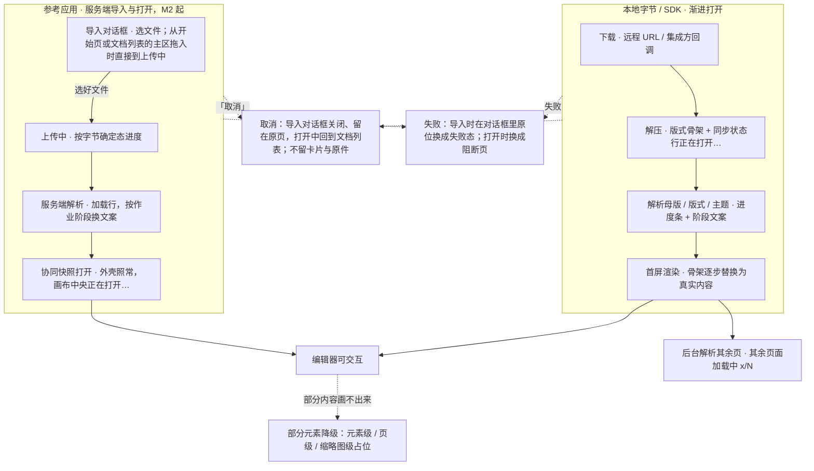
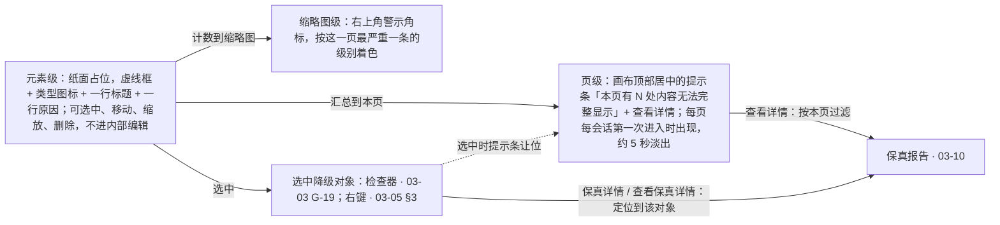
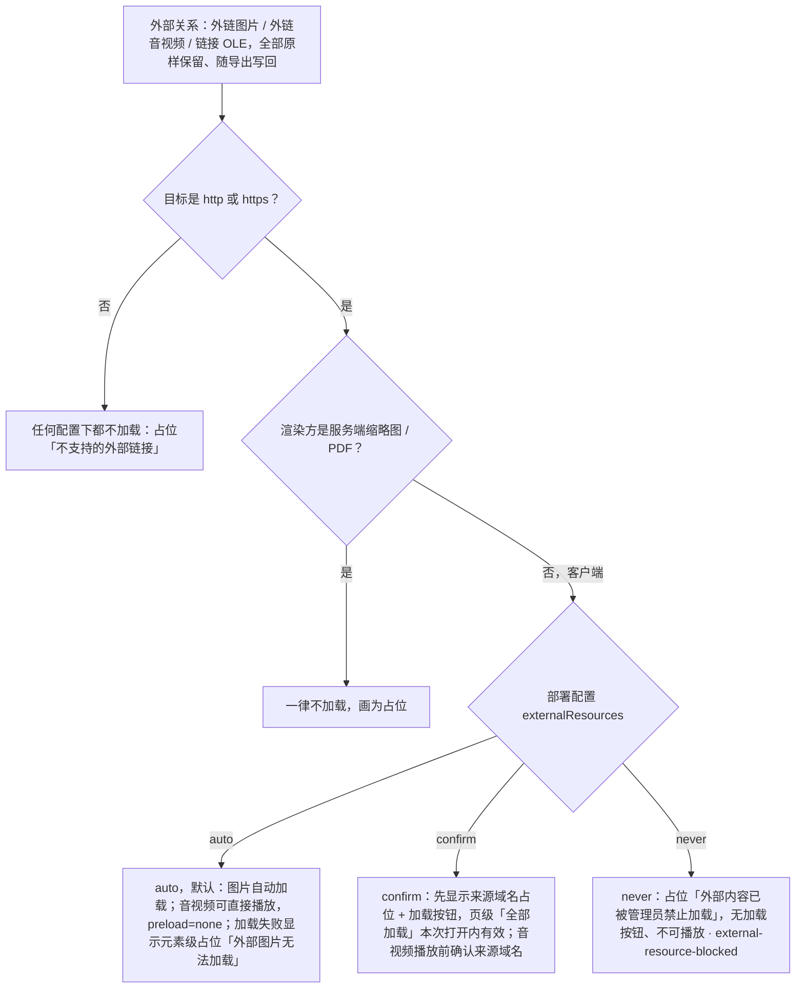

> 状态：草稿 | 负责：设计 | 更新：2026-09-15；2026-09-24（rulings §4.15：Q5 超出规模上限直接拒绝导入；Q7 外链资源自动加载 + `externalResources`、受限字体回退提示、EMF 栅格化、SmartArt / OLE / chartex 落点）；2026-09-24（rulings §4.16 Q15：失败态表新增 `format.macro_rejected`；加密次文案补「先去除密码」）；2026-09-24（复核修正，rulings §4.17）；2026-09-25（补图）；2026-09-25（矛盾收口，rulings §4.18）；2026-10-07（design-language-v3 第 1 批：只做第 1 批定稿直接要求的最小改动——编辑器内的打开进度改指 03-02 §6.2「加载中」（进度与「取消」在画布幻灯片框下方，同步状态行「正在打开…」「其余页面加载中 x/N」），原线框与阶段表、图里的顶部全局栏「取消」、Ribbon 禁用骨架与状态栏弱提示作废；打开失败态的返回入口只在按钮组放「返回文档列表」（03-02 §10 第 12 条），表内与「超出规模上限」线框同步；受限内嵌字体进入编辑时的状态栏弱提示按 rulings §4.25 DS-6 改走轻提示，文本框内联提示的文案按第 1 批样张改写，内联提示、检查器「中文」字段与字体弹层的锁形以 03-16 §3.3、§4.4 为准；导入过渡页 `#/import` 与其余界面描述随第 3 批回写）；2026-10-08（design-language-v3 第 1 批收口：「打开进度的呈现」的「标题 / 正文占位符」按 rulings §4.25 DS-30 改称「标题 / 文本占位符」，受限字体内联提示一条的定稿措辞统一；其余界面描述仍随第 3 批回写）；2026-10-15（design-language-v3 第 2 批：按已拍板样张 `fidelity`、`plugins` 与第 1 批随之改的画面回写降级与失败页——「降级占位三层」的线框与三层改写：元素级占位统一为虚线框 + 类型图标 + 一行标题 + 一行原因（「内容已保留」并进原因行），保真占位与缺插件占位同一画法，选中后的检查器与右键改指 03-03 G-19、03-05 §3，原「属性面板仅显示位置与大小 + 此元素当前无法渲染 + 原因 + 查看保真详情」作废（DS-52）；页级提示条改为画布顶部居中的浮动胶囊，每页每会话第一次进入时出现、约 5 秒淡出、悬停与聚焦时停住、不设 ×，报告开着时不出、选中降级对象时让位，原「可关闭的提示条」作废（DS-51）；缩略图警示角标按这一页最严重一条的级别着色，整页无法解析用危险浅底 + 危险色图标、读屏写「无法解析」（DS-51）；「只保留对象」表的占位文案按两行改写；外链 confirm 的页级提示条同一套停留规则；受限字体进入编辑的轻提示按第 2 批样张定稿；打开失败表「无访问权限 / 文档已删除」行的「申请访问」打开留言弹层（DS-48，第 1 批 `main-states.open-failed-access` 随之改），补 `collab.room_full` 一行，会话中访问被撤销与查看人数已满的阻断页指向 03-12 §8（DS-50、DS-60）；「交互说明」「边界情况」去掉保真报告的入口角标（DS-51）；依据 rulings §4.25 DS-48、DS-50…DS-53、DS-60、DS-64、DS-68；同日再补：「缩略图侧栏加载/虚拟化/警示（G-05）」的读屏名示例「第 4 页，3 条评论」改为「第 4 页，3 条未解决评论」，读法以设计 07 §3 为准（rulings §4.25 TB-81、TB-89））；2026-10-22（design-language-v3 第 3 批：按已拍板样张 `import` 改写受影响的节——新增「导入页与导入过渡页」一节：「导入 .pptx」先进导入页（拖放区 +「选择文件…」，DS-98；开始页与文档列表上的拖入落区照常保留），导入过渡页全屏、不带应用壳，上传中与服务端解析在同一位置换行，失败原位换成同一布局，浏览器后退等于取消（DS-97），过渡页的「取消」回到发起导入的那一页（TB-129），画布底上的次按钮一律 outline（TB-128），列 15 个样张状态与 2 个未采纳的备选、另 3 个相关备选（DS-63）；「打开进度」表：上传中与服务端解析两行改写（服务端解析按作业阶段换文案、不显示百分比，DS-53），补「协同快照」一行（编辑器外壳照常、全部不可用，画布中央转圈 +「正在打开…」+「取消」，不画版式骨架，DS-99），大文件提示只在本地 / SDK 的渐进打开里出现，阶段图改画；「打开失败态」表：「无访问权限 / 文档已删除」一行拆成「你没有权限访问此文档」「找不到该文档」「此文档在回收站中」三行（DS-122、DS-85），补「文件过于复杂」「存储空间不足（M3）」两行与可重试的「导入没有完成」（按原因换第二行），`format.pptx.invalid_package` 补建议句、技术详情与「复制诊断信息」的反馈；「超出规模上限」线框改为文件名在标题上方、说明句不再引用文件名；G-05 未生成的缩略图改为同尺寸中性块；G-06 浏览器放不了的媒体改为中性提示签、在线视频只给「在新标签页打开」；EMF 栅格化中改为纸面占位 + 转圈；依据 rulings §4.25 DS-53、DS-63、DS-85、DS-97…DS-99、DS-122、DS-123、TB-128、TB-129；同日再补（回写中新增的技术口径）：「取消」的去向按 TB-133 写明从导入页选的文件同样回到打开导入页之前的那一页、导入页的出口沿用「返回文档列表」；导入页的大小上限改读 RuntimeConfig `limits.importMaxBytes`（TB-147）；「打开失败态」表的「找不到该文档」「此文档在回收站中」两行改指 03-33 §7.2、03-01 §6，补「链接已失效」一行（规格 03-33 §7.3），回收站阻断页的剩余天数按 `trashDays` 推算（TB-141），表后注明嵌入里同一组阻断页不放「返回文档列表」（03-33 §9.2，TB-115）；G-05 缩略图虚拟化的挂载数引用 TB-135；整页无法解析的页级占位写明在渲染层画（TB-151）；未采纳备选的名称按样张标题改齐；「超出规模上限」末条改指 03-12 §13 与 §8.6（DS-128、TB-146）；同日再补（回写中新增的技术口径）：「打开失败态」表「此文档在回收站中」一行改指 03-01 §6.1，并注明「恢复」失败时主按钮上方一行内联错误、按钮恢复可用（rulings §4.25 TB-155）；「你没有权限访问此文档」一行补 M2：「申请访问」留在原位、不可用（kit 主按钮的不可用态），写「后续版本提供」，「返回文档列表」照常，M3 起可用（TB-156，同 DS-137）；降级占位「整页无法解析」补一句：保真占位是确定内容，服务端照常回传、进缩略图与 PDF，与运行时单页渲染出错按失败处理不同（TB-157）；导入页的大小上限注明 web 容器与应用容器读同一部署值（TB-158）；2026-10-22 复核修正：「打开失败态」表「你没有权限访问此文档」一行 M2 的写法与 03-08 §4.5 对齐——工具提示与读屏说明「申请访问 · 后续版本提供」、点了不弹留言弹层，阻断页的说明句不变（rulings §4.25 TB-156）；「导入页与导入过渡页 · 入口与流程」的焦点一条按样张 `import.drop-page` 改正：到导入页时焦点落在落区里的主按钮「选择文件…」，过渡页与失败页仍落在按钮行第一颗；「边界情况」补手机与触控设备上直接打开 `/import` 照常显示导入页（TB-167））；2026-10-23（design-language-v3 第 3 批评审修改：按转正后的样张 `import` 把「导入页与导入过渡页」一节整节改为「导入对话框」——「导入 .pptx」打开叠在原页上的「导入」对话框，选文件、拖入悬停、上传、服务端解析与失败都在框里原位换，成功后关闭并以协同快照打开，整屏导入页与导入过渡页作废（rulings §4.25 DS-140 取代 DS-97、DS-98）；外框 560 × 固定高 406（标题栏 40 之后的高，TB-179 原写 414），落区静止用与分隔线同档的安静虚线、拖入悬停用强调色虚线加淡底（DS-141、TB-180），对话框按全站新画法（标题栏 40、圆角 12、× 正文色，DS-142），上传与解析行的文件名前加 .pptx 文件类型图标（DS-143、TB-182）；`/import` 叠在来路之上、后退即关闭，直接打开时背后是文档列表「最近」并先补一条历史，成功后替换成编辑器地址；上传与解析中「取消」、×、Esc 都是中止并关闭、留在原页，× 写「取消导入」、点遮罩不关，失败后底栏只有「关闭」、「重试」是正文里的次按钮，「复制诊断信息」的反馈写在底栏（TB-179，修订 TB-129、TB-133）；只有选文件阶段接收拖入，一次拖多个文件不接收（TB-180）；手机为底部面板、平板为对话框，触控下按钮写「选择文件…」（TB-181，修订 TB-167）；线框改画，样张状态表换成 9 个对话框态与其余 6 态、3 个未采纳的备选（DS-63）；设计基准、「打开进度」表、阶段图、服务端导入一段、「打开失败态」表与表后说明、「超出规模上限」线框、交互说明与边界情况随之改写；依据 rulings §4.25 DS-140…DS-143、TB-179…TB-182；「焦点、读屏与文件名」与「关闭与取消」补直接打开 `/import` 时焦点落在对话框本身、页面上没有「导入 .pptx」时关闭后回「显示导航」或主区（与设计 07 §2.3 一致））；2026-11-04（design-language-v3 母版视图改版：「缩略图侧栏加载/虚拟化/警示」200 页文档一条的逐项占位改写为自身的理由、不再引母版视图，画法不变；rulings §4.25 DS-176；需求编号、优先级与里程碑不变） | 依赖：charter v0.2；`10-prd/07-design-coverage-and-gaps.md`；PRD OF §2.5–§2.6 / OF-02 / OF-03 / OF-07 / OF-15 / OF-17 / OF-24、SV-01、SV-08；rulings §4.15 Q5 / Q7、§4.16 Q15、§4.18 CO-12 / UX-14、§4.20 FE-06、§4.25 DS-6、DS-30、DS-41、DS-48、DS-50…DS-53、DS-56、DS-60、DS-63、DS-64、DS-68、DS-85、DS-87、DS-99、DS-101、DS-113、DS-122、DS-123、DS-128、DS-137、DS-140…DS-143（DS-140 取代 DS-97、DS-98）、DS-176、TB-81、TB-89、TB-95、TB-115、TB-118、TB-128、TB-129、TB-133、TB-135、TB-141、TB-146、TB-147、TB-151、TB-153、TB-155…TB-158、TB-167、TB-179…TB-182；前端 50/02 §2、§9.3、50/10 §6；后端 60/06 §6.3、§10.4、60/15 §3.9；设计 03-01 §6、§6.1、03-08 §4.5、03-33 §7、§9.2；playground `#/v3/home?state=import.*`、`#/v3/editor?state=import.*`（`src/v3/scenarios/import/`，第 3 批；底座 `src/v3/kit/` 的 `importDialog.tsx`、`Dialog.tsx`、`BottomSheet.tsx`、`FileTypeIcon.tsx`、`DropOverlay.tsx`）、`#/v3/editor?state=fidelity.*`、`plugins.missing-selected`、`main-states.open-failed-access`（第 2 批）

# 03-13 打开与导入：进度、失败态、降级占位

> **设计基准（2026-10-22 起，rulings §4.25 DS-99；导入 2026-10-23 起按 DS-140…DS-143）**：「导入」对话框（选文件、拖入悬停、上传、服务端解析、按错误码的失败与手机底部面板）、协同快照打开、大文件提示、200 页文档的缩略图虚拟化，以及媒体、外链与 EMF 的零散态，以已拍板的 playground 第 3 批样张 `import` 为准（15 个状态加 3 个未采纳的备选，见「导入对话框」一节）：对话框各态叠在开始页上 `#/v3/home?state=import.<状态 id>`（`dialog-documents` 叠在文档列表上），其余各态画在编辑器里 `#/v3/editor?state=import.<状态 id>`。源码在 `playground/src/v3/scenarios/import/`：`import.scenario.tsx`（各状态的标题与说明）、`dialog.tsx`（「导入」对话框与手机底部面板，由场景登记给底座）、`pages.tsx`（技术详情、超出项小表、诊断信息与快照打开时的两种画法）、`data.ts`（作业阶段与各失败态的文案，`OTHER_FAILURES`、`FOLDED` 是只换文案、不另画的错误码）、`FileName.tsx`（长文件名，导出对话框与轻提示同一个件）、`virtual.tsx`（缩略图虚拟化）、`slides.tsx`（媒体、外链与 EMF）；底座的件在 `playground/src/v3/kit/`：`importDialog.tsx`（对话框的登记、开关与两个入口——顶栏「导入 .pptx」与拖入落区）、`Dialog.tsx`（导入专用一档 560）、`BottomSheet.tsx`（手机底部面板）、`FileTypeIcon.tsx`（文件类型图标）、`DropOverlay.tsx`（主区拖入落区）。对照截图 `openspec/changes/design-language-v3/screens/batch3/import-<状态>-dark.jpg`。
>
> **第 1、2 批已定稿的部分**：编辑器内的渐进打开以 03-02 §6.2「加载中」与样张 `main-states.opening`、`opening-rest` 为准；降级占位三层（纸面占位、页级提示条、缩略图警示角标）、外链 `confirm` 的页级提示条与受限字体进入编辑时的轻提示，以第 2 批样张 `#/v3/editor?state=fidelity.<状态 id>` 为准（源码 `playground/src/v3/scenarios/fidelity/`，对照截图 `openspec/changes/design-language-v3/screens/batch2/fidelity-<状态>-dark.jpg`；缺插件占位同一画法，见 `plugins.missing-selected`）；打开失败页以 03-02 §6.2「错误（打开失败）」与样张 `main-states.open-failed`、`open-failed-access` 为准，「找不到该文档」与「此文档在回收站中」两页见 `shell-pages.not-found-doc`、`documents.trash-blocked`（03-33 §7.2、03-01 §6.1）；会话中的两种阻断页以 [03-12](12-offline-conflict-banner.md) §8 为准。此前的旧路由 `#/import`、09 v3.0（shadcn Rhea + 材质层）的组件写法与 `mockups/*.html` 线框一并作废。

补齐 `02-editor-main.md`"加载中"/"错误"两个状态过于简单的问题，并新增降级渲染的三层呈现与服务端导入的「导入」对话框（PRD SV-01）。覆盖缺口 **G-01**（OF-01/03，打开进度与取消）、**G-02**（OF-02/24，打开失败态全集）、**G-03**（OF-13/09/07，降级渲染占位）、**G-05**（OF-15，缩略图侧栏加载/虚拟化/警示）、**G-06**（OF-07，媒体元素查看态）。对应 `02-user-flows.md` F1 主流程与边界 E1–E6。

---

## 打开进度的呈现（v3，2026-10-07 第 1 批定稿）

编辑器内的打开进度按 03-02 §6.2「加载中」（样张 `main-states.opening`、`opening-rest`）：母版与版式先出——画布与缩略图先画每页真实的版式几何（母版装饰与页脚是真的，标题 / 文本占位符画成虚线框，不是灰色骨架条；「文本」取代「正文」，DS-30）；画布幻灯片框下方居中一行阶段文案 + 确定态进度条 + 百分比 +「取消」；同步状态行「正在打开…」；首屏可交互之前底部工具条、检查器、左栏「新建幻灯片」与视图切换留在原位、不可用（「文档打开后可用」）。版面与尺寸以 03-02 为准，本文只定阶段、文案与取消的行为（下方「打开进度」表）。原线框（顶部全局栏的「取消」、Ribbon 区禁用骨架、画布灰色骨架与底部进度条）随应用栏、ribbon 与状态栏废弃而作废。

首屏渲染完成后，进度与骨架消失，编辑器可交互；同步状态行弱提示「其余页面加载中 x/N」（03-02 §3.1），缩略图逐项由版式骨架变为真实缩略图（不等待全部完成）。

这种渐进打开（经 Worker 分批）用于本地字节与 SDK（M1 本地打开）；参考应用里的服务端文档自 M2 起以协同快照一次装载（rulings §4.18 CO-12），画法见下方「打开进度」表「协同快照」一行（DS-99）。服务端导入的「导入」对话框见下一节。

## 导入对话框（v3，2026-10-23 第 3 批评审修改定稿）

参考应用的服务端导入（PRD SV-01，M2 起）全程在叠在原页上的「导入」对话框里（rulings §4.25 DS-140；标杆是 Figma 文件浏览器的 Import 对话框）：开始页与文档列表顶栏的「导入 .pptx」打开它、从选文件开始，主区的拖入落区松开即打开它的上传态（TB-180）；选文件、拖入、上传、服务端解析与失败都在框里原位换，成功后关闭对话框、以协同快照打开编辑器。手机（< 640）是贴底的底部面板，平板是对话框（TB-181）。2026-10-22 拍板的整屏导入页（DS-98）与整屏导入过渡页（DS-97）2026-10-23 起由 DS-140 取代。M1 只有本地打开，没有上传与服务端解析两段（前端 50/02 §9.3）。

### 线框（选文件、上传中、两种失败与手机底部面板）

```
选文件（import.dialog）                                  上传中（import.dialog-uploading）
┌──────────────────────────────────────────────────┐     ┌──────────────────────────────────────────────────┐
│ 导入                                         [×] │     │ 导入                                         [×] │
├──────────────────────────────────────────────────┤     ├──────────────────────────────────────────────────┤
│  ┌╌╌╌╌╌╌╌╌╌╌╌╌╌╌╌╌╌╌╌╌╌╌╌╌╌╌╌╌╌╌╌╌╌╌╌╌╌╌╌╌╌╌╌╌┐  │     │  ┌╌╌╌╌╌╌╌╌╌╌╌╌╌╌╌╌╌╌╌╌╌╌╌╌╌╌╌╌╌╌╌╌╌╌╌╌╌╌╌╌╌╌╌╌┐  │
│  ╎                                            ╎  │     │  ╎                                            ╎  │
│  ╎                                            ╎  │     │  ╎                                            ╎  │
│  ╎                                            ╎  │     │  ╎  [PPT] 2026 年 Q2 业绩汇报.pptx · 48.2 MB  ╎  │
│  ╎     把 PowerPoint 演示文稿带进 Cordex      ╎  │     │  ╎  正在上传…                            48%  ╎  │
│  ╎ 把 .pptx 文件拖到这里，单个文件最大 200 MB ╎  │     │  ╎  ▓▓▓▓▓▓▓▓▓▓▓▓▓▓▓▓░░░░░░░░░░░░░░░░░░░░░░░░  ╎  │
│  ╎                                            ╎  │     │  ╎                                            ╎  │
│  ╎             [从电脑选择文件…]              ╎  │     │  ╎                                            ╎  │
│  ╎                                            ╎  │     │  └╌╌╌╌╌╌╌╌╌╌╌╌╌╌╌╌╌╌╌╌╌╌╌╌╌╌╌╌╌╌╌╌╌╌╌╌╌╌╌╌╌╌╌╌┘  │
│  ╎                                            ╎  │     ├──────────────────────────────────────────────────┤
│  └╌╌╌╌╌╌╌╌╌╌╌╌╌╌╌╌╌╌╌╌╌╌╌╌╌╌╌╌╌╌╌╌╌╌╌╌╌╌╌╌╌╌╌╌┘  │     │                                           [取消] │
└──────────────────────────────────────────────────┘     └──────────────────────────────────────────────────┘

失败 · 可重试（import.dialog-failed-network）            失败 · 不是有效的演示文稿（import.dialog-failed-invalid-package）
┌──────────────────────────────────────────────────┐     ┌──────────────────────────────────────────────────┐
│ 导入                                         [×] │     │ 导入                                         [×] │
├──────────────────────────────────────────────────┤     ├──────────────────────────────────────────────────┤
│                                                  │     │                        ⊠                         │
│                                                  │     │         无法打开：文件不是有效的演示文稿         │
│                        ⊘                         │     │     可以在 PowerPoint 中打开并另存一份 .pptx     │
│                   导入没有完成                   │     │                     后再导入                     │
│               网络连接中断，请重试               │     │         华东区季度经营分析.pptx · 8.4 MB         │
│                      [重试]                      │     │                    ⌄ 技术详情                    │
│        2026 年 Q2 业绩汇报.pptx · 48.2 MB        │     │       错误码   format.pptx.invalid_package       │
│                                                  │     │       部件     ppt/slides/slide7.xml             │
│                                                  │     │       traceId  4be1f07c9a2d4e31                  │
├──────────────────────────────────────────────────┤     ├──────────────────────────────────────────────────┤
│                                           [关闭] │     │                           [复制诊断信息]  [关闭] │
└──────────────────────────────────────────────────┘     └──────────────────────────────────────────────────┘

手机底部面板（import.dialog-phone，390 × 844）
╭──────────────────────────────────────╮
│                  ▬▬                  │
│ 导入                             [×] │
├──────────────────────────────────────┤
│ 把 PowerPoint 演示文稿带进 Cordex    │
│ 只支持 .pptx，单个文件最大 200 MB    │
│ ┌──────────────────────────────────┐ │
│ │            选择文件…             │ │
│ └──────────────────────────────────┘ │
│                                      │
└──────────────────────────────────────┘
```

图例：对话框外框 560 × 固定高 406，各阶段不变、只换框里的内容（rulings §4.25 TB-179；高 = 1 + 标题栏 40 + 正文上下 24 + 落区 316 + 1）；画法同全站对话框（DS-142：标题栏 40、圆角 12、`[×]` 用正文色）。`╌` `╎` 是虚线落区（494 × 316，有底栏的阶段收到 494 × 263）：静止时与分隔线同档 `--v3-border`（DS-141），拖入悬停换成强调色虚线加 `--v3-accent-soft` 淡底（`import.dialog-dragover`，图中未画）。`[PPT]` 是 20px .pptx 文件类型图标（Tabler `file-type-ppt`，图上字样即「PPT」；`--v3-text-2`，只作装饰；DS-143、TB-182）；`⊘` 离线云、`⊠` 带叉的文件图标，都是 20px 危险色（kit `PanelState`）。上传与解析中 `[×]` 的名字是「取消导入」。手机底部面板（kit `BottomSheet`）没有落区，「选择文件…」44 高、整宽。截图：`batch3/import-dialog-*.jpg`、`import-dialog-uploading-*.jpg`、`import-dialog-failed-network-*.jpg`、`import-dialog-failed-invalid-package-*.jpg`、`import-dialog-phone-*.jpg`。

### 入口、尺寸、地址与关闭

- **入口**（rulings §4.25 DS-140）：开始页与文档列表顶栏的「导入 .pptx」（锚点 `import.entry`、`aria-haspopup="dialog"`）在原页上打开对话框、从选文件开始，两处打开的是同一个对话框（`import.dialog`、`import.dialog-documents`）；主区的拖入落区（kit `DropOverlay`）松开直接打开上传态、焦点落在「取消」（TB-180，03-29 §3、03-01 §8）。回收站视图顶栏不放「导入 .pptx」、不接收拖入。
- **尺寸**（TB-179）：kit `Dialog` 导入专用的一档，宽 560（与标杆同宽；登记在设计 04 的对话框尺寸表）、固定高 406——标题栏 40 之后的高（标杆 560 × 404，差在它的外框边是 0.5px；TB-179 原写的 414 是标题栏 48 时的值）；换阶段时框体不跳。视口居中，窄于 592 时宽度收到视口减 32、矮于 470 时高度收到视口减 64；内容比正文高时（矮视口、200% 缩放）从上沿排起、正文滚动，不丢内容（PRD NF-05）。标题栏 40：「导入」13px 600 + 24px ×（正文色 `--v3-text`，悬停底同图标按钮，DS-142）；正文内边距左右 32、上下 24（同标杆）；遮罩 `--v3-scrim`。上传、解析与失败阶段才有底栏（右对齐）。外框随内容收缩的做法不采用：居中时换阶段框体上下跳，改成顶部锚定又让选文件阶段不再视口居中。
- **地址与历史**（TB-179；TB-129、TB-133 按它修订）：`/import` 叠在来路之上（同 `/settings`，DS-113、TB-118）——从开始页、文档列表打开时地址换成 `/import`、背后仍是来路页面；选文件、上传到失败都在同一个 `/import` 上，不新增历史；浏览器后退等于关闭。直接打开 `/import`（书签、新标签页、别人发来的地址）时背后是文档列表「最近」，进来时先在它前面补一条「最近」的历史，关闭后留在列表。导入成功后用替换方式把 `/import` 换成 `/documents/:id`：在编辑器里按后退回到来路页（直接打开的回到列表），不会回到一个空的导入对话框。
- **关闭与取消**（TB-179、TB-180）：选文件阶段 ×、Esc、点遮罩关闭。上传与解析中「取消」、×、Esc 是同一个动作——中止并关闭对话框、留在原页：上传中中止直传；解析中调导入取消端点（`POST /imports/:jobId/cancel`，作业转 `cancelled`，服务端清理原件与产物）；都不留卡片也不留原件（rulings §4.18 UX-14）。这两个阶段 × 的读屏名与工具提示写「取消导入」（kit `Dialog` closeLabel，同导出对话框生成中的「取消导出」，DS-101），点遮罩不关闭（误点不丢掉这次导入）。失败后底栏只有「关闭」（「重试」在正文里），×、Esc、点遮罩与「关闭」都关闭。关闭后焦点回到顶栏「导入 .pptx」（`import.entry`；状态里一出现就开着的同样回到它）；页面上没有这颗按钮时（手机与平板的开始页、文档列表不放导入入口，DS-87）回到顶栏「显示导航」，左栏常驻的平板落在主区（设计 07 §2.3）。原写的「取消等同浏览器后退、回到发起导入的那一页」与导入页自己的「返回文档列表」作废。
- **刷新与关闭标签页**：走浏览器原生离开提示（文案不能定制）；上传中刷新原件即丢失，回到选文件的初始态（就是 `dialog-documents` 的画面）；解析中刷新，作业照常完成，文档随后出现在列表里。

### 各阶段

- **选文件**（`import.dialog`）：落区填满正文（494 × 316）——1px 虚线、圆角 4，静止时与分隔线同档 `--v3-border`（rulings §4.25 DS-141，同标杆：落区靠正中的字与按钮识别，理由同 DS-35，WCAG 1.4.11 不要求这道线 3:1；设计 04 §2「控件边界色用于虚线落区」一条随之修订）。正中三段：粗体一行「把 PowerPoint 演示文稿带进 Cordex」（13px 600，不重复标题「导入」）· 说明一行「把 .pptx 文件拖到这里，单个文件最大 200 MB」（12px `--v3-text-2`；上限读 RuntimeConfig `limits.importMaxBytes`，与服务端拒收用的是同一个部署值——web 容器与应用容器读同一行部署配置，缺省 200 MB；rulings §4.25 TB-147、TB-158）· 主按钮「从电脑选择文件…」（28 高，与说明相距 24；弹系统文件选择框，只收 .pptx、单选）。没有图标、没有底栏，也没有「返回文档列表」。
- **拖入悬停**（`import.dialog-dragover`，TB-180）：拖着文件悬在窗口上时整个对话框接收（拖到标题栏、遮罩上也算进落区）：落区换成 1px 强调色虚线 + `--v3-accent-soft` 淡底（同画布框选的「强调色虚线 + 淡底」，强调色只表达「松开就会接住」），正中两行换成「松开以导入」（13px 600，与主区落区同一句）·「只支持 .pptx，单个文件最大 200 MB」，「从电脑选择文件…」先收起（焦点若在它上面，先交给对话框本身，拖出后交回，不掉到 `body`）；松开即原位进上传中，拖出窗口或按 Esc 取消拖动即恢复。一次拖着不止一个文件时不高亮、不接收，写「一次只能导入一个文件」·「请只拖入一个 .pptx 文件」（浏览器在拖动中给得出个数、给不出文件名，所以不写文件名；系统文件选择框同样单选）；拖的不是 .pptx 时照样高亮，松开后在框里报「不支持的文件格式」。对话框开着的所有阶段都在窗口上拦下拖放的浏览器缺省行为（不会把文件当网页打开、离开页面中断上传），只有选文件阶段接收：上传、解析与失败阶段光标显示不可放下、不高亮、不换文件（失败后要换文件先「关闭」再导入）。落区圆角按层级不同：主区落区是页面级大块、与卡片同为 8，对话框里的落区嵌在圆角 12 的框里、取 4（同标杆）。
- **上传中**（`import.dialog-uploading`）：选好文件或拖入松开后原位换成上传——底栏出现、落区收到 494 × 263 并留着（文件「落进」落区），正中是与导出对话框「生成中」同一版式的一组（最宽 360、左对齐）：文件名一行（20px .pptx 文件类型图标，Tabler `file-type-ppt`、`--v3-text-2`、`aria-hidden`，与导出对话框的格式行同一套，rulings §4.25 DS-143、TB-182；间距 8 · 文件名 12px 中字重 +「· 48.2 MB」`--v3-text-2`）· 阶段文案「正在上传…」在左、百分比在右（12px / 11px `--v3-text-2`）· 整宽确定态进度条（kit `Progress` 4px，按字节）；底栏右侧「取消」（对话框里的次按钮，DS-37）。焦点落在「取消」（换阶段不经过 `body`），Tab 只在 ×（「取消导入」）与「取消」之间。.ppt / .pptm、超过单文件上限与存储已满在申请上传时就被拒（415 / 413 / 429，后端 60/15 §3.9），选完文件直接到对应的失败态、不经上传。
- **服务端解析**（`import.dialog-parsing`）：上传完成后同一位置的阶段行换成加载行——转圈 + 作业阶段文案（kit `LoadingRow`；DS-53：v3 没有不确定态进度条，不显示百分比，进度条的位置空着、文件名不上下跳）。文案按作业阶段换（后端 60/06 §6.3）：排队「正在排队，马上开始…」、取件与解压「正在检查文件…」、解析演示文稿与各页「正在解析幻灯片…」、处理媒体「正在处理图片与媒体…」、写入「正在创建文档…」；后端不给排位，排队时不写前面还有几个。文件名一行与落区不动。
- **失败**（`import.dialog-failed-network`、`dialog-failed-invalid-package`、`dialog-failed-quota`）：确定性错误原位换成不可重试的失败态，瞬时错误给「重试」，文案按错误码（下方「打开失败态」表）。正文是整块状态（kit `PanelState`，同导出对话框的失败态）：危险色图标 20 · 标题 13px 600 · 说明（12px `--v3-text-2`，两句各占一行）· 可重试的另有次按钮「重试」（在正文里，DS-53）· 补充说明一行「文件名 · 大小」（单行、中间省略）；`role="alert"`；落区不再出现（只在接住文件、处理文件时出现）。底栏只有「关闭」（TB-179）；不是有效的演示文稿另有「复制诊断信息」，点后结果写在底栏左侧「✓ 已复制诊断信息」（DS-56）。从上传、解析换到失败时，底栏「取消」原位换成「关闭」（同一颗按钮换字），焦点在它上面时留在原位。「重试」用还在手里的文件重新走一遍完整导入、原位回到上传中，焦点落在「取消」。
- **成功**：对话框关闭，进编辑器、以协同快照打开（「打开进度」表「协同快照」一行，DS-99 不变）；有保真差异时再出第 2 批的保真轻提示（`fidelity.default`）。不在文档列表里生成「上传中 / 解析中」的卡片（rulings §4.18 UX-14）。
- **手机与平板**（rulings §4.25 TB-181，修订 TB-167）：手机（< 640）是贴底的底部面板（`import.dialog-phone`；kit `BottomSheet`，与偏好设置的手机形态同一个件：上圆角 12、顶部把手 40 × 4、标题行 48「导入」+ 右侧关闭 44，上沿离视口顶至少 24、高随内容）。手机没有拖放，不画落区与「拖到这里」一句，只留粗体一行 · 说明「只支持 .pptx，单个文件最大 200 MB」· 主按钮「选择文件…」（44 高、整宽、不写「从电脑」）；上传、解析与失败在同一个面板里原位切换，正文同对话框（文件名前同样有 .pptx 图标），底栏的按钮改为面板里竖排、整宽、44 高（「取消」「关闭」在最下）；上传与解析中关闭按钮写「取消导入」、点遮罩不关闭；打开时焦点落在面板本身（读屏念标题），关闭后回到顶栏「显示导航」。平板（触控、≥ 640）照常是对话框，触控下按钮写「选择文件…」、说明只写「只支持 .pptx，单个文件最大 200 MB」（不写「从电脑」与「拖到这里」）。手机与平板的开始页、文档列表不放「导入 .pptx」（DS-87），只有直接打开 `/import` 会到这里：照常显示、不另拦，背后是文档列表的触控形态，导入完成后按设备进编辑器的仅查看形态。

### 焦点、读屏与文件名

- **焦点**：由用户点「导入 .pptx」打开时焦点落在「从电脑选择文件…」（kit `Dialog` 的初始焦点）；从拖入落区松开打开、或「重试」回到上传中时落在底栏「取消」；Tab / ⇧Tab 只在对话框里循环（焦点圈定、`aria-modal`）。换阶段时原来那颗按钮卸载或换了字，焦点交给这一阶段的按钮，不掉到 `body`（07 §2.4）。直接打开 `/import`（书签、新标签页）时焦点在对话框本身、读屏先念标题「导入」、不画焦点环；样张里状态一出现就开着时同此。
- **读屏**：`role="dialog"`，`aria-labelledby` 指向标题「导入」；「从电脑选择文件…」的读屏说明（`aria-describedby`）带上粗体一行与说明一行——对话框没有可见的说明，打开时读屏只念「导入 对话框」。对话框里有一个常驻的 polite 播报区，从选文件起就挂着、初始为空，换阶段只改它的文字：拖入悬停「松开以导入」、上传「正在上传「文件名」」、解析的阶段文案、「已复制诊断信息」（新挂上就带着字的播报区读屏软件常常不念，所以不随阶段新挂）；进度条名称「上传进度」带 `aria-valuenow`，百分比不逐条播报；失败由整块状态的 `role="alert"` 念出。
- **文件名**：一行，放不下时中间省略——开头照常、末尾保留扩展名与它前面 6 个字，完整名进工具提示，读屏念全名（TB-95 允许文件名到 255 字；设计 07 §7、03-01「文件名超长」同一规则；导出对话框与轻提示里的文件名同一个件）。

### 样张状态（`import`）

对话框各态叠在开始页上，路由 `#/v3/home?state=import.<状态 id>`（`dialog-documents` 叠在文档列表上：`#/v3/documents?state=import.dialog-documents`）；其余各态画在编辑器里，路由 `#/v3/editor?state=import.<状态 id>`；未写视口的按 1600 × 1000。对话框里的按钮都能点着走，也可以真的从桌面拖一个文件进来试。

| 状态（样张标题） | 要点 | 样张 id | 里程碑 |
|---|---|---|---|
| 导入对话框（开始页） | 叠在开始页上；落区「把 PowerPoint 演示文稿带进 Cordex」·「把 .pptx 文件拖到这里，单个文件最大 200 MB」·「从电脑选择文件…」，没有底栏 | `import.dialog` | M2（SV-01，DS-140） |
| 导入对话框（文档列表） | 同一个对话框叠在文档列表「最近」上；直接打开 `/import`、上传中刷新后看到的也是这一画面 | `import.dialog-documents` | M2（TB-179） |
| 导入对话框 · 拖入悬停 | 强调色虚线 + 淡底，「松开以导入」；拖着不止一个文件时不接收 | `import.dialog-dragover` | M2（DS-141、TB-180） |
| 导入对话框 · 上传中 | 落区收到 494 × 263；.pptx 图标 · 文件名与大小 ·「正在上传…」· 百分比 · 进度条；底栏「取消」，× 写「取消导入」 | `import.dialog-uploading` | M2（SV-01） |
| 导入对话框 · 服务端解析 | 同一位置换成加载行，按作业阶段换文案，不显示百分比 | `import.dialog-parsing` | M2 |
| 导入对话框 · 失败（可重试） | 「导入没有完成」+ 按原因换的第二行与图标 + 正文里的「重试」；底栏「关闭」 | `import.dialog-failed-network` | M2 |
| 导入对话框 · 失败（不是有效的演示文稿） | 建议句 + 技术详情（这一态一出现就展开）；底栏「复制诊断信息」「关闭」；不支持的格式、加密、含宏、超出处理上限、文件过于复杂、存储空间不足同一画法只换图标与文案 | `import.dialog-failed-invalid-package` | M2；存储空间不足 M3（SV-08） |
| 导入对话框 · 失败（超出规模上限） | 说明句 + 拆分建议 + 超出项小表；底栏「关闭」 | `import.dialog-failed-quota` | M2（Q5） |
| 导入对话框 · 手机底部面板（< 640） | 390 × 844：贴底面板，没有落区与「拖到这里」，「选择文件…」44 高、整宽 | `import.dialog-phone` | M2（TB-181） |
| 打开服务端文档 · 协同快照 | 编辑器外壳照常、全部不可用，画布中央「正在打开…」+「取消」 | `import.snapshot-opening` | M2（CO-12，DS-99） |
| 本地打开 · 大文件提示 | 进度行原样，下方另起一行大文件提示 | `import.large-file` | M1（OF-03） |
| 200 页文档 · 缩略图虚拟化 | 视口附近才生成，未生成的是同尺寸中性块 | `import.thumbs-virtualized` | M1 P0（OF-15） |
| 媒体 · 放不了的格式与在线视频 | 中性提示签「此格式无法在浏览器中播放」；在线视频「在新标签页打开」 | `import.media-unsupported` | M2（OF-07） |
| 外链 · 管理员禁止加载 | 两行占位「外部内容已被管理员禁止加载」┊ 域名 | `import.external-never` | M2（Q7） |
| EMF 图片 · 正在生成预览 | 纸面占位 + 转圈 +「正在生成预览…」，完成后原位换成图片 | `import.emf-rasterizing` | M2 P1（OF-07） |

样张没有单独画、规格写在相关状态里的：排队中并进 `dialog-parsing`（同一行换文案）；不支持的格式、加密、含宏、超出处理上限、未加载文档类型、文件过于复杂与存储空间不足并进 `dialog-failed-invalid-package`（同一画法只换图标与文案）；超时、5xx、上传凭证失效并进 `dialog-failed-network`（同一态换第二行与图标）；平板上的对话框只换按钮与说明的文字（TB-181）。

### 未采纳的备选（DS-63）

拍板时画给用户对照的备选留在样张里，标题前加「未采纳 · 」、说明写明由哪一条 DS 定为推荐；路由不变，实现以上表的状态为准（rulings §4.25 DS-63）。后两行是落在本文失败表上、画在别的场景里的备选。

| 备选 | 样张 id | 内容 | 结论 |
|---|---|---|---|
| 落区虚线用控件边界色 | `import.alt-dialog-dash-control` | 虚线用 `--v3-border-control`（对 panel ≥ 3:1，即设计 04 §2 原写的「虚线落区用控件边界色」）；与标杆同尺寸并排实测，比标杆的 #444 亮约一倍，框线压过正中的字与按钮；之后各阶段的落区同此，拖入悬停仍是强调色虚线加淡底 | 未采纳，DS-141 定为安静虚线 |
| 只把入口换成对话框 | `import.alt-dialog-entry-only` | 「导入 .pptx」打开同一个对话框，选好文件后关闭对话框、进整屏导入过渡页，上传、解析与失败照旧在整屏阻断页上；选完文件整屏换一次，进度与失败的画法与入口不是同一套。整屏过渡页已删，样张里选好文件只关闭对话框、焦点回到顶栏「导入 .pptx」 | 未采纳，DS-140 定为全程在对话框里 |
| 快照打开用整屏阻断页 | `import.alt-open-blocking` | 不画编辑器外壳，整屏只放转圈（32）、文档名、「正在打开…」与「取消」，快照到了再出整个编辑器（整屏换一次） | 未采纳，DS-99 定为外壳照常加转圈 |
| 404 与 403 合成一页 | `shell-pages.alt-404-merged` | 「找不到文档，或你没有访问权限」+「申请访问」 | 未采纳，DS-122 定为单独的「找不到该文档」（规格见 03-33） |
| 回收站里的文档只读预览 | `documents.alt-trash-preview` | 所有者打开回收站里的文档时进编辑器只读形态，画布顶部横幅「此文档在回收站中 [恢复]」 | 未采纳，DS-85 定为阻断页「此文档在回收站中」（规格见 03-01 §6.1） |

2026-10-22 拍板时的两个导入备选（过渡页留在应用壳里、「导入 .pptx」直接弹系统文件选择框）随整屏导入页与过渡页一起由 DS-140 取代，不再列出。

## 线框：降级占位三层（v3，2026-10-15 第 2 批定稿）

```
┌──────────────────┬──────────────────────────────────────────────────────────────────┐
│                  │          ╭────────────────────────────────────────────╮          │
│ 6 ┌──────────┐   │          │ [i] 本页有 1 处内容无法完整显示 ┊ 查看详情 │          │
│   └──────────┘   │          ╰────────────────────────────────────────────╯          │
│ 7 ┌──────[⚠1]┐   │  ┌──────────────────────────────────────────────────────────┐    │
│   └──────────┘   │  │ 成本结构                                                 │    │
│ 8 ┌──────────┐   │  │                    ┌╌╌╌╌╌╌╌╌╌╌╌╌╌╌╌╌╌╌╌╌╌╌╌╌╌╌╌╌╌╌┐      │    │
│   └──────────┘   │  │ Q2 总成本          ╎              ▥               ╎      │    │
│                  │  │ 7,960 万元         ╎      瀑布图暂不支持显示      ╎      │    │
│                  │  │                    ╎    已原样保留，导出后可在    ╎      │    │
│                  │  │ 人力    4,139  52% ╎       PowerPoint 查看        ╎      │    │
│                  │  │                    └╌╌╌╌╌╌╌╌╌╌╌╌╌╌╌╌╌╌╌╌╌╌╌╌╌╌╌╌╌╌┘      │    │
│                  │  └──────────────────────────────────────────────────────────┘    │
└──────────────────┴──────────────────────────────────────────────────────────────────┘
```

图例：上方是页级提示条（画布顶部居中的浮动胶囊，不推挤画布，没有 ×）；`[i]` 中性信息图标；纸面上的虚线框是元素级占位（类型图标 + 一行标题 + 一行原因）；左栏 `[⚠1]` 是缩略图警示角标。截图：`batch2/fidelity-page-hint-*.jpg`；整页无法解析见 `fidelity-parse-hint-*.jpg`。

---

## 状态

### 打开进度（G-01）

| 阶段 | 触发/时长 | 界面表现 |
|---|---|---|
| 选文件（服务端导入，SV-01，DS-140） | 开始页 / 文档列表顶栏「导入 .pptx」，或直接打开 `/import` | 「导入」对话框叠在原页上：落区 +「从电脑选择文件…」；选好文件或拖入落区即原位进上传中（见「导入对话框」） |
| 上传中（服务端导入） | 在对话框里选好文件或拖入落区，或把文件拖进开始页 / 文档列表的主区 | 对话框原位换成上传（DS-140）：.pptx 图标 · 文件名与大小 ·「正在上传…」· 按字节确定态进度 · 底栏「取消」；取消（×、Esc 是同一个动作）即中止直传、关闭对话框、留在原页（TB-179），不留卡片也不留原件 |
| 服务端解析（导入作业 `queued` / `running`） | 上传完成后 | 同一位置换成加载行：转圈 + 按作业阶段换的文案（「正在排队，马上开始…」「正在检查文件…」「正在解析幻灯片…」「正在处理图片与媒体…」「正在创建文档…」，60/06 §6.3），不显示百分比（DS-53）+ 底栏「取消」；取消即取消导入作业（作业转 `cancelled`，服务端清理原件与产物）、关闭对话框、留在原页；作业成功后关闭对话框、进编辑器，以协同快照打开 |
| 协同快照（服务端文档，M2 起，DS-99） | 导入成功后，或从开始页 / 文档列表打开服务端文档（rulings §4.18 CO-12，不经 Worker 分批） | 编辑器外壳照常画出、全部不可用（同第 1 批 `main-states.opening`：同步状态行「正在打开…」，左栏「新建幻灯片」与视图切换、工具条、检查器写「文档打开后可用」，头像组不出现），左栏还没有缩略图、检查器「设计」页签是空的、缩放读数「—」；画布列中央一行「转圈 · 正在打开… ·「取消」」，没有百分比（快照一次装载）；不画版式骨架（快照一到就是完整内容，骨架只会闪一下）；超过 300 ms 才出现这一行（DS-53），快照到达后直接出完整编辑器；「取消」回到文档列表（样张 `import.snapshot-opening`） |
| 下载（远程 URL / 集成方回调，本地字节 / SDK） | 有网络传输时 | 不确定态或按字节数确定态进度 |
| 解压 | 立即 | 版式骨架 + 同步状态行「正在打开…」（03-02 §6.2「加载中」） |
| 解析母版/版式/主题 | ≤ 1 s（D50） | 画布幻灯片框下方：阶段文案「正在解析母版与版式…」+ 确定态进度条 + 百分比 +「取消」 |
| 首屏渲染 | 每 ≥ 250 ms 或 5% 更新一次 | 骨架逐步替换为真实内容 |
| 后台解析其余页 | 首屏完成后 | 同步状态行弱提示「其余页面加载中 x/N」（03-02 §3.1），可被用户跳页抢占 |
| 取消 | 首屏可见前（含上传中与服务端解析）；位置固定：导入对话框里在底栏（×、Esc 是同一个动作），协同快照打开时在画布中央那一行，渐进打开时在画布幻灯片框下方的进度行（03-02 §6.2） | 立即释放资源，无半打开状态；导入对话框关闭、留在原页（TB-179），打开中回到文档列表；导入场景同时中止上传或取消作业，不留卡片与原件 |
| 大文件提示（> 50 MB 或 > 100 页） | 打开开始时判定；只在本地字节 / SDK 的渐进打开里出现 | 进度行原样，下方另起一行「文件较大，首屏渲染完成后其余页面将继续加载」（12px 次级文字、居中；不并进进度行，行宽不随文案跳动；样张 `import.large-file`）；参考应用的服务端导入在上传时不知道页数、协同快照一次装载，都不出这句 |

上半四行是参考应用的服务端导入与打开（M2 起），下半是本地字节与 SDK 的渐进打开（M1 本地打开同此）。

**打开进度的阶段与出口**



怎么读：上面一组是参考应用的服务端导入与打开——在导入对话框里选文件（拖进开始页或文档列表的主区时跳过这一步）、上传、服务端解析，成功后关闭对话框、以协同快照一次装载；打开库中已有的服务端文档只走最后一步。下面一组是本地字节与 SDK 的渐进打开。两组在首屏可见前都可以取消、都可能失败；降级不是失败，而是进了编辑器之后仍可继续编辑的状态。文件超过 50 MB 或 100 页时，渐进打开的进度行下方另起一行大文件提示。

**服务端导入**（PRD SV-01「进度阶段与客户端 OF-01 一致」；rulings §4.18 UX-14）：开始页、文档列表的「导入 .pptx」一律打开叠在原页上的「导入」对话框（地址 `/import` 叠在来路之上，rulings §4.25 DS-140、TB-179），依次经过「选文件 → 上传中 → 服务端解析 → 关闭对话框、协同快照打开 → 编辑器」（从主区拖入时从上传中开始），**不在文档列表里生成"上传中 / 解析中"的后台卡片**；画面与出口见「导入对话框」一节。失败按下表错误码处理，都在对话框里原位显示：确定性错误（类型不支持、加密、含宏、无效的演示文稿、超出处理上限或规模上限、文件过于复杂、存储空间不足）底栏只有「关闭」（无效的演示文稿另有「复制诊断信息」）；瞬时错误（上传中断或离线、超时、5xx、上传凭证失效）在正文里给次按钮「重试」，重试即用还在手里的文件重新走一遍完整导入（重新上传）。

### 打开失败态（按错误码，替换 02 的单一通用文案，G-02）

| 错误码 | 主文案 | 次文案/动作 |
|---|---|---|
| `format.unsupported_binary` | 不支持的文件格式 | "请在 PowerPoint 中另存为 .pptx 后重试" + [返回文档列表]；不使用"已损坏"措辞。导入时 .ppt 按扩展名在申请上传时就被拒（415），选完文件直接到这一失败态、不经上传；拖进对话框的不是 .pptx 时同此（对话框里画法同 `import.dialog-failed-invalid-package`，带叉的文件图标，只换文案） |
| `format.encrypted` | 此文件已加密，当前版本无法打开 | "请先在 PowerPoint 中去除密码后再导入" + [返回文档列表]（锁形文件图标；rulings §4.16 Q15）；查看器里改写成「…后再打开」（03-25 §4.7） |
| `format.macro_rejected` | 不支持包含宏的演示文稿 | "请另存为 .pptx 后再导入" + [返回文档列表]；不提供重试、不提供"忽略宏打开"；`.pptm` 以及改名为 .pptx 但含宏的文件均走此态；不使用"已损坏"措辞（rulings §4.16 Q15） |
| `format.pptx.invalid_package` | 无法打开：文件不是有效的演示文稿 | 建议句「可以在 PowerPoint 中打开并另存一份 .pptx 后再导入」（PRD EM-12：每个错误码有建议动作）+ 可展开的「技术详情」（kit `FoldRow`：展开与收起是同一个按钮，`aria-expanded`、`aria-controls`；展开是三行：错误码 · 首个失败部件路径 · traceId，等宽字只给西文，底是 `--v3-panel` + 1px 细边）+ [复制诊断信息] [返回文档列表]（没有「重试」：同一文件重试结果不变）。「复制诊断信息」复制错误码、部件、traceId、文件名、大小与时间，不含文档内容。打开时的阻断页上两颗都是 outline，「复制诊断信息」点后按钮原位变为「✓ 已复制」1.5 秒再恢复（按钮定宽 100，两种文案切换时这一行不跳），页上的 polite 区播报一次「已复制诊断信息」，不出轻提示——阻断页上的这颗按钮一律照 03-08「复制链接」的反馈。导入对话框里（样张 `import.dialog-failed-invalid-package`，技术详情一出现就展开、最宽 360）底栏「复制诊断信息」「关闭」都是次按钮，点后结果写在底栏左侧「✓ 已复制诊断信息」（16px 成功色对勾 + 12px 主文字色，关闭对话框前一直留着），常驻播报区念一次，不出轻提示（遮罩会盖住画布轻提示；DS-56、TB-179） |
| `format.limit_exceeded` | 文件超出处理上限 | 显示被触发的限制名与上限值（如「媒体总量 312 MB，超过 256 MB 的上限」）+ [返回文档列表]；不提供重试；与规模上限的文案不混用 |
| `format.quota_exceeded`（规模上限，见下方线框） | 文档超出规模上限，无法导入 | 说明超出的是哪一项 + 实际值 / 上限值；[返回文档列表]；不提供重试、不提供"以只读打开"（rulings §4.15 Q5）；超过单文件上限的在申请上传时就被拒（413），选完文件直接到这一失败态（样张 `import.dialog-failed-quota`） |
| `headless.task_timeout` / `headless.task_oom`（导入作业，terminal） | 文件过于复杂，无法完成导入 | 「解析超出了服务器的处理时间或内存上限，重试结果不会改变」+ 拆分建议（与规模上限同一句「可以在 PowerPoint 中把它拆成几份较小的文件后再分别导入」）+ [返回文档列表]；不给「重试」（同一输入重跑结果不变，后端 60/06 §6.3；原先落到通用兜底、给出没用的「重试」）；导入对话框里画法同 `import.dialog-failed-invalid-package`，图标换成 `FileWarning`、没有技术详情 |
| `storage.quota_exceeded`（M3，PRD SV-08） | 存储空间不足，无法导入 | 硬盘图标；`dimension: bytes`（413）：「你的文档已占用 〈已用〉，上限 〈上限〉，放不下这个文件」+「删除不需要的文档（回收站里的也占用空间）后再导入，或联系管理员」；`dimension: documents`（429）把第一句换成「你的文档数已达上限（〈N〉 份）」，回收站里的同样计入；数值读部署配置；申请上传时就被拒、不经上传；[返回文档列表]（导入对话框里画法同 `import.dialog-failed-invalid-package`，硬盘图标、没有技术详情） |
| 可重试的「导入没有完成」（瞬时错误） | 导入没有完成 | 第二行与图标按原因换：上传中断或离线「网络连接中断，请重试」（离线云图标）；服务器响应超时「服务器响应超时，请重试」、服务端 5xx「服务暂时不可用，请稍后重试」、上传凭证失效（`server.import.upload_forbidden`，上传超过 1 小时）「上传用时过长，请重试」（这三种不是用户的网络问题，不用离线云，用警示三角）+ [重试]（正文里的次按钮，DS-53、TB-179：用还在手里的文件重新走一遍完整导入，上传凭证失效时重新申请上传；点了原位回到上传中、焦点落在「取消」；离线时留在原位不可用，工具提示「恢复连接后可重试」）；底栏只有「关闭」（样张 `import.dialog-failed-network`） |
| 无访问权限（403，从未获授权的人） | 你没有权限访问此文档 | "可以向文档所有者申请访问，获得批准后即可打开" + [申请访问]（主按钮）[返回文档列表]。访问申请随分享在 M3 开放：M2 的「申请访问」留在原位、不可用、仍可聚焦（kit 主按钮的不可用态，DS-123），工具提示与读屏说明「申请访问 · 后续版本提供」，点了不弹留言弹层（rulings §4.20 FE-06）；「返回文档列表」照常，阻断页的说明句不变，三个里程碑同一版式与文案（rulings §4.25 TB-156，与 DS-137 同一规则；规格 03-08 §4.5）；下面写的是 M3 起的行为。回收站里的文档对从未获授权的人也是这一页（照常记下申请、不透露在回收站，rulings §4.25 TB-73）。「申请访问」打开留言弹层：可选留言 ≤ 200 字 +「取消 / 发送」；发送后按钮留在原位不可用（24 小时内不能重复申请，工具提示写原因），页上写「已发送申请，等待文档所有者批准」（常驻、polite 播报一次），不另出轻提示（规格 03-08 §1.4、§4.5；rulings §4.25 DS-48，第 1 批样张 `main-states.open-failed-access` 随之改）；申请被拒后不告知申请人，再打开时看到的阻断页与第一次相同，满 24 小时后可以再申请（DS-68） |
| 分享链接已失效（403，链接已撤销或已到期、又没有直接授权） | 链接已失效 | 「没有访问权限」的变体，只换图标、标题与第一句说明：断链图标 · 两句说明各占一行「这个分享链接已被撤销或已过期」「可以向文档所有者申请访问，获得批准后即可打开」+ [申请访问]（主按钮，同一个留言弹层）[返回文档列表]；发送后的写法同上一行（样张 `shell-pages.link-expired`；画法与文案以 [03-33](33-login-session-and-error-pages.md) §7.3 为准）。不带原因的 403 仍是上一行「你没有权限访问此文档」 |
| 文档不存在（404 `server.documents.not_found`） | 找不到该文档 | 问号文件图标 ·「文档可能已被删除，或链接有误」· 只有 [返回文档列表]（对不存在的文档「申请访问」必然再得 404，所以不给）；拿不到元数据、不写文档名。会看到这一页的：文档不存在、永久删除中，或有角色的非所有者（编辑者、评审者、查看者、持有效链接的人）打开回收站里的文档（rulings §4.25 DS-122，样张 `shell-pages.not-found-doc`；画法与文案以 [03-33](33-login-session-and-error-pages.md) §7.2 为准，打开回收站里的文档按三类人分的对照表也在那一节） |
| 回收站里的文档（所有者打开） | 此文档在回收站中 | 回收站图标 · 文档名 ·「恢复后即可打开和编辑；N 天后将永久删除」（N 由移入回收站的时间与 `GET /auth/config` 返回的 `trashDays` 推算，前端不另配，rulings §4.25 TB-141；M2 没有到期清理，只写前半句）· [恢复]（主按钮，恢复后照常打开；请求失败时主按钮上方一行内联错误、按钮恢复可用，rulings §4.25 TB-155）[返回文档列表]；回收站里的文档不能打开、不给只读预览（rulings §4.25 DS-85，样张 `documents.trash-blocked`，规格以 [03-01](01-document-list.md) §6.1 为准） |
| `collab.room_full`（查看人数已满） | 文档当前查看人数已达上限 | "有名额空出时会自动打开，保持此页即可" + [返回文档列表]（只有这一个按钮；后台按退避重试，有名额时自动打开；规格 03-12 §8.2，rulings §4.25 DS-60） |
| 其他 / 未归类错误（通用兜底） | 无法打开该文档 | "请稍后重试；如果问题持续，请复制诊断信息并联系管理员" + [重试] [复制诊断信息] [返回文档列表]；**通用文案不含"已损坏"措辞**——只有 `format.pptx.invalid_package` 才说"不是有效的演示文稿"，且同样不说"已损坏"（2026-09-24 复核修正） |
| `format.no_document_type`（集成场景） | 未加载可打开此文件的文档类型插件 | 面向集成方的文案 + [复制诊断信息]（不面向最终用户展示技术措辞时由集成方兜底文案覆盖） |

打开时的错误态复用 `02-editor-main.md` 的阻断式全屏布局（03-02 §6.2「错误（打开失败）」：不渲染残缺的左栏、检查器与工具条；返回入口只有按钮组里的「返回文档列表」）：上表与下文的［返回文档列表］即这一个按钮，落在画布底上一律 outline（rulings §4.25 TB-128，只有它一颗时也是）；主按钮不可用或进行中保持 kit 主按钮的不可用态（DS-123）。原「保留顶部返回列表」的写法作废（顶部返回与居中返回两处合一，03-02 §10 第 12 条）。导入时的失败都在「导入」对话框里原位显示（DS-140，见「导入对话框」）：整块状态（危险色图标 20 · 标题 · 说明两句各占一行 · 补充说明「文件名 · 大小」）；上表的［返回文档列表］在对话框里是底栏的「关闭」，［重试］是正文里的次按钮，［复制诊断信息］在底栏、点后结果写在底栏左侧（rulings §4.25 TB-179、DS-53、DS-56）。会话进行中访问被撤销时，整个工作区换成同一布局的「访问权限已变更」阻断页（「申请访问」打开同一个留言弹层，内存里的文档与待同步更改一并清空、不提供导出，rulings §4.25 DS-50）；它与查看人数已满的阻断页规格都以 [03-12](12-offline-conflict-banner.md) §8.1、§8.2 为准，本表只列打开时的情形。嵌入（iframe）里同一组阻断页都不放「返回文档列表」：打开失败只留「重试」「复制诊断信息」，离开交给宿主（[03-33](33-login-session-and-error-pages.md) §9.2，rulings §4.25 TB-115）。

#### 超出规模上限：直接拒绝导入（rulings §4.15 Q5）

```
┌────────────────────────────────────────────────────────────────┐
│ 导入                                                       [×] │
├────────────────────────────────────────────────────────────────┤
│                               △                                │
│                   文档超出规模上限，无法导入                   │
│             共有 236 页，超过每份文档 200 页的上限             │
│     可以在 PowerPoint 中把它拆成几份较小的文件后再分别导入     │
│               2026 年度全员大会.pptx · 186.3 MB                │
│                                                                │
│            超出项              实际值          上限            │
│            页数                236 页        200 页            │
│            文档总元素       24,180 个     20,000 个            │
├────────────────────────────────────────────────────────────────┤
│                                                         [关闭] │
└────────────────────────────────────────────────────────────────┘
```

（导入对话框里的画法，样张 `import.dialog-failed-quota`：`△` 是 20px 危险色 `FileWarning`；文件名与大小写在说明下方的补充说明一行，所以说明句不引用文件名；「超出项 · 实际值 · 上限」是宽 320 的小表，多项逐行，数字右对齐、等宽、不着状态色；底栏只有「关闭」；示例数值，界面读部署配置。）

- 触发：导入检查到文档超出系统天花板，返回 `format.quota_exceeded{dimension, limit, actual}`（413；`dimension` 取值照抄架构 10 §3「配额三码并列与 `dimension` 取值表」，rulings §4.17 D2）。四项上限（部署配置可调，界面文案**读取实际配置值**，不写死数字）：

  | 维度（`dimension`） | 默认上限 | 主文案下的说明句 |
  |---|---|---|
  | 单文件大小（`fileSize`，含媒体） | 200 MB | 「文件大小为 N MB，超过每个文件 200 MB 的上限」 |
  | 页数（`slides`） | 200 页 | 「共有 N 页，超过每份文档 200 页的上限」 |
  | 单页元素（`elementsPerSlide`） | 1,000 个 | 「第 K 页有 N 个元素，超过每页 1,000 个的上限」（多页超限时列出前 3 页 +「等 M 页」） |
  | 文档总元素（`elementsTotal`） | 20,000 个 | 「共有 N 个元素，超过每份文档 20,000 个元素的上限」 |

  阻断页上的说明一律不加句号，两句各占一行（同第 2 批阻断页）。

- 同时超出多项时，"超出项"表逐行列出全部超出的维度（按文件大小 → 页数 → 单页元素 → 总元素排序），主说明句取第一项。
- **直接拒绝，不降级**：不提供"以只读打开""仅打开前 200 页"或自动拆分；不提供重试（同一文件重试结果不变）。原件不入库。
- 建议句"可以在 PowerPoint 中把它拆成几份较小的文件后再分别导入"固定出现；集成方可覆盖文案。
- 与 `format.limit_exceeded`（ZIP/媒体等解析安全上限，OF-24）是两类错误：前者是"文件本身处理不了"，本态是"文件能解析，但规模超出本部署承诺"，文案不混用。
- 打开**已在库中**的文档不会出现本态：编辑过程中接近 / 达到上限的提示见 [03-12](12-offline-conflict-banner.md) §13「配额与软门禁」；部署调低元素天花板后打开超限的文档是只读加入，横幅「文档已达元素上限，只读打开」见 03-12 §8.6（rulings §4.25 DS-128；横幅里的实际数与上限随 `auth.ok` 下发，TB-146）。

### 降级渲染占位（三层，G-03；2026-10-15 第 2 批定稿）

- **元素级**（rulings §4.25 DS-52）：原始几何位置显示占位——虚线框 + 类型图标 + 一行标题 + 一行原因，「内容已保留 / 已原样保留」并进原因行（样张第 7 页瀑布图：「瀑布图暂不支持显示」+「已原样保留，导出后可在 PowerPoint 查看」）。占位画在纸面上、随幻灯片按比例缩放，缩略图与画布同一份渲染，颜色取纸面的中性色，状态色不进纸面（设计 04 §4.1c「降级对象的纸面占位」）；保真占位与缺插件占位同一画法（缺插件占位的原因行如「插件已停用，内容已保留」，[03-09](09-plugin-manager.md) §6.2；第 1 批 3 个缺插件画面的三行占位随之改为两行）。不遮挡相邻元素；可选中、移动、缩放、删除，不能进入内部编辑（缺插件占位不能改大小，03-09 §6.6）。选中时保真占位画 8 个缩放手柄与尺寸角标、没有旋转手柄，评审与只读角色只画选中框；检查器按 [03-03](03-properties-panel.md) G-19「无法显示的对象」（对象说明在最上、中性信息图标、「保真详情」是带外链图标的次按钮；位置与大小不旋转、不翻转；替代文本），右键按 [03-05](05-context-menu.md) §3「无法显示的对象」（评审、只读浏览与降权下照常出这份菜单，03-05 §4，rulings §4.25 DS-64）；原「属性面板仅显示位置与大小 + 此元素当前无法渲染 + 原因 + 查看保真详情」与「一行文案」的占位作废。双击或聚焦后按 Enter 不进入任何子编辑态，只弹一次说明（轻提示，如「此类图表暂不支持显示，已原样保留」+「查看保真详情」，前端 50/25 §2.2）。
- **页级**（rulings §4.25 DS-51；样张 `fidelity.page-hint`）：本页有以占位显示的内容时，画布顶部居中出一条提示条「本页有 N 处内容无法完整显示 ┊ 查看详情」——浮动胶囊（设计 04 §4.1c「页级提示条」），不推挤画布，图标中性（`Info`，`--v3-text-2`）。本会话里每页只在第一次进入时出现，约 5 秒后淡出（减少动态效果时到点直接隐藏），悬停或焦点在上面时停住、移开后重新计时，焦点在上面时不淡出；不设 ×（元素级占位与缩略图角标常驻，信息不会丢）。报告开着时不出；选中降级对象时让位（由检查器的对象说明来讲），取消选中后不再补出；从别处打开报告同样结束这一页的提示条，关上后不再补出。「查看详情」打开按本页过滤的保真报告（[03-10](10-fidelity-report.md)）——提示条在用户用它的时候不算消失：报告开着时隐藏，关上后接着显示、焦点回到「查看详情」（不重复播报），焦点移开后重新计时。提示条本身是 polite 播报区，出现两帧后才把内容放进无障碍树，出现时播报一次（设计 07 §3）。原「画布顶部可关闭的提示条」作废。
- **整页无法解析**（02-user-flows F1 E2；样张 `fidelity.parse-failed`、`parse-hint`）：画布显示页级占位「此页内容无法解析」+「原内容已保留，导出时原样写回；其余页面不受影响」（同一画法，母版页脚照常），其余页不受影响；页级占位在渲染层的纸面内画（render-dom 或 slide-render 的页级回退，与放映单页渲染失败的「此页内容暂时无法显示」同一画法，缩略图、查看器与服务端缩略图同一份，rulings §4.25 TB-151）；它是这一页的确定内容，服务端渲染照常回传、不报错误码，服务端缩略图与 PDF 里这一页同样是这个占位——与运行时单页渲染出错不同，后者服务端不回传、按失败处理（TB-157，后端 60/06 §10.4，放映一侧见 03-11 §6）；进入这一页时的提示条写「此页内容无法解析 ┊ 查看详情」，图标用危险色（按这一页最严重一条的级别）。
- **缩略图级**（DS-51）：右上角警示角标，数字 = 该页以占位显示的元素数，按这一页最严重一条的级别着色——以占位显示为警告浅底 + 警告色三角；整页无法解析为危险浅底 + 危险色 `FileWarning`（与保真报告条目、页级提示条同一个图标）。读屏名分别为「第 N 页，M 处内容以占位显示」「第 N 页，M 处内容无法解析」（设计 04 §2.5）。与评论角标并排、警示在左（评论角标中性，只计未解决，03-06）。

**降级占位三层的联动**



怎么读：一个元素画不出来时三层同时出现，页级提示条与缩略图角标都是对元素级的汇总；提示条一闪而过，占位与角标常驻；选中降级对象时由检查器的对象说明来讲，提示条让位。所有「查看详情」入口都落到同一个保真报告（03-10），不另做诊断视图。整页解析失败时画布改为页级占位「此页内容无法解析」，提示条与角标用危险色。
依据：PRD OF-13、OF-15；rulings §4.25 DS-51、DS-52；02-user-flows F1 E2。

### 缩略图侧栏加载/虚拟化/警示（G-05）

- 200 页文档：左栏只为视口附近的页生成缩略图（overscan 与同时挂载的上限以前端 50/10 §6 为准：overscan 6、同时挂载 ≤ 12 项，rulings §4.25 TB-135；原写的「±10 项」随之对齐），其余页滚进视口时才生成；生成超过 300 ms 才显示占位——与缩略图同尺寸的中性块（`--v3-panel-2`），不画转圈与文字：逐项缩略图的占位不是 DS-53 管的列表或面板加载，一栏几十个转圈太吵（rulings §4.25 DS-176）；页码照常在左侧，读屏名照常「第 N 页」（可访问树不随虚拟化裁剪，50/05 §11），点它照常翻到那一页；虚拟滚动 ≥ 55 fps。取代原「灰块 + 页码」（样张 `import.thumbs-virtualized`）。
- 未解析页：缩略图是版式骨架（与打开中同一画法：真实的版式几何，占位符画成虚线框，03-02 §6.2「加载中」；样张 `fidelity.generating` 的第 6–8 页），而非空白。
- 编辑后 ≤ 500 ms 内该页缩略图更新，其它页不重绘（脏页驱动）。
- 当前页/多选/隐藏页（见 03-screens/14）/警示角标/评论角标可能同时出现在同一缩略图上，视觉优先级：当前页描边 > 警示/评论角标 > 隐藏态不透明度；警示角标与评论角标在右上角并排（警示在左、评论在右，不重叠），缩略图的读屏名带上两者（如「第 4 页，3 条未解决评论」，读法以设计 07 §3 为准，rulings §4.25 TB-81、TB-89）。

### 媒体元素查看态（G-06）

- 视频/音频：编辑与评审模式下显示海报帧 + 居中播放图标（不自动播放）；点击播放使用浏览器原生控件，Esc 或点击外部停止。
- 浏览器不支持的编解码（wmv / avi）或 DRM：海报帧照常显示，左上角一枚中性提示签「此格式无法在浏览器中播放」（kit `CanvasTag`：界面件、跟随界面主题、不进缩略图），没有播放按钮；仍可选中、移动、缩放、删除，导出时原样写回（M2；样张 `import.media-unsupported`）。能播放的视频仍是第 1 批 `image-editing.video-poster` 的居中播放按钮。
- 外链媒体（`TargetMode="External"`）：按下方"外链资源"规则——默认（`externalResources = auto`）直接可播，`preload="none"`，点击播放前不下载；在线视频（视频网站页面链接）只显示文档里的海报帧 + 居中「在新标签页打开」（不在页面里嵌入第三方播放器；工具提示与读屏名写域名）；非 http(s) 目标原样保留但不可播放。原"首次播放前来源域名确认弹层"改为仅在部署配置为 `confirm` 时出现（rulings §4.15 Q7）。
- 放映模式：点击播放，播放期间控制条隐藏；翻页即停止播放。

### 只保留对象、外链资源与字体的呈现（rulings §4.15 Q7；PRD OF §2.5–§2.6、OF-17）

以下对象都**原样保留、随导出写回**，差别只在"能不能画出来、画成什么"。能渲染的不显示任何降级标记；只在确实画不出来时才走上方"降级占位三层"，并在保真报告（03-screens/10）登记。占位一律两行（rulings §4.25 DS-52）：第一行标题写对象与状态，第二行写原因并带「内容已保留」；下表「┊」前为标题、后为原因（样张只画了 chartex，其余按同一写法由原一行文案拆成两行）。

| 对象 | 画布呈现 | 画不出来时的占位（元素级：标题 ┊ 原因） | 诊断原因值 |
|---|---|---|---|
| SmartArt | M1 起按包内预计算的 `dsp:drawing` 渲染为静态图形；可整体移动/缩放/删除，双击提示"SmartArt 暂不支持编辑内部结构" | 无 `dsp:drawing` 时：「SmartArt 无法显示」┊「文件缺少预览数据，内容已保留」 | `render/element-degraded` |
| OLE 嵌入 / 链接对象 | 显示包内预览图（取自 `mc:Fallback` 的图片）；可整体移动/缩放/删除；双击提示"嵌入对象暂不支持在此编辑"；链接 OLE 的链接目标不加载 | 无预览图时：「嵌入对象（<类型>）无法预览」┊「文件里没有预览图，内容已保留」 | `render/element-degraded` |
| EMF / WMF 图片（含 OLE 的 EMF 预览） | M1：有包内位图预览时显示预览，否则占位；**M2 起按需栅格化**——栅格化模块在后台惰性加载期间，原位是纸面占位：虚线框 + 转圈（只在 motion-safe 下转）+「正在生成预览…」+「EMF 〈图片说明〉，完成后自动显示」，与保真占位同一画法（缩略图同一份渲染）；完成后原位换成图片，不移动、不弹提示，不阻塞其余内容（样张 `import.emf-rasterizing`；取代原「骨架（呼吸动效）」；不用图片「上传中」的占位：栅格化不是用户发起的操作、没有取消） | M1 无预览：「此图片格式（EMF）暂无法预览」┊「内容已保留」；M2 栅格化失败或超出 OF-24 上限：「EMF 图片无法预览」┊「图片过大或过于复杂，内容已保留」 | `emf-no-preview` 等 |
| chartex 新图表（瀑布、直方、箱形、漏斗、旭日、树状） | 占位（不显示文件里"此图表在你的版本中不可用"那段兜底文字）；可整体移动/缩放/删除 | 「瀑布图暂不支持显示」┊「已原样保留，导出后可在 PowerPoint 查看」（标题按图表类型写，样张 `fidelity.page-hint`） | `chartex-unsupported` |
| 未知图形数据 | 有 Fallback 图片时显示图片，否则占位 | 「无法显示此对象」┊「不支持的对象类型，内容已保留」 | `render/element-degraded` |

**外链资源（外链图片、外链音视频、链接 OLE）**——外部关系全部原样保留，只有 `http(s)` 目标可以被加载；服务端缩略图 / PDF 一律不加载、画为占位。客户端行为由部署配置 `externalResources` 决定：

| 配置 | 外链图片 | 外链音视频 | 用户可见提示 |
|---|---|---|---|
| `auto`（默认，用户裁决） | 自动加载，无确认 | 可直接播放，`preload="none"` | 无；加载失败时按元素级占位「外部图片无法加载」┊「<域名>」 |
| `confirm` | 先显示占位「此图片来自外部网站」┊「<域名>」+ [加载]（纸面上的按钮，取亮色 token）；进入这一页时出页级提示条「本页包含来自外部网站的内容 ┊ 全部加载」（本次打开内有效，不持久化），与「本页提示条」同一套停留规则（每页本会话第一次进入时出现、约 5 秒淡出、悬停或聚焦时停住、不设 ×，错过了也能在占位上逐个「加载」；rulings §4.25 DS-51）；点了「全部加载」提示条随之消失、焦点交给画布；未加载时缩略图角标与保真报告把它算作以占位显示（样张 `fidelity.external-confirm`） | 播放前弹出来源域名确认 | 同左 |
| `never` | 占位「外部内容已被管理员禁止加载」┊「<域名>」，无加载按钮；缩略图角标与保真报告照常把它算作以占位显示，第一次进入这一页时出页级提示条（DS-51；样张 `import.external-never`） | 同左，不可播放 | 诊断原因 `external-resource-blocked` |

非 `http(s)` 的外部链接（如 `file://`）在任何配置下都不加载，占位文案"不支持的外部链接"。

**外链资源的加载判定**



怎么读：先按协议、再按渲染方、最后按部署配置三级判定；只有客户端且 http(s) 目标才看 `externalResources`，服务端永远不加载外部资源。

**受限内嵌字体（OS/2 `fsType` 为"受限"或"仅预览/打印"，M2 起）**——只用于只读渲染（查看、评审、放映、缩略图、PDF），编辑时改用回退字体，文档仍可编辑：

- 进入编辑模式时（含从评审切回编辑），若当前文档含受限字体，出现一次轻提示「1 种字体仅授权查看，编辑时以替代字体显示」+ 文字按钮「详情」（锁形图标、中性，不弹窗、不阻断）；「详情」打开保真报告并滚到「字体」分组的「仅授权查看的字体」（03-10）。打开文档时的差异提示已经包含字体时不再另出这一条。原「状态栏弱提示」的落点随状态栏废弃而作废，按 rulings §4.25 DS-6 改走 `ui.notification`（轻提示的位置与外观见 03-19 §4.3）；2026-10-15 随第 2 批样张定稿（`fidelity.font-toast`、`font-detail`）。
- 文本进入编辑态（出现插入符）时，若该文本框使用受限字体，文本框上方出现一次性内联提示「「<字体名>」仅授权查看，编辑时显示为「<回退字体>」」+ 关闭（同一会话每种字体只提示一次，关闭后本会话不再出现）；检查器「中文」字段显示原字体名 + 锁形，字段下方说明「编辑时以「<回退字体>」显示，查看和放映时仍用原字体」。文案与呈现已于第 1 批定稿（样张 `text-edit.restricted-font`），以 03-16 §3.3 为准。
- 字体弹层（03-16 §4.4）中该字体条目带锁形图标、`aria-disabled`、仍可聚焦，提示「此字体仅授权查看，不能用于新文字」；点了不应用。
- 编辑态与查看态字形可能不同（行宽、换行位置可能变化）是已知代价，保真报告如实说明。

---

## 交互说明

- 打开进度、失败态、降级占位三者是同一条 F1 流程的先后阶段，不是互斥状态：一次打开可能"进度中 → 首屏完成 → 部分元素降级"依次经过，不需要用户额外操作触发降级占位的出现。
- 本文件的页级 / 元素级降级与保真报告（03-screens/10）联动：页级提示条的「查看详情」打开按本页过滤的报告，检查器「保真详情」与右键「查看保真详情」打开报告并定位到该对象，都是同一个整栏面板，不重复实现两套详情视图。原「保真报告入口角标」随 rulings §4.25 DS-51 作废（常驻入口只有主菜单「文件 › 保真报告」，打开后有差异时出一次轻提示）。
- 取消打开是唯一允许中断当前操作的入口，位置固定、不会因进度阶段变化而移动：渐进打开时在画布幻灯片框下方的进度行（03-02 §6.2「加载中」），协同快照打开时在画布中央那一行，导入对话框里在底栏（上传中与服务端解析同一颗「取消」，换到失败时原位换成「关闭」，rulings §4.25 DS-140、TB-179）；原「固定在顶部全局栏」随应用栏废弃而作废。
- 导入对话框里上传与解析中的「取消」、×、Esc 都是中止并关闭对话框、留在原页，浏览器后退等于关闭；失败后底栏只有「关闭」，关闭后同样留在原页（rulings §4.25 TB-179，TB-129、TB-133 按它修订；「导入对话框」）。

## 边界情况

- 部分部件解析失败但整体可打开：保真报告里「无法解析」单独成组、排在最前、危险色图标（见 03-screens/10）；进入那一页时页级提示条写「此页内容无法解析」、图标用危险色，左栏那一页的角标用危险色（「降级渲染占位」）；打开时的轻提示改为错误语气。
- 选中降级对象时页级提示条让位、之后不再补出；报告开着时提示条不出（「降级渲染占位」页级）。
- 极大文件（页数多/媒体多，接近 200 页/200 MB 上限）：渐进渲染优先当前可见页，缩略图侧栏懒生成，不阻塞用户操作。
- 降级元素被复制/粘贴：占位状态与位置属性随行为一起复制，不尝试"修复"或"猜测"原始内容。
- 打开取消后立即再次打开同一文件：视为全新打开流程，不复用任何缓存的中间状态。
- 导入中刷新或关闭标签页：走浏览器原生离开提示；上传中刷新原件即丢失，回到选文件的初始态；服务端解析中刷新，作业照常完成，文档随后出现在列表里。
- 直接打开 `/import` 或在新标签页打开：背后是文档列表「最近」、对话框从选文件开始；进来时先在它前面补一条「最近」的历史，关闭后留在列表，导入成功后在编辑器里按后退回到列表（rulings §4.25 TB-179）。
- 手机（< 640）与触控设备（平板）上直接打开 `/import`（书签、新标签页、别人发来的地址）：照常显示、不另拦——手机上是贴底的底部面板（`import.dialog-phone`），平板上是对话框，触控下按钮写「选择文件…」、不写「拖到这里」；导入完成后按设备进编辑器的仅查看形态（rulings §4.25 TB-181，修订 TB-167）。开始页与文档列表在这些形态下不放「导入 .pptx」，顶部一行提示照 DS-87、TB-153（03-29、03-01）。
- 上传中掉线：原位换成「导入没有完成」+「网络连接中断，请重试」；恢复连接前「重试」不可用（「恢复连接后可重试」）。
- 文件名很长（TB-95 允许到 255 字）：导入对话框里的文件名一行放不下时中间省略，保留扩展名与它前面 6 个字，完整名进工具提示，读屏念全名。
- 对话框开着时又拖进文件：只有选文件阶段接收，一次拖着不止一个文件时不接收（「一次只能导入一个文件」）；上传、解析与失败阶段光标显示不可放下、不换文件（rulings §4.25 TB-180）。
