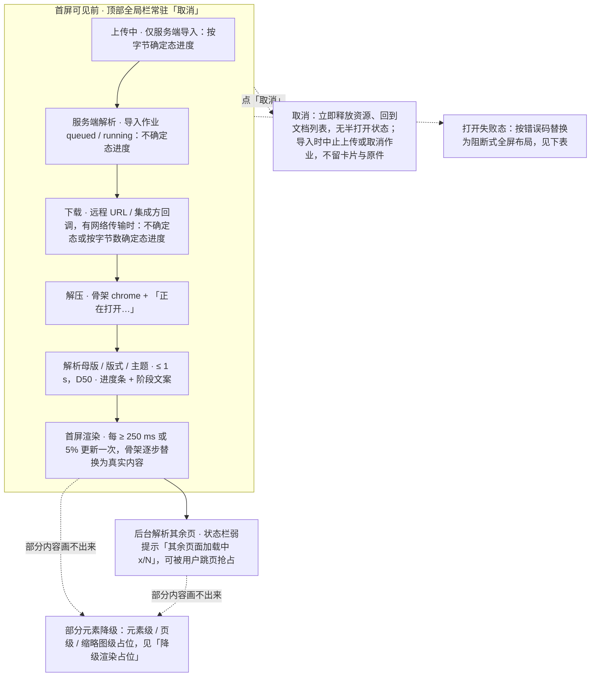
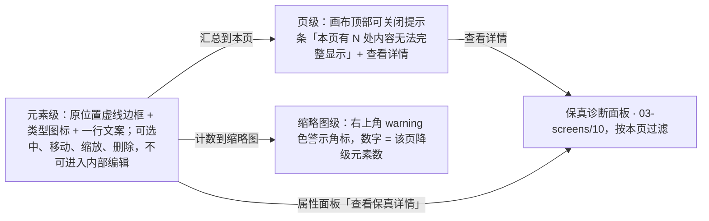
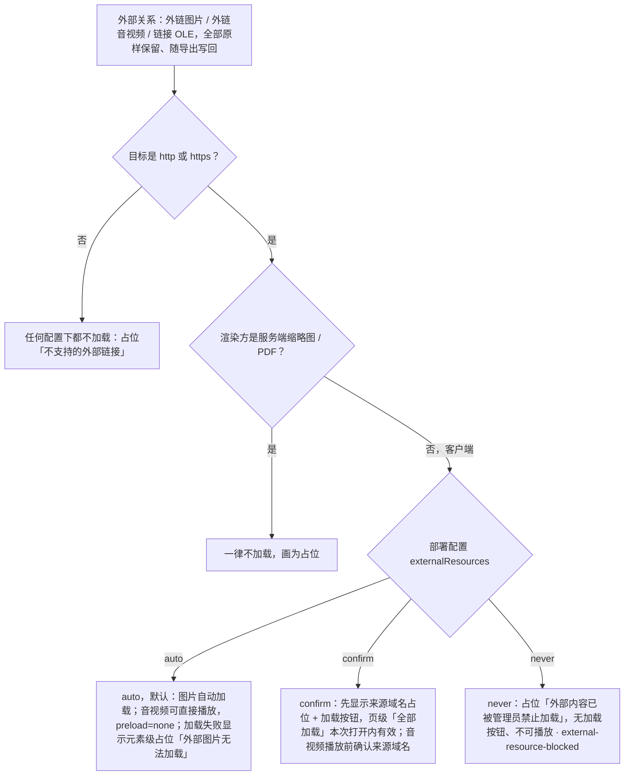

> 状态：草稿 | 负责：设计 | 更新：2026-09-15；2026-09-24（rulings §4.15：Q5 超出规模上限直接拒绝导入；Q7 外链资源自动加载 + `externalResources`、受限字体回退提示、EMF 栅格化、SmartArt / OLE / chartex 落点）；2026-09-24（rulings §4.16 Q15：失败态表新增 `format.macro_rejected`；加密次文案补「先去除密码」）；2026-09-24（复核修正，rulings §4.17）；2026-09-25（补图）；2026-09-25（矛盾收口，rulings §4.18） | 依赖：charter v0.2；`10-prd/07-design-coverage-and-gaps.md`；PRD OF §2.5–§2.6 / OF-02 / OF-17 / OF-24、SV-08；rulings §4.15 Q5 / Q7、§4.16 Q15

# 03-13 打开与导入：进度、失败态、降级占位

> **设计基准（2026-09-15 起）**：组件规格以 [`09-design-specification.md`](../09-design-specification.md) v3.0（shadcn Rhea + 材质层）为准；对应 playground 路由 `#/import`（[已发布 artifact](https://claude.ai/code/artifact/cf6e1a1a-986b-48bb-b743-5758dff419d2)，源码 `playground/src/routes/`）。本文引用的 `mockups/*.html` 与线框图为历史静态稿，以 playground 实际渲染为终稿。

补齐 `02-editor-main.md`"加载中"/"错误"两个状态过于简单的问题，并新增降级渲染的三层呈现。覆盖缺口 **G-01**（OF-01/03，打开进度与取消）、**G-02**（OF-02/24，打开失败态全集）、**G-03**（OF-13/09/07，降级渲染占位）、**G-05**（OF-15，缩略图侧栏加载/虚拟化/警示）、**G-06**（OF-07，媒体元素查看态）。对应 `02-user-flows.md` F1 主流程与边界 E1–E6。

---

## 线框：打开进度（阶段化，替换 02 的单一进度条）

```
┌─────────────────────────────────────────────────────────────────────────┐
│[≡ 取消]  正在打开 季度汇报.pptx …                                          │
├─────────────────────────────────────────────────────────────────────────┤
│（Ribbon 区禁用骨架）                                                       │
├──────────┬──────────────────────────────────────────────┬───────────────┤
│ [骨架×N] │              ▓▓▓▓▓▓▓▓▓▓▓▓（画布骨架，呼吸动效）  │  [骨架]        │
├──────────┴──────────────────────────────────────────────┴───────────────┤
│ 正在解析母版与版式… ▓▓▓▓▓▓▓▓░░░░░░░░ 55%                                    │
└─────────────────────────────────────────────────────────────────────────┘
```

首屏渲染完成后，进度条与骨架消失，编辑器可交互；状态栏保留弱提示"其余页面加载中 6/12"，缩略图逐项由灰块变为真实缩略图（不等待全部完成）。

## 线框：降级占位三层

```
┌──────────────────────────────────────────────┬───────────────────────────┐
│ ⚠ 本页有 2 处内容无法完整显示  [查看详情] [×]   │   缩略图：                 │
├──────────────────────────────────────────────┤   ┌──────┐                │
│  ┌╌╌╌╌╌╌╌╌╌╌╌╌╌╌╌╌╌╌┐                        │   │ [3]⚠ │ ← 警示角标(数字)│
│  ╎ 🖼 无法显示        ╎  （虚线占位框，可选中/  │   └──────┘                │
│  ╎ 图表渲染器未加载   ╎   移动/缩放/删除）       │                            │
│  └╌╌╌╌╌╌╌╌╌╌╌╌╌╌╌╌╌╌┘                        │                            │
└──────────────────────────────────────────────┴───────────────────────────┘
```

---

## 状态

### 打开进度（G-01）

| 阶段 | 触发/时长 | 界面表现 |
|---|---|---|
| 上传中（服务端导入，SV-01） | 从文档列表 / 开始页「导入 .pptx」选择文件后 | 按字节确定态进度 +「取消」；取消即中止上传、回到文档列表，不留卡片也不留原件 |
| 服务端解析（导入作业 `queued` / `running`） | 上传完成后 | 不确定态进度 + 阶段文案"正在服务端解析…"+「取消」；取消即取消导入作业（作业转 `cancelled`，服务端清理原件与产物）、回到文档列表；作业成功后直接打开编辑器，进入下列客户端阶段 |
| 下载（远程 URL/集成方回调） | 有网络传输时 | 不确定态或按字节数确定态进度 |
| 解压 | 立即 | 骨架 chrome + "正在打开…" |
| 解析母版/版式/主题 | ≤ 1 s（D50） | 进度条 + 阶段文案 |
| 首屏渲染 | 每 ≥ 250 ms 或 5% 更新一次 | 骨架逐步替换为真实内容 |
| 后台解析其余页 | 首屏完成后 | 状态栏弱提示"其余页面加载中 x/N"，可被用户跳页抢占 |
| 取消 | 首屏可见前（含上传中与服务端解析），"取消"按钮常驻顶部全局栏 | 立即释放资源、回到文档列表，无半打开状态；导入场景同时中止上传或取消作业，不留卡片与原件 |
| 大文件提示（> 50 MB 或 > 100 页） | 打开开始时判定 | 进度文案追加"文件较大，首屏渲染完成后其余页面将继续加载" |

**打开进度的阶段与出口**



怎么读：实线是一次打开依次经过的阶段，分组框内的阶段都可以被取消；「上传中」与「服务端解析」只在服务端导入时出现，打开库中已有的文档从「下载」开始。虚线是三种出口，其中降级不是失败，而是首屏完成后仍可继续编辑的状态。文件超过 50 MB 或 100 页时，进度文案在开始时追加大文件提示。

**服务端导入复用同一过渡页**（PRD SV-01「进度阶段与客户端 OF-01 一致」；rulings §4.18 UX-14）：文档列表、开始页的「导入 .pptx」一律跳到本页 `#/import`，依次经过「上传中 → 服务端解析 → 打开编辑器」，**不在文档列表里生成"上传中 / 解析中"的后台卡片**。失败按下表错误码处理：确定性错误（类型不支持、加密、含宏、无效的演示文稿、超出处理上限或规模上限）只给「返回列表」；瞬时错误（网络中断、超时、5xx）给「重试」，重试即重新走一遍完整导入（重新上传）。

### 打开失败态（按错误码，替换 02 的单一通用文案，G-02）

| 错误码 | 主文案 | 次文案/动作 |
|---|---|---|
| `format.unsupported_binary` | 不支持的文件格式 | "请在 PowerPoint 中另存为 .pptx 后重试" + [返回列表]；不使用"已损坏"措辞 |
| `format.encrypted` | 此文件已加密，当前版本无法打开 | "请先在 PowerPoint 中去除密码后再导入" + [返回列表]（rulings §4.16 Q15） |
| `format.macro_rejected` | 不支持包含宏的演示文稿 | "请另存为 .pptx 后再导入" + [返回列表]；不提供重试、不提供"忽略宏打开"；`.pptm` 以及改名为 .pptx 但含宏的文件均走此态；不使用"已损坏"措辞（rulings §4.16 Q15） |
| `format.pptx.invalid_package` | 无法打开：文件不是有效的演示文稿 | 可展开"技术详情"（首个失败部件路径）+ [复制诊断信息] + [返回列表] |
| `format.limit_exceeded` | 文件超出处理上限 | 显示被触发的限制名与上限值（如"媒体总量超过 256 MB 上限"）；不提供重试 |
| `format.quota_exceeded`（规模上限，见下方线框） | 文档超出规模上限，无法导入 | 说明超出的是哪一项 + 实际值 / 上限值；[返回列表]；不提供重试、不提供"以只读打开"（rulings §4.15 Q5） |
| 无访问权限/文档已删除 | 你没有权限访问此文档 | [申请访问]（见 03-screens/08 补充）+ [返回列表] |
| 其他 / 未归类错误（通用兜底） | 无法打开该文档 | "请稍后重试；如果问题持续，请复制诊断信息并联系管理员" + [重试] [复制诊断信息] [返回列表]；**通用文案不含"已损坏"措辞**——只有 `format.pptx.invalid_package` 才说"不是有效的演示文稿"，且同样不说"已损坏"（2026-09-24 复核修正） |
| `format.no_document_type`（集成场景） | 未加载可打开此文件的文档类型插件 | 面向集成方的文案 + [复制诊断信息]（不面向最终用户展示技术措辞时由集成方兜底文案覆盖） |

全部错误态复用 `02-editor-main.md` 的阻断式全屏布局（保留顶部"返回列表"，不渲染残缺 chrome）。

#### 超出规模上限：直接拒绝导入（rulings §4.15 Q5）

```
┌─────────────────────────────────────────────────────────────┐
│[← 返回列表]                                                   │
│                                                               │
│            ⛔ 文档超出规模上限，无法导入                         │
│    "年度汇总.pptx"共有 23,480 个元素，超过每份文档                │
│    20,000 个元素的上限。                                       │
│    可以在 PowerPoint 中把它拆成几份较小的文件后再分别导入。          │
│                                                               │
│    超出项        实际值       上限                              │
│    文档总元素     23,480      20,000                            │
│                                         [ 返回列表 ]           │
└─────────────────────────────────────────────────────────────┘
```

- 触发：导入检查到文档超出系统天花板，返回 `format.quota_exceeded{dimension, limit, actual}`（413；`dimension` 取值照抄架构 10 §3「配额三码并列与 `dimension` 取值表」，rulings §4.17 D2）。四项上限（部署配置可调，界面文案**读取实际配置值**，不写死数字）：

  | 维度（`dimension`） | 默认上限 | 主文案下的说明句 |
  |---|---|---|
  | 单文件大小（`fileSize`，含媒体） | 200 MB | "文件大小为 N MB，超过每个文件 200 MB 的上限。" |
  | 页数（`slides`） | 200 页 | "共有 N 页，超过每份文档 200 页的上限。" |
  | 单页元素（`elementsPerSlide`） | 1,000 个 | "第 K 页有 N 个元素，超过每页 1,000 个的上限。"（多页超限时列出前 3 页 + "等 M 页"） |
  | 文档总元素（`elementsTotal`） | 20,000 个 | "共有 N 个元素，超过每份文档 20,000 个元素的上限。" |

- 同时超出多项时，"超出项"表逐行列出全部超出的维度（按文件大小 → 页数 → 单页元素 → 总元素排序），主说明句取第一项。
- **直接拒绝，不降级**：不提供"以只读打开""仅打开前 200 页"或自动拆分；不提供重试（同一文件重试结果不变）。原件不入库。
- 建议句"可以在 PowerPoint 中把它拆成几份较小的文件后再分别导入"固定出现；集成方可覆盖文案。
- 与 `format.limit_exceeded`（ZIP/媒体等解析安全上限，OF-24）是两类错误：前者是"文件本身处理不了"，本态是"文件能解析，但规模超出本部署承诺"，文案不混用。
- 打开**已在库中**的文档不会出现本态：编辑过程中接近/达到上限的提示见 03-screens/12"配额超限反馈"。

### 降级渲染占位（三层，G-03）

- **元素级**：原始几何位置显示虚线边框 + 类型图标 + 一行文案（如"无法显示：图表渲染器未加载"），不遮挡相邻元素；可选中（显示手柄）、可移动/缩放/删除，不可进入内部编辑；属性面板仅显示"位置与大小"+"此元素当前无法渲染"+ 原因 +"查看保真详情"入口。
- **页级**：画布顶部出现可关闭的提示条"本页有 N 处内容无法完整显示 [查看详情]"，点击"查看详情"打开保真诊断面板（见 03-screens/10 补充）并过滤到本页；整页解析失败时（F1 E2）画布显示页级占位"此页内容无法解析"，其余页不受影响。
- **缩略图级**：右上角警示角标（数字 = 该页降级元素数），与评论角标（见 03-screens/06 补充）在视觉上区分（警示用 `warning` 语义色，评论用中性色）。

**降级占位三层的联动**



怎么读：一个元素画不出来时三层同时出现，页级与缩略图级都是对元素级的汇总；所有「查看详情」入口都落到同一个保真诊断面板，不实现两套详情视图。整页解析失败时画布改为页级占位「此页内容无法解析」。

### 缩略图侧栏加载/虚拟化/警示（G-05）

- 200 页文档：仅视口附近 ±10 项渲染真实缩略图，其余为灰块 + 页码，虚拟滚动 ≥ 55 fps。
- 未解析页：缩略图显示骨架（呼吸动效）而非空白。
- 编辑后 ≤ 500 ms 内该页缩略图更新，其它页不重绘（脏页驱动）。
- 当前页/多选/隐藏页（见 03-screens/14）/警示角标/评论角标可能同时出现在同一缩略图上，视觉优先级：当前页描边 > 警示/评论角标 > 隐藏态不透明度。

### 媒体元素查看态（G-06）

- 视频/音频：编辑与评审模式下显示海报帧 + 居中播放图标（不自动播放）；点击播放使用浏览器原生控件，Esc 或点击外部停止。
- 浏览器不支持的编解码（wmv/avi）或 DRM：海报帧 + 角标"此格式无法在浏览器中播放"，仍可移动/缩放/删除（M2）。
- 外链媒体（`TargetMode="External"`）：按下方"外链资源"规则——默认（`externalResources = auto`）直接可播，`preload="none"`，点击播放前不下载；在线视频（如视频网站页面链接）只显示海报 + "在新标签页打开"；非 http(s) 目标原样保留但不可播放。原"首次播放前来源域名确认弹层"改为仅在部署配置为 `confirm` 时出现（rulings §4.15 Q7）。
- 放映模式：点击播放，播放期间控制条隐藏；翻页即停止播放。

### 只保留对象、外链资源与字体的呈现（rulings §4.15 Q7；PRD OF §2.5–§2.6、OF-17）

以下对象都**原样保留、随导出写回**，差别只在"能不能画出来、画成什么"。能渲染的不显示任何降级标记；只在确实画不出来时才走上方"降级占位三层"，并在保真报告（03-screens/10）登记。

| 对象 | 画布呈现 | 画不出来时的占位文案（元素级） | 诊断原因值 |
|---|---|---|---|
| SmartArt | M1 起按包内预计算的 `dsp:drawing` 渲染为静态图形；可整体移动/缩放/删除，双击提示"SmartArt 暂不支持编辑内部结构" | 无 `dsp:drawing` 时："SmartArt 无法显示（文件缺少预览数据）" | `render/element-degraded` |
| OLE 嵌入 / 链接对象 | 显示包内预览图（取自 `mc:Fallback` 的图片）；可整体移动/缩放/删除；双击提示"嵌入对象暂不支持在此编辑"；链接 OLE 的链接目标不加载 | 无预览图时："嵌入对象（<类型>）无法预览" | `render/element-degraded` |
| EMF / WMF 图片（含 OLE 的 EMF 预览） | M1：有包内位图预览时显示预览，否则占位；**M2 起按需栅格化**——元素先显示骨架（呼吸动效），栅格化模块在后台惰性加载完成后替换为图片，不阻塞其余内容 | M1 无预览："此图片格式（EMF）暂无法预览"；M2 栅格化失败或超出 OF-24 上限："此 EMF 图片过大或过于复杂，无法预览" | `emf-no-preview` 等 |
| chartex 新图表（瀑布、直方、箱形、漏斗、旭日、树状） | 占位（不显示文件里"此图表在你的版本中不可用"那段兜底文字）；可整体移动/缩放/删除 | "此类图表（瀑布图等 Office 2016 新图表）暂不支持显示，已原样保留" | `chartex-unsupported` |
| 未知图形数据 | 有 Fallback 图片时显示图片，否则占位 | "无法显示：不支持的对象类型" | `render/element-degraded` |

**外链资源（外链图片、外链音视频、链接 OLE）**——外部关系全部原样保留，只有 `http(s)` 目标可以被加载；服务端缩略图 / PDF 一律不加载、画为占位。客户端行为由部署配置 `externalResources` 决定：

| 配置 | 外链图片 | 外链音视频 | 用户可见提示 |
|---|---|---|---|
| `auto`（默认，用户裁决） | 自动加载，无确认 | 可直接播放，`preload="none"` | 无；加载失败时按元素级占位"外部图片无法加载（<域名>）" |
| `confirm` | 先显示占位"此图片来自外部网站 <域名>"+ [加载]；页级提示条"本页包含来自外部网站的内容 [全部加载]"（本次打开内有效，不持久化） | 播放前弹出来源域名确认 | 同左 |
| `never` | 占位"外部内容已被管理员禁止加载（<域名>）"，无加载按钮 | 同左，不可播放 | 诊断原因 `external-resource-blocked` |

非 `http(s)` 的外部链接（如 `file://`）在任何配置下都不加载，占位文案"不支持的外部链接"。

**外链资源的加载判定**



怎么读：先按协议、再按渲染方、最后按部署配置三级判定；只有客户端且 http(s) 目标才看 `externalResources`，服务端永远不加载外部资源。

**受限内嵌字体（OS/2 `fsType` 为"受限"或"仅预览/打印"，M2 起）**——只用于只读渲染（查看、评审、放映、缩略图、PDF），编辑时改用回退字体，文档仍可编辑：

- 进入编辑模式时，若当前文档含受限字体，状态栏出现弱提示"1 种字体仅授权查看，编辑时以替代字体显示 [详情]"（不弹窗、不阻断）；[详情] 打开保真报告并定位到"字体"分组。
- 文本进入编辑态（出现插入符）时，若该文本框使用受限字体，文本框上方出现一次性内联提示"「<字体名>」仅授权查看，编辑时以「<回退字体>」显示，查看和放映时仍使用原字体"；同一会话每种字体只提示一次。
- 字体下拉中该字体条目带锁形图标 + tooltip"此字体仅授权查看，不能用于新文字"；选择它时不应用并提示同样文案。
- 编辑态与查看态字形可能不同（行宽、换行位置可能变化）是已知代价，保真报告如实说明。

---

## 交互说明

- 打开进度、失败态、降级占位三者是同一条 F1 流程的先后阶段，不是互斥状态：一次打开可能"进度中 → 首屏完成 → 部分元素降级"依次经过，不需要用户额外操作触发降级占位的出现。
- 保真报告入口角标（03-screens/10）与本文件的页级/元素级降级提示联动："查看详情"统一跳转到保真诊断面板并按页过滤，不重复实现两套详情视图。
- 取消打开是唯一允许中断当前操作的入口，位置固定在顶部全局栏，不会因进度阶段变化而移动。

## 边界情况

- 部分部件解析失败但整体可打开：保真报告标红对应条目（见 03-screens/10），受影响页面同时出现本文件定义的页级提示条。
- 极大文件（页数多/媒体多，接近 200 页/200 MB 上限）：渐进渲染优先当前可见页，缩略图侧栏懒生成，不阻塞用户操作。
- 降级元素被复制/粘贴：占位状态与位置属性随行为一起复制，不尝试"修复"或"猜测"原始内容。
- 打开取消后立即再次打开同一文件：视为全新打开流程，不复用任何缓存的中间状态。
