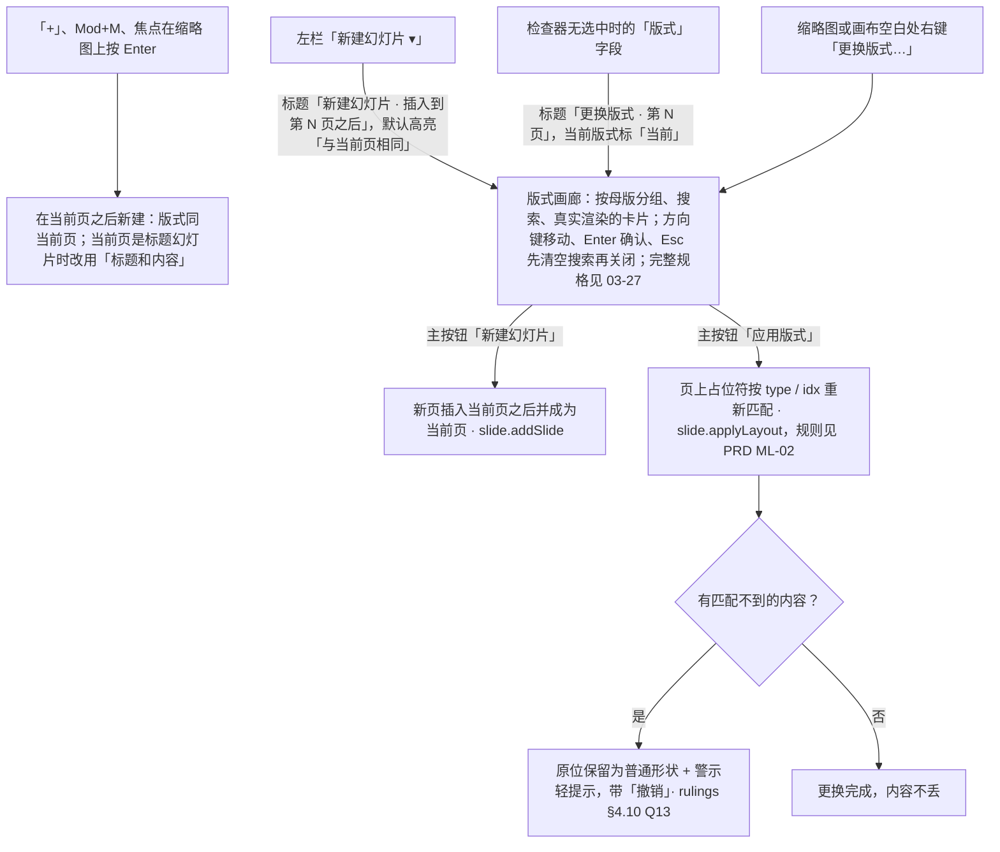
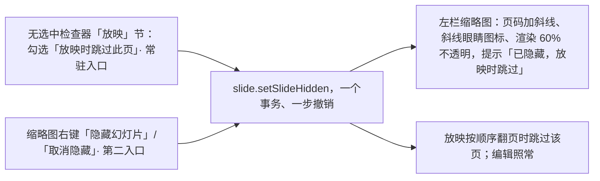

> 状态：草稿 | 负责：设计 | 更新：2026-09-18；2026-09-25（补图）；2026-10-07（design-language-v3 第 1 批：按已拍板的 slide-management 场景整篇改写——§1 线框按 v3 外壳重画（左栏、版式库弹层、网格视图多选拖动）；§2 左栏元素表；§3 新建（「新建幻灯片 ▾」版式库与「+」，新页插入当前页之后）、拖动排序（多选、跨节）、删除与撤销、仅剩 1 页时删除不可用、节的显示与节标题右键、隐藏幻灯片（rulings §4.25 DS-25：无选中检查器「放映」节「放映时跳过此页」为常驻入口、缩略图右键为第二入口，隐藏页缩略图变淡并带斜线眼睛）、更换版式与占位符不匹配、缩略图右键、网格视图里的多选与拖动；§5 状态表列全 14 个样张状态与路由；原「新建 ▾」flyout 线框、多母版补充节与 672px 对话框规格作废，分组画廊的完整规格归 03-27；§8 原入口去向、§9 与其他文档的出入；依据 rulings §4.25 DS-1、DS-21、DS-25）；2026-10-07（design-language-v3 第 1 批：按 rulings §4.25 TB-17、TB-22、TB-23 与第一步影响修订——§3.1、§3.6 版式画廊的模式差异与组件规格改为引用 03-27 §0、§1、§5，不在本文重复定义；§3.4 节标题菜单由 slide-ui 直接渲染、不开放贡献；§3.6、§3.7、§5 评审、只读浏览与降权时缩略图右键的「更换版式…」等留在原位不可用，同一原因写在菜单顶部一行；§9 第 1 条按 03-02 §10 第 13 条定处理、第 3 条按 TB-17 关闭）；2026-10-08（design-language-v3 第 1 批收口：§3.6、§3.7 与 §5「降权 · 缩略图右键」行写明缩略图右键顶部说明按情形为「评审模式下不可用」「只有查看权限」「需要编辑权限」（rulings §4.25 TB-51），删去已完成的「样张现为逐项写，跟改」；§3.5「切换」补样张原因原文；§9 四条核对后全部收口（样张「切换」原因已改、PRD ML-02 已改、`layout-picker.readonly` 说明已改、40/03 §2.6 `slide.reorderSlides` 已改为 `{slideIds; after?}`），标题改为「已全部收口」）；2026-10-08（design-language-v3 第 1 批评审修改：§2「新建幻灯片 ▾」与「+」改为透明底加细边的次按钮，悬停与打开时铺 `--v3-panel-2`（rulings §4.25 DS-37，原 `--v3-panel-2` 淡底作废））；2026-10-22（design-language-v3 第 3 批：只改受影响的段落——§1.1、§1.3 图例：左栏顶行与网格胶囊的「单页 / 网格」改为分段画法（rulings §4.25 DS-133），画布下方的备注区改为凹陷底（DS-134）；§3.5 补放映里的页码按实际页号、敲数字可跳到隐藏页、从隐藏页开始照样显示，全部页都隐藏时三处「放映」不可用、原因写「所有幻灯片都已设为放映时跳过」（TB-111）；§3.8 网格里 ↵ 打开、空格选中，快捷键面板列在「左栏缩略图与网格」组（TB-116）；§4 紧凑形态的幻灯片抽屉从横幅下沿开始、不盖横幅（DS-130）；§5 注明各态随 DS-133、DS-134 改画、基线按有意改动重存） | 依赖：charter v0.2；rulings §4.10 Q13；rulings §4.25 DS-21…DS-26、DS-37、TB-17、TB-22、TB-23、TB-51；`10-prd/07-design-coverage-and-gaps.md`；PRD `07-masters` ML-02；playground `src/v3/scenarios/slides-selection/`、`src/v3/editor/LeftRail.tsx`、`src/v3/editor/layouts/LayoutGallery.tsx`、`src/v3/editor/thumb-menu.tsx`；rulings §4.25 DS-130、DS-133、DS-134、TB-111、TB-116（2026-10-22）

# 03-14 幻灯片管理与版式选择器

> **设计基准（2026-10-07 起，rulings §4.25 DS-21）**：以 playground 第 1 批「幻灯片管理与版式」场景为准，路由 `#/v3/editor?state=slide-management.<状态 id>`（§5 列全 14 个状态）；源码 `playground/src/v3/scenarios/slides-selection/`（`slide-management.scenario.tsx`、`rail.tsx`、`GridDrag.tsx`、`menus.tsx`），左栏 `src/v3/editor/LeftRail.tsx`，版式画廊 `src/v3/editor/layouts/LayoutGallery.tsx`，缩略图右键 `src/v3/editor/thumb-menu.tsx`。外壳（左栏 240、检查器 280、底部创建工具条）以 [03-02](02-editor-main.md) 为准；token 只写名字（样张作用域名 `--v3-*`），取值见设计 [04](../04-design-system.md)。旧稿的「新建 ▾」flyout 线框、`mockups/*.html` 与 `#/editor/layouts` 路由作废（DS-7）。

本文定左栏缩略图列表上的幻灯片管理：按版式新建、复制、删除、拖动排序（含多选与跨节）、节、隐藏页、更换版式，以及网格视图里的同一套多选与拖动。覆盖缺口 **G-18**（ED-11，幻灯片管理与版式选择）、**G-42**（ED-11 / OF-11，节的显示）；产品默认答案 D14（新建页的默认版式）、D15（隐藏页）见 `07-design-coverage-and-gaps.md` §4。命令 id 以 40/03 §2.6 为准：`slide.addSlide`、`slide.duplicateSlide`、`slide.deleteSlides`、`slide.reorderSlides`、`slide.setSlideHidden`、`slide.applyLayout`、`slide.resetSlide`。右键菜单的通用规则（外观、不可用项、焦点）见 [03-05](05-context-menu.md)；版式画廊的多母版分组、跨母版、搜索与重置的完整规格见 [03-27](27-layout-picker-and-reset.md)。

---

## 1. 线框

### 1.1 单页视图 · 左栏的幻灯片管理（1600 × 1000，第 4 页已隐藏、无选中）

```
←──────── 240 ─────────→←─────────── 画布 ────────────→←───────── 280 ─────────→
┌──────────────────────┬──────────────────────────────┬────────────────────────┐
│ [▣▾]          [▭][▦] │                              │ (周)(王)(李)  ▶ [分享] │
│ 2026 年 Q2 业绩汇报 ▾│                              ├────────────────────────┤
│ ✓ 已同步             │ ┌──────────────────────────┐ │ [设计]  评论     77% ▾ │
│ [新建幻灯片    ▾][+] │ │ 营收趋势                 │ ├────────────────────────┤
│ ▸ 开场  2 页         │ │                          │ │ 幻灯片 4               │
│ ▾ 业务回顾  3 页     │ │  ▂▃  ▂▂  ▃▄  ▅▅  ▆▆  ▇█  │ ├────────────────────────┤
│ 3 ┌──────────────┐   │ │                          │ │ 版式                   │
│   │ 关键指标     │   │ │ 2026 年 Q2 业绩汇报    4 │ │ [▭ 仅标题           ▾] │
│   └──────────────┘   │ └──────────────────────────┘ ├────────────────────────┤
│▌4 ┏━━━━━━━━━━━━━━┓   │                              │ 主题 · 背景（同 03-02）│
│▌⊘ ┃░ 营收趋势 [3]┃   │ ┌──────────────────────────┐ ├────────────────────────┤
│▌  ┗━━━━━━━━━━━━━━┛   │ │ 先讲 6 月创年内新高……    │ │ 放映                   │
│ 5 ┌──────────────┐   │ └──────────────────────────┘ │ [切换  无          ▾]  │
│   │ 区域分布     │   │                              │ ☑ 放映时跳过此页       │
│   └──────────────┘   │                              │                        │
│ ▾ 下半年  1 页       │ ╭──────────────────────────╮ │                        │
│ 6 ┌──────────────┐   │ │ 底部创建工具条（03-02）  │ │                        │
│   │ 下半年计划   │   │ ╰──────────────────────────╯ │                        │
│   └──────────────┘   │                              │                        │
└──────────────────────┴──────────────────────────────┴────────────────────────┘
```

图例：`▌` 当前页（整行 `--v3-accent-soft` 底，`┏┓` 为缩略图的强调色描边）；第 4 页是隐藏页——页码 `4` 加一道斜线（字符画不出，见样张）、页码下方 `⊘` 为斜线眼睛图标、`░` 表示幻灯片渲染 60% 不透明；`[3]` 评论计数角标（不随隐藏变淡）；`▸ / ▾` 节标题行折叠 / 展开；`[▣▾]` 主菜单，`[▭][▦]` 单页 / 网格切换（2026-10-22 起为分段画法：28 高的槽铺 `--v3-panel-2`，选中块面板色 + 细边，两项各 28 × 28，左栏顶行由 52 宽变为 56，rulings §4.25 DS-133，03-02 §3.1）；画布下方的备注区 2026-10-22 起为凹陷底（去掉描边、比画布深一档，DS-134，03-02 §3.3）；检查器「切换」字段留在原位不可用（§3.5）。样张状态：`slide-management.hidden`。

### 1.2 「新建幻灯片 ▾」版式库（贴左栏右缘展开，多母版文档）

```
┌──────────────────────┬──────────────────────────────────────────────────────────┐
│ [▣▾]          [▭][▦] │                                                          │
│ 2026 年 Q2 业绩汇报 ▾│                                                          │
│ ✓ 已同步             │ ╭──────────────────────────────────────────────────────╮ │
│ [新建幻灯片    ▾][+] │ │ 新建幻灯片 · 插入到第 2 页之后                   [×] │ │
│ 1 ┌──────────────┐   │ │ [⌕ 搜索版式                                        ] │ │
│   │ 标题页       │   │ │ ▤ Office · 当前页所用母版                            │ │
│   └──────────────┘   │ │ ┏━━━━━━━━━━┓ ┌──────────┐ ┌──────────┐ ┌──────────┐  │ │
│▌2 ┏━━━━━━━━━━━━━━┓   │ │ ┃ ▔▔▔▔▔▔▔▔ ┃ │ ▔▔▔▔▔▔▔▔ │ │ ▔▔▔▔▔▔▔▔ │ │ ▔▔▔▔▔▔▔▔ │  │ │
│▌  ┃ 议程         ┃   │ │ ┗━━━━━━━━━━┛ └──────────┘ └──────────┘ └──────────┘  │ │
│▌  ┗━━━━━━━━━━━━━━┛   │ │ 与当前页相同 标题幻灯片   标题和内容   两栏内容      │ │
│ 3 ┌──────────────┐   │ │ 标题和内容                                           │ │
│   │ 关键指标     │   │ │ ┌──────────┐ ┌──────────┐ ┌──────────┐ ┌──────────┐  │ │
│   └──────────────┘   │ │ │ ▔▔▔▔▔▔▔▔ │ │ ▔▔▔▔▔▔▔▔ │ │ ▔▔▔▔▔▔▔▔ │ │ ▔▔▔▔▔▔▔▔ │  │ │
│ ⋮                    │ │ └──────────┘ └──────────┘ └──────────┘ └──────────┘  │ │
│                      │ │ 比较         仅标题       章节标题     空白          │ │
│                      │ │ ▤ 简约 [导入]                                        │ │
│                      │ │ ⓘ 用这里的版式新建的页属于母版「简约」               │ │
│                      │ │ ┌──────────┐ ┌──────────┐ ┌──────────┐ ┌──────────┐  │ │
│                      │ │ └──────────┘ └──────────┘ └──────────┘ └──────────┘  │ │
│                      │ │ 标题和内容   标题幻灯片   空白         仅标题        │ │
│                      │ ├──────────────────────────────────────────────────────┤ │
│                      │ │                                  [取消] [新建幻灯片] │ │
│                      │ ╰──────────────────────────────────────────────────────╯ │
│                      │                                                          │
└──────────────────────┴──────────────────────────────────────────────────────────┘
```

图例：弹层宽 472，正文最高 440、超出纵向滚动；`▔▔` 代表版式的真实渲染（母版装饰 + 空占位符），不是骨架条；`┏┓` 为当前高亮卡（1px 强调色边 + 0.5px 外环）；`▤` 为母版组标题图标（Lucide `LayoutTemplate`），`ⓘ` 为非当前母版组的说明行；检查器略。样张状态：`slide-management.new-slide-menu`。

### 1.3 网格视图 · 多选拖动

```
┌──────────────────────────────────────────────────────────────────────────────────────────────┐
│ ╭────────────────────────────────────────────────────╮     ╭───────────────────────────────╮ │
│ │ [▣▾] 2026 年 Q2 业绩汇报 ▾ │ [+ 新建幻灯片] [▭][▦] │     │ (周)(王)(李) 36% ▾ │ ▶ [分享] │ │
│ ╰────────────────────────────────────────────────────╯     ╰───────────────────────────────╯ │
│                                                                                              │
│       1                             2                             3                          │
│       ┌──────────────────────┐      ┏━━━━━━━━━━━━━━━━━━━━━━┓      ┏━━━━━━━━━━━━━━━━━━━━━━┓   │
│       │ 标题页               │      ┃░ 议程 ░░░░░░░░░░░░░░░┃      ┃░ 关键指标 ░░░░░░░░░░░┃   │
│       │                      │      ┃░░░░░░░░░░░░░░░░░░░░░░┃      ┃░░░░░░░░░░░░░░░░░░░░░░┃   │
│       │                      │      ┃░░░░░░░░░░░░░░░░░░░░░░┃      ┃░░░░░░░░░░░░░░░░░░░░░░┃   │
│       └──────────────────────┘      ┗━━━━━━━━━━━━━━━━━━━━━━┛      ┗━━━━━━━━━━━━━━━━━━━━━━┛   │
│                                                                                              │
│       4                             5                             6                          │
│       ┌──────────────────────┐      ┌──────────────────────┐  ○   ┌──────────────────────┐   │
│       │ 营收趋势        [评3]│      │ 区域分布             │  ┃   │ 下半年计划           │   │
│       │                      │      │                      │  ┃   │╔═ 议程 ═══════╗[2]   │   │
│       │                      │      │                      │  ┃   │╚══════════════╝      │   │
│       └──────────────────────┘      └──────────────────────┘  ┃   └──────────────────────┘   │
│                                                                                              │
└──────────────────────────────────────────────────────────────────────────────────────────────┘
```

图例：第 2、3 页多选中（`┏┓` 2px 强调色环）并正在被拖动（`░` 盖一层 60% 画布色，等于 40% 不透明）；`○┃` 插入线画在第 5、6 页之间的列距正中（2px 强调色，上端 8px 空心圆，高同幻灯片框）；`╔╗` 拖动影子（宽 208，2px 强调色环 + 浮层阴影，多选叠两张，右上角数量角标 `[2]`）；左上胶囊里的 `[▭][▦]` 与左栏同一个切换，2026-10-22 起同为分段画法（rulings §4.25 DS-133，03-02 §5.1）。样张状态：`slide-management.grid-reorder`。

---

## 2. 左栏的元素

左栏结构（主菜单、单页 / 网格、文档菜单、同步状态、缩略图条目的尺寸与当前页样式）以 03-02「左栏」为准，本节只列幻灯片管理用到的元素。

| 元素 | 规格 | 行为 |
|---|---|---|
| 新建幻灯片 ▾ | 28 高次按钮（透明底加 1px 细边、与分隔线同档，悬停铺 `--v3-panel-2`；rulings §4.25 DS-37，原 `--v3-panel-2` 淡底作废；占满剩余宽，左右内边距 10，▾ 为 `--v3-text-2`）；`aria-haspopup="dialog"` + `aria-expanded`；打开时按钮显示按下态（铺 `--v3-panel-2`） | 打开版式库弹层（§3.1）；再点一次或点弹层外关闭 |
| + | 28px 图标按钮，与「新建幻灯片 ▾」同一画法（透明底加细边，DS-37），与 ▾ 间距 8；工具提示「新建幻灯片 ⌘M」 | 按缺省版式在当前页之后新建（§3.1） |
| 多选中的页 | 与当前页同一高亮：整行 `--v3-accent-soft` 底，缩略图 1px 强调色边 + 0.5px 外环，页码 `--v3-text`；只有当前页带 `aria-current` | `Shift` / `Mod` 单击加选或减选 |
| 节标题行 | 高 28、圆角 6、左右内边距 8，上方比普通条目多留 4（第一节除外）；12px ▾（折叠时转为 ▸，`--v3-text-2`）+ 节名 12px 600 `--v3-text` +「N 页」12px `--v3-text-2`；整行是一个 `button`（`aria-expanded`），悬停 `--v3-panel-2` | 点整行折叠 / 展开；右键见 §3.4 |
| 隐藏页 | 页码加一道斜线，页码下方 12px 斜线眼睛图标（Lucide `EyeOff`，`--v3-text-2`）；幻灯片渲染 60% 不透明，当前页描边、评论角标与警示角标不变淡 | 悬停 / 聚焦工具提示「已隐藏，放映时跳过」（§3.5） |
| 插入指示线 | 2px 强调色线，左端 8px 空心圆（2px 强调色边、面板底），从缩略图左缘（条目左缘起 36）画到右侧留 8；所在间隙放大到 16，其余条目让位 | 拖动排序时标出落点；跨节时线的右端压一枚角标「移到「〈节名〉」」（`--v3-accent-solid` 底白字，高 20、12px） |
| 拖动影子 | 宽 120 的真实缩略图，1px 强调色边 + `--v3-shadow`，跟随指针；多选时下面错开 4 再叠一张（1px `--v3-border`），右上角数量角标 | 松手后消失 |
| 拖动源 | 整条 40% 不透明 | 松手后恢复 |

## 3. 操作

### 3.1 新建幻灯片（D14）

- **直接新建**：点「+」、按 `Mod+M`（⌘M），或焦点在左栏缩略图上按 `Enter`（PRD ED-11）：在当前页之后插入一页，版式 = 当前页的版式；当前页是「标题幻灯片」时改用「标题和内容」（首页之后很少再要一张标题页）。新页成为当前页，左栏把它滚入视野。缩略图右键「新建幻灯片 ⌘M」同此，作用于被右键的那一页（右键时先切到该页）。
- **按版式新建**：点「新建幻灯片 ▾」，版式库弹层贴左栏右缘向右展开、与按钮顶端对齐，宽 472（线框 §1.2）。它与检查器「版式」字段、右键「更换版式…」打开的是同一个版式画廊组件（§3.6）：分组（当前页所用母版置顶、导入的母版标「导入」、单母版退化为扁平网格）、搜索、版式卡片（真实渲染、4 列）、键盘与关闭以 [03-27](27-layout-picker-and-reset.md) §1、§5 为准；新建模式与更换模式的差异（标题、第一张卡、当前版式标记、其它母版组的说明、底栏、选择后的动作、弹出位置）只在 03-27 §0 的对照表里定义，本文不重复。`Enter`、双击或点「新建幻灯片」即在当前页之后新建；`Esc` 先清空搜索、再按才关闭，焦点回到「新建幻灯片 ▾」。
- **新页**：画布上空占位符显示虚线框与提示文字；缩略图与放映里不出现空占位符，只剩母版装饰（PRD ML-02「基于版式新建」）。
- **网格视图**：左上胶囊「+ 新建幻灯片」，行为同「+」（03-02「网格视图」）。
- **命令**：`slide.addSlide{layoutId?, after?}`，一个事务、一步撤销；超出规模上限时命令被拒并提示（PRD SV-08）。
- **评审、只读浏览**：左栏不显示新建行；编辑模式已降权：新建行留在原位不可用，工具提示「需要编辑权限」。

**图 3-1 新建与更换版式共用一个画廊**



怎么读：上方四个入口里，「+」一类不经画廊直接新建，其余三个打开同一个画廊；画廊按入口分成新建与更换两条出路，更换时先重新匹配占位符，匹配不到的内容原位保留并提示，不静默丢弃。
依据：PRD ED-11、ML-02；rulings §4.10 Q13；rulings §4.25 DS-21；样张 `slide-management.new-slide-menu`、`slide-management.change-layout`、`slide-management.layout-unmatched`。

### 3.2 拖动排序（含多选、跨节）

- **单页**：拖动一张缩略图，源条目变为 40% 不透明；指针所在的间隙放大到 16 并画插入指示线，影子跟随指针，其余条目让位（150–200 ms，50/10 §6）；松手执行一次 `slide.reorderSlides`，一个事务、一步撤销。样张：把第 5 页拖到第 2、3 页之间。
- **多选**：`Shift` / `Mod` 单击多选后拖动其中一张，整组一起移动、保持组内先后；影子叠两张，右上角写数量。
- **跨节**：落点在另一节时，插入线右端写「移到「〈节名〉」」，避免「移到哪个节」的歧义；落在节标题行之后即进入该节开头。样张：第 3、4 页一起拖到「下半年」节开头。
- **键盘等价**：`Mod+Shift+↑` / `↓`（⇧⌘↑ / ⇧⌘↓，PRD ED-29）每按一次移动一位，每次一个事务；缩略图右键「移动 ▸」另有「移到开头」「移到末尾」；移动后读屏播报「已移到第 N 页」（50/16 §8）。
- 渐进打开、后续页还没到齐（`unitLoaded` 之前）时重排不可用（50/10 §6）。
- 协同：他人同时重排时只有位置变化动画，不出提示（05 §5 场景 F，PRD CO-08）。

### 3.3 删除（含多选）

- **入口**：缩略图右键「删除幻灯片 ⌫」、焦点在左栏时按 `Delete` / `Backspace`；网格视图同。
- **立即删除、不弹确认**：画布底部（工具条上方居中）5 秒轻提示「已删除 N 页」+「撤销」，`role="status"`、不抢焦点，「撤销」可 Tab 到达（03-05 §6）；删除后选中相邻页（样张：删掉第 5、6 页后当前页落在第 4 页）。
- 页独占的部件（媒体、图表、备注）随页删除，共享部件保留；删除落为软删除墓碑，撤销恢复全部部件与关系、id 不变（PRD ED-11，rulings §4.15 Q3）。命令 `slide.deleteSlides{slideIds}`。
- **仅剩 1 页**：缩略图右键里「删除幻灯片」留在原位不可用，右侧写「文档至少保留 1 页」，不用危险色；「移动 ▸」同样不可用，原因「只有 1 页」；`Delete` 无效。

### 3.4 节（G-42，OF-11）

- **M2 只显示**：文档含节时，缩略图列表在对应位置插入节标题行「▾ 节名 N 页」；点整行折叠 / 展开，折叠后只留标题行（▸）。折叠状态是本人在本机的偏好，不同步给协作者、不写进文件。
- **节标题右键（M2）**：「展开此节」或「折叠此节」（按当前状态二选一）┊「全部折叠」·「全部展开」┊ 一行说明「节的新增、重命名与排序将在后续版本提供」——用说明行代替一排灰显条目（03-05 §3「节标题」）。这个菜单由 slide-ui 直接渲染，不走 `ui.contextMenu`、不开放插件贡献；M3 做节的增删改时再定是否开放槽位（rulings §4.25 TB-23）。
- **M3**：新增、重命名、重排、删除节（`slide.addSection` / `renameSection` / `removeSection` / `moveSection`，50/18 §13.2 SLD-05），入口在节标题右键，样张未画，随 M3 出样张。
- 跨节拖动见 §3.2。节与母版分组是两个正交维度：节按页分组，版式库按母版分组。

### 3.5 隐藏幻灯片（D15，DS-25）

- **常驻入口**：无选中时检查器「放映」节的勾选项「放映时跳过此页」——勾上即隐藏当前页，取消即恢复。**第二入口**：缩略图右键「隐藏幻灯片」；已隐藏的页这一项换成「取消隐藏」（`Eye` 图标）。两处都执行 `slide.setSlideHidden{slideId, hidden}`，一个事务、一步撤销。
- **隐藏页在左栏**：画法见 §2「隐藏页」；读屏名称「第 N 页，已隐藏，放映时跳过」。缩略图上几种标记同时出现时的视觉优先级：当前页描边 > 警示角标（03-13）> 评论角标 > 隐藏态的不透明度。
- 隐藏页照常可以编辑，只是放映按顺序翻页时跳过它（03-11）。放映里的页码按实际页号：放映中敲数字可以跳到隐藏页并显示它，从隐藏页开始放映（「从当前页放映」）也照样显示（rulings §4.25 TB-111）。
- **全部页都隐藏时**：三处「放映」（检查器协作行、网格视图与紧凑形态的右上胶囊）留在原位、不可用，原因写「所有幻灯片都已设为放映时跳过」（TB-111，PRD ED-30）；命令面板的放映命令同此（03-24 §8.3）。取消任一页的隐藏即恢复可用。
- **「放映」节的另一项「切换」**：文件里带来的切换效果原样显示、保存时保留，字段留在原位不可用并写原因（切换效果的编辑不在 M1–M3 范围，章程 §2.3；样张原文「切换效果已原样保留，M1–M3 暂不可编辑」）。评审与只读浏览下这一节只读展示「切换 · 无」「放映时 · 跳过此页 / 播放此页」（DS-15）。
- 网格视图里隐藏页的画法样张未画，随实现沿用左栏的同一组标记。

**图 3-2 隐藏幻灯片的两个入口**



怎么读：左侧两个入口写同一条命令，检查器里的勾选项常驻、右键是第二入口；命令生效后左栏标记与放映行为同时变化。
依据：rulings §4.25 DS-25；产品默认答案 D15；样张 `slide-management.hidden`、`slide-management.thumb-menu-hidden`。

### 3.6 更换版式（ML-02）

- **入口**：无选中时检查器的「版式」字段（常驻：左侧 32 × 18 版式缩略 + 当前版式名 + ▾）；缩略图右键与画布空白处右键的「更换版式…」是第二入口，打开同一个画廊（更换模式）。弹出位置、标题、「当前」标记、左下「重置为版式默认…」与主按钮「应用版式」等与新建模式的差异见 03-27 §0 对照表；跨母版选择、搜索无结果、画廊打开期间版式被他人删除等以 03-27 §2、§4、§6 为准。
- **应用**：页上每个占位符按 `type` / `idx` 重新匹配（规则见 PRD ML-02），一个事务；匹配不到的内容不丢，原位保留并转为普通形状，画布底部警示色轻提示「N 个元素无法匹配新版式的占位符，已保留为普通形状」+「撤销」（5 秒，rulings §4.10 Q13）。样张：第 3 页由「仅标题」换成「空白」，标题占位符无处匹配。
- **重置页**：画廊左下「重置为版式默认…」、主菜单「编辑 › 重置页…」与画布空白处右键「重置页…」，确认后可撤销，流程见 03-27。
- 他人同时更换同一页版式：受影响处内联提示并附「恢复我的值」（05 §5 场景 I）。
- **评审、只读浏览**：检查器只显示当前版式，没有画廊入口（DS-15）；缩略图与画布右键里的「更换版式…」留在原位不可用，原因写在菜单顶部一行——缩略图菜单评审时「评审模式下不可用」、只读浏览时「只有查看权限」（03-05 §4，rulings §4.25 TB-17、TB-22、TB-51）。
- **命令**：`slide.applyLayout{slideIds, layoutId}`、`slide.resetSlide{slideIds}`。

### 3.7 缩略图右键

单页左栏与网格视图是同一份菜单（条目、外观与只读形态见 03-05 §3「缩略图」、§4）：「新建幻灯片 ⌘M」·「复制幻灯片 ⌘D」┊「更换版式…」·「隐藏幻灯片」（已隐藏时为「取消隐藏」）·「移动 ▸」（上移一页 ⇧⌘↑ · 下移一页 ⇧⌘↓ ┊ 移到开头 · 移到末尾）┊「删除幻灯片 ⌫」（危险色）。在缩略图上右键，或焦点在缩略图上按 `Shift+F10` / 菜单键打开，同时切到被点的那一页；关闭后焦点回到那一页的缩略图。评审模式、只读浏览与编辑模式已降权时菜单照常打开，条目全部留在原位、不可用（评审时的「更换版式…」同样如此，rulings §4.25 TB-17），同一原因写在菜单顶部一行、不逐项写（TB-22）——评审「评审模式下不可用」（TB-51）、只读浏览「只有查看权限」、降权「需要编辑权限」，删除不用危险色（03-05 §4）。

### 3.8 网格视图里的多选与拖动

- 与左栏同一套行为（03-02「网格视图」）：`Shift` / `Mod` 单击多选，多选中的页与当前页一样画 2px 强调色环；拖动时源页盖一层 60% 画布色（等于 40% 不透明）；插入线是两页之间列距正中的竖线（2px 强调色、上端 8px 空心圆，高同幻灯片框）；影子宽 208，2px 强调色环 + 浮层阴影，多选时叠两张、右上角写数量；松手执行一次 `slide.reorderSlides`。
- 网格里的缩略图右键与左栏同一份（§3.7）；方向键、Home、End 在页间移动焦点，↵ 打开那一页（回单页并定位到该页）、空格选中（03-02 §5.3），重排快捷键同左栏。快捷键面板把这几条列在「左栏缩略图与网格」组，同一个 ↵ 在左栏是新建同版式幻灯片（§3.1）、在网格里是打开，两行各自标出作用域（rulings §4.25 TB-116，03-24 §4）。

## 4. 窄屏

- **紧凑窗口（640–1024）**：左栏收为左上角开关打开的抽屉，抽屉里就是桌面左栏（新建、缩略图、右键、拖动排序不变），样张 `narrow.compact-rail`。有横幅时抽屉从横幅下沿开始、不盖住横幅（编辑器紧凑形态的非模态抽屉，rulings §4.25 DS-130，03-02 §5a.1）。
- **仅查看（< 640 或触控）**：不提供新建、删除与排序；点底部页码打开两列缩略图面板，只能跳页，样张 `narrow.narrow-slides`。两种形态的外壳以 03-02 为准。

## 5. 状态

样张路由前缀统一为 `#/v3/editor?state=`，后接 `<场景 id>.<状态 id>`；网格视图的状态另带 `&view=grid`。每个状态都有暗、亮两套，截图按 playground `src/v3/scenarios/README.md`「截图约定」拍摄（1600 × 1000）。2026-10-22 起左栏顶行与网格胶囊的「单页 / 网格」改为分段画法（rulings §4.25 DS-133），各态的备注区改为凹陷底（DS-134），下表各态随之改画、逐像素基线按有意改动重存；各态的要点不变。

| # | 状态 | 要点 | 路由 | 里程碑 |
|---|---|---|---|---|
| 1 | 新建幻灯片 · 版式库 | 点「新建幻灯片 ▾」贴左栏右缘展开版式库，默认高亮「与当前页相同」；卡片是版式的真实渲染；方向键移动、Enter 新建、Esc 取消；「+」直接新建同版式页（⌘M） | `#/v3/editor?state=slide-management.new-slide-menu` | M2 |
| 2 | 新建幻灯片 · 首页之后 | 当前页是标题幻灯片时，第一张换成「建议 · 标题和内容」，直接点「+」也按它新建 | `#/v3/editor?state=slide-management.new-slide-after-cover` | M2 |
| 3 | 新页插入当前页之后 | 新页插入当前页之后并成为当前页；画布上空占位符显示虚线框与提示文字，缩略图里只剩母版装饰 | `#/v3/editor?state=slide-management.new-slide-added` | M2 |
| 4 | 拖动排序 | 把第 5 页拖到第 2、3 页之间：源条目变淡，间隙放大并画 2px 强调色指示线，影子跟随指针；松手一步撤销，键盘等价 ⇧⌘↑ / ⇧⌘↓ | `#/v3/editor?state=slide-management.drag-reorder` | M2 |
| 5 | 多选拖动 · 跨节 | 第 3、4 页一起拖到「下半年」节开头；插入线写明「移到「下半年」」，影子叠两张、右上角计数 | `#/v3/editor?state=slide-management.drag-multi-section` | M2 |
| 6 | 节的显示与折叠 | 节标题行「▾ 节名 N 页」，点整行折叠 / 展开，折叠后保留标题行（「业务回顾」已折叠）；折叠状态是本人本机偏好 | `#/v3/editor?state=slide-management.sections` | M2（显示） |
| 7 | 节标题右键 | 「展开此节 · 全部折叠 · 全部展开」+ 一行说明，新增、重命名、排序不画灰显条目 | `#/v3/editor?state=slide-management.section-menu` | M2；节的增删改 M3 |
| 8 | 隐藏的幻灯片 | 第 4 页页码加斜线、下方斜线眼睛、渲染 60% 不透明，当前页描边与评论角标不变；检查器「放映时跳过此页」已勾选 | `#/v3/editor?state=slide-management.hidden` | M2 |
| 9 | 隐藏页右键 · 取消隐藏 | 已隐藏的页再右键，「隐藏幻灯片」换成「取消隐藏」 | `#/v3/editor?state=slide-management.thumb-menu-hidden` | M2 |
| 10 | 仅剩 1 页 · 删除不可用 | 「删除幻灯片」留在原位不可用并写「文档至少保留 1 页」，「移动」写「只有 1 页」 | `#/v3/editor?state=slide-management.last-slide` | M2 |
| 11 | 删除后可撤销 | 多选删除第 5、6 页：立即生效、不确认，选中相邻页；画布底部 5 秒提示「已删除 2 页」+「撤销」 | `#/v3/editor?state=slide-management.deleted` | M2 |
| 12 | 更换版式 | 检查器「版式」字段打开版式画廊（贴检查器左缘），当前版式标「当前」，左下「重置为版式默认…」；单母版文档不显示分组标题 | `#/v3/editor?state=slide-management.change-layout` | M2 |
| 13 | 更换版式 · 占位符不匹配 | 第 3 页由「仅标题」换成「空白」：标题内容原位保留为普通形状，警示轻提示带「撤销」 | `#/v3/editor?state=slide-management.layout-unmatched` | M2 |
| 14 | 网格视图 · 多选拖动 | 网格里多选第 2、3 页拖到第 5、6 页之间：源页变淡，列距正中画竖向插入线，影子叠两张带计数 | `#/v3/editor?state=slide-management.grid-reorder&view=grid` | M2 |

其他场景里与本文相关的状态：

| 状态 | 路由 | 说明 |
|---|---|---|
| 右键菜单 · 缩略图 | `#/v3/editor?state=context-menu.thumbnail` | 缩略图右键，「移动 ▸」展开（03-05） |
| 降权 · 缩略图右键 | `#/v3/editor?state=main-states.degraded-thumb-menu` | 编辑模式已降权：缩略图右键全部不可用，同一原因「需要编辑权限」写在菜单顶部一行（TB-22），删除不用危险色；评审模式（含「更换版式…」，TB-17）与只读浏览同一形态，顶部说明分别为「评审模式下不可用」（TB-51）「只有查看权限」 |
| 版式画廊各态 | `#/v3/editor?state=layout-picker.<状态 id>` | 多母版分组、跨母版、搜索、他人删除版式、不匹配、重置确认与撤销（03-27） |
| 紧凑 · 幻灯片抽屉 | `#/v3/editor?state=narrow.compact-rail` | 视口 800 × 1000，左栏作为抽屉 |
| 仅查看 · 幻灯片列表 | `#/v3/editor?state=narrow.narrow-slides` | 视口 390 × 844，两列缩略图面板 |

## 6. 交互说明

- 版式库是「新建」与「更换版式」共用的同一个组件，不设计两套；单母版与多母版只是同一组件的两种呈现。
- 拖动排序、隐藏、删除都是本地乐观执行：操作立即在本地生效，并发语义见 05 §5 与 PRD CO-08。
- 左栏缩略图的拖动与画布上对象的拖动（03-17）是两套独立的交互，互不影响。
- 焦点：版式库关闭后回到触发它的「新建幻灯片 ▾」或检查器「版式」字段；右键菜单关闭后回到被右键的缩略图；删除的轻提示不抢焦点。

## 7. 边界情况

- 200 页规模下拖动排序：只有视口内的缩略图参与让位动画，视口外的位置由虚拟列表重算，不掉帧（PRD ED-11 200 页滚动 ≥ 55 fps）。
- 文档只剩 1 页：删除与移动不可用（§3.3）。
- 更换版式导致占位符不匹配：不静默丢弃内容，保留原位置并转为普通形状（与 PowerPoint 一致，§3.6）。
- 节的折叠状态：按本人本机偏好保存，不同步给协作者（§3.4）。
- 版式名称很长：卡片名按版式库的规则处理，以 03-27 为准。

## 8. 原入口去向

| 原入口（旧稿） | v3 落点 | 依据 |
|---|---|---|
| 缩略图栏底部「+ 新建」与「新建 ▾」flyout | 左栏顶部「新建幻灯片 ▾」版式库弹层与「+」（§3.1） | DS-1、DS-21 |
| 「幻灯片属性」里的版式 | 无选中检查器「版式」字段（§3.6） | DS-1 |
| 隐藏幻灯片只在缩略图右键 | 无选中检查器「放映」节「放映时跳过此页」常驻 + 缩略图右键第二入口（§3.5） | DS-25 |
| 隐藏页「60% 不透明 + 斜线编号」 | 页码加斜线 + 斜线眼睛图标 + 渲染 60% 不透明（§2） | DS-25 |
| 节标题右键只有「折叠 / 展开」 | 「展开此节 / 折叠此节 · 全部折叠 · 全部展开」+ 说明行（§3.4） | DS-21 |
| 多母版分组画廊为 672 宽对话框 | 472 宽弹层，分组、搜索与重置见 03-27（§3.1、§3.6） | DS-21 |

## 9. 与其他文档的出入（已全部收口）

四条都已在对方文档或样张里改正（2026-10-08 核对）；编号保留供他处引用。

| # | 出入 | 本文口径 | 收口 |
|---|---|---|---|
| 1 | 检查器「放映 › 切换」的不可用原因：样张原写「切换效果的编辑在 M3 提供，现在只能查看」 | 切换效果编辑不在 M1–M3 范围（章程 §2.3；PRD 01 矩阵「切换效果」行写编辑为章程非目标），原因文案不写 M3、只说明原样保留不可编辑 | 样张已改为「切换效果已原样保留，M1–M3 暂不可编辑」（`editor/inspector/builtin.tsx`，与 03-02 §10 第 13 条同一处理） |
| 2 | PRD ML-02 原写缩略图右键「版式 ▸」与右键「重置」 | 缩略图右键为「更换版式…」（打开画廊）；重置在画廊左下、主菜单「编辑」与画布空白处右键，缩略图右键没有 | PRD ML-02 已改：「版式 ▸」子菜单作废，重置的三个入口不含缩略图右键 |
| 3 | 样张 `layout-picker.readonly` 的状态说明原写评审模式下「缩略图右键也没有『版式』」 | 按 rulings §4.22 D-10 禁用而不隐藏，「更换版式…」留在原位不可用，原因按 TB-22 写在菜单顶部一行「评审模式下不可用」（03-05 §4、03-27 §4.3 同此） | 样张说明已改（rulings §4.25 TB-17、TB-51） |
| 4 | 40/03 `slide.reorderSlides` 的参数原只有一个 `slideId` | 多选整体拖动、跨节拖动都是一个事务、一步撤销（§3.2） | 40/03 §2.6 已改为 `{slideIds; after?}` |
