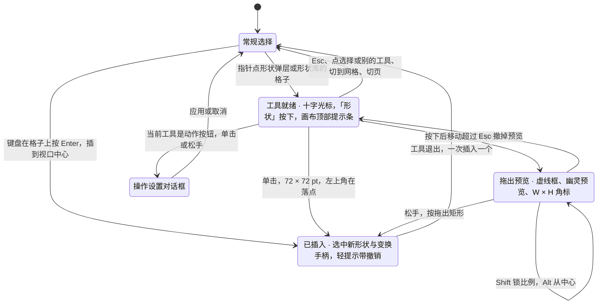
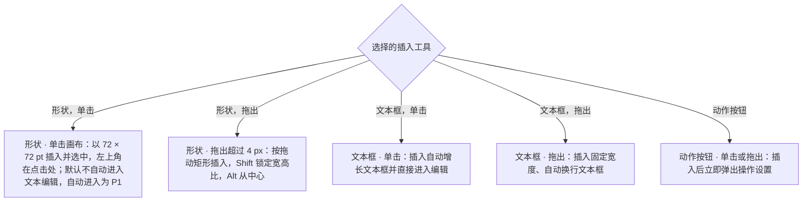

> 状态：草稿 | 负责：设计 | 更新：2026-09-18；2026-09-25（补图）；2026-09-30（§4.21 样张确认回写：形状库定为 10 类、首批 72 项与线条组；新增插入工具态视觉（十字光标、拖出虚线框与尺寸角标、Shift / Alt / Esc）、动作按钮「操作设置」对话框、页眉和页脚对话框、图标面板、符号面板；覆盖 G-77、G-78、G-79、G-81、G-82、G-83）；2026-09-30（§4.21 剩余缺口样张回写 · 整合：页眉和页脚对话框「文本编辑态」一条改为链到 [03-16](16-text-editing-and-formatting.md)「日期和时间格式选择器」，toast 同步；对话框日期格式与语言名和选择器不一致，登记为待决）；2026-09-30（§4.22 设计待决收口：页眉和页脚对话框的日期格式改为与 03-16 同一张 13 种 `datetimeN` 表与同一套语言名，默认第一种 `datetime1`「2026/9/30」，固定日期默认同值，语言下拉宽 128；映射表语料核对为推迟项）；2026-10-07（design-language-v3 第 1 批：按 `shape-library` 与 `insert` 样张整篇改写——设计基准改 v3；新增 §1 形状弹层（常用 4 × 3、「全部形状 72 ›」原位展开，2026-10-07 键盘约定：键盘打开焦点进第一格、方向键漫游、整组一个 Tab 位、Esc 回按钮）；§2 形状库（同一弹层内边距 12、格子圆角 6、P2 行尾标记、工具态时不显示底部提示行、不设搜索）；§3 插入工具态（画布顶部提示条取代状态栏、尺寸角标改强调色实底「W × H」、默认 72 × 72 pt 即 1 in、键盘 Enter 插到视口中心）；§4 变换手柄（调整手柄由黄色改强调色菱形，DS-21、DS-24）与插入后检查器；§5 操作设置（宽 480、主按钮「应用」、分段页签、导入的其他动作只读，右键入口挂 03-05 §9 第 1 条）；§6 页眉和页脚（预览改当前页真实渲染、轻提示按样张原文）；§7 图标面板（宽 640、清除检索、无结果文案）；§8 符号面板（主体高 226、「✓ 已插入」反馈）；§9 状态逐个列出样张状态与路由；依据 rulings §4.25 DS-1、DS-6、DS-15、DS-21、DS-23、DS-24）；2026-10-07（design-language-v3 第 1 批：按 rulings §4.25 TB-5、TB-6、TB-18、DS-27 与第一步影响修订——§2.4 形状库整库一个 Tab 停靠点、方向键漫游，键盘在格子上按 Enter 插到视口中心（PRD ED-05，样张未实现，随实现）；§3.1 默认尺寸的单位按 DS-27；§5 右键「操作设置…」定为形状菜单条目（TB-18），协议白名单改指「插入链接」对话框（TB-6）；§6 写明样张两处日期格式取值一致、产品共用一张 `datetimeN` 映射表；§7 图标网格的 Tab 停靠随实现同此；§9.1 形状库状态补注；§3.3、§3.4、§7 的 1 in、0.2 in 改按 pt 书写（DS-27））；2026-10-08（design-language-v3 第 1 批收口：§4 插入后的形状检查器补「填充」节上方的快速样式（42 格样式库弹层，PRD ED-06 M2 P1，rulings §4.25 DS-31）、「不透明度」同时写填充与描边 alpha（TB-47）与「操作」之后的「替代文本」节（TB-32），并注明样张只画到「操作」；§3.1 默认尺寸注明 PRD 的 1 in 按 TB-37 保留原单位、界面显示值按 DS-27；§3.4、§7 连续插入的错位改回 0.2 in（PowerPoint 默认值保留原单位，TB-37，取代上一条的 14.4 pt 写法）；§6「应用」作用于左栏所选的页（DS-32）；§8 符号面板关闭后焦点回到文本插入符补引 TB-52）；2026-10-08（design-language-v3 第 1 批评审修改：§4 插入后形状检查器的快速样式改为点开后 42 格样式库在「快速样式」节里原位展开（rulings §4.25 DS-34，原「样式库弹层」作废）；§6 页眉和页脚对话框底栏的次按钮注明透明底加细边（DS-37））；2026-10-23（design-language-v3 第 3 批评审修改：§9.1 写明操作设置、页眉和页脚、插入图标三个对话框的各态随 rulings §4.25 DS-142 改画（标题栏 40、圆角 12、× 正文色）） | 依赖：charter v0.2；`10-prd/07-design-coverage-and-gaps.md`；rulings §4.21（R-d-62、R-d-64、R-d-66、R-d-70、R-d-77、q-extra-inserts）、§4.25 DS-1、DS-6、DS-15、DS-21…DS-27、DS-31、DS-32、DS-34、DS-37、TB-5、TB-6、TB-18、TB-32、TB-37、TB-47、TB-52；playground v3 `src/v3/editor/shapes/`、`src/v3/editor/Toolbar.tsx`、`src/v3/scenarios/insert/`

# 03-15 插入菜单与形状库/变换手柄

> **设计基准（2026-10-07 起，rulings §4.25 DS-1、DS-21）**：以 playground `#/v3/editor` 第 1 批样张为准：场景 `shape-library`（形状弹层、形状库、插入工具态、变换手柄、操作设置）与 `insert`（页眉和页脚、插入图标、符号面板）。源码：形状库 72 项与缩略图在 `playground/src/v3/editor/shapes/`（`catalog.tsx`、`ShapeLibrary.tsx`），形状弹层与它的键盘在 `src/v3/editor/Toolbar.tsx`，其余在 `src/v3/scenarios/insert/`（`shape-pick.tsx`、`insert-tool.tsx`、`shape-sections.tsx`、`ActionSettings.tsx`、`HeaderFooter.tsx`、`IconPicker.tsx`、`SymbolPanel.tsx`）。外壳以 [03-02](02-editor-main.md) 为准；入口（工具条「形状」与「更多」、主菜单「插入」）、禁用原因总表与弹层的通用开关约定在 [03-04](04-insert-menu.md)，本文不重复。原插入页签「形状 ▾」大按钮的按下态与状态栏「插入工具：〈名称〉」作废，由工具条「形状」的按下态与画布顶部提示条取代（DS-1、DS-6）。行为口径与前端 [50/10](../../50-frontend/10-editor-shell-and-interaction.md) §7.4、[50/22](../../50-frontend/22-elements-shapes-and-lines.md)、[50/20](../../50-frontend/20-elements-text.md)、[50/23](../../50-frontend/23-elements-media.md) 一致，视觉与文案以本文为准。

本文写插入入口打开之后的界面：形状弹层与形状库、插入工具态、插入后的变换手柄、动作按钮的「操作设置」、页眉和页脚对话框、插入图标对话框与符号面板。覆盖缺口 **G-13**（ED-05，形状插入与几何变换）与 §4.21 新增的 **G-77**（插入工具态）、**G-78**（形状库 72 项、线条与动作按钮）、**G-79**（操作设置对话框）、**G-81**（页眉和页脚对话框）、**G-82**（图标面板）、**G-83**（符号面板）。

---

## 1. 形状弹层：常用 4 × 3 与「全部形状」

```
     ┌────────────────────────┐
     │ [▭]  [▢]  [○]  [△]     │
     │ [◇]  [☆]  [✚]  [⬡]     │
     │ [↔]  [◫]  [╱]  [↗]     │
     ├────────────────────────┤
     │ 全部形状          72 › │
     └────────────────────────┘
                 ↕ 13（距工具条外沿 8）
  ╭───────────────────────────────────────────────╮
  │[选择][文本][形状][图片][表格][图表][评论][ + ]│
  ╰───────────────────────────────────────────────╯
              ↑「形状」按下（强调色底）
```

（格子里的字符只是示意，实际是 20px 线稿图标；依次为矩形、圆角矩形、圆、三角形 ┊ 菱形、星形、十字、六边形 ┊ 左右箭头、对话气泡、直线、箭头线。样张 `shape-library.quick`。）

| 项 | 规格 |
|---|---|
| 弹层 | 锚在「形状」按钮上方、水平居中，距按钮 13（距工具条外沿 8）；`--v3-panel` 底、1px `--v3-border`、圆角 8、内边距 4、`--v3-shadow` |
| 常用 12 项 | 4 列 × 3 行，单元 36（圆角 6）、间距 4，图标 20（描边 1.5）；悬停 `--v3-panel-2` 底；工具提示为中文名，在格子上方；网格 `role="menu"`、`aria-label="形状"`，格子 `role="menuitem"`、`aria-label` 为中文名 |
| 与形状库的对应 | 圆 = 椭圆（`ellipse`）、星形 = 五角星（`star5`）、十字 = 加号（`mathPlus`）、对话气泡 = 圆角矩形标注（`wedgeRoundRectCallout`）、箭头线 = 箭头（`straightConnector1` 带尾箭头），其余同名；点常用格与点形状库里对应的格是同一个插入工具，再打开形状库时那一格高亮 |
| 「全部形状 72 ›」 | 网格下一条贯通的 1px 分隔线，其下一行：高 28、圆角 4、左右内边距 8；左「全部形状」12px，右侧数量 11px 等宽 +「›」（`--v3-text-2`）；`aria-haspopup="dialog"`。点它在同一弹层、同一锚点原位换成完整形状库（§2），焦点移进形状库第一格 |
| 开关 | 「形状」按下（强调色底）、`aria-expanded`；弹层开着时「形状」不弹工具提示；点外部或 Esc 关闭；收起后下次打开从常用 4 × 3 的第一格开始 |
| 选定 | 指针点一个格子：弹层收起，「形状」保持按下，进入该形状的插入工具态（§3），焦点交还「形状」；键盘在格子上按 Enter 见 §3.4 |

**键盘约定**（2026-10-07 样张修正后定稿）：

- 焦点在「形状」上按 Enter 或 Space 打开时，焦点进第一格「矩形」；指针打开时焦点留在「形状」上。单键 S 在单页视图里选中「形状」并展开弹层（03-04 §3）。
- 常用网格整组只占一个 Tab 停靠点（roving tabindex），方向键漫游：← → 逐格移动、首尾回绕；↑ ↓ 跨行（4 列），越过首行或末行时回绕到同一列的另一端；Home / End 到第一格 / 最后一格。Tab 从网格移到「全部形状 72 ›」。
- Esc 关闭弹层、焦点回到「形状」；格子上的工具提示开着时同样一下就关。

---

## 2. 形状库（全部形状 · 72 项）

```
┌─────────────────────────────────────────────────────────────────────────────┐
│ 最近使用  □ □ □ □ □ □ □                                                     │  ← 最多 10 项；没有最近使用时整段与分隔线都不出现
├─────────────────────────────────────────────────────────────────────────────┤
│ 线条      □ □ □ □ □ □ □ ▒ ▒ ▒ [P2]                                          │  ← 末三项 P2 禁用（▒），行尾挂 P2 标记
│ 矩形      □ □ □ □ □                                                         │
│ 基本形状  □ □ □ □ □ □ □ □ □ □ □ □                                           │
│           □ □                                                               │  ← 超过 12 项换行
│ 箭头      □ □ □ □ □ □ □ □                                                   │
│ 公式形状  □ □ □ □ □ □                                                       │
│ 流程图    □ □ □ □ □ □ □ □                                                   │
│ 星与旗帜  □ □ □ □ □                                                         │
│ 标注      □ □ □ □                                                           │
│ 动作按钮  □ □ □ □ □ □ □ □ □ □ □ □                                           │
├─────────────────────────────────────────────────────────────────────────────┤
│ 单击插入 72 × 72 pt，或拖出大小  [Shift] 锁定比例  [Alt] 从中心  [Esc] 取消 │  ← 已选定插入工具时不显示（画布顶部提示条已有）
└─────────────────────────────────────────────────────────────────────────────┘
```

（`□` 是一个 28 × 28 的格子，`▒` 是不可用的 P2 格；实际缩略图是预设几何的线稿：24 视框、无填充、渲染描边 1.5，与 Lucide 图标同一笔画。产品里构建期由 preset-table 按同一几何路径生成 SVG sprite（R-d-66），不用 emoji，也不用位图。样张 `shape-library.library`。）

### 2.1 尺寸与布局

| 项 | 规格 |
|---|---|
| 弹层 | 与常用 4 × 3 是同一弹层原位切换，锚点与位置不变；内边距 12；`role="dialog"`、`aria-label="形状库"`；宽随内容：类名列 56 + 间距 8 + 12 × 28 + 11 × 4 = 444，加内边距约 468 |
| 格子区 | 最大高度为视口高度减 280，超出在格子区内纵向滚动；底部提示行固定在格子区下方 |
| 类名列 | 宽 56、高 28，12px `--v3-text-2`，与该类第一行格子顶对齐 |
| 格子 | 28 × 28、圆角 6、间距 4（行距同）；缩略图 20；每类一行最多 12 格，超过换行（基本形状 14 项占两行） |
| 最近使用 | 置顶，其下一条贯通弹层的 1px 分隔线；最多 10 项，存本机（个人偏好，不写入文档、不同步），不计入 72 项；没有最近使用时整段与分隔线都不出现（§9.2）。样张为 7 项：矩形、圆角矩形、椭圆、右箭头、箭头、圆角矩形标注、五角星 |
| P2 标记 | 线条行末三项（曲线、任意多边形、自由曲线）不可用，行尾挂一个 `P2` 标记（占两格宽，样式同 03-04 §7.3） |
| 底部提示行 | 贯通的 1px 分隔线下，12px `--v3-text-2`：左「单击插入 72 × 72 pt，或拖出大小」，右侧依次键帽 Shift「锁定比例」、Alt「从中心」、Esc「取消」；已选定插入工具时不显示（画布顶部提示条已有同一句，同一信息不在同屏出现两次） |
| 搜索 | 不设：PRD 07 G-78 定为「可选搜索框，样张决定」，2026-09-30 与 v3 样张都不设；按名称直达走命令面板 ⌘K |

### 2.2 各类清单（首批 72 项，顺序即 ED-05 验收枚举顺序）

| 类 | 数量 | 条目（工具提示名称） |
|---|---|---|
| 线条 | 10 | 直线、箭头、双箭头、肘形连接符、肘形箭头连接符、曲线连接符、曲线箭头连接符；曲线、任意多边形、自由曲线（P2，不可用） |
| 矩形 | 5 | 矩形、圆角矩形、剪去单角的矩形、剪去同侧角的矩形、同侧圆角矩形 |
| 基本形状 | 14 | 椭圆、等腰三角形、直角三角形、平行四边形、梯形、菱形、正五边形、六边形、八边形、圆柱形、立方体、同心圆、心形、闪电形 |
| 箭头 | 8 | 右箭头、左箭头、上箭头、下箭头、左右箭头、直角箭头、五边形箭头、燕尾形 |
| 公式形状 | 6 | 加号、减号、乘号、除号、等号、不等号 |
| 流程图 | 8 | 流程图：过程、可选过程、决策、数据、预定义过程、文档、终止、接点 |
| 星与旗帜 | 5 | 四角星、五角星、六角星、爆炸形 1、波形 |
| 标注 | 4 | 矩形标注、圆角矩形标注、椭圆形标注、线形标注 |
| 动作按钮 | 12 | 后退或前一项、前进或下一项、转到开头、转到结尾、转到主页、获取信息、返回、视频、文档、声音、帮助、空白（工具提示前缀「动作按钮：」） |

「10 类」= 最近使用 + 上表 9 类。线条组的直线与各类连接符插入时落 `p:cxnSp`（R-d-64，导入的 sp + line 不改写），箭头与双箭头记首尾箭头；线条选中后只显示两个端点手柄，无旋转手柄。动作按钮统一为圆角方框内画语义图形，每项带默认动作（§5）。

### 2.3 格子状态

| 状态 | 视觉 |
|---|---|
| 默认 | `--v3-text` 线稿 |
| 悬停 | `--v3-panel-2` 底 |
| 键盘聚焦 | 2px 强调色焦点环（`:focus-visible`，03-02 §7） |
| 当前插入工具（`aria-pressed`） | `--v3-accent-soft` 底 + 强调色线稿；同一预设在「最近使用」与所属类里同时高亮（样张 `shape-library.library-armed`） |
| P2 不可用（`aria-disabled`） | `--v3-text-3` 线稿、无悬停底、点了无效，仍可聚焦；工具提示「曲线 · 绘制曲线排在后续版本（P2）」（任意多边形、自由曲线同式）；读屏名「曲线（P2，暂不可用）」 |

### 2.4 键盘

- 每类是一个 `role="group"`（`aria-label` 为类名），格子是按钮（`aria-label` 为中文名，状态见 §2.3）。
- **整库只占一个 Tab 停靠点**（roving tabindex，rulings §4.25 TB-5）：只有焦点所在的一格可被 Tab 到达，方向键在库内漫游；从「全部形状 72 ›」进来时焦点落在第一格。与常用 4 × 3、表格网格、占位符图标条同一模式（设计 [07](../07-accessibility-and-i18n.md) §1.2、§1.2b）。弹层里没有别的可聚焦项，Tab / ⇧Tab 按弹层规则在层内循环，焦点留在库内（07 §2.3）。样张现为每格各一个 Tab 停靠点，随实现改。
- 方向键：← → 在格子间连续移动，行尾接下一行行首、跨类连续；↑ ↓ 按行移动并保持列位，落到较短的行时取该行最后一格；P2 格同样可停。
- Enter（Space 同）：不经工具态，按默认尺寸插到视口中心并选中（§3.4，PRD ED-05）；P2 格无效。样张里键盘 Enter 与指针单击一样只是选定工具，键盘插入未实现，随实现按本条。指针单击格子：选定插入工具（§3）。
- Esc：关闭整个弹层，焦点回到「形状」。

---

## 3. 插入工具态（G-77）

```
←───── 240 ─────→←───────────────────── 画布（cursor: crosshair） ─────────────────────→←──────── 280 ────────→
┌────────────────┬──────────────────────────────────────────────────────────────────────┬──────────────────────┐
│[Logo▾]   [▭][▦]│      ╭───────────────────────────────────────────────────────╮       │(周)(王)(李)  ▶ [分享]│
│Q2 业绩汇报 ▾   │      │ ▢ 插入 · 圆角矩形  单击插入或拖出 │ Shift · Alt · Esc │       │[设计] 评论      77% ▾│
│✓ 已同步        │      ╰───────────────────────────────────────────────────────╯       ├──────────────────────┤
│[新建幻灯片▾][+]│                                                                      │幻灯片 6              │
│                │  ┌────────────────────────────────────────────────────────────────┐  ├──────────────────────┤
│⋮               │  │ 下半年计划                                                     │  │版式                  │
│5 ┌──────────┐  │  │ ▔▔                                                             │  │[▭ 仅标题          ▾] │
│  │ 区域分布 │  │  │                                     ●┌╌╌╌╌╌╌╌╌╌╌╌╌╌╌╌╌╌╌╌╌╌╌┐  │  ├──────────────────────┤
│  └──────────┘  │  │ ╭──────────────╮  ╭──────────────╮   ╎ ╭──────────────────╮ ╎  │  │主题                  │
│6 ┏━━━━━━━━━━┓  │  │ │ 阶段 1 · 拓展│→ │ 阶段 2 · 提效│→  ╎ │ 幽灵预览         │ ╎  │  │[色块] Office  [调整] │
│  ┃下半年计划┃  │  │ ╰──────────────╯  ╰──────────────╯   ╎ ╰──────────────────╯ ╎  │  ├──────────────────────┤
│  ┗━━━━━━━━━━┛  │  │                                      └╌╌╌╌╌╌╌╌╌╌╌╌╌╌╌╌╌╌╌╌╌╌┼  │  │背景                  │
│                │  │                                            [246 × 120]         │  │…                     │
│                │  │                                                                │  │                      │
│                │  │ 2026 年 Q2 业绩汇报                                         6  │  │                      │
│                │  └────────────────────────────────────────────────────────────────┘  │                      │
│                │                                                                      │                      │
│                │          ╭───────────────────────────────────────────────╮           │                      │
│                │          │[选择][文本][形状][图片][表格][图表][评论][ + ]│           │                      │
│                │          ╰───────────────────────────────────────────────╯           │                      │
│                │                       ↑ 按下（强调色底）                             │                      │
└────────────────┴──────────────────────────────────────────────────────────────────────┴──────────────────────┘
```

（提示条文案在线框里缩写，全文见 §3.1。样张 `shape-library.insert-ready`（就绪）、`shape-library.insert-drag`（拖出中）。）

### 3.1 视觉

| 部件 | 规格 |
|---|---|
| 光标 | 画布内 CSS `cursor: crosshair`；样张另画一个深色细线 + 白色描边的十字作替身（系统光标拍不进截图），产品不画 |
| 工具条 | 「形状」保持按下；再打开形状库时当前工具格高亮（§2.3）；换别的工具即清掉当前插入工具 |
| 提示条 | 画布顶部居中、距画布顶 12（有横幅时排在横幅下）：`--v3-panel` 实底、1px `--v3-border`、`--v3-shadow`，高 36、圆角 12、左右内边距 12、元素间距 12，12px `--v3-text-2`，不换行；内容依次为 16px 强调色缩略图、「插入 · 〈名称〉」（600、`--v3-text`）、「单击插入 72 × 72 pt，或拖出大小」、竖分隔、键帽 Shift「锁定比例」、Alt「从中心」、Esc「取消」；`role="status"`、`aria-live="polite"`，读屏名「插入工具：〈名称〉」。取代原状态栏里的「插入工具：〈名称〉」（DS-6） |
| 默认尺寸 | 72 × 72 pt 即 1 in × 1 in（PRD ED-05 按 PowerPoint 默认值写作 1 in，保留原单位，rulings §4.25 TB-37）；提示条、底部提示行与尺寸角标里的数值是界面显示值，文档与样张按 pt 书写，产品按设置的度量单位显示（中文默认 cm、英文默认 in，03-23；DS-27） |
| 拖出预览 | 按下后移动超过 4 px 才算拖出：起点 6px 强调色圆点（2px 白色外圈）；1.5px 强调色虚线包围框；幽灵预览按真实预设几何画（强调色 10% 填充、45% 描边；圆角矩形默认圆角 = 短边 × 16.667%）；线条类不画包围框，只画强调色线段；终点是十字光标 |
| 尺寸角标 | 包围框下方居中、下移 8：高 18、圆角 4、`--v3-accent-solid` 底白字、11px 等宽，写「W × H」（样张「246 × 120」）；与选中框的尺寸标签同一组件（03-02 §3.2） |
| 修饰键 | Shift 锁定比例（线条约束到 0° / 45° / 90°）；Alt 以按下点为中心（线条无此项）；拖出中 Esc 撤掉预览、回到工具就绪，工具就绪时 Esc 退出工具态（形状弹层开着时第一下 Esc 先收起弹层） |
| 文本框工具 | 「文本」同样进入工具态（十字光标、提示条、单击或拖出）；样张只画了形状的工具态，文本框的提示条按同式写「插入 · 文本框 · 单击插入自动增长文本框，或拖出固定宽度 │ Esc 取消」 |
| 退出 | Esc、点「选择」或别的创建工具、切到网格视图、在左栏或检查器按下指针、切换当前页，都退出工具态且不产生命令（50/10 §7.4）；再点「形状」是重新打开形状弹层（当前工具格高亮），不退出工具态 |

### 3.2 状态机

**图 3-1 插入工具态**



怎么读：只有「已插入」与「操作设置」会写文档，其余都是本机界面状态（不广播、不入历史）；单击与拖出的分界是 4 px；键盘不经过指针状态，从格子直接插到视口中心；形状工具一次只插入一个，插入后回到常规选择（锁定连续绘制 P2）；动作按钮在插入完成的同一刻弹出操作设置，插入与设置合为一个撤销步。状态机的实现细节（阈值配置、协同与失败分流）以 [50/10](../../50-frontend/10-editor-shell-and-interaction.md) §7.4 为准。
依据：rulings §4.21 R-d-62、R-d-77；PRD ED-05；样张 `src/v3/scenarios/insert/shape-pick.tsx`、`insert-tool.tsx`。

### 3.3 插入交互：单击 vs 拖出

- **形状**：单击画布按 72 × 72 pt 插入，左上角在点击处，并选中；线条为起点在点击处的 72 pt（1 in）水平线。拖出：按拖出矩形插入（Shift 锁定宽高比，Alt 从中心）。
- **插入之后**：默认不自动进入文本编辑（自动进入为 P1，默认关，保留「先摆位置再输文字」的顺序）；画布轻提示「已插入 · 〈名称〉」带「撤销」（中性，工具条上方 12），撤销即去掉新形状、回到无选中；live region 播报「已插入〈名称〉」（50/16 §8）。
- **文本框**：单击插入自动增长文本框并直接进入编辑；拖出插入固定宽度、自动换行的文本框；空文本框退出编辑即删除，并与插入合为一个撤销步（R-d-65）。
- **动作按钮**：单击或拖出插入后立即弹出操作设置（§5）。

**图 3-2 插入交互：单击 vs 拖出**



怎么读：同一个工具的单击与拖出得到不同结果；形状默认不进入文本编辑，是为了保留「先摆位置再输文字」的常见顺序；动作按钮额外多一步操作设置。
依据：PRD ED-05；rulings §4.21 R-d-62、R-d-65、R-d-77。

### 3.4 键盘插入（视口中心）

焦点在常用 4 × 3 或形状库的格子上按 Enter（Space 同）：不经工具态，按默认尺寸插到视口中心并选中，连续插入同一形状依次错位 0.2 in（引用 PowerPoint 默认值的行为常量，保留原单位，rulings §4.25 TB-37）；弹层收起。焦点在工具条「文本」上按 Enter，同样在视口中心插入文本框并进入编辑。这是插入工具态的键盘等价（WCAG 2.5.7；PRD ED-05、50/10 §7.4、设计 [07](../07-accessibility-and-i18n.md) §1.2a）。样张里键盘激活格子与指针单击一样只是选定工具，键盘插入样张未画，实现按本条。

---

## 4. 插入之后：选中与变换手柄（G-13）

```
                  ○                  ← 旋转手柄
                  │
  ▪─◆─────────────▪───────────────▪  ← ◆ 调整手柄（圆角矩形在上沿，距左 = 圆角半径）
  │                               │
  ▪           圆角矩形            ▪  ← ▪ 缩放手柄（四角 + 四边中点，共 8 个）
  │                               │
  ▪───────────────▪───────────────▪
             [246 × 120]             ← 尺寸角标
```

样张 `shape-library.inserted`：第 6 页「下半年计划」第 3 个阶段框，圆角矩形 246 × 120。

| 手柄 | 外观 | 交互 | 反馈 |
|---|---|---|---|
| 8 个缩放手柄 | 四角 + 四边中点；8 × 8 方块、圆角 1，白底（`--v3-handle-fill`）、1px 强调色边；选中框 1px 强调色线 | 拖动缩放；Shift 锁比例；Alt 以中心缩放 | 拖动中框下方的尺寸角标随之更新（「W × H」，单位见 §3.1） |
| 旋转手柄 | 上沿正中上方：直径 10 的圆、白底 1px 强调色边，距上沿 16，以 12 长的 1px 强调色细线相连 | 拖动旋转；Shift 步进 15° | 拖动中显示角度角标（如「45°」，样张未画） |
| 调整手柄 | 只在有 `avLst` 的形状上，每个 `gd` 一个：8 × 8 强调色菱形、1px 白边；圆角矩形在上沿、距左等于圆角半径 | 拖动实时改几何（如圆角半径），P1 | 无数值角标，靠形状直接反馈；数值等价在检查器（50/22 §2.3） |
| 线条两端点 | 两个直径 10 的圆、白底 1px 强调色边；无旋转手柄 | 拖动改端点；Shift 约束 0° / 45° / 90°；靠近形状时显示连接点（03-17「连接符端点吸附」） | — |
| Esc（拖动中） | — | 取消当前拖动，恢复到拖动前 | — |

- 调整手柄原先的黄色作废，改用强调色、以菱形区分（已拍板样张 `insert-tool.tsx`，rulings §4.25 DS-21；与 DS-24「选中框与参考线统一用强调色、界面只保留一种彩色」同一取舍）。
- **检查器**：标题为形状名（如「圆角矩形」），分区依次为对齐行、位置与大小、快速样式、填充、描边、阴影、不透明度、操作、替代文本（分区规格以 03-02 §4.2 为准）。快速样式在「填充」节上方：一行主题样式缩略图，点开后 42 格样式库在本节里、缩略行下方原位展开，不遮挡画布（PRD ED-06，M2 P1，rulings §4.25 DS-31；DS-34 修订了原定的「样式库弹层」，规格见 03-02 §4.2）；「不透明度」同时写填充与描边颜色的 alpha（OOXML 形状没有整体不透明度，`slide.setShapeOpacity`，一步撤销，TB-47）；「替代文本」在「操作」之后，与图片同一组件（描述框、标记为装饰性、缺失警示，03-18 §5.4，TB-32）。样张 `shape-library.inserted` 只画到「操作」：快速样式按 DS-31 补样张状态，替代文本节随实现。新形状只写 `p:style` 主题引用（R-d-63），填充与描边的颜色行显示「主题样式 · 强调 1」「主题样式 · 强调 1 深色 25%」而非具体色值；「操作」一行显示「单击时 无动作 ›」，点开即操作设置（§5）。
- **轻提示**：「已插入 · 圆角矩形」带「撤销」，见 §3.3。

---

## 5. 动作按钮「操作设置」对话框（G-79）

```
┌──────────────────────────────────────────────────────────────────────┐
│ 操作设置                                                         [×] │
├──────────────────────────────────────────────────────────────────────┤
│ [▶] 动作按钮「前进或下一项」· 放映时生效，编辑时 ⌘ + 单击可预览      │
│ ┌──────────────────────────────┬─────────────────────────────┐       │
│ │           单击鼠标           │       鼠标悬停 [P2]         │       │  ← 分段页签；「鼠标悬停」P2 禁用而不隐藏
│ └──────────────────────────────┴─────────────────────────────┘       │
│ 单击时                                                               │
│ ○ ⊘ 无动作                                                           │
│ ● › 下一张幻灯片                 ○ ‹ 上一张幻灯片                    │
│ ○ « 第一张幻灯片                 ○ » 最后一张幻灯片                  │
│ ○ ↺ 最近观看的幻灯片             ○ ☒ 结束放映                        │
│ ○ ▤ 指定幻灯片…                  ○ ∞ 网址（URL）…                    │
│     [3. 关键指标                 ▾]                                  │  ← 仅选「指定幻灯片…」时出现（「网址（URL）…」时为地址输入）
│ ☑ 单击时突出显示                                                     │
│ ⓘ 运行程序、运行宏、播放声音不在此设置；导入文件里已有的会原样保留。 │
├──────────────────────────────────────────────────────────────────────┤
│                                                       [取消]  [应用] │
└──────────────────────────────────────────────────────────────────────┘
```

- **触发**：插入动作按钮后立即弹出（R-d-77），关闭后焦点回到「形状」；检查器「操作」一行（任何形状都有：「单击时 〈当前动作〉 ›」）点开同一对话框，关闭后焦点回到那一行；形状右键「操作设置…」打开同一对话框，关闭后焦点交回画布（[03-05](05-context-menu.md) §3「形状」，rulings §4.25 TB-18；右键条目样张未画，随实现）。插入 M2 P0，操作设置 M2 P1。样张 `shape-library.action-settings`、`shape-library.action-slide`。
- **布局**：宽 480；标题「操作设置」+ 右上「×」；说明行左侧 24 × 24、圆角 4 的强调色浅底图块，内画该形状的 16px 缩略图（强调色），右侧「动作按钮「〈名称〉」· 放映时生效，编辑时 ⌘ + 单击可预览」（普通形状写「形状「〈名称〉」…」；Windows / Linux 显示 Ctrl + 单击）。
- **页签**：分段控件（`role="tablist"`）「单击鼠标」「鼠标悬停」；「鼠标悬停」带 `P2` 标记、不可用但可聚焦，工具提示「悬停触发的动作排在后续版本（P2）；导入文件里已有的悬停动作原样保留」。
- **跳转目标**：「单击时」小标题（12px `--v3-text-2`）下 9 项单选（`role="radiogroup"`），两列、列距 24，「无动作」独占一行；每项高 28，单选点后是 16px 图标（`Ban`、`ChevronRight`、`ChevronLeft`、`ChevronsLeft`、`ChevronsRight`、`History`、`SquareX`、`GalleryVerticalEnd`、`Link2`）与文字。目标与 OOXML 对应：无动作（不写 `hlinkClick`）、下一张 `jump=nextslide`、上一张 `jump=previousslide`、第一张 `jump=firstslide`、最后一张 `jump=lastslide`、最近观看 `jump=lastslideviewed`、结束放映 `jump=endshow`（后两项为 R-d-77 补入）、指定幻灯片 `hlinksldjump`、网址为外部关系。
- **附加字段**：选「指定幻灯片…」时下方缩进 24 出现页选择下拉（「序号. 标题」，样张选「3. 关键指标」）；选「网址（URL）…」时为地址输入（占位 `https://example.com`，协议白名单 http / https / mailto / tel 与「插入链接」对话框一致，03-16 §5.1）。
- **默认动作**（打开时预选）：后退或前一项 → 上一张；前进或下一项 → 下一张；转到开头、转到主页 → 第一张；转到结尾 → 最后一张；返回 → 最近观看；获取信息、视频、文档、声音、帮助、空白 → 无动作。普通形状缺省「无动作」。
- **「单击时突出显示」**复选，默认勾选（`highlightClick`）。
- **说明行**：信息图标 +「运行程序、运行宏、播放声音不在此设置；导入文件里已有的会原样保留。」，常驻。导入文件里本对话框不认识的动作只读展示为「其他动作（保留原设置）」、不可改，「应用」不清除它（PRD 07 G-79，样张未画）。
- **应用 / 取消**：底栏「取消」「应用」（主按钮）。应用后轻提示「已设置单击动作 · 〈目标〉」带「撤销」（样张未画）；动作按钮的插入与设置是同一事务、一个撤销步（`slide.insertShape` + `slide.setAction`），普通形状的设置自成一步；取消时动作按钮保留并带默认动作。

---

## 6. 页眉和页脚对话框（G-81）

```
┌───────────────────────────────────────────────────────────────────────────┐
│ 页眉和页脚                                                            [×] │
├───────────────────────────────────────────────────────────────────────────┤
│ 给幻灯片加日期、编号和页脚文字，内容写入版式上的页脚占位符。              │
│ ☑ 日期和时间                                         预览 · 第 4 页       │
│     ● 自动更新 [2026/9/30       ▾][中文（中国）▾]   ┌────────────────┐    │  ← 非当前方式的控件禁用（选「固定」后可编辑）
│     ○ 固定     [2026/9/30                       ]   │ 营收趋势       │    │
│ ☑ 幻灯片编号                                        │ 当前页真实渲染 │    │  ← 版式缺编号占位符时禁用，右侧写「当前版式没有此占位符」
│ ☑ 页脚                                              │[日期][页脚][4] │    │
│     [2026 年 Q2 业绩汇报 · 内部资料             ]   └────────────────┘    │
│ ────────────────────────────────────────────────    2026/9/30 ·           │
│ ☑ 标题幻灯片中不显示                                2026 年 Q2 业绩汇报 · │
│                                                     内部资料 · 4          │
├───────────────────────────────────────────────────────────────────────────┤
│ 应用：所选 1 页 · 全部应用：6 页               [取消]  [应用]  [全部应用] │
└───────────────────────────────────────────────────────────────────────────┘
```

- **入口**：「更多 › 页眉和页脚…」与主菜单「插入 › 页眉和页脚…」；未在编辑文字时「日期和时间…」「幻灯片编号…」也打开本对话框（[03-04](04-insert-menu.md) §7.4）。关闭后焦点回到「更多」。M2 P2，命令 `slide.setHeaderFooter`（R-d-70）；母版侧复选 M3。样张 `insert.header-footer`。
- **布局**：宽 640；标题「页眉和页脚」+「×」，说明「给幻灯片加日期、编号和页脚文字，内容写入版式上的页脚占位符。」；正文左栏表单、右栏 160 宽预览，间距 20；复选行高 28，子项缩进 24。
- **日期和时间**：复选；「自动更新」单选（宽 88）+ 格式下拉（13 种 `datetimeN`，与 03-16 同一张表：列所选语言的 `datetime1`…`datetime13`，默认第一种 `datetime1`「2026/9/30」；存格式编码、不存列表下标，换语言后仍指向同一 `datetimeN`；样张对话框 `insert/HeaderFooter.tsx` 的 `ZH_FORMATS` 只另写了一组中文取值，与选择器 `text-edit/pickers.tsx` 的 `DT_FORMATS` 中文一组逐项相同，产品两处共用一张三语映射表，03-16 §7.3）+ 语言下拉（中文（中国）/ 英语（美国）/ 日语，与 03-16 同一套界面语言名，宽 128）；「固定」单选 + 文本输入，默认与 `datetime1` 同值「2026/9/30」。非当前方式的控件不可用（「固定」输入框的工具提示「选「固定」后可编辑」）；关闭日期时其下子项一并不可用（文字退到 `--v3-text-3`，不用半透明）。样张固定时刻 2026-09-30 14:32:05，与 03-16 相同。映射表本身待 70 线语料核对，推迟（触发条件：M2 P2 `slide.setHeaderFooter` 开工前 70 线交付三语 PowerPoint 另存语料，见 rulings §4.22），核对后本对话框与 03-16 同步更新。
- **幻灯片编号**、**页脚**（复选 + 文本输入，样张「2026 年 Q2 业绩汇报 · 内部资料」，关闭时输入不可用）、分隔线下「标题幻灯片中不显示」。
- **预览**：标题「预览 · 第 N 页」（高 28、12px `--v3-text-2`）；当前页的真实缩小渲染（不用灰条，设计质量门 Q8），叠加三个页脚族占位符的位置——日期左、页脚中、编号右；启用 = 强调色实线 + 强调色浅底并写出内容，关闭 = 灰色虚线；预览下方一行摘要（12px `--v3-text-2`，如「2026/9/30 · 2026 年 Q2 业绩汇报 · 内部资料 · 4」，只在「 · 」处换行，全部关闭时「不显示页脚」）。
- **应用范围**：底栏左侧「应用：所选 N 页 · 全部应用：M 页」；右侧「取消」「应用」（次按钮：透明底加 1px 细边，rulings §4.25 DS-37）「全部应用」（主按钮）。「应用」只作用于左栏所选的页（PRD ED-31 按样张改，rulings §4.25 DS-32），「全部应用」作用于全部页，各为一个事务、一个撤销步；对话框关闭后画布轻提示「已把页眉和页脚应用到所选 N 页」或「已把页眉和页脚应用到全部 M 页」，带「撤销」；页数多时显示确定态进度（样张未画）。
- **缺占位符**（样张 `insert.header-footer-missing`）：版式里没有对应的页脚族占位符时，该项不可用、右侧写「当前版式没有此占位符」（工具提示同文），预览里不画那个位置；页脚族占位符按确定性 id 生成（R-d-70）。
- **文本编辑态**：插入符在文本里时，「幻灯片编号」直接在插入符处插入页码字段，「日期和时间…」打开格式选择器（03-04 §7.4）；选择器的格式、默认值与插入后的提示见 [03-16](16-text-editing-and-formatting.md)「日期和时间格式选择器」，行为口径同 [50/20](../../50-frontend/20-elements-text.md) §3。

---

## 7. 图标面板：插入图标对话框（G-82）

```
┌─────────────────────────────────────────────────────────────────────────────┐
│ 插入图标                                                                [×] │
├─────────────────────────────────────────────────────────────────────────────┤
│ 线性图标，插入后是可改色的 SVG 图片；可多选。                               │
│ [⌕ 搜索图标，如 增长、团队、目标                                          ] │
│ 全部            93   [▢][▢][▢][▢][▢][▢][▢][▢]                               │
│ 商务            14   [▢][▢][▢][▢][▢][▢][✓][▢]                               │  ← 选中格：强调色浅底 + 强调色图标 + 右上角对勾点
│ 数据            12   [▢][▢][▢][▢][✓][▢][▢][▢]                               │
│ 人物与沟通      12   [▢][▢][✓][▢][▢][▢][▢][▢]                               │
│ 科技            14   [▢][▢][▢][▢][▢][▢][▢][▢]                               │
│ 教育             8   …（8 列，区域高 308，超出滚动）                        │
│ 自然             8                                                          │
│ 交通与地点      10                                                          │
│ 标志与提示      15                                                          │
│ Lucide 图标（ISC）                                                          │
├─────────────────────────────────────────────────────────────────────────────┤
│ 已选 3 个 · 插入为 72 × 72 pt，颜色取主题文字色         [取消]  [插入 3 个] │
└─────────────────────────────────────────────────────────────────────────────┘
```

- **形态**：模态对话框（PRD 07 G-82「抽屉或大弹层，样张决定」→ 对话框），宽 640；入口「更多 › 图标…」与主菜单「插入 › 图标…」（03-04），关闭后焦点回到「更多」。M3 P2（q-extra-inserts）。样张 `insert.icons`。
- **搜索**：输入框带放大镜前缀，占位「搜索图标，如 增长、团队、目标」；有检索词时尾部显示「N 个结果」与「×」清除检索；检索中文名、补充词与英文 id，分类与检索同时生效。
- **分类栏**：左侧 128 宽，每项高 28、圆角 4、12px，右侧 11px 等宽计数；当前分类 `--v3-panel-2` 底、500 字重、`--v3-text`，其余 `--v3-text-2`；样张 8 类共 93 个（全部 93、商务 14、数据 12、人物与沟通 12、科技 14、教育 8、自然 8、交通与地点 10、标志与提示 15）；栏底注「Lucide 图标（ISC）」。
- **网格**：区域高 308，超出纵向滚动；8 列方格、间距 6、圆角 6，图标 24（描边 1.5）；多选：选中格为 `--v3-accent-soft` 底 + 强调色图标 + 右上角 16px 强调色圆点白对勾；工具提示与读屏名为中文名（`role="listbox"`、`aria-multiselectable`，格 `role="option"`、`aria-selected`）。产品实现网格虚拟化。
- **无结果**（样张 `insert.icons-empty`）：网格区居中两行——「没有匹配「〈词〉」的图标」（12px `--v3-text`）、「换个说法试试，如「飞机」「科技」，或清空检索浏览全部分类」（12px `--v3-text-2`）；分类栏保持可点，清空检索即恢复。
- **底栏**：左「已选 N 个 · 插入为 72 × 72 pt，颜色取主题文字色」（未选时「未选择 · …」）；右「取消」「插入 N 个」（主按钮；未选时为「插入」、不可用，工具提示「先选择至少一个图标」）。
- **插入后**：对话框关闭，画布轻提示「已插入 N 个图标」带「撤销」；N 个图标一个事务，按视口中心依次错位 0.2 in（保留原单位，TB-37）插入并全部选中；每个图标是 SVG 图片（带 PNG 回退），替代文本预填图标中文名，之后的改色与图片操作见 [03-18](18-image-editing.md)「SVG 与图标」（样张 `image-editing.icon`）。
- **键盘**：方向键在网格中移动、Space 勾选、Enter 插入（PRD 07 G-82）；网格整组一个 Tab 停靠点，与形状库同一模式（07 §1.2b）；样张未接方向键、每格各是一个 Tab 停靠点，随实现改；图标随应用打包、按分类惰性加载，无网络时照常可用。

---

## 8. 符号面板（G-83）

```
┌────────────────────────────────────────────────────────────────┐
│ [⌕ 搜索名称或码位，如 箭头、2192                             ] │
│ 最近使用       箭头                          U+2190–21FF       │
│ 拉丁-1 补充    ←  ↑ [→] ↓  ↔  ↕  ↖  ↗                          │
│ 希腊字母       ↘  ↙  ↚  ↛  ↩  ↪  ↰  ↱                          │
│ …              …（8 列，格高 36，6 行可见，超出滚动）          │
│ [箭头]                                                         │
│ 数学运算符                                                     │
│ …                                                              │
├────────────────────────────────────────────────────────────────┤
│ [ → ]  向右箭头                                       [插入 ↵] │  ← 插入后按钮短暂变为「✓ 已插入」，面板保持打开
│        U+2192 · RIGHTWARDS ARROW · 箭头                        │
└────────────────────────────────────────────────────────────────┘
```

- **形态**：非模态弹层，宽 468、内边距 12，锚在「更多」上方、水平居中（距按钮 13，与工具条上的其他弹层一致）；入口「更多 › 符号…」与主菜单「插入 › 符号…」，仅在文本编辑态可用（否则不可用，右侧「先在文本框中放置光标」，03-04 §7.3）。M3 P2（q-extra-inserts）。样张 `insert.symbols`。
- **焦点**：打开后焦点进入面板（落在搜索框），文本编辑态不退出、插入符留在原位（50/10 §7.4「浮层与文本编辑」）；插入后焦点回到文本、插入符在新字符之后，面板保持打开以便连续插入；Esc 关闭面板，焦点与插入符回到文本（rulings §4.25 TB-52；样张未画，通用弹层关闭后把焦点交回「更多」，随实现按本条）。
- **搜索**：占位「搜索名称或码位，如 箭头、2192」；匹配中文名、英文字符名、区块名与十六进制码位（可带 `U+`）；有检索词时标题改为「搜索结果」、右侧「N 个」。
- **区块栏**：左侧 128 宽、与字符网格同高 226（6 行字符格），可滚动；每项高 28、圆角 4、12px；首项「最近使用」，其后按 Unicode 区块：拉丁-1 补充、希腊字母、常用标点、上标和下标、货币符号、字母式符号、数字形式、箭头、数学运算符、带圈字母数字、几何图形、杂项符号、装饰符号、CJK 符号和标点、全角 ASCII；当前区块 `--v3-panel-2` 底、500 字重；首次打开把当前区块滚到栏中部。
- **字符网格**：标题行左为区块名（12px 600）、右为码位范围（11px 等宽），「最近使用」时右侧写「仅自己可见」；8 列、格高 36、间距 2、字号 18、圆角 6；选中格 `--v3-accent-soft` 底 + 强调色字 + 1px 强调色内描边；`role="listbox"`，格 `role="option"`，读屏名「中文名 + 码位」。产品只收默认以文本呈现的码位（避开 `Emoji_Presentation=Yes`），保证插入后按正文字体渲染。
- **最近使用**：每人记忆、不写入文档，最多 12 个，刚插入的排到最前。
- **预览底栏**：贯通的 1px 分隔线下；44 × 44、圆角 4、`--v3-panel-2` 底的放大预览（字号 24）；中文名（13px 600，缺名时显示区块名）；次行 12px 等宽「码位 · 英文 Unicode 名 · 区块」；右侧主按钮「插入 ↵」（最小宽 72）。
- **插入**：点「插入」、按 Enter、双击格子三种方式等价（Enter 与双击样张未画），调用 `slide.insertText`（无需新命令）；插入后「插入」按钮 1.5 秒内显示「✓ 已插入」，读屏经 `role="status"` 播报「已插入「→」」。

---

## 9. 状态

### 9.1 样张状态

路由前缀 `#/v3/editor?state=`，加 `&theme=dark|light`。在 `shape-library` 的任一状态里点形状格子都能进入工具态，单击画布即插入 72 × 72 pt 并选中、轻提示带撤销。2026-10-23 起 kit 对话框按 rulings §4.25 DS-142 改为标题栏 40、圆角 12、× 用正文色（设计 04 §4.1a）：下表的对话框各态（`shape-library.action-settings`、`action-slide`，`insert.header-footer`、`header-footer-missing`、`icons`、`icons-empty`）随之改画，要点不变。

| 状态 | 路由 | 要点 | 里程碑 |
|---|---|---|---|
| 形状 ▾ · 全部形状入口 | `shape-library.quick` | 常用 4 × 3 不变，底部「全部形状 72 ›」，点它原位展开形状库 | M2 P0 |
| 全部形状 · 72 项 | `shape-library.library` | 最近使用置顶 + 9 类；线条末三项 P2 不可用并挂 P2；底部提示行。整库一个 Tab 停靠点与键盘 Enter 插到视口中心样张未实现（§2.4，TB-5），随实现 | M2 P0；曲线类绘制 P2 |
| 插入工具就绪 | `shape-library.insert-ready` | 「形状」按下；画布顶部提示条；十字光标 | M2 P0 |
| 拖出预览 | `shape-library.insert-drag` | 起点圆点、1.5px 虚线框、幽灵预览、「246 × 120」角标、终点十字 | M2 P0 |
| 工具态中再开形状库 | `shape-library.library-armed` | 当前工具格高亮（最近使用与矩形类同时），提示条仍在，底部提示行不显示 | M2 P0 |
| 已插入 · 变换手柄 | `shape-library.inserted` | 8 个缩放手柄 + 旋转手柄 + 菱形调整手柄；检查器填充 / 描边为「主题样式」；轻提示带撤销 | M2 P0；调整手柄 P1 |
| 动作按钮 · 操作设置 | `shape-library.action-settings` | 插入完成即弹出，按按钮预选「下一张幻灯片」；「鼠标悬停」P2 | 插入 M2 P0；操作设置 M2 P1 |
| 操作设置 · 指定幻灯片 | `shape-library.action-slide` | 选「指定幻灯片…」时出现页选择（序号. 标题） | M2 P1 |
| 页眉和页脚 | `insert.header-footer` | 左栏表单、右栏当前页真实预览；底栏写清两个按钮的范围 | M2 P2 |
| 页眉和页脚 · 版式缺占位符 | `insert.header-footer-missing` | 幻灯片编号不可用并写「当前版式没有此占位符」，预览不画编号位 | M2 P2 |
| 插入图标 · 已选 3 个 | `insert.icons` | 分类栏 + 8 列网格，多选对勾；底栏「插入 3 个」 | M3 P2 |
| 插入图标 · 无结果 | `insert.icons-empty` | 网格区居中空态，分类栏可点；未选时「插入」不可用 | M3 P2 |
| 符号面板 · 编辑文本 | `insert.symbols` | 非模态弹层锚在「更多」上方，不退出文本编辑；区块栏 + 8 列网格 + 预览底栏 | M3 P2 |

### 9.2 空：没有最近使用的形状

形状库不显示「最近使用」一段与其下的分隔线，直接从「线条」开始，不留空白分组标题。

### 9.3 只读：评审模式、查看者与编辑权限降级

- **评审模式与查看者**：底部是评审条或浏览条，没有「形状」与「更多」，本文的弹层与面板都不可达（DS-23，03-04 §7.7）；画布上没有变换手柄（03-02 §6.2）；选中形状时检查器只读展示当前值（DS-15），「操作」一节只写「单击时 〈当前动作〉」，不能打开操作设置。
- **编辑权限降级**：「形状」「更多」留在原位、不可用（03-04 §7.7）；会话中被降级时，打开着的形状弹层收起、插入工具态退出，不产生命令。

### 9.4 窄屏

- **紧凑窗口**（640–1024）：形状弹层、形状库与各对话框同桌面；形状库约 468 宽，格子区最高为视口高度减 280（`narrow.compact`）。
- **仅查看**（< 640 或触控）：没有创建工具条，本文的界面都不出现（`narrow.narrow`）。

---

## 10. 交互说明

- 形状库分类顺序沿用 ED-05 验收标准的枚举顺序（最近使用 / 线条 / 矩形 / 基本形状 / 箭头 / 公式形状 / 流程图 / 星与旗帜 / 标注 / 动作按钮），不自行调整，保证与快捷参考文档一致。
- 新插入的形状默认样式只写 `p:style` 主题引用（R-d-63），颜色跟随当前主题，检查器的填充 / 描边显示「主题样式」而非具体色值。
- 尺寸 / 角度角标与插入工具态的拖出预览都是即时反馈层（`render.overlay`，与远端选区同层级），松手后消失、不常驻；工具态是本机界面状态，不广播、不入历史，他人只看到插入完成后的新元素。
- 检查器「位置与大小」一节（03-02 §4.2）的数值输入是全部手柄交互的键盘 / 表单等价路径（WCAG 2.5.7），拖动手柄与输入数值产生相同的 Mutation；插入本身的键盘等价见 §3.4。
- 对话框（操作设置、页眉和页脚、插入图标）与弹层的打开、关闭与焦点归还按 03-04 §7.2。

## 11. 边界情况

- 插入的对象超出画布边界：允许插入，仅在插入瞬间将其带入视口可见区域（03-04 §9）。
- 插入被规模上限或权限拒绝：轻提示说明原因（`document.quota_exceeded`），工具退出，画布不留预览（50/10 §7.4）。
- 工具态期间当前页被远端删除：工具退出并按软冲突提示。
- 缩放到极小尺寸（如 < 4px）：手柄命中区仍保持 ≥ 24px（命中区规则见 [07](../07-accessibility-and-i18n.md) §2），避免「越缩越难再选中手柄」。
- 旋转后的形状再次缩放：缩放手柄跟随旋转角度显示在正确位置，不是固定的水平 / 垂直包围盒手柄。
- 触屏设备：手柄命中区扩大到 ≥ 44px 且间距 ≥ 8px（[07](../07-accessibility-and-i18n.md) §2），必要时减少同时可见的手柄数量而非缩小手柄；插入工具态的单击 / 拖出同样适用于触摸，修饰键提示在触屏上隐藏。
- 图标搜索无结果、符号搜索无结果：网格区显示空态文案，分类栏保持可点，清空检索即恢复。
- 形状库在矮窗口里：格子区按视口高度减 280 收短并滚动，底部提示行始终可见。
