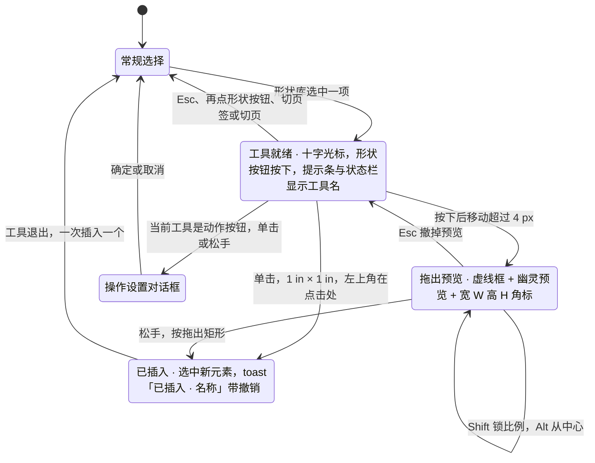

> 状态：草稿 | 负责：设计 | 更新：2026-09-18；2026-09-25（补图）；2026-09-30（§4.21 样张确认回写：形状库定为 10 类、首批 72 项与线条组；新增插入工具态视觉（十字光标、拖出虚线框与尺寸角标、Shift / Alt / Esc）、动作按钮「操作设置」对话框、页眉和页脚对话框、图标面板、符号面板；覆盖 G-77、G-78、G-79、G-81、G-82、G-83） | 依赖：charter v0.2；`10-prd/07-design-coverage-and-gaps.md`；09 v3.0 S-05 / §1.4（Lucide 图标）；playground `#/editor/insert`；rulings §4.21（R-d-62、R-d-64、R-d-66、R-d-70、R-d-77、q-extra-inserts）

# 03-15 插入菜单与形状库/变换手柄

> **设计基准（2026-09-15 起）**：组件规格以 [`09-design-specification.md`](../09-design-specification.md) v3.0（shadcn Rhea + 材质层）为准；对应 playground 路由 `#/editor/insert`（[已发布 artifact](https://claude.ai/code/artifact/cf6e1a1a-986b-48bb-b743-5758dff419d2)，源码 `playground/src/routes/`）。本文引用的 `mockups/*.html` 与线框图为历史静态稿，以 playground 实际渲染为终稿。
>
> **样张确认（2026-09-30）**：本文各节以用户确认的 playground 样张为准，源码在 `playground/src/components/editor/ribbon/insert/`（`ShapeGallery.tsx`、`shapes.tsx`、`InsertToolOverlay.tsx`、`ActionSettingsDialog.tsx`、`HeaderFooterDialog.tsx`、`IconPickerDialog.tsx`、`SymbolPanel.tsx`），演示状态对应：形状库 · 72 项、插入工具态 · 拖出、动作按钮 · 操作设置、页眉和页脚对话框、图标面板、符号面板 · 编辑文本、变换手柄。行为口径与前端 [50/10](../../50-frontend/10-editor-shell-and-interaction.md) §7.4、[50/22](../../50-frontend/22-elements-shapes-and-lines.md)、[50/20](../../50-frontend/20-elements-text.md)、[50/23](../../50-frontend/23-elements-media.md) 一致，视觉与文案以本文为准。

补齐 `04-insert-menu.md` 停留在"小样"阶段的形状弹出面板，给出画布内变换手柄的完整规范，并收录插入页签的全部新面板。覆盖缺口 **G-13**（ED-05，形状插入与几何变换）与 §4.21 新增的 **G-77**（插入工具态）、**G-78**（形状库 72 项、线条与动作按钮）、**G-79**（操作设置对话框）、**G-81**（页眉和页脚对话框）、**G-82**（图标面板）、**G-83**（符号面板）。与 04-insert-menu.md 是同一贡献点（`ui.ribbon` "插入"页签）的深化，不重复定义弹出面板的基础交互（展开/关闭/键盘导航见 04-insert-menu.md）。

---

## 线框：形状库弹出面板（10 类、72 项）

```
┌────────────────────────────────────────────────────────────┐
│ 最近使用  [▭][▢][◯][⇨][↗][▢◣][☆]                            │
├────────────────────────────────────────────────────────────┤
│ 线条      [╱][↗][⤢][⌐][⌐→][∿][∿→][≀][⬠][✎]                │  ← 末三项 P2 灰显
│ 矩形      [▭][▢][◸][◸◹][⌓]                                  │
│ 基本形状  [◯][△][◺][▱][⏢][◇][⬠][⬡][⯃][⌭][⧉][◎]              │
│           [♡][ϟ]                                            │  ← 超过 12 项换行
│ 箭头      [⇨][⇦][⇧][⇩][⇔][↱][⬠→][»]                          │
│ 公式形状  [+][−][×][÷][=][≠]                                 │
│ 流程图    [▭][▢][◇][▱][⊟][⌇][⊂⊃][○]                          │
│ 星与旗帜  [✦][★][✶][✺][≋]                                    │
│ 标注      [▭◣][▢◣][◯◣][▭╲]                                   │
│ 动作按钮  [◀][▶][⏮][⏭][⌂][ⓘ][↩][▭▷][▯][♪][?][ ]              │
├────────────────────────────────────────────────────────────┤
│ 单击画布插入 1 in × 1 in，或拖出大小  Shift 锁定比例  Alt 从中心  Esc 取消 │
└────────────────────────────────────────────────────────────┘
```

（字符只是线框示意；实际缩略图是预设几何的 SVG 线稿（24 × 24 视框、1.5 描边、无填充，与 Lucide 线性图标同一视觉语言），产品里构建期由 preset-table 按同一几何路径生成 SVG sprite（R-d-66），不使用 emoji，也不使用位图。）

### 尺寸与布局

| 项 | 规格 |
|---|---|
| 面板 | Popover，`align="start"` 贴形状按钮左缘，内边距 12；宽度随内容（56 类名列 + 8 间距 + 12 × 28 格 + 11 × 4 间距 ≈ 444）；最大高度为视口高度减 280，超出在面板内纵向滚动 |
| 类名列 | 左侧 56 宽、12px 次要色，与该类第一行格子同高（28）顶对齐 |
| 格子 | 28 × 28（与 Ribbon 小控件同一节奏），圆角 8，间距 4；缩略图 20；每类一行最多 12 格，超过换行（基本形状 14 项占两行） |
| 最近使用 | 置顶，与下方各类之间一条 5% 分隔线；最多 10 项、仅存本机（会话记忆，不写入文档），不计入 72 项；没有最近使用时整段不显示 |
| 底部提示行 | 分隔线下 12px 次要色：「单击画布插入 1 in × 1 in，或拖出大小」「`Shift` 锁定比例」「`Alt` 从中心」「`Esc` 取消」，快捷键用 Kbd |
| 搜索 | 样张不设搜索框（PRD G-78「可选搜索框，样张决定」→ 不保留）；按名称直达走命令面板 |

### 各类清单（首批 72 项，顺序即 ED-05 验收枚举顺序）

| 类 | 数量 | 条目（tooltip 名称） |
|---|---|---|
| 线条 | 10 | 直线、箭头、双箭头、肘形连接符、肘形箭头连接符、曲线连接符、曲线箭头连接符；曲线、任意多边形、自由曲线（P2，禁用） |
| 矩形 | 5 | 矩形、圆角矩形、剪去单角的矩形、剪去同侧角的矩形、同侧圆角矩形 |
| 基本形状 | 14 | 椭圆、等腰三角形、直角三角形、平行四边形、梯形、菱形、正五边形、六边形、八边形、圆柱形、立方体、同心圆、心形、闪电形 |
| 箭头 | 8 | 右箭头、左箭头、上箭头、下箭头、左右箭头、直角箭头、五边形箭头、燕尾形 |
| 公式形状 | 6 | 加号、减号、乘号、除号、等号、不等号 |
| 流程图 | 8 | 流程图：过程、可选过程、决策、数据、预定义过程、文档、终止、接点 |
| 星与旗帜 | 5 | 四角星、五角星、六角星、爆炸形 1、波形 |
| 标注 | 4 | 矩形标注、圆角矩形标注、椭圆形标注、线形标注 |
| 动作按钮 | 12 | 后退或前一项、前进或下一项、转到开头、转到结尾、转到主页、获取信息、返回、视频、文档、声音、帮助、空白（tooltip 前缀「动作按钮：」） |

「10 类」= 最近使用 + 上表 9 类。线条组的直线与各类连接符插入时落 `p:cxnSp`（R-d-64，导入的 sp + line 不改写），箭头与双箭头记首尾箭头；线条选中后只显示两个端点手柄，无旋转手柄。动作按钮统一为圆角方框内画语义图形，每项带默认动作（见下文「操作设置」）。

### 格子状态

| 状态 | 视觉 |
|---|---|
| 默认 | 前景 80% |
| 悬停 / 键盘聚焦 | muted 底；聚焦加 2px ring |
| 当前插入工具（`aria-pressed`） | 主色 12% 底 + 主色 40% 内描边 + 主色图形 |
| P2 禁用（`aria-disabled`） | 前景 35%、不响应点击与悬停底色，但仍可聚焦；tooltip「曲线 · 绘制曲线排在后续版本（P2）」（任意多边形、自由曲线同式）；读屏名「曲线（P2，暂不可用）」 |

键盘：方向键在格子间移动——左右跨行连续，上下按行、跨类连续并保持列位（落到较短行时取该行最后一格）；`Enter` 选择后进入插入工具态；`Esc` 关闭面板。

## 线框：插入工具态（选中形状之后）

```
        ┌─────────────────────────────────────────────────────────────┐
        │ ▢ 插入 · 圆角矩形  单击插入 1 in × 1 in，或拖出大小 │ Shift 锁定比例  Alt 从中心  Esc 取消 │  ← glass 提示条
        └─────────────────────────────────────────────────────────────┘
┌──────────────────────── 画布（cursor: crosshair）────────────────────────┐
│                                                                          │
│                        ●╌╌╌╌╌╌╌╌╌╌╌╌╌╌╌╌╌╌╌╌╌╌╌╮                            │
│                        ╎ ╭──────────────────────╮ ╎ ← 1.5px 主色虚线框      │
│                        ╎ │   幽灵预览（主色 10%）  │ ╎                         │
│                        ╎ ╰──────────────────────╯ ╎                          │
│                        ╰╌╌╌╌╌╌╌╌╌╌╌╌╌╌╌╌╌╌╌╌╌╌╌╌┼  ← 十字光标在拖动终点      │
│                                  [宽 256 高 104]    ← 尺寸角标（深底浅字）     │
└──────────────────────────────────────────────────────────────────────────┘
 状态栏：第 4/12 页 · 插入工具：圆角矩形
```

### 插入工具态视觉

| 部件 | 规格 |
|---|---|
| 光标 | 画布内 CSS `cursor: crosshair`（样张截图另画一个深色细线 + 纸色描边的十字示意，产品不画） |
| Ribbon | 「形状 ▾」大按钮保持按下态；再次打开形状库时当前工具格高亮 |
| 提示条 | 画布上方居中，与母版视图提示条同一形态：glass、高 36、圆角 16、12px、不换行；内容「形状缩略图（主色 16）· 插入 · 〈名称〉 · 单击插入 1 in × 1 in，或拖出大小 │ Shift 锁定比例 · Alt 从中心 · Esc 取消」；`role="status"` |
| 状态栏 | 左侧追加「插入工具：〈名称〉」 |
| 拖出预览 | 按下后移动超过 4 px 才算拖出：起点一个 6px 主色圆点（纸色 2px 外圈）；形状画 1.5px 主色虚线包围框 + 幽灵预览（主色 10% 填充、主色 45% 描边，按真实预设几何，如圆角矩形默认圆角 = 短边 × 16.667%）；线条类不画包围框，只画主色线段 |
| 尺寸角标 | 包围框下方居中、下移 24：深色胶囊（前景色底、背景色字）、11px、等宽数字，文字「宽 W 高 H」（单位随设置，见 03-screens/03） |
| 修饰键 | `Shift` 锁定比例（线条约束到 0° / 45° / 90°）；`Alt` 以按下点为中心（线条无此项）；`Esc` 拖出中撤掉预览回到工具就绪，工具就绪时退出工具态 |

**插入工具态**



怎么读：只有「已插入」与「操作设置」会写文档；形状工具一次只插入一个，插入后回到常规选择（连续绘制 P2）；动作按钮在插入完成的同一刻弹出操作设置，插入与设置合为一个撤销步。状态机的实现细节（4 px 阈值、键盘 Enter 插到视口中心、协同与失败分流）以 [50/10](../../50-frontend/10-editor-shell-and-interaction.md) §7.4 为准。

## 线框：画布内变换手柄

```
        ▪(旋转手柄，Shift 步进15°)
        │
   ▪────┼────▪         ▪ = 缩放手柄（8个，Shift锁比例/Alt中心缩放）
   │  ╭──────╮  │
   │  │ 形状  │  ▪ ← 拖动中显示 "宽 320 高 96" 尺寸角标
   │  ╰──────╯  │
   ▪────┼────▪
        │
      ◆(黄色调整手柄，仅含 avLst 的形状显示，拖动改几何)
```

样张「变换手柄」演示状态：选中 220 × 140 的矩形，包围盒标注「宽 220 高 140」与「旋转 0°」。

---

## 状态

### 插入交互（点击 vs 拖出）

- 选择形状后单击画布：以 1 in × 1 in 插入，左上角在点击处，并选中；线条为起点在点击处的 1 in 水平线。拖出：按拖动矩形插入（按住 Shift 锁定宽高比，Alt 从中心）。
- 插入后自动进入文本编辑态为 P1（默认不自动进入，避免打断"先摆位置再输文字"的常见操作顺序）；插入成功 toast「已插入 · 〈名称〉」带 [撤销]。
- 文本框工具（04-insert-menu.md 已有按钮）：单击插入自动增长文本框并直接进入编辑；拖出插入固定宽度自动换行文本框；空文本框退出编辑即删除，并与插入合为一个撤销步（R-d-65）。

**插入交互：单击 vs 拖出**


怎么读：同一个工具的单击与拖出得到不同结果；形状默认不进入文本编辑，是为了保留「先摆位置再输文字」的常见顺序；动作按钮额外多一步操作设置。

### 缩放/旋转/调整手柄

| 手柄 | 交互 | 反馈 |
|---|---|---|
| 8 个缩放手柄（四角+四边） | 拖动缩放；Shift 锁比例；Alt 以中心缩放 | 拖动中显示"宽 W 高 H"尺寸角标（单位见 03-screens/03 补充的度量单位设置） |
| 旋转手柄（形状上方独立手柄） | 拖动旋转；Shift 步进 15° | 拖动中显示角度角标（如"45°"） |
| 黄色调整手柄（`avLst` 存在时） | 每个 `gd` 对应一个手柄，拖动实时改几何（如圆角矩形的圆角半径） | 无数值角标，靠视觉直接反馈 |
| 线条两端点手柄 | 拖动改端点；Shift 约束 0° / 45° / 90°；靠近形状时显示连接点 | 无旋转手柄 |
| Esc（拖动进行中） | 取消当前拖动，恢复到拖动前状态 | — |

### 只读（评审模式）

插入页签与全部弹出面板在评审模式下不出现（同 04-insert-menu.md 已定），变换手柄同样不出现（评审模式画布无选中手柄，见 02-editor-main.md 模式对照表）。

---

## 线框：动作按钮「操作设置」对话框（G-79）

```
┌──────────────────────────────────────────────────────┐
│ [▶]  操作设置                                          │
│      动作按钮「前进或下一项」· 放映时生效，编辑时 ⌘ + 单击可预览 │
│ ┌──────────────────────┬──────────────────────────┐   │
│ │      单击鼠标          │   鼠标悬停  P2（禁用）       │   │
│ └──────────────────────┴──────────────────────────┘   │
│ 单击时                                                 │
│ ┌──────────────────────────────────────────────────┐ │
│ │ ○ ⊘ 无动作                                         │ │
│ │ ● › 下一张幻灯片          ○ ‹ 上一张幻灯片           │ │
│ │ ○ « 第一张幻灯片          ○ » 最后一张幻灯片         │ │
│ │ ○ ↺ 最近观看的幻灯片      ○ ☒ 结束放映              │ │
│ │ ○ ▤ 指定幻灯片…          ○ ∞ 网址（URL）…          │ │
│ └──────────────────────────────────────────────────┘ │
│ [9. 客户案例            ▾]   ← 仅选「指定幻灯片…」时出现  │
│ ☑ 单击时突出显示                                        │
│ ⓘ 运行程序、运行宏、播放声音不在此设置；导入文件里已有的会原样保留。│
│                                        [取消]  [确定]   │
└──────────────────────────────────────────────────────┘
```

- **触发**：插入动作按钮后立即弹出（R-d-77）；检查器「操作」一行与右键「操作设置…」同样打开（普通形状也可设置）。插入 M2 P0，操作设置 M2 P1。
- **布局**：对话框宽 520；标题行左侧 40 × 40 圆角 12 的主色 10% 图块，内画该动作按钮缩略图（24）；说明「动作按钮「〈名称〉」· 放映时生效，编辑时 ⌘ + 单击可预览」。
- **页签**：「单击鼠标」「鼠标悬停」；悬停页签带 P2 标记、禁用但可聚焦，tooltip「悬停触发的动作排在后续版本（P2）；导入文件里已有的悬停动作原样保留」。
- **跳转目标**：9 项两列单选，放在 3% 前景底的圆角 16 容器内，每项高 32、圆角 12，选中项白底 + 阴影 + 10% 描边；「无动作」独占一行。目标与 OOXML 对应：无动作（不写 `hlinkClick`）、下一张 `jump=nextslide`、上一张 `jump=previousslide`、第一张 `jump=firstslide`、最后一张 `jump=lastslide`、最近观看 `jump=lastslideviewed`、结束放映 `jump=endshow`（后两项为 R-d-77 补入）、指定幻灯片 `hlinksldjump`、网址为外部关系。
- **附加字段**：选「指定幻灯片…」时下方出现页选择下拉（「序号. 标题」）；选「网址（URL）…」时出现地址输入（占位 `https://example.com`，协议白名单 http / https / mailto / tel 与超链接对话框一致）。
- **默认动作**（打开时预选）：后退或前一项 → 上一张；前进或下一项 → 下一张；转到开头、转到主页 → 第一张；转到结尾 → 最后一张；返回 → 最近观看；获取信息、视频、文档、声音、帮助、空白 → 无动作。
- **「单击时突出显示」**复选，默认勾选（`highlightClick`）。
- **确认 / 取消**：确定后 toast「已设置单击动作 · 〈目标〉」；插入与设置是同一事务、一个撤销步（`slide.insertShape` + `slide.setAction`）；取消时动作按钮保留并带默认动作。导入文件里的运行程序、运行宏、播放声音不提供设置、原样保留（说明行常驻）。

## 线框：页眉和页脚对话框（G-81）

```
┌──────────────────────────────────────────────────────────────────┐
│ 页眉和页脚                                                          │
│ 给幻灯片加日期、编号和页脚文字，内容写入版式上的页脚占位符。              │
│ ☑ 日期和时间                                    预览                │
│    ● 自动更新 [2026年9月26日        ▾][简体中文 ▾]  ┌──────────────┐ │
│    ○ 固定     [2026/9/26                     ]   │ ▬▬▬▬▬         │ │
│ ☑ 幻灯片编号                                     │ ───────       │ │
│ ☑ 页脚                                          │ ──────        │ │
│    [2026年Q2业绩汇报 · 内部资料              ]    │[日期][ 页脚 ][#]│ │
│ ──────────────────────────────                  └──────────────┘ │
│ ☑ 标题幻灯片中不显示                              2026年9月26日 · …· 4│
│ 应用：所选 1 页 · 全部应用：12 页        [取消] [应用] [全部应用]      │
└──────────────────────────────────────────────────────────────────┘
```

- **入口**：插入 › 文本 › 页眉和页脚…；不在文本编辑态时点「日期和时间」「幻灯片编号」也打开本对话框（04-insert-menu.md「文本组随文本编辑态切换」）。M2 P2，命令 `slide.setHeaderFooter`（R-d-70）；母版侧复选 M3。
- **布局**：对话框宽 640；左栏表单、右栏 160 宽预览，间距 20。复选行高 28；子项缩进 24。
- **日期和时间**：复选开关；「自动更新」= 格式下拉（按所选语言列出 6 种样例：短日期、年月日长格式、完整日期、月日、日期 + 时间、时间，映射 `datetime1..13`）+ 语言下拉（简体中文 / English (US) / 日本語，宽 112）；「固定」= 文本输入。关闭日期时整组 50% 并禁用；非当前模式的控件禁用。
- **幻灯片编号**、**页脚**（复选 + 文本输入，关闭时输入禁用）、分隔线下「标题幻灯片中不显示」。
- **预览**：16:9 迷你页，标题与正文用灰条示意；底部三个页脚族占位符位置（日期左、页脚中、编号右），启用 = 主色实线 + 主色 20% 填充，关闭 = 虚线；预览下方一行摘要（如「2026年9月26日 · 2026年Q2业绩汇报 · 内部资料 · 4」，全部关闭时「不显示页脚」）。
- **应用范围**：底栏左侧「应用：所选 N 页 · 全部应用：M 页」；「应用」只作用于所选页，「全部应用」作用于全部页；各为一个事务、一个撤销步，toast「已更新所选 N 页 / 全部 M 页的页眉和页脚 [撤销]」；页数多时显示确定态进度。
- **缺占位符**：版式里没有对应的页脚占位符时，该项禁用并说明「当前版式没有此占位符」；页脚族占位符按确定性 id 生成（R-d-70）。
- **文本编辑态**：光标在文本里时，「幻灯片编号」直接在光标处插入页码字段（toast「已插入幻灯片编号字段」），「日期和时间」在光标处插入自动更新的日期字段（toast「已插入日期字段（自动更新）」）。PRD G-81 所述「文本编辑态的日期和时间格式选择器」样张未出，行为暂以 [50/20](../../50-frontend/20-elements-text.md) §3 为准，视觉待后续样张。

## 线框：图标面板（G-82）

```
┌────────────────────────────────────────────────────────────────────┐
│ 插入图标                                                              │
│ 线性图标，插入后是可改色的 SVG 图片；可多选。                              │
│ [⌕ 搜索图标，如 增长、团队、目标                        12 个结果]         │
│ ┌──────────────┐ ┌──────────────────────────────────────────────┐   │
│ │ 全部       93 │ │ [↗✓][◎✓][ⓤ✓][ ▥ ][ ◔ ][ ⚑ ][ ★ ][ ⚙ ]      │   │
│ │ 商务       14 │ │ [ ✉ ][ ☎ ][ ⌂ ][ ⚿ ][ ☁ ][ ⚡ ][ ♥ ][ ✓ ]      │   │
│ │ 数据       12 │ │ …（8 列，区域高 308，超出滚动）                    │   │
│ │ 人物与沟通 12 │ │                                                │   │
│ │ 科技       14 │ │                                                │   │
│ │ 教育        8 │ │                                                │   │
│ │ 自然        8 │ │                                                │   │
│ │ 交通与地点 10 │ │                                                │   │
│ │ 标志与提示 15 │ │                                                │   │
│ │ Lucide 图标（ISC）│                                              │   │
│ └──────────────┘ └──────────────────────────────────────────────┘   │
│ 已选 3 个 · 插入为 1 in × 1 in，颜色取主题文字色      [取消] [插入 3 个]  │
└────────────────────────────────────────────────────────────────────┘
```

- **形态**：模态对话框（PRD G-82「抽屉或大弹层，样张决定」→ 对话框），宽 680；入口在插入 › 形状 › 图标（04-insert-menu.md），M3 P2（q-extra-inserts）。
- **搜索**：顶部输入组，放大镜前缀，占位「搜索图标，如 增长、团队、目标」；有检索词时尾部显示「N 个结果」；检索中文名、补充词与英文 id，分类与检索同时生效；无结果时网格区居中「没有匹配「〈词〉」的图标」。
- **分类栏**：左侧 128 宽，每项高 28、圆角 8，右侧等宽数字计数；当前分类 accent 底 + 加粗；样张 8 类共 93 个（全部 93、商务 14、数据 12、人物与沟通 12、科技 14、教育 8、自然 8、交通与地点 10、标志与提示 15）；栏底注明「Lucide 图标（ISC）」。
- **网格**：3% 前景底、圆角 16 的滚动区，高 308；8 列方格、间距 6，格内图标 24、描边 1.75；多选：选中格主色 10% 底 + 2px 主色描边 + 右上角 16 圆形主色对勾；tooltip 与读屏名为中文名（`role="listbox"`、`aria-multiselectable`）。产品实现网格虚拟化。
- **底栏**：左侧「已选 N 个 · 插入为 1 in × 1 in，颜色取主题文字色」（未选时「未选择」）；右侧「取消」「插入 N 个」（未选时禁用）。插入后 toast「已插入 N 个图标 [撤销]」：N 个图标一个事务，按视口中心依次错位 0.2 in 插入并全部选中；每个图标是 SVG 图片（带 PNG 回退），替代文本预填图标中文名，之后的改色与图片操作见 [03-18](18-image-editing.md)「SVG 与图标」。
- **键盘**：方向键在网格中移动、`Space` 勾选、`Enter` 插入；图标随应用打包、按分类惰性加载，无网络时照常可用。

## 线框：符号面板（G-83）

```
┌──────────────────────────────────────────────────────┐
│ [⌕ 搜索名称或码位，如 箭头、2192                    ]    │
│ ┌────────────┐ 箭头                    U+2190–21FF   │
│ │ 最近使用     │ ┌──────────────────────────────────┐ │
│ │ 拉丁-1 补充  │ │ ←  ↑ [→] ↓  ↔  ↕  ↖  ↗          │ │
│ │ 希腊字母     │ │ ↘  ↙  ↚  ↛  ↩  ↪  ↰  ↱          │ │
│ │ …           │ │ …（8 列，格 36）                    │ │
│ │ [箭头]       │ │                                  │ │
│ │ 数学运算符   │ │                                  │ │
│ │ …           │ └──────────────────────────────────┘ │
│ └────────────┘                                       │
│ ─────────────────────────────────────────────────── │
│ [ → ]  向右箭头                         [插入 Enter]   │
│        U+2192 · RIGHTWARDS ARROW · 箭头                │
└──────────────────────────────────────────────────────┘
```

- **形态**：非模态弹出面板（Popover），宽 468，贴「符号 ▾」按钮左缘；M3 P2（q-extra-inserts），仅在文本编辑态可用（否则按钮禁用，tooltip「先在文本框里放置光标，再插入符号」）。打开时不抢走文本光标；插入后焦点回到文本、面板保持打开以便连续插入；`Esc` 关闭并回到文本光标。
- **搜索**：占位「搜索名称或码位，如 箭头、2192」；支持中文名、英文字符名、区块名与十六进制码位（可带 `U+`）；有检索词时标题改为「搜索结果」、右侧「N 个」。
- **区块栏**：左侧 128 宽、主体区高 252，可滚动；首项「最近使用」（每人记忆、不写入文档，右侧标注「仅自己可见」），其后按 Unicode 区块：拉丁-1 补充、希腊字母、常用标点、上标和下标、货币符号、字母式符号、数字形式、箭头、数学运算符、带圈字母数字、几何图形、杂项符号、装饰符号、CJK 符号和标点、全角 ASCII；首次打开把当前区块滚到栏中部。
- **字符网格**：标题行左为区块名、右为码位范围（等宽 11px）；8 列、格高 36、字号 18，3% 前景底圆角 16；选中格主色 10% 底 + 2px 主色描边；读屏名「中文名 + 码位」。产品只收默认以文本呈现的码位（避开 `Emoji_Presentation=Yes`），保证插入后按正文字体渲染。
- **预览底栏**：44 × 44 圆角 12 放大预览（字号 24）；中文名（缺名时显示区块名）；次行等宽「码位 · 英文 Unicode 名 · 区块」；右侧「插入 [Enter]」。
- **插入**：`Enter`、双击格子、点「插入」三种方式等价，调用 `slide.insertText`（无需新命令）。

---

## 交互说明

- 形状库分类顺序沿用 ED-05 验收标准的枚举顺序（最近使用/线条/矩形/基本形状/箭头/公式形状/流程图/星与旗帜/标注/动作按钮），不自行调整顺序，保证与快捷参考文档一致。
- 新插入的形状默认样式只写 `p:style` 主题引用（R-d-63），颜色跟随当前主题，属性面板的填充 / 边框显示「主题样式」而非具体色值。
- 尺寸/角度角标与插入工具态的拖出预览都是即时反馈层（`render.overlay`，与远端选区同层级），松手后消失，不常驻；工具态是本机 UI 状态，不广播、不入历史，他人只看到插入完成后的新元素。
- 属性面板"位置与大小"分区（见 03-screens/03）的数值输入是全部手柄交互的键盘/表单等价路径（WCAG 2.5.7），拖动手柄与输入数值产生相同的 Mutation；插入工具态的键盘等价是焦点在形状库格子上按 `Enter` 插到视口中心（连续插入错位 0.2 in）。
- 对话框（操作设置、页眉和页脚、图标）打开时不自动聚焦首个控件，焦点落在对话框容器上，`Tab` 进入表单；关闭后焦点回到触发按钮。

## 边界情况

- 插入的对象超出画布边界：允许插入，仅在插入瞬间将其带入视口可见区域（04-insert-menu.md 已定，此处不重复）。
- 插入被规模上限或权限拒绝：toast 说明原因，工具退出，画布不留预览（50/10 §7.4）。
- 工具态期间当前页被远端删除：工具退出并按软冲突提示。
- 缩放到极小尺寸（如 < 4px）：手柄命中区仍保持 ≥ 24px（03-screens/03 已定的命中区规则），避免"越缩越难再选中手柄"的死循环。
- 旋转后的形状再次缩放：缩放手柄跟随旋转角度显示在正确位置（不是固定的水平/垂直包围盒手柄）。
- 触屏设备：手柄命中区扩大到 ≥ 44px 且间距 ≥ 8px（07-accessibility-and-i18n.md §2），必要时减少同时可见的手柄数量而非缩小手柄；插入工具态的单击 / 拖出同样适用于触摸，修饰键提示在触屏上隐藏。
- 图标搜索无结果、符号搜索无结果：网格区显示空态文案，分类栏保持可点，清空检索即恢复。
