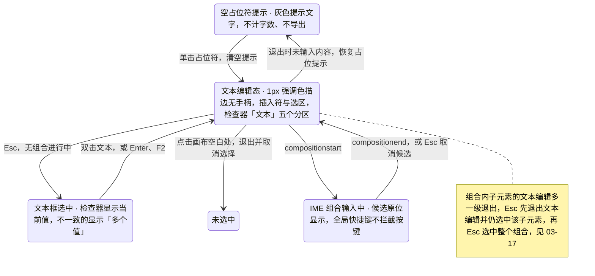
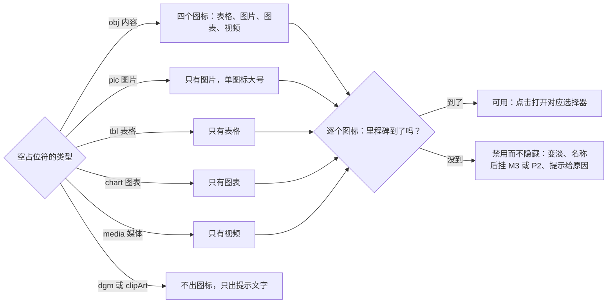
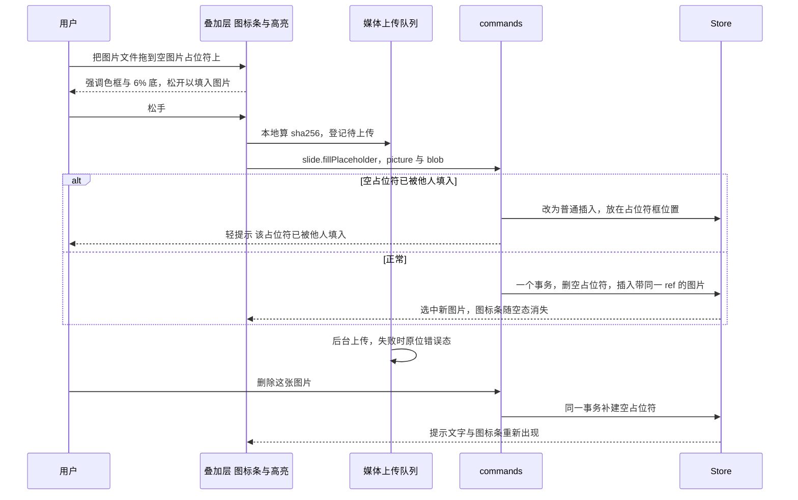
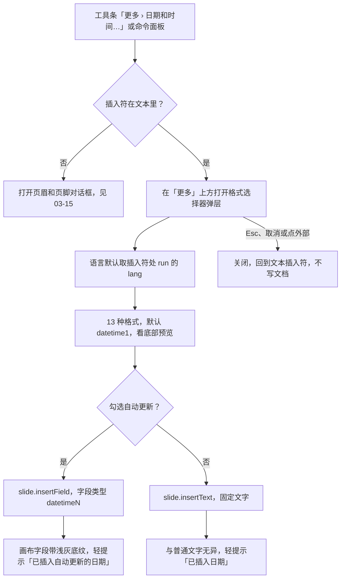
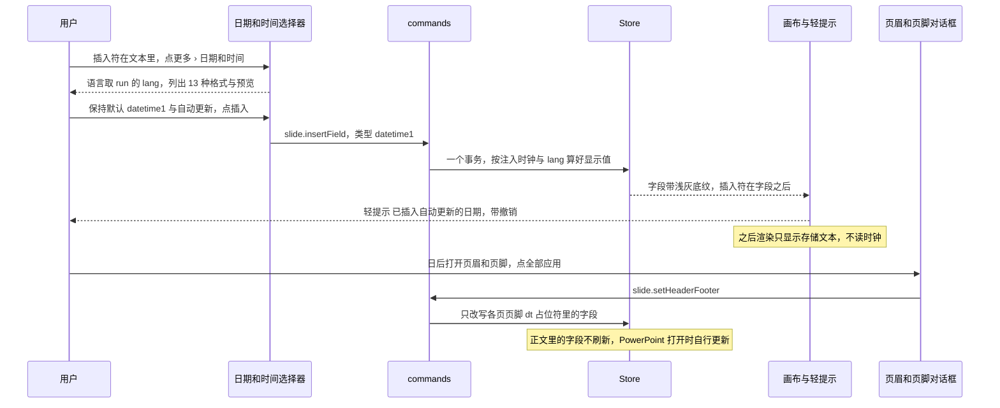

> 状态：草稿 | 负责：设计 | 更新：2026-09-15；2026-09-25（补图）；2026-09-25（矛盾收口，rulings §4.18）；2026-09-25（§4.19）；2026-09-30（§4.21 剩余缺口样张回写：新增「空内容占位符图标条」（G-80）与「日期和时间格式选择器」（G-81 文本编辑态部分）两节并配图；状态清单补 5 个演示状态；新增「待决 / 取舍」，如实登记样张与规格的差异；样张经主会话抽查，最终以用户确认为准）；2026-09-30（§4.21 剩余缺口样张回写 · 复核修正：占位符「表格」图标的去向改指 03-30 §13 第 7 条这一唯一登记点；待决补 `placeholder-empty` 分区与 50/10 §5 的差异、样张未画占位符选中框；格式列表容器与图标按钮圆角按样张 token 更正；「禁用而不隐藏」出处改为 rulings §4.20 FE-06）；2026-09-30（§4.22 设计待决收口：图标条与迷你工具条改画在屏幕坐标覆盖层、按屏幕尺寸绘制，窄占位符折叠为「插入 ▾」；图标条键盘改为单一 Tab 停靠点；表格图标定为同一网格弹层（用户裁决 Q2）；检查器 `placeholder-empty` 定为三组（占位符、位置与大小、插入到占位符）；样张版式改为「内容与图片」；日期选择器默认 `datetime1` 并与页眉和页脚对话框共用一张表，「自动更新」说明定稿；多图拖入规则定稿；状态清单补 2 态；待决表只留推迟项与两条样张取舍）；2026-09-30（§4.22 整合：待决表补第 18 行选区手柄与标签随缩放变小，指向 rulings §4.22 SR-5）；2026-09-30（§4.22 复核修正：文首待决说明更正为三条取舍；占位符弹层避让改为 112 px，图表菜单同一口径、插入后展开检查器「数据」分区；第 18 条手柄尺寸更正）；2026-10-05（design-language-v3 第 0 批修正：只改快捷键值——「超链接对话框（G-34）」的触发键由 `Mod+K` 改为 `Mod+Shift+K`（rulings §4.25 DS-11）；界面描述随第 1 批回写）；2026-10-07（design-language-v3 第 1 批：按已拍板的 `text-edit` 场景（21 态）整篇改写——设计基准改指 v3 样张与对照截图；§1 线框按 v3 外壳重画（编辑态全景含检查器「文本」五个分区、空内容占位符与 `placeholder-empty` 检查器），新增 §1.3 原入口去向；§2「状态」改为 21 个样张状态、路由与里程碑；§3 编辑态外观改为 1px 强调色描边 + 插入符 + 选区、无手柄，文字迷你工具条取消（DS-13），溢出缩小与受限字体改为画布浮签与检查器说明；§4 格式改为检查器「文本」字体 · 段落 · 颜色 · 列表 · 文本框五个分区，补字体弹层、颜色弹层、项目符号与编号菜单、多个值与只读展示（DS-15）；§5 超链接改为「插入链接 / 编辑链接」对话框（`Mod+Shift+K`，DS-11）、悬停小卡与失效链接；§6 图标条改为 64 / 72 px 无底板按钮、折叠菜单改为底部说明行、按键说明改为画布浮签，检查器 `placeholder-empty` 只留「占位符」「位置与大小」两组（DS-14），补评审只读形态（DS-15、DS-23）；§7 日期和时间改由工具条「更多」与命令面板打开、弹层锚在「更多」上方、选中项改为左侧对勾，插入结果改为轻提示（DS-6）；§10 待决第 2、14、16、17、18 条按 DS-13、DS-14、DS-21 与 §4.25「被修订的既有口径」关闭，新增第 19–21 条（检查器单位、链接命名、三个快捷键）；依据 rulings §4.25 DS-1、DS-6、DS-11、DS-13…DS-15、DS-21…DS-24、DS-26；依赖改指 v3 样张源码）；2026-10-07（design-language-v3 第 1 批：按 rulings §4.25 DS-27、DS-29、TB-6、TB-10、TB-12、TB-19 与第一步影响修订——§1.3、§5、§8 右键条目统一为「链接…」（TB-6），文本右键「粘贴为纯文本」为 P2 不可用（TB-19）；§3.2、§4.1 删除线 Mod+Shift+X、上标 Mod+Shift+=、下标 Mod+= 登记 ED-16，只在文本编辑时生效（DS-29）；§4.1、§6.7 长度按 pt 书写、产品随设置的度量单位（DS-27）；§6.1 图表菜单开着时提示文字让位；§6.6 占位符图表菜单首行改「五类 · 填入占位符后展开数据」（TB-12），占位符表格的填入提示按 03-30 §2.3 统一；§10 第 19–21 条按 DS-27、TB-6、DS-29 关闭，新增第 22 条（段前、段后的显示单位，待确认）；§1.1、§1.2、§7 线框里工具条的「选择」去掉 ▾，与 03-04 §3 和样张一致；§6.6 默认行高与多图错位改按 pt 书写（DS-27））；2026-10-08（design-language-v3 第 1 批收口：§4.1 段前、段后与固定行距定为与字号一样始终以 pt 显示、不随度量单位换算（rulings §4.25 TB-33），§10 第 22 条关闭并移入已定稿表；§7.1、§8 日期和时间、符号弹层关闭后焦点回到文本插入符补引 TB-52；§1.3 迷你工具条去向补 `toolbar.<selectionKind>` 删除（TB-29）；§2 末段改为 capture-screens 第 16 条已登记 12 个 v3 状态；§6.6 多图拖入的错位改回 0.2 in（PowerPoint 默认值保留原单位，TB-37，取代上一条的 14.4 pt 写法）；§10 第 20 条「样张跟改」改为「样张已改」）；2026-10-08（design-language-v3 第 1 批收口复核：§6.6「表格」行改记样张已统一）；2026-10-08（design-language-v3 第 1 批评审修改：§4.1 控件外观改为安静样式——字号、段前、段后等输入只铺淡底、不描边，下拉与颜色触发器透明底加细边，对齐分段的选中块面板色加细边并贴边，粗体 / 斜体 / 下划线 / 删除线与上标 / 下标的按下项为强调色淡底（rulings §4.25 DS-35、DS-36、TB-55），原「1px `--v3-border-control` 内描边」作废）；2026-10-23（design-language-v3 第 3 批评审修改：§5.1 写明「插入链接」对话框随 rulings §4.25 DS-142 改为标题栏 40、圆角 12、× 正文色，`link-dialog`、`link-invalid` 随之改画）；2026-11-04（design-language-v3 母版视图改版：§1.1、§1.2 线框与图例的检查器补顶行「继承自版式「〈名〉」 / 转到版式 ›」，§1.2 图例另补母版视图画布上的占位符用同一条虚线；§2 状态表 `editing`、`placeholder-selected`、`placeholder-readonly` 三行与表后补随之改的状态；§4 开头补来自版式占位符的标题与文本框在检查器顶行有「继承自版式「〈名〉」 / 转到版式 ›」，§4.2 补同时选中几个这样的框时「转到版式」只选中版式，§4.3 补只读时照画、动作不可用；§6.7 两组之上补这一行，只读时照画、动作不可用；rulings §4.25 DS-147、DS-148、DS-174、TB-205；需求编号、优先级与里程碑不变） | 依赖：charter v0.2；`10-prd/07-design-coverage-and-gaps.md`；rulings §4.21（R-d-69、R-d-72、q-table-depth、q-media-insert）、§4.20 FE-06（禁用而不隐藏）、§4.22、§4.25 DS-1、DS-6、DS-9、DS-11、DS-13…DS-15、DS-17、DS-21…DS-27、DS-29、DS-35、DS-36、DS-147、DS-148、DS-174、TB-6、TB-10、TB-12、TB-19、TB-29、TB-33、TB-37、TB-52、TB-55、TB-205；前端 50/20 §3、50/21 §3、50/06 §2 与 §5.3；ADR-0018；playground `src/v3/scenarios/text-edit/`、`src/v3/editor/inspector/text.tsx`、`src/v3/kit/PlaceholderBar.tsx`、`src/v3/kit/TableGridPicker.tsx`（旧版 `TextEditing.tsx`、`PlaceholderIconBar.tsx`、`DateTimePicker.tsx`、`datetime-formats.ts` 随 DS-7 删除）

# 03-16 文本编辑态与格式化

> **设计基准（2026-10-07 起，rulings §4.25 DS-21）**：以 playground `#/v3/editor?state=text-edit.<状态 id>&theme=dark|light` 的已拍板样张为准：场景源码 `playground/src/v3/scenarios/text-edit/`；检查器「文本」五个分区是底座 `src/v3/editor/inspector/text.tsx`（所有场景共用）；空内容占位符图标条与表格网格是 kit `src/v3/kit/PlaceholderBar.tsx`、`TableGridPicker.tsx`。对照截图 `openspec/changes/design-language-v3/screens/batch1/text-edit-editing-{dark,light}.jpg`。编辑器外壳（左栏 240、画布与备注、底部浮动创建工具条、检查器 280）见 [03-02](02-editor-main.md)。旧稿 `#/editor/text` 的「开始」页签分组、文字迷你工具条与状态栏提示全部作废（DS-1、DS-6、DS-13），去向见 §1.3。行为口径与前端 [50/20](../../50-frontend/20-elements-text.md) §3、[50/21](../../50-frontend/21-elements-structure.md) §3、[50/06](../../50-frontend/06-text-editing-and-ime.md) §2 一致，视觉与文案以本文为准。

本文写文本编辑态、文字格式（检查器「文本」）、超链接、空内容占位符图标条与「日期和时间」格式选择器。覆盖缺口 **G-11**（ED-02，文本内联编辑与占位符提示）、**G-12**（ED-03 / ED-04，字符与段落格式、项目符号与编号）、**G-34**（ED-19，超链接）、**G-80**（ED-07，空内容占位符图标条）与 **G-81** 的文本编辑态部分（ED-31，「日期和时间」格式选择器；页眉和页脚对话框见 [03-15](15-insert-menu-and-shape-library.md)，工具条「更多」的分流见 [03-04](04-insert-menu.md)）。对应 `02-user-flows.md` F2。

---

## 1. 线框

### 1.1 编辑文字（`text-edit.editing`，1600 × 1000，单页视图）

```
←──────── 240 ────────→←─────────── 画布 flex（1600 宽视口下 1080） ────────────→←─────────── 280 ───────────→
┌──────────────────────┬────────────────────────────────────────────────────────┬────────────────────────────┐
│ [Logo▾]  [单页][网格]│                                                        │ (周)(王)(李)      ▶ [分享] │
│ 2026 年 Q2 业绩汇报 ▾│  ┌──────────────────────────────────────────────────┐  ├────────────────────────────┤
│ ✓ 已同步             │  │  下半年计划                                      │  │ [设计]  评论        77% ▾  │
│ [新建幻灯片    ▾] [+]│  │  ▔▔                                              │  ├────────────────────────────┤
│                      │  │ ┌─────────────────────────────┐ ┌───────────┐    │  │ ⓘ 继承自版式「标题和内容」 │
│ 1 ┌───────────────┐  │  │ │● 拓展企业客户               │ │下半年目标 │    │  │                 转到版式 › │
│   │ 标题页        │  │  │ │  ○ 新增 3 个行业解决方案    │ │           │    │  ├────────────────────────────┤
│   └───────────────┘  │  │ │  ○ 重点突破制造与零售       │ │3 个       │    │  │ 文本                       │
│ ⋮                    │  │ │● 提升交付效率               │ │−25%       │    │  ├────────────────────────────┤
│ 5 ┌───────────────┐  │  │ │  ○ 上线[自动化交付]|流程    │ │55+        │    │  │ 字体                    Tx │
│   │ 区域分布      │  │  │ │  ○ 平均交付周期缩短 25%     │ └───────────┘    │  │ [西文 Inter       正文 ▾ ] │
│   └───────────────┘  │  │ │● 优化产品体验               │                  │  │ [中文 思源黑体    正文 ▾ ] │
│▌6 ┏━━━━━━━━━━━━━━━┓  │  │ │  ○ 重构核心编辑工作流       │                  │  │ [字号 20   ▾][ A⁺ │ A⁻   ] │
│▌  ┃ 下半年计划    ┃  │  │ │  ○ NPS 提升至 55 以上       │                  │  │ [ B   │  I   │  U  │  S  ] │
│▌  ┗━━━━━━━━━━━━━━━┛  │  │ └─────────────────────────────┘                  │  │ [ x² │ x₂   ][大小写 无 ▾] │
│                      │  │  2026 年 Q2 业绩汇报                          6  │  ├────────────────────────────┤
│                      │  └──────────────────────────────────────────────────┘  │ 段落                       │
│                      │                          ════                          │ [左 │中 │右 │两端│分散   ] │
│                      │  ┌──────────────────────────────────────────────────┐  │ [行距 1.2  ▾][ ⇤  │  ⇥   ] │
│                      │  │ 添加演讲者备注…                                  │  │ [段前 0   pt][段后 6   pt] │
│                      │  └──────────────────────────────────────────────────┘  ├────────────────────────────┤
│                      │    ╭──────────────────────────────────────────────╮    │ 颜色                       │
│                      │    │[选择][文本][形状][图片][表格][图表][评论][+] │    │ [A ■ #4B566B][高亮 ▨ 无  ] │
│                      │    ╰──────────────────────────────────────────────╯    ├────────────────────────────┤
│                      │                                                        │ 列表               第 2 级 │
│                      │                                                        │ [○ 空心圆点▾][⒈ 无      ▾] │
│                      │                                                        ├────────────────────────────┤
│                      │                                                        │ 文本框                     │
│                      │                                                        │ [顶 │ 中 │ 底]  ☑ 自动换行 │
│                      │                                                        │ [自动调整 溢出时缩小文字▾] │
│                      │                                                        │ [文字方向 横排    P2 ▾   ] │
└──────────────────────┴────────────────────────────────────────────────────────┴────────────────────────────┘
```

图例：`▌` 当前页；正文文本框的细线框是编辑态的 1px 强调色描边（无手柄，§3.2）；`[自动化交付]` 是选区（`--v3-sel` 底），其后的 `|` 是插入符；检查器顶部依次是协作行、页签行、顶行「ⓘ 继承自版式「标题和内容」」与下一行右对齐的「转到版式 ›」（正在编辑的文本框来自这个版式的占位符，§4，rulings §4.25 DS-147、DS-174）、面板标题「文本」，其下五个分区（§4.1）：`Tx` 清除格式，`A⁺ │ A⁻` 增大 / 减小字号，`B I U S` 粗体 / 斜体 / 下划线 / 删除线，`x² │ x₂` 上标 / 下标，`⇤ │ ⇥` 减少 / 增加缩进，`[顶 │ 中 │ 底]` 文本框垂直对齐，「文字方向」为 P2 禁用项。画布上没有任何浮动的文字格式条（DS-13）；底部工具条照常只放创建工具。截图：`text-edit-editing-dark.jpg` / `-light.jpg`。

### 1.2 空内容占位符（`text-edit.placeholder-selected`）

```
←──────── 240 ────────→←─────────── 画布 flex（1600 宽视口下 1080） ────────────→←─────────── 280 ───────────→
┌──────────────────────┬────────────────────────────────────────────────────────┬────────────────────────────┐
│ [Logo▾]  [单页][网格]│                                                        │ (周)(王)(李)      ▶ [分享] │
│ 2026 年 Q2 业绩汇报 ▾│ ┌────────────────────────────────────────────────────┐ ├────────────────────────────┤
│ ✓ 已同步             │ │ ┌╌╌╌╌╌╌╌╌╌╌╌╌╌╌╌╌╌╌╌╌╌╌╌╌╌╌╌╌╌╌╌╌╌╌╌╌╌╌╌╌╌╌╌╌╌╌╌╌┐ │ │ [设计]  评论        77% ▾  │
│ [新建幻灯片    ▾] [+]│ │ ╎ 单击此处添加标题                               ╎ │ ├────────────────────────────┤
│                      │ │ └╌╌╌╌╌╌╌╌╌╌╌╌╌╌╌╌╌╌╌╌╌╌╌╌╌╌╌╌╌╌╌╌╌╌╌╌╌╌╌╌╌╌╌╌╌╌╌╌┘ │ │ ⓘ 继承自版式「内容与图片」 │
│ 1 ┌───────────────┐  │ │ ■━━━━━━━━━━━━━━■━━━━━━━━━━━━━━━■ ┌╌╌╌╌╌╌╌╌╌╌╌╌╌╌╌╌┐│ │                 转到版式 › │
│   │ 标题页        │  │ │ ┃ • 单击此处添加文本           ┃ ╎                ╎│ ├────────────────────────────┤
│   └───────────────┘  │ │ ┃                              ┃ ╎                ╎│ │ 内容占位符                 │
│ ⋮                    │ │ ■ [▦]  [▣]  [▥]    [▷]         ■ ╎      [▣]       ╎│ ├────────────────────────────┤
│ 6 ┌───────────────┐  │ │ ┃ 表格 图片 图表 M3 视频 P2    ┃ ╎      图片      ╎│ │ 占位符                     │
│   │ 下半年计划    │  │ │ ┃                              ┃ ╎                ╎│ │ 类型    内容               │
│   └───────────────┘  │ │ ┃单击图标插入，或把图片拖到这里┃ ╎单击图标添加图片╎│ │ 索引    1                  │
│▌7 ┏━━━━━━━━━━━━━━━┓  │ │ ■━━━━━━━━━━━━━━■━━━━━━━━━━━━━━━■ └╌╌╌╌╌╌╌╌╌╌╌╌╌╌╌╌┘│ │ 来自    版式「内容与图片」 │
│▌  ┃               ┃  │ │  2026 年 Q2 业绩汇报                            7  │ ├────────────────────────────┤
│▌  ┗━━━━━━━━━━━━━━━┛  │ └────────────────────────────────────────────────────┘ │ 位置与大小                 │
│                      │                          ════                          │ [X 60     pt][Y 124    pt] │
│                      │  ┌──────────────────────────────────────────────────┐  │ [W 540  pt][H 360 pt ↺][锁]│
│                      │  │ 添加演讲者备注…                                  │  │ [旋转 0    °][ ⇋  │  ⇵   ] │
│                      │  └──────────────────────────────────────────────────┘  │ H 在本页改过（版式值 348   │
│                      │    ╭──────────────────────────────────────────────╮    │ pt），其余继承自版式       │
│                      │    │[选择][文本][形状][图片][表格][图表][评论][+] │    │                            │
│                      │    ╰──────────────────────────────────────────────╯    │                            │
└──────────────────────┴────────────────────────────────────────────────────────┴────────────────────────────┘
```

图例：第 7 页是新建的「内容与图片」页；`┌╌┐` 虚线框与灰色提示文字只画在画布上（不进缩略图、放映与导出），母版视图画布上给占位符画的是同一条虚线（rulings §4.25 DS-148，03-26 §4.2）；`■━┃` 是左侧内容占位符的选中框（8 个缩放手柄、无旋转手柄）；`[▦] [▣] [▥] [▷]` 是图标条（表格、图片、图表、视频，Lucide `Table`、`ImagePlus`、`ChartColumn`、`Video`），「图表」「视频」未开放，名称后挂 `M3` / `P2`；右侧图片占位符只有「图片」一个大号图标。检查器：页签行之下是顶行「ⓘ 继承自版式「内容与图片」」与下一行右对齐的「转到版式 ›」（rulings §4.25 DS-147、DS-174），其下面板标题「内容占位符」，只有「占位符」「位置与大小」两组（§6.7）；`↺` 是 H 字段内的「重置为版式值 348 pt」，`[锁]` 是锁定比例，`⇋ │ ⇵` 是水平 / 垂直翻转。

### 1.3 原入口去向

| 原入口（已作废） | v3 落点 | 依据 |
|---|---|---|
| 「开始」页签 · 字体、段落组 | 检查器「文本」的字体 / 段落 / 颜色 / 列表 / 文本框五个分区（§4），是文字格式的唯一常驻入口；粗体、斜体等另有快捷键 | DS-1、DS-13 |
| 文字迷你工具条（`ui.toolbar` 的 `text-editing` 槽位，已作废） | 取消，不另设替代件；表格单元格与图表里的文字同样只在检查器「文本」；对象上下文槽位 `toolbar.<selectionKind>` 随之删除，`ui.toolbar` 只剩 `create`、`create.more`、`reviewBar` | DS-13、DS-22、TB-29 |
| 「开始」页签 · 剪贴板、编辑组 | 右键、主菜单「编辑」与快捷键（[03-19](19-undo-redo-clipboard-and-save-state.md)、[03-21](21-find-and-replace.md)）；右键文本菜单不再有「字体…」（[03-05](05-context-menu.md)） | DS-1 |
| 插入 › 文本 ›「日期和时间 ▾」（已作废） | 工具条「更多 › 日期和时间…」、主菜单「插入 › 日期和时间…」、命令面板「插入日期和时间」（§7） | DS-1、DS-5 |
| 链接与批注 ›「超链接…」（已作废） | 工具条「更多 › 链接…」、主菜单「插入 › 链接…」、右键「链接…」、`Mod+Shift+K`（§5） | DS-1、DS-11、TB-6 |
| 检查器「插入到占位符」按钮组（已作废） | 画布上占位符的图标条（可键盘与读屏操作），以及工具条「图片」「表格」「图表」按 rulings §4.22 Q1 填入空占位符（§6.6） | DS-14 |
| 状态栏的提示（图标条按键说明、拖入说明、日期字段类型，已作废） | 图标条按键说明改为画布浮签（§6.4），拖入说明画在占位符里（§6.6），日期插入结果改为轻提示（§7.2） | DS-6 |

---

## 2. 状态

样张路由一律为 `#/v3/editor?state=text-edit.<状态 id>`，暗 / 亮各一套（`&theme=dark|light`）；第一个状态是默认态。里程碑写该状态演示的能力最早在哪个里程碑提供。

| 状态 id | 标题 | 要点 | 里程碑 | 本文 |
|---|---|---|---|---|
| `editing` | 编辑中 · 检查器「文本」 | 第 6 页正文文本框编辑态：1px 强调色描边、无手柄，「自动化交付」被选中、插入符在其后；检查器顶行「继承自版式「标题和内容」 / 转到版式 ›」，其下「文本」五个分区；没有迷你工具条 | M2 P0（ED-02、ED-03） | §3.2、§4.1 |
| `bullets` | 项目符号库 · 两级 | 「列表 › 项目符号」下拉展开（当前「空心圆点」）；分区标题右侧「第 2 级」 | M2 P0（ED-04）；自定义符号 P2 | §4.6 |
| `numbering` | 编号库 · 起始值 | 一级段落改为「1. 2. 3.」；「编号」下拉展开，末行起始值 | M2 P0（ED-04） | §4.6 |
| `font` | 中文字体 · 可搜索 | 「中文」字体弹层：搜索、主题字体、最近使用、全部字体；受限字体带锁形、不可选 | M2 P0（ED-03） | §4.4 |
| `color` | 文字颜色 · 主题色 10 × 6 | 「文字颜色」弹层：主题颜色 10 × 6、标准色、最近使用、自定义色值 | M2 P0（ED-03） | §4.5 |
| `mixed` | 选中两个文本框 · 多个值 | 标题与正文两个文本框同时选中（外接选中框带 8 个手柄与尺寸角标）；检查器标题「2 个文本框」，字号、文字颜色、项目符号显示「多个值」 | M2 P0（rulings §4.18 UX-10） | §4.2 |
| `autofit` | 溢出 · 已自动缩小至 92% | 正文多一行、文字按阶梯缩小；文本框右下外侧画布浮签「已缩小至 92%」，「文本框」分区写明缩小比例 | M2 P1（ED-24） | §3.3 |
| `restricted-font` | 受限字体 · 编辑时替代 | 文本框上方一次性内联提示（可关闭）；「中文」字段显示原字体名与锁形，下方说明替代字体 | M2（PRD OF-17，03-13） | §3.3 |
| `placeholder` | 空占位符 · 提示文字与图标条 | 新建「内容与图片」页：标题、内容占位符灰色提示；内容占位符四个图标、图片占位符一个图标；无选中，检查器为幻灯片属性 | 提示 M2 P0（ED-02）；图标条 M2 P1（ED-07） | §3.1、§6 |
| `placeholder-selected` | 选中空内容占位符 | 左侧内容占位符选中；检查器顶行「继承自版式「内容与图片」 / 转到版式 ›」，其下「内容占位符」只有「占位符」「位置与大小」两组，H 在本页改过、可逐项重置 | M2 P1（R-d-72） | §6.7 |
| `placeholder-focus` | 图标条 · 键盘焦点与禁用原因 | 焦点停在禁用的「图表 M3」上，原因提示自动展开；占位符底部画布浮签「← → 在图标间移动 · Enter 插入 · Esc 回到占位符」 | M2 P1；图表 M3、视频 P2 | §6.3、§6.4 |
| `placeholder-collapsed` | 窄栏 · 折叠为「插入 ▾」 | 版式「两栏内容与图片」每栏 264 pt，两个内容占位符在屏幕上放不下整条、折叠为「插入 ▾」，左侧菜单展开；图片占位符仍放得下单图标 | M2 P1 | §6.1 |
| `placeholder-table` | 占位符 · 表格网格 | 点「表格」后图标下方弹出与工具条「表格」同一网格（悬停 3 行 × 4 列），说明「填入这个占位符，表格宽度取占位符宽」 | M2（q-table-depth） | §6.6 |
| `placeholder-drop` | 图片拖入空占位符 | 右侧图片占位符 2px 强调色实线框 + 强调色 6% 底；「松开以填入图片」与拖动缩略图「+ 1」；其它占位符的图标条不变 | M2 P1 | §6.6 |
| `placeholder-readonly` | 评审模式 · 只读 | 不出图标条，只留虚线框与提示文字，选中框无手柄；检查器只读展示、顶部「只读 · 评审模式下不可编辑」，其下「转到版式 ›」照画、留在原位不可用；底部为评审条，左栏无新建 | M2（DS-15、DS-23） | §6.7、§9 |
| `datetime` | 日期和时间 · 格式选择器 | 封面底行编辑中，从「更多」打开的弹层锚在「更多」上方：语言、13 种格式（默认 `datetime1`）、自动更新、预览 | M2 P2（ED-31） | §7 |
| `datetime-field` | 已插入日期字段 | 字段带浅灰底纹、插入符在其后；轻提示「已插入自动更新的日期「2026/9/30」」带「撤销」 | M2 P2（ED-31） | §7.2 |
| `link-dialog` | 链接 · 本文稿中的页 | 「插入链接」对话框，「本文稿中的页」以真实缩略图选择，选中第 3 页 | M2 P1（ED-19） | §5.1 |
| `link-invalid` | 链接 · 不安全的地址 | 地址为 `javascript:`：地址框危险色边与内联报错，「插入」不可用并给原因 | M2 P1（ED-19） | §5.1 |
| `link-hover` | 编辑态 · 悬停已有链接 | 「关键指标」已链接到第 3 页，下方小卡：目标页、「⌘ 点击前往」、编辑、移除 | M2 P1（ED-19） | §5.2 |
| `link-broken` | 链接目标页已删除 | 「区域分布」带危险色虚线下划线，小卡「目标页已被删除，请重新设置」 | M2 P1（ED-19） | §5.2 |

母版视图改版（rulings §4.25 DS-147、DS-174）随之改：选中空占位符的各态（`placeholder-selected`、`placeholder-focus`、`placeholder-collapsed`、`placeholder-table`、`placeholder-readonly`）与编辑、选中文字的各态（第 6 页的标题与要点、第 2 页的议程都在版式的占位符里），检查器顶行多「继承自版式「〈名〉」 / 转到版式 ›」，其下的内容随之下移（§4、§6.7）；`datetime`、`datetime-field` 编辑的封面底行不是占位符，没有这一行；`placeholder`、`placeholder-drop` 没有选中（检查器是幻灯片属性），也没有这一行。

相关状态在其它场景里：`insert.more-editing`（工具条「更多」· 光标在文本里，「日期和时间…」打开本文 §7 的弹层，03-04）、`context-menu.text`（文本右键，03-05）、`chart.placeholder-chart`（占位符图标条 › 图表，M3，03-31）、`table.placeholder-grid`（占位符 · 表格网格的表格侧，03-30）、`narrow.compact-inspector`（紧凑窗口下检查器为抽屉，03-02）。其中 `insert.more-editing` 与 `context-menu.text` 编辑或选中的是第 1 页标题（来自版式「标题幻灯片」的占位符），检查器顶行同样有「转到版式」这一行。

文档站截图（`docs/_tools/capture-screens.cjs` 第 16 条）已改登记上表中的 12 个 v3 状态：`editing`、`bullets`、`font`、`color`、`restricted-font`、`placeholder`、`placeholder-focus`、`placeholder-collapsed`、`placeholder-table`、`placeholder-drop`、`datetime`、`link-dialog`。

---

## 3. 文本编辑态

### 3.1 空占位符提示（G-11）

- 文本占位符为空时显示灰色提示文字（取自版式提示或默认，如「单击此处添加标题」「单击此处添加文本」），不计入字数、不导出，只画在画布上。
- 标题等文字占位符：单击即清空提示并进入编辑态。内容占位符（`obj`）：单击左上提示行进入编辑态，单击虚线框内其余区域则选中占位符（检查器切到 `placeholder-empty`，§6.7）。
- Esc 或点击外部退出编辑且未输入内容时，恢复提示文字。
- 内容族占位符（内容 `obj`、图片 `pic`、表格 `tbl`、图表 `chart`、媒体 `media`）为空时，中央另有快速插入图标条，见 §6；在 `obj` 里编辑文字时它的图标条隐藏。

### 3.2 进入/编辑/退出文本编辑态

- **进入**：双击文本框，插入符落在点击处；选中单个文本框后按 `Enter`（或 `F2`）进入，插入符在文本末尾（ED-29，50/06 §2）；评审、只读浏览与降权下不进入编辑（§9）。
- **外观**：文本框沿外框（含内边距）画 1px 强调色描边，屏幕像素、不随缩放变粗变细；不画缩放手柄（这是编辑态与选中态的区别）。插入符为强调色竖线，粗细随纸面缩放；选中文字铺 `--v3-sel`（强调色 28%）。选中框与描边统一用强调色（DS-24）。
- **检查器**：面板标题切为「文本」，显示字体 / 段落 / 颜色 / 列表 / 文本框五个分区，全部展开、不折叠（§4.1）；格式改动即时作用于选区或当前词。
- **没有文字迷你工具条**（DS-13）：画布上不出现浮动的文字格式条；粗体、斜体、下划线、删除线、上标、下标与字号增减用快捷键（PRD ED-16，§4.1），其余格式在检查器。
- **IME 组合输入**：候选文字原位显示，候选框与插入符对齐；组合期间全局快捷键不拦截按键，点检查器文字控件时保持输入焦点、命令排到组合结束之后（50/06 §5.3）；`Esc` 优先取消候选而不是退出编辑（[07](../07-accessibility-and-i18n.md) §4）。
- **自动调整**：`spAutoFit` 文本框输入超出时形状实时增高；`normAutofit` 溢出时文字按阶梯缩小（§3.3）。
- **退出**：`Esc` 回到选中该文本框（组合内子元素仍选中该子元素）；点击画布空白处退出并取消选择（与非编辑态「点空白取消选择」同一条指针规则，与 PowerPoint 一致，50/06 §2）；空文本框退出后恢复提示文字。

**图 3-1 文本编辑态切换**



怎么读：Esc 在组合输入中只取消候选、不退出编辑；Esc 退出后仍选中该文本框，点击画布空白处则退出并取消选择；编辑态的格式入口只有检查器「文本」与快捷键，画布上没有浮动格式条。
依据：PRD ED-02、ED-16；50/06 §2、§5.3；设计 07 §4；rulings §4.25 DS-13、DS-24；rulings §4.18 UX-06（Esc 逐级链）。

### 3.3 溢出缩小与受限字体

- **溢出缩小**（`autofit`，M2 P1，ED-24）：`normAutofit` 的文本输入超出时按 PowerPoint 阶梯缩小字号（行距同比），文本框右下角外侧出中性画布浮签「已缩小至 92%」（屏幕坐标、12px）；检查器「文本框」分区的「自动调整」字段下方写「文字已缩小至 92%，行距同比缩小；删减内容后自动恢复」。删减内容后自动放大回去，浮签随之消失。
- **受限内嵌字体**（`restricted-font`，PRD OF-17，规则见 [03-13](13-import-progress-and-degraded-states.md)「只保留对象、外链资源与字体的呈现」）：文本进入编辑态时，若用了仅授权查看的字体，文本框上方右对齐出一次性内联提示（高 32、圆角 8、面板底 + 1px 边 + 浮层阴影、12px）：锁形图标 +「「方正兰亭黑」仅授权查看，编辑时显示为「微软雅黑」」+ 关闭按钮（读屏名「关闭提示」）；同一会话每种字体只提示一次，关闭后本会话不再出现。检查器「中文」字段显示原字体名 + 锁形（读屏名「仅授权查看」），字段下方说明「编辑时以「微软雅黑」显示，查看和放映时仍用原字体」；字体弹层里该字体不可选（§4.4）。

---

## 4. 字符与段落格式（G-12）

文字格式只在检查器「文本」（DS-13）。文本编辑态与选中文本框（非编辑态）都显示这五个分区：编辑态作用于选区（无选区时作用于当前词，空文本框作用于段落结束属性，PRD ED-03），选中文本框时作用于整个文本框。分区 id 与顺序：`text.font` 10 · `text.paragraph` 20 · `text.color` 30 · `text.list` 40 · `text.box` 50。编辑或选中的文本框是来自版式占位符的标题或文本框时，面板标题上方另有顶行「继承自版式「〈名〉」」与下一行右对齐的「转到版式 ›」，进入母版视图并选中版式上对应的占位符；只读时照画、动作不可用并写原因（rulings §4.25 DS-147、DS-174、TB-205，03-03）。

### 4.1 五个分区

| 分区 | 控件（自上而下） | 说明 |
|---|---|---|
| 字体 | 标题右侧「清除格式」图标按钮（24）· 「西文」下拉 · 「中文」下拉 · 「字号」字段 + 「增大字号 / 减小字号」按钮组 · 「粗体 / 斜体 / 下划线 / 删除线」切换条 · 「上标 / 下标」切换条 + 「大小写」下拉 | 西文、中文字体分开设置（东亚字体独立，PRD ED-03）；用主题字体时值后标「标题」或「正文」（`+mj-*` / `+mn-*`）。「中文」点开字体弹层（§4.4）；「西文」在样张里是 5 个示例字体的普通下拉，产品与「中文」用同一种可搜索字体弹层（标题「西文字体」，主题字体为 `+mj-lt` / `+mn-lt`，样张未画，随实现）。字号框可直接输入，右端 ▾ 列常用刻度 8–96 pt；增大 / 减小按 PRD ED-03 的阶梯。大小写：无 / 全部大写 / 小型大写 / 句首大写。工具提示带快捷键：粗体 ⌘B、斜体 ⌘I、下划线 ⌘U、删除线 ⇧⌘X、上标 ⇧⌘=、下标 ⌘=、增大 ⇧⌘>、减小 ⇧⌘<（PRD ED-16；删除线 `Mod+Shift+X`、上标 `Mod+Shift+=`、下标 `Mod+=` 2026-10-07 登记，rulings §4.25 DS-29）。删除线、上标、下标三键只在文本编辑时生效：文本编辑中 `Mod+=` 执行下标，画布上仍为放大。「清除格式」的提示为「清除格式（只清除这里的显式设置，母版与版式的格式不变）」 |
| 段落 | 对齐分段（左对齐 / 居中 / 右对齐 / 两端对齐 / 分散对齐）· 「行距」下拉 + 「减少缩进 / 增加缩进」按钮组 · 「段前」「段后」数值框（pt） | 行距：1.0 / 1.15 / 1.2 / 1.5 / 2.0 / 自定义…（自定义倍数与固定值，PRD ED-03）；固定行距与段前、段后始终以 pt 显示（TB-33）。缩进按钮的提示为 ⇧Tab / Tab；对齐快捷键见 ED-16 |
| 颜色 | 「文字颜色」字段（图标 + 色块 + 色值）+ 「高亮」字段（无高亮时为灰色斜线色块 +「无」） | 点开颜色弹层（§4.5）；高亮的弹层样张未画，与文字颜色同一组件 |
| 列表 | 「项目符号」下拉（当前符号小样 + 名称）+ 「编号」下拉（当前方案）；列表段落时分区标题右侧显示「第 N 级」（1–9） | 菜单见 §4.6；非列表段落与多选时不显示级别 |
| 文本框 | 垂直对齐分段（顶端对齐 / 垂直居中 / 底端对齐）+ 「自动换行」复选 · 「自动调整」下拉（不自动调整 / 溢出时缩小文字 / 根据文字调整形状大小）· 自动缩小时的说明行 · 「文字方向」下拉（横排，P2 禁用） | 「文字方向」禁用而不隐藏：值退到不可用色、挂 `P2`，可聚焦，提示「文字方向在 P2 提供」。文本框内边距（PRD ED-03）样张未画，落点随实现定（建议本分区） |

控件尺寸与外观按 [03-02](02-editor-main.md) §3.5「节与控件」（2026-10-08 安静样式；原为「字段 1px `--v3-border-control` 内描边」，按 rulings §4.25 DS-35 修订）：字段高 28；字号、段前、段后等输入只铺 `--v3-panel-2` 淡底、不描边，悬停出细边，字号字段 ▾ 左侧是 1px 面板色切口；西文、中文、大小写、行距、项目符号、编号、自动调整等下拉与「文字颜色」「高亮」触发器透明底加细边，悬停与打开时铺 `--v3-panel-2`；标签在框内左侧（中文 12px、单字母 11px，`--v3-text-2`），数字等宽；切换条与分段控件 28 高——段落对齐与文本框垂直对齐的分段，选中块为面板色加细边、贴边（TB-55），「粗体 / 斜体 / 下划线 / 删除线」「上标 / 下标」的按下项为强调色淡底、不描边（DS-36）；按钮组（增大 / 减小字号、缩进）是一次性动作，没有按下态。本文与样张里的长度按 pt 书写，产品按设置的度量单位显示（03-23：中文默认 cm、英文默认 in；rulings §4.25 DS-27）；字号始终以 pt 显示、不随设置变化（03-23）；段前、段后与固定行距同字号一样，始终以 pt 显示、不随度量单位换算（同 PowerPoint，rulings §4.25 TB-33；§10 第 22 条关闭）。

### 4.2 多选、混合值与作用范围（`mixed`）

- 同时选中多个文本框（非编辑态）时画布画外接选中框（8 个手柄 + 尺寸角标），各文本框另有细描边；检查器标题为「N 个文本框」。
- 不一致的值显示「多个值」（`--v3-text-2`，是可读信息，DS-9）：字号框留空并以「多个值」为占位，颜色字段为空色块 +「多个值」，下拉的值写「多个值」；一致的值照常显示（rulings §4.18 UX-10）。
- 在任一字段改值即统一作用于全部选中文本框，计一个事务、一个撤销步。
- 选中的几个框都来自版式的占位符时（`mixed` 的标题与要点），检查器顶行照样写「继承自版式「标题和内容」」；对应的占位符不止一个，「转到版式」只选中版式（03-03「母版视图与继承上下文的三种分区」，rulings §4.25 DS-174、TB-205）。

### 4.3 只读展示（评审、只读浏览、降权，DS-15）

不进入文本编辑态（无插入符、无编辑描边）。选中文本框时检查器「文本」各分区只列属性与当前值，不画字段外形与禁用控件，每行左侧 64 宽的标签列：字体（西文、中文、字号、字形、上下标、大小写；受限字体写「方正兰亭黑（仅授权查看）」）、段落（对齐、行距、段前、段后）、颜色（文字、高亮，带色块）、列表（项目符号、编号，标题右侧仍写级别）、文本框（垂直对齐、自动换行、自动调整、文字方向）。面板顶部一行说明权限（「只读 · 评审模式下不可编辑」/「只读 · 你只有查看权限」/「只读 · 需要编辑权限」，03-02 §6.2）；文本框来自版式的占位符时，其下照画「继承自版式「〈名〉」」，「转到版式 ›」留在原位、不可用，写与主菜单「母版视图」同一条原因（如「评审模式下不可用」，§4，rulings §4.25 DS-147）。样张没有单独的「文本只读」状态，`text.tsx` 各分区已有只读分支，画法与 `placeholder-readonly` 相同。

### 4.4 字体弹层（`font`）

```
 ┌──────────────────────────────┐
 │ 中文字体                 [×] │
 │ [⌕ 搜索字体                ] │
 │ 主题字体                     │
 │    思源黑体             标题 │
 │ ✓  思源黑体             正文 │
 │ 最近使用                     │
 │    苹方                      │
 │    阿里巴巴普惠体            │
 │ 全部字体                     │
 │    阿里巴巴普惠体            │
 │    方正兰亭黑           (锁) │ ← 受限内嵌字体：aria-disabled，提示「此字体仅授权查看，不能用于新文字」
 │    仿宋                      │
 │    …（列表最高 440）         │ ← 底部 16 px 渐隐，提示下面还有
 └──────────────────────────────┘
```

- 宽 240；贴检查器左缘 8 px 向左展开、顶边与「中文」字段对齐，视口放不下时上下平移；弹层开着时「中文」字段为按下态。
- 标题「中文字体」+ 关闭（提示 Esc）；搜索框按名称过滤，无结果时列表区显示「没有名为「…」的字体」。
- 三组：主题字体（标题 / 正文两项，即 `+mj-ea` / `+mn-ea`）、最近使用、全部字体；当前字体左侧对勾。单击即应用并收起（同 Figma）；`↑` / `↓` 跨组移动，`Enter` 应用。列表最高 440，底部 16 px 渐隐提示下面还有。
- 受限内嵌字体带锁形、`aria-disabled`、仍可聚焦，读屏名「方正兰亭黑（仅授权查看，不能用于新文字）」，提示「此字体仅授权查看，不能用于新文字」，点了不应用（03-13）。

### 4.5 颜色选择器（`color`）

```
 ┌──────────────────────────────────┐
 │ 文字颜色                     [×] │
 │ 主题颜色                         │
 │ ■ ■ ■ ■ ■ ■ ■ ■ ■ ■              │ ← 第 1 行：文档主题 10 色（lt1 dk1 lt2 dk2 accent1–6）
 │ ■ ■ ■ ■ ■ ■ ■ ■ ■ ■              │ ← 第 2–6 行：各色的明暗变体
 │ ■ ■ ■ ■ ■ ■ ■ ■ ■ ■              │
 │ ■ ■ ■ ■ ■ ■ ■ ■ ■ ■              │
 │ ■ ■ ■ ■ ■ ■ ■ ■ ■ ■              │
 │ ■ ■ ■ ■ ■ ■ ■ ■ ■ ■              │
 │ 标准色                           │
 │ ■ ■ ■ ■ ■ ■ ■ ■ ■ ■              │
 │ 最近使用                         │
 │ ■ ■ ■                            │
 │ [■ #4B566B          │ 100%]      │ ← 自定义色值（色块 · 十六进制 · 不透明度）
 └──────────────────────────────────┘
   色块 20 px、圆角 4、间距 6；选中为 2px 强调色外圈（隔 2px），悬停 1px 灰圈；每块提示「名称 色值」
```

- 贴检查器左缘 8 px 向左展开、顶边与「文字颜色」字段对齐，视口放不下时上移；标题「文字颜色」+ 关闭（Esc）。
- 主题颜色 10 × 6：第 1 行是文档主题的 10 色（lt1、dk1、lt2、dk2、accent1–6），第 2–6 行是各色的明暗变体（浅色取加深 5–50%，深色取提亮 50–5%，其余取提亮 80 / 60 / 40%、加深 25 / 50%）；其下标准色 10、最近使用。每个色块带提示「名称 色值」。
- 单击色块即时应用、弹层保持打开（便于连续比较），× 或 `Esc` 关闭；键盘 `Tab` 进入色板、方向键移动、`Enter` 选择。
- 底部自定义色值字段：色块 + 十六进制 + 不透明度，与检查器其它颜色字段同一组件；RGB / HSL 输入样张未画，随实现。

### 4.6 项目符号与编号（G-12）

- **项目符号**（`bullets`）：下拉贴「项目符号」字段下缘 4、左对齐，最小宽 240。单选：无、实心圆点 ●、空心圆点 ○、实心方块 ■、空心方块 □、菱形 ◆、箭头 ➢、对勾 ✓（7 种预设字符，PRD ED-04）；分隔线；「自定义符号…」挂 `P2`、禁用而不隐藏，原因「后续版本提供」；分隔线；说明行「Tab 降级、⇧Tab 升级，共 9 级」。
- **编号**（`numbering`）：下拉贴「编号」字段下缘 4、右对齐。单选：无、1. 2. 3.（数字）、1) 2) 3)（数字加括号）、A. B. C.（大写字母）、a. b. c.（小写字母）、a) b) c)（字母加括号）、I. II. III.（罗马数字）、i. ii. iii.（小写罗马数字）、一、二、三、（中文数字）、(一) (二) (三)（中文数字加括号），右侧灰字为方案名；分隔线；「起始值」数值框（默认 1，`startAt`）。
- `Tab` / `Shift+Tab` 在段首升降级（共 9 级，模型级别 0–8），级别切换后即时改变缩进并继承对应级别样式；连续段落编号连续、级别变化重新计数（PRD ED-04）。
- 项目符号的颜色与大小（PRD ED-04 P1）样张未画，落点随实现定（建议「列表」分区）；图片项目符号 P2。

---

## 5. 超链接（G-34）

入口：工具条「更多 › 链接…」、主菜单「插入 › 链接…」、文字与形状右键「链接…」（[03-05](05-context-menu.md) §3）与 `Mod+Shift+K`（2026-10-05 由 `Mod+K` 改，`Mod+K` 归命令面板，rulings §4.25 DS-11）。命令名统一为「链接…」、对话框标题「插入链接」（rulings §4.25 TB-6，§10 第 20 条关闭）。M2 P1（R-d-67）。

### 5.1 超链接对话框（G-34）

```
 ┌────────────────────────────────────────────────┐
 │ 插入链接                                   [×] │
 ├────────────────────────────────────────────────┤
 │ [    网页地址    │■ 本文稿中的页 ]             │
 │ 选择页                                         │
 │ ┌────────────┐ ┌────────────┐ ┏━━━━━━━━━━━━┓   │ ← 真实缩略图，单选；选中为强调色边 + 外环
 │ │ 2026 年 Q2 │ │ 议程       │ ┃ 关键指标   ┃   │
 │ │ 业绩汇报   │ │ ─ ─ ─      │ ┃ ▁▃▅ ▁▃▅    ┃   │
 │ └────────────┘ └────────────┘ ┗━━━━━━━━━━━━┛   │
 │ 1 标题页       2 议程         3 关键指标       │
 │ ┌────────────┐ ┌────────────┐ ┌────────────┐   │
 │ │ 营收趋势   │ │ 区域分布   │ │ 下半年计划 │   │
 │ └────────────┘ └────────────┘ └────────────┘   │
 │ 4 营收趋势     5 区域分布     6 下半年计划     │
 │ 显示文字                                       │
 │ [关键指标                                    ] │
 ├────────────────────────────────────────────────┤
 │                                  [取消] [插入] │
 └────────────────────────────────────────────────┘
```

```
 ┌────────────────────────────────────────────────┐
 │ 插入链接                                   [×] │
 ├────────────────────────────────────────────────┤
 │ [■   网页地址    │  本文稿中的页  ]            │
 │ 地址                                           │
 │ [javascript:alert(document.cookie)           ] │ ← 地址框危险色边
 │ 只支持 http、https、mailto 和 tel 链接         │ ← 危险色，role=alert；「插入」不可用并给原因
 │ 显示文字                                       │
 │ [关键指标                                    ] │
 ├────────────────────────────────────────────────┤
 │                                  [取消] [插入] │
 └────────────────────────────────────────────────┘
```

- 对话框宽 480（kit `Dialog` md：标题栏 40、圆角 12、× 用正文色，2026-10-23 按 rulings §4.25 DS-142 统一，`link-dialog`、`link-invalid` 随之改画），标题「插入链接」；从悬停小卡点「编辑链接」时标题为「编辑链接」、主按钮为「保存」。
- 「链接到」分段：网页地址 / 本文稿中的页。网页地址显示「地址」输入（占位 `https://`），下方说明「mailto 与 tel 链接会随文件保留，在 Cordex 里不打开」；本文稿中的页把地址栏换成「选择页」：三列真实缩略图（页码 + 页名），单选，选中项强调色边 + 外环。
- 「显示文字」预填当前选中的文字。
- 校验：不在白名单的协议（`javascript:`、`data:` 等）地址框换危险色边，下方内联报错「只支持 http、https、mailto 和 tel 链接」（`role="alert"`）；「插入」不可用（`aria-disabled`、仍可聚焦，提示「只支持 http、https、mailto、tel 地址」），不提交。编辑链接时未选目标页，「保存」不可用，提示「先选择要链接到的页」。
- 确认后文字变为链接样式（文档的超链接颜色 + 下划线，属文档内容），一个撤销步。应用内只激活 http(s) 与页内跳转：`mailto:` / `tel:` 可写入并随导出保留，但在应用内不打开（PRD ED-19；rulings §4.15 Q7、ADR-0008 决策 5）。

### 5.2 悬停小卡与失效链接（`link-hover`、`link-broken`）

```
 01   关键指标                                     P3   ← 链接样式：文档超链接色 + 下划线
      ╭─────────────────────────────────────────────╮
      │ ▭ 第 3 页 · 关键指标  ⌘ 点击前往 ┊ [✎] [⌀]  │   ← 小卡：高 32，贴链接文字下方 8
      ╰─────────────────────────────────────────────╯
 03   区域分布                                     P5   ← 失效链接：危险色虚线下划线（只在编辑态画）
      ╭─────────────────────────────────────────────╮
      │ [!] 目标页已被删除，请重新设置   ┊ [✎] [⌀]  │
      ╰─────────────────────────────────────────────╯
```

- 编辑态悬停已有链接：链接文字下方 8 px 浮出小卡（高 32、圆角 8、面板底 + 1px 边 + 浮层阴影、12px）：目标（页内链接为幻灯片图标 +「第 3 页 · 关键指标」，网页链接为地球图标 + 地址）与灰字「⌘ 点击前往」——单击目标即前往该页，编辑态里 `Mod+点击` 链接同样前往；分隔线；「编辑链接」（提示 ⇧⌘K，打开「编辑链接」对话框，关闭后焦点回到这个按钮）；「移除链接」（去掉链接样式、小卡收起，轻提示「已移除「关键指标」的链接」带「撤销」）。
- `Esc` 收起小卡（焦点在卡里或卡外都是一下就收），移开指针同样收起；`mailto:` / `tel:` 链接的小卡改为显示目标与「复制」，应用内不打开（样张未画）。
- **失效链接**：链接到的页已被删除时，编辑态下链接文字画危险色虚线下划线；小卡换成危险色警示图标 +「目标页已被删除，请重新设置」+ 编辑 + 移除。点「编辑链接」打开不预选任何页的对话框；保存后恢复正常样式，轻提示「已把「区域分布」链接到第 N 页」。

---

## 6. 空内容占位符图标条（G-80）

页上空的内容族占位符中央显示一条快速插入图标条，点图标或把图片拖进来即可把内容放到版式规定的位置与大小。PRD ED-07（P1，R-d-69）；前端行为见 [50/21](../../50-frontend/21-elements-structure.md) §3，填入与删除恢复的模型决策见 [ADR-0018](../../30-architecture/adr/0018-editor-element-model-and-insert-commands.md)。这是往占位符里插入内容的常驻入口：检查器不设「插入到占位符」按钮组（DS-14），底部工具条的「图片」「表格」「图表」按 rulings §4.22 Q1 也会先填入空占位符（§6.6）。样张用「内容与图片」版式（内容占位符 540 pt、图片占位符 276 pt）演示展开态，用「两栏内容与图片」（每栏 264 pt）演示折叠态。

### 6.1 图标条规格

| 部件 | 规格（样张） |
|---|---|
| 出现条件 | 页上空的内容族占位符，且没有在该占位符里编辑文字；编辑模式的单页视图可见，评审、只读浏览与降权不出（§6.7）。图标条、提示文字与虚线框都画在覆盖层，不进 Scene，缩略图、放映与导出里都没有 |
| 按类型过滤 | `obj` 显示表格、图片、图表、视频四项；`pic` 只图片；`tbl` 只表格；`chart` 只图表；`media` 只视频；`dgm`（SmartArt）与 `clipArt` 不出图标、只出提示文字（SmartArt 插入是非目标，R-d-75；剪贴画不提供，50/21 §3） |
| 外观 | 纸面上没有底板：一排方形按钮，不用容器、毛玻璃与胶囊。`role="toolbar"`，读屏名「插入内容到占位符」 |
| 按钮 | 多图标 64 × 64、单图标 72 × 72，圆角 8，间距 8；图标 24（单图标 28），描边 1.5；图标下方 12px 名称，间距 6。常态 `--v3-text-2`；悬停 `--v3-panel-2` 底 + `--v3-text`；对应弹层开着时同悬停外观（按下态、`aria-expanded`） |
| 未开放的项 | 留在原位：图标与名称退到 `--v3-text-3`，名称后挂里程碑标记（kit `Tag`，`M3` / `P2`，不变淡），`aria-disabled`、可聚焦，点了不做任何事（§6.3） |
| 提示文字 | 整条下方 12，12px `--v3-text-2`：内容占位符「单击图标插入，或把图片拖到这里」，图片占位符「单击图标添加图片」。只在整条展开、四边放得下、且没有键盘焦点停在图标上、没有打开表格网格或图表菜单时出现（弹层开着时让位，免得被压住半句） |
| 焦点环 | 2px 强调色描边、外距 2 |
| 配色 | 纸面恒为白色：图标条与占位符里的界面件取纸面亮色 token（kit `PaperScope`），暗色界面下外观与亮色相同；焦点环与选中框用当前主题的强调色 |
| 位置与尺寸 | 画在幻灯片叠加层，按占位符的屏幕框居中、按屏幕尺寸绘制，不随画布缩放；`obj` 先让出左上提示行 48 pt，再在余下区域居中。四图标整条宽 280 px（4 × 64 + 3 × 8），单图标 72 px；四周各留 8 px，即区域在屏幕上宽 ≥ 296 px、高 ≥ 80 px（单图标 88 × 88）才展开，否则折叠。1600 × 1000「适应窗口」（77%）下 1 pt 约 1.03 px：540 pt 与常见两栏（约 373–408 pt）都展开，264 pt 的三栏折叠 |
| 折叠形态 | 单个「插入 ▾」按钮：高 36、圆角 8、`--v3-panel` 底 + 1px `--v3-border`，加号图标 +「插入」（12px 中粗）+ 12px ▾；命中区外扩到 44；读屏名「插入内容到占位符」、`aria-haspopup="menu"`；菜单开着时为按下态（`--v3-panel-2` 底）。菜单贴按钮下缘 6、居中，最小宽 208：首行小标题「插入到占位符」，其下同一组条目（图标 16 + 名称，未开放的项名称后挂 `M3` / `P2`、`aria-disabled`、可聚焦）；有未开放项时末尾分隔线 + 说明行「图表在 M3、视频在 P2 提供 / 文稿里已有的图表和视频照常查看和放映」，未开放项 `aria-describedby` 指向它。选「表格」时菜单收起、网格锚在「插入 ▾」上弹出 |

```
        ╭────────────╮
        │ + 插入  ▾  │   ← 高 36、圆角 8，命中区外扩到 44；菜单开着时按下态
        ╰────────────╯
   ┌──────────────────────────────────────┐
   │ 插入到占位符                         │
   │ ▦ 表格                               │
   │ ▣ 图片                               │
   │ ▥ 图表 [M3]                          │ ← 禁用而不隐藏：aria-disabled、可聚焦
   │ ▷ 视频 [P2]                          │
   ├──────────────────────────────────────┤
   │ 图表在 M3、视频在 P2 提供            │ ← 说明行，禁用项 aria-describedby 指向它
   │ 文稿里已有的图表和视频照常查看和放映 │
   └──────────────────────────────────────┘

   ┌────────────────────────────────────┐
   │ 插入表格                3 行 × 4 列│ ← 读数 aria-live；移出网格时为「移入选择尺寸」
   │ ▣ ▣ ▣ ▣ □ □ □ □ □ □                │ ← 16 px 格、间距 4；高亮为选中色底 + 1px 强调色
   │ ▣ ▣ ▣ ▣ □ □ □ □ □ □                │
   │ ▣ ▣ ▣ ▣ □ □ □ □ □ □                │
   │ □ □ □ □ □ □ □ □ □ □                │
   │ …（共 8 行 × 10 列）               │
   │ 填入这个占位符，表格宽度取         │
   │ 占位符宽                           │
   ├────────────────────────────────────┤
   │ ▦ 插入表格…                        │
   └────────────────────────────────────┘
```

### 6.2 按占位符类型与里程碑出图标

**图 6-1 图标条按占位符类型与里程碑出图标**



怎么读：先按占位符类型决定出哪几个图标，再逐个看里程碑——已到的可点，没到的照样出现，只是变淡、挂标记并用提示说明原因；只有非目标（SmartArt、剪贴画）根本不出图标。M2 时表格与图片可用，图表 M3 起可用，视频 P2 起可用。
依据：rulings §4.20 FE-06（禁用而不隐藏）；rulings §4.21 R-d-69、R-d-75、q-table-depth、q-media-insert；50/21 §3。

### 6.3 禁用而不隐藏与提示

| 图标 | 里程碑 | M2 时 | 提示（样张原文） | 读屏名 |
|---|---|---|---|---|
| 表格 | M2（q-table-depth：插入与单元格文字） | 可用 | 插入表格 | 插入表格到占位符 |
| 图片 | M2 P1（R-d-69） | 可用 | 插入图片 | 插入图片到占位符 |
| 图表 | M3（ED-15a） | 禁用 + `M3` | 图表插入在 M3 提供，/ 随图表编辑组件一起开放。/ 文稿里已有的图表照常查看和放映。 | 插入图表到占位符（M3 提供） |
| 视频 | P2（q-media-insert） | 禁用 + `P2` | 视频插入排在后续版本（P2）。/ 文稿里已有的视频照常查看、放映、移动和缩放。 | 插入视频到占位符（P2 提供） |

- 禁用项用 `aria-disabled` 而不是 `disabled`：方向键仍可停留、悬停与聚焦都给提示；指针为默认箭头，点击不做任何事。提示是深色实底工具提示，在按钮下方展开，按句分行（表中 `/` 处换行）；键盘焦点停在禁用项上时提示自动展开（样张 `placeholder-focus`）。
- 折叠菜单里的未开放项不单独出提示，原因写在菜单底部的说明行（§6.1）。
- 图标条与折叠菜单的禁用判定与文案同源（kit `PH_ITEMS` 一张定义表、`phItemState` 一个判定），启用某一项时两处同时生效；与工具条同步：图表到 M3 起与工具条「图表」一起启用，视频随 ED-35 在 P2 启用；启用前后图标位置不变。

### 6.4 键盘聚焦顺序

图标条按 APG Toolbar 模式（[07](../07-accessibility-and-i18n.md) §1.2）：整条只有一个 `Tab` 停靠点，图标之间用方向键。聚焦图标条时，占位符底部居中出画布浮签「← → 在图标间移动 · Enter 插入 · Esc 回到占位符」（屏幕坐标、12px，样张 `placeholder-focus`）。

1. 画布内 `Tab` 按 z 序逐个选中对象（[03-17](17-selection-alignment-and-snapping.md)）；选中空内容占位符时显示选中框，检查器切到 `placeholder-empty`。
2. 占位符选中后再按 `Tab`：焦点进入它的图标条；首次落在第一个图标（「表格」），之后回到上次停留的图标（roving tabindex）。
3. `←` / `→` 在图标间移动，到头循环；`Home` / `End` 到第一个 / 最后一个。禁用项同样停留，聚焦即展开原因提示。
4. `Tab`：离开整条，按 z 序选中下一个对象（样张为右侧图片占位符，再按 `Tab` 进入它唯一的「图片」）；`Shift+Tab` 反向。
5. `Enter` / `Space`：触发当前图标；禁用项无动作，提示保持显示。
6. `Esc`：焦点回到占位符本身（仍选中）；再按 `Esc` 按 03-17 的 Esc 链取消选择。样张的占位符不是可聚焦元素，这一步只由浮签示意；产品由画布的可访问镜像承担焦点。
7. 折叠为「插入 ▾」时整条就是这一个按钮：`Enter` / `Space` / `↓` 打开菜单，菜单内方向键移动，未开放项可停留并由说明行给原因。
8. 选择器（文件选择、表格网格、图表菜单）取消后焦点回到触发它的图标（折叠时回到「插入 ▾」）；填入成功后焦点随选中落到新内容上。

### 6.5 交互状态

**图 6-2 空内容占位符的交互状态**


怎么读：写文档的只有「已填入」一格，其余都是本机界面状态；「折叠」只是同一组条目换了形态，随缩放与版式在两种形态间切换；两条填入路径（点图标或菜单项经选择器、直接拖入图片）都落到同一个命令、同一个撤销步；从「已填入」删除内容或撤销都会回到「空态」，图标条重新出现。
依据：50/21 §3；ADR-0018 决策 10；rulings §4.22 SF-02；rulings §4.25 DS-6、DS-14。

### 6.6 填入：点图标、拖入图片

点图标打开的选择器与工具条是同一组件，填入统一走 `slide.fillPlaceholder`（新增，§4.21，ADR-0018），一个事务、一个撤销步，填入后选中新内容：

| 图标 | 选择器 | 填入后 |
|---|---|---|
| 图片 | 系统文件选择 | 保留占位符身份（同 `type`、`idx` 与层级顺序），按占位符框居中裁剪填满（`obj` 占位符的放法待实测，见 §10 第 10 条）；换版式时随占位符移动；上传在后台，上传中与失败的占位框见 [03-18](18-image-editing.md)「上传中/失败」 |
| 表格 | 在图标下方 8 px 居中弹出与工具条「表格」同一网格 `TableGridPicker`（用户裁决 2026-09-30 Q2）：标题「插入表格」+ 右侧读数「R 行 × C 列」（`aria-live`，移出网格复位为「移入选择尺寸」）；16 px 格、间距 4，悬停范围 8 行 × 10 列；网格下方说明「填入这个占位符，表格宽度取占位符宽」；分隔线 +「插入表格…」。下方离视口不足 8 px 时翻到上方。「插入表格…」先关网格、再开与工具条同一个行列对话框（[03-30](30-table-editing.md)），取消或 `Esc` 后焦点回到表格图标（折叠时回到「插入 ▾」） | 表格宽取占位符框宽、默认行高同 03-30（370840 EMU，约 29.2 pt）；轻提示文案以 [03-30](30-table-editing.md) §2.3 为准（「已在占位符插入 R 行 × C 列表格，宽取占位符框宽」，第二行说明填入是一个撤销步、删除内容后占位符恢复为空；两份样张已按 03-30 §12 第 22 行统一）；撤销后占位符恢复为空并重新选中；选中表格并进入首格编辑，编辑细节见 03-30（样张填入后回到无选中，只演示占位符这一侧） |
| 图表（M3） | 与工具条「图表」同一个 `ChartTypeMenu`（宽 240，六项与子类型 flyout），贴图标下缘 6 左对齐弹出，首行说明「五类 · 填入占位符后展开数据」（不带 M3 标记；「数据面板」只指加宽到 400 的面板，rulings §4.25 TB-12）；菜单开着时图表图标为按下态（`aria-expanded`）；未选类型就关闭时焦点回到图表图标（样张 `chart.placeholder-chart`） | 取占位符框；插入后选中图表、展开检查器「数据」分区、焦点在首个数值格，完整数据网格在「数据」分区点「展开」后临时替换检查器栏（[03-31](31-chart-editing.md)，DS-26） |
| 视频（P2） | —（禁用） | — |

**拖入图片**（`placeholder-drop`）：图片文件拖到空的内容或图片占位符上时，该占位符改为 2px 强调色实线框 + 强调色 6% 底（画在纸面、随占位符缩放）；中央 32 号图标（`ImageDown`，强调色）、「松开以填入图片」（13px 中粗、强调色）、下方 12px 说明「按占位符框裁剪填满，换版式时随占位符移动」，以及指针旁带「+ 1」计数的拖动缩略图，都按屏幕尺寸绘制。只有指针下的占位符高亮，其它占位符的图标条不变；拖到占位符以外按普通图片插入（03-18）。

**一次拖入多张图片**（定稿，样张不补帧）：指针下的占位符填第一张（`slide.fillPlaceholder`）；其余几张在放下点按普通插入，依次错位 0.2 in（50/19 §3.1；引用 PowerPoint 默认值的行为常量，保留原单位，rulings §4.25 TB-37），不自动去填同页其它空占位符。拖动缩略图的计数显示张数（「+ N」）。

**从工具条插入**：工具条「图片」「表格」「图表」插入时，页上有空内容占位符（`obj`，或同类的 `pic` / `tbl` / `chart`）就填入阅读序第一个，已选中的空占位符优先，走同一条 `slide.fillPlaceholder`；没有空占位符才按默认落点插入（rulings §4.22 Q1，03-04）。

### 6.7 检查器 placeholder-empty

选中空内容占位符时检查器是 `selectionKind: placeholder-empty`（R-d-72），面板标题按类型写「内容占位符」「图片占位符」等。面板标题之上是顶行「ⓘ 继承自版式「内容与图片」」与下一行右对齐的「转到版式 ›」：进入母版视图，选中这个版式与版式上对应的占位符，焦点落在画布上那个占位符（rulings §4.25 DS-147、DS-174、TB-205；顶行的画法与可用性以 03-03「母版视图与继承上下文的三种分区」为准）。面板只放占位符属性，两组（DS-14；原第三组「插入到占位符」按钮组作废，插入走 §6.6 的图标条与工具条）：

- **占位符**：类型（写产品化名称「内容」「图片」，不露 `obj` / `pic`）、索引、来自「版式「内容与图片」」，三行只读（64 宽标签列 + 值），编辑与只读同一画法。
- **位置与大小**：所有对象共用的几何分区——X / Y ┊ W / H + 锁定比例 ┊ 旋转 + 水平 / 垂直翻转；文档与样张按 pt 书写，产品按设置的度量单位显示（[03-23](23-settings-panel.md)：zh-CN 默认 cm、en-US 默认 in；rulings §4.25 DS-27，§4.22 SR-4 结案）。在本页改过的字段，框内右端多一个「重置为版式值 〈值〉」图标按钮（↺）；节末一行说明继承关系：没改过时「继承自版式「内容与图片」；移动或缩放后可逐项重置」，改过时如「H 在本页改过（版式值 348 pt），其余继承自版式」。点 ↺ 只把该字段恢复为版式值，一个撤销步（轻提示带「撤销」，样张未画）。空占位符可以移动与缩放，重置按字段进行，不另设整组「重置为版式位置」。
- **评审、只读浏览与降权**（`placeholder-readonly`，DS-15、DS-23）：画布不出图标条与图标条下的提示文字，只留虚线框与占位符提示，选中框不画手柄；检查器顶部一行「只读 · 评审模式下不可编辑」，其下照画「继承自版式「内容与图片」」，「转到版式 ›」留在原位、不可用，写「评审模式下不可用」（权限行在上、它在下，DS-147），「占位符」三行照常，「位置与大小」改为只读行：位置「60, 124 pt」、大小「540 × 360 pt」、旋转「0°」与「继承自版式「内容与图片」」；底部工具条换成评审条、左栏不提供新建（03-02）。

### 6.8 删除填入内容后恢复空占位符

- 删除填入的图片、表格或图表：同一事务补建空占位符（新 id、同 ref 与顺序），提示文字与图标条重新出现；撤销「填入」同样回到空占位符。
- 直接选中空占位符后删除：占位符本身被删，不补回（50/21 §3）；撤销这一步可找回。
- 协同先后到达：本机执行时发现他人已填入并已同步，改为普通插入（放在占位符框位置），轻提示「该占位符已被〈姓名〉填入，已作为普通元素插入」（50/21 §3）。
- 样张没有「删除后恢复」这一帧，视觉即回到 `placeholder` 态（ADR-0018 决策 10）。

**图 6-3 拖入图片填入与删除恢复**



怎么读：纵向是时间；拖入高亮只是叠加层的反馈，真正写文档的是松手那一刻的一条命令；上传在后台进行，不阻塞填入；删除图片时命令在同一事务里补回空占位符，所以图标条会立刻回来。
依据：ADR-0018 决策 10；50/21 §3；rulings §4.22 D-23。

---

## 7. 日期和时间格式选择器（G-81，文本编辑态）

插入符在文本里时，工具条「更多 › 日期和时间…」或命令面板「插入日期和时间」打开这个非模态弹层，与 PowerPoint 的「日期和时间」对话框同构；插入符不在文本里时，「更多」里的同名条目右侧注「页眉和页脚」，点了打开页眉和页脚对话框（分流见 03-04，对话框见 [03-15](15-insert-menu-and-shape-library.md)「页眉和页脚对话框」）。主菜单「插入 › 日期和时间…」在样张里不随编辑态变化，产品按「更多」的分流规则处理（样张未画）。PRD ED-31（M2 P2）；前端行为见 [50/20](../../50-frontend/20-elements-text.md) §3。

```
                           ┌──────────────────────────────────────────┐
                           │ 日期和时间                           [×] │
                           │ 插入到光标处，字体字号随所在段落         │
                           │ 文A 语言 [中文（中国）              ▾]   │
                           │ ┌──────────────────────────────────────┐ │
                           │ │ ✓ 2026/9/30                          │ │ ← 默认选中 datetime1：左侧对勾，不铺强调色
                           │ │   2026年9月30日星期三                │ │
                           │ │   2026年9月30日                      │ │
                           │ │   2026年9月                          │ │
                           │ │   9月30日                            │ │
                           │ │   二〇二六年九月三十日               │ │
                           │ │   星期三                             │ │
                           │ │   2026/9/30 14:32                    │ │
                           │ │   …（共 13 种，高 236，超出滚动）    │ │
                           │ └──────────────────────────────────────┘ │
                           │ ☑ 自动更新                               │
                           │   插入为日期字段：这里显示插入当天的     │
                           │   日期，在 PowerPoint 中打开时自动更新   │
                           ├──────────────────────────────────────────┤
                           │ 将插入 ░2026/9/30░         [取消] [插入] │
                           └──────────────────────────────────────────┘
                             ↓ 弹层宽 332、内边距 12；水平中心对准「更多」，底边距工具条 8
  ╭──────────────────────────────────────────────╮
  │[选择][文本][形状][图片][表格][图表][评论][+] │ ← 「+」即「更多」：弹层开着时按下态
  ╰──────────────────────────────────────────────╯
 画布：产品部 · ░2026/9/30░|        轻提示：已插入自动更新的日期「2026/9/30」  撤销
```

（`░…░` 表示字段的浅灰底纹；`文A` 为 Lucide `Languages` 图标。）

### 7.1 选择器规格

| 部件 | 规格（样张） |
|---|---|
| 入口与分流 | 工具条「更多 › 日期和时间…」、命令面板「插入日期和时间」（M2 P2）。插入符在文本里：打开本弹层，弹层开着时「更多」为按下态；不在文本里：条目右侧注「页眉和页脚」，打开页眉和页脚对话框 |
| 形态 | 非模态弹层（kit `Popover`），宽 332、内边距 12；锚在「更多」上方，水平居中、底边距工具条 8（与符号面板同一定位规则，视口放不下时自动平移）；不移走文本插入符 |
| 标题区 | 「日期和时间」12px 600 + 右上关闭（提示 Esc）；副标题「插入到光标处，字体字号随所在段落」12px `--v3-text-2` |
| 语言 | 左侧语言图标 +「语言」标签 + 下拉（高 28）：中文（中国）/ 英语（美国）/ 日语；默认取插入符所在 run 的 `lang`（样张固定为中文（中国））；切换语言后列表即时换成该语言的 13 种格式 |
| 格式列表 | `role="listbox"`，读屏名「可用格式」；`--v3-panel-2` 底、圆角 4、内边距 4，每项高 28、12px、数字等宽；每种语言 13 项，自上而下对应 `datetime1`…`datetime13`；打开时默认选中该语言的第一种 `datetime1`；最大高 236（约 8 项），其余滚动；选中项左侧对勾（与字体列表、菜单勾选项一致，不铺强调色），悬停 `--v3-panel-3`；单击选中，双击直接插入。存的是格式编码，换语言后仍选中同一 `datetimeN` |
| 自动更新 | 复选框，默认勾选。勾选时说明「插入为日期字段：这里显示插入当天的日期，在 PowerPoint 中打开时自动更新」；取消勾选时说明改为「插入为固定文本，之后不会变化」。字段在 Cordex 里不刷新，见 §7.4 |
| 预览与操作 | 底栏上方 1px 通栏分隔线；左侧「将插入 〈预览〉」，自动更新时预览值带 `--v3-panel-3` 底纹，固定文本时无底纹；右侧「取消」（ghost）与「插入」（主按钮），高 28 |
| 焦点 | 用户打开后键盘焦点进入弹层、`Tab` 在层内循环，文本插入符留在原处；插入、取消、关闭或 `Esc` 后焦点回到文本插入符（rulings §4.25 TB-52，与 03-15 符号面板一致；样张未画，通用弹层关闭后把焦点交回「更多」，随实现按本条） |
| 样张时刻 | 固定为 2026-09-30（周三）14:32:05，保证截图稳定；产品用注入的时钟与 run 的 `lang` 经 `Intl.DateTimeFormat` 求值（50/20 §3） |

### 7.2 插入之后：字段底纹与轻提示

- **勾选自动更新**：`slide.insertField`，字段类型 `datetimeN`（格式就编码在字段类型里，不另设参数，50/20 §3），一个事务、一个撤销步；轻提示「已插入自动更新的日期「2026/9/30」」带「撤销」。
- **不勾选**：`slide.insertText` 插入同一串文字，轻提示「已插入日期「2026/9/30」」带「撤销」。
- 两种轻提示都是中性日常提示：不带对勾与关闭，不露 `datetime1` 这类内部格式编码（DS-6 取消状态提示后，格式编码只在选中字段时的检查器里查看，见下文「改格式」）。
- **画布**（`datetime-field`）：字段带墨色 8% 浅灰底纹、小圆角（随纸面缩放；只在编辑态画，不进缩略图、放映与导出）；插入符停在字段之后。字段是不可拆的一格：插入符整格跳过，Backspace / Delete 整格删除，双击选中整个字段（50/20 §3）。固定文本与普通文字无异。
- **字体字号**：字段与文本都不写显式字体字号，随所在段落继承。
- **改格式**：选中已插入的日期字段时，检查器「文本」出现「日期格式」下拉，P2，样张未画（50/20 §3）。

**图 7-1 点「日期和时间」之后**



怎么读：同一个条目按插入符位置分两路——不在文本里走页眉和页脚对话框（批量写页脚），在文本里走本弹层（在插入符处插一个）；弹层里只有「插入」会写文档，而且只写一步；「自动更新」决定写成字段还是写成固定文字。
依据：PRD ED-31；50/20 §3；rulings §4.22 SF-04、D-22；rulings §4.25 DS-1、DS-6。

### 7.3 三种语言 × 13 种格式（样张自建，待语料核对）

`datetime1`…`datetime13` 到各语言显示格式的映射是 PowerPoint 的约定，没有现成库，映射表自建（50/20 §3）。样张里选择器的格式表在 `src/v3/scenarios/text-edit/pickers.tsx`（`DT_FORMATS`，三种语言），页眉和页脚对话框在 `src/v3/scenarios/insert/HeaderFooter.tsx` 另写了同一组中文取值；产品两处共用一张 `datetimeN` 映射表。下表是样张在固定时刻 2026-09-30 14:32:05 的显示值，**只代表样张当前取值，须经 70 线语料（PowerPoint 各语言版本另存的字段缓存值）核对后才能定稿**：推迟（触发条件：M2 P2 开工 `slide.insertField` / `slide.setHeaderFooter` 前，70 线交付三语 PowerPoint 另存语料，rulings §4.22 DF-08；§10 第 3 条）。

| 字段类型 | 中文（中国） | 英语（美国） | 日语 |
|---|---|---|---|
| `datetime1` | 2026/9/30 | 9/30/2026 | 2026/9/30 |
| `datetime2` | 2026年9月30日星期三 | Wednesday, September 30, 2026 | 2026年9月30日水曜日 |
| `datetime3` | 2026年9月30日 | 30 September 2026 | 2026年9月30日 |
| `datetime4` | 2026年9月 | September 30, 2026 | 2026年9月 |
| `datetime5` | 9月30日 | 30-Sep-26 | 9月30日 |
| `datetime6` | 二〇二六年九月三十日 | September 26 | 令和8年9月30日 |
| `datetime7` | 星期三 | Sep-26 | 水曜日 |
| `datetime8` | 2026/9/30 14:32 | 9/30/2026 2:32 PM | 2026/9/30 14:32 |
| `datetime9` | 2026/9/30 14:32:05 | 9/30/2026 2:32:05 PM | 2026/9/30 14:32:05 |
| `datetime10` | 14:32 | 14:32 | 14:32 |
| `datetime11` | 14:32:05 | 14:32:05 | 14:32:05 |
| `datetime12` | 下午2时32分 | 2:32 PM | 午後2時32分 |
| `datetime13` | 下午2时32分05秒 | 2:32:05 PM | 午後2時32分05秒 |

英语（美国）的 `datetime6`「September 26」是「月份 + 两位年份」，读者容易误读成 9 月 26 日；中文与日语的 `datetime4`（年月）与英语的 `datetime4`（完整日期）语义不对齐——这两处都是核对重点。

### 7.4 与页眉和页脚对话框的关系

- **两个入口、同一种字段**：本选择器在插入符处插一个字段（`slide.insertField`）；页眉和页脚对话框（03-15）批量往页脚族占位符里写日期、编号与页脚文字（`slide.setHeaderFooter`，R-d-70）。插入符不在文本里时，「日期和时间…」直接打开对话框，不打开本选择器。
- **显示值在哪些时刻产生**：插入时由命令当场算一次并存进字段；之后渲染只显示存储文本、不读系统时钟，缩略图与导出因此是确定的（50/20 §3 图 3-1）；导出时写存储文本，PowerPoint 打开文件时会自行刷新字段显示。页眉和页脚对话框「应用 / 全部应用」按 [50/21](../../50-frontend/21-elements-structure.md) §4 的命令展开只改写页脚族日期占位符（`dt`）里的内容。
- **正文字段不在 Cordex 内刷新（定稿）**：「自动更新」只决定写成字段还是写成固定文本。插在正文里的日期字段在 Cordex 里一直显示插入当天的日期；页眉和页脚的「应用 / 全部应用」只改写页脚族 `dt` 占位符，不碰正文字段；文件在 PowerPoint 中打开时，字段由 PowerPoint 自行更新（rulings §4.22 D-22）。
- **两处的语言与格式一致**：选择器与对话框「自动更新」的格式下拉用同一张 `datetimeN` 映射表（每种语言 13 种）、同一套界面语言名「中文（中国）/ 英语（美国）/ 日语」，都存格式编码、默认第一种 `datetime1`；对话框规格见 03-15「页眉和页脚对话框」。

**图 7-2 日期字段的显示值从哪来**



怎么读：纵向是时间；选择器只负责选语言与格式，显示值由命令在插入那一刻算好并存进字段；之后日期不会自己跳变，这保证了缩略图、视觉基线与导出的确定性；页眉和页脚对话框应用时只改写页脚里的日期，正文字段不跟着刷新，要到文件在 PowerPoint 中打开时才更新。
依据：50/20 §3、50/21 §4；rulings §4.22 D-22；PRD ED-31。

---

## 8. 交互说明

- **格式入口唯一**：文字格式只在检查器「文本」，画布不设文字迷你工具条（DS-13）；快捷键照常（ED-16）；文本右键菜单只有剪切、复制、粘贴、粘贴为纯文本（P2，M2 不可用，rulings §4.25 TB-19）、链接…、添加评论，不放「字体…」（03-05）。
- **弹层定位**：检查器里的弹层（字体、颜色）贴检查器左缘 8 px 向左展开、顶边与触发控件对齐，不盖住检查器；检查器里的下拉（项目符号、编号、行距等）贴字段下缘展开；工具条上的弹层（日期和时间、符号）向上居中、距工具条 8；叠加层里的弹层（表格网格、图表菜单、折叠菜单）贴触发处下缘。视口放不下时自动翻转或平移，距视口边至少 8。弹层开着时触发控件为按下态。
- **焦点**：用户打开的弹层把焦点移进第一个可聚焦项，`Tab` / `Shift+Tab` 在层内循环；`Esc` 或层内按钮关闭后焦点回到触发处，点外部关闭时焦点留在用户点的地方；往文本里插东西的弹层（日期和时间、符号）关闭后焦点回到文本插入符（§7.1，rulings §4.25 TB-52）。
- **清除格式**只清除字符 / 段落级显式覆盖，不影响继承自母版 / 版式的属性（PRD ED-03「只写显式覆盖」）。
- **叠加层**：图标条、折叠「插入 ▾」、拖入说明、按键浮签、受限字体提示、溢出缩小浮签、链接小卡与日期字段底纹都画在叠加层，不进 Scene、缩略图、放映与导出。界面件与界面文字按屏幕尺寸绘制、不随画布缩放；只有贴合对象形状的描边与底色（编辑描边之外的拖入目标框、字段底纹、失效链接的虚线下划线）随纸面缩放。
- **两个插入入口**：往空占位符里放内容走画布图标条，或工具条「图片」「表格」「图表」（rulings §4.22 Q1）；两处的选择器是同一组件，命令都是 `slide.fillPlaceholder`。
- **状态栏已废弃**（DS-6）：按键说明用画布浮签，操作结果用轻提示（底部工具条上方居中），持续状态写在相关对象或检查器里。

## 9. 边界情况

- 字体列表很长：用可搜索的字体弹层（§4.4），不用纯下拉长列表。
- 长译文：检查器字段的标签在框内左侧，值放不下时截断，读屏名带完整值；工具提示给全称。
- 超链接目标页已删除：失效态与重新设置见 §5.2（`link-broken`）。
- 组合内子元素的文本编辑：与顶层文本编辑态交互一致，只是退出路径多一级——Esc 先退出文本编辑（仍选中该子元素），再 Esc 退出组合编辑态并选中整个组合，再 Esc 才取消选择（Esc 逐级链见 03-17，rulings §4.18 UX-06）。
- 占位符在屏幕上太窄、放不下整条图标条：折叠为「插入 ▾」（`placeholder-collapsed`，§6.1）。
- 评审模式、只读浏览与降权：不进入文本编辑，检查器只读展示（§4.3）；不显示图标条，只保留虚线框与提示文字，占位符选中框不画手柄（`placeholder-readonly`）；正在编辑时被降权即被动退出编辑（50/06 §2）。
- 紧凑窗口（640–1024，DS-17）：检查器收为右侧抽屉，「文本」各分区原样在抽屉里（样张 `narrow.compact-inspector`）；仅查看形态（小于 640）不进入文本编辑。
- 拖入的不是图片（如视频文件）：占位符不高亮，按普通拖入处理（03-18）；视频插入是 P2。
- 他人已填入同一占位符：本机改为普通插入并轻提示（§6.8）；真并发下同页出现两个同位内容，由服务端软门禁修复一次（50/21 §3）。
- 日期选择器打开期间，插入符所在的文本框被他人删除：弹层关闭、不插入，按软冲突提示（与 03-15 插入工具态的同类边界一致）。

---

## 10. 待决 / 取舍

第 1 批（2026-10-07，rulings §4.25 DS-21）拍板后，原第 16、17、18 条随样张定稿关闭；同日第 19、20、21 条按 DS-27、TB-6、DS-29 关闭；2026-10-08 第 22 条按 TB-33 关闭；此前已收口的第 1、2、4–9、11–15 条见 rulings §4.22，编号保留供他处引用。

| 原条目 | 定稿 | 依据 |
|---|---|---|
| 16 常见两栏版式下图标条多半折叠（SR-1） | 按钮由 76 / 84 px 缩为 64 / 72 px，四图标整条 280 px（另加四周各 8 px）；1600 × 1000「适应窗口」下常见两栏（约 373–408 pt）展开，264 pt 的三栏折叠（§6.1） | DS-21 |
| 17 占位符网格弹层向上翻时盖住标题（SR-3） | 网格贴图标下缘 8 px 向下展开，只有下方离视口不足 8 px 才翻到上方；原为状态栏与缩放条预留的 112 px 随状态栏取消作废（§6.6）；SR-3 结案 | DS-21、DS-6、TB-10 |
| 18 选区手柄、选区标签与尺寸角标随缩放变小（SR-5） | 与画布浮签同在屏幕覆盖层，固定屏幕尺寸 | rulings §4.25「被修订的既有口径」§4.22 SF-01 行（DS-13、DS-22） |
| 14 检查器 `placeholder-empty` 三组 | 改为两组，「插入到占位符」按钮组取消（§6.7） | DS-14 |
| 2 迷你工具条字偏小 | 文字迷你工具条整体取消，格式只在检查器（§4） | DS-13 |
| 19 样张的检查器长度单位（SR-4） | 文档与样张的数值按 pt 书写（kit `LENGTH_UNIT` 一处定义），产品按设置的度量单位显示（中文默认 cm、英文默认 in，03-23）；SR-4 结案（§4.1、§6.7） | DS-27 |
| 20 链接命令的名称 | 统一为「链接…」，对话框标题「插入链接」；右键菜单（03-05 §3）与 PRD ED-19 的「超链接…」随之改名，样张已改（§5） | TB-6 |
| 21 删除线、上标、下标的快捷键 | 登记进 PRD ED-16：删除线 `Mod+Shift+X`、上标 `Mod+Shift+=`、下标 `Mod+=`，三者只在文本编辑时生效（文本编辑中 `Mod+=` 执行下标，画布上仍为放大）；检查器提示照样张（§4.1）；粘贴为纯文本 `Mod+Shift+V` 登记为 P2 | DS-29 |
| 22 段前、段后与固定行距的显示单位 | 同字号一样，始终以 pt 显示、不随度量单位换算（同 PowerPoint）；样张按 pt 不变，03-23「单位切换」补写（§4.1） | TB-33 |

仍未定的如下。

| # | 事项 | 现状 | 处理 | 去向 |
|---|---|---|---|---|
| 3 | `datetime1`…`datetime13` 格式映射 | 中 / 英 / 日三张表自建（§7.3） | 须语料核对；英语 `datetime6`「September 26」易误读，中日与英语的 `datetime4` 语义不对齐；若语料证实是 PowerPoint 原样就照搬 | 推迟（rulings §4.22 DF-08：M2 P2 开工 `slide.insertField` / `slide.setHeaderFooter` 前，70 线交付三语 PowerPoint 另存语料）；核对后回写本文映射表、样张格式表与 03-15 |
| 10 | `obj` 占位符里放图片 | 按占位符框裁剪填满（`pic` 占位符两种结论下都裁剪） | 只影响 `obj`，样张不变；实测为等比放入时改拖入说明与 §6.6 的措辞 | 推迟（rulings §4.22 DF-09：M2 P1 图片填入开工前，维护机实测 PowerPoint 填入后 `p:pic` 的 xfrm 与 srcRect） |
