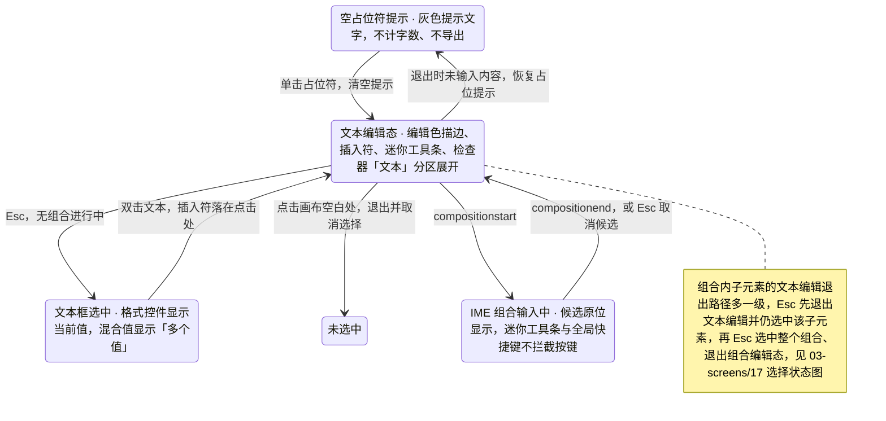
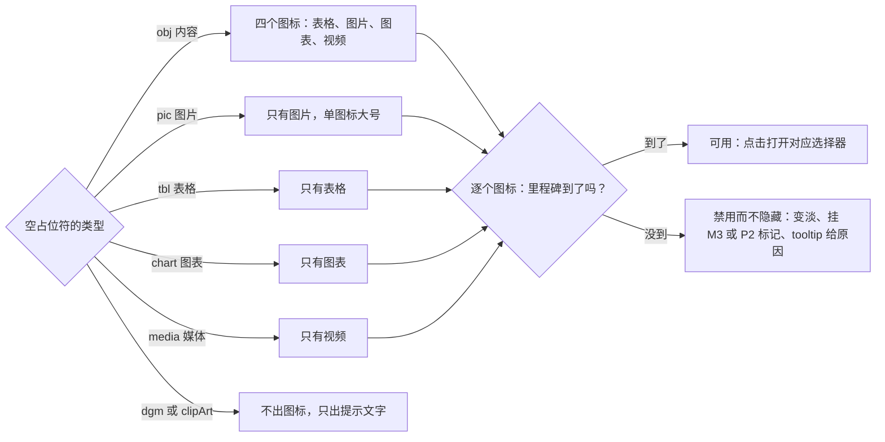
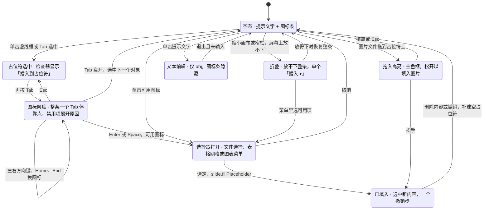
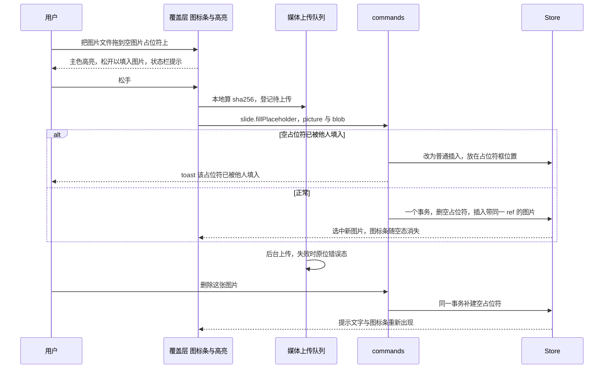
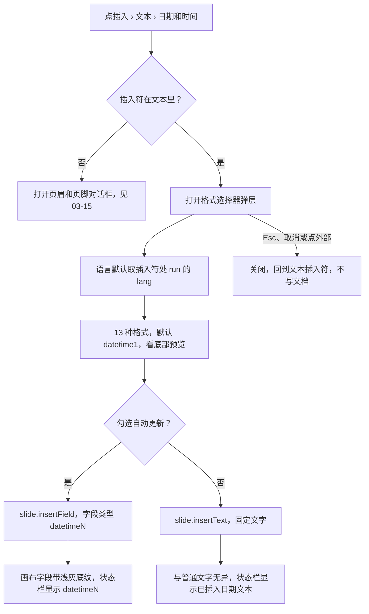
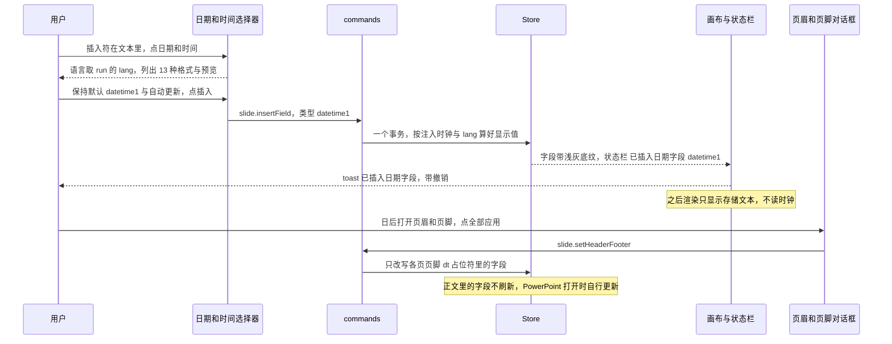

> 状态：草稿 | 负责：设计 | 更新：2026-09-15；2026-09-25（补图）；2026-09-25（矛盾收口，rulings §4.18）；2026-09-25（§4.19）；2026-09-30（§4.21 剩余缺口样张回写：新增「空内容占位符图标条」（G-80）与「日期和时间格式选择器」（G-81 文本编辑态部分）两节并配图；状态清单补 5 个演示状态；新增「待决 / 取舍」，如实登记样张与规格的差异；样张经主会话抽查，最终以用户确认为准）；2026-09-30（§4.21 剩余缺口样张回写 · 复核修正：占位符「表格」图标的去向改指 03-30 §13 第 7 条这一唯一登记点；待决补 `placeholder-empty` 分区与 50/10 §5 的差异、样张未画占位符选中框；格式列表容器与图标按钮圆角按样张 token 更正；「禁用而不隐藏」出处改为 rulings §4.20 FE-06）；2026-09-30（§4.22 设计待决收口：图标条与迷你工具条改画在屏幕坐标覆盖层、按屏幕尺寸绘制，窄占位符折叠为「插入 ▾」；图标条键盘改为单一 Tab 停靠点；表格图标定为同一网格弹层（用户裁决 Q2）；检查器 `placeholder-empty` 定为三组（占位符、位置与大小、插入到占位符）；样张版式改为「内容与图片」；日期选择器默认 `datetime1` 并与页眉和页脚对话框共用一张表，「自动更新」说明定稿；多图拖入规则定稿；状态清单补 2 态；待决表只留推迟项与两条样张取舍）；2026-09-30（§4.22 整合：待决表补第 18 行选区手柄与标签随缩放变小，指向 rulings §4.22 SR-5）；2026-09-30（§4.22 复核修正：文首待决说明更正为三条取舍；占位符弹层避让改为 112 px，图表菜单同一口径、插入后展开检查器「数据」分区；第 18 条手柄尺寸更正） | 依赖：charter v0.2；`10-prd/07-design-coverage-and-gaps.md`；rulings §4.21（R-d-69、R-d-72、q-table-depth、q-media-insert）、§4.20 FE-06（禁用而不隐藏）；前端 50/20 §3、50/21 §3；ADR-0018；playground `TextEditing.tsx`、`PlaceholderIconBar.tsx`、`DateTimePicker.tsx`、`datetime-formats.ts`、`TableGridPicker.tsx`

# 03-16 文本编辑态与格式化

> **设计基准（2026-09-15 起）**：组件规格以 [`09-design-specification.md`](../09-design-specification.md) v3.0（shadcn Rhea + 材质层）为准；对应 playground 路由 `#/editor/text`（[已发布 artifact](https://claude.ai/code/artifact/cf6e1a1a-986b-48bb-b743-5758dff419d2)，源码 `playground/src/routes/`）。本文引用的 `mockups/*.html` 与线框图为历史静态稿，以 playground 实际渲染为终稿。
>
> **§4.21 样张（2026-09-30）**：「空内容占位符图标条」「日期和时间格式选择器」两节以 playground `#/editor/text` 的样张为准，源码为 `playground/src/components/editor/elements/PlaceholderIconBar.tsx`、`playground/src/components/editor/ribbon/insert/DateTimePicker.tsx`、`playground/src/components/editor/ribbon/insert/datetime-formats.ts`、`playground/src/components/editor/ribbon/insert/TableGridPicker.tsx`、`playground/src/routes/editor/TextEditing.tsx`，Ribbon 入口在 `playground/src/components/editor/ribbon/InsertTab.tsx`。演示状态：空内容占位符 · 图标条、图标条 · 键盘焦点与禁用原因、图标条 · 窄占位符折叠、占位符 · 表格网格、图片拖入空占位符、日期和时间 · 格式选择器、已插入日期字段。样张已经主会话抽查，**最终以用户确认为准**；§4.22（2026-09-30）按用户裁决 Q1–Q3 修订样张后，原登记的样张差异已收口，文末「待决 / 取舍」只留推迟项与三条样张取舍（rulings §4.22 SR-1、SR-3、SR-5）。行为口径与前端 [50/20](../../50-frontend/20-elements-text.md) §3、[50/21](../../50-frontend/21-elements-structure.md) §3 一致，视觉与文案以本文为准。

补齐 `02-editor-main.md`"正在编辑文本"一行带过的状态，给出完整的文本编辑态、"开始"页签格式化控件、颜色/字体选择器与项目符号库。覆盖缺口 **G-11**（ED-02，文本内联编辑与占位符提示）、**G-12**（ED-03/ED-04，字符与段落格式、项目符号与编号）、**G-34**（ED-19，超链接对话框）。对应 `02-user-flows.md` F2。2026-09-30 起另覆盖 §4.21 的 **G-80**（ED-07，空内容占位符图标条）与 **G-81** 的文本编辑态部分（ED-31，「日期和时间」格式选择器；页眉和页脚对话框本身见 [03-15](15-insert-menu-and-shape-library.md)，Ribbon 分流见 [03-04](04-insert-menu.md)）。

---

## 线框："开始"页签完整分组

```
┌─────────────────────────────────────────────────────────────────────────┐
│┌剪贴板┐┌幻灯片──┐┌字体──────────────────┐┌段落────────────┐┌绘图────┐┌编辑──┐│
││粘贴▾ ││新建▾   ││微软雅黑▾ 18▾ ▴▾      ││[≡][≡][≡][≡][≡] ││形状▾  ││查找  ││
││剪切  ││版式▾   ││B I U S 𝐀▾ ▽▾ ≡▾ Tt▾ ││•▾ 1▾ ◂▸ ¶▾      ││快速▾  ││替换  ││
││复制  ││重置    ││清除格式               ││⌷▾               ││填充▾  ││选择▾ ││
│└──────┘└────────┘└──────────────────────┘└─────────────────┘└───────┘└─────┘│
└─────────────────────────────────────────────────────────────────────────┘
```

图例：`𝐀▾`=字体颜色、`▽▾`=高亮、`≡▾`=大小写、`Tt▾`=清除格式已并入同分组、`•▾`=项目符号、`1▾`=编号、`◂▸`=减少/增加缩进、`¶▾`=行距与段距、`⌷▾`=文本框锚点/对齐。

## 线框：文本编辑态（画布内）

```
┌──────────────────────────────────────┐
│  ┌ 迷你工具条（贴边，视口边缘自动翻转） ┐  │
│  │ 微软雅黑▾ 18▾ B I 𝐀▾ •▾ ≡ ≡      │  │
│  └──────────────────────────────────┘  │
│  ╭────────────────────────╮            │
│  │ 单击此处添加标题          │ ← 占位符提示（灰色，不导出） │
│  ╰────────────────────────╯            │
└──────────────────────────────────────┘
```

---

## 状态

### 样张演示状态（playground `#/editor/text`）

DesignBar 的「演示状态」下拉逐项对应下表；截图按 `16--<状态 id>--light|dark.jpg` 命名（`docs/_tools/capture-screens.cjs` 第 16 条登记 10 态，默认态 `editing`；`placeholder`、`autofit`、`readonly` 三态在下拉里、不登记截图）。加粗的 7 项为 2026-09-30 新增，其中 `placeholder-collapsed`、`placeholder-table-grid` 为 §4.22 收口补。

| 状态 id | 演示状态 | 画面要点 | 本文小节 |
|---|---|---|---|
| `placeholder` | 空占位符提示 | 标题与正文占位符的灰色斜体提示 | 空占位符提示（G-11） |
| `editing` | 编辑中 · 迷你工具条 | 编辑色下划线、插入符、迷你工具条（屏幕覆盖层，字体名与字号 12px） | 进入/编辑/退出文本编辑态 |
| `bullets` | 项目符号 · 多级缩进 | 两级项目符号；正文占位符顶端对齐（PowerPoint 默认 `anchor="t"`），迷你工具条贴在首行上方 | 项目符号与编号 flyout |
| `autofit` | 已自动缩小至 92% | 溢出缩小角标 | 进入/编辑/退出文本编辑态 |
| `readonly` | 只读（无插入符/无工具条） | 评审模式只读细条 | —（见 03-04「只读」） |
| `restricted-font` | 受限字体三处提示 | 内联提示、迷你工具条锁形、状态栏；一次性内联提示条画在屏幕覆盖层（12px，不随缩放），正文按提示条与工具条的屏幕高度换算下移 | 见 03-13 |
| **`placeholder-icons`** | **空内容占位符 · 图标条** | 「内容与图片」版式：左内容占位符（540 pt）已选中（选中框 + 检查器 `placeholder-empty` 三组），四图标；右图片占位符（276 pt）单图标 | 空内容占位符图标条（G-80） |
| **`placeholder-focus`** | **图标条 · 键盘焦点与禁用原因** | 焦点环落在「图表 M3」（整条唯一的 Tab 停靠点），原因 tooltip 展开；状态栏「←/→ 在图标间移动 · Enter 插入 · Esc 回到占位符」 | 同上 |
| **`placeholder-collapsed`** | **图标条 · 窄占位符折叠** | 缩放 50%：左侧内容占位符在屏幕上放不下整条，折叠为「插入 ▾」并展开菜单，「图表 M3」禁用项的原因 tooltip 在右侧；右侧单图标仍为 84 px；状态栏说明折叠原因 | 同上 |
| **`placeholder-table-grid`** | **占位符 · 表格网格** | 表格图标旁弹出与插入页签同一网格弹层（悬停 3 × 4），下方放不下时翻到图标上方；状态栏「选定行列即填入此占位符 · 宽取占位符框宽」 | 同上 |
| **`placeholder-drop`** | **图片拖入空占位符** | 右侧图片占位符主色高亮（描边画在纸面），「松开以填入图片」与拖动缩略图「+ 1」画在覆盖层 | 同上 |
| **`datetime`** | **日期和时间 · 格式选择器** | 插入页签「日期和时间 ▾」弹层，中文 13 种格式，默认选中 `datetime1`（「2026/9/30」） | 日期和时间格式选择器（G-81） |
| **`datetime-field`** | **已插入日期字段** | 字段浅灰底纹；状态栏「已插入日期字段 · datetime1」 | 同上 |

### 空占位符提示（G-11）

- 文本占位符为空时显示灰色提示文字（取自版式提示或默认，如"单击此处添加标题"），不计入字数、不导出。
- 单击占位符即清空提示并进入编辑态；Esc 或点击外部退出编辑且未输入内容时恢复占位提示。
- 内容族占位符（内容 `obj`、图片 `pic`、表格 `tbl`、图表 `chart`、媒体 `media`）为空时，除提示文字外中央还有一条快速插入图标条，见下文「空内容占位符图标条（G-80）」；内容占位符 `obj` 左上仍保留「• 单击此处添加文本」，单击提示文字照常进入文本编辑，此时图标条隐藏。

### 进入/编辑/退出文本编辑态

- 双击文本：进入编辑态——文本框描边变为 `border-focus` 编辑色、插入符落在点击处、迷你工具条出现在文本框上方（视口边缘不足时自动翻转到下方）、检查器坞"文本"分区自动展开定位。
- IME 组合输入中：候选文字原位显示，候选框与插入符对齐；组合期间迷你工具条按钮与全局快捷键不拦截按键；`Esc` 优先取消候选而非退出编辑态（见 07-accessibility-and-i18n.md §4）。
- `spAutoFit` 文本框输入超出：形状实时增高；`normAutofit` 溢出：文本按阶梯缩小，属性面板"文本"分区显示"已自动缩小至 92%"。
- Esc：退出编辑返回选中态（组合内子元素仍选中该子元素）；点击画布空白处：退出编辑并**取消选择**（与非编辑态「点击空白取消选择」同一条指针规则，与 PowerPoint 一致；原「返回选中态」作废，以前端设计线 `50-frontend/06` §2 为准）；空文本框退出后恢复占位提示。

**文本编辑态切换**



怎么读：Esc 在组合输入中只取消候选、不退出编辑，这是 07-accessibility-and-i18n §4 的 IME 规则；Esc 退出后仍选中该文本框，点击画布空白处则退出并取消选择（`50-frontend/06` §2）；迷你工具条只在「文本编辑态」出现，退出立即隐藏。

### 字符与段落格式（G-12）

- 字体族：可搜索下拉，含主题字体选项（`+mj-lt`/`+mn-lt`），东亚字体独立设置；字号：阶梯下拉（8–96pt 常用刻度）+ 直接输入 + 增减按钮。
- 字符：B/I/U（单）/S（删除线）/上标/下标/字体颜色 ▾/高亮 ▾/大小写 ▾（全部大写/小型大写/句首大写）/清除格式。
- 段落：左/中/右/两端/分散对齐五态图标切换；缩进增减；行距 ▾（1.0/1.15/1.5/2.0/自定义）；段前后距 ▾；文本框锚点/对齐 ▾（顶/中/底 + 自动换行开关，P2 起支持文本方向）。
- 光标在词内无选区时应用字符格式作用于当前词；多选多个文本框时统一应用并计一个事务；文本框选中（非编辑态）时格式控件显示当前值，混合值统一显示"多个值"（`MixedValueField` 占位样式，Ribbon 的字体、字号控件同样适用；与 03-screens/03、02-editor-main 一致，原"—"作废，rulings §4.18 UX-10）。

### 颜色选择器 popover

```
┌───────────────────────────┐
│ 主题颜色                    │
│ ■■■■■■■■■■  (10×6 明暗变体) │
│ 标准色                       │
│ ■■■■■■■■■■                  │
│ 最近使用                     │
│ ■■■■                        │
│ [自定义颜色…]  Hex[#4A54E1]  │
└───────────────────────────┘
```

- 键盘可达：方向键在色板网格内导航，Enter 选择，Esc 关闭；"自定义颜色"展开 Hex/RGB/HSL 输入；填充场景额外提供透明度滑杆。

### 项目符号与编号 flyout（G-12）

- 项目符号 ▾：7 种字符预设 + "无" + "自定义…"（自定义字符/图片项目符号为 P2）。
- 编号 ▾：≥ 8 种方案（阿拉伯句点、字母句点、罗马数字句点、中文数字等）+ 起始值输入。
- `Tab`/`Shift+Tab` 在段首升降级（级别 0–8），级别切换后即时改变缩进并继承对应级别样式。

### 超链接对话框（G-34）

```
┌─────────────────────────────────────┐
│ 插入超链接                        [×]│
├─────────────────────────────────────┤
│ 类型：(●网页 URL) (○本文稿中的页)     │
│ 地址 [https://example.com........]   │
│ ⚠ 仅支持 http/https/mailto/tel       │
│ 显示文字 [季度业绩汇报..........]     │
│                    [移除链接] [确定] │
└─────────────────────────────────────┘
```

- 触发：`Mod+K` 或右键"超链接…"；"本文稿中的页"切换后地址栏替换为缩略图列表选择器。
- 校验：非白名单协议（如 `javascript:`/`data:`）内联错误提示，不提交；确认后文本变为链接样式（`text-link` token）。
- 编辑态悬停已有链接：浮出小卡"`Mod+点击` 打开 · 编辑 · 移除"。应用内只激活 http(s) 与页内跳转：`mailto:` / `tel:` 链接可写入并随导出保留，但在应用内不打开，悬停小卡改为显示目标与"复制"（PRD ED-19；rulings §4.15 Q7、ADR-0008 决策 5）。

---

## 线框：空内容占位符图标条（G-80）

样张用「内容与图片」版式：左边是内容占位符（`obj`，540 pt 宽，四个图标，已选中），右边是图片占位符（`pic`，276 pt 宽，只有「图片」一个图标）。选这个版式是为了在 1440 × 900「适应窗口」（83%）下画出展开的整条：等宽「两栏内容」的一栏只有 408 pt，83% 时约 339 px，放不下 344 px 的四图标条加两侧各 8 px 留白，会按规格折叠（折叠形态见演示态 `placeholder-collapsed`）。PRD ED-07（P1，R-d-69）；前端行为见 [50/21](../../50-frontend/21-elements-structure.md) §3，填入与删除恢复的模型决策见 [ADR-0018](../../30-architecture/adr/0018-editor-element-model-and-insert-commands.md)。

```
┌──────────────────────────── 幻灯片 · 版式「内容与图片」 ─────────────────────────────┐
│ ┌╌╌╌╌╌╌╌╌╌╌╌╌╌╌╌╌╌╌╌╌╌╌╌╌╌╌╌╌╌╌╌╌╌╌╌╌╌╌╌╌╌╌╌╌╌╌╌╌╌╌╌╌╌╌╌╌╌╌╌╌╌╌╌╌╌╌╌╌╌╌╌╌╌╌╌╌╌╌╌╌╌╌┐ │
│ ╎ 单击此处添加标题                                                                 ╎ │
│ └╌╌╌╌╌╌╌╌╌╌╌╌╌╌╌╌╌╌╌╌╌╌╌╌╌╌╌╌╌╌╌╌╌╌╌╌╌╌╌╌╌╌╌╌╌╌╌╌╌╌╌╌╌╌╌╌╌╌╌╌╌╌╌╌╌╌╌╌╌╌╌╌╌╌╌╌╌╌╌╌╌╌┘ │
│ ■━ 内容占位符 obj · 已选中 ━━━━━━━━━━━━━━━━━━━━━━━━━━■ ┌╌ 图片占位符 pic ╌╌╌╌╌╌╌╌╌╌┐ │
│ ┃ • 单击此处添加文本                                 ┃ ╎                           ╎ │
│ ┃                         M3      P2                 ┃ ╎                           ╎ │
│ ┃   ╭─────────────────────────────────╮              ┃ ╎       ╭────────╮          ╎ │
│ ┃   │ [▦]     [▣]     [▥]     [▷]     │              ┃ ╎       │  [▣]   │          ╎ │
│ ┃   │ 表格    图片    图表    视频    │              ┃ ╎       │  图片  │          ╎ │
│ ┃   ╰─────────────────────────────────╯              ┃ ╎       ╰────────╯          ╎ │
│ ┃      单击图标插入，或把图片拖到这里                ┃ ╎    单击图标添加图片       ╎ │
│ ■━━━━━━━━━━━━━━━━━━━━━━━━━━━━━━━━━━━━━━━━━━━━━━━━━━━━■ └╌╌╌╌╌╌╌╌╌╌╌╌╌╌╌╌╌╌╌╌╌╌╌╌╌╌╌┘ │
└──────────────────────────────────────────────────────────────────────────────────────┘
 检查器 · 属性   [占位符]        类型 内容（obj） · 索引 1 · 来自 版式「内容与图片」
                [位置与大小]    X 0.83 in · Y 1.78 in · 宽 7.50 in（继承自版式） · 高 5.17 in（已覆盖 · ↺ 重置）
                [插入到占位符]  [▦ 表格] [▣ 图片] [▥ 图表  M3] [▷ 视频  P2]
```

（线框字符只是示意，图标为 Lucide 线性图标 Table、ImagePlus、ChartColumn、Video；`■━┃` 表示左侧占位符的选中框（8 个缩放手柄、无旋转手柄，示意只画角）；`M3`、`P2` 是挂在图标右上角的里程碑标记；「图表」「视频」为禁用态，图标与文字变淡。）

### 图标条规格

| 部件 | 规格（样张） |
|---|---|
| 出现条件 | 页上空的内容族占位符，且没有在该占位符里编辑文字；普通视图可见，只读 / 评审不出。图标条、提示文字与虚线框都画在覆盖层，不进 Scene，因此缩略图、放映与导出里都没有 |
| 按类型过滤 | `obj` 显示表格、图片、图表、视频四项；`pic` 只图片；`tbl` 只表格；`chart` 只图表；`media` 只视频；`dgm`（SmartArt）与 `clipArt` 不出图标、只出提示文字（SmartArt 插入是非目标，R-d-75；剪贴画不提供，50/21 §3） |
| 容器 | `role="toolbar"`，读屏名「插入内容到占位符」；圆角 20，白 80% 底 + 背景模糊，1px 墨色 8% 描边加一层轻投影；内边距 8，图标间距 8；整条在占位符内水平、垂直居中（`obj` 先让出左上提示行的 48 pt，在余下区域居中） |
| 图标按钮 | 多图标 76 × 76，单图标 84 × 84，圆角 `rounded-2xl`（约 14）；图标 28（单图标 32），描边 1.5；图标下方 13px 文字，间距 6；常态墨色 70%，悬停主色 10% 底 + 主色深一级文字 |
| 里程碑标记 | 挂在按钮右上角外侧 6 px；18 高胶囊，info 浅蓝底、深蓝 12px 字、2px 白色外圈；与 `MilestoneTag` 同义，不随禁用变淡。只要该项有里程碑就挂（与插入页签「图表 ▾」的 M3 一样，开放后仍挂到该里程碑发布）；是否禁用只看该类型是否已开放 |
| 提示文字 | 图标条下方 12，15px 墨色 50%：内容占位符「单击图标插入，或把图片拖到这里」，图片占位符「单击图标添加图片」；只在整条展开、且上下左右都放得下时出现 |
| 焦点环 | 3px 主色环 + 2px 白色外距，落在纸面上也清晰 |
| 配色口径 | 图标条落在幻灯片纸面上（纸面恒为白色），所以用文档墨色 `#1A2030` 与主色 `#3A5CE6` 的固定值，不用界面 token；暗色界面下外观不变（对照 `16--placeholder-icons--dark.jpg`） |
| 尺寸与缩放 | 画在 `SlideCanvas` 的屏幕坐标覆盖层（`data-slot="canvas-overlay"`），按占位符的屏幕框居中，按屏幕尺寸绘制，不随画布缩放；触控命中区 ≥ 44 px（50/21 §3）。四图标整条宽 344 px（4 × 76 + 3 × 8 + 左右内边距 16），单图标 100 px；四周至少留 8 px，放不下即折叠 |
| 折叠形态 | 单个「插入 ▾」胶囊按钮：高 44、全圆角，白 80% 底 + 背景模糊 + 与整条相同的描边与投影；Plus 图标 + 14px「插入」+ ChevronDown，读屏名「插入内容到占位符」。菜单宽 208、非模态，首行「插入到占位符」（12px 次要色，不可选），其下同一组条目（图标 16 + 名称，右侧里程碑标记）；禁用项 `aria-disabled`、仍可聚焦，文字与图标 50%，原因 tooltip 在右侧展开。选了带选择器的项（表格）时菜单关闭、焦点回到「插入 ▾」，选择器锚在这个按钮上弹出；选择器或外部菜单开着时按钮为按下态 |

**图标条按占位符类型与里程碑出图标**



怎么读：先按占位符类型决定出哪几个图标，再逐个看里程碑——已到的可点，没到的照样出现，只是变淡、挂标记并用 tooltip 说明原因（「禁用而不隐藏」，rulings §4.20 FE-06；M4+ 的项同样禁用显示，50/10 §4）；只有非目标（SmartArt、剪贴画）根本不出图标。M2 时表格与图片可用，图表 M3 起可用，视频 P2 起可用。

### 禁用而不隐藏与 tooltip

| 图标 | 里程碑 | M2 时 | tooltip（样张原文） | 读屏名 |
|---|---|---|---|---|
| 表格 | M2（q-table-depth：插入与单元格文字） | 可用 | 插入表格 | 插入表格到占位符 |
| 图片 | M2 P1（R-d-69） | 可用 | 插入图片 | 插入图片到占位符 |
| 图表 | M3（ED-15a） | 禁用 + `M3` | 图表插入在 M3 提供：随图表编辑组件一起开放。文稿里已有的图表照常查看和放映。 | 插入图表到占位符（M3 提供） |
| 视频 | P2（q-media-insert） | 禁用 + `P2` | 视频插入排在后续版本（P2）。文稿里已有的视频照常查看、放映、移动和缩放。 | 插入视频到占位符（P2 提供） |

- 禁用项用 `aria-disabled` 而不是 `disabled`：仍可用方向键停留与悬停，tooltip 可达；图标与文字降到墨色 35%，指针为 `not-allowed`，点击不做任何事。tooltip 在按钮下方展开，最大宽 240；折叠菜单里的禁用项文字与图标 50%，tooltip 在右侧展开。
- 图标条、折叠菜单与检查器「插入到占位符」按钮组用同一个 Tooltip 组件、同一段原因文案（不用浏览器原生 `title`），禁用判定同源（`placeholderItemState`）。
- 与插入页签同步：图表到 M3 起与「图表 ▾」一起启用（03-04「禁用而不隐藏」表）；视频随 ED-35 在 P2 启用；启用前后图标位置不变。

### 键盘聚焦顺序

图标条按 APG Toolbar 模式（[07](../07-accessibility-and-i18n.md) §1.2）：整条只有一个 `Tab` 停靠点，图标之间用方向键。样张帧 `placeholder-focus`：焦点环落在禁用的「图表」上（它就是当前停靠点），原因 tooltip 自动展开；状态栏左侧显示「←/→ 在图标间移动 · Enter 插入 · Esc 回到占位符」。

1. 画布内 `Tab` 按 z 序逐个选中对象（[03-17](17-selection-alignment-and-snapping.md)）；选中空内容占位符时它显示选中框，检查器切到 `placeholder-empty`。
2. 占位符选中后再按 `Tab`：焦点进入它的图标条；首次进入落在第一个图标（「表格」），之后回到上次停留的图标（roving tabindex）。
3. `←` / `→` 在图标间移动，到头循环；`Home` / `End` 到第一个 / 最后一个。禁用项同样停留，聚焦即展开原因 tooltip。
4. `Tab`：离开整条，按 z 序选中下一个对象（样张为右侧图片占位符，再按 `Tab` 进入它唯一的「图片」）；`Shift+Tab` 反向。
5. `Enter` / `Space`：触发当前图标；禁用项无动作，tooltip 保持显示。
6. `Esc`：焦点回到占位符本身（仍选中）；再按 `Esc` 按 03-17 的 Esc 链取消选择。样张的占位符不是可聚焦元素，这一步只由状态栏提示示意；产品由画布的可访问镜像承担焦点。
7. 折叠为「插入 ▾」时整条就是这一个按钮：`Enter` / `Space` / `↓` 打开菜单，菜单内方向键移动，禁用项可停留并在右侧给原因。
8. 选择器（文件选择、表格网格、图表菜单）取消后焦点回到触发它的图标（折叠时回到「插入 ▾」）；填入成功后焦点随选中落到新内容上。

**空内容占位符的交互状态**



怎么读：写文档的只有「已填入」一格，其余都是本机界面状态；「折叠」只是同一组条目换了形态，随缩放与版式在两种形态间切换；两条填入路径（点图标或菜单项经选择器、直接拖入图片）都落到同一个命令、同一个撤销步；从「已填入」删除内容或撤销都会回到「空态」，图标条重新出现。

### 填入：点图标、拖入图片

点图标打开的选择器与插入页签是同一组件，填入统一走 `slide.fillPlaceholder`（新增，§4.21，ADR-0018），一个事务、一个撤销步，填入后选中新内容：

| 图标 | 选择器 | 填入后 |
|---|---|---|
| 图片 | 系统文件选择 | 保留占位符身份（同 `type`、`idx` 与层级顺序），按占位符框居中裁剪填满（`obj` 占位符的放法待实测，见文末第 10 条）；换版式时随占位符移动；上传在后台，上传中与失败态同 [03-04](04-insert-menu.md)「加载中」「错误」 |
| 表格 | 在图标旁弹出与插入页签同一个网格弹层 `TableGridPicker`（8 行 × 10 列悬停范围，读数「R 行 × C 列 表格」，含「插入表格…」；用户裁决 2026-09-30 Q2）；下方放不下时翻到图标上方（为状态栏与缩放条留出 112 px，83% 的样张即向上弹出；图表菜单同一口径）。「插入表格…」与插入页签同一流程：先关网格再开对话框，取消或 `Esc` 后焦点回到表格图标（折叠时回到「插入 ▾」） | 表格宽取占位符框宽、默认行高约 0.41 in（同 [03-30](30-table-editing.md) §2.4）；toast「已在占位符插入 R 行 × C 列表格，宽取占位符框宽」，说明「填入是一个撤销步；删除内容后占位符恢复为空」；选中表格并进入首格编辑，编辑细节见 03-30 |
| 图表（M3） | 插入页签同一个 `ChartTypeMenu`（六项与子类型 flyout），贴图表图标下缘弹出，下方放不下时翻到图标上方（同表格网格，留出 112 px）；首行「[M3] 五类 · 填入占位符后打开数据面板」；菜单开着时图表图标为按下态（`aria-expanded`）；未选类型就关闭时焦点回到图表图标 | 取占位符框；插入后展开检查器「数据」分区、焦点在首个数值格，见 [03-31](31-chart-editing.md) |
| 视频（P2） | —（禁用） | — |

**拖入图片**（样张帧 `placeholder-drop`）：图片文件拖到空的内容或图片占位符上时，该占位符改为 2px 主色实线框 + 主色 6% 底（画在纸面，随占位符缩放）；中央 32 号图标（ImageDown）、「松开以填入图片」（14px 中粗、主色）、下方 12px 说明「按占位符框裁剪填满，换版式时随占位符移动」，以及指针旁带「+ 1」计数胶囊的拖动缩略图，都画在屏幕覆盖层、按屏幕尺寸绘制；状态栏左侧「松开鼠标：图片填入占位符（可撤销）」。只有指针下的占位符高亮，其它占位符的图标条保持原样；拖到占位符以外的位置按普通图片插入（[03-18](18-image-editing.md)）。

**一次拖入多张图片**（定稿，样张不补帧）：指针下的占位符填第一张（`slide.fillPlaceholder`）；其余几张在放下点按普通插入，依次错位 0.2 in（50/19 §3.1），不自动去填同页其它空占位符。拖动缩略图的计数胶囊显示张数（「+ N」）。

### 检查器「插入到占位符」按钮组

选中空内容占位符时检查器是 `selectionKind: placeholder-empty`（R-d-72），属性页三组，组名与顺序同 [03-03](03-properties-panel.md)、50/10 §5、50/21 §3 ⑦：

- **占位符**：类型「内容（obj）」、索引「1」、来自「版式「内容与图片」」，三行只读。
- **位置与大小**：X、Y、宽、高四个数值框（显示单位随设置，见 [03-23](23-settings-panel.md)；样张用 in，两位小数；各样张单位不一，见 rulings §4.22 SR-4）；每个字段下注来源——未在本页改过的显示「继承自版式」，移动或缩放过的显示主色「已覆盖」+「↺ 重置」小按钮（tooltip「重置为版式值 〈值〉 in」，点击后 toast「已重置〈字段〉为版式值 〈值〉 in」带「撤销」）。样张：X 0.83、Y 1.78、宽 7.50 继承自版式；高 5.17 已覆盖（版式值 4.96 in）。空占位符可以移动与缩放，重置按字段进行，不另设整组「重置为版式位置」。
- **插入到占位符**：2 × 2 描边小按钮（高 28，图标 14 + 12px 文字，左对齐）——表格、图片、图表、视频；过滤、动作与禁用规则与图标条完全相同（按占位符类型过滤，图表、视频在 M2 变淡并在按钮右侧挂 `M3` / `P2` 标记，`aria-disabled` 可聚焦，悬停或聚焦用同一个 Tooltip 组件给同一段原因）；组底注「也可以直接单击占位符输入文字；填入内容后删除，占位符会恢复为空。」（12px）。
- **只读 / 评审**：不出「插入到占位符」组，「位置与大小」只读。

这是图标条的表单等价路径：图标条被遮挡或折叠时，键盘与读屏用户从检查器完成同样的操作。

### 删除填入内容后恢复空占位符

- 删除填入的图片、表格或图表：同一事务补建空占位符（新 id、同 ref 与顺序），提示文字与图标条重新出现；撤销「填入」同样回到空占位符。
- 直接选中空占位符后删除：占位符本身被删，不补回（50/21 §3）；撤销这一步可找回。
- 协同先后到达：本机执行时发现他人已填入并已同步，改为普通插入（放在占位符框位置），toast「该占位符已被〈姓名〉填入，已作为普通元素插入」（50/21 §3）。
- 样张没有「删除后恢复」这一帧，以上按 ADR-0018 与 50/21 §3 描述，视觉即回到 `placeholder-icons` 帧。

**拖入图片填入与删除恢复**



怎么读：纵向是时间；拖入高亮只是覆盖层的反馈，真正写文档的是松手那一刻的一条命令；上传在后台进行，不阻塞填入；删除图片时命令在同一事务里补回空占位符，所以图标条会立刻回来。

---

## 线框：日期和时间格式选择器（G-81，文本编辑态）

插入符在文本里时，插入 › 文本 › 「日期和时间 ▾」打开这个小型选择器，与 PowerPoint 的「日期和时间」对话框同构；插入符不在文本里时按钮不带 ▾，直接打开页眉和页脚对话框（分流见 [03-04](04-insert-menu.md)「文本组随文本编辑态切换」，对话框见 [03-15](15-insert-menu-and-shape-library.md)「页眉和页脚对话框」）。PRD ED-31（M2 P2）；前端行为见 [50/20](../../50-frontend/20-elements-text.md) §3。

```
 插入 › 文本  [◷ 日期和时间 ▾]   ← 文本编辑态才带 ▾；弹层打开时按钮为按下态
 ┌──────────────────────────────────────────┐
 │ 日期和时间                                  │
 │ 插入到光标处，字体字号随所在段落               │
 │ 文A 语言  [中文（中国）                  ▾] │
 │ ┌──────────────────────────────────────┐ │
 │ │ 2026/9/30                           ✓ │ │ ← 默认选中 datetime1：主色 10% 底 + 对勾
 │ │ 2026年9月30日星期三                     │ │
 │ │ 2026年9月30日                          │ │
 │ │ 2026年9月                              │ │
 │ │ 9月30日                                │ │
 │ │ 二〇二六年九月三十日                      │ │
 │ │ 星期三                                 │ │
 │ │ 2026/9/30 14:32                       │ │
 │ │ …（共 13 种，区域高 236，超出滚动）        │ │
 │ └──────────────────────────────────────┘ │
 │ ☑ 自动更新                                  │
 │   插入为日期字段：这里显示插入当天的日期，    │
 │   在 PowerPoint 中打开时自动更新            │
 │ ──────────────────────────────────────── │
 │ 将插入 ░2026/9/30░              [取消] [插入] │
 └──────────────────────────────────────────┘
 画布：汇报日期：░2026/9/30░|      状态栏：第 2/12 页 · 已插入日期字段 · datetime1
```

（`░…░` 表示字段的浅灰底纹；`文A` 为 Lucide Languages 图标。）

### 选择器规格

| 部件 | 规格（样张） |
|---|---|
| 入口与分流 | 插入 › 文本 › 日期和时间（M2 P2）。插入符在文本里：按钮带 ▾，点开本弹层，打开时按钮为按下态（accent 底、`aria-pressed`）；不在文本里：按钮不带 ▾，点击打开页眉和页脚对话框，tooltip「未在编辑文字：打开页眉和页脚，设置页脚里的日期」 |
| 形态 | 非模态弹层（Popover），宽 332、内边距 12，贴按钮左缘向下展开，视口边缘自动翻转（与本文颜色、字体 flyout 同一定位规则）；打开时不自动聚焦首项、不移走文本插入符；`Esc`、「取消」或点外部关闭，焦点回到文本插入符 |
| 标题区 | 「日期和时间」14px 半粗；副标题「插入到光标处，字体字号随所在段落」12px 次要色 |
| 语言 | 左侧「语言」标签（Languages 图标 14）+ 小号下拉（高 28）：中文（中国）/ 英语（美国）/ 日语；默认取插入符所在 run 的 `lang`（样张固定为中文（中国））；切换语言后列表即时换成该语言的 13 种格式 |
| 格式列表 | `role="listbox"`，读屏名「可用格式」；容器是 `.cordex-group` 分组卡（卡片底 + 6% 发丝描边与极淡投影；暗色为白 5%），每项高 28、12px、等宽数字；每种语言 13 项，自上而下对应 `datetime1`…`datetime13`，与页眉和页脚对话框共用 `datetime-formats.ts` 一张表；打开时默认选中该语言的第一种 `datetime1`；最大高 236（约 8 项），其余滚动；选中项主色 10% 底 + 中粗 + 右侧主色对勾；单击选中，双击直接插入。存的是格式编码，换语言后仍选中同一 `datetimeN` |
| 自动更新 | 复选框，默认勾选。勾选时说明「插入为日期字段：这里显示插入当天的日期，在 PowerPoint 中打开时自动更新」；取消勾选时说明改为「插入为固定文本，之后不会变化」。字段在 Cordex 里不刷新，理由见下文「与页眉和页脚对话框的关系」 |
| 预览与操作 | 底栏上方 1px 分隔线；左侧「将插入 〈预览〉」，自动更新时预览值带与画布字段相同的浅灰底纹；右侧「取消」（ghost）与「插入」（主按钮），高 28 |
| 样张时刻 | 固定为 2026-09-30（周三）14:32:05，保证截图稳定；产品用注入的时钟与 run 的 `lang` 经 `Intl.DateTimeFormat` 求值（50/20 §3） |

### 插入之后：字段底纹与状态栏 datetimeN

- **勾选自动更新**：`slide.insertField`，字段类型 `datetimeN`（格式就编码在字段类型里，不另设参数，50/20 §3），一个事务、一个撤销步；toast「已插入日期字段「2026/9/30」」带「撤销」。
- **不勾选**：`slide.insertText` 插入同一串文字，toast「已插入文本「2026/9/30」」带「撤销」。
- **画布**（样张帧 `datetime-field`）：字段带墨色 8% 浅灰底纹、圆角 3（覆盖层，只在编辑态出现，不进缩略图、放映与导出）；插入符停在字段之后。字段是不可拆的一格：插入符整格跳过，Backspace / Delete 整格删除，双击选中整个字段（50/20 §3）。固定文本与普通文字无异。
- **状态栏**：左侧显示「已插入日期字段 · datetime1」，`datetimeN` 是所选格式的字段类型，便于核对导出结果；插入的是固定文本时显示「已插入日期文本」。
- **字体字号**：字段与文本都不写显式字体字号，随所在段落继承。
- **改格式**：选中已插入的日期字段时在检查器「文本」分区出现「日期格式」下拉，是 P2，样张未画（50/20 §3）。

**点「日期和时间」之后**



怎么读：同一个按钮按插入符位置分两路——不在文本里走页眉和页脚对话框（批量写页脚），在文本里走本弹层（在插入符处插一个）；弹层里只有「插入」会写文档，而且只写一步；「自动更新」决定写成字段还是写成固定文字。

### 三种语言 × 13 种格式（样张自建，待语料核对）

`datetime1`…`datetime13` 到各语言显示格式的映射是 PowerPoint 的约定，没有现成库，映射表自建（50/20 §3）；样张里本选择器与页眉和页脚对话框共用 `playground/src/components/editor/ribbon/insert/datetime-formats.ts` 这一张表。下表是样张在固定时刻 2026-09-30 14:32:05 的显示值，**只代表样张当前取值，须经 70 线语料（PowerPoint 各语言版本另存的字段缓存值）核对后才能定稿**：推迟（触发条件：M2 P2 开工 `slide.insertField` / `slide.setHeaderFooter` 前，70 线交付三语 PowerPoint 另存语料，见 rulings §4.22；文末「待决 / 取舍」第 3 条）。

| 字段类型 | 中文（中国） | 英语（美国） | 日语 |
|---|---|---|---|
| `datetime1` | 2026/9/30 | 9/30/2026 | 2026/9/30 |
| `datetime2` | 2026年9月30日星期三 | Wednesday, September 30, 2026 | 2026年9月30日水曜日 |
| `datetime3` | 2026年9月30日 | 30 September 2026 | 2026年9月30日 |
| `datetime4` | 2026年9月 | September 30, 2026 | 2026年9月 |
| `datetime5` | 9月30日 | 30-Sep-26 | 9月30日 |
| `datetime6` | 二〇二六年九月三十日 | September 26 | 令和8年9月30日 |
| `datetime7` | 星期三 | Sep-26 | 水曜日 |
| `datetime8` | 2026/9/30 14:32 | 9/30/2026 2:32 PM | 2026/9/30 14:32 |
| `datetime9` | 2026/9/30 14:32:05 | 9/30/2026 2:32:05 PM | 2026/9/30 14:32:05 |
| `datetime10` | 14:32 | 14:32 | 14:32 |
| `datetime11` | 14:32:05 | 14:32:05 | 14:32:05 |
| `datetime12` | 下午2时32分 | 2:32 PM | 午後2時32分 |
| `datetime13` | 下午2时32分05秒 | 2:32:05 PM | 午後2時32分05秒 |

英语（美国）的 `datetime6`「September 26」是「月份 + 两位年份」，读者容易误读成 9 月 26 日；中文与日语的 `datetime4`（年月）与英语的 `datetime4`（完整日期）语义不对齐——这两处都是核对重点。

### 与页眉和页脚对话框的关系

- **两个入口、同一种字段**：本选择器在插入符处插一个字段（`slide.insertField`）；页眉和页脚对话框（[03-15](15-insert-menu-and-shape-library.md)）批量往页脚族占位符里写日期、编号与页脚文字（`slide.setHeaderFooter`，R-d-70）。插入符不在文本里时，「日期和时间」按钮直接打开对话框，不打开本选择器。
- **显示值在哪些时刻产生**：插入时由命令当场算一次并存进字段；之后渲染只显示存储文本、不读系统时钟，缩略图与导出因此是确定的（50/20 §3 图 3-1）；导出时写存储文本，PowerPoint 打开文件时会自行刷新字段显示（50/20 §3）。页眉和页脚对话框「应用 / 全部应用」按 [50/21](../../50-frontend/21-elements-structure.md) §4 的命令展开只改写页脚族日期占位符（`dt`）里的内容。
- **正文字段不在 Cordex 内刷新（定稿）**：「自动更新」只决定写成字段还是写成固定文本。用本选择器插在正文里的日期字段，在 Cordex 里一直显示插入当天的日期；页眉和页脚对话框的「应用 / 全部应用」只改写页脚族 `dt` 占位符（50/21 §4），不碰正文字段；文件在 PowerPoint 中打开时，字段由 PowerPoint 自行更新。勾选说明因此写「插入为日期字段：这里显示插入当天的日期，在 PowerPoint 中打开时自动更新」。
- **两处的语言与格式一致（已统一）**：选择器与对话框「自动更新」的格式下拉共用一张 `datetimeN` 映射表（每种语言 13 种）、同一套界面语言名「中文（中国）/ 英语（美国）/ 日语」，都存格式编码、默认第一种 `datetime1`；对话框规格见 [03-15](15-insert-menu-and-shape-library.md)「页眉和页脚对话框」。

**日期字段的显示值从哪来**



怎么读：纵向是时间；选择器只负责选语言与格式，显示值由命令在插入那一刻算好并存进字段；之后日期不会自己跳变，这保证了缩略图、视觉基线与导出的确定性；页眉和页脚对话框应用时只改写页脚里的日期，正文字段不跟着刷新，要到文件在 PowerPoint 中打开时才更新。

---

## 交互说明

- 迷你工具条（`ui.toolbar`，`slot: text-editing`）仅在文本编辑态出现，退出编辑立即隐藏；与 03-screens/02 定义的"正在编辑文本"选中态变体是同一机制。
- 颜色/字体/项目符号三类 flyout 遵循同一套 popover 定位规则（贴合触发按钮，视口边缘自动翻转），复用 `PopoverShell` 原子组件（04-design-system §4.1）。
- "清除格式"只清除字符/段落级显式覆盖，不影响继承自母版/版式的属性（呼应 02-editing.md"只写显式覆盖"原则）。
- 「日期和时间」选择器与颜色 / 字体 / 项目符号 flyout 同一套 popover 定位规则；与符号面板（03-15）一样不抢走文本插入符，关闭后插入符回到原处。
- 空内容占位符图标条、拖入高亮、日期字段底纹与迷你工具条同属覆盖层（`render.overlay`）：不进 Scene、缩略图、放映与导出。界面控件与界面文字（图标条、「插入 ▾」、迷你工具条、受限字体一次性内联提示条、拖入说明）画在 `SlideCanvas` 的屏幕坐标覆盖层，按屏幕尺寸绘制，不随画布缩放；只有贴合对象形状的描边、底色（拖入目标框、字段底纹）随纸面缩放。
- 迷你工具条：`glass-float rounded-xl`、内边距 4，按钮高 24，字体名与字号 12px（`text-xs`，按 [09](../09-design-specification.md) 字阶；`text-2xs` 11 只用于徽标、键帽、画布标签与 Ribbon 组标题）；锚在文本框上缘正中、上移 8。本文、03-30、03-31 共用同一组件。
- 图标条与检查器「插入到占位符」是同一组动作的两个入口：过滤、禁用与原因文案同源（样张两处共用 `placeholderIcons` 一张定义表与 `placeholderItemState` 一个判定），启用某一项时两处同时生效。

## 边界情况

- 字体列表很长：改为可搜索的 `Select`（输入过滤），而非纯下拉长列表（沿用 03-screens/03 已定规则）。
- 伪本地化下的按钮标签换行：字符按钮采用图形符号为主、文字为辅，避免因语言差异撑破 Ribbon 高度（04-design-system §2.1 规则）。
- 超链接地址为本文稿页但该页已被删除：链接显示为失效态（描边变为 `danger`），点击提示"目标页已被删除，请重新设置"。
- 组合内子元素的文本编辑：与顶层文本编辑态交互完全一致，仅退出路径多一级：Esc 先退出文本编辑（仍选中该子元素），再 Esc 退出组合编辑态并**落在选中整个组合**，再 Esc 才取消选择（Esc 逐级链见 03-screens/17，rulings §4.18 UX-06）。
- 占位符在屏幕上太窄、放不下整条图标条（小缩放或窄栏版式）：折叠为单个「插入 ▾」按钮，展开后是同一组条目与禁用原因（演示态 `placeholder-collapsed`，见「图标条规格」折叠形态）。
- 只读 / 评审模式：不显示图标条与检查器「插入到占位符」组，只保留虚线框与提示文字，占位符选中框不画缩放手柄（与 03-04「只读」时插入页签不出现一致）。
- 拖入的不是图片（如视频文件）：占位符不高亮，按普通拖入处理（03-18）；视频插入是 P2。
- 他人已填入同一占位符：本机改为普通插入并 toast 说明（见上文「删除填入内容后恢复空占位符」）；真并发下同页出现两个同位内容，由服务端软门禁修复一次（50/21 §3）。
- 日期选择器打开期间，插入符所在的文本框被他人删除：弹层关闭、不插入，按软冲突提示（与 03-15 插入工具态的同类边界一致）。

---

## 待决 / 取舍（2026-09-30 样张回写；§4.22 收口）

§4.22（2026-09-30）按用户裁决 Q1–Q3 与样张修订，原第 1、2、4–9、11–15 条已收口，定稿内容已写进正文：

| 原条目 | 定稿 | 正文位置 |
|---|---|---|
| 1 图标条随画布缩放 | 画在屏幕坐标覆盖层、按屏幕尺寸绘制；放不下时折叠为「插入 ▾」 | 「图标条规格」的尺寸与缩放、折叠形态 |
| 2 迷你工具条字偏小 | 覆盖层绘制，字体名与字号 12px（`text-xs`），`glass-float` | 「交互说明」 |
| 4 选择器的默认格式 | 取当前语言第一种 `datetime1`（50/20 §3 口径） | 「选择器规格」格式列表 |
| 5 选择器与页眉和页脚对话框不一致 | 共用一张 13 种 `datetimeN` 表、同一套界面语言名 | 「与页眉和页脚对话框的关系」、03-15 |
| 6 「在页眉和页脚应用时刷新」 | 只改说明文字；正文字段不在 Cordex 内刷新，PowerPoint 打开时自行更新 | 同上 |
| 7 占位符里点「表格」 | 图标旁弹出与插入页签同一网格弹层（Q2） | 「填入：点图标、拖入图片」 |
| 8 只读角色下的图标条 | 不出图标条与「插入到占位符」组，选中框不画手柄 | 「边界情况」 |
| 9 检查器禁用按钮的原因 | 与图标条同一 Tooltip 组件、同一文案 | 「禁用而不隐藏与 tooltip」 |
| 11 一次拖入多张图片 | 第一张填入指针下的占位符，其余在放下点普通插入、依次错位 0.2 in | 「填入：点图标、拖入图片」 |
| 12 图标条内的键盘 | 单一 `Tab` 停靠点 + 方向键（APG Toolbar） | 「键盘聚焦顺序」 |
| 13 删除后恢复空占位符 | 不另出样张，视觉即 `placeholder-icons` 帧（ADR-0018 决策 10） | 「删除填入内容后恢复空占位符」 |
| 14 检查器 `placeholder-empty` 的分区 | 三组：占位符、位置与大小（逐字段继承 / 覆盖 · 重置）、插入到占位符 | 「检查器「插入到占位符」按钮组」 |
| 15 占位符的选中框 | 图标条各帧都画左侧占位符的选中框 | 「样张演示状态」 |

仍未定的只剩下表：两条推迟项与三条样张取舍。

| # | 事项 | 现状 | 处理 | 去向 |
|---|---|---|---|---|
| 3 | `datetime1`…`datetime13` 格式映射 | 中 / 英 / 日三张表自建，选择器与页眉和页脚对话框共用 `datetime-formats.ts` | 须语料核对；英语 `datetime6`「September 26」易误读，中日与英语的 `datetime4` 语义不对齐；若语料证实是 PowerPoint 原样就照搬 | 推迟（触发条件：M2 P2 开工 `slide.insertField` / `slide.setHeaderFooter` 前，70 线交付三语 PowerPoint 另存语料，见 rulings §4.22）；核对后回写本文映射表、`datetime-formats.ts` 与 03-15 |
| 10 | `obj` 占位符里放图片 | 按占位符框裁剪填满（`pic` 占位符两种结论下都裁剪） | 只影响 `obj`，样张不变；实测为等比放入时改拖入说明与「填入」表的措辞 | 推迟（触发条件：M2 P1 图片填入开工前，维护机实测 PowerPoint 填入后 `p:pic` 的 xfrm 与 srcRect，见 rulings §4.22） |
| 16 | 常见等宽两栏版式下图标条多半折叠 | 四图标整条 344 px，四周各留 8 px；等宽「两栏内容」一栏 408 pt，83% 时约 339 px 就放不下，PowerPoint 常见两栏一栏约 373 pt 更窄，笔记本常用缩放下多半折叠为「插入 ▾」（样张因此改用「内容与图片」版式演示展开态） | 取舍，样张已按此实现：接受折叠；或调整按钮尺寸与排布规则，让两栏在常见缩放下也能展开 | 待用户确认（rulings §4.22 SR-1） |
| 17 | 占位符网格弹层向上翻时盖住标题 | 图标条在画布下半部时，网格弹层下方放不下就翻到图标上方（为状态栏与缩放条留 112 px，图表菜单同一口径），会盖住标题占位符 | 取舍，样张已按此实现：保持向上；或始终向下，代价是压住状态栏与缩放条 | 待用户确认（rulings §4.22 SR-3） |
| 18 | 选区手柄、选区标签与尺寸角标随缩放变小 | 迷你工具条、图标条与画布浮签已移到屏幕坐标覆盖层（SF-01），选中框的手柄、选区标签与尺寸角标仍画在纸面坐标，随画布缩放变小（设计 02 在 77% 时手柄约 7.7 px、选区标签字约 8.5 px） | 取舍，样张已按此实现：保持纸面坐标；或与迷你工具条一样移到屏幕覆盖层 | 待用户确认（rulings §4.22 SR-5） |
