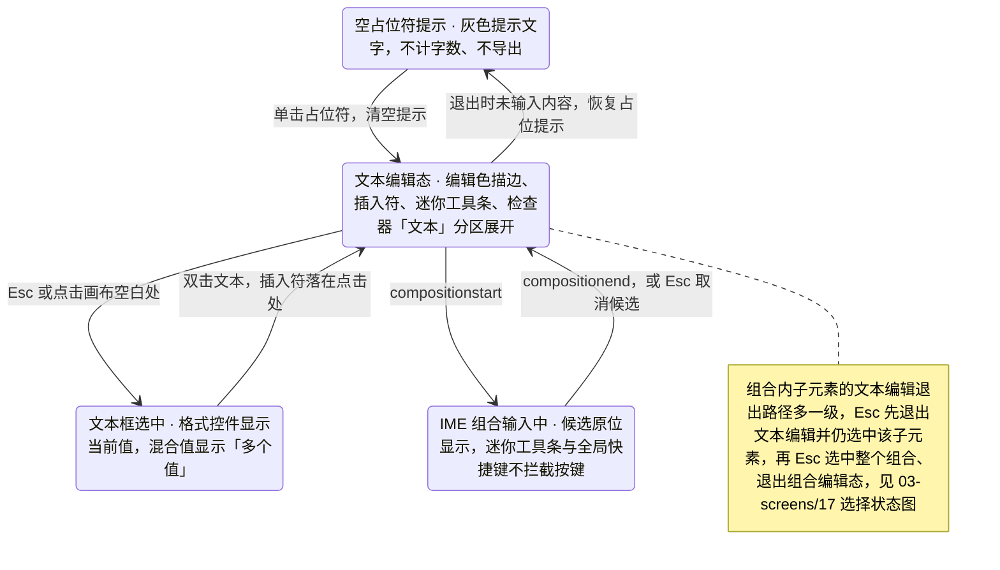

> 状态：草稿 | 负责：设计 | 更新：2026-09-15；2026-09-25（补图）；2026-09-25（矛盾收口，rulings §4.18） | 依赖：charter v0.2；`10-prd/07-design-coverage-and-gaps.md`

# 03-16 文本编辑态与格式化

> **设计基准（2026-09-15 起）**：组件规格以 [`09-design-specification.md`](../09-design-specification.md) v3.0（shadcn Rhea + 材质层）为准；对应 playground 路由 `#/editor/text`（[已发布 artifact](https://claude.ai/code/artifact/cf6e1a1a-986b-48bb-b743-5758dff419d2)，源码 `playground/src/routes/`）。本文引用的 `mockups/*.html` 与线框图为历史静态稿，以 playground 实际渲染为终稿。

补齐 `02-editor-main.md`"正在编辑文本"一行带过的状态，给出完整的文本编辑态、"开始"页签格式化控件、颜色/字体选择器与项目符号库。覆盖缺口 **G-11**（ED-02，文本内联编辑与占位符提示）、**G-12**（ED-03/ED-04，字符与段落格式、项目符号与编号）、**G-34**（ED-19，超链接对话框）。对应 `02-user-flows.md` F2。

---

## 线框："开始"页签完整分组

```
┌─────────────────────────────────────────────────────────────────────────┐
│┌剪贴板┐┌幻灯片──┐┌字体──────────────────┐┌段落────────────┐┌绘图────┐┌编辑──┐│
││粘贴▾ ││新建▾   ││微软雅黑▾ 18▾ ▴▾      ││[≡][≡][≡][≡][≡] ││形状▾  ││查找  ││
││剪切  ││版式▾   ││B I U S 𝐀▾ ▽▾ ≡▾ Tt▾ ││•▾ 1▾ ◂▸ ¶▾      ││快速▾  ││替换  ││
││复制  ││重置    ││清除格式               ││⌷▾               ││填充▾  ││选择▾ ││
│└──────┘└────────┘└──────────────────────┘└─────────────────┘└───────┘└─────┘│
└─────────────────────────────────────────────────────────────────────────┘
```

图例：`𝐀▾`=字体颜色、`▽▾`=高亮、`≡▾`=大小写、`Tt▾`=清除格式已并入同分组、`•▾`=项目符号、`1▾`=编号、`◂▸`=减少/增加缩进、`¶▾`=行距与段距、`⌷▾`=文本框锚点/对齐。

## 线框：文本编辑态（画布内）

```
┌──────────────────────────────────────┐
│  ┌ 迷你工具条（贴边，视口边缘自动翻转） ┐  │
│  │ 微软雅黑▾ 18▾ B I 𝐀▾ •▾ ≡ ≡      │  │
│  └──────────────────────────────────┘  │
│  ╭────────────────────────╮            │
│  │ 单击此处添加标题          │ ← 占位符提示（灰色，不导出） │
│  ╰────────────────────────╯            │
└──────────────────────────────────────┘
```

---

## 状态

### 空占位符提示（G-11）

- 文本占位符为空时显示灰色提示文字（取自版式提示或默认，如"单击此处添加标题"），不计入字数、不导出。
- 单击占位符即清空提示并进入编辑态；Esc 或点击外部退出编辑且未输入内容时恢复占位提示。

### 进入/编辑/退出文本编辑态

- 双击文本：进入编辑态——文本框描边变为 `border-focus` 编辑色、插入符落在点击处、迷你工具条出现在文本框上方（视口边缘不足时自动翻转到下方）、检查器坞"文本"分区自动展开定位。
- IME 组合输入中：候选文字原位显示，候选框与插入符对齐；组合期间迷你工具条按钮与全局快捷键不拦截按键；`Esc` 优先取消候选而非退出编辑态（见 07-accessibility-and-i18n.md §4）。
- `spAutoFit` 文本框输入超出：形状实时增高；`normAutofit` 溢出：文本按阶梯缩小，属性面板"文本"分区显示"已自动缩小至 92%"。
- Esc 或点击画布空白处：退出编辑返回选中态；空文本框退出后恢复占位提示。

**文本编辑态切换**



怎么读：Esc 在组合输入中只取消候选、不退出编辑，这是 07-accessibility-and-i18n §4 的 IME 规则；迷你工具条只在「文本编辑态」出现，退出立即隐藏。

### 字符与段落格式（G-12）

- 字体族：可搜索下拉，含主题字体选项（`+mj-lt`/`+mn-lt`），东亚字体独立设置；字号：阶梯下拉（8–96pt 常用刻度）+ 直接输入 + 增减按钮。
- 字符：B/I/U（单）/S（删除线）/上标/下标/字体颜色 ▾/高亮 ▾/大小写 ▾（全部大写/小型大写/句首大写）/清除格式。
- 段落：左/中/右/两端/分散对齐五态图标切换；缩进增减；行距 ▾（1.0/1.15/1.5/2.0/自定义）；段前后距 ▾；文本框锚点/对齐 ▾（顶/中/底 + 自动换行开关，P2 起支持文本方向）。
- 光标在词内无选区时应用字符格式作用于当前词；多选多个文本框时统一应用并计一个事务；文本框选中（非编辑态）时格式控件显示当前值，混合值统一显示"多个值"（`MixedValueField` 占位样式，Ribbon 的字体、字号控件同样适用；与 03-screens/03、02-editor-main 一致，原"—"作废，rulings §4.18 UX-10）。

### 颜色选择器 popover

```
┌───────────────────────────┐
│ 主题颜色                    │
│ ■■■■■■■■■■  (10×6 明暗变体) │
│ 标准色                       │
│ ■■■■■■■■■■                  │
│ 最近使用                     │
│ ■■■■                        │
│ [自定义颜色…]  Hex[#4A54E1]  │
└───────────────────────────┘
```

- 键盘可达：方向键在色板网格内导航，Enter 选择，Esc 关闭；"自定义颜色"展开 Hex/RGB/HSL 输入；填充场景额外提供透明度滑杆。

### 项目符号与编号 flyout（G-12）

- 项目符号 ▾：7 种字符预设 + "无" + "自定义…"（自定义字符/图片项目符号为 P2）。
- 编号 ▾：≥ 8 种方案（阿拉伯句点、字母句点、罗马数字句点、中文数字等）+ 起始值输入。
- `Tab`/`Shift+Tab` 在段首升降级（级别 0–8），级别切换后即时改变缩进并继承对应级别样式。

### 超链接对话框（G-34）

```
┌─────────────────────────────────────┐
│ 插入超链接                        [×]│
├─────────────────────────────────────┤
│ 类型：(●网页 URL) (○本文稿中的页)     │
│ 地址 [https://example.com........]   │
│ ⚠ 仅支持 http/https/mailto/tel       │
│ 显示文字 [季度业绩汇报..........]     │
│                    [移除链接] [确定] │
└─────────────────────────────────────┘
```

- 触发：`Mod+K` 或右键"超链接…"；"本文稿中的页"切换后地址栏替换为缩略图列表选择器。
- 校验：非白名单协议（如 `javascript:`/`data:`）内联错误提示，不提交；确认后文本变为链接样式（`text-link` token）。
- 编辑态悬停已有链接：浮出小卡"`Mod+点击` 打开 · 编辑 · 移除"。

---

## 交互说明

- 迷你工具条（`ui.toolbar`，`slot: text-editing`）仅在文本编辑态出现，退出编辑立即隐藏；与 03-screens/02 定义的"正在编辑文本"选中态变体是同一机制。
- 颜色/字体/项目符号三类 flyout 遵循同一套 popover 定位规则（贴合触发按钮，视口边缘自动翻转），复用 `PopoverShell` 原子组件（04-design-system §4.1）。
- "清除格式"只清除字符/段落级显式覆盖，不影响继承自母版/版式的属性（呼应 02-editing.md"只写显式覆盖"原则）。

## 边界情况

- 字体列表很长：改为可搜索的 `Select`（输入过滤），而非纯下拉长列表（沿用 03-screens/03 已定规则）。
- 伪本地化下的按钮标签换行：字符按钮采用图形符号为主、文字为辅，避免因语言差异撑破 Ribbon 高度（04-design-system §2.1 规则）。
- 超链接地址为本文稿页但该页已被删除：链接显示为失效态（描边变为 `danger`），点击提示"目标页已被删除，请重新设置"。
- 组合内子元素的文本编辑：与顶层文本编辑态交互完全一致，仅退出路径多一级：Esc 先退出文本编辑（仍选中该子元素），再 Esc 退出组合编辑态并**落在选中整个组合**，再 Esc 才取消选择（Esc 逐级链见 03-screens/17，rulings §4.18 UX-06）。
