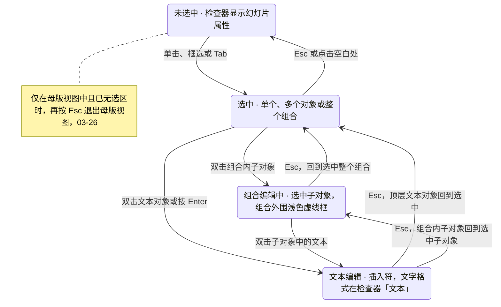
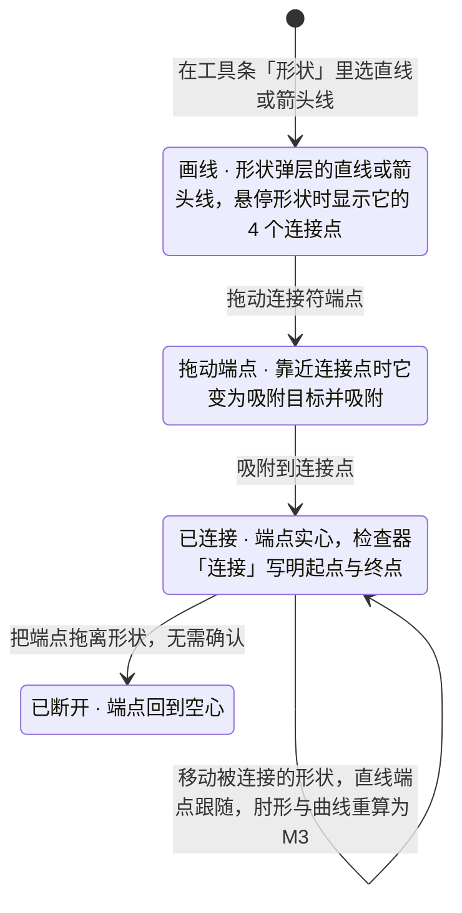

> 状态：草稿 | 负责：设计 | 更新：2026-09-18；2026-09-25（补图）；2026-09-25（矛盾收口，rulings §4.18）；2026-10-07（design-language-v3 第 1 批：按已拍板的 selection 场景整篇改写——§1 线框按 v3 外壳重画（多选与检查器对齐行、智能参考线、连接符吸附）；§2 画布叠加件按 rulings §4.25 DS-24 统一用强调色（页面对齐实线、对象对齐虚线、等间距数值角标），原品红参考线作废；§3 选择模型与多选检查器（「N 个对象」、混合值、异类只显示交集分区）；§4「吸附已临时关闭」由底部提示改为画布提示签（DS-6）；§5 对齐与分布改在检查器顶部对齐行（多选带「对齐参照」）与多选右键「对齐与分布 ▸」，主菜单「排列」不含对齐；§6 组合编辑与锁定对象；§7 网格与参考线设置在主菜单「视图 › 网格与参考线 ▸」与画布空白处右键，间距 6 / 12 / 18 pt；§8 连接符用形状弹层的直线 / 箭头线画、检查器「连接」节；§9 状态表列全 10 个样张状态与路由；删去作废的 v0.3 记号说明；依据 rulings §4.25 DS-1、DS-6、DS-13、DS-15、DS-21、DS-24）；2026-10-07（design-language-v3 第 1 批：按 rulings §4.25 DS-27、TB-20、TB-21 与第一步影响修订——§2、§7、§9 网格三档 6 / 12 / 18 pt、缺省 12 pt，画法按 03-20 §5（线距等于网格间距、每 4 格加深），PRD ED-09 的缺省同此，长度按 pt 书写、产品随设置；§5 单选与多选同一对齐行（六向对齐 + 横向、纵向分布，单选时分布不可用，TB-20）；§8 检查器「连接」节的起点、终点做成下拉（形状 · 连接点），是连接与断开的键盘等价（TB-21）；§12 第 2、3、6 条关闭）；2026-10-08（design-language-v3 第 1 批收口：§5、§12 第 6 条写明底座 `AlignRow` 已是横向 / 纵向分布两枚，删去「单枚『均匀分布』跟改」；§7、§9 第 5 行与「显示网格与参考线」行、§12 第 2 条写明两处网格样张已统一用 kit `SlideGrid`（线距等于网格间距、每 4 格加深，03-20 §5），删去「每格 30 pt 示意」与「`--s-mute` 30% 跟改」；§3 多选时形状「不透明度」同时写填充与描边 alpha（rulings §4.25 TB-47））；2026-11-04（design-language-v3 母版视图改版：§3「`Esc` 逐级链」补母版视图另加的三级并指向 03-26 §1.1；rulings §4.25 TB-195；需求编号、优先级与里程碑不变） | 依赖：charter v0.2；`10-prd/07-design-coverage-and-gaps.md`；rulings §4.18 UX-06；rulings §4.25 DS-21…DS-27、TB-20、TB-21、TB-47、TB-195

# 03-17 选择、多选、对齐、分布、吸附、网格与参考线

> **设计基准（2026-10-07 起，rulings §4.25 DS-21、DS-24）**：以 playground 第 1 批「选择、对齐与吸附」场景为准，路由 `#/v3/editor?state=selection.<状态 id>`（§9 列全 10 个状态）；源码 `playground/src/v3/scenarios/slides-selection/`（`selection.scenario.tsx`、`canvas-bits.tsx`、`inspector.tsx`、`menus.tsx`），画布叠加件 `src/v3/kit/canvas.tsx`（选中框、框选、参考线、尺寸角标、画布提示签），网格与参考线清单 `src/v3/kit/mainMenu.tsx`。外壳以 [03-02](02-editor-main.md) 为准；token 只写名字（样张作用域名 `--v3-*`），取值见设计 [04](../04-design-system.md)。

补齐 03-02 选中态里「多个对象」「组合」「锁定」「连接符」的具体交互，覆盖缺口 **G-10**（ED-01，选择模型与命中）、**G-17**（ED-09，对齐 / 分布 / 吸附 / 网格 / 参考线）、**G-39**（ED-28 E~，连接符端点吸附）。画布上的选择与拖动规格另见前端 50/10 §7.1、§7.2，命令 id 以 40/03 §2.6 为准。

---

## 1. 线框

### 1.1 多选 · 包围盒与检查器对齐行（第 3 页两张指标卡）

```
←──── 240 ─────→←──────────────── 画布 ─────────────────→←─────────── 280 ───────────→
┌──────────────┬────────────────────────────────────────┬────────────────────────────┐
│ [▣▾]  [▭][▦] │                                        │ (周)(王)(李)    ▶  [分享]  │
│ 2026 年 Q2 ▾ │ ┌────────────────────────────────────┐ ├────────────────────────────┤
│ ✓ 已同步     │ │ 关键指标                           │ │ [设计]  评论         77% ▾ │
│ [新建…▾][+]  │ │                                    │ ├────────────────────────────┤
│ 2 ┌────────┐ │ │▪╌╌╌╌╌╌╌╌╌╌▪╌╌╌╌╌╌╌╌╌╌▪             │ │ 左 中 右 顶 中 底 ┆ 横 纵  │
│   └────────┘ │ │╎┌────────┐ ┌────────┐╎  ┌────────┐ │ │ 对齐参照 [所选对象│ 页面 ] │
│▌3 ┏━━━━━━━━┓ │ │▪│ 营收   │ │活跃客户│▪  │ 毛利率 │ │ ├────────────────────────────┤
│▌  ┃关键指标┃ │ │╎└────────┘ └────────┘╎  └────────┘ │ │ 2 个对象                   │
│▌  ┗━━━━━━━━┛ │ │▪╌╌╌╌╌╌╌╌╌╌▪╌╌╌╌╌╌╌╌╌╌▪             │ ├────────────────────────────┤
│ 4 ┌────────┐ │ │     [541 × 264]                    │ │ 位置与大小                 │
│   └────────┘ │ │ 2026 年 Q2 业绩汇报              3 │ │ [X 多个值 pt][Y 182    pt] │
│ ⋮            │ └────────────────────────────────────┘ │ [W 256 pt][H 264 pt][锁]   │
│              │                                        │ [旋转 多个值 °][↕][↔]      │
│              │ ╭────────────────────────────────────╮ ├────────────────────────────┤
│              │ │ 底部创建工具条（03-02）            │ │ 填充                       │
│              │ ╰────────────────────────────────────╯ │ [■ #F4F6FB         100%]   │
│              │                                        ├────────────────────────────┤
│              │                                        │ 描边 · 阴影 · 不透明度     │
└──────────────┴────────────────────────────────────────┴────────────────────────────┘
```

图例：`▪╌╌▪` 多选包围盒（所选对象外扩 3px 的 1px 强调色虚线 + 8 个缩放手柄，无旋转手柄），每个所选对象另描 1px 强调色框；`[541 × 264]` 整组尺寸角标；检查器顶部是对齐行（左对齐 · 水平居中 · 右对齐 · 顶对齐 · 垂直居中 · 底对齐 ┆ 横向分布 · 纵向分布，两个对象时分布不可用）与「对齐参照」分段；`多个值` 为各对象取值不同的字段。样张状态：`selection.multi-select`。

### 1.2 拖动 · 智能参考线（画布特写，拖动第 2 张卡）

```
┌───────────────────────────────────────────────────────────────────┐
│ 关键指标                        │                                 │
│                                 │                                 │ ← 页面中心对齐：1px 实线，贯穿页面
│┄┄┌────────────────┐┄┄┄┄┌─────────────────┐┄┄┄┄┌────────────────┐┄┄│ ← 与左右两张卡顶边对齐：1px 虚线
│  │ 营收           │    │ 活跃客户        │    │ 毛利率         │  │
│  │                │[29]│                 │[29]│                │  │ ← 两侧间距相等：数值角标（pt）
│  │                │    │                 │    │                │  │
│  └────────────────┘    └─────────────────┘    └────────────────┘  │
│                          [X 352 · Y 182]                          │ ← 拖动中不画手柄，角标写位置（pt）
│                                 │                                 │
│ 2026 年 Q2 业绩汇报             │                               3 │
└───────────────────────────────────────────────────────────────────┘
```

图例：三类参考线都用强调色，只靠线型与角标区分（DS-24）。样张状态：`selection.smart-guides`；对照截图 `openspec/changes/design-language-v3/screens/batch1/selection-smart-guides-dark.jpg` / `-light.jpg`。

### 1.3 连接符 · 端点吸附（第 7 页「交付流程」）

```
 ┌──────────┐            ┌──────────┐            ┌─────○────┐
 │ 需求评审 ●───────────▶│ 方案设计 ●───────────▶◉ 交付上线 ○
 │ 2 天     │            │ 6 天     │            │ 10 天    │
 └──────────┘            └──────────┘            └─────○────┘
                                            [连接到「交付上线」]
```

图例：`●` 已连接的端点（强调色实心 + 2px 白边）；`◉` 正在吸附的连接点（强调色实心 + 2px 强调色外圈，隔 2px 白）；`○` 悬停形状的其余连接点（8px 白底、1px 强调色边）；悬停形状另描 1px 强调色框；下方是画布提示签。样张状态：`selection.connector-snap`。

---

## 2. 画布叠加件的颜色与画法（DS-24）

v3 界面只保留一种彩色：选中框、手柄、多选包围盒、框选矩形、智能参考线与连接点一律用强调色 `--v3-accent`，类型靠线型与角标区分；网格线用纸面上的中性灰；协作者的远端光标与选区用各自的身份色（05 §2、§3），不会与参考线混淆。手柄、角标与画布提示签按屏幕尺寸绘制，不随缩放变小（画在不缩放的屏幕坐标覆盖层，rulings §4.25「被修订的既有口径」§4.22 SF-01 行）；全部渲染在 `render.overlay` 层（层级 `--layer-canvas-overlay`，设计 04 §2.11），不进缩略图、网格视图与放映。下表的取值以 playground `kit/canvas.tsx` 与 `scenarios/slides-selection/canvas-bits.tsx` 为准，设计 04 §2.3a 有解释；手柄视觉 8px、命中区要扩到 24px（04 §2.3a，样张未实现）。

| 叠加件 | 画法 | 何时出现 |
|---|---|---|
| 选中框 | 1px 强调色线 + 四角 8px 方形手柄（`--v3-handle-fill` 底、1px 强调色边、圆角 1）+ 框下 8px 处尺寸角标「W × H」（高 18、圆角 4、`--v3-accent-solid` 底、11px 白字、数字等宽） | 单选 |
| 拖动中的选中框 | 不画手柄；角标改写当前位置「X 352 · Y 182」 | 拖动对象时 |
| 多选包围盒 | 所选对象外扩 3px 的 1px 强调色虚线框 + 8 个缩放手柄（四角 + 四边中点），无旋转手柄；每个所选对象另描 1px 强调色框；框下是整组尺寸角标 | 多选 |
| 框选矩形 | 1px 强调色虚线 + `--v3-accent-soft` 底；会被选中的对象预先描 1px 强调色框 | 在空白处拖动 |
| 智能参考线 · 页面 | 1px 强调色实线，贯穿页面 | 与页面中心或边缘对齐 |
| 智能参考线 · 对象 | 1px 强调色虚线，从最左（上）一个相关对象画到最右（下）一个 | 与其他对象的边或中心对齐 |
| 等间距 | 每段相等的间距画一条短线，中点一枚数值角标（画法同尺寸角标；文档与样张按 pt 书写，产品按设置的度量单位显示，rulings §4.25 DS-27） | 两侧间距相等 |
| 组合编辑外框 | 1px 虚线，强调色 50% | 组合编辑中 |
| 锁定手柄 | 四角 16px 方块（圆角 4、1px 强调色边、`--v3-handle-fill` 底），内放 10px 锁形图标 | 选中锁定的对象 |
| 连接点 | 8px 圆点：白底 1px 强调色边；吸附目标为强调色实心 + 2px 强调色外圈（隔 2px 白）；已连接的端点为强调色实心 + 2px 白边 | 画线或拖端点到形状附近；选中已连接的连接符 |
| 网格 | 纸面上的中性细线，线距等于网格间距（6 / 12 / 18 pt，缺省 12 pt），每 4 格加深一档，不用强调色；线色、不透明度与加深的取值以 03-20 §5 为准 | 「显示网格」开着、编辑时 |
| 画布提示签 | 高 24、圆角 4、`--v3-panel` 底 + 1px `--v3-border` + `--v3-shadow`，12px `--v3-text-2`，可带 12px 图标；不接收指针 | 「按住 Alt 相交即选」「吸附已临时关闭 · 松开 Alt 恢复」「组合编辑中」「该组合已锁定移动」「连接到「…」」 |

## 3. 选择模型（G-10）

- **点选与命中**：点击命中 z 序最高、且命中其填充、描边或文本的对象；`fill="none"` 的形状内部点击穿透，只有描边与文本可以命中（PRD ED-01）。
- **框选**：在空白处按下拖出框选矩形，松手后默认「完全包含」的对象被选中，按住 `Alt` 为「相交即选」；拖动期间框选矩形右下方的提示签写「按住 Alt 相交即选」。样张：第 1、2 张卡完全在框内（已描预选框），被框到一半的第 3 张不选。
- **加减选**：`Shift` + 单击切换单个对象；多选画包围盒（§2），不提供整体旋转与调整手柄。
- **多选时的检查器**：面板标题「N 个对象」。同类多选（两个矩形）显示对齐行 · 位置与大小 · 填充 · 描边 · 阴影 · 不透明度，各对象取值不同的字段写「多个值」（旋转不同也写「多个值」，03-03），输入新值即统一应用到全部所选对象（形状的「不透明度」同时写各自填充与描边颜色的 alpha，`slide.setShapeOpacity{shapeIds; alpha}`，一步撤销，rulings §4.25 TB-47）；异类多选（标题、列表与要点卡）只显示交集分区：对齐行 · 位置与大小 · 不透明度。
- **键盘**：`Tab` / `Shift+Tab` 按 z 序循环选中并滚入视口；`Mod+A` 全选当前页。
- **组合**：首次点击选中整个组合，检查器标题「组合」：对齐行 · 位置与大小 ·「组合」节（「包含 N 个对象」+「取消组合」）· 不透明度；双击组合内的子对象进入组合编辑（§6.1）。
- **`Esc` 逐级链**（与 PowerPoint 一致，rulings §4.18 UX-06）：文本编辑 → 选中子对象 → 选中整个组合（退出组合编辑）→ 取消选择 →（仅在母版视图中且已无选区时）退出母版视图；母版视图里另有拖动取消并回弹、工具态回到「选择」与「焦点在窗格先交给画布」三级（rulings §4.25 TB-195，逐级以 03-26 §1.1 为准）。每按一次只退一级；IME 组合输入中的 `Esc` 先交还输入法（07 §4）。
- 锁定对象见 §6.2。

**图 3-1 画布选择状态**



怎么读：每条 Esc 箭头只退一级，所以从组合内的文本编辑退到「未选中」要按三次 Esc；母版视图的退出只挂在「未选中」之后，不会被正在编辑的文本或选区误触发。文本编辑态没有画布迷你工具条，格式在检查器里改（DS-13）。
依据：PRD ED-01；rulings §4.18 UX-06；rulings §4.25 DS-13。

## 4. 智能参考线与吸附（ED-09 P0）

- **出现时机**：拖动或缩放对象时。与页面中心或边缘对齐画实线，与其他对象的边或中心对齐画虚线，两侧间距相等时在每段间距中点写数值角标；吸附阈值 4 CSS px（屏幕空间，随缩放不变）。样张：拖动第 2 张卡，与页面中心对齐（实线）、与左右两张卡的顶边对齐（虚线）、两侧间距都是 29。
- **拖动中**：选中框不画手柄，角标写当前位置；检查器「位置与大小」实时跟随；预览不写文档，缩略图在松手后才更新；松手执行一次命令、一步撤销（50/10 §7.2）。
- **按住 `Alt`**：参考线消失、不吸附；被拖对象上方出现画布提示签「吸附已临时关闭 · 松开 Alt 恢复」，松开即恢复。这条提示原写在底部状态栏，状态栏已随 DS-6 取消、此写法作废。
- **开关**：主菜单「视图 › 网格与参考线 ▸」里「智能参考线」关掉时，拖动不画参考线、也不吸附到对象；「吸附到网格」开着时按网格吸附（§7）。
- 计算 p95 ≤ 4 ms（300 元素页，PRD ED-09）。

## 5. 对齐与分布（ED-09 P1）

- **检查器顶部的对齐行**（在面板标题上方，左右 10、上下 8）：六枚 28px 图标按钮「左对齐 · 水平居中 · 右对齐 · 顶对齐 · 垂直居中 · 底对齐」+ 竖分隔 +「横向分布 · 纵向分布」。单选与多选是同一行：分布在所选对象不足 3 个时（含单选）留在原位不可用（`aria-disabled`、仍可聚焦），工具提示「需选中 3 个以上对象」；这一行与多选右键「对齐与分布 ▸」、命令面板是同一组命令（rulings §4.25 TB-20，03-02 §4.2 同此）；底座样张 `editor/inspector/builtin.tsx` 的 `AlignRow` 已是「横向分布」「纵向分布」两枚，单选时不可用并写原因。
- **对齐参照**：多选时对齐行下多一行「对齐参照」+ 分段控件「所选对象 / 页面」（宽 152），多选缺省「所选对象」；单选固定相对页面，不显示这一行。
- **多选右键「对齐与分布 ▸」**：同一组命令 ┊「对齐参照」单选（所选对象 / 页面；单选时「所选对象」不可用，原因「单选时固定为页面」），见 03-05 §3「多选」。命令面板（`Mod+K`）同样可执行。主菜单「排列」只管层级与组合，不放对齐。
- **事务**：每次对齐或分布是一个事务、一步撤销，不论涉及多少对象；命令 `slide.alignShapes` / `slide.distributeShapes`（参数 `relativeTo`，40/03 §2.6）。
- **锁定与只读**：选中锁定的对象时对齐行整行不可用，原因「已锁定移动」；评审、只读浏览与编辑模式已降权时检查器只读展示属性（DS-15），对齐行是命令、不出现。
- 不要求先框选再点按钮的固定顺序：先选对象、再在对齐行、右键或命令面板里执行即可。

## 6. 组合编辑与锁定

### 6.1 组合编辑

- 双击组合内的子对象进入组合编辑：组合外围 1px 浅色虚线框（强调色 50%），外框左上方提示签「组合编辑中」；被选中的子对象照常画选中框与手柄。
- 检查器顶部一行说明「在组合「〈组合名〉」内编辑」「按 Esc 返回整个组合」（信息图标），其下是子对象自己的对齐行与分区，面板标题为子对象名（样张：圆角矩形——位置与大小 · 填充 · 描边 · 阴影 · 不透明度）。
- 组合内的操作与顶层相同（PRD ED-08）；`Esc` 逐级退出（图 3-1）。右键组合的「取消组合 ⇧⌘G」拆一层，「进入组合编辑」等价于双击（03-05 §3「组合」）。

### 6.2 锁定对象（`spLocks`）

- 原文件里锁定移动的对象可以选中：四角手柄换成锁形方块，没有边中点手柄，下方照常写尺寸；外框上方提示签「该〈对象〉已锁定移动」（带锁形图标，样张为组合）；拖动、缩放无效。
- 检查器顶部一行说明（锁形图标）「此〈对象〉在原文件中已锁定移动」「可以查看属性，不能拖动或缩放」；「位置与大小」字段留在原位不可用（原因「已锁定移动」），对齐行整行不可用；其余分区照常。
- 解锁的界面为 P2（PRD ED-26，50/18 §2.2 SEL-05）。

## 7. 网格与参考线设置

- **入口**：主菜单「视图 › 网格与参考线 ▸」与画布空白处右键「网格与参考线 ▸」，两处是同一张清单、读写同一份偏好（清单与显示部分以 03-20 §5 为准，本节写与吸附相关的用法）：
  - 勾选项：「显示网格」·「显示参考线」┊「吸附到网格」·「智能参考线」（右侧注「吸附到对象」）；
  - 「网格间距」小标题 + 单选三档「6 pt / 12 pt / 18 pt」，缺省 12 pt（rulings §4.25 DS-27，PRD ED-09 的缺省同此）；文档与样张按 pt 书写，产品按设置的度量单位显示（03-23）；
  - 「标尺」「添加参考线」：P2，留在原位不可用，标 P2，右侧写「后续版本提供」。
- **缺省**：网格关、参考线开、吸附到网格关、智能参考线开、间距 12 pt。
- 全部是个人呈现偏好（`ui.setPreference`）：只存本机，不同步给协作者，不入撤销历史。
- **显示网格**：画布上叠加中性细线，线距等于网格间距、每 4 格加深一档（画法以 03-20 §5 为准，DS-27），只在编辑时显示，不进缩略图、网格视图与放映；两处样张（`selection.grid-visible`、`view-zoom.grid-guides`）都用 kit `SlideGrid` 画：线距等于网格间距、`--v3-text-3` 18%、每 4 格加深到 36%。**显示参考线**：文件里存的参考线（`p:guideLst`）画成 1px 强调色虚线、贯穿整页，与拖动时的智能参考线不同（03-20 §5）。
- 标尺、可拖出的自定义参考线与参考线写回 `p15:sldGuideLst` 为 P2（PRD ED-09）。

## 8. 连接符（G-39，ED-28）

- **画连接符**：用底部工具条「形状」弹层里的「直线」或「箭头线」（03-15），从一个形状拖到另一个形状。指针悬停的形状描 1px 强调色框并显示 4 个连接点（上、右、下、左）；端点靠近某个连接点时它变为吸附目标并吸附，下方提示签「连接到「〈形状名〉」」；已连接的起点画成实心端点。样张：从「方案设计」右侧连接点拉向「交付上线」左侧连接点。
- **选中已连接的连接符**：沿线 1px 强调色、两端实心端点，没有缩放手柄。检查器标题为连接符名（样张「箭头连接符」），分区依次为：
  - 「连接」：起点、终点各一个下拉，值写「〈形状名〉 · 〈哪一侧〉连接点」（样张「需求评审 · 右侧连接点」）；说明「把端点拖离形状即可断开」；下拉是连接与断开的键盘等价，见下文「键盘等价」；
  - 「线条」：实线 / 虚线，颜色，粗细（pt），终点箭头（无箭头 / 三角箭头 / 圆点）；
  - 「类型」：直线 / 肘形 / 曲线；
  - 「位置与大小」：X、Y、W、H，说明「由两端的连接点决定，拖动端点即可改变」，没有旋转、翻转与锁定比例。
- **移动被连接的形状**：直线连接符的端点跟随（M2）；肘形与曲线的路径按 PowerPoint 规则重算为 M3（PRD ED-28）。
- **断开**：把端点拖离形状即可，无需确认，不另设菜单项。
- **键盘等价**（WCAG 2.5.7；PRD ED-29、设计 07 §1.2a）：「连接」节的起点、终点做成下拉，列出本页可连接的形状与各自的连接点（「〈形状名〉 · 〈哪一侧〉连接点」），另有一项「未连接」；选一项即把这一端连到该连接点，选「未连接」即断开、端点留在原位，与拖动端点吸附、拖离形状走同一组命令（rulings §4.25 TB-21，50/10 §7.5）。样张只画了只读的起点 / 终点，下拉随实现。
- 右键连接符的菜单见 03-05 §3「连接符」。

**图 8-1 连接符端点的状态**



怎么读：连接关系只由端点吸附与拖离两个动作建立和解除；连接点与参考线同在 `render.overlay` 层、同用强调色，以圆点形状区分。
依据：PRD ED-28；rulings §4.25 DS-24；样张 `selection.connector-snap`、`selection.connector-connected`。

## 9. 状态

样张路由前缀统一为 `#/v3/editor?state=`，后接 `<场景 id>.<状态 id>`。每个状态都有暗、亮两套，截图按 playground `src/v3/scenarios/README.md`「截图约定」拍摄（1600 × 1000）。

| # | 状态 | 要点 | 路由 | 里程碑 |
|---|---|---|---|---|
| 1 | 框选中 | 空白处拖出半透明框选矩形；默认完全包含才选中（第 1、2 张卡描出预选框，被框到一半的第 3 张不选），提示签说明按住 Alt 相交即选 | `#/v3/editor?state=selection.marquee` | M2 P0 |
| 2 | 多选 · 包围盒与混合值 | 虚线包围盒 + 8 个缩放手柄（无旋转手柄），每个对象描 1px 框；检查器「2 个对象」，对齐行带分布（不足 3 个不可用）与「对齐参照」，不一致的 X 写「多个值」 | `#/v3/editor?state=selection.multi-select` | M2 P0（对齐分布 P1） |
| 3 | 拖动 · 智能参考线 | 拖动第 2 张卡：与页面中心对齐（实线）、与左右两张卡顶边对齐（虚线）、两侧间距相等（角标 29）；吸附阈值 4px | `#/v3/editor?state=selection.smart-guides` | M2 P0 |
| 4 | 按住 Alt · 吸附临时关闭 | 参考线消失、不吸附；画布提示签「吸附已临时关闭 · 松开 Alt 恢复」；缩略图在松手后才更新 | `#/v3/editor?state=selection.snap-off` | M2 P0 |
| 5 | 显示网格 | 画布叠加 12 pt 网格（中性细线，线距等于网格间距、每 4 格加深一档，只在编辑时显示，不进缩略图与放映；kit `SlideGrid`，03-20 §5）；开关、间距与吸附在「网格与参考线 ▸」，只存本机偏好 | `#/v3/editor?state=selection.grid-visible` | M2（标尺、添加参考线 P2） |
| 6 | 异类多选 · 对齐与分布菜单 | 标题、列表与要点卡一起选中：右键只留共有命令，「对齐与分布」展开六向对齐、横向 / 纵向分布与参照；检查器只显示交集分区 | `#/v3/editor?state=selection.align-menu` | M2 P1 |
| 7 | 组合编辑中 | 双击组合内的子对象进入组合编辑：浅色虚线外框 +「组合编辑中」，检查器顶部说明「按 Esc 返回整个组合」 | `#/v3/editor?state=selection.group-edit` | M2 P0 |
| 8 | 锁定对象 | 四角手柄换成锁形，拖动无效并提示「已锁定移动」；检查器可查看属性，「位置与大小」不可用 | `#/v3/editor?state=selection.locked` | M2 P1（解锁界面 P2） |
| 9 | 连接符 · 端点吸附 | 用箭头线从「方案设计」拉出，悬停「交付上线」时显示 4 个连接点，靠近左侧连接点时高亮并吸附；起点已连接 | `#/v3/editor?state=selection.connector-snap` | M2 P1（E~） |
| 10 | 连接符 · 已连接 | 两端实心端点；检查器「连接」写明起点 / 终点，拖离即断开；肘形 / 曲线的跟随重算为 M3 | `#/v3/editor?state=selection.connector-connected` | M2 P1；重算 M3 |

其他场景里与本文相关的状态：

| 状态 | 路由 | 说明 |
|---|---|---|
| 右键菜单 · 画布空白处 | `#/v3/editor?state=context-menu.canvas` | 「网格与参考线 ▸」展开（03-05） |
| 右键菜单 · 组合 / 连接符 | `#/v3/editor?state=context-menu.group`、`#/v3/editor?state=context-menu.connector` | 03-05 |
| 主菜单 · 视图 | `#/v3/editor?state=view-zoom.view-menu` | 「网格与参考线 ▸」在主菜单里的位置（03-20） |
| 显示网格与参考线 | `#/v3/editor?state=view-zoom.grid-guides` | 网格与文件参考线的显示（03-20 §5；与 `selection.grid-visible` 同一个 kit `SlideGrid`，间距读偏好、缺省 12 pt） |

## 10. 交互说明

- 本文的对齐、分布与吸附作用于画布上的对象，与 03-14 左栏缩略图的拖动排序是两套独立的拖动交互，互不影响。
- 键盘等价：方向键微移 1 px、`Shift` + 方向键 10 px（屏幕像素，按缩放换算，PRD ED-29）；缩放 `Shift+Alt+方向键`（P1，此前以检查器「位置与大小」的 W / H 输入为等价）；对齐与分布走检查器对齐行、右键或命令面板。
- 远端协作者的选区与光标同在 `render.overlay` 层，用各自的身份色，与本端的强调色选中框、参考线分得开（05 §3）。
- 拖动中对象被他人删除：撤销预览、不提交命令（50/18 §2.2 SEL-07）。

## 11. 边界情况

- 多选异类对象（形状 + 图片 + 连接符）：对齐与分布照常可用（作用于各自的包围盒）；只属于某一类的操作（如连接符端点）在多选下不提供。
- 300 元素页的框选与命中测试：p95 ≤ 2 ms（PRD ED-01）；超出预算时降级为只高亮命中的最上层对象，不做全量重算。
- 触屏：框选与滚动、缩放手势冲突，长按 200 ms 后才进入框选，短按与滑动保留手势缩放与滚动。
- 极小缩放下等间距角标可能互相重叠：角标让位于参考线，必要时只画线、不写数值。

## 12. 原口径去向与定稿

| # | 原口径（旧稿） | v3 | 依据 / 状态 |
|---|---|---|---|
| 1 | 智能参考线用品红（页面实线、对象虚线），与选中框分色 | 选中框、参考线、连接点统一用强调色，以线型与数值角标区分（§2） | DS-24，已定 |
| 2 | 「排列 ▾」菜单里的六向对齐、分布与「参照」；「视图」页签或右键「网格与参考线 ▸」，间距 0.1 / 0.2 / 0.5 | 检查器顶部对齐行 + 多选右键「对齐与分布 ▸」（§5）；主菜单「视图 › 网格与参考线 ▸」与画布空白处右键，间距 6 / 12 / 18 pt、缺省 12 pt（§7） | DS-1、DS-21、DS-27，已定：三档 6 / 12 / 18 pt、缺省 12 pt，PRD ED-09 的缺省 0.2 in 改为 12 pt（DS-27）；网格画法统一按 03-20 §5（线距等于网格间距、每 4 格加深，`--v3-text-3` 18% / 36%），两处样张（`view-zoom.grid-guides`、`selection.grid-visible`）已统一用 kit `SlideGrid` |
| 3 | 连接成功后属性面板显示「已连接到：矩形 3」 | 检查器「连接」节的起点、终点做成下拉（形状 · 连接点，另有「未连接」），是连接与断开的键盘等价（§8） | DS-1、TB-21，已定；样张未画下拉，随实现 |
| 4 | 按住 Alt 时底部状态栏短暂提示，此写法作废 | 画布提示签（§4） | DS-6，已定 |
| 5 | 选择连接符工具后悬停形状 | 用形状弹层的直线或箭头线（§8） | DS-1，已定 |
| 6 | 单选形状的对齐行 | 六向对齐 + 横向分布、纵向分布两枚按钮（单选时不可用），与多选、右键同一组命令（§5，03-02 §4.2 已同此）；底座样张已改为两枚 | TB-20，已定 |
