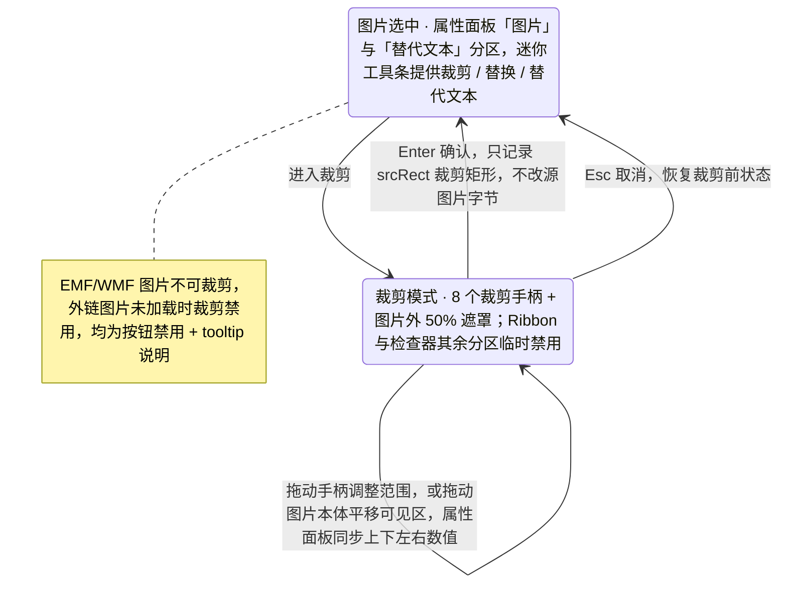
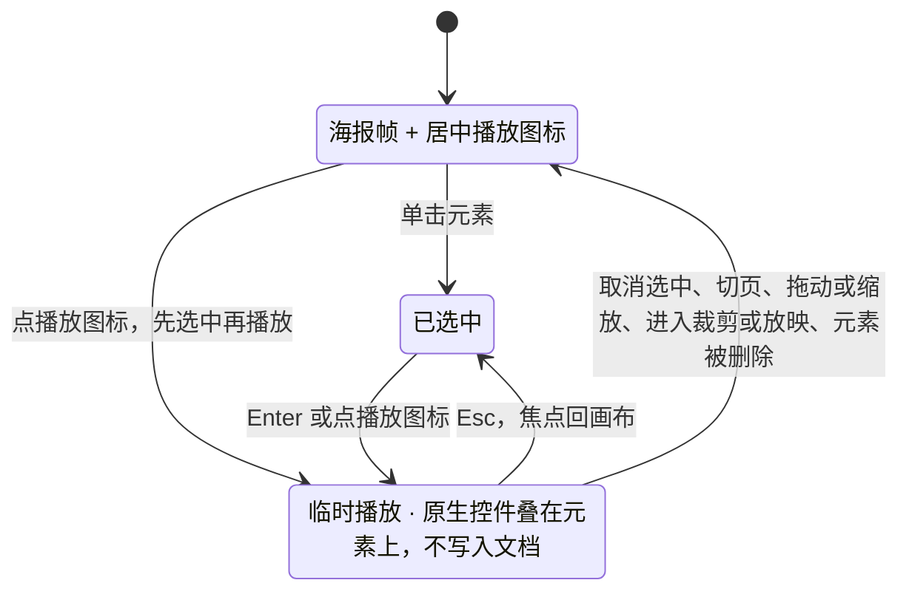

> 状态：草稿 | 负责：设计 | 更新：2026-09-15；2026-09-24（rulings §4.15 Q7：EMF 栅格化与外链图片边界）；2026-09-25（补图）；2026-09-30（§4.21 样张确认回写：插入路径按 playground 图片 ▾ 菜单；新增「SVG 与图标」「视频与音频（已有媒体）」两节，补编辑态临时播放（R-d-68）；大图压缩提示补命令语义、适用范围与撤销）；2026-09-30（§4.22 复核修正：插入路径补 Q1——从插入页签插入图片时先填空内容占位符，已选中的优先，链到 03-04） | 依赖：charter v0.2；`10-prd/07-design-coverage-and-gaps.md`；前端 [50/23](../../50-frontend/23-elements-media.md) §2–§4、§7；rulings §4.21（R-d-45、R-d-68、q-media-insert、q-extra-inserts）

# 03-18 图片操作（上传/裁剪/替代文本）

> **设计基准（2026-09-15 起）**：组件规格以 [`09-design-specification.md`](../09-design-specification.md) v3.0（shadcn Rhea + 材质层）为准；对应 playground 路由 `#/editor/insert`（插入）与 `#/editor`（图片选中态）（[已发布 artifact](https://claude.ai/code/artifact/cf6e1a1a-986b-48bb-b743-5758dff419d2)，源码 `playground/src/routes/`）。本文引用的 `mockups/*.html` 与线框图为历史静态稿，以 playground 实际渲染为终稿。

补齐图片元素从插入到裁剪的完整交互，`04-insert-menu.md` 只覆盖了通用的加载/错误占位。覆盖缺口 **G-15**（ED-07，图片操作）、**G-38**（ED-26，替代文本对话框）；2026-09-30 起并收录 SVG 图片、图标插入后的操作与已有视频 / 音频的编辑态临时播放（插入入口见 [03-04](04-insert-menu.md)，图标面板见 [03-15](15-insert-menu-and-shape-library.md)）。

---

## 线框：图片属性面板分区（选中图片）

```
┌───────────────────┐
│ 属性│评论│历史│插件  │
├───────────────────┤
│ ▾ 图片              │
│  [替换图片] [重置]   │
│  [进入裁剪]          │
│  不透明度 [──●──]80%│
│ ▾ 位置与大小 ...     │
│ ▾ 替代文本           │
│  [文字描述…      ]  │
│  ☐ 标记为装饰性       │
│  ⚠ 缺少替代文本       │ ← 未填写时的警示（07 §3）
└───────────────────┘
```

## 线框：裁剪模式（画布内）

```
┌──────────────────────────────────────┐
│░░░░░░░░░░░░░░░░░░░░░░░░░░░░░░░░░░░░░░░░│ ← 图片外区域 50% 遮罩
│░░░┌──────────────────────┐░░░░░░░░░░░░│
│░░░│▪                    ▪│░░░░░░░░░░░░│ ← 8 个裁剪手柄
│░░░│      可见区域         │░░░░░░░░░░░░│
│░░░│▪                    ▪│░░░░░░░░░░░░│
│░░░└──────────────────────┘░░░░░░░░░░░░│
└──────────────────────────────────────┘
                [取消]  [确定裁剪]
```

---

## 状态

### 插入路径

- 本地文件（支持多选）、拖入画布、粘贴（系统剪贴板）、URL 输入（集成方可禁用）；单张 > 25 MB 默认拒绝并提示上限。
- Ribbon 入口（2026-09-30 样张确认）：插入 › 图像 › 图片 ▾ 下拉菜单——「此设备…」「来自 URL…」（下载后内嵌，不保留外链）、分隔线、「屏幕截图」「相册」（禁用 + `M4+` 标记）；另有空图片 / 内容占位符中央的图标条入口（G-80，见 03-16）。
- 插入落点（rulings §4.22 Q1）：从插入页签或命令面板插入图片时，页上有空内容占位符（`obj` 或 `pic`）就填入阅读序第一个（已选中的空占位符优先），走 `slide.fillPlaceholder`、保留 `p:ph`，按占位符框裁剪填满（`obj` 的放法待实测，见 03-16 文末第 10 条）；没有空占位符时按页面适配缩放（最长边不超过页面 60%），并带入视口可见区域。与 [03-04](04-insert-menu.md)「插入落点」同一口径。

### 上传中/失败（协同模式，扩展 04-insert-menu.md 已有的通用态）

- 上传中：画布原位占位框 + 确定态进度条 + 取消按钮。
- 失败：占位框变为错误态"上传失败 · 文件过大或格式不支持"+ [重试]/[移除]（沿用 04-insert-menu.md 已定文案）。

### 选中态属性面板

- "图片"分区：替换图片（保留位置/尺寸/裁剪范围）、重置图片（撤销全部裁剪/效果调整）、进入裁剪、不透明度滑杆。
- "替代文本"分区（G-38）：文字描述输入（≤ 250 字，计数）、"标记为装饰性"复选（导出为空 `alt`，勾选后描述输入框禁用）；缺失替代文本且未标记装饰性时，画布该图片角落与属性面板均显示警示标记（07-accessibility-and-i18n.md §3）。

### 裁剪模式

- 进入后显示 8 个裁剪手柄 + 图片外区域 50% 半透明遮罩；拖动手柄调整裁剪范围，拖动图片本体在裁剪框内平移可见区域。
- 属性面板同步显示上/下/左/右裁剪数值的等价输入（键盘用户可直接输入数值，WCAG 2.5.7 键盘等价）。
- `Enter` 确认裁剪、`Esc` 取消并恢复裁剪前状态；裁剪不修改源图片字节，仅记录裁剪矩形（`a:srcRect`）。

**裁剪模式状态**



怎么读：裁剪是一个临时模式，只有 Enter 与 Esc 两个出口；数值输入是拖动手柄的键盘等价路径，两者产生相同的裁剪结果。

### 大图压缩提示

- 插入 > 4096 px 的图片时，toast"图片较大，是否压缩到 2048 px？[压缩] [保留原图]"；选择"压缩"不改变已插入的其它图片，仅作用于当前这张。
- 提示出现在插入完成之后、单独一步（M2 P1）：图片先按原图插入并可立即编辑，toast 不阻塞；选「保留原图」或 toast 超时消失都不改任何字节。选「压缩」执行 `slide.compressPicture`：长边缩到 2048 px、按原格式重编码（有透明通道的保持 PNG），得到新媒体、保留裁剪范围（按百分比记录，与分辨率无关）、框与替代文本，一个撤销步；旧图片字节不删（协同中他人已引用的版本仍可用）。
- 属性面板"图片"分区另有「压缩」按钮（P1），对已选图片做同样操作；动画 GIF、SVG、EMF / WMF 不参与压缩，按钮禁用并 tooltip 说明「该格式不支持压缩」。
- 除显式压缩外，图片编辑不修改源位图字节（PRD ED-07 边界）。

**大图插入到压缩**


怎么读：压缩永远是插入之后用户显式选择的第二步，拒绝或忽略都不影响已插入的图片；撤销压缩回到原图，不会连同插入一起撤掉。

### SVG 与图标（2026-09-30）

- **SVG 图片**：与位图同一入口（选 .svg、拖入、粘贴 `image/svg+xml`），单个 ≤ 2 MiB，超出或不是良构 XML 时在本机拒绝并 toast「SVG 过大或无法解析」；插入前先按自研白名单消毒（拒 DOCTYPE、去脚本与外链，R-d-45），含不安全构造的 SVG 拒绝插入并提示。尺寸取 `viewBox` / `width` / `height`（无单位按 96 DPI）。插入 M2 P0，同时生成 PNG 回退（2 倍显示尺寸、最长边 ≤ 2048 px，P1，与 SVG 插入同批交付），导出后旧版 PowerPoint 显示回退图。
- **SVG 的操作**：选中后与位图相同——属性面板"图片"分区、替换 / 重置、裁剪（裁剪范围同时作用于 SVG 与回退）、透明度、旋转、替代文本；不提供「转换为形状」（M4+ 再评估）；不参与压缩。画布只以图像方式渲染 SVG，SVG 与回退都解码失败时显示"无法显示的图片"占位。
- **图标**：从图标面板（[03-15](15-insert-menu-and-shape-library.md)「图标面板」，M3 P2）插入的是 SVG 图片：默认 1 in × 1 in、颜色取主题文字色（写入解析后的具体颜色）、替代文本预填图标中文名、名称「图标 N」；多个图标错位 0.2 in 并全部选中，整批一个撤销步。
- **图标改色**：选中图标时迷你工具条多一个「颜色」，属性面板"图片"分区下多一个"图形填充"（主题色网格 + 最近使用 + 自定义）；改色即时生效，生成新的 SVG 与回退，一个撤销步；只对单色 SVG 开放，多色 SVG 的「颜色」禁用并 tooltip「多色图形不支持一键改色」（外部插入的单色 SVG 改色为 P2）。

### 视频与音频（已有媒体，2026-09-30）

- **插入仍为 P2**：插入 › 图像 › 视频 / 音频在 M2–M3 禁用而不隐藏，tooltip「视频、音频插入排在后续版本（P2）。文稿里已有的音视频照常查看、放映、移动和缩放。」（03-04）；将来插入时也不写动画时序，导出后在 PowerPoint 放映需点媒体控件播放（q-media-insert）。
- **编辑态临时播放**（M2 P1，R-d-68，修正 03-13 G-06 与"编辑态只画海报"的冲突）：视频显示海报帧 + 居中播放图标。点击播放图标，或选中视频 / 音频后按 `Enter`，在元素位置叠放浏览器原生播放控件开始播放（音频贴在图标下方）；未选中时先选中再播放。播放层是临时覆盖层：不写入文档、不广播、不进撤销栈，缩略图与导出不受影响。
- **停止**：`Esc`、取消选中、切换当前页、开始拖动或缩放该元素、进入裁剪或放映、元素被删除（含协作者删除）时停止并卸载控件，`Esc` 后焦点回到画布；同一文稿同时只播放一个，开始新的即停止旧的。播放中 `Space` 由原生控件处理播放 / 暂停。
- **适用视图**：编辑、评审、查看器普通视图；放映中点击播放、翻页即停止；外链媒体按 03-13"外链资源"三档规则（`confirm` 档先确认域名）。
- **其它操作**：移动、缩放、旋转、删除、替换海报（M2 P1）、替代文本；裁剪 P2（按钮禁用并说明原因）。

**编辑态临时播放**



怎么读：播放是临时状态，只有「开始」和「停止」两类转移；任何会改变元素或视图的操作都会先停止播放，因此播放不会与编辑、协同或撤销交织。

---

## 交互说明

- 裁剪模式期间，Ribbon 与检查器坞其余分区临时禁用（避免裁剪过程中意外切换选区），仅保留裁剪相关的最小控件集。
- 替代文本的"标记为装饰性"与"文字描述"互斥（勾选装饰性后描述框禁用并保留原有文字，取消勾选恢复），避免用户误以为两者会叠加生效。
- 迷你工具条（`ui.toolbar`，`slot: image-selected`）提供裁剪/替换/替代文本三个快捷入口，与属性面板功能一致，仅是更快的访问路径。

## 边界情况

- EMF/WMF 图片：可移动/缩放/删除但不可裁剪（P2 才支持），裁剪按钮禁用并 tooltip 说明"该格式暂不支持裁剪"。显示方式（rulings §4.15 Q7）：M1 有包内位图预览时显示预览、否则占位；M2 起按需栅格化为图片显示（先骨架、后替换），导出时保留原 EMF/WMF 文件不变；栅格化失败或超出 OF-24 上限时回到占位，文案见 03-screens/13"只保留对象、外链资源与字体的呈现"。
- 外链图片（`r:link`）：默认自动加载（部署 `externalResources` 可收紧为 `confirm` / `never`，见 03-screens/13）；可移动/缩放/删除，"替换"可换成本地上传的图片，裁剪在图片已加载时可用、未加载（占位）时禁用并 tooltip"外部图片未加载"。
- 图片形状遮罩（非矩形裁剪）：M2 不提供裁剪为形状的入口，仅矩形裁剪；属性面板不显示"裁剪为形状"选项（P2 范围）。
- 裁剪后再次替换图片：新图片按原裁剪比例重新裁剪，而非丢弃裁剪设置从头开始。
- 触屏设备：裁剪手柄命中区扩大到 ≥ 44px，遮罩区域轻触可平移可见区（等价于鼠标拖动图片本体）。
