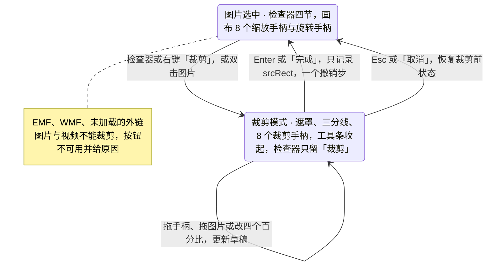
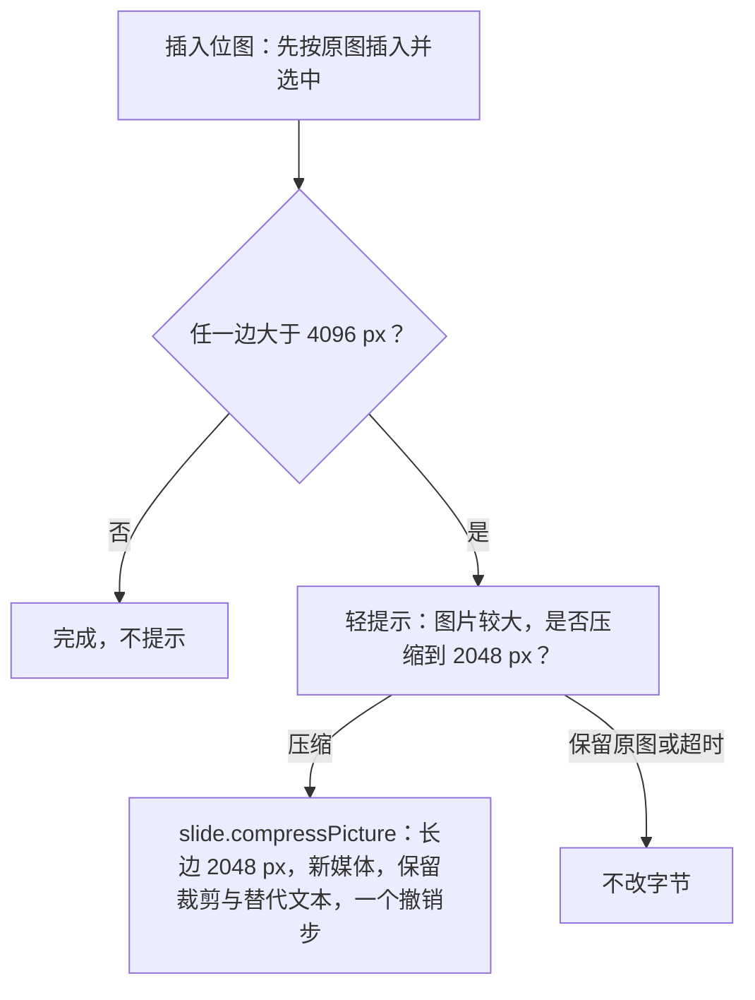
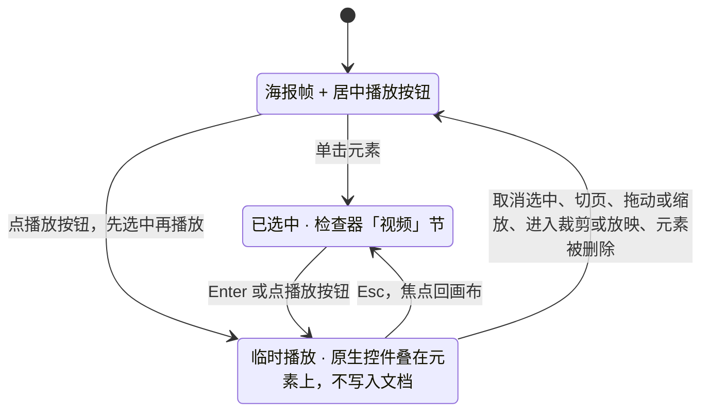

> 状态：草稿 | 负责：设计 | 更新：2026-09-15；2026-09-24（rulings §4.15 Q7：EMF 栅格化与外链图片边界）；2026-09-25（补图）；2026-09-30（§4.21 样张确认回写：插入路径按 playground 图片 ▾ 菜单；新增「SVG 与图标」「视频与音频（已有媒体）」两节，补编辑态临时播放（R-d-68）；大图压缩提示补命令语义、适用范围与撤销）；2026-09-30（§4.22 复核修正：插入路径补 Q1——从插入页签插入图片时先填空内容占位符，已选中的优先，链到 03-04）；2026-10-07（design-language-v3 第 1 批：按已拍板的 `image-editing` 场景（10 态）整篇改写——设计基准改指 v3 样张；§1 线框按 v3 外壳重画（选中图片、检查器图标与视频两种变体、裁剪模式），新增 §1.4 原入口去向：不设图片上下文工具条，裁剪、替换、替代文本、图标改色进检查器与右键（DS-21，与 DS-22 同一取舍）；§2「状态」改为 10 个样张状态、路由与里程碑；§3 插入路径改为工具条「图片 ▾」、主菜单与命令面板，补「来自 URL」对话框；§4 上传中 / 失败按样张占位框与文案，上传中不另出轻提示；§5 检查器改为「图片」（预览、替换… / 裁剪 / 重置 / 压缩…）· 不透明度 · 位置与大小（默认锁定比例）· 替代文本四节，补评审只读展示（DS-15）；§6 裁剪模式改为 `--v3-scrim` 遮罩 + 三分线 + 框下浮条「取消 Esc / 完成 ↵」，创建工具条临时收起、检查器只留「裁剪」四个百分比；§7 压缩提示为两选项轻提示；§8 图标改色改为检查器「图形填充」节；§9 视频临时播放入口在画布，检查器只留说明；§12 新增待决 2 条（来自 URL 的协议说明、检查器单位）；依据 rulings §4.25 DS-1、DS-6、DS-15、DS-17、DS-21、DS-22、DS-24）；2026-10-07（design-language-v3 第 1 批：按 rulings §4.25 TB-4、TB-7、DS-15、DS-27 修订——§3「来自 URL」只接受 https、线框说明文字改正、非 https 的报错随实现，下载阶段的轻提示与上传占位框分开写、上传中不另发轻提示；§5.3 长度按 pt 书写、产品随设置；§5.5 只读分支按 DS-15 写全各节（含图标「图形填充」与已有视频）；§6 与图 6-1「取消」回到进入裁剪前、「完成」算一个撤销步（TB-4）；§12 两条按 TB-7、DS-27 关闭；§1.1 线框里工具条的「选择」去掉 ▾，与 03-04 §3 和样张一致；§3、§8 的错位与图标默认尺寸改按 pt 书写（DS-27））；2026-10-08（design-language-v3 第 1 批收口：§2 末段改为 capture-screens 第 18 条已登记 7 个 v3 状态；§3「来自 URL」线框与正文按样张原文「支持 https 地址的…」，删去「样张现为 http / https，跟改」，§12 第 1 条写明样张已改（rulings §4.25 TB-7）；§3、§8 多图与多个图标的错位改回 0.2 in（PowerPoint 默认值保留原单位，TB-37，取代上一条的 14.4 pt 写法，图标默认尺寸仍写 72 × 72 pt）；§5.2 写明形状的不透明度同时写填充与描边 alpha（TB-47），§5.4 形状检查器「替代文本」节与本节同一组件（TB-32）；§1.4 补 `toolbar.<selectionKind>` 删除（TB-29））；2026-10-08（design-language-v3 第 1 批收口：§5.4 补形状的缺失警示范围，rulings §4.25 TB-54）；2026-10-08（design-language-v3 第 1 批评审修改：§5.1「图片」节的 2 × 2 按钮改为透明底加细边的次按钮（rulings §4.25 DS-37）；§1.1 图例注明锁定比例按下态只铺淡底、图标描边加粗（DS-35））；2026-10-23（design-language-v3 第 3 批评审修改：§3「来自 URL」对话框随 rulings §4.25 DS-142 改为标题栏 40、圆角 12、× 正文色，线框改为说明在标题栏之下（同样张），`insert.image-url` 随之改画） | 依赖：charter v0.2；`10-prd/07-design-coverage-and-gaps.md`；前端 [50/23](../../50-frontend/23-elements-media.md) §2–§4、§7、50/14 §5；rulings §4.21（R-d-29、R-d-45、R-d-68、q-media-insert、q-extra-inserts）、§4.22 Q1、§4.25 DS-1、DS-6、DS-15、DS-17、DS-21…DS-27、DS-35、DS-37、TB-4、TB-7、TB-29、TB-32、TB-37、TB-47；playground `src/v3/scenarios/insert/`（`image-editing.scenario.tsx`、`picture-inspector.tsx`、`picture-overlays.tsx`、`picture-flow.tsx`、`photo.tsx`，「来自 URL」在 `insert.scenario.tsx`）、`src/v3/scenarios/slides-selection/menus.tsx`（图片与媒体右键）

# 03-18 图片操作（上传/裁剪/替代文本）

> **设计基准（2026-10-07 起，rulings §4.25 DS-21）**：以 playground `#/v3/editor?state=image-editing.<状态 id>&theme=dark|light` 的已拍板样张为准：场景 `playground/src/v3/scenarios/insert/image-editing.scenario.tsx`；检查器分区 `picture-inspector.tsx`（`picture` 与 `media` 两种选中种类，别的场景直接复用）；画布件 `picture-overlays.tsx`；裁剪与上传的进出 `picture-flow.tsx`；示例页 `photo.tsx`（第 5 页「华东交付中心」，照片为内联 SVG 真实渲染）。工具条「图片 ▾」与「来自 URL」对话框在 `insert` 场景，图片与媒体的右键菜单在 `context-menu` 场景（[03-05](05-context-menu.md)）。编辑器外壳见 [03-02](02-editor-main.md)。旧稿 `#/editor/insert`、`#/editor` 里的插入页签入口、图片迷你工具条与状态栏提示全部作废（DS-1、DS-6；图片快速操作条与表格、图表同一取舍不设，DS-22），去向见 §1.4。行为口径与前端 [50/23](../../50-frontend/23-elements-media.md) §2–§4、§7 一致，视觉与文案以本文为准。

本文写图片元素从插入到裁剪的完整交互（各类插入入口的菜单与通用加载、错误态见 [03-04](04-insert-menu.md)）。覆盖缺口 **G-15**（ED-07，图片操作）、**G-38**（ED-26，替代文本）；并收录 SVG 图片、图标插入后的操作（图标面板见 [03-15](15-insert-menu-and-shape-library.md)）与已有视频 / 音频的编辑态临时播放。

---

## 1. 线框

### 1.1 选中图片（`image-editing.selected`，1600 × 1000，单页视图）

```
←──────── 240 ────────→←─────────── 画布 flex（1600 宽视口下 1080） ────────────→←─────────── 280 ───────────→
┌──────────────────────┬────────────────────────────────────────────────────────┬────────────────────────────┐
│ [Logo▾]  [单页][网格]│                                                        │ (周)(王)(李)      ▶ [分享] │
│ 2026 年 Q2 业绩汇报 ▾│  ┌──────────────────────────────────────────────────┐  ├────────────────────────────┤
│ ✓ 已同步             │  │  华东交付中心                                    │  │ [设计]  评论        77% ▾  │
│ [新建幻灯片    ▾] [+]│  │  ▔▔              ○                               │  ├────────────────────────────┤
│                      │  │ ■━━━━━━━━━━━━━■━━━━━━━━━━━━■ 7 月 1 日正式启用   │  │ 图片                       │
│ 1 ┌───────────────┐  │  │ ┃                      [!] ┃ 可同时支撑          │  ├────────────────────────────┤
│   │ 标题页        │  │  │ ┃   （照片：玻璃幕墙办公楼 ┃ 40 个项目并行交付   │  │ ┌────┐ 华东交付中心.jpg    │
│   └───────────────┘  │  │ ┃     与两侧裙楼、广场）   ┃ 建筑面积   1.2 万 m²│  │ │预览│ JPEG · 3024 × 2016  │
│ ⋮                    │  │ ■                          ■ 交付团队     260 人 │  │ └────┘ · 2.4 MB            │
│▌5 ┏━━━━━━━━━━━━━━━┓  │  │ ┃                          ┃ 平均交付周期   −25% │  │ [ 替换…     ][ 裁剪      ] │
│▌  ┃ 华东交付中心  ┃  │  │ ┃                          ┃                     │  │ [ 重置      ][ 压缩…     ] │
│▌  ┗━━━━━━━━━━━━━━━┛  │  │ ■━━━━━━━━━━━━━■━━━━━━━━━━━━■                     │  ├────────────────────────────┤
│ 6 ┌───────────────┐  │  │          [480 × 320]                             │  │ 不透明度                   │
│   │ 下半年计划    │  │  │  2026 年 Q2 业绩汇报                          5  │  │ ──────────────●  [100   %] │
│   └───────────────┘  │  └──────────────────────────────────────────────────┘  ├────────────────────────────┤
│                      │                          ════                          │ 位置与大小                 │
│                      │  ┌──────────────────────────────────────────────────┐  │ [X 67     pt][Y 154    pt] │
│                      │  │ 添加演讲者备注…                                  │  │ [W 480  pt][H 320  pt][锁] │
│                      │  └──────────────────────────────────────────────────┘  │ [旋转 0    °][ ⇋  │  ⇵   ] │
│                      │    ╭──────────────────────────────────────────────╮    ├────────────────────────────┤
│                      │    │[选择][文本][形状][图片][表格][图表][评论][+] │    │ 替代文本                   │
│                      │    ╰──────────────────────────────────────────────╯    │ ┌────────────────────────┐ │
│                      │                                                        │ │描述图片里的内容，供读屏│ │
│                      │                                                        │ │软件朗读                │ │
│                      │                                                        │ │                   0/250│ │
│                      │                                                        │ └────────────────────────┘ │
│                      │                                                        │ ☐ 标记为装饰性             │
│                      │                                                        │ [!] 缺少替代文本，读屏软件 │
│                      │                                                        │     无法描述此图           │
└──────────────────────┴────────────────────────────────────────────────────────┴────────────────────────────┘
```

图例：`■━┃` 是选中框（1px 强调色、8 个缩放手柄），`○` 是旋转手柄（框顶中点上方，短竖线相连），`[480 × 320]` 是尺寸角标（强调色实底白字，`--v3-accent-solid`）；`[!]` 是缺替代文本角标（图片右上角内缩 8，24 × 24，面板底 + 1px 边 + 浮层阴影，警告色图标，未选中时同样显示）。检查器面板标题「图片」，其下四节：图片（无节标题：预览、文件名、格式与尺寸，2 × 2 按钮）、不透明度、位置与大小（`[锁]` 是锁定比例，图片默认按下；按下态只铺 `--v3-panel-2`、不描边，图标描边加粗到 2，03-02 §3.5，rulings §4.25 DS-35）、替代文本（描述框与计数、标记为装饰性、缺失警示）。画布上没有图片上下文工具条（§1.4）。

### 1.2 检查器的两种变体（`image-editing.icon`、`image-editing.video`）

```
         图标（icon）                 已有视频（video）
┌────────────────────────────┐  ┌────────────────────────────┐
│ 图标                       │  │ 视频                       │
├────────────────────────────┤  ├────────────────────────────┤
│ 图形填充                   │  │ ┌────┐ 交付中心巡览.mp4    │
│ 主题颜色                   │  │ │海报│ MP4 · 1:30          │
│ ■ ■ ■ ■ ■ ■ ■ ■ ■ ■        │  │ └────┘ · 1920 × 1080       │
│ 最近使用                   │  │ [ 换海报…   ][ 裁剪 [P2] ] │
│ ■ ■ ■                      │  │ 按 ↵ 或点画面上的播放图标  │
│ [■ #3A5CE6       │ 100%]   │  │ 临时播放；不写入文档、不广 │
├────────────────────────────┤  │ 播，导出不受影响           │
│ ┌────┐ 图标 1              │  ├────────────────────────────┤
│ │ ◎  │ SVG · 单色          │  │ 位置与大小                 │
│ └────┘                     │  │ [X 67     pt][Y 154    pt] │
│ [ 替换…     ][ 裁剪      ] │  │ [W 480  pt][H 320  pt][锁] │
│ [ 重置      ][ 压缩·禁用 ] │  │ [旋转 0    °]（无翻转）    │
├────────────────────────────┤  ├────────────────────────────┤
│ 不透明度                   │  │ 替代文本                   │
│ ──────────────●  [100   %] │  │ ┌────────────────────────┐ │
├────────────────────────────┤  │ │交付中心巡览视频，约 1  │ │
│ 位置与大小                 │  │ │分 30 秒                │ │
│ [X 83     pt][Y 244    pt] │  │ │                  19/250│ │
│ [W 31   pt][H 31   pt][锁] │  │ └────────────────────────┘ │
├────────────────────────────┤  │ ☐ 标记为装饰性             │
│ 替代文本                   │  │                            │
│ ┌────────────────────────┐ │  │                            │
│ │目标                    │ │  │                            │
│ │                   2/250│ │  │                            │
│ └────────────────────────┘ │  │                            │
│ ☐ 标记为装饰性             │  │                            │
└────────────────────────────┘  └────────────────────────────┘
```

图标：面板标题「图标」，最上方多一节「图形填充」（§8）；「压缩」不可用（SVG 不参与压缩）；替代文本预填图标名。已有视频：面板标题「视频」，「视频」节只有「换海报…」与 P2 的「裁剪」，播放入口在画布上（§9）；「位置与大小」没有翻转。

### 1.3 裁剪模式（`image-editing.crop`）

```
←──────── 240 ────────→←─────────── 画布 flex（1600 宽视口下 1080） ────────────→←─────────── 280 ───────────→
┌──────────────────────┬────────────────────────────────────────────────────────┬────────────────────────────┐
│ [Logo▾]  [单页][网格]│                                                        │ (周)(王)(李)      ▶ [分享] │
│ 2026 年 Q2 业绩汇报 ▾│  ┌──────────────────────────────────────────────────┐  ├────────────────────────────┤
│ ✓ 已同步             │  │  华东交付中心                                    │  │ [设计]  评论        77% ▾  │
│ [新建幻灯片    ▾] [+]│  │  ▔▔                                              │  ├────────────────────────────┤
│                      │  │ ┌╌╌╌╌╌╌╌╌╌╌╌╌╌╌╌╌╌╌╌╌╌╌╌╌╌╌┐ 7 月 1 日正式启用   │  │ (i) 正在裁剪 · 其余属性    │
│ 1 ┌───────────────┐  │  │ ╎░░░░░░░░░░░░░░░░░░░░░░░░░░╎ 可同时支撑          │  │     暂不可改               │
│   │ 标题页        │  │  │ ╎░░┏━━━━━━┯━━━━━━┯━━━━━┓░░░╎ 40 个项目并行交付   │  ├────────────────────────────┤
│   └───────────────┘  │  │ ╎░░┃      ┊      ┊     ┃░░░╎ 建筑面积   1.2 万 m²│  │ 裁剪图片                   │
│ ⋮                    │  │ ╎░░┠╌╌╌╌╌╌┼╌╌╌╌╌╌┼╌╌╌╌╌┨░░░╎ 交付团队     260 人 │  ├────────────────────────────┤
│▌5 ┏━━━━━━━━━━━━━━━┓  │  │ ╎░░┃      ┊      ┊     ┃░░░╎ 平均交付周期   −25% │  │ 裁剪                       │
│▌  ┃ 华东交付中心  ┃  │  │ ╎░░┗━━━━━━┷━━━━━━┷━━━━━┛░░░╎                     │  │ [上 8      %][下 4      %] │
│▌  ┗━━━━━━━━━━━━━━━┛  │  │ ╎░░░░░░░░░░░░░░░░░░░░░░░░░░╎                     │  │ [左 10     %][右 6      %] │
│                      │  │ └╌╌╌╌╌╌╌╌╌╌╌╌╌╌╌╌╌╌╌╌╌╌╌╌╌╌┘                     │  │ 拖动手柄调整范围，拖动图片 │
│                      │  │      ╭──────────────────────╮                    │  │ 在框内平移；只记录裁剪范   │
│                      │  │      │ 取消 Esc ┊ [完成 ↵]  │                    │  │ 围，不改原图               │
│                      │  │      ╰──────────────────────╯                    │  │                            │
│                      │  │  2026 年 Q2 业绩汇报                          5  │  │                            │
│                      │  └──────────────────────────────────────────────────┘  │                            │
│                      │                          ════                          │                            │
│                      │  ┌──────────────────────────────────────────────────┐  │                            │
│                      │  │ 添加演讲者备注…                                  │  │                            │
│                      │  └──────────────────────────────────────────────────┘  │                            │
│                      │                                                        │                            │
│                      │            （创建工具条临时收起，位置保留）            │                            │
│                      │                                                        │                            │
└──────────────────────┴────────────────────────────────────────────────────────┴────────────────────────────┘
```

图例：`┌╌┐` 是原图范围（白色 70% 虚线）；`░` 是原图在裁剪框外的部分（`--v3-scrim` 遮罩，与对话框遮罩同一 token）；`┏━┓` 是裁剪框（1px 强调色，四角 L 形与四边短条共 8 个裁剪手柄，强调色 3px、外描 2px 白边）；`┊ ╌` 是三分线（白色 45%）；框下浮条「取消 Esc ┊ 完成 ↵」。底部创建工具条临时收起、位置保留；检查器顶部说明行、面板标题「裁剪图片」，只剩「裁剪」节。

### 1.4 原入口去向

v3 不设图片上下文工具条（第 1 批样张 DS-21，与表格、图表的 DS-22 同一取舍；对象上下文槽位 `toolbar.<selectionKind>` 随之删除，rulings §4.25 TB-29）：图片的属性与常用操作只在检查器，右键与快捷键是第二入口。

| 原入口（已作废） | v3 落点 |
|---|---|
| 图片迷你工具条（`ui.toolbar` 的 `image-selected` 槽位，已作废）「裁剪」 | 检查器「图片 › 裁剪」、右键「裁剪」（03-05）、双击图片（50/23 §2.1，样张未演示） |
| 图片迷你工具条「替换」（已作废） | 检查器「替换…」、右键「替换图片…」 |
| 图片迷你工具条「替代文本」（已作废） | 检查器「替代文本」节、右键「编辑替代文本…」 |
| 图标迷你工具条「颜色」（已作废） | 检查器「图形填充」节（§8） |
| 插入 › 图像 ›「图片 ▾」（已作废） | 工具条「图片 ▾」、主菜单「插入 › 图片 ▸」、命令面板（§3） |
| 插入 › 图像 ›「视频」「音频」（已作废） | 工具条「更多」与主菜单「插入」里的「视频」「音频」，P2 前禁用而不隐藏（§9） |
| 裁剪时「其余命令区与检查器其余分区禁用」（已作废） | 创建工具条临时收起，检查器只留「裁剪」节（§6） |

---

## 2. 状态

样张路由一律为 `#/v3/editor?state=image-editing.<状态 id>`，暗 / 亮各一套（`&theme=dark|light`）；第一个状态是默认态。示例文档第 5 页换成「华东交付中心」图文页，照片在 x 67、y 154，480 × 320 pt。

| 状态 id | 标题 | 要点 | 里程碑 | 本文 |
|---|---|---|---|---|
| `selected` | 选中图片 · 缺替代文本 | 照片选中（8 个手柄、旋转手柄、尺寸角标 480 × 320），右上角缺替代文本角标；检查器四节，替代文本节末警示 | 插入与选中 M2 P0（ED-07）；替代文本 M2 P1（ED-26） | §5 |
| `alt-text` | 替代文本已填写 | 描述 33 字、计数 33/250，画布角标与警示消失 | M2 P1（ED-26） | §5.4 |
| `decorative` | 标记为装饰性 | 勾选后描述框不可用但保留原文，说明「导出为空替代文本，读屏软件会跳过这张图片」，不再警示 | M2 P1（ED-26） | §5.4 |
| `crop` | 裁剪模式 | 遮罩、三分线、8 个裁剪手柄、框下浮条；工具条收起；检查器只留「裁剪」上 8 / 下 4 / 左 10 / 右 6 % | M2 P1（ED-07） | §6 |
| `uploading` | 上传中 | 照片位置的原位占位框：上传图标、「正在上传图片…」、确定态进度 62%、「取消上传」；不另出轻提示 | M2 P0（ED-07） | §4 |
| `upload-failed` | 上传失败 | 占位框原位变错误态：「图片上传失败」「文件过大或格式不支持（单张上限 25 MB）」、重试 / 移除 | M2 P0（ED-07） | §4 |
| `compress` | 大图压缩提示 | 选中 6000 × 4000、9.8 MB 的原图；轻提示「图片较大，是否压缩到 2048 px？」压缩 / 保留原图 | M2 P1（ED-07） | §7 |
| `icon` | 图标改色 | 第 6 页「目标」图标选中（31 × 31）；面板标题「图标」，最上方「图形填充」，「压缩」不可用，替代文本「目标」 | M3 P2（ED-32） | §8 |
| `video-poster` | 已有视频 · 海报帧 | 未选中的已有视频：海报帧 + 居中圆形播放按钮 | 临时播放 M2 P1（R-d-68）；插入 P2（ED-35） | §9 |
| `video` | 已有视频 · 临时播放 | 选中后元素底部叠浏览器原生控件；检查器「视频」：换海报…、裁剪 P2、播放说明 | 临时播放 M2 P1；裁剪 P2 | §9 |

相关状态在其它场景里：`insert.image-menu`（工具条「图片 ▾」，03-04）、`insert.image-url`（来自 URL，§3）、`context-menu.image` 与 `context-menu.media`（图片、媒体右键，03-05）、`text-edit.placeholder-drop`（图片拖入空占位符，[03-16](16-text-editing-and-formatting.md) §6.6）。

文档站截图（`docs/_tools/capture-screens.cjs` 第 18 条）已登记上表中的 7 个 v3 状态：`selected`、`crop`、`uploading`、`upload-failed`、`compress`、`icon`、`video`。

---

## 3. 插入路径

- **入口**：
  - 工具条「图片 ▾」（`insert.image-menu`）：此设备…（可多选）· 来自 URL…（下载后内嵌，不保留外链）┊ 屏幕截图、相册（M4+，禁用而不隐藏）┊ 说明行「也可以把图片拖到画布上，或直接粘贴。」；菜单规格与禁用原因见 03-04。
  - 主菜单「插入 › 图片 ▸」是同一组条目；命令面板「插入图片」。
  - 拖入画布、粘贴（系统剪贴板）。
  - 空图片 / 内容占位符的图标条与拖入（03-16 §6）。
- **文件限制**：png / jpg / gif / svg / webp / bmp；单张大于 25 MB 默认拒绝并提示上限；EMF / WMF 不接受插入（PRD ED-07）。多选时依次错位 0.2 in 插入（引用 PowerPoint 默认值的行为常量，保留原单位，rulings §4.25 TB-37），一个事务、一个撤销步。
- **插入落点**（rulings §4.22 Q1）：从工具条、主菜单或命令面板插入图片时，页上有空内容占位符（`obj` 或 `pic`）就填入阅读序第一个（已选中的空占位符优先），走 `slide.fillPlaceholder`、保留 `p:ph`，按占位符框裁剪填满（`obj` 的放法待实测，见 03-16 §10 第 10 条）；没有空占位符时按页面适配缩放（最长边不超过页面 60%），放在视口可见区域。与 03-04「插入落点」同一口径。
- **插入后**：选中新图片；读屏播报「已插入图片，建议补充替代文本」（50/23 §2.1 ⑪）。

**来自 URL 对话框**（`insert.image-url`）

```
 ┌────────────────────────────────────────────────┐
 │ 从 URL 插入图片                            [×] │  ← 标题栏 40
 ├────────────────────────────────────────────────┤
 │ 图片会下载并内嵌到文稿里，不保留外部链接。     │
 │ [https://cdn.example.com/2026q2/east-cent…  ]  │
 │ 支持 https 地址的 JPG、PNG、GIF、SVG，单张     │
 │ 不超过 25 MB。                                 │
 ├────────────────────────────────────────────────┤
 │                                  [取消] [插入] │
 └────────────────────────────────────────────────┘
```

- 标题「从 URL 插入图片」，宽 480（kit `Dialog` md：标题栏 40、圆角 12、× 用正文色，2026-10-23 按 rulings §4.25 DS-142 统一，`insert.image-url` 随之改画）；说明「图片会下载并内嵌到文稿里，不保留外部链接。」在标题栏下；地址框；下方说明列支持的格式与 25 MB 上限；「取消」与「插入」。
- 插入后对话框关闭、焦点回到工具条「图片」。下载期间画布上还没有元素，只出中性轻提示「正在下载图片，完成后内嵌到文稿」；下载完成后与本地文件走同一条路径，按插入落点出上传占位框（§4），上传中不再另发轻提示。
- 只接受 https 地址（rulings §4.25 TB-7），浏览器按图像上下文加载后转码内嵌，不写外链、服务端不代抓；对方不允许直接下载时提示先保存到本地；部署 `externalResources` 为 `never` 时入口不可用并给原因（[50/14](../../50-frontend/14-client-security.md) §5）。样张说明文字为「支持 https 地址的 JPG、PNG、GIF、SVG，单张不超过 25 MB。」（§12 第 1 条）；地址不是 https 时的报错样张未画，随实现按「插入链接」对话框的写法——地址框危险色边、下方内联报错（`role="alert"`）、「插入」不可用并给原因（03-16 §5.1）。

---

## 4. 上传中/失败

```
 上传中（uploading）                  上传失败（upload-failed）
 ┌╌╌╌╌╌╌╌╌╌╌╌╌╌╌╌╌╌╌╌╌╌╌╌╌╌╌╌╌╌╌┐     ┌╌╌╌╌╌╌╌╌╌╌╌╌╌╌╌╌╌╌╌╌╌╌╌╌╌╌╌╌╌╌┐
 ╎                              ╎     ╎                              ╎
 ╎             [↑]              ╎     ╎             (!)              ╎
 ╎        正在上传图片…         ╎     ╎         图片上传失败         ╎
 ╎        ▬▬▬▬▬▬▬▬▬▭▭▭▭▭        ╎     ╎     文件过大或格式不支持     ╎
 ╎    1.5 MB / 2.4 MB · 62%     ╎     ╎      （单张上限 25 MB）      ╎
 ╎         [× 取消上传]         ╎     ╎         [重试]  移除         ╎
 ╎                              ╎     ╎                              ╎
 └╌╌╌╌╌╌╌╌╌╌╌╌╌╌╌╌╌╌╌╌╌╌╌╌╌╌╌╌╌╌┘     └╌╌╌╌╌╌╌╌╌╌╌╌╌╌╌╌╌╌╌╌╌╌╌╌╌╌╌╌╌╌┘
```

- **上传中**（`uploading`）：照片位置的原位占位框，用纸面亮色 token（暗色界面下外观相同）：1px `--v3-border-control` 虚线 + `--v3-panel-2` 底；中央上传图标（24）、「正在上传图片…」（13px 中粗）、确定态进度条（宽 200、高 4、强调色）、「1.5 MB / 2.4 MB · 62%」（11px `--v3-text-2`，数字等宽）、「取消上传」（ghost 按钮，× 图标）。上传中不另出轻提示：进度只在占位框里，同一信息不在同屏出现两次。上传完成后原地换成真实图片，不移动、不弹窗。
- **取消上传**：占位框去掉，轻提示「已取消上传，未插入图片」。
- **上传失败**（`upload-failed`）：占位框原位变为错误态：危险色 50% 虚线 + `--v3-danger-soft` 底；危险色圆形警示图标（24）、「图片上传失败」（13px 600）、「文件过大或格式不支持（单张上限 25 MB）」（12px `--v3-text-2`，整组 `role="alert"`）、「重试」（outline）与「移除」（ghost）。不移动、不弹窗。「重试」回到上传中；「移除」去掉占位框并轻提示「已移除上传失败的图片」。
- 协同：他人看到的同一张图片在上传完成前显示加载占位（50/23 §2.1 ⑨）；视频、音频等其它媒体的通用加载与错误态见 03-04。

---

## 5. 选中态检查器（原名「选中态属性面板」）

面板标题「图片」（图标为「图标」、视频为「视频」）。分区 id 与顺序：`picture.graphic-fill` 5（仅图标）· `picture.image` 10 · `picture.opacity` 15 · `picture.layout` 20 · `picture.alt` 30；已有视频为 `media.video` 10，与图片共用 `picture.layout`、`picture.alt`。插件可按选中类型追加分区（`ui.inspectorSection`）。

### 5.1 「图片」节

- 无节标题（面板标题已是「图片」）：预览缩略图 60 × 40（圆角 4、1px 边）+ 文件名（12px）+ 格式 · 像素尺寸 · 大小（11px `--v3-text-2`、数字等宽，如「JPEG · 3024 × 2016 · 2.4 MB」；图标写「SVG · 单色」）。
- 2 × 2 次按钮（高 28、圆角 6，图标 16 + 文字；透明底加 1px 细边、与分隔线同档，悬停铺 `--v3-panel-2`，rulings §4.25 DS-37，原 `--v3-panel-2` 淡底作废）：
  - **替换…**：选一张新图片换掉当前图片，保留位置、尺寸与裁剪比例（裁剪过的按原裁剪比例重新裁剪，50/23 §2.4）。
  - **裁剪**：进入裁剪模式（§6）。
  - **重置**：撤销全部裁剪与调整（透明度、效果），保留替代文本、边框与旋转（50/23 §2.4）。
  - **压缩…**：对这张图片做 §7 的压缩（P1），确认形式样张未画；动画 GIF、SVG（含图标）、EMF / WMF 不参与压缩，按钮不可用（`aria-disabled`、可聚焦），提示「该格式不支持压缩」。

### 5.2 「不透明度」节

滑杆 + 数值框（0–100 %，默认 100），拖动与输入是同一条命令，与形状的「不透明度」节同一画法；图片写入时换算为 `alphaModFix`（50/23 §2.4），形状则同时写填充与描边颜色的 alpha（rulings §4.25 TB-47）。

### 5.3 「位置与大小」节

所有对象共用的几何分区：X / Y ┊ W / H + 锁定比例 ┊ 旋转 + 水平 / 垂直翻转；图片默认锁定比例（`noChangeAspect`），缩放手柄与数值输入是同一条命令（WCAG 2.5.7）；裁剪完成后显示裁剪框的尺寸（与画布尺寸角标同一数值）。文档与样张按 pt 书写，产品按设置的度量单位显示（[03-23](23-settings-panel.md)；rulings §4.25 DS-27，§12 第 2 条）。视频没有翻转。

### 5.4 「替代文本」节（G-38）

- 描述框：多行，占位「描述图片里的内容，供读屏软件朗读」，右下计数「n/250」，最多 250 字。
- 「标记为装饰性」复选：勾选后描述框不可用（`aria-disabled`，提示「已标记为装饰性，取消勾选后可编辑」）但保留原文，下方说明「导出为空替代文本，读屏软件会跳过这张图片」；取消勾选即恢复。两者互斥，避免用户以为会叠加生效。
- 缺失警示：既没有描述、也没有标记装饰性时，节末一行警告色「缺少替代文本，读屏软件无法描述此图」（警告图标 14），画布图片右上角同时出缺替代文本角标（未选中时也显示，[07](../07-accessibility-and-i18n.md) §3）；填写描述或勾选装饰性后两处同时消失。
- 右键「编辑替代文本…」（03-05）：检查器切到该对象并把焦点移到描述框（样张未演示）。
- 适用于图片、SVG、图标与视频 / 音频；形状检查器在「操作」之后的「替代文本」节是同一组件（rulings §4.25 TB-32，03-15 §4）。缺失警示与画布角标对形状只用于不含文字的预设形状与任意多边形，含文字的形状与文本框不提示（rulings §4.25 TB-54，前端 50/05 §11）。

### 5.5 评审、只读浏览与降权（DS-15）

画布不画缩放与旋转手柄，不能进入裁剪模式（双击图片无效）；检查器统一为只读展示当前值（rulings §4.25 DS-15）：每节只列属性与当前值（64 宽标签列 + 值，与 03-16 §4.3 同一画法），不画字段外形、不显示禁用控件，所以替换、裁剪、重置、压缩等按钮都不出现。各节为：图片（预览、文件名、格式与尺寸）、不透明度（如「100%」）、位置与大小（位置 / 大小 / 旋转三行）、替代文本（描述原文或「无」、是否装饰性）；图标多一节图形填充（色块 + 色值）；已有视频的「视频」节只列海报缩略、文件名与格式时长，不出「换海报…」「裁剪」，播放说明照常——评审与只读浏览下也能临时播放（§9）。面板顶部一行说明权限（03-02 §6.2）。样张只有「位置与大小」画了只读分支，其余各节随实现按本条补齐。

---

## 6. 裁剪模式

- **进入**：检查器「裁剪」、右键「裁剪」、双击图片（50/23 §2.1，样张未演示）。EMF / WMF、未加载的外链图片与视频（P2 前）不能裁剪，对应按钮不可用并给原因（§11）。
- **画面**：原图范围画白色 70% 虚线框；原图在裁剪框外的部分盖 `--v3-scrim` 遮罩；裁剪框 1px 强调色 + 三分线 + 8 个裁剪手柄（四角 L 形、四边短条，强调色 3px 外描 2px 白边，在任何照片底色上都看得清）；触控命中区 ≥ 44 px。
- **调整**：拖裁剪手柄改范围（原图不动、框变）；在框内拖动图片平移可见区（光标为移动）；检查器「裁剪」节的上 / 下 / 左 / 右四个百分比是拖动的键盘等价（WCAG 2.5.7），输入即更新草稿；节末说明「拖动手柄调整范围，拖动图片在框内平移；只记录裁剪范围，不改原图」。
- **出口**：框下浮条「取消 Esc」（ghost）┊「完成 ↵」（主按钮）是唯一的两个出口，`Esc` 等同取消、`Enter` 等同完成；焦点在检查器数值框里时 `Enter` 只提交数值、不完成裁剪，焦点在按钮上时 `Enter` 触发该按钮。
- **裁剪期间**：底部创建工具条临时收起（位置保留，画布不跳动）；检查器顶部说明行「正在裁剪 · 其余属性暂不可改」，面板标题「裁剪图片」，只剩「裁剪」节；点画布上的其它对象不切换选区，避免误丢草稿。
- **完成**：只记录裁剪矩形（`a:srcRect`），不改源图片字节；照片按裁剪框显示，选中框与尺寸角标改为裁剪后的框，轻提示「已裁剪图片」带「撤销」（撤销恢复进入裁剪前的样子），整个裁剪会话算一个撤销步。**取消**：回到进入裁剪模式前的状态，丢弃本次在框上与检查器里做的全部调整，不写文档（rulings §4.25 TB-4）。
- 填充 / 适合（PRD ED-07，P1）样张未画，落点随实现定（命令见 50/23 §2.3）。

**图 6-1 裁剪模式状态**



怎么读：裁剪是一个临时模式，只有「完成」与「取消」两个出口；三种调整方式改的是同一份草稿、结果等价，只有「完成」写文档、算一个撤销步，「取消」回到进入前的状态。
依据：PRD ED-07、ED-29；50/23 §2.3；rulings §4.21 R-d-29；rulings §4.25 TB-4。

---

## 7. 大图压缩提示

- 插入任一边大于 4096 px 的位图后，单独一步出轻提示「图片较大，是否压缩到 2048 px？」，两个选择：「压缩」（推荐项）与「保留原图」（`compress`）。不阻塞：图片已按原图插入并可立即编辑。
- 选「保留原图」或提示超时消失：不改任何字节。选「压缩」：执行 `slide.compressPicture`——长边缩到 2048 px、按原格式重编码（有透明通道的保持 PNG），得到新媒体，保留裁剪范围（按百分比记录，与分辨率无关）、框与替代文本，一个撤销步；旧图片字节不删（协同中他人已引用的版本仍可用）。只作用于当前这张，不改已插入的其它图片。M2 P1。
- 检查器「压缩…」对已选图片做同样操作（P1）；动画 GIF、SVG、EMF / WMF 不参与压缩，按钮不可用，提示「该格式不支持压缩」。
- 除显式压缩外，图片编辑不修改源位图字节（PRD ED-07 边界）。

**图 7-1 大图插入到压缩**



怎么读：压缩永远是插入之后用户显式选择的第二步，拒绝或忽略都不影响已插入的图片；撤销压缩回到原图，不会连同插入一起撤掉。
依据：PRD ED-07；50/23 §2.4。

---

## 8. SVG 与图标

- **SVG 图片**：与位图同一入口（选 .svg、拖入、粘贴 `image/svg+xml`），单个 ≤ 2 MiB，超出或不是良构 XML 时在本机拒绝并轻提示「SVG 过大或无法解析」；插入前先按自研白名单消毒（拒 DOCTYPE、去脚本与外链，R-d-45），含不安全构造的 SVG 拒绝插入并提示。尺寸取 `viewBox` / `width` / `height`（无单位按 96 DPI）。插入 M2 P0，同时生成 PNG 回退（2 倍显示尺寸、最长边 ≤ 2048 px，P1，与 SVG 插入同批交付），导出后旧版 PowerPoint 显示回退图。
- **SVG 的操作**：选中后与位图相同——检查器四节、替换 / 重置 / 裁剪（裁剪范围同时作用于 SVG 与回退）、旋转、替代文本；不提供「转换为形状」（M4+ 再评估）；不参与压缩（「压缩」不可用）。画布只以图像方式渲染 SVG，SVG 与回退都解码失败时显示「无法显示的图片」占位。
- **图标**（M3 P2，ED-32）：从图标面板（03-15「图标面板」）插入的是 SVG 图片：默认 72 × 72 pt（1 in × 1 in）、颜色取主题文字色（写入解析后的具体颜色）、替代文本预填图标中文名、名称「图标 N」；多个图标错位 0.2 in（保留原单位，TB-37）并全部选中，整批一个撤销步。
- **图标改色**（`icon`）：选中单色图标时面板标题为「图标」，检查器最上方多「图形填充」节：「主题颜色」一行 10 色、「最近使用」、自定义色值字段（色块 · 十六进制 · 不透明度）；选中色块 2px 强调色外圈。改色即时生效，生成新的 SVG 与回退，一个撤销步。只对单色 SVG 开放：多色 SVG 的「图形填充」不可用并给原因「多色图形不支持一键改色」（样张未画）；外部插入的单色 SVG 改色为 P2。

---

## 9. 视频与音频（已有媒体）

- **插入仍为 P2**：工具条「更多」与主菜单「插入」里的「视频」「音频」禁用而不隐藏，挂 `P2`，右侧短原因「后续版本提供」（完整原因见 03-04）；空占位符图标条的「视频」同样禁用（03-16 §6.3）。将来插入时也不写动画时序，导出后在 PowerPoint 放映需点媒体控件播放（q-media-insert）。
- **编辑态临时播放**（M2 P1，R-d-68，修正 03-13 G-06 与「编辑态只画海报」的冲突）：视频显示海报帧 + 居中 56 px 圆形播放按钮（面板 85% 底 + 1px 边 + 浮层阴影，读屏名「临时播放视频」，`video-poster`）。点播放按钮（未选中时先选中再播放），或选中视频 / 音频后按 `Enter`，在元素位置叠浏览器原生播放控件开始播放（样张在元素底部画了示意控件条：暂停、时间、进度、音量、全屏，`video`；音频贴在图标下方，样张未画）。播放层是临时叠加层：不写入文档、不广播、不进撤销栈，缩略图与导出不受影响。
- **检查器**（选中视频，面板标题「视频」）：「视频」节为海报缩略、文件名（如「交付中心巡览.mp4」）与「MP4 · 1:30 · 1920 × 1080」；「换海报…」（M2 P1）与「裁剪」（P2，禁用而不隐藏，挂 `P2`，提示「裁剪视频排在后续版本（P2）」）；说明行「按 ↵ 或点画面上的播放图标临时播放；不写入文档、不广播，导出不受影响」——检查器不再放第二个播放按钮。其下「位置与大小」（没有翻转）与「替代文本」。
- **右键**（03-05）：播放 ↵、替换海报…、裁剪（P2）、排列、旋转（没有翻转）、组合、编辑替代文本…、添加评论、删除。
- **停止**：`Esc`、取消选中、切换当前页、开始拖动或缩放该元素、进入裁剪或放映、元素被删除（含协作者删除）时停止并卸载控件，`Esc` 后焦点回到画布；同一文稿同时只播放一个，开始新的即停止旧的。播放中 `Space` 由原生控件处理播放 / 暂停。
- **适用视图**：编辑、评审、查看器普通视图；放映中点击播放、翻页即停止；外链媒体按 03-13「外链资源」三档规则（`confirm` 档先确认域名）。
- **其它操作**：移动、缩放、旋转、删除、替换海报（M2 P1）、替代文本；裁剪 P2。

**图 9-1 编辑态临时播放**



怎么读：播放是临时状态，只有「开始」和「停止」两类转移；任何会改变元素或视图的操作都会先停止播放，因此播放不会与编辑、协同或撤销交织。
依据：rulings §4.21 R-d-68、q-media-insert；PRD ED-07；50/23 §7.2。

---

## 10. 交互说明

- **不设图片上下文工具条**（DS-21，与表格、图表的 DS-22 同一取舍）：图片的属性与常用操作只在检查器，右键与快捷键是第二入口；去向见 §1.4。
- 替代文本的「标记为装饰性」与描述互斥（§5.4）。
- 裁剪模式是本地交互态：进出不入历史、不广播，只在「完成」时执行一次 `slide.crop`（50/23 §2.3）。
- 选中框、旋转手柄、尺寸角标与裁剪框统一用强调色（DS-24），按屏幕尺寸绘制、不随画布缩放；缺替代文本角标、上传占位框与播放层都画在叠加层，不进缩略图、放映与导出。
- 操作结果用轻提示（底部工具条上方居中），状态栏已废弃（DS-6）。

## 11. 边界情况

- EMF / WMF 图片：可移动、缩放、删除，但不可裁剪（P2 才支持），检查器「裁剪」不可用、提示「该格式暂不支持裁剪」；不参与压缩。显示方式（rulings §4.15 Q7）：M1 有包内位图预览时显示预览、否则占位；M2 起按需栅格化为图片显示（先骨架、后替换），导出时保留原 EMF / WMF 文件不变；栅格化失败或超出 OF-24 上限时回到占位，文案见 03-13「只保留对象、外链资源与字体的呈现」。
- 外链图片（`r:link`）：默认自动加载（部署 `externalResources` 可收紧为 `confirm` / `never`，见 03-13）；可移动、缩放、删除，「替换…」可换成本地上传的图片；裁剪在图片已加载时可用，未加载（占位）时不可用并提示「外部图片未加载」。
- 图片形状遮罩（非矩形裁剪）：M2 只有矩形裁剪，检查器不出「裁剪为形状」（P2）。
- 裁剪后再替换图片：新图片按原裁剪比例重新裁剪，而不是丢弃裁剪设置从头开始。
- 裁剪中目标被远端删除、失去编辑权限或切到评审模式：丢弃草稿、退出裁剪模式并提示；草稿期间他人改了该图片的裁剪或位置：确认时整值写回，轻提示「该图片刚被他人修改，已用你的裁剪覆盖，可撤销」（50/23 §2.3）。
- 触屏设备：裁剪手柄命中区扩大到 ≥ 44 px，遮罩区域轻触可平移可见区（等价于拖动图片本体）。
- 紧凑窗口（640–1024，DS-17）：检查器收为右侧抽屉，图片各节原样在抽屉里；仅查看形态（小于 640）不出检查器与编辑操作。

---

## 12. 待决（已全部定稿）

第 1 批文档回写中提出的两条，2026-10-07 由 rulings §4.25 定稿关闭；编号保留供他处引用，本文正文已按定稿写。

| # | 事项 | 定稿 | 依据 |
|---|---|---|---|
| 1 | 「来自 URL」对话框的协议说明 | 只接受 https（与 [50/14](../../50-frontend/14-client-security.md) §5 一致：http 在 HTTPS 页面上是混合内容，CSP 只放行 https）；样张说明文字已改为「支持 https 地址的 JPG、PNG、GIF、SVG，单张不超过 25 MB。」（§3） | TB-7 |
| 2 | 样张的检查器长度单位（SR-4） | 文档与样张按 pt 书写，产品按设置的度量单位显示（03-23）；SR-4 结案（§5.3，同 03-16 §10 第 19 条） | DS-27 |
