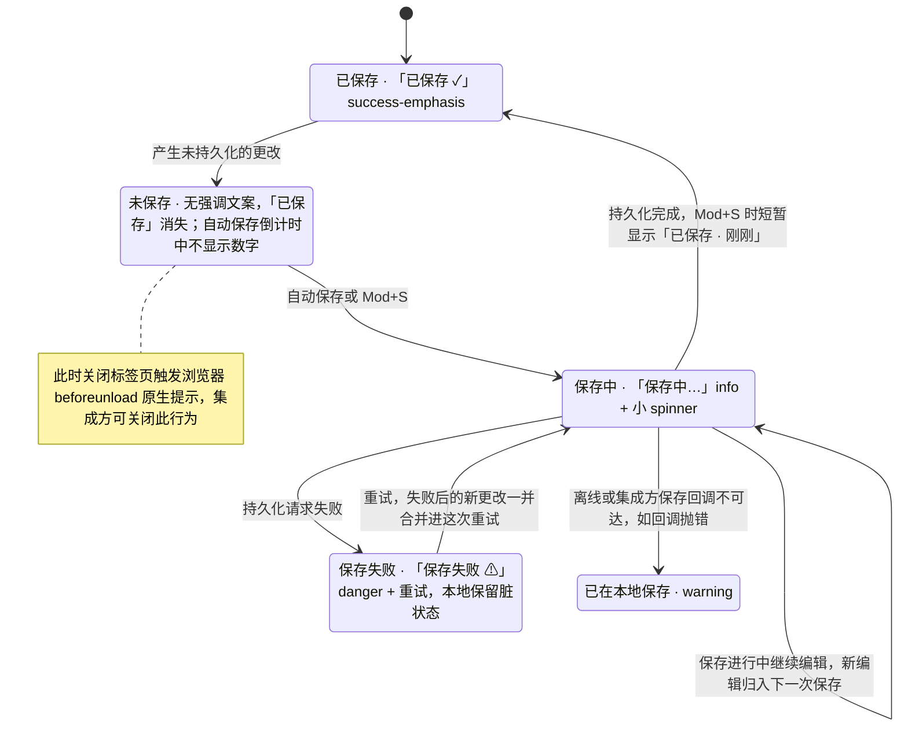

> 状态：草稿 | 负责：设计 | 更新：2026-09-15；2026-09-24（rulings §4.15 Q3：协同撤销跳过 / 停下 / 原 id 恢复）；2026-09-24（复核修正，rulings §4.17）；2026-09-25（补图）；2026-09-25（矛盾收口，rulings §4.18） | 依赖：charter v0.2；`10-prd/07-design-coverage-and-gaps.md`

# 03-19 撤销重做、剪贴板反馈、保存态与离开保护

> **设计基准（2026-09-15 起）**：组件规格以 [`09-design-specification.md`](../09-design-specification.md) v3.0（shadcn Rhea + 材质层）为准；对应 playground 路由 `#/editor`（应用栏/状态栏，无独立路由）（[已发布 artifact](https://claude.ai/code/artifact/cf6e1a1a-986b-48bb-b743-5758dff419d2)，源码 `playground/src/routes/`）。本文引用的 `mockups/*.html` 与线框图为历史静态稿，以 playground 实际渲染为终稿。

补齐 `02-editor-main.md` App Bar 只有"已保存"一个静态文案的问题，新增撤销/重做入口规范。覆盖缺口 **G-20**（ED-14，撤销/重做 UI）、**G-22**（ED-17，剪贴板反馈）、**G-24**（ED-23，保存/脏状态/离开保护）。对应产品默认答案 D9/D10（`07-design-coverage-and-gaps.md` §4）。

---

## 线框：App Bar 撤销重做与保存态（扩展 02-editor-main.md 顶部区）

```
┌─────────────────────────────────────────────────────────────────────────┐
│[≡] 季度汇报.pptx ✎  [↶][↷]   保存中…   (●B)(●C)(+2)  [分享]  [编辑▾] [⋯]  │
└─────────────────────────────────────────────────────────────────────────┘
                      ↑撤销/重做图标按钮（编辑模式常驻，评审/放映隐藏）
```

---

## 状态

### 撤销/重做按钮（D10：位置固定在文档标题右侧）

- 无可撤销/重做操作时按钮禁用（40% 不透明 + `cursor: not-allowed`）；`tooltip` 显示具体步骤名，取自命令 `ui.command` 标题（如"撤销：移动形状 (Mod+Z)"），不是泛泛的"撤销"二字。
- 点击撤销：若受影响元素不在当前页，自动跳转到该页并选中受影响元素（多元素则多选）。
- 连续键入合并为一步（间隔 ≤ 1 秒、同一文本框、无光标跳转）；格式修改、拖动、粘贴各自独立成步。
- 协同模式下的撤销语义（rulings §4.15 Q3，见 05-collaboration-ux.md §6）：
  - 本步中部分属性已被他人后写：跳过这些属性、其余照常撤销，toast"<X> 之后修改了此处，已跳过"。
  - 整步被跳过（目标已被他人删除——不看墓碑 TTL，撤销永不复活他人删除的元素，rulings §4.17 D4；或全部属性都被他人后写）：toast"无法撤销：此处已被 X 删除 / 修改"，**本次按键到此为止**，不连带撤销更早一步；按钮 tooltip 随即更新为再前一步的步骤名。
  - 撤销自己的删除：以原 id 恢复（软删除墓碑）；墓碑已过 TTL（默认 24 h），或已被所有者在「最近删除」中彻底删除（03-screens/07，rulings §4.18 CO-07）时，按"整步被跳过"处理，toast"无法撤销：该内容已被彻底删除"（元素级用「彻底删除」，「永久删除」只用于文档级的「永久删除文档」）。
- ribbon 不重复放置撤销/重做按钮（D10），避免同一命令两处入口造成状态不一致的视觉。

### 剪贴板反馈

| 场景 | 反馈 |
|---|---|
| 粘贴外部富文本/HTML | toast"部分格式已被简化" |
| 粘贴纯文本到画布空白处 | 新建文本框并进入编辑态，不产生额外提示 |
| 粘贴图片 | 走 03-screens/18 的上传占位流程 |
| 粘贴内容 > 25 MB | 拒绝并 toast 说明上限 |
| 剪贴板 API 被浏览器拒绝 | toast"浏览器未授权访问剪贴板，已使用编辑器内部剪贴板"，内部复制粘贴仍可用 |
| 右键"粘贴 ▾" | 变体：保留源格式/仅文本/作为图片（P2） |

### 保存态文案全集（替换 02 的单一"已保存"）

| 状态 | 文案 | 触发 |
|---|---|---|
| 已保存 | "已保存 ✓"（`success-emphasis`） | 最近一次事务已持久化 |
| 保存中 | "保存中…"（`info`，小 spinner） | 自动保存或 `Mod+S` 触发的持久化进行中 |
| 未保存 | 无强调文案，仅"已保存"消失 | 有未持久化的更改但尚未触发保存（自动保存倒计时中，不显示倒计时数字） |
| 保存失败 | "保存失败 ⚠ [重试]"（`danger`） | 持久化请求失败，本地保留脏状态 |
| 已在本地保存（离线，单人模式） | "已在本地保存"（`warning`） | 离线时集成方保存回调不可达 |
| 同步状态（协同模式） | 替换为 05-collaboration-ux.md §7 的六态指示，不与本表并存 | — |

**保存态切换（单人模式）**



怎么读：这是 App Bar 保存态文案的切换顺序；只保留一条最新的失败提示，不堆叠。协同模式不走这张图，改用 05-collaboration-ux §7 的会话六态指示。

### 离开保护

- 存在未保存更改（dirty）时关闭标签页：浏览器 `beforeunload` 原生提示（集成方可关闭此行为）。
- 协同模式 `offline` 时尝试刷新页面：提示"刷新将丢失未同步更改"（沿用 05-collaboration-ux.md §7 已定文案）。
- `Mod+S`：立即触发保存，App Bar 短暂显示"已保存 · 刚刚"；保存进行中继续编辑不阻塞，新编辑归入下一次保存。

---

## 交互说明

- 撤销/重做、保存态、剪贴板反馈三者共享同一条"命令执行 → 事务 → 状态栏/App Bar 反馈"回路（02-user-flows.md F2），本文件只是把该回路在 App Bar 层面的具体呈现补全，不引入新的数据流。
- 保存态的语义色使用遵循 04-design-system §2.5 规则：`success-emphasis`/`warning-emphasis`/`danger-emphasis` 用于文字，不使用 `*-default`。

## 边界情况

- 保存失败后用户继续编辑：新的更改与失败前的更改合并进下一次重试，不产生"多次失败堆叠"的提示噪音（只保留一条最新的失败提示）。
- 单人模式无网络概念，"已在本地保存"仅用于说明集成方保存回调暂时不可达（如回调函数抛错），不等同于协同的离线态。
- 极短时间内的多次撤销（长按或快速连击 `Mod+Z`）：每次仍是独立一步，不做合并，保证撤销粒度可预测。
- 剪贴板内部回退（API 被拒绝）跨标签页不共享：每个标签页维护自己的内部剪贴板状态。
