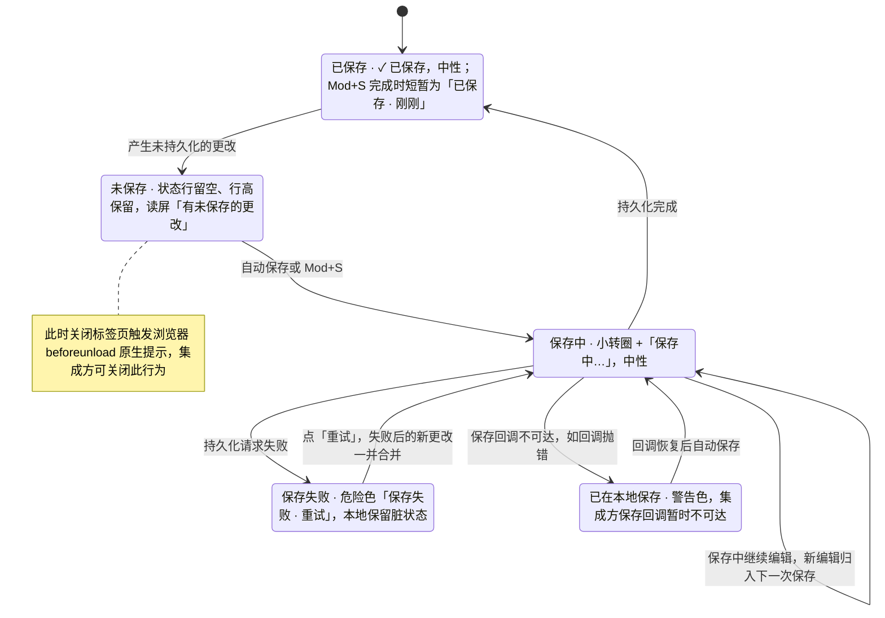

> 状态：草稿 | 负责：设计 | 更新：2026-09-15；2026-09-24（rulings §4.15 Q3：协同撤销跳过 / 停下 / 原 id 恢复）；2026-09-24（复核修正，rulings §4.17）；2026-09-25（补图）；2026-09-25（矛盾收口，rulings §4.18）；2026-09-25（§4.19）；2026-10-07（design-language-v3 第 1 批：按已拍板样张 `undo-clipboard` 整篇改写——撤销 / 重做改由主菜单「编辑」（带步骤名、不可用项写原因）、快捷键与命令面板进入，应用栏按钮与 D10 的位置作废（DS-1）；新增 §1 线框（外壳位置、主菜单「编辑」、画布右键粘贴选项、轻提示、状态行）、§2 入口去向、§3 状态（12 个样张状态的路由与里程碑）；§4 撤销补步骤名、不可用原因与轻提示规格，协同跳过两态与 03-02 §6.2 同款，恢复按钮注明样张未画；§5 剪贴板反馈补轻提示文案与语气，「粘贴选项」在主菜单与右键各一处、M2 整项置灰标 P2；§6 保存态改在文件名下方的状态行（DS-6），已保存与保存中改中性色，保存失败与已在本地保存补图标、工具提示与读屏，状态图补「已在本地保存 → 恢复后自动保存」；依据 rulings §4.25 DS-1、DS-2、DS-6、DS-9、DS-15、DS-21）；2026-10-07（design-language-v3 第 1 批：§1.3、§2、§5「粘贴选项 › 仅文本」的 `Mod+Shift+V` 定为 P2、随「粘贴选项」上线，03-05 文本右键「粘贴为纯文本」同为 P2、留在原位不可用（DS-29、TB-19）；§1.4、§3、§4.2 协同撤销的轻提示定为保留「恢复我的值」/「恢复元素」按钮（M3，样张未画、随实现，TB-26），§1.4 线框补按钮，§4.2 补同一时刻只留最新一条（50/04 §6.3）；依据 rulings §4.25 DS-29、TB-19、TB-26）；2026-10-08（design-language-v3 第 1 批收口：§1.1 线框工具条「选择」去掉 ▾（同 03-02 §3.4）；§4.3、§10 轻提示层级写明 `--layer-toast`，在常驻外壳之下、工具条弹层之下（TB-2，04 §2.11）；依据 rulings §4.25 TB-2）；2026-10-15（design-language-v3 第 2 批回写：只改涉及的段落——§1.3 线框与说明、§3「右键 · 粘贴选项」一行：画布空白处右键在「重置页…」之后加一组「添加评论 C」（rulings §4.25 DS-44，第 1 批 `undo-clipboard.paste-options` 随之改）；§4.3 轻提示的播报改为每条自己是播报区、内容出现两帧后才放进无障碍树，原「容器 `aria-live="polite"`」作废（第 2 批口径，07 §3）；§6.1 位置与颜色、§6 状态表的「同步状态（协同模式）」行与图 6-1 的「怎么读」：协同模式的同步状态改指 03-02 §3.1（含第 2 批补齐的各态），写明 DS-61 的着色规则不改本节单人保存的整行着色（DS-61）；§7 协同模式的离开保护按 DS-59 改：应用内的离开与刷新先尝试同步，仍有未同步项弹应用内确认框，浏览器刷新与关闭标签页只能用原生提示、文案不能定制（规格见 03-12 §9）；依据 rulings §4.25 DS-44、DS-59、DS-61；同日再补：§7 确认框的「导出为本地副本」打开 03-12 §7.2 的对话框，它在 SDK 里（`ui.dialog` 模板 `export-local-copy`），确认框与横幅经 `ui.openDialog` 打开同一个（TB-85）） | 依赖：charter v0.2；`10-prd/07-design-coverage-and-gaps.md`；rulings §4.15 Q3、§4.17 D4、§4.18 CO-07、§4.19 D-M2-CONTENT、§4.25 DS-1、DS-2、DS-6、DS-9、DS-11、DS-15、DS-16、DS-21…DS-26、DS-29、DS-44、DS-59、DS-61、TB-2、TB-19、TB-26、TB-85；playground `#/v3/editor?state=undo-clipboard.*`（`src/v3/scenarios/find-view-undo/` 的 `undo-clipboard.scenario.tsx`、`chrome.tsx`、`MainMenu.tsx`，`src/v3/kit/mainMenu.tsx`、`src/v3/kit/Toast.tsx`）

# 03-19 撤销重做、剪贴板反馈、保存态与离开保护

> **设计基准（2026-10-07 起，rulings §4.25 DS-21）**：以 playground 第 1 批样张 `#/v3/editor?state=undo-clipboard.<状态 id>` 为准（12 个状态，见 §3），源码在 `playground/src/v3/scenarios/find-view-undo/`（`undo-clipboard.scenario.tsx` 各状态的标题与说明、`chrome.tsx` 保存状态行、`MainMenu.tsx`）与 `playground/src/v3/kit/`（`mainMenu.tsx` 主菜单「编辑」条目与粘贴变体、`Toast.tsx` 轻提示）；编辑器外壳以 [03-02](02-editor-main.md) 为准。本文此前的应用栏线框（撤销 / 重做图标按钮、「保存中…」文案）随 DS-1、DS-6 作废。

撤销 / 重做、剪贴板反馈、保存态与离开保护在 v3 编辑器里的入口与反馈。覆盖缺口 **G-20**（ED-14，撤销 / 重做 UI）、**G-22**（ED-17，剪贴板反馈）、**G-24**（ED-23，保存 / 脏状态 / 离开保护），对应产品默认答案 D9（可逆操作用可撤销的轻提示）。D10「撤销 / 重做按钮放在应用栏文档标题右侧」已被 DS-1 取代：v3 没有应用栏，撤销 / 重做不设常驻按钮，入口是主菜单「编辑」、快捷键与命令面板（§2）。

---

## 1. 线框

### 1.1 在编辑器中的位置（桌面 1600 × 1000，单页视图）

```
←──────── 240 ────────→←───────────────── 画布 flex ─────────────────→←───────── 280 ──────────→
┌──────────────────────┬──────────────────────────────────────────────┬────────────────────────┐
│ [Logo▾]① [单页][网格]│                                              │ (周)(王)(李) ▶ [分享]  │
│ 2026 年 Q2 业绩汇报 ▾│                                              ├────────────────────────┤
│ ✓ 已同步 ②           │  ┌────────────────────────────────────────┐  │ [设计]  评论    77% ▾  │
│ [新建幻灯片  ▾] [+]  │  │                                        │  ├────────────────────────┤
│                      │  │           当前页 · 选中矩形            │  │ 矩形                   │
│ 1 ┌──────────────┐   │  │                                        │  │ 位置与大小             │
│   └──────────────┘   │  └────────────────────────────────────────┘  │ …                      │
│▌2 ┏━━━━━━━━━━━━━━┓   │                     ════                     │                        │
│▌  ┗━━━━━━━━━━━━━━┛   │  ┌────────────────────────────────────────┐  │                        │
│ ⋮                    │  │ 添加演讲者备注…                        │  │                        │
│                      │  └────────────────────────────────────────┘  │                        │
│                      │      ╭──────────────────────────────╮        │                        │
│                      │      │ (王) 王小明之后修改了此处… × │ ③      │                        │
│                      │      ╰──────────────────────────────╯        │                        │
│                      │   ╭────────────────────────────────────╮     │                        │
│                      │   │  [选择][文本][形状] … [评论][+]    │     │                        │
│                      │   ╰────────────────────────────────────╯     │                        │
└──────────────────────┴──────────────────────────────────────────────┴────────────────────────┘
```

图例：① 主菜单（logo ▾），撤销 / 重做与剪贴板命令在「编辑」子菜单（§1.2）；② 文件名下方的状态行：协同模式显示同步状态（[05](../05-collaboration-ux.md) §7），SDK 嵌入的回调式保存显示保存态（§6）；③ 轻提示：画布列底部居中、底部工具条上方 12（§4.3）。样张：`undo-clipboard.undo-partial`。

### 1.2 主菜单「编辑」

```
┌────────────────┐
│ 返回首页       │
├────────────────┤
│ 文件         ▸ │   ┌──────────────────────────────────────┐
│ 编辑         ▸ │ ──│ 撤销：移动形状                    ⌘Z │
│ 视图         ▸ │   │ 重做                没有可重做的操作 │  ← 置灰并写原因
│ 插入         ▸ │   ├──────────────────────────────────────┤
│ 排列         ▸ │   │ 剪切                              ⌘X │
├────────────────┤   │ 复制                              ⌘C │
│ 插件…          │   │ 粘贴                              ⌘V │
├────────────────┤   │ 粘贴选项  P2         后续版本提供  ▸ │  ← M2 整项置灰（P2）
│ 帮助         ▸ │   │ 原位复制                          ⌘D │
└────────────────┘   │ 删除                               ⌫ │
                     ├──────────────────────────────────────┤
                     │ 全选                              ⌘A │
                     ├──────────────────────────────────────┤
                     │ 查找…                             ⌘F │
                     │ 替换…                            ⇧⌘H │
                     ├──────────────────────────────────────┤
                     │ 重置页…                              │
                     └──────────────────────────────────────┘
```

条目定稿（`kit/mainMenu.tsx` `editItems`；主菜单其余顶层项见 03-02 §2.3）：撤销 ⌘Z · 重做 ⇧⌘Z ┊ 剪切 ⌘X · 复制 ⌘C · 粘贴 ⌘V · 粘贴选项 ▸ · 原位复制 ⌘D · 删除 ⌫ ┊ 全选 ⌘A ┊ 查找… ⌘F · 替换… ⇧⌘H（Windows / Linux Ctrl+H，DS-16）┊ 重置页…（与右键同名，03-05、03-27）。子菜单第一项与父项「编辑」同一行对齐；菜单规格同 03-02 §2.3（项高 28、12px，快捷键提示 11px 右对齐）。不可用项文字退到 `--v3-text-3`，右侧写原因并取代快捷键提示（含中文时 12px、`--v3-text-2`），仍可聚焦（`aria-disabled`），原因经 `aria-describedby` 读出。样张：`undo-clipboard.edit-menu`。

### 1.3 画布空白处右键（P2 预览）

```
┌──────────────────────────┐
│ 粘贴                  ⌘V │   ┌────────────────────┐
│ 粘贴选项  P2           ▸ │ ──│ 保留源格式         │
│ 全选                  ⌘A │   │ 仅文本         ⇧⌘V │
├──────────────────────────┤   │ 作为图片           │
│ 网格与参考线           ▸ │   └────────────────────┘
│ 更换版式…                │
│ 重置页…                  │
├──────────────────────────┤
│ 添加评论               C │
└──────────────────────────┘
```

条目与 03-05 的「画布空白处」菜单一致（粘贴 · 全选 ┊ 网格与参考线 ▸ · 更换版式… · 重置页… ┊ 添加评论 C ┊ 插件分组），只在「粘贴」之后插入「粘贴选项 ▸」。「添加评论 C」是 2026-10-15 按 rulings §4.25 DS-44 加的一组（在「重置页…」之后、插件分组之前）：与按 C 相同，进入评论工具并在落点出撰写框（03-06）；与工具条「评论」同一条件，随评论包出现（03-02 §3.4）。样张 `undo-clipboard.paste-options` 展开的是 P2 形态；M2 时「粘贴选项」整项置灰、标 P2、右侧写「后续版本提供」，与主菜单「编辑」同。「仅文本」的提示键 ⇧⌘V（`Mod+Shift+V`）按 rulings §4.25 DS-29 登记进 PRD ED-16、优先级 P2，随「粘贴选项」一起上线，M2 不生效；03-05 文本右键的「粘贴为纯文本 ⇧⌘V」与「粘贴选项」同为 P2：留在原位、不可用、标 P2（TB-19）。

### 1.4 轻提示

```
╭────────────────────────────────────────────────────╮
│ (王) 王小明之后修改了此处，已跳过  [恢复我的值]  × │  ← 部分跳过：中性，左侧对方头像
╰────────────────────────────────────────────────────╯
╭───────────────────────────────────────────────╮
│ △ 无法撤销：此处已被王小明删除  [恢复元素]  × │  ← 整步被跳过：警告色图标（被改写时按钮为「恢复我的值」）
╰───────────────────────────────────────────────╯
╭────────────────────╮
│ ⓘ 部分格式已被简化 │  ← 粘贴网页内容：中性说明图标，无 ×
╰────────────────────╯
╭────────────────────────────────────╮
│ ⊗ 无法粘贴：内容超过 25 MB 上限  × │  ← 超限：错误色图标
╰────────────────────────────────────╯
╭─────────────────────────────────────────────────────╮
│ △ 浏览器未授权访问剪贴板，已使用编辑器内部剪贴板  × │  ← 剪贴板未授权：警告色图标
╰─────────────────────────────────────────────────────╯
```

协同撤销两条提示上的「恢复我的值」「恢复元素」按 rulings §4.25 TB-26 保留（M3，CO-09；规则见 §4.2）；样张 `undo-partial`、`undo-blocked` 只画了关闭（×），按钮随实现补上，其余提示与样张一致。

### 1.5 文件名下方的状态行（SDK 嵌入的回调式保存）

```
2026 年 Q2 业绩汇报 ▾     ← 文件名（文档菜单）
✓ 已保存                  ← 已保存（⌘S 完成时短暂为「已保存 · 刚刚」）· 中性
◌ 保存中…                 ← 保存中（小转圈）· 中性
                          ← 未保存（空行，行高保留；读屏「有未保存的更改」）
△ 保存失败 · 重试         ← 保存失败（「重试」是文字按钮）· 危险色
▭ 已在本地保存            ← 已在本地保存（硬盘图标）· 警告色
```

---

## 2. 入口与去向

v3 不设常驻撤销按钮（DS-1），保存与同步状态不再占一条底部栏（DS-6）；入口按「主菜单 + 右键 + 命令面板 + 快捷键」组织（03-02 §7.1）。

| 功能 | 入口 | 不可用时（置灰、仍可聚焦，右侧写原因） |
|---|---|---|
| 撤销 / 重做 | 主菜单「编辑」前两项（带步骤名）、`Mod+Z` / `Mod+Shift+Z`、`Mod+Y`、命令面板（`Mod+K`）；命令 `core.undo` / `core.redo`（40/10 §2.6） | 没有步骤：「没有可撤销的操作」/「没有可重做的操作」；评审模式「评审模式下不可用」、只读浏览「只有查看权限」、编辑模式已降权「需要编辑权限」（DS-15，03-02 §6.2） |
| 剪切 / 复制 / 粘贴 / 原位复制 / 删除 | 主菜单「编辑」、右键（03-05）、`Mod+X` / `Mod+C` / `Mod+V` / `Mod+D` / `Delete`（`Backspace`） | 未选中对象：剪切、复制、原位复制、删除写「未选中对象」；只读时剪切、粘贴、原位复制、删除写上一行的模式原因，复制照常 |
| 粘贴选项 ▸（保留源格式 / 仅文本 / 作为图片） | 主菜单「编辑」与画布空白处右键（§1.3）；「仅文本」另有 `Mod+Shift+V`（P2，DS-29），文本右键的「粘贴为纯文本」用同一快捷键、同为 P2（TB-19，03-05） | P2：M2 整项置灰、标 P2、写「后续版本提供」，快捷键不响应 |
| 全选 | 主菜单「编辑」、`Mod+A`、画布空白处右键 | 渐进打开未到齐时置灰并提示「正在载入其余页面…」（rulings §4.18 CO-12，50/04 §2） |
| 查找… / 替换… | 主菜单「编辑」、`Mod+F` / 替换键（03-21） | 只读时替换写模式原因，查找照常 |
| 重置页… | 主菜单「编辑」、右键（同名） | 只读时写模式原因 |
| 保存 | `Mod+S`、自动保存、集成方主动调用（SDK 回调式，PRD EM-02 (a)） | — |
| 保存 / 同步状态 | 左栏文件名下方的状态行（§6）；网格视图在左上「文档」胶囊的文件名后（03-02 §5.1） | — |
| 反馈 | 轻提示（`ui.notification`，§4.3）与状态行；本文的反馈都不弹模态对话框 | — |

---

## 3. 状态

样张路由均为 `#/v3/editor?state=<样张 id>`（暗 / 亮另加 `&theme=dark|light`）。

| 状态（样张标题） | 要点 | 样张 id | 里程碑 |
|---|---|---|---|
| 主菜单 · 编辑 | 选中矩形后打开主菜单「编辑」：首项「撤销：移动形状 ⌘Z」；没有可重做的步骤时「重做」置灰、右侧写「没有可重做的操作」；「粘贴选项」整项置灰标 P2 | `undo-clipboard.edit-menu` | M2 P0（ED-14、ED-17）；粘贴选项 P2 |
| 协同撤销 · 部分跳过 | 撤销「修改要点卡」：填充照常回退，文字已被王小明后改、跳过该键；中性轻提示「王小明之后修改了此处，已跳过」，左侧是对方头像，可关闭、不打断输入；撤销后选中受影响的对象；提示另带「恢复我的值」（TB-26，样张未画） | `undo-clipboard.undo-partial`（同款 `main-states.undo-skipped`） | M3 P0（CO-09；50/18 UND-03） |
| 协同撤销 · 整步被跳过 | 目标已被他人删除（不看墓碑 TTL）：警告色轻提示「无法撤销：此处已被王小明删除」，这次 `Mod+Z` 到此为止、不连带撤销更早一步；同一位置另有「无法撤销：此处已被〈X〉修改」「无法撤销：该内容已被彻底删除」两种文案；按钮依次为「恢复元素」「恢复我的值」，彻底删除时没有按钮（TB-26，样张未画） | `undo-clipboard.undo-blocked`（同款 `main-states.undo-blocked`） | M3 P0（CO-09） |
| 右键 · 粘贴选项（P2 预览） | 画布空白处右键：粘贴 ⌘V · 粘贴选项 ▸（保留源格式 / 仅文本 ⇧⌘V / 作为图片）· 全选 ⌘A · 网格与参考线 ▸ · 更换版式… · 重置页… ┊ 添加评论 C（DS-44 加的一组）；M2 时「粘贴选项」整项置灰标 P2 | `undo-clipboard.paste-options` | P2（ED-17；50/18 CLP-04） |
| 粘贴网页内容 · 格式已简化 | HTML 转纯文本（基本格式 P2），新建文本框并进入编辑态，检查器显示「文本」分区；中性说明轻提示「部分格式已被简化」；粘贴纯文本同样新建文本框，但不出提示 | `undo-clipboard.paste-html` | M2 P1（ED-17） |
| 粘贴超过 25 MB | 拒绝粘贴，错误色轻提示「无法粘贴：内容超过 25 MB 上限」，可关闭；画布不变 | `undo-clipboard.paste-too-large` | M2（ED-17） |
| 剪贴板未授权 | 复制要点卡（`Mod+C`）时浏览器拒绝剪贴板权限：退回编辑器内部剪贴板，警告色轻提示「浏览器未授权访问剪贴板，已使用编辑器内部剪贴板」；本标签页内复制粘贴照常（不跨标签页） | `undo-clipboard.clipboard-denied` | M2（ED-17） |
| 保存态 · 已保存 | SDK 嵌入的回调式保存（单人，头像组只剩自己）：文件名下方「✓ 已保存」，中性色；`Mod+S` 完成时短暂显示「已保存 · 刚刚」 | `undo-clipboard.saved` | M2 P0（ED-23、EM-02） |
| 保存态 · 保存中 | 小转圈 +「保存中…」，中性色；保存期间继续编辑不阻塞，新编辑归入下一次保存 | `undo-clipboard.saving` | 同上 |
| 保存态 · 未保存 | 状态行留空（行高保留，下方「新建幻灯片」不跳动），读屏读到「有未保存的更改」；此时关闭标签页触发浏览器原生离开提示 | `undo-clipboard.unsaved` | 同上 |
| 保存态 · 保存失败 | 危险色「保存失败 · 重试」（三角警示图标），「重试」是文字按钮；危险色只在这一状态出现；之后的编辑并入下一次重试，只保留一条失败提示 | `undo-clipboard.save-failed` | 同上 |
| 保存态 · 已在本地保存 | 警告色硬盘图标 +「已在本地保存」：集成方保存回调暂时不可达（如回调抛错），不等同于协同的离线态 | `undo-clipboard.saved-local` | 同上 |

样张没有单独画、行为照常的：「重做：〈步骤名〉」（与撤销同一格式）；协同撤销提示条上的恢复按钮（§4.2，TB-26）；网格视图里的保存态（§6.1）；粘贴图片的上传占位（03-18）；离开保护的浏览器原生提示（§7）。

---

## 4. 撤销 / 重做

### 4.1 规则

- **步骤名**：主菜单与命令面板显示下一步的步骤名，取该命令 `ui.command` 的标题，如「撤销：移动形状」（50/04 §5），不是泛泛的「撤销」二字；没有可撤销 / 重做的步骤时置灰并写原因（§2）。
- **撤销后定位**：受影响元素不在当前页时自动跳到该页，并选中受影响元素（多元素则多选）；样张 `undo-partial` 撤销后选中的是被部分回退的要点卡。
- **合并**：连续键入合并为一步（间隔 < 500 毫秒、同一文本框、无光标跳转；与 PRD ED-14、架构 05 §6 `coalesceMs` 一致，原「≤ 1 秒」作废）；格式修改、拖动、粘贴各自独立成步。
- **连击**：长按或快速连按 `Mod+Z`，每次仍是独立一步，不合并，保证撤销粒度可预测。
- **只读**：评审模式、只读浏览与编辑模式已降权时撤销 / 重做不可用——主菜单置灰并写原因，快捷键不响应；与主菜单里其余改文档的命令同口径（DS-15）。
- **不入历史**：视图、缩放、当前页、选区与网格参考线等呈现偏好都是 Operation，不进撤销栈（ED-14、03-20 §9）。

### 4.2 协同下的撤销（rulings §4.15 Q3，语义见 [05](../05-collaboration-ux.md) §6）

- 本步中部分属性已被他人后写：跳过这些属性、其余照常撤销，中性轻提示「〈X〉之后修改了此处，已跳过」，左侧是对方头像（样张 `undo-partial`）。
- 整步被跳过（目标已被他人删除——不看墓碑 TTL，撤销永不复活他人删除的元素，rulings §4.17 D4；或全部属性都被他人后写）：警告色轻提示「无法撤销：此处已被〈X〉删除 / 修改」，**本次按键到此为止**，不连带撤销更早一步；主菜单「撤销：〈步骤名〉」随即更新为再前一步（样张 `undo-blocked`）。
- 撤销自己的删除：以原 id 恢复（软删除墓碑）；墓碑已过 TTL（默认 24 h），或已被所有者在「最近删除」中彻底删除（03-07，rulings §4.18 CO-07）时，按「整步被跳过」处理，警告色轻提示「无法撤销：该内容已被彻底删除」（元素级用「彻底删除」，「永久删除」只用于文档级的「永久删除文档」）。
- **恢复按钮**（rulings §4.25 TB-26，M3，CO-09）：「〈X〉之后修改了此处，已跳过」与「无法撤销：此处已被〈X〉修改」带「恢复我的值」，「无法撤销：此处已被〈X〉删除」带「恢复元素」，「无法撤销：该内容已被彻底删除」不带按钮；点按钮是一个新事务、不是撤销，恢复语义与点后的反馈以前端 50/04 §6.3 为准。带按钮的提示停留 5 s、悬停暂停计时；协同撤销的提示同一时刻只留最新一条，新的替换旧的（50/04 §6.3）。按钮是轻提示的文字按钮，放在 × 之前，与 03-21「已替换 N 处 · 撤销」同一形态；样张两条提示只画了关闭（×），按钮随实现补上。

### 4.3 轻提示（`ui.notification`）

- **位置**：画布列底部居中、底部工具条上沿之上 12；多条时自下而上叠放（间距 8），新的在下；层级为 `--layer-toast`（15），在常驻外壳（左栏、检查器、底部工具条，`--layer-chrome` 20）之下，工具条弹出的形状弹层与提示重叠时弹层在上（rulings §4.25 TB-2，04 §2.11）。
- **外观**：高 40（带第二行说明时随内容增高），`--v3-panel` 底 + 1px `--v3-border` + `--v3-shadow`，圆角 8，左内边距 12，12px 字、不换行，文字一律 `--v3-text`。左侧图标按语气：中性不带图标，或带对方头像（20px）；说明用 `--v3-text-2` 的信息图标；警告、错误用 `--v3-warning`、`--v3-danger` 的图标——语义色只用于图标。动作是文字按钮（如「撤销」），可关闭的另有 ×。
- **行为**：非阻断、不抢焦点；每条轻提示自己是一个播报区（`role="status"`、polite，错误为 `role="alert"`），同一句只经这一条通道播报一次；内容在出现两帧后才放进无障碍树（先出现空的播报区、再填内容，部分读屏不念带着内容插进来的播报区），外观不变；容器本身不是播报区（2026-10-15 第 2 批口径，原「容器 `aria-live="polite"`」作废：容器套着每条的 status / alert 时同一句进了两个播报区，部分读屏会念两遍；07 §3、50/16）。点 × 或动作后自行收起，焦点交回画布、不掉到 `body`。

---

## 5. 剪贴板反馈

| 场景 | 反馈 | 样张 |
|---|---|---|
| 粘贴外部富文本 / HTML | HTML 转纯文本（基本格式 P2），新建文本框并进入编辑态；中性说明轻提示「部分格式已被简化」（信息图标，无 ×） | `paste-html` |
| 粘贴纯文本到画布空白处 | 新建文本框并进入编辑态（缺省样式见 03-16），不出提示 | `paste-html` 的说明 |
| 粘贴图片 | 走 03-18 的上传占位流程 | — |
| 粘贴内容 > 25 MB | 拒绝，画布不变；错误色轻提示「无法粘贴：内容超过 25 MB 上限」，可关闭 | `paste-too-large` |
| 剪贴板 API 被浏览器拒绝 | 退回编辑器内部剪贴板；警告色轻提示「浏览器未授权访问剪贴板，已使用编辑器内部剪贴板」，可关闭；本标签页内复制粘贴照常 | `clipboard-denied` |
| 粘贴选项 ▸ | 保留源格式 / 仅文本 / 作为图片（P2）：主菜单「编辑」与画布空白处右键各一处；M2 整项置灰标 P2、写「后续版本提供」；「仅文本」的 `Mod+Shift+V` 与文本右键「粘贴为纯文本」同为 P2（DS-29、TB-19） | `paste-options`（展开的是 P2 形态） |

粘贴格式的判定顺序（自定义 MIME → 图片 → HTML → 纯文本）以 PRD ED-17 图 2-3 为准，剪贴板管线见 50/04 §9。

---

## 6. 保存态

### 6.1 状态行（取代原应用栏的单一「已保存」文案）

- **位置**：左栏文件名下方、与缺省「✓ 已同步」同一行（高 16，12px，图标 12、描边 1.75，图标与文字间距 4）。SDK 嵌入的回调式保存（PRD EM-02 (a)）在这一行显示保存态；协同模式在同一行显示同步状态——05 §7 的会话状态，以及第 2 批补齐的「未保存到服务器 N 项」「服务器保存延迟」「登录已过期 · N 项待同步」「协同已暂停 · N 项未同步」「只读 · 名额已满」「只读 · 登录账号已变更」「文档已被删除」等，各态以 03-02 §3.1 为准（rulings §4.25 DS-61）——两者不并存。网格视图里文件名在左上「文档」胶囊：缺省态不显示，其余状态以紧凑形态跟在文件名后（与同步状态同规则，03-02 §5.1；样张未画保存态的网格形态）。
- **颜色**：语义色只在对应状态出现（设计质量门 Q3，DS-9）。已保存与保存中是常态，用中性 `--v3-text-2`；保存失败整行 `--v3-danger`（「重试」按钮文字为 `--v3-text`），已在本地保存整行 `--v3-warning`。原「已保存 ✓（`success-emphasis`）」「保存中…（`info`）」的着色作废。协同模式的同步状态另按 DS-61 着色（还带着待同步计数的只给图标警告色，转为只读或文档已不存在时中性，03-02 §3.1）；本节两种整行着色只用于 SDK 嵌入的单人保存，DS-61 明确不改它们，两套规则不混用。
- **工具提示**：「保存失败」——「保存请求失败，更改仍保留在本机；之后的编辑会合并进下一次重试」；「已在本地保存」——「集成方的保存服务暂时不可达，更改已保存在本机，恢复后自动保存」。
- **读屏**：状态行 `role="status"`、`aria-live="polite"`（07 §3，样张待补）；未保存时可见文字为空，读屏文字「有未保存的更改」。

| 状态 | 文案与图标 | 颜色 | 触发 |
|---|---|---|---|
| 已保存 | ✓ 已保存 | 中性 | 最近一次事务已持久化 |
| 已保存 · 刚刚 | ✓ 已保存 · 刚刚 | 中性 | `Mod+S` 完成后短暂显示，随后回到「已保存」 |
| 保存中 | 小转圈 + 保存中… | 中性 | 自动保存或 `Mod+S` 触发的持久化进行中 |
| 未保存 | 空（读屏「有未保存的更改」） | — | 有未持久化的更改但尚未触发保存（自动保存倒计时中，不显示倒计时数字） |
| 保存失败 | 三角警示图标 + 保存失败 · 重试 | 危险色 | 持久化请求失败，本地保留脏状态 |
| 已在本地保存 | 硬盘图标 + 已在本地保存 | 警告色 | 集成方保存回调不可达（如回调抛错） |
| 同步状态（协同模式） | 03-02 §3.1 的同步状态行各态（05 §7 的会话六态与第 2 批补齐的各态，DS-61），不与本表并存 | 按 DS-61 | — |

**图 6-1 保存态切换（SDK 嵌入的回调式保存）**



怎么读：这是文件名下方状态行在保存态之间的切换顺序；状态行同一时刻只显示一种，失败提示不堆叠。协同模式不走这张图，改用 03-02 §3.1 的同步状态行各态（05 §7 的会话六态与第 2 批补齐的各态，DS-61）。参考应用自 M2 起即为协同模式（协同后端提前，文档内容只以协同快照为事实源）：每个更改经网关落库即视为已保存，没有「保存中 / 保存失败」的 pptx 保存路径，服务器落库延迟由「未保存到服务器 N 项」表达（03-12）。本图只适用于 SDK 嵌入的回调式保存。
依据：PRD ED-23、EM-02 (a)；rulings §4.19 D-M2-CONTENT、§4.25 DS-6、DS-21、DS-61；样张 `undo-clipboard.saved`…`saved-local`。

---

## 7. 离开保护

- 存在未保存更改（dirty）时关闭标签页：浏览器 `beforeunload` 原生提示（集成方可关闭此行为）。
- 协同模式（2026-10-15 按 rulings §4.25 DS-59 改，规格见 [03-12](12-offline-conflict-banner.md) §9）：重连中、离线，或仍有未获服务器确认的更改时——
  - **应用内的离开与刷新**（主菜单「返回首页」、隔离态横幅的「刷新」、插件设置横幅的「重新加载」、发现新版本横幅的「刷新」）先尝试同步，仍有未同步项才弹应用内确认框「离开将丢失 N 项未同步更改」/「刷新将丢失 N 项未同步更改」：左下「导出为本地副本」，右侧安全项「留下」/「取消」（初始焦点）与危险色「仍要离开」/「仍要刷新」。「导出为本地副本」打开 03-12 §7.2 的「导出本地副本」对话框：它在 SDK 里（`ui.dialog` 模板 `export-local-copy`），参考应用的这两个确认框与横幅经 `ui.openDialog` 打开同一个（rulings §4.25 TB-85）。
  - **浏览器刷新、关闭标签页**只能触发浏览器原生的离开提示，文案与外观都不能定制。原「提示『刷新将丢失未同步更改』」只能出现在上一条的应用内确认框里。
- `Mod+S`：立即触发保存，状态行短暂显示「已保存 · 刚刚」；保存进行中继续编辑不阻塞，新编辑归入下一次保存。协同模式下按键只消费、不下载（50/10 §10.4 第 17 行）。

---

## 8. 交互说明

- 撤销 / 重做、保存态、剪贴板反馈共享同一条「命令执行 → 事务 → 反馈」回路（02-user-flows F2）；本文只定义这条回路在主菜单、状态行与轻提示上的呈现，不引入新的数据流。
- 反馈分层（09 §3.3）：横幅 > 轻提示 > 字段内联错误 > 文件名下方的状态行，同一事件只用一层。保存失败只在状态行（可重试），不另弹轻提示；协同撤销被跳过、剪贴板问题只用轻提示。
- 状态色 token 与对比度以 04 §2.5、§2.6 为准（DS-9）：状态行只在保存失败、已在本地保存两种状态整行着色；轻提示的语义色只用于左侧图标。

## 9. 边界情况

- 保存失败后用户继续编辑：新的更改与失败前的更改合并进下一次重试，状态行只有一条失败提示，不堆叠。
- 单人模式无网络概念，「已在本地保存」仅说明集成方保存回调暂时不可达（如回调抛错），不等同于协同的离线态；回调恢复后自动保存，状态行回到「保存中…」。
- 剪贴板内部回退（API 被拒绝）跨标签页不共享：每个标签页维护自己的内部剪贴板状态。
- 评审模式、只读浏览与编辑模式已降权：主菜单「编辑」里改文档的命令置灰并写原因，复制、全选、查找照常（03-02 §2.3）；画布右键同口径（03-05）。
- 渐进打开未到齐（`unitLoaded` 为假）：全选、查找替换等全文命令置灰并提示「正在载入其余页面…」；撤销栈不含导入批次（`system('import')` 不入栈，50/04 §5）。

## 10. 设计规格（速查）

| 项 | 规格 | 来源 |
|---|---|---|
| 主菜单「编辑」 | 菜单面板 `--v3-panel` 底 + 1px `--v3-border` + 圆角 8 + 内边距 4 + `--v3-shadow`，最小宽 168；项高 28、圆角 4、12px；快捷键提示 11px 右对齐；不可用项文字 `--v3-text-3`，原因写在右侧并取代快捷键提示 | `kit/Menu.tsx`、03-02 §2.3 |
| 状态行 | 高 16、12px，图标 12（描边 1.75），图标与文字间距 4；常态 `--v3-text-2`，失败 `--v3-danger`，本地保存 `--v3-warning` | `editor/LeftRail.tsx` `RailStatus`、`find-view-undo/chrome.tsx` |
| 轻提示 | 高 40、圆角 8、左内边距 12、图标 16（头像 20）与文字间距 8、12px；距底部工具条上沿 12，多条间距 8；层级 `--layer-toast`，在常驻外壳之下（TB-2） | `kit/Toast.tsx` |
| 「P2」标记 | 菜单项名称后的里程碑标记，与主菜单「插入」里的 M4+ / P2 标记同款（03-02 §2.3） | `kit/Menu.tsx` |
