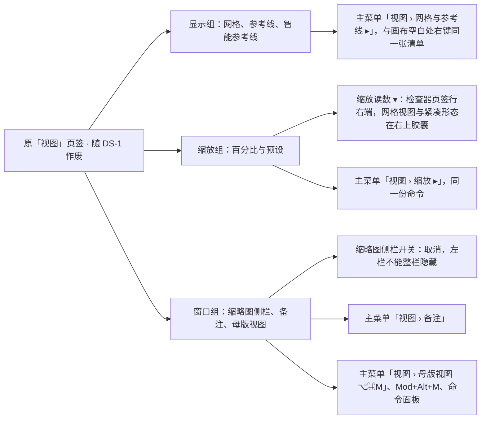
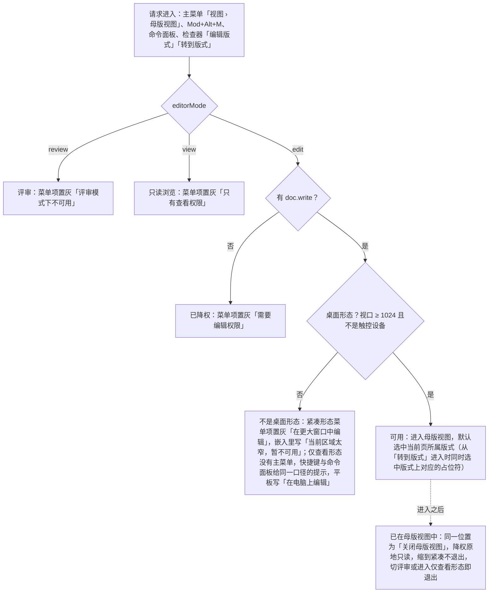

> 状态：草稿 | 负责：设计 | 更新：2026-09-18；2026-09-25（补图）；2026-09-25（矛盾收口，rulings §4.18）；2026-10-05（design-language-v3 第 0 批修正：只改快捷键值——母版视图快捷键说明里的命令面板由 `Mod+Shift+P` 改为 `Mod+K`（rulings §4.25 DS-11）；界面描述随第 1 批回写）；2026-10-07（design-language-v3 第 1 批：按已拍板样张 `view-zoom` 整篇改写——标题去掉「视图页签」，原「视图」页签、画布底部缩放胶囊与「窗口」组母版视图按钮作废；新增 §1 原入口去向（显示 → 主菜单「视图 › 网格与参考线」与画布右键，缩放 → 检查器页签行读数与主菜单「视图 › 缩放」，缩略图侧栏开关取消，备注、母版视图进主菜单「视图」）与图 1-1；§2 线框按 v3 外壳重画；§3 状态列 6 个样张状态与窄屏、母版、网格相关状态；§4 缩放改为实测比例读数与命令式菜单（含 10–400 输入框，100% 为页面实际尺寸）；§5 网格与参考线清单与画法；§6 面板尺寸改为三条分隔条（左栏 160–420、检查器 240–720、备注 64–320）与按文档记在本机；§7 页导航补数字跳页提示条；§8 母版视图入口改为主菜单项，状态矩阵与判定图按 v3 改写；依据 rulings §4.25 DS-1、DS-3、DS-4、DS-6、DS-17、DS-21、DS-24）；2026-10-07（design-language-v3 第 1 批：§4 快捷键补文本编辑中 `Mod+=` 为下标（DS-29）；§5 网格间距定为 6 / 12 / 18 pt、缺省 12 pt，文档按 pt 书写、产品按设置的单位显示，线距等于所选间距（DS-27，SR-4 结案）；§6 检查器拖宽定为 240–480（TB-25），记忆按文档记在本机定稿（TB-24），补分隔条命中区按 07 §2 核对；§8、图 8-1、§10 补进入仅查看形态（< 640）即退出母版视图（TB-16）；§9 补单页 / 网格视图写进地址栏 `view`（TB-30）；依据 rulings §4.25 DS-27、DS-29、TB-16、TB-24、TB-25、TB-30）；2026-10-08（design-language-v3 第 1 批收口：§2.1 线框工具条「选择」去掉 ▾（同 03-02 §3.4）；§4 快捷键改指 50/10 §10.4 第 31 行，放大、缩小只在画布作用域，文本编辑中 `Mod+=` 为下标、`Mod+-` 也不缩放（PRD ED-16）；§5 样张已按所选间距画网格，删去「固定 32 × 18 格」说明；§6 检查器拖宽注明样张已改 480，补本机键 `cordex.layout.{rememberKey}` 与登出清除（TB-41），补左栏与检查器不设整栏折叠（DS-32）；§3、§8、§8.1、图 8-1、§10 进入判定改为桌面形态（视口 ≥ 1024、不是触控设备），不是完整形态时（紧凑形态与仅查看形态）原因统一为「在更大窗口中编辑」，原「需要 ≥ 1024 宽度」作废、样张 `narrow.compact` 跟改（TB-44）；依据 rulings §4.25 DS-32、TB-41、TB-44）；2026-10-08（design-language-v3 第 1 批评审修改：§6 分隔条与备注把手注明不在安静样式范围、取值不变并列入后续批次复核（rulings §4.25 DS-35、TB-58）；§4 缩放菜单的比例输入框随检查器字段改为安静样式（DS-35））；2026-10-15（design-language-v3 第 2 批回写：§6 末条原「版本历史打开时检查器临时加宽到 560 不在本批」改为作废结论——版本历史是检查器整栏面板，沿用检查器宽度（缺省 280）、不加宽（rulings §4.25 DS-38）；§6 新增「整栏面板开着时」一条：列表与报告类（版本历史、保真报告）就是检查器当前宽度，检查器分隔条照常可拖，编辑与整页类（图表数据面板、插件整页面板）宽 max(400, 检查器当前宽度)，开着时分隔条不可拖、关闭后回到原宽（TB-60）；整栏面板开着时「单页 / 网格」与主菜单「视图 › 网格视图」不可用，版本历史写「关闭版本历史后可用」（03-07），§2.2 同步；同日再补：§6 末条补「（缺省 280）」与 TB-60，与各处「沿用检查器宽度（缺省 280）」同一写法；§7 新增「换页时正在写的评论」一条——任一路径换页（含进网格视图）时写了内容的评论撰写框随旧页收起、草稿按页留着，回到那一页原样恢复、不抢焦点、不改评论工具（rulings §4.25 DS-65、TB-79、TB-84，03-06 §6.1））；2026-10-22（design-language-v3 第 3 批：只改与第 3 批裁决有关的段落——§1 单页 / 网格的常驻入口改为分段控件（DS-133）；§6 备注把手维持现画法、竖分隔条悬停线同样不改，原「列入后续批次复核」结案（DS-135、DS-74），偏好设置里不给面板尺寸记忆的开关（第 3 批拍板的设置分组里没有这一项，DS-113）；§8.1、图 8-1、§10 母版视图在嵌入里的不可用原因写「当前区域太窄，暂不可用」（DS-112），仅查看形态外接键盘的提示在平板上写「在电脑上编辑」（TB-125），紧凑形态的抽屉从横幅下沿开始（DS-130）；依据 rulings §4.25 DS-74、DS-112、DS-113、DS-130、DS-133、DS-135、TB-125）；2026-10-22（design-language-v3 第 3 批回写续：§4 快捷键与 §9 补「适应窗口 ⌘0」「100% ⌘1」各是一条无参 Operation `slide.zoomToFit`、`slide.zoomTo100`（只转调 `slide.setZoom`，30/05、40/10 登记），快捷键、读数菜单、主菜单与命令面板的这两条都绑它们（rulings §4.25 TB-149）；§8.1 状态矩阵、图 8-1 依据与 §10 仅查看形态一条：触控设备上的不可用原因一律「在电脑上编辑」（TB-136），嵌入里因容器窄进入这一形态时写「当前区域太窄，暂不可用」（DS-112）；同日再补：§8.1 状态矩阵「仅查看形态」一行、图 8-1 依据与 §10 仅查看形态一条补嵌入里又是触控设备时仍写「在电脑上编辑」——按原因定先后、触控优先，嵌入只改写「在更大窗口中编辑」那一句（rulings §4.25 TB-159）；2026-10-22 复核修正：§8.1 状态矩阵「仅查看形态」一行与 §10 仅查看形态一条写明手机不论是否触控都按窗口窄写（rulings §4.25 TB-163）；状态头的回写轮次字样改为「回写续 / 同日再补」）；2026-11-04（design-language-v3 母版视图改版：§1 原入口去向表「窗口 · 母版视图」补检查器「编辑版式」「转到版式」与上下文条；§8 入口补两个上下文入口；§8.1 表前写明检查器两个入口同一可用性、完整原因以 03-26 §1.1 为准，补版本历史开着、文档打开中两行，放映一行改为不响应；图 8-1 请求入口补检查器两个入口、可用节点补「转到版式」选中对应占位符，怎么读同步；§8.3 UX 规则的鼠标路径补检查器两个入口与上下文条；rulings §4.25 DS-147、DS-162…DS-164、DS-174、TB-205、TB-209；需求编号、优先级与里程碑不变） | 依赖：charter v0.2；rulings §4.9 Q9 / §4.10 Q12 · Q19；rulings §4.25 DS-1、DS-3、DS-4、DS-6、DS-11、DS-17、DS-21…DS-27、DS-29、DS-32、DS-35、DS-38、DS-65、DS-74、DS-112、DS-113、DS-130、DS-133、DS-135、DS-147、DS-162…DS-164、DS-174、TB-16、TB-24、TB-25、TB-30、TB-41、TB-44、TB-58、TB-60、TB-79、TB-84、TB-116、TB-125、TB-136、TB-149、TB-159、TB-163、TB-205、TB-209；`10-prd/07-design-coverage-and-gaps.md`；`03-screens/02` §2.3、§3.5、§5.1，`26`；playground `#/v3/editor?state=view-zoom.*`（`src/v3/scenarios/find-view-undo/` 的 `view-zoom.scenario.tsx`、`Zoom.tsx`、`display.tsx`、`PageJump.tsx`、`MainMenu.tsx`，`src/v3/kit/mainMenu.tsx`，`src/v3/editor/resize.tsx`）

# 03-20 视图、缩放与导航

> **设计基准（2026-10-07 起，rulings §4.25 DS-21）**：以 playground 第 1 批样张 `#/v3/editor?state=view-zoom.<状态 id>` 为准（6 个状态，见 §3），源码在 `playground/src/v3/scenarios/find-view-undo/`（`view-zoom.scenario.tsx` 各状态的标题与说明、`Zoom.tsx` 缩放读数与菜单、`display.tsx` 网格与参考线、`PageJump.tsx` 数字跳页、`MainMenu.tsx`）、`src/v3/kit/mainMenu.tsx`（主菜单「视图」与缩放命令）与 `src/v3/editor/resize.tsx`（分隔条）；编辑器外壳以 [03-02](02-editor-main.md) 为准。本文此前的「视图」页签线框、画布底部的玻璃缩放胶囊与「窗口」组的「母版视图」按钮随 DS-1、DS-2、DS-6 作废。

编辑器的视图状态、缩放、显示偏好、面板尺寸与页面导航。覆盖缺口 **G-23**（ED-22，视图 / 缩放 / 导航），并承接 ED-09 的网格与参考线显示开关（吸附与智能参考线的拖动行为见 03-17）。v3 没有「视图」页签（DS-1）：单页 / 网格两种视图的常驻入口在左栏顶部与网格左上胶囊（DS-3、DS-4，03-02 §2），其余视图命令进主菜单「视图」（03-02 §2.3）。

---

## 1. 原「视图」页签内容的去处

| 原分组 · 控件 | v3 去处 | 依据 |
|---|---|---|
| 显示 · 网格 / 参考线 / 智能参考线 | 主菜单「视图 › 网格与参考线 ▸」，与画布空白处右键「网格与参考线 ▸」是同一张清单（§5） | DS-1；03-05、03-17 |
| 缩放 · 百分比与预设 | 检查器页签行右端的缩放读数 ▾（网格视图与紧凑形态在右上「协作与分享」胶囊）；主菜单「视图 › 缩放 ▸」是同一份命令（§4） | DS-6；03-02 §3.5、§5.1 |
| 窗口 · 缩略图侧栏开关 | 取消：左栏承载主菜单、文件名与同步状态，不能整栏隐藏；要更大的画布用网格视图，或把左栏右缘拖窄到 160（§6） | DS-21（样张 `find-view-undo/MainMenu.tsx`） |
| 窗口 · 备注 | 主菜单「视图 › 备注」勾选项；网格视图下置灰并写「网格视图下不显示」 | DS-3 |
| 窗口 · 母版视图 | 主菜单「视图 › 母版视图 ⌥⌘M」、`Mod+Alt+M`、命令面板；普通视图的常驻进入入口是检查器「版式」节标题右侧的「编辑版式」，选中占位符形状时检查器顶行另有「转到版式」（rulings §4.25 DS-147，修订 DS-21「不设常驻按钮」半句）；母版视图中常驻的退出入口只有上下文条（母版视图的模式横幅）的「关闭母版视图」（§8，03-26） | DS-21、DS-147 |
| 单页 / 网格（v3 新增） | 左栏顶部 / 网格左上胶囊各一个常驻入口（同一个分段控件，两项各 28，rulings §4.25 DS-133，03-02 §2.2），主菜单「视图」单选是第二入口 | DS-3、DS-4、DS-133 |

**图 1-1 原「视图」页签内容的去处**



怎么读：左边是原页签的三组控件，右边是每组在 v3 的去处；缩放有两处入口，但读数菜单与主菜单子菜单是同一份命令，不算重复入口（设计质量门 Q2：主菜单是不常驻的第二入口）。
依据：rulings §4.25 DS-1、DS-3、DS-6、DS-21；样张 `kit/mainMenu.tsx` `mainMenuItems`、`find-view-undo/MainMenu.tsx`。

---

## 2. 线框

### 2.1 在编辑器中的位置（桌面 1600 × 1000，单页视图，无选中）

```
←──────── 240 ────────→←───────────────── 画布 flex ─────────────────→←───────── 280 ──────────→
┌──────────────────────┬──────────────────────────────────────────────┬────────────────────────┐
│ [Logo▾]② [单页][网格]│                                              │ (周)(王)(李) ▶ [分享]  │
│ 2026 年 Q2 业绩汇报 ▾│     ╭───────────────────────────────────╮    ├────────────────────────┤
│ ✓ 已同步             │     │  转到第 5 页 · ↵ 跳转 · Esc 取消  │ ③  │ [设计]  评论  77% ▾ ①  │
│ [新建幻灯片  ▾] [+]  │     ╰───────────────────────────────────╯    ├────────────────────────┤
│                      │  ┌────────────────────────────────────────┐  │ 幻灯片 3               │
│ 1 ┌──────────────┐   │  │                                        │  │ 版式                   │
│   └──────────────┘   │  │       当前页（适应窗口，约 77%）       │  │ 主题                   │
│ 2 ┌──────────────┐   │  │                                        │  │ 背景                   │
│   └──────────────┘   │  └────────────────────────────────────────┘  │ 放映                   │
│▌3 ┏━━━━━━━━━━━━━━┓  ④│                    ════ ④                    │                        │
│▌  ┗━━━━━━━━━━━━━━┛   │  ┌────────────────────────────────────────┐  │                        │
│ ⋮                    │  │ 演讲者备注（主菜单「视图 › 备注」）    │  │                        │
│                      │  └────────────────────────────────────────┘  │                        │
│                      │   ╭────────────────────────────────────╮     │                        │
│                      │   │  [选择][文本][形状] … [评论][+]    │     │                        │
│                      │   ╰────────────────────────────────────╯     │                        │
└──────────────────────┴──────────────────────────────────────────────┴────────────────────────┘
```

图例：① 缩放读数 ▾（检查器页签行右端，§4）；② 主菜单（logo ▾），视图命令在「视图」子菜单（§2.2）；③ 数字跳页提示条（画布顶部居中，§7）；④ 分隔条：左栏右缘、检查器左缘（图中未标）与备注上方把手（§6）。样张：`view-zoom.page-jump`。

### 2.2 主菜单「视图」与「网格与参考线 ▸」

```
┌──────────────────────┐
│ ✓ 单页视图           │
│   网格视图           │
├──────────────────────┤
│ ✓ 备注               │
├──────────────────────┤
│   网格与参考线     ▸ │   ┌──────────────────────────────────┐
│   缩放             ▸ │ ──│   显示网格                       │
├──────────────────────┤   │ ✓ 显示参考线                     │
│   母版视图       ⌥⌘M │   ├──────────────────────────────────┤
├──────────────────────┤   │   吸附到网格                     │
│ 模式                 │   │ ✓ 智能参考线          吸附到对象 │
│ ✓ 编辑               │   ├──────────────────────────────────┤
│   评审               │   │ 网格间距                         │
└──────────────────────┘   │   6 pt                           │
                           │ ✓ 12 pt                          │
                           │   18 pt                          │
                           ├──────────────────────────────────┤
                           │   标尺  P2          后续版本提供 │
                           │   添加参考线  P2    后续版本提供 │
                           └──────────────────────────────────┘
```

「视图」子菜单定稿（`kit/mainMenu.tsx`）：单选「单页视图 / 网格视图」（与左栏顶部、网格胶囊同一状态）┊ 勾选「备注」┊ 网格与参考线 ▸ · 缩放 ▸ ┊ 母版视图 ⌥⌘M ┊ 模式：编辑 / 评审（单选，查看者没有这一组，03-02 §6.2）。勾选与单选项左侧留 16 的对勾列；不可用项置灰并在右侧写原因（§8.1、§10；检查器整栏面板开着时「网格视图」同此，§6）。样张：`view-zoom.view-menu`。

### 2.3 缩放菜单

```
  [设计]  评论       77% ▾
┌────────────────────────┐
│ [缩放  77       %]     │  ← 输入 10–400，↵ 确认
├────────────────────────┤
│ 放大                ⌘+ │  ← 按档位步进
│ 缩小                ⌘− │
├────────────────────────┤
│ 适应窗口            ⌘0 │  ← 缺省，打开文档时
│ 适应宽度               │
├────────────────────────┤
│ 50%                    │
│ 75%                    │
│ 100%                ⌘1 │  ← 100% = 页面实际尺寸
│ 150%                   │
│ 200%                   │
└────────────────────────┘
```

样张：`view-zoom.zoom-menu`。

### 2.4 数字跳页提示条

```
╭────────────────────────────────────╮
│  转到第 5 页   ↵ 跳转   Esc 取消   │  ← 有该页：↵ 跳转、Esc 取消
╰────────────────────────────────────╯
╭────────────────────────────────────╮
│  没有第 9 页 · 共 6 页   Esc 取消  │  ← 没有该页：↵ 不动
╰────────────────────────────────────╯
```

样张：`view-zoom.page-jump`（可以直接在页面上敲数字、`PageUp` / `PageDown`、`Home` / `End` 试）。

---

## 3. 状态

样张路由均为 `#/v3/editor?state=<样张 id>`（暗 / 亮另加 `&theme=dark|light`）。

| 状态（样张标题） | 要点 | 样张 id | 里程碑 |
|---|---|---|---|
| 缩放菜单 | 检查器页签行右端「77% ▾」：读数是实测比例（1600 × 1000 视口下幻灯片显示宽 984 ÷ 1280）；菜单只放命令：输入框（10–400，↵ 确认）· 放大 / 缩小 · 适应窗口 ⌘0 / 适应宽度 · 50%–200% 预设（100% ⌘1），点了真的缩放 | `view-zoom.zoom-menu` | M2 P0（ED-22） |
| 放大到 150% | 超过适应窗口：画布出现原生滚动条（不自定义样式），滚轮或空格 + 拖拽平移；读数 150%，`Mod+0` 或「适应窗口」一键归位；备注框位置不变 | `view-zoom.zoomed` | M2 P0（ED-22） |
| 主菜单 · 视图 | 单页 / 网格 · 备注 · 网格与参考线 ▸ · 缩放 ▸ · 母版视图 ⌥⌘M · 模式；展开「网格与参考线」，「显示参考线」开着，第 3 页可见文件里存的四条参考线（强调色虚线），勾选项都真的生效 | `view-zoom.view-menu` | M2（单页 / 网格 P0，ED-22；网格与参考线 ED-09；标尺、添加参考线 P2） |
| 显示网格与参考线 | 网格为中性细线、每 4 格加深一档，画在纸面上、与界面主题无关；参考线为 1px 强调色虚线。两者都是呈现偏好，不入撤销历史 | `view-zoom.grid-guides` | M2（ED-09） |
| 面板尺寸与记忆 | 左栏右缘、检查器左缘各一条竖分隔条，备注上方的把手可上下拖；演示态：左栏拖到 300（分隔条显示拖动中）、备注拉高到 180，画布随之收窄（读数 72%） | `view-zoom.panel-size` | M2 P0（ED-22） |
| 数字跳页 | 画布聚焦时敲数字：顶部居中提示「转到第 5 页 · ↵ 跳转 · Esc 取消」；没有该页时「没有第 N 页 · 共 6 页」 | `view-zoom.page-jump` | M2 P0（ED-22） |

其他场景里与本文相关的状态：

| 状态 | 要点 | 样张 id |
|---|---|---|
| 网格视图 | 缩放读数在右上「协作与分享」胶囊（第一页显示宽 ÷ 1280），菜单同 §2.3；备注不显示 | `view=grid`（03-02 §5） |
| 紧凑 · 两侧收起 | 640–1024：缩放读数在右上「协作与分享」胶囊；主菜单「视图 › 母版视图」置灰「在更大窗口中编辑」（TB-44；样张原写「需要 ≥ 1024 宽度」，作废、跟改）；左栏与检查器是抽屉、没有分隔条 | `narrow.compact` |
| 仅查看 · 更多 | < 640：右上「更多」只有查看类命令——从当前页放映、从头放映、适应窗口、显示演讲者备注（行高 48） | `narrow.narrow-more` |
| 入口 · 主菜单「视图」 | 「母版视图 ⌥⌘M」进入母版视图（命令面板等价） | `master-view.entry`（03-26） |
| 评审者 · 主菜单的模式切换 | 「视图 › 模式」里「编辑」置灰「需要编辑权限」，「母版视图」置灰「评审模式下不可用」 | `main-states.commenter`（03-02 §6.2） |

---

## 4. 缩放

- **读数**：实测比例 = 当前页的显示宽 ÷ 该页 100% 时的显示宽。100% 是页面按 96 DPI 的实际尺寸（1 pt = 4/3 CSS 像素），16:9 缺省页（960 × 540 pt）即 1280 × 720 px；超宽等自定义页按当前页尺寸计算。打开文档时为「适应窗口」，1600 × 1000 视口约 77%。读数不带选中态，菜单里的档位因此不打勾（勾选的档位会与实测读数对不上）。
- **位置**：单页视图在检查器页签行右端（28 高按钮、12px 数字等宽、`--v3-text-2`，悬停与菜单展开时 `--v3-panel-2` 底 + `--v3-text`）；网格视图在右上「协作与分享」胶囊（读数取第一页）；紧凑形态在右上胶囊（DS-17）；仅查看形态没有读数，「更多」里有「适应窗口」，幻灯片可双指缩放。
- **菜单**（宽 200，右对齐展开在读数下方 4）：顶部比例输入框（28 高，与检查器字段同一外观——只铺 `--v3-panel-2` 淡底、不描边，悬停出细边，03-02 §3.5，rulings §4.25 DS-35：左侧「缩放」标签、数字、右侧 %；只收数字，↵ 确认并夹到 10–400，按键不交给菜单的首字母检索）┊ 放大 ⌘+ · 缩小 ⌘−（按 10 / 25 / 50 / 75 / 100 / 125 / 150 / 200 / 300 / 400 档位步进）┊ 适应窗口 ⌘0 · 适应宽度 ┊ 50% · 75% · 100% ⌘1 · 150% · 200%。主菜单「视图 › 缩放 ▸」是同一份命令，不含输入框（`kit/mainMenu.tsx` `ZOOM_COMMANDS`）。网格胶囊与紧凑胶囊里的读数菜单与单页同一份；样张底座的 `editor/chrome.tsx` `ZoomMenu` 尚未加输入框，随 playground 迁移补齐。
- **快捷键**：`Mod+=` / `Mod+-` 放大 / 缩小（提示写 ⌘+ / ⌘−，50/10 §10.4 第 31 行）、`Mod+0` 适应窗口、`Mod+1` 100%（PRD ED-16）；`Mod+滚轮`与触控板捏合以指针位置为锚点缩放。放大、缩小注册在画布作用域：文本编辑中 `Mod+=` 执行下标（`Mod+Shift+=` 为上标，rulings §4.25 DS-29），`Mod+-` 也不缩放，退出文本编辑后两键恢复为放大、缩小；文本编辑中缩放用 `Mod+滚轮`、捏合或读数菜单，`Mod+0`、`Mod+1` 照常（PRD ED-16，50/10 §10.4 第 16、31 行）。「适应窗口 ⌘0」「100% ⌘1」各是一条无参命令（Operation `slide.zoomToFit`、`slide.zoomTo100`，只转调 `slide.setZoom`，架构 30/05 与 40/10 登记），快捷键、读数菜单、主菜单「视图 › 缩放」与命令面板的这两条都绑它们，名称与快捷键在这几处同一份（rulings §4.25 TB-149、TB-116，03-24）。
- **放大超过适应窗口**：画布视口出现浏览器原生滚动条（不自定义样式；macOS 的叠加式滚动条只在滚动时出现，Windows 常驻），空格 + 拖拽或滚轮平移；四周留白与适应窗口相同（左右 48、上 40、下 24），备注框位置不变；`Mod+0` 或「适应窗口」一键归位。样张打开放大态时停在页面左上角，产品以指针位置为锚点。
- **适应宽度**：幻灯片宽撑满画布可用宽（左右各留 48），高度超出时纵向滚动；16:9 页在常见视口里与适应窗口相同，样张不单独演示。
- **不可用**：文档打开中读数置灰（`--v3-text-3`）、菜单打不开，读屏名带原因，如「缩放 77%（文档打开后可用）」（03-02 §6.2「加载中」）。
- **读屏**：读数按钮的可访问名称含可见读数（「缩放 77%」，WCAG 2.5.3，07 §3）。
- 单页视图的缩放比例切到网格再切回时保持；缩放是 Operation（`slide.setZoom`），不入撤销历史（§9）。

---

## 5. 网格与参考线

- **入口**：主菜单「视图 › 网格与参考线 ▸」与画布空白处右键「网格与参考线 ▸」是同一张清单（`kit/mainMenu.tsx` `gridGuideItems`；右键菜单项带 16px 图标），勾选立即生效，两处读写同一份偏好。
- **条目与缺省**：显示网格（关）· 显示参考线（开）┊ 吸附到网格（关）· 智能参考线（开，右侧注「吸附到对象」）┊ 网格间距（三档单选）┊ 标尺 · 添加参考线（P2：置灰、标 P2、右侧写「后续版本提供」，保留可发现性、不隐藏）。吸附与智能参考线的拖动行为见 03-17。
- **网格间距**：三档单选 6 / 12 / 18 pt，缺省 12 pt（rulings §4.25 DS-27；PRD ED-09 原缺省 0.2 in 随之改为 12 pt，§4.22 SR-4 结案）。本文与样张的数值按 pt 书写，产品按设置的度量单位显示档位名（中文缺省 cm、英文缺省 in，换算与输入解析见 03-23），档位本身不变。
- **网格画法**：画在纸面（当前页幻灯片）上，中性细线（`--v3-text-3`，18% 不透明，每 4 格加深到 36%），1px 不随缩放变粗；颜色取亮色纸面 token、与界面主题无关。线距等于所选网格间距（缺省 12 pt，每 48 pt 一条加深线）。样张 `view-zoom.grid-guides` 按所选间距画（kit `SlideGrid`，主菜单或右键里切换「网格间距」后画布跟着变），与 03-17 的 `selection.grid-visible` 是同一画法。
- **参考线**：显示文件里存的参考线（读取并显示；新增、拖出与持久化为 P2，PRD ED-09），1px 强调色虚线、贯穿整页。拖动对象时的智能参考线与此不同：页面对齐用实线、对象对齐用虚线、等间距用数值角标（03-17，DS-24）。
- 全部是呈现偏好（Operation `ui.setPreference`，不入撤销历史、不同步给协作者），按客户端偏好记在本机（50/10 §7.3）。

---

## 6. 面板尺寸与记忆

三条分隔条只在桌面形态（≥ 1024）出现：

| 分隔条 | 位置与命中区 | 范围（缺省） | 读屏名 |
|---|---|---|---|
| 左栏宽 | 左栏右缘，7 宽的命中区跨在 1px 分隔线上 | 160–420（240） | 「幻灯片列表宽度」 |
| 检查器宽 | 检查器左缘，同上 | 240–480（280），按 PRD ED-12（rulings §4.25 TB-25；样张 `editor/resize.tsx` 的上限已由 720 改为 480） | 「检查器宽度」 |
| 备注高 | 备注上方的把手：可见 40 × 4，命中区 64 × 16 | 64–320（120） | 「备注高度」 |

- **命中区**（WCAG 2.5.8）：竖分隔条命中宽 7、备注把手命中高 16，都不足 24，按 07 §2 的间距例外核对——命中区两侧各 12 内没有其他可点目标；不满足就加宽命中区。
- **外观**：静止时竖分隔条就是面板的 1px 分隔线；悬停或拖动时显出 2px `--v3-border-control` 中性线（不用强调色），指针变成左右箭头；备注把手悬停、拖动时由 `--v3-handle` 加深为 `--v3-text-2`，指针变成上下箭头；键盘焦点为 2px 强调色。把手的取值维持现画法（2026-10-22 第 3 批拍板，rulings §4.25 DS-135）：静止 `--v3-handle` = `--v3-border-control`（与画布暗 4.52 / 亮 3.17，≥ 3:1——把手本身就是可拖的控件，静止时要能被看见），悬停与拖动换 `--v3-text-2`，左栏底部面板、Sheet 的把手同一个 token；竖分隔条悬停与拖动时的 2px 中性线不在 TB-58 的遗留项里（DS-74），同样维持 `--v3-border-control`。原「是否调整列入后续批次复核」结案（样张 `quiet-leftovers.handle-now`；未采纳的「淡一档」见 `quiet-leftovers.handle-after`）。样张：`view-zoom.panel-size`。
- **键盘**：`role="separator"`、可聚焦，带 `aria-orientation` 与 `aria-valuemin` / `aria-valuemax` / `aria-valuenow`；← →（备注为 ↑ ↓）每次 8、按住 Shift 每次 32，`Home` / `End` 到最小 / 最大，`Enter` 或双击回到缺省值（ED-29 键盘等价）。
- **记忆**：按文档记在本机（localStorage），下次打开该文档原样恢复；本机存储不可用（隐私窗口、被禁用）时只在本次会话里生效。原「按 `Unit` 类型记忆、同类文档共享一份」作废（rulings §4.25 TB-24，同样张）。本机键为 `cordex.layout.{rememberKey}`（参考应用传文档 id），登出与换人时清除，与分享令牌、离线数据的登出清理一致（TB-41；键空间以前端 50/02 §10.1 为准，读写见 50/10 §2.1）。集成方可关闭记忆（PRD ED-22「可禁用」，50/10 §2.1 `layout.remember:false`）；偏好设置里不给用户开关——第 3 批拍板的偏好设置分组（外观 · 语言与单位 · 无障碍 · 通知 · 隐私与诊断 · 关于）里没有这一项（rulings §4.25 DS-113，03-23）。
- **不设整栏折叠**：左栏与检查器都没有折叠按钮，要更大的画布用网格视图，或把面板拖窄（以已拍板样张为准，PRD ED-12 原「检查器可折叠」随之改，rulings §4.25 DS-32；左栏见 §1）。
- **其他形态**：网格视图里左栏、检查器与备注都不渲染，分隔条随之不出现，回单页后原样恢复；紧凑形态（640–1024）的左栏与检查器是抽屉，宽度固定（240 / 280）、没有分隔条，备注高度用缺省 120。
- **整栏面板开着时**（rulings §4.25 DS-38、TB-60，03-02 §3.5）：检查器整栏换成面板时宽度跟着检查器走——列表与报告类（版本历史、保真报告）就是检查器当前宽度（缺省 280），开着时检查器左缘分隔条照常可拖，拖的就是检查器宽度、照常按文档记住；编辑与整页类（图表数据面板、插件整页面板）宽 max(400, 检查器当前宽度)，开着时分隔条不可拖，关闭后回到检查器原宽。整栏面板开着时左栏顶部「单页 / 网格」与主菜单「视图 › 网格视图」留在原位不可用（网格视图没有检查器栏），版本历史写「关闭版本历史后可用」（03-07）。
- 原「版本历史打开时检查器临时加宽到 560」作废：版本历史是检查器整栏面板，由文档菜单打开，沿用检查器宽度（缺省 280）、不加宽，画布不跳动（DS-38、TB-60，03-07）。

---

## 7. 页导航

- **翻页键**：`Page Up` / `Page Down`、`Home` / `End`（非文本编辑态、焦点不在输入框）：上一页 / 下一页 / 首页 / 末页，直接翻页、不出提示。
- **数字跳页**：画布聚焦、非文本编辑态时敲数字，画布顶部居中出现提示条：「转到第 N 页 · ↵ 跳转 · Esc 取消」；没有该页时「没有第 N 页 · 共 M 页 · Esc 取消」，↵ 不动。最多 3 位、去掉前导 0，`Backspace` 删一位，`Esc` 清空；带修饰键或焦点在输入框里时不响应。提示条是画布浮签（36 高、圆角 12、`--v3-panel` 底 + 1px 边 + `--v3-shadow`，12px `--v3-text-2`，页码数字加粗等宽、按键用键帽），有横幅时随之下移；`role="status"`、`aria-live="polite"`。样张：`view-zoom.page-jump`。
- **其他路径**：命令面板「跳转到第 N 页」（01 §4）；左栏缩略图或网格中单击；全部落到 `slide.setCurrentSlide`（Operation，不入历史，50/10 §8）。网格视图的键盘导航见 03-02 §5.3；放映模式的跳页输入见 03-11。
- **换页时正在写的评论**：不论从哪条路径换页（含进入网格视图），写了内容的浮动撰写框随旧页收起、草稿按页留在内存，回到单页的那一页时原样恢复；恢复时不抢焦点（焦点留在换页的地方），评论工具是否按下也不变；没写内容的随之收起（03-06 §6.1，rulings §4.25 DS-65、TB-79、TB-84）。
- **区域与焦点**：`F6` / `Shift+F6` 在左栏、画布、备注（显示时）、底部工具条、检查器之间循环（ED-29，07 §1.1）；单页 / 网格切换后的焦点去向见 07 §2.2；左栏缩略图列表 `↑` / `↓` 移动并同步画布（07 §1.2）。
- **母版视图快捷键**：`Mod+Alt+M` 进入 / 退出母版视图（2026-09-17 与 PRD ED-16 定稿一致；原草案 `Mod+Shift+M` 作废；示意快捷键，最终以 `ui.shortcut` 注册结果为准，不与 `Mod+K` 命令面板（2026-10-05 由 `Mod+Shift+P` 改，rulings §4.25 DS-11）、`Mod+Shift+↑/↓` 幻灯片重排冲突，见 `03-screens/26` §8）。

---

## 8. 母版视图入口（DS-21）

母版视图仍是同一个编辑器（03-26）。从主菜单「视图 › 母版视图 ⌥⌘M」、`Mod+Alt+M` 与命令面板进入，进入时默认选中当前页所属版式；另有普通视图检查器上的两个上下文入口——无选中时「版式」节标题右侧的「编辑版式」（常驻）与选中占位符形状时顶行的「转到版式」（同时选中版式上对应的占位符），可用性与原因同主菜单（rulings §4.25 DS-147、DS-174、TB-205，03-26 §1.1）；能否进入看是否为桌面形态（视口 ≥ 1024，且不是触控设备），不是就不可进入（rulings §4.25 TB-44，原因文案见 §8.1 与 03-26 §1.1）。在母版视图中，主菜单同一位置变为「关闭母版视图 ⌥⌘M」，「网格视图」「备注」置灰并写「母版视图下不可用」「母版视图下不显示」；常驻的退出入口只有上下文条的「关闭母版视图」，另有无选区时 `Esc` 与再按 `Mod+Alt+M`（03-26）。已在母版视图中时，缩到紧凑形态（640–1024）不退出；进入仅查看形态（< 640）即退出母版视图、回到普通视图，与手动切到评审同理（rulings §4.25 TB-16，03-26 §6.6）。原「视图」页签「窗口」组的「母版视图」按钮与页签行右侧的「普通｜母版」分段作废（rulings §4.25「被修订的既有口径」§4.9 Q8 行）。样张：`master-view.entry`。

### 8.1 状态矩阵（主菜单「视图 › 母版视图」）

检查器的「编辑版式」「转到版式」与主菜单同一可用性与原因；完整的可用性、原因与次序以 03-26 §1.1 为准（rulings §4.25 DS-147、TB-209）。

| 状态 | 主菜单项 | `Mod+Alt+M` | 命令面板「母版视图」 |
|---|---|---|---|
| 可用（编辑模式、有 `doc.write`、桌面形态：视口 ≥ 1024 且不是触控设备，TB-44） | 「母版视图 ⌥⌘M」，点即进入 | 进入 / 退出 | 可用 |
| 评审模式 | 置灰，右侧写「评审模式下不可用」 | 不切换，轻提示同一原因（同一原因不连续重复，50/11 §3） | 禁用并注明同一原因 |
| 只读浏览（查看者） | 置灰，写「只有查看权限」 | 同上 | 同上 |
| 编辑模式已降权（无 `doc.write`，`readonly-degraded`） | 置灰，写「需要编辑权限」 | 同上 | 同上 |
| 紧凑形态 640–1024 | 置灰，写「在更大窗口中编辑」（不是完整形态，与仅查看形态顶部状态行同一口径，TB-44；样张 `narrow.compact` 原写「需要 ≥ 1024 宽度」，作废、跟改）；嵌入（iframe）里写「当前区域太窄，暂不可用」——容器尺寸由宿主定，「更大窗口」用户照做不了（rulings §4.25 DS-112，03-02 §5a.4，样张 `embed.compact-menu`） | 同上 | 同上 |
| 仅查看形态（< 640，或触控设备） | 没有主菜单 | 外接键盘按下时不切换，轻提示与这一形态的状态行同一口径：宽度 < 640「在更大窗口中编辑」（TB-44；手机不论是否触控都这样写，rulings §4.25 TB-163），平板（触控、≥ 640）「在电脑上编辑」（rulings §4.25 TB-125 细化 TB-44；触控设备上的不可用原因一律这样写，TB-136）；嵌入里因容器窄而进入这一形态时写「当前区域太窄，暂不可用」（DS-112、TB-136）；嵌入里又是触控设备时仍写「在电脑上编辑」——按原因定先后、触控优先，嵌入只改写「在更大窗口中编辑」那一句（rulings §4.25 TB-159） | 禁用并注明同一原因 |
| 版本历史面板开着 | 置灰，写「关闭版本历史后可用」（与此时「网格视图」同一句，rulings §4.25 DS-162、TB-209） | 不切换，轻提示同一原因 | 禁用并注明同一原因 |
| 文档打开中 | 置灰，写「文档打开后可用」（DS-164、TB-209） | 同上 | 同上 |
| 已在母版视图中 | 同一位置为「关闭母版视图 ⌥⌘M」；被降权或缩到紧凑形态后仍可用；进入仅查看形态时已自动退出（TB-16） | 退出 | 「关闭母版视图」可用 |
| 放映 | 不适用（放映舞台没有编辑器外壳） | 不响应（放映不参与入口判定，不给轻提示，50/11 §3） | — |
| 聚焦 | 与其余菜单项同：键盘高亮，`↑` / `↓` 移动、`Enter` 进入；置灰项仍可聚焦，读屏读出原因 | — | — |

**图 8-1 「母版视图」入口可用性判定**



怎么读：自上而下是判定顺序，模式优先于权限、权限优先于形态（桌面形态按 TB-44 同时看视口与是否触控设备），命中即返回；图里只画模式、权限与形态三层，另有版本历史开着、文档打开中两种不能进入（§8.1 表），完整的原因与次序以 03-26 §1.1 为准（rulings §4.25 TB-209）。各种不可用都只拦「进入」——主菜单项与检查器的两个入口置灰并写原因，`Mod+Alt+M` 不切换并给一次同一原因的轻提示（DS-163），命令面板条目禁用并注明原因。虚线指向进入之后：已在母版视图中时，降权与缩到紧凑形态都不会把用户推出母版视图，只有手动切到评审与进入仅查看形态（< 640）会自动退出（rulings §4.18 UX-20、§4.25 TB-16，03-26 §6）。
依据：rulings §4.10 Q12、§4.18 UX-11 / UX-20、§4.25 DS-21、DS-112、DS-147、DS-162…DS-164、TB-16、TB-44、TB-125、TB-136、TB-159、TB-209；50/11 §3；样张 `kit/mainMenu.tsx` `mainMenuItems`、`narrow.compact`、`embed.compact-menu`。

### 8.2 设计规格

| 项 | 规格 |
|---|---|
| 菜单项 | 与主菜单其余项同规格（高 28、12px，03-02 §2.3）；标签固定为「母版视图」，点即进入（导航式切换，不做勾选式开关）；快捷键提示 ⌥⌘M 右对齐 |
| 不可用 | 文字退到 `--v3-text-3`，右侧写原因并取代快捷键提示；`aria-disabled`、仍可聚焦，原因经 `aria-describedby` 读出 |
| 母版视图中 | 同一位置换成「关闭母版视图 ⌥⌘M」；单页 / 网格单选里「网格视图」置灰「母版视图下不可用」，「备注」置灰「母版视图下不显示」 |

### 8.3 应用的 UX 规则

| 规则 id | 来源 | 落实方式 |
|---|---|---|
| `drag-keyboard-equivalent`（引申：导航与拖动都要有键盘等价） | `ui-ux-pro-max --domain ux "resize handle drag"`（Accessibility/Dragging Movements 的引申应用） | 母版视图的进入 / 退出同时有鼠标路径（主菜单项、检查器「编辑版式」「转到版式」、上下文条的「关闭母版视图」）与键盘路径（`Mod+Alt+M`、菜单键盘导航）；三条分隔条都有键盘等价（方向键、`Home` / `End`、`Enter`），不存在仅鼠标可达的功能孤岛 |

---

## 9. 交互说明

- 本文的开关与缩放都是呈现偏好或视图状态，全部是 Operation、不入撤销历史，与内容编辑命令（Mutation）严格区分：单页 / 网格 `ui.setEditorView`、备注 `ui.togglePanel('notes')`、网格与参考线 `ui.setPreference`、缩放 `slide.setZoom`（「适应窗口」「100%」另有无参的 `slide.zoomToFit`、`slide.zoomTo100`，只转调它，TB-149）、当前页 `slide.setCurrentSlide`、母版视图 `view.setMode`（命令绑定见 40/10 §2.6）。
- **视图写进地址栏**（rulings §4.25 TB-30）：参考应用 `apps/web` 把单页 / 网格视图同步到地址栏查询参数 `view`（缺省的单页不写，网格为 `view=grid`）；切换用 replace、不新增浏览历史，所以浏览器「后退」不会在两种视图之间来回；刷新后保持当前视图。嵌入场景由宿主决定是否同步。实现口径见 50/10 §2.3。
- 缩放 / 平移的性能预算：≥ 55 fps（ED-22），与画布覆盖层（远端光标、选区）渲染共享同一帧预算，缩放中远端光标可临时降低更新频率。

## 10. 边界情况

- 页面本身很大（自定义超宽画布）：缩放预设与「适应窗口」仍按当前页尺寸计算 100%，画布出现独立滚动条（03-02 §8）。
- 网格视图：「备注」置灰并写「网格视图下不显示」（开关值保留，回单页原样恢复）；缩放读数改在右上胶囊；分隔条不出现。
- 紧凑形态（640–1024，DS-17）：左栏与检查器收为左上「文档」、右上「协作与分享」两个胶囊，按需展开为抽屉（宽度固定、无分隔条，有横幅时从横幅下沿开始，rulings §4.25 DS-130）；主菜单「视图」其余项照常，「母版视图」置灰「在更大窗口中编辑」（TB-44，原「需要 ≥ 1024 宽度」作废；嵌入里写「当前区域太窄，暂不可用」，DS-112）；已在母版视图中时缩到这一形态不强制退出（rulings §4.10 Q12，03-26 §6.6）。
- 仅查看形态（< 640 或 `pointer: coarse`，PRD NF-07）：没有主菜单与缩放读数；右上「更多」只有从当前页放映、从头放映、适应窗口、显示演讲者备注；幻灯片可双指缩放，左右轻扫或外接键盘 ← → 翻页（样张 `narrow.narrow`、`narrow.narrow-more`，03-02 §5a.2）；已在母版视图中时进入这一形态即退出母版视图（TB-16）；外接键盘按 `Mod+Alt+M` 不进入，提示与状态行同一口径——宽度 < 640「在更大窗口中编辑」（TB-44；手机不论是否触控都这样写，TB-163），平板（触控、≥ 640）「在电脑上编辑」（TB-125、TB-136），嵌入里因容器窄而进入这一形态时「当前区域太窄，暂不可用」（DS-112），嵌入里又是触控设备时仍是「在电脑上编辑」（TB-159）。
- 跨断点：打开中的抽屉与面板在断点变化时关闭；面板尺寸记忆保留，回到桌面形态时恢复（50/10 §2.2）。
- 换一个文档：用该文档在本机记住的面板尺寸，没有记录时用缺省值。
- 焦点在输入框（检查器字段、备注、评论撰写框、缩放输入框）时，数字键与 `Page Up` / `Page Down`、`Home` / `End` 交给输入，不翻页、不出跳页提示。
