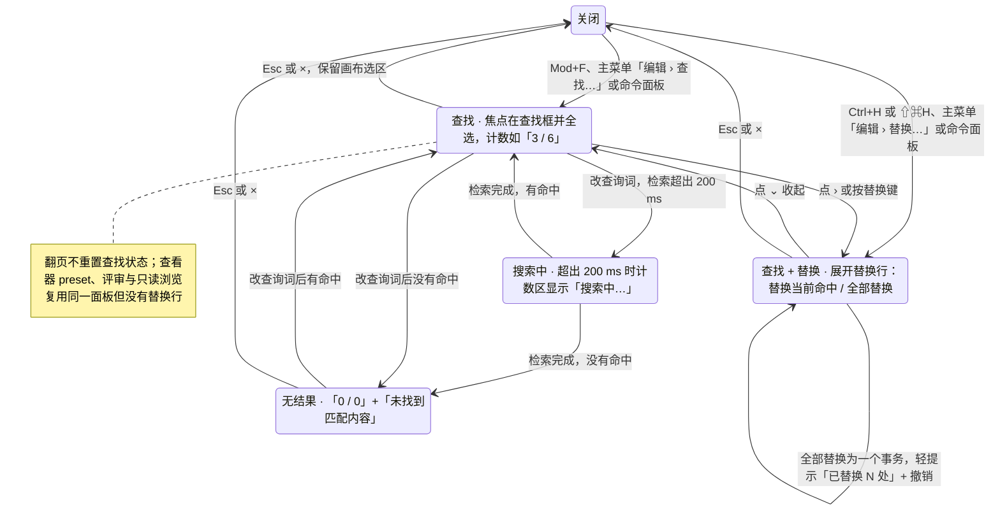

> 状态：草稿 | 负责：设计 | 更新：2026-09-15；2026-09-25（补图）；2026-10-05（design-language-v3 第 0 批修正：只改快捷键值——替换键由 `Mod+H` 改为 Windows / Linux `Ctrl+H`、macOS `⇧⌘H`（rulings §4.25 DS-16），「打开/关闭」、状态图与图注同步；界面描述随第 1 批回写）；2026-10-07（design-language-v3 第 1 批：按已拍板样张 `find-replace` 整篇改写——§1 线框按 v3 外壳重画（画布右上 400 宽浮动面板：› 展开替换 · 查找框内含区分大小写 / 全字匹配 · 计数 · 上一个 / 下一个 · 关闭，替换行与状态行按需出现；缩略图右下角中性命中标记），补面板结构与紧凑形态线框；§2 入口改为主菜单「编辑 › 查找… / 替换…」、快捷键与命令面板（DS-1、DS-16），补焦点、Esc 与只读、渐进打开下的可用性，「不遮挡 Ribbon」的说法作废；§3 状态列 7 个样张状态与紧凑形态、路由与里程碑，状态图补搜索中；§4 查找补计数、跳转、命中高亮（当前命中浅强调色底、其余描边）与命中标记规格；§5 替换补「已替换 N 处 · 撤销」与部分未替换的轻提示；§6 窄屏：紧凑形态面板收窄为 320、选项与替换收进「⋯」（DS-17）；隐藏页外观按 DS-25；依据 rulings §4.25 DS-1、DS-16、DS-17、DS-21、DS-25）；2026-10-07（design-language-v3 第 1 批：§4 补检索范围——M2 只查幻灯片内容、不查演讲者备注，面板不设「含备注」（TB-27）；§1.2、§1.3、§2、§3、§6 评审、只读浏览与降权下不显示 `›` 与替换行、「⋯」里没有「替换…」、替换键只打开查找（TB-28，同 DS-15 不显示禁用控件）；§10 面板层级改指 `--layer-panel`（TB-2）；依据 rulings §4.25 DS-15、TB-2、TB-27、TB-28）；2026-10-08（design-language-v3 第 1 批收口：§1.1 线框工具条「选择」去掉 ▾（同 03-02 §3.4）；§3「命中位于隐藏页」补样张检查器「放映」节的「放映时跳过此页」已勾选（DS-25）；依据 rulings §4.25 DS-25）；2026-10-08（design-language-v3 第 1 批评审修改：§4「区分大小写」「全字匹配」开关的按下态改为强调色淡底、不描边（rulings §4.25 DS-36，原 `--v3-seg-on` 底 + 1px `--v3-seg-on-line` 内描作废）；§10 查找框、替换框注明安静样式字段，「替换」「全部替换」为透明底加细边的次按钮（DS-35、DS-37））；2026-10-22（design-language-v3 第 3 批复核修正：§7 原「查看器的 v3 外壳与搜索入口随第 3 批（03-25）定稿」改为已拍板的写法——搜索是宿主选项，入口只有查看器顶部条的「搜索」，窄屏从「更多 › 搜索」打开 320 宽查找条，查看器不占 `Mod+F`、不绑替换键（原「替换键只打开查找」与 03-25 §4.4、50/12 §3 不一致，删去）；§3「样张没有单独画」去掉查看器一项，改指 `viewer.search`、`viewer.narrow-search`；依据 rulings §4.25 DS-110、DS-111） | 依赖：charter v0.2；`10-prd/07-design-coverage-and-gaps.md`；rulings §4.25 DS-1、DS-15、DS-16、DS-17、DS-21…DS-26、DS-35…DS-37、DS-110、DS-111、TB-2、TB-27、TB-28；playground `#/v3/editor?state=find-replace.*`（`src/v3/scenarios/find-view-undo/find-replace.scenario.tsx`、`FindReplace.tsx`）与 `narrow.compact-find`

# 03-21 查找与替换

> **设计基准（2026-10-07 起，rulings §4.25 DS-21）**：以 playground 第 1 批样张 `#/v3/editor?state=find-replace.<状态 id>` 为准（7 个状态，另有紧凑形态 `narrow.compact-find`，见 §3），源码在 `playground/src/v3/scenarios/find-view-undo/`（`FindReplace.tsx` 面板、命中高亮与缩略图命中标记，`find-replace.scenario.tsx` 各状态的标题与说明）；对照截图 `openspec/changes/design-language-v3/screens/batch1/find-replace-default-dark.jpg` / `-light.jpg`；编辑器外壳以 [03-02](02-editor-main.md) 为准。此前的面板线框是 ribbon 版旧稿，已作废。

在整份文档里查找文字并替换。覆盖缺口 **G-31**（ED-13 / OF-16）。对应产品默认答案 D11：画布右上角的浮动面板，不占检查器，`preset-slide-viewer` 复用不含替换行的同一面板（§7）。按 DS-1，查找替换不在底部工具条、也不在检查器：入口是主菜单「编辑 › 查找… / 替换…」、快捷键与命令面板（§2）。

---

## 1. 线框

### 1.1 在编辑器中的位置（桌面 1600 × 1000，单页视图，查找「营收」）

```
←──────── 240 ────────→←───────────────── 画布 flex ─────────────────→←───────── 280 ──────────→
┌──────────────────────┬──────────────────────────────────────────────┬────────────────────────┐
│ [Logo▾]  [单页][网格]│        ╭──────────────────────────────────╮  │ (周)(王)(李) ▶ [分享]  │
│ 2026 年 Q2 业绩汇报 ▾│        │ › [⌕ 营收  Aa ab] 3 / 6 ↑ ↓ ×    │  ├────────────────────────┤
│ ✓ 已同步             │        ╰──────────────────────────────────╯  │ [设计]  评论    77% ▾  │
│ [新建幻灯片  ▾] [+]  │  ┌────────────────────────────────────────┐  ├────────────────────────┤
│ 1 ┌──────────────┐   │  │                                        │  │ 幻灯片 4               │
│   └──────────────┘   │  │ ▒营收▒趋势                             │  │ 版式                   │
│ 2 ┌──────────────┐   │  │                                        │  │ 主题                   │
│   └────────── ⌕1 ┘   │  │ 6 月 [营收] 4,800 万元…                │  │ 背景                   │
│ 3 ┌──────────────┐   │  │                                        │  │ 放映                   │
│   └────────── ⌕1 ┘   │  └────────────────────────────────────────┘  │                        │
│▌4 ┏━━━━━━━━━━━━━━┓   │                     ════                     │                        │
│▌  ┗━━━━━━━━━━ ⌕2 ┛   │  ┌────────────────────────────────────────┐  │                        │
│ 5 ┌──────────────┐   │  │ 演讲者备注                             │  │                        │
│   └────────── ⌕2 ┘   │  └────────────────────────────────────────┘  │                        │
│ 6 ┌──────────────┐   │   ╭────────────────────────────────────╮     │                        │
│   └──────────────┘   │   │  [选择][文本][形状] … [评论][+]    │     │                        │
│                      │   ╰────────────────────────────────────╯     │                        │
└──────────────────────┴──────────────────────────────────────────────┴────────────────────────┘
```

图例：`›` 展开替换；`⌕` 放大镜；`Aa` / `ab` 区分大小写 / 全字匹配；`▒营收▒` 当前命中（浅强调色底 + 1px 强调色框）；`[营收]` 本页其余命中（1px 强调色框）；`⌕1` / `⌕2` 缩略图右下角的命中标记（本页命中数）。截图：`screens/batch1/find-replace-default-*.jpg`，样张 `find-replace.default`。

### 1.2 面板结构

```
┌────────────────────────────────────────────────────────┐
│ ›  [⌕ 营收                 Aa  ab]  3 / 6   ↑   ↓   ×  │  ← 查找行
│    [⇄ 替换为                     ]  [替换] [全部替换]  │  ← 替换行（展开时）
│    ⊘ 未找到匹配内容                                    │  ← 状态行（按需）
└────────────────────────────────────────────────────────┘
```

面板宽 400、内边距 8、圆角 8，`--v3-panel` 底 + 1px `--v3-border` + `--v3-shadow`；内容是三列网格（24 ┊ 1fr ┊ auto，列间距 4、行间距 8）：查找框与替换框左右对齐，右侧两组按钮共用一列。三行：

- **查找行**：`›` 展开 / 收起替换（24 图标按钮，展开后变 `⌄`，`aria-expanded`；工具提示「展开替换 ⇧⌘H」/「收起替换」；评审、只读浏览与降权时不显示，§2）· 查找框（28 高字段，左侧放大镜，右侧框内两个 24 的选项开关「区分大小写」`Aa`、「全字匹配」`ab`）· 计数「i / n」· 上一个 `↑`（工具提示 ⇧↵）· 下一个 `↓`（↵）· 关闭 `×`（Esc）。
- **替换行**（展开时）：替换框（28 高，左侧替换图标，占位「替换为」）·「替换」「全部替换」两个 28 高次级按钮。
- **状态行**（按需）：从第二列起，图标与查找框里的放大镜对齐、文字与查询词对齐，12px `--v3-text-2`，`role="status"`：「未找到匹配内容」（`SearchX` 图标）或「该内容位于已隐藏的幻灯片」（`EyeOff` 图标）。

### 1.3 紧凑形态（640–1024）

```
┌────────────────────────────────────────┐
│ [⌕ 营收           ]  3 / 6  ↑  ↓  ⋯  × │
└────────────────────────────────────────┘
                          ┌──────────────────┐
                          │ ☐ 区分大小写     │
                          │ ☐ 全字匹配       │
                          ├──────────────────┤
                          │ ☐ 替换…     ⇧⌘H │
                          └──────────────────┘
```

面板宽 320，排在右上「协作与分享」胶囊下方；只留查找框、计数、上一个 / 下一个、「⋯」与关闭。「⋯」（「更多查找选项」，`aria-haspopup="menu"`）里是勾选项「区分大小写」「全字匹配」┊「替换… ⇧⌘H」，勾上「替换…」才在下面展开替换行；评审、只读浏览与降权时「⋯」里只有两个勾选项（§2）。样张：`narrow.compact-find`（视口 1000 × 760）。

---

## 2. 入口、打开与关闭

- **打开**：`Mod+F` 打开查找（替换行收起）；替换键（Windows / Linux `Ctrl+H`、macOS `⇧⌘H`；2026-10-05 由 `Mod+H` 改，⌘H 是 macOS 的「隐藏应用」，rulings §4.25 DS-16，PRD ED-16）打开并展开替换行。主菜单「编辑 › 查找… ⌘F / 替换… ⇧⌘H」（03-19 §1.2）与命令面板（搜「查找」「替换」）等价，与 06-extensibility-ux.md §2.5「命令是唯一行为入口」一致。
- **焦点**：由按键或菜单打开时焦点进查找框并全选原查询词（直接键入即替换它）；面板已开着时再按 `Mod+F` 或替换键，焦点回到查找框并全选（替换键同时展开替换行）。没有用户动作就出现的面板（如样张状态）不抢焦点。
- **关闭**：焦点在面板内，或焦点不在其他输入框时按 `Esc`，或点 `×`：面板关闭，命中高亮与缩略图标记随之消失，焦点交回画布（不掉到 `body`），保留当前画布选区。`Esc` 先关面板、不连带清空选区（逐层退出，50/10 §7.1）；焦点在检查器字段等其他输入框里按 `Esc` 不关面板。
- **非模态**：`role="dialog"`、`aria-label="查找和替换"`，不困住焦点；`Tab` 顺序为 `›` → 查找框 → 区分大小写 → 全字匹配 → 上一个 → 下一个 → 关闭 →（展开时）替换框 →「替换」→「全部替换」。
- **只读**（rulings §4.25 TB-28）：评审模式、只读浏览与编辑模式已降权（无 `doc.write`）下查找照常；替换不可用——主菜单「替换…」留在原位置灰并写「评审模式下不可用」/「只有查看权限」/「需要编辑权限」（03-19 §2），替换键只打开查找；面板不显示 `›` 与替换行，紧凑形态的「⋯」里没有「替换…」（面板里不画禁用控件，与 DS-15 同一口径；与查看器同一形态，§7）。面板打开期间被降权时替换行随即收起。样张未画这一形态，随实现。
- **渐进打开**：文档其余页未到齐（`unitLoaded` 为假）时，主菜单「查找… / 替换…」与快捷键置灰或等待，提示「正在载入其余页面…」（rulings §4.18 CO-12，50/18 §15.1）。

---

## 3. 状态

样张路由均为 `#/v3/editor?state=<样张 id>`（暗 / 亮另加 `&theme=dark|light`）；查询词用示例文档里真实出现 6 次的「营收」。

| 状态（样张标题） | 要点 | 样张 id | 里程碑 |
|---|---|---|---|
| 查找 · 有匹配 | `Mod+F` 打开：计数「3 / 6」；当前命中（第 4 页标题）浅强调色底，本页其余命中描边；命中所在的第 2–5 页缩略图右下角打放大镜计数标记；↵ / ⇧↵ 跳转会自动换页 | `find-replace.default` | M2 P1（ED-13、OF-16） |
| 查找 + 替换 | 替换键打开或点 `›` 展开替换行：「替换」只换当前命中，「全部替换」作用于全文档、一个撤销步（M2 不提供仅当前页） | `find-replace.replace` | M2 P1 |
| 无结果 | 计数「0 / 0」，上一个 / 下一个不可用（工具提示「没有匹配项」），面板底部一行「未找到匹配内容」；画布与缩略图不画任何标记 | `find-replace.no-match` | M2 P1 |
| 搜索中 | 全文检索超出 200 ms 预算时，计数区显示「搜索中…」、查找框的放大镜换成转圈，而不是卡住无反馈 | `find-replace.searching` | M2 P1（OF-16、ED-13 的性能预算） |
| 全部替换完成 | 全部替换是一个事务：中性轻提示「已替换 6 处」+「撤销」；第 4 页标题与正文已变为「收入」（缩略图同步），查询词「营收」随之无结果，「替换」「全部替换」不可用 | `find-replace.replaced` | M2 P1 |
| 全部替换 · 部分未替换（协同） | 提交前目标文字已被他人删除的位置跳过：警告色轻提示「已替换 4 处（2 处因内容变化未替换）」+「撤销」，仍是一步撤销 | `find-replace.replaced-partial` | M2 P1（执行时重新校验每处命中，50/18 FND-02） |
| 命中位于隐藏页 | 计数包含隐藏页；跳到第 5 页（已隐藏：缩略图变淡、页码加斜线并带斜线眼睛图标，检查器「放映」节的「放映时跳过此页」已勾选，03-14、DS-25）时面板底部提示「该内容位于已隐藏的幻灯片」，不自动取消隐藏 | `find-replace.hidden-slide` | M2 P1 |
| 紧凑 · 查找 | 640–1024：面板宽 320、排在右上胶囊下方；区分大小写、全字匹配与「替换…」在「⋯」里，选了「替换…」才展开替换行；命中高亮与跳页同桌面 | `narrow.compact-find` | M2（DS-17） |

样张没有单独画、行为照常的：正则查找（P2，面板不出入口）；评审、只读浏览与降权下没有替换行的面板（§2，TB-28）；仅查看形态（§6）；渐进打开未到齐（§2）。查看器 preset 里的这块面板已随第 3 批出样张：`viewer.search`、`viewer.narrow-search`（§7）。

**图 3-1 查找面板状态**



怎么读：`Mod+F` 与替换键（Ctrl+H，macOS ⇧⌘H）是同一面板的两个开口，区别只是替换行是否展开；「搜索中」只在检索超出预算时出现；「全部替换」在 M2 始终作用于全文档，且一次只占一个撤销步。评审、只读浏览与降权时没有「查找 + 替换」这一态：替换键只打开「查找」，主菜单「替换…」不可用（TB-28）。
依据：PRD ED-13、OF-16；rulings §4.25 DS-16、DS-21、TB-28；样张 `find-replace.*`。

---

## 4. 查找

- **范围**（rulings §4.25 TB-27）：M2 只查幻灯片内容（各页对象里的文字），不查演讲者备注，面板不设「含备注」选项（PRD ED-13 未要求；50/18 FND-01 的「可选含备注」随之去掉）。
- **检索**：输入即时检索，基于模型文本索引、不依赖 DOM，未挂载的页也能命中（OF-16）；选项只有「区分大小写」「全字匹配」两个开关（24 图标按钮、圆角 3；按下态为强调色淡底（`--v3-toggle-on`：暗 40%、亮 22%）、不描边，图标 `--v3-text`、描边加粗到 2，与检查器切换条的按下项同一画法（03-02 §3.5；原为 `--v3-seg-on` 底 + 1px `--v3-seg-on-line` 内描，2026-10-08 按 rulings §4.25 DS-36 修订）；未按下 `--v3-text-2`；`aria-pressed`），正则为 P2。
- **计数**：「i / n」11px 数字等宽 `--v3-text-2`（「0 / 0」同色，计数是可读信息，不用占位色，DS-9），最小宽 48、居中，`aria-live="polite"`；搜索中改为 12px「搜索中…」。
- **跳转**：查找框里 ↵ 下一个、⇧↵ 上一个，或点 `↑` / `↓`；首尾循环；下一处在别页时自动换页（左栏当前页同步）。没有命中时 `↑` / `↓` 不可用，工具提示「没有匹配项」。
- **命中高亮**：画在幻灯片上、随缩放：当前命中为浅强调色底（同文字选区 `--v3-sel`）+ 1px 强调色框；本页其余命中只有 1px 强调色框；圆角 2。面板关闭或查询词改动后旧高亮立即消失。
- **缩略图命中标记**：命中所在页的左栏缩略图右下角（距右、下各 4）一枚中性小签：高 16、圆角 4、1px `--v3-border`、`--v3-panel` 底，10px 放大镜 + 11px 本页命中数（`--v3-text-2`，数字等宽）；与右上角的评论计数（评论图标）区分开，不用彩色；读屏名「本页 N 处匹配」。面板关闭即消失。

---

## 5. 替换

- **展开**：点 `›` 或按替换键展开替换行，再点 `⌄` 收起；替换行收起时替换框的内容保留。
- **替换**：只换当前命中，一处一个撤销步；替换文字沿用该处首个 run 的字符格式（ED-13）。
- **全部替换**：作用于全文档（M2 不提供「仅当前页」，P2），一个事务、一步撤销；完成后中性轻提示「已替换 N 处」+「撤销」（轻提示规格见 03-19 §4.3），查找随之在新文本上重算（原查询词通常变为无结果）。
- **部分未替换（协同）**：提交前目标文字已被他人删除或改动的位置跳过，警告色轻提示「已替换 N 处（M 处因内容变化未替换）」+「撤销」，仍是一步撤销（50/18 FND-02：命令执行时重新校验每处命中）。
- 没有命中时「替换」「全部替换」不可用，工具提示「没有匹配项」。

---

## 6. 窄屏

- **紧凑形态（640–1024，DS-17）**：面板收窄为 320，排在右上「协作与分享」胶囊下方（再下移 60，不压胶囊）；查找框内不放选项开关，区分大小写、全字匹配与「替换…」收进「⋯」，选了「替换…」才在下面展开替换行；命中高亮与跳页同桌面；评审、只读浏览与降权时「⋯」里没有「替换…」（§2）。左栏收起时看不到缩略图命中标记，展开幻灯片抽屉后照常显示。样张：`narrow.compact-find`。
- **仅查看形态（< 640）**：不提供查找入口（样张 `narrow.narrow-more` 的「更多」只有放映、适应窗口与备注）；外接键盘按 `Mod+F` 时的呈现样张未画，随实现按紧凑形态的 320 宽面板（50/10 §2.2：断点不改变外接键盘的快捷键），不含替换（这一形态不提供编辑，03-02 §5a.2）。

## 7. 查看器 preset 复用

- `preset-slide-viewer`（03-25）复用同一面板，没有替换行：不显示 `›`（`FindReplace.tsx` 的 `canReplace=false`）。查看器的 v3 外壳与搜索入口已随第 3 批拍板（2026-10-22，rulings §4.25 DS-110、DS-111；规格见 [03-25](25-viewer-preset-shell.md) §4.4，样张 `viewer.search`、`viewer.narrow-search`）：搜索是宿主选项（`search`），入口只有查看器顶部条的「搜索」，面板挂在画布右上、工具条下方 12；窄屏从「更多 › 搜索」打开 §1.3 那条 320 宽的查找条，水平居中、离上沿 24，选项里没有「替换…」。查看器嵌在宿主页里，不占 `Mod+F`，也不绑替换键（前端 50/12 §3 的查看器键位里没有它们），`Mod+F` 照常打开浏览器自己的查找。

---

## 8. 交互说明

- 面板浮在画布列右上角（距画布列上、右各 12），位置固定、不可拖动；有横幅时随之下移；不遮挡左栏与检查器。
- 面板打开期间画布仍可正常滚动、翻页和选中对象，查找状态（查询词、选项、当前位置）不因翻页而重置。
- 性能预算：D200 全文检索 ≤ 200 ms、全部替换 ≤ 500 ms（OF-16 / ED-13）；超出预算时计数区显示「搜索中…」过渡态，而不是卡住无反馈。
- 查找与跳转只是本地查询（Operation，不入历史）；只有替换写入文档（单处替换为一个事务，全部替换为 `slide.replaceAll` 一个事务，40/10 §2.6、50/18 §15）。

## 9. 边界情况

- 命中位于隐藏页：计数包含隐藏页，跳转时状态行提示「该内容位于已隐藏的幻灯片」，不自动取消隐藏（隐藏页外观见 03-14，DS-25）。
- 命中位于降级 / 无法渲染的元素（03-13）：查找索引基于模型文本，仍可命中，但画布高亮退化为该元素占位框的高亮，而非精确的文字框选。
- 协同场景下替换过程中内容被他人修改：全部替换作为单一事务提交，提交前目标文本已被他人删除或改动的位置跳过并计入「已替换 N 处（M 处因内容变化未替换）」。
- 极长文档的替换范围：全部替换不提供「仅当前页」筛选（M2 始终作用于全文档），仅当前页替换为 P2。

## 10. 设计规格（速查）

| 项 | 规格 | 来源 |
|---|---|---|
| 面板 | 宽 400（紧凑 320）、内边距 8、圆角 8（弹层档）；`--v3-panel` 底 + 1px `--v3-border` + `--v3-shadow`；距画布列上、右各 12；层级为画布浮动面板一档 `--layer-panel`（30，在常驻外壳 20 之上、下拉菜单 100 之下，rulings §4.25 TB-2，04 §2.11） | `kit/FloatingPanel.tsx`、`FindReplace.tsx` |
| 控件 | 查找框、替换框 28 高（检查器字段同一外观：只铺 `--v3-panel-2` 淡底、不描边，悬停出细边，rulings §4.25 DS-35）；选项开关、`›` 24（按下的选项开关为强调色淡底，DS-36）；上一个、下一个、关闭 28 图标按钮；「替换」「全部替换」28 高次按钮（透明底加 1px 细边，DS-37） | `ui.tsx`、`kit/controls.tsx` |
| 计数 | 11px 数字等宽 `--v3-text-2`，最小宽 48；搜索中 12px | `FindReplace.tsx` |
| 命中高亮 | 当前命中 `--v3-sel` 底 + 1px `--v3-accent` 框；其余命中 1px `--v3-accent` 框；圆角 2 | `kit/canvas.tsx` `HoverBox` |
| 缩略图命中标记 | 右下角，高 16、圆角 4、1px `--v3-border`、`--v3-panel` 底，10px 放大镜 + 11px 数字 `--v3-text-2` | `FindReplace.tsx` `HitMark` |
| 状态行 | 12px `--v3-text-2`，图标 16，与放大镜对齐 | `FindReplace.tsx` |
