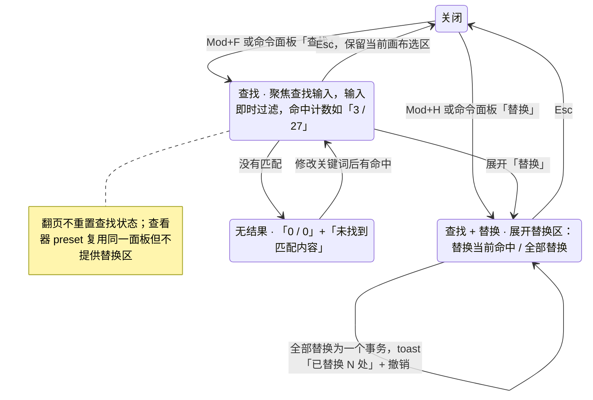

> 状态：草稿 | 负责：设计 | 更新：2026-09-15；2026-09-25（补图） | 依赖：charter v0.2；`10-prd/07-design-coverage-and-gaps.md`

# 03-21 查找与替换

> **设计基准（2026-09-15 起）**：组件规格以 [`09-design-specification.md`](../09-design-specification.md) v3.0（shadcn Rhea + 材质层）为准；对应 playground 路由 `#/editor`（画布右上角浮动面板，无独立路由）（[已发布 artifact](https://claude.ai/code/artifact/cf6e1a1a-986b-48bb-b743-5758dff419d2)，源码 `playground/src/routes/`）。本文引用的 `mockups/*.html` 与线框图为历史静态稿，以 playground 实际渲染为终稿。

新增界面，编辑器主界面此前完全没有查找/替换的对应设计。覆盖缺口 **G-31**（ED-13/OF-16）。对应产品默认答案 D11（位置：画布右上角浮动面板，不占检查器坞，`preset-slide-viewer` 复用不含替换区的同一面板）。

---

## 线框（画布右上角浮动面板）

```
                                    ┌───────────────────────────┐
                                    │ 🔍 [预算.....]    3 / 27  │
                                    │ [◂][▸]  ☐区分大小写 ☐全字  │
                                    │ ▾ 替换                     │
                                    │ [替换为...........]        │
                                    │        [替换]  [全部替换]  │
                                    │                        [×] │
                                    └───────────────────────────┘
```

---

## 状态

### 打开/关闭

- `Mod+F` 打开（聚焦查找输入）；`Mod+H` 打开并展开替换区；`Esc` 关闭并保留当前画布选区（不清空正在查看的对象）。
- 命令面板搜索"查找"/"替换"可直达，与 06-extensibility-ux.md §2.5"命令是唯一行为入口"一致。

### 查找

- 输入即时过滤（基于模型文本索引，非 DOM，未挂载页也能命中，OF-16）；命中计数"3 / 27"实时更新；`◂`/`▸` 或 `Enter`/`Shift+Enter` 在命中间跳转。
- 当前命中元素在画布上高亮包围盒并自动跳转到对应页；所有命中所在页在缩略图侧栏显示小标记（不同于评论/警示角标，使用中性描边）。
- 选项：区分大小写、全字匹配（正则为 P2，本轮不做）。

### 替换

- 展开"替换"后出现替换输入与"替换"（仅替换当前命中）/"全部替换"两个按钮。
- "全部替换"为一个事务，完成后 toast"已替换 N 处 [撤销]"；替换保留首个 run 的字符格式。

### 空/无结果

```
                                    │ 🔍 [预算.....]    0 / 0   │
                                    │ 未找到匹配内容              │
```

**查找面板状态**



怎么读：Mod+F 与 Mod+H 是同一面板的两个开口，区别只是替换区是否展开；「全部替换」在 M2 始终作用于全文档，且一次只占一个撤销步。

### 查看器 preset 复用

- `preset-slide-viewer`（03-screens/25）复用同一查找面板，但不展开替换区（查看器无编辑能力）。

---

## 交互说明

- 面板不遮挡 Ribbon 与检查器坞，浮动于画布视口右上角，位置固定（不可拖动），窄屏下收窄为仅查找输入+计数，替换区收入"更多"。
- 面板打开期间画布仍可正常滚动/翻页，查找状态不因翻页而重置。
- D200 全文搜索 ≤ 200 ms、全部替换 ≤ 500 ms（OF-16/ED-13 性能预算），超出预算时命中计数区显示"搜索中…"过渡态而非卡顿无反馈。

## 边界情况

- 命中位于隐藏页：命中计数包含隐藏页，跳转时提示"该内容位于已隐藏的幻灯片"，不自动取消隐藏。
- 命中位于降级/无法渲染的元素（03-screens/13）：查找索引基于模型文本，仍可命中，但画布高亮退化为该元素占位框的高亮而非精确文本框选。
- 协同场景下替换过程中内容被他人修改：全部替换作为单一事务提交，若目标文本在提交前已被他人删除，该处替换跳过并计入"已替换 N 处（2 处因内容变化未替换）"。
- 极长文档的替换范围：全部替换不提供"仅当前页"筛选（M2 范围内始终作用于全文档），仅当前页替换为 P2。
