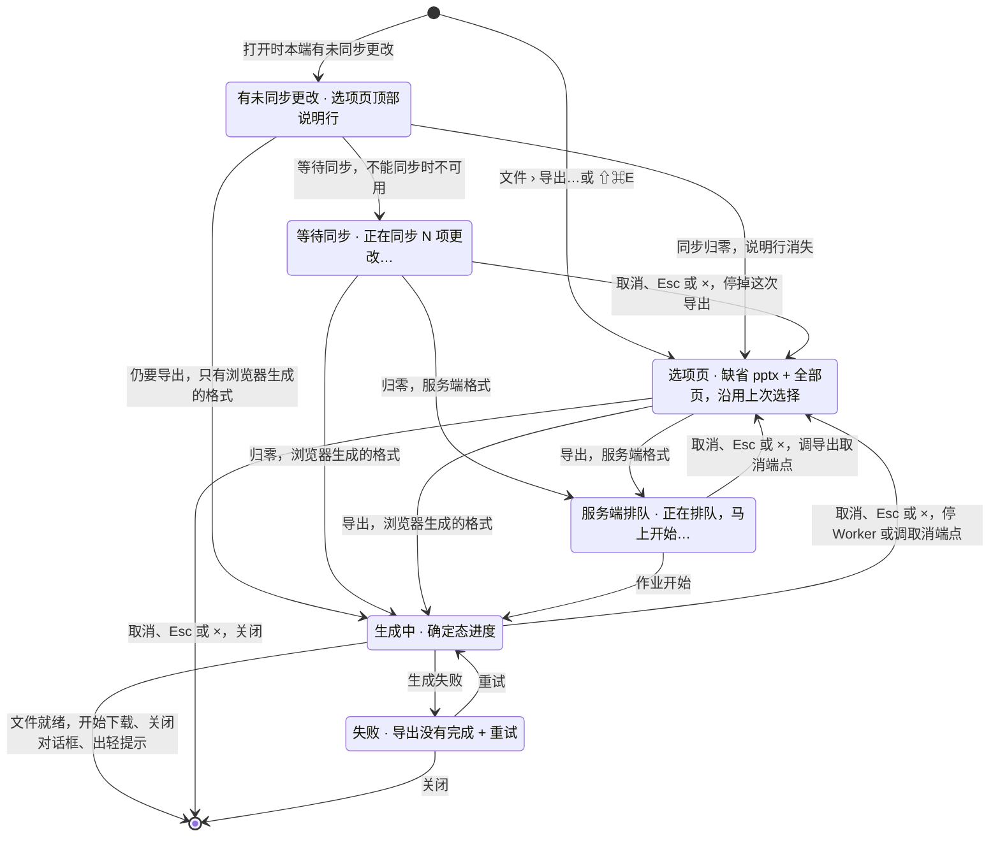

> 状态：草稿 | 负责：设计 | 更新：2026-09-18；2026-09-24（rulings §4.15 Q8：PDF 时点改 M3 后半段）；2026-09-25（补图）；2026-09-25（矛盾收口，rulings §4.18）；2026-10-15（design-language-v3 第 2 批回写：只加一节「「导出本地副本」不是本对话框」——降权、登录账号已变更、文档已被删除、有更改过大无法同步的横幅与离开 / 刷新确认框里的「导出为本地副本」打开的是 03-12 §7.2 的「导出本地副本」对话框（列出未保存的更改、可选 .pptx / .json），原降权横幅后半句的意思移到那里与「已导出本地副本」（rulings §4.25 DS-58）；通用导出对话框的 v3 样张随第 3 批（DS-62），其余各节未改；同日再补：同一节写明「导出本地副本」对话框在 SDK（ui-react 的 `ui.dialog` 模板 `export-local-copy`），横幅与参考应用的离开 / 刷新确认框都经 `ui.openDialog` 打开同一个，嵌入形态也有；本对话框由宿主经壳意图 export 打开，参考应用里由 apps/web 提供（rulings §4.25 TB-85，50/01 §5.4））；2026-10-22（design-language-v3 第 3 批：按已拍板样张 `export` 整篇改写——§1 线框按 v3 重画：kit 对话框 md 480、顶部锚定，节标题加单选行右侧次级文字，与「导出本地副本」对话框同一画法；§2 入口改为主菜单「文件 › 导出…」⇧⌘E（Windows / Linux Ctrl+Shift+E，居中对齐保留 ⌘E，DS-78）与命令面板，原应用栏「⋯」与 `Mod+E` 作废；没有导出权限时「导出…」留在原位不可用——查看者「只有查看权限」，评审者与编辑中被降权「需要编辑权限」，未保存的更改仍走横幅「导出为本地副本」（DS-105）；不加打印入口，需要打印时导出 PDF（DS-104）；§3 列 17 个样张状态与 1 个未采纳的备选、5 个文字备选（DS-63）；§4 格式不放 JPEG，PDF 在 M3 后半段前留在原位不可用，pptx 只导整份，图片与 PDF 的「全部页」缺省不含隐藏页、不设勾选（DS-103），PNG 宽度 1280 / 1920 / 3840、M2 四种范围都在浏览器生成并把多页打包成 .zip、M3 起「全部页」改由服务端生成（DS-102），SVG 补「内嵌字体」；§5 未同步更改改为选项页顶部的说明行；§6 生成中只有「取消」一个出口（Esc、× 等同，服务端格式调导出取消端点），不做后台继续，原「后台进行」轻提示作废（DS-101）；§7 文件就绪即下载并关闭对话框、画布底部轻提示「已导出「X」」，服务端格式多一个「下载」，原「完成」态与「下载链接 1 小时内有效」作废（DS-100）；依据 rulings §4.25 DS-53、DS-58、DS-62、DS-63、DS-78、DS-100…DS-105、TB-85、TB-126；同日再补（回写中新增的技术口径）：§4.3 浏览器一次导出 PNG 的页数上限按 TB-148 写入初值（1280 px 200 页、1920 px 100 页、3840 px 25 页，M2 位图实测后只收紧，前端 50/13 §3），「一次最多导出 N 页图片。」的 N 按所选宽度取；§2.2 编辑中被降权一行注明与文档菜单「重命名」「创建副本」「版本历史」同一规则（TB-138）；§2.3 补有更改被拒的「文档已达元素上限」「文档正忙」两种横幅，第二句没点名的原因引用 TB-139；设计基准按样张转正后的去向改写（⇧⌘E 由底座命令 `file.export` 发，「导出…」的不可用原因在底座主菜单）；同日再补（回写中新增的技术口径）：§4.3 写明分档上限只对浏览器生成的 PNG，SVG 不设分档上限、只受每份文档的页数天花板（rulings §4.25 TB-152），1280 px 一档按 50/13 §3 写成「等于系统天花板，即不另设限」，§3 同步；§6 补服务端格式里有一页渲染出错、重试 1 次仍失败时整个导出作业失败、不把占位写进文件，整页无法解析的保真占位照常导出（TB-157）；§2.1 命令面板「导出…」注明壳意图经 shell-glue 注册的无参 Operation 进命令面板（TB-162），设计基准注明 `file.export` 是样张里的命令名；2026-10-22 复核修正：§6 补浏览器生成的图片导出遇到运行时单页渲染出错时同样按失败处理、进失败态，不把一时的占位写进文件（rulings §4.25 TB-166），§3「样张没有单独画」同步；§2.2 编辑中被降权一行补引 DS-139（降权后文档菜单「创建副本」改为不可用，取代第 1 批的「照常」）；§6 失败一条写定因页面渲染出错的导出失败的原因句——服务端格式（TB-157）与浏览器生成的图片（TB-166）同一句「有一页暂时无法生成，请重试；文档本身不受影响」，对应错误码 `render.page_failed`（架构 30/10 §1.1a），文案登记在前端 50/15 §4.3 常见码表（rulings §4.25 TB-173），服务端一句的出处补后端 60/06 §10.5，§3「样张没有单独画」同步；§6 失败一条的原因句分三条写：页面渲染出错那一句补注 `render.page_failed` 按前端 50/15 §4.2 标为面向用户、带 zh-CN / en-US 语言包键（TB-173），服务端出处补 60/06 §11.3；补服务端格式因单页超时（`headless.render_timeout`）失败的原因句「生成文件时超时，请重试；文档本身不受影响」，与前一句并列登记在 50/15 §4.3，其余失败的原因按错误码照 50/15 §4.3（rulings §4.25 TB-175）——原来并列的示例「服务暂时不可用，请稍后重试」在 50/15 没有对应的登记，随之去掉；§3 `export.failed` 一行注明样张的原因即单页超时那一句；§6「其余失败」一条定稿：renderer 忙、注入超时、浏览器崩溃与网络、存储等基础设施失败不另标面向用户，按前端 50/15 §4.2 显示通用文案 `errors.generic`，本节只列页面渲染出错、单页超时两句与通用文案（rulings §4.25 TB-176），单页超时一句补注 `headless.render_timeout` 同样面向用户、带 zh-CN / en-US 语言包键（TB-175），§3 `export.failed` 一行同步）；2026-10-23（design-language-v3 第 3 批评审修改：格式行在单选圈与名称之间放 20px 文件类型图标——Tabler Icons（`@tabler/icons` 3.49.0，MIT）的 `file-type-ppt`、`file-type-png`、`file-type-svg`、`file-type-pdf` 原件，插件贡献的格式没有专属图标时用通用 `file` 字形，中性色、选中不变色、不可用随文字降色、只作装饰，图上字样是「PPT」、名称照旧写 .pptx（rulings §4.25 DS-143、TB-182）——§1.1、§1.2 线框与图注、§4.1 格式表（加「图标」一列）与图标规则、§9、§11 随之改，§2.3 写明「导出本地副本」对话框的格式行同一套图标（.json 一行用 lucide `FileBraces`）；对话框按全站新画法（标题栏 40、圆角 12、× 正文色，DS-142），§1.1 图注与 §11 补；§3 补 `m3-pdf`（M3 选 PDF 与插件格式同屏，评审态转正），「样张没有单独画」去掉 PDF 选项页一条；§3.1 补未采纳的 Phosphor、Bootstrap 两套格式图标（各 M2 与 M3 两态）与不保留样张的彩色文件图标（DS-63、TB-183）；设计基准的状态数改为 18 个加 5 个未采纳的备选，源码补 kit `FileTypeIcon.tsx` 与 `fileTypeIcons.tsx`，写明画面随之变的状态；§7 与设计基准里长文件名「与导入页同一个件」改为与导入对话框同一个件（DS-140）；依据 rulings §4.25 DS-140、DS-142、DS-143、TB-182、TB-183） | 依赖：charter v0.2；PRD 01 OF-18、OF-19，03 CO-05，06 SV-02、SV-13，04 NF-01，07 G-25、D17、D27；rulings §4.12 U-09、§4.15 Q8、§4.18 UX-05、§4.20 FE-06、§4.24 AL-4、§4.25 DS-53、DS-58、DS-62、DS-63、DS-78、DS-100…DS-105、DS-139、DS-140、DS-142、DS-143、TB-85、TB-126、TB-138、TB-139、TB-148、TB-152、TB-157、TB-162、TB-166、TB-173、TB-175、TB-176、TB-182、TB-183；架构 30/10 §1.1a；前端 50/17、50/18 EXP-01…EXP-06、50/04 §8.3、50/10 §10.1、50/13 §3、50/15 §4.2、§4.3；后端 60/06 §10.4、§10.5、§11.3、60/15 §3.9；设计 03-12 §7.2、03-13、03-10、04 §2.14、06 §4；playground `#/v3/editor?state=export.*`（`src/v3/scenarios/export/`，底座 `src/v3/kit/FileTypeIcon.tsx`）

# 03-22 导出对话框

> **设计基准（2026-10-22 起，rulings §4.25 DS-100…DS-105）**：以已拍板的 playground 第 3 批样张 `export` 为准——路由 `#/v3/editor?state=export.<状态 id>`（暗 / 亮另加 `&theme=dark|light`），18 个状态加 5 个未采纳的备选（§3）。源码在 `playground/src/v3/scenarios/export/`：`export.scenario.tsx`（各状态的标题与说明）、`ExportDialog.tsx`（对话框：选项页、未同步说明、等待同步、排队与生成中、失败）、`controller.tsx`（接住底座命令 `file.export`——主菜单「文件 › 导出…」与 ⇧⌘E 都发它，这是样张里的命令名，产品里由 shell-glue 的壳意图承担，§2.1——、计时、完成轻提示）、`model.ts`（格式、范围、页码校验、文件名、哪种格式在服务端生成）、`parts.tsx`（同步状态行）、`fileTypeIcons.tsx`（格式图标里 DS-143 未采纳的 Phosphor、Bootstrap 两套）；格式行采纳的 Tabler 文件类型图标是底座的件 kit `FileTypeIcon.tsx`（导入对话框的上传行与「导出本地副本」对话框用同一个件，rulings §4.25 TB-182）；没有导出权限时「文件 › 导出…」的不可用原因由底座主菜单按角色与降权推算（`kit/mainMenu.tsx` `exportReasonOf`）；长文件名与导入对话框同一个件 `import/FileName.tsx`。对照截图 `openspec/changes/design-language-v3/screens/batch3/export-<状态>-dark.jpg`；2026-10-23 第 3 批评审修改起，对话框按全站新画法（标题栏 40、圆角 12、× 正文色，rulings §4.25 DS-142），格式行加文件类型图标（DS-143）——除 `exported-toast`、`exported-server`、`no-permission`、`no-permission-reviewer` 四态（对话框不开着）外，各态画面随之变。外壳与对话框、轻提示的通用规格见 [03-02](02-editor-main.md) 与设计 [04](../04-design-system.md)；导出的实现落点见前端 [50/18](../../50-frontend/18-editor-capabilities.md) EXP-01…EXP-06。此前的线框（应用栏「⋯ → 导出…」`Mod+E`、单选胶囊、「完成」态与「服务端作业：下载链接 1 小时内有效」、「后台进行」轻提示、「查看导入详情」）与 shadcn / 材质层时期的写法（09 v3.0、旧路由 `#/export`）一并作废。

把整份文档或其中几页导出为 PowerPoint、PNG、SVG、PDF 或插件贡献的格式。覆盖缺口 **G-25**（PRD OF-18、OF-19、SV-02，用户流程 F6）；产品默认答案 D17：缺省 pptx + 全部页，之后记住上次的格式与范围（本机偏好），文件名等于文档标题。本对话框与第 2 批的「导出本地副本」是两个对话框，画法一致（§2.3）。

---

## 1. 线框

### 1.1 选项页 · PowerPoint 整份（缺省，`export.default`）

```
┌────────────────────────────────────────────────────────────┐
│ 导出「2026 年 Q2 业绩汇报」                           [×]  │
├────────────────────────────────────────────────────────────┤
│ 格式                                                       │
│ (●) [PPT] PowerPoint（.pptx）   可在 PowerPoint 中继续编辑 │
│ ( ) [PNG] PNG 图片                           每页一张图片  │
│ ( ) [SVG] SVG 矢量图                     每页一个矢量文件  │
│ ( ) [PDF] PDF  [M3]                          后续版本提供  │
│                                                            │
│ 范围                                                       │
│ 全部 6 页                 PowerPoint 格式只导出整份文档    │
│                                                            │
│ ⓘ 未修改的内容将原样保留                                   │
├────────────────────────────────────────────────────────────┤
│                                         [取消]  [导出]     │
└────────────────────────────────────────────────────────────┘
```

kit `Dialog` md 480、顶部锚定（内容随格式与阶段增减，标题不跳，04 §4.1a），画法同全站对话框（标题栏 40、圆角 12、`[×]` 用正文色，rulings §4.25 DS-142）；正文内边距 16、节间 16；节标题 12px 600、单选行（`RadioRow`）右侧是次级文字的说明，与「导出本地副本」对话框（03-12 §7.2）同一画法。`[PPT]` `[PNG]` `[SVG]` `[PDF]` 是格式行的 20px 文件类型图标（Tabler，图上字样即方括号里的字母；只作装饰，§4.1，DS-143）：单选圈 16 · 8 · 图标 20 · 8 · 名称 · 右侧说明，行高仍是 28；只有「格式」一节带图标，名称列比其余各节的单选项右移 28。截图：`batch3/export-default-*.jpg`。

### 1.2 选项页 · PNG（`export.png`）

```
┌────────────────────────────────────────────────────────────┐
│ 导出「2026 年 Q2 业绩汇报」                           [×]  │
├────────────────────────────────────────────────────────────┤
│ 格式                                                       │
│ ( ) [PPT] PowerPoint（.pptx）   可在 PowerPoint 中继续编辑 │
│ (●) [PNG] PNG 图片                           每页一张图片  │
│ ( ) [SVG] SVG 矢量图                     每页一个矢量文件  │
│ ( ) [PDF] PDF  [M3]                          后续版本提供  │
│ 图片宽度                                                   │
│ [ 1280 px | 1920 px | 3840 px ]                            │
│ 范围                                                       │
│ (●) 全部页                       5 页 · 不含 1 张隐藏页    │
│ ( ) 当前页                                     第 2 页     │
│ ( ) 选定页                                        3 页     │
│ ( ) 自定义页码  [例如 1,3,5-8                         ]    │
│ 多页会打包成一个 .zip 文件。                               │
├────────────────────────────────────────────────────────────┤
│                                         [取消]  [导出]     │
└────────────────────────────────────────────────────────────┘
```

图例：格式行的文件类型图标同 §1.1；图片宽度是分段控件（宽 288）；「自定义页码」的输入框常在，聚焦即选中这一项。选 SVG 时「图片宽度」换成「字体」一节（勾选「内嵌字体」，§4.2）。截图：`batch3/export-png-*.jpg`。

### 1.3 有未同步更改、等待同步与生成中

```
有未同步更改（浏览器生成的格式）            等待同步                                    生成中
┌──────────────────────────────────────┐    ┌──────────────────────────────────────┐    ┌──────────────────────────────────────┐
│ 导出「2026 年 Q2 业绩汇报」      [×] │    │ 导出「2026 年 Q2 业绩汇报」      [×] │    │ 导出「2026 年 Q2 业绩汇报」      [×] │
├──────────────────────────────────────┤    ├──────────────────────────────────────┤    ├──────────────────────────────────────┤
│ ⚠ 有 3 项更改还没同步                │    │ ◌ 正在同步 2 项更改…                 │    │ 2026 年 Q2 业绩汇报.pptx             │
│   导出将包含本地最新内容，可能与其他 │    │   同步完成后将自动开始导出。         │    │ 正在重新打包未修改的部件…        58% │
│   协作者看到的版本不同               │    ├──────────────────────────────────────┤    │ ▓▓▓▓▓▓▓▓▓▓▓▓▓▓░░░░░░░░░░░░░░░░       │
├──────────────────────────────────────┤    │                               [取消] │    ├──────────────────────────────────────┤
│ 格式 … 范围 …                        │    └──────────────────────────────────────┘    │                               [取消] │
├──────────────────────────────────────┤      × 的名字是「取消导出」                    └──────────────────────────────────────┘
│               [仍要导出]  [等待同步] │                                                  × 的名字是「取消导出」
└──────────────────────────────────────┘
```

截图：`batch3/export-unsynced-client-*.jpg`、`export-waiting-sync-*.jpg`、`export-generating-*.jpg`。

### 1.4 完成：关闭对话框 + 轻提示（DS-100）

```
    ┌──────────────────────────────────────────────────┐
    │ 画布                                             │
    │                                                  │
    │       ╭────────────────────────────────────╮     │
    │       │ 已导出「2026 年 Q2 业绩汇报.pptx」 │     │  ← 轻提示，中性、无图标，约 5 秒收起
    │       ╰────────────────────────────────────╯     │
    │   ╭──────────────────────────────────────────╮   │
    │   │ 底部工具条                               │   │
    │   ╰──────────────────────────────────────────╯   │
    └──────────────────────────────────────────────────┘

服务端格式（M3）：
    ╭────────────────────────────────────────────╮
    │ 已导出「2026 年 Q2 业绩汇报.pdf」     下载 │
    ╰────────────────────────────────────────────╯
```

截图：`batch3/export-exported-toast-*.jpg`、`export-exported-server-*.jpg`。

---

## 2. 入口与权限

### 2.1 入口

- 主菜单「文件 › 导出…」，快捷键 ⇧⌘E（Windows / Linux Ctrl+Shift+E，rulings §4.25 DS-78；⌘E 留给居中对齐，PRD ED-16、07 D27）；命令面板「导出…」（分类「文件」；壳意图经 shell-glue 为它注册的无参 Operation 与一条 `ui.command` 进命令面板，打开的是同一个对话框，rulings §4.25 TB-162）。应用栏「⋯」菜单与 `Mod+E` 的旧入口随应用栏取消而作废（DS-1）。
- 本对话框由宿主经壳意图 `export` 打开，参考应用里由 apps/web 提供（rulings §4.25 TB-85，前端 50/01 §5.4）。
- 打开时对话框从选项页开始，沿用上次的格式与范围（D17）；本端有未同步更改时选项页顶部就是说明行（§5）。
- **不加打印入口**（rulings §4.25 DS-104）：需要打印时导出 PDF，再用浏览器或系统打印；主菜单「文件」不加「打印…」，EXP-05 结案为不排期。

### 2.2 没有导出权限（U-09、DS-105）

`doc.export` 只到编辑者（PRD 03 §1、rulings §4.12 U-09）。没有它时主菜单「文件 › 导出…」留在原位、不可用，右侧写原因，快捷键提示让位给原因，⇧⌘E 无效；「保真报告」照常（rulings §4.20 FE-06）：

| 谁 | 原因 | 样张 |
|---|---|---|
| 查看者（只读浏览） | 只有查看权限（与同一菜单「插入」「排列」同一句） | `export.no-permission` |
| 评审者（评审模式、没有编辑权限） | 需要编辑权限（按权限写、不按模式写：编辑者切到评审模式照常可以导出） | `export.no-permission-reviewer` |
| 编辑中被降权（`readonly-degraded`） | 需要编辑权限（DS-105；第 1 批 `main-states.degraded-menu` 原写的「导出照常」随之改；文档菜单的「重命名」「创建副本」「版本历史」同一规则，rulings §4.25 TB-138、DS-139） | （同评审者那一句，降权态在第 1 批画） |

降权后未保存的更改仍走横幅里的「导出为本地副本」（PRD CO-05，03-12 §7.2），不受这条影响。前端底座的主菜单按能力位置灰这一项（03-02 §2.3「文件」随之改写）。

### 2.3 「导出本地副本」不是本对话框（2026-10-15，rulings §4.25 DS-58）

降权、登录账号已变更、文档已被删除、有更改过大无法同步、换纪元，以及有更改被拒的「文档已达元素上限」「文档正忙」这几种横幅里的「导出为本地副本」（离开 / 刷新确认框左下的同名按钮也一样）打开的是另一个对话框「导出本地副本」，规格见 [03-12](12-offline-conflict-banner.md) §7.2：先列出未保存的更改（命令名 + 所在页，点某项切到该页对照），再选格式——演示文稿副本 .pptx（缺省）或更改摘要 .json；说明与导出后的「已导出本地副本」写明系统不会把副本自动合并回文档，第二句按原因换（rulings §4.25 DS-129，03-12 §7.2、§7.3；DS-129 没点名的原因用中性句「导出的副本不会自动合并回文档，可以对照重做。」，TB-139）。降权后没有 `doc.export` 也能导出这份副本（PRD CO-05）。两个对话框的归属也不同：「导出本地副本」在 SDK 里——ui-react 的 `ui.dialog` 模板 `export-local-copy`，横幅与参考应用的离开 / 刷新确认框都经 `ui.openDialog` 打开同一个，嵌入形态也有这条兜底（rulings §4.25 TB-85，前端 50/09 §6.1、50/07 §8.2）；本对话框是宿主经壳意图 export 打开的通用导出对话框。两个对话框的格式行同一画法、同一套文件类型图标：「导出本地副本」的 .pptx 一行是 Tabler `file-type-ppt`，.json 一行是 lucide `FileBraces`（20、描边 1.5；Tabler 没有 json 的文件类型图标，rulings §4.25 TB-182，03-12 §7.2）。

---

## 3. 状态

样张路由均为 `#/v3/editor?state=export.<状态 id>`；未写视口的按 1600 × 1000。示例文档 6 页，导入自同名 .pptx（有原样保留的部件），第 5 页已隐藏、左栏多选了第 2–4 页。对话框状态能点着走：选项 →（有未同步更改）仍要导出 / 等待同步 →（服务端格式）排队 → 生成中 → 关闭 + 轻提示；别的样张里选主菜单「文件 › 导出…」会转到这里。

| 状态（样张标题） | 要点 | 样张 id | 里程碑 |
|---|---|---|---|
| 默认 · PowerPoint 整份 | 缺省 pptx + 全部页；格式行带文件类型图标（DS-143）；pptx 时「范围」只有一行「全部 6 页 · PowerPoint 格式只导出整份文档」；PDF 留在原位不可用、标 M3，图标随文字降为 `--v3-text-3`；不放 JPEG；底部「未修改的内容将原样保留」 | `export.default` | M1（零编辑）/ M2 P0（OF-18） |
| 选 PNG · 宽度与范围 | 宽度 1280 / 1920 / 3840（缺省 1280）；范围四项，「全部页」写「5 页 · 不含 1 张隐藏页」；多页时「多页会打包成一个 .zip 文件。」 | `export.png` | M2 P1（OF-19） |
| 选 SVG · 内嵌字体 | 「字体」一节勾选「内嵌字体」（缺省不勾）；没在左栏多选时「选定页」不可用「先在左栏选中多页」；选「当前页」单页不打包 | `export.svg` | M2 P1 |
| 自定义页码有误 | 「1,3,x」离开输入框后字段危险色内描边 + 下方一行原因；「导出」不可用「页码有误，改正后才能导出」 | `export.custom-range-error` | M2 P1 |
| 有未同步更改 · 浏览器生成的格式 | 选项页顶部说明行「有 3 项更改还没同步」；底栏「仍要导出」（次）+「等待同步」（主）；左栏同步状态行「同步中 0%」 | `export.unsynced-client` | M2（UX-05） |
| 等待同步 | 加载行「正在同步 2 项更改…」+「同步完成后将自动开始导出。」，底栏只有「取消」；归零后自动进入生成中 | `export.waiting-sync` | M2 |
| 有未同步更改 · 不能同步时 | 离线：说明行多一句「恢复连接后才能同步」，「等待同步」留在原位不可用；浏览器格式仍可「仍要导出」 | `export.unsynced-offline` | M2 |
| 生成中（浏览器） | 文件名 · 阶段文案 + 百分比 · 确定态进度条；底栏只有「取消」，Esc、× 等同；× 写「取消导出」 | `export.generating` | M2 P0 |
| 导出失败 | 整块状态：危险色图标 +「导出没有完成」+ 按错误码的原因 + 次按钮「重试」，底栏「关闭」；原因只有页面渲染出错、单页超时各一句（TB-173、TB-175），其余失败显示通用文案（TB-176，§6）；样张里的原因是 M3 服务端格式单页超时的那一句 | `export.failed` | M2 P0 |
| 完成 · 关闭并轻提示 | 文件就绪即下载并关闭对话框；画布底部轻提示「已导出「2026 年 Q2 业绩汇报.pptx」」，焦点回到打开前的位置 | `export.exported-toast` | M2 P0（DS-100） |
| 文档有无法显示的内容 | 底部说明行按格式写（PNG「第 7 页有 1 处内容无法显示，PNG 中会按占位画出」）+「查看保真报告」 | `export.degraded-note` | M2（G-03） |
| 查看者 · 导出不可用 | 主菜单「文件 › 导出…」不可用「只有查看权限」；停在有评论的第 4 页，照常画评论钉（TB-126） | `export.no-permission` | M2（U-09） |
| 评审者 · 导出不可用 | 「文件 › 导出…」不可用「需要编辑权限」；评审条没有「返回编辑」；照常画评论钉（TB-126） | `export.no-permission-reviewer` | M2（U-09，DS-105） |
| 选 PDF · 插件格式同屏（M3） | PDF 可用并选中：右侧「由服务端生成，页面大小与幻灯片相同」，范围四项同图片；格式列表末尾插件贡献的「Markdown（.md）」画通用 `file` 字形（TB-182）；PDF 的图标与其余可用行同为 `--v3-text-2`，选中只由单选圈表达；没有未同步更改，底栏「取消 / 导出」，点「导出」先排队 | `export.m3-pdf` | M3 后半段（Q8、PS-14） |
| 需先同步 · 服务端格式 | 选 PDF：说明行「需先同步 3 项更改」+「PDF 由服务端生成，只包含已同步到服务器的内容」；没有「仍要导出」，底栏「取消 / 等待同步」 | `export.unsynced-server` | M3 后半段（Q8） |
| 服务端排队与生成中 | 排队「正在排队，马上开始…」+「PDF 由服务端生成，完成后自动下载。」；作业开始后同一位置换成「正在生成第 3 / 6 页…」；两步都只有「取消」 | `export.server-generating` | M3 后半段（DS-101） |
| 完成 · 服务端格式带「下载」 | 同样关闭对话框、开始下载；轻提示多一个文字按钮「下载」 | `export.exported-server` | M3 后半段（DS-100） |
| 插件贡献的导出格式 | 格式列表末尾「Markdown（.md）」，图标是通用 `file` 字形（TB-182），右侧写归属「来自「Markdown 导出」」；只导整份 | `export.plugin-format` | M3（PS-14） |

样张没有单独画、规格写在相关状态里的：其余页面还没载入（§5.3）、嵌入 iframe 不允许下载（§10）、浏览器端多页 PNG 超出页数上限（§4.3；SVG 不设分档上限，TB-152）、某一页渲染出错导致导出失败（浏览器生成与 M3 服务端格式同一画面：同 `failed`，原因换成「有一页暂时无法生成，请重试；文档本身不受影响」，§6，TB-157、TB-166、TB-173）、编辑中被降权（§2.2）、隐藏页（并进 `png`）；M3 选 PDF 的选项页见 `m3-pdf`，有未同步更改与排队时见 `unsynced-server`、`server-generating`。

### 3.1 未采纳的备选（DS-63）

拍板时画给用户对照的备选留在样张里，标题前加「未采纳 · 」、说明写明由哪一条 DS 定为推荐；路由不变，实现以上表的状态为准（rulings §4.25 DS-63）。只有文字说明、没有出图的备选同列在这里。

| 备选 | 样张 id | 内容 | 结论 |
|---|---|---|---|
| 对话框停在「导出完成」 | `export.alt-done-state` | 03-22 原画法：整块状态（成功色对勾 +「导出完成」+「文件名 · 大小」），底栏「完成」，服务端格式另有「下载」；比推荐多一步 | 未采纳，DS-100 定为关闭 + 轻提示 |
| 关掉对话框后在后台继续 | （文字备选） | 生成中关掉对话框不取消，作业在后台跑，完成后轻提示「导出完成」+「下载」 | 未采纳，DS-101 定为只能取消 |
| PNG 在 M3 也全在浏览器生成 | （文字备选） | 服务端 PNG 只留给 API 与自动化 | 未采纳，DS-102 定为 M3 起「全部页」走服务端 |
| 导出细节逐项另定 | （文字备选） | pptx 支持部分页、隐藏页加勾选「包括隐藏的幻灯片」、对话框加 JPEG 与质量 | 未采纳，DS-103 定为三项都按推荐 |
| 加「文件 › 打印…」 | （文字备选） | 随 PDF 在 M3 后半段加入口，生成服务端 PDF 后在新标签打开、用浏览器的 PDF 查看器打印 | 未采纳，DS-104 定为不加打印入口 |
| 编辑中被降权后导出照常 / 只放浏览器格式 | （文字备选） | 降权前一刻还在编辑，导出已重新载入的服务端版本；或只放开 pptx / PNG / SVG | 未采纳，DS-105 定为不可用「需要编辑权限」 |
| 格式图标 · Phosphor | `export.alt-icons-phosphor`、`export.alt-icons-phosphor-m3` | Phosphor Icons regular（`@phosphor-icons/core` 2.1.1，MIT）的 `file-ppt` / `file-png` / `file-svg` / `file-pdf`，插件格式回退 `file`：256 网格的填充轮廓，与 Tabler 同重，但笔画是填充出来的、不能走统一描边；字样同为「PPT」。M3 一态画 PDF 选中与插件格式同屏（同 `m3-pdf`，只换图标） | 未采纳，DS-143 定为 Tabler Icons |
| 格式图标 · Bootstrap（PPTX 字样） | `export.alt-icons-bootstrap`、`export.alt-icons-bootstrap-m3` | Bootstrap Icons（`bootstrap-icons` 1.13.2，MIT）的 `filetype-pptx` / `filetype-png` / `filetype-svg` / `filetype-pdf`，插件格式回退 `file-earmark`：图上写「PPTX」、与名称一致，但 16 格的填充造型、字样挤在左下角，四个字母高约 5px，1 倍屏上又细又淡；同样不能走统一描边。M3 一态同上 | 未采纳，DS-143 定为 Tabler Icons |
| 彩色文件图标 | （样张不保留） | 评审时画过一套彩色文件图标，授权不明，按 TB-183 不保留原件与样张 | 未采纳，DS-143 定为 Tabler Icons（中性色） |

**图 3-1 导出对话框状态**



怎么读：主干是选项 → 生成中 → 关闭并轻提示；服务端格式多一步排队，有未同步更改时只能等同步归零。等待、排队与生成中三个阶段只有「取消」一个出口（Esc、× 等同），取消回到选项、不关对话框；只有选项页与失败时 × 才是关闭。导出失败不影响文档本身的编辑。
依据：PRD G-25、OF-18、OF-19、SV-02；rulings §4.18 UX-05、§4.25 DS-100、DS-101；50/04 §8.3。

---

## 4. 选项

### 4.1 格式

| 格式 | 图标（DS-143） | 右侧说明 | 在哪生成 | 里程碑 |
|---|---|---|---|---|
| PowerPoint（.pptx） | Tabler `file-type-ppt`（图上字样「PPT」） | 可在 PowerPoint 中继续编辑 | 浏览器（Worker） | M1（零编辑）/ M2 P0 |
| PNG 图片 | `file-type-png` | 每页一张图片 | M2 四种范围都在浏览器；M3 起「全部页」在服务端（DS-102） | M2 P1 |
| SVG 矢量图 | `file-type-svg` | 每页一个矢量文件 | 浏览器 | M2 P1 |
| PDF | `file-type-pdf`（M3 后半段前随文字降为 `--v3-text-3`） | 由服务端生成，页面大小与幻灯片相同（M3 后半段前写「后续版本提供」、留在原位不可用、标 M3，不隐藏，rulings §4.20 FE-06） | 服务端 | M3 后半段（rulings §4.15 Q8、§4.24 AL-4） |
| 插件贡献的格式 | 通用 `file` 字形（TB-182） | 12px 归属图标 +「来自「〈插件名〉」」（设计 06 §4，命令面板 TB-106 同一说法）；文字可见、并进单选项的读屏名 | 浏览器（注册了 `canExport` 的 `core.format`） | M3 P1（PS-14） |

- **文件类型图标**（rulings §4.25 DS-143、TB-182）：「格式」一节的单选行在单选圈与名称之间放 20px 图标（单选圈 16 · 8 · 图标 20 · 8 · 名称 · 右侧说明；行高仍是 28，图标上下各留 4，对话框不变高）。只有这一节带图标（「图片宽度」「字体」「范围」不是文件类型），名称列因此比其余各节的单选项右移 28，单选圈仍对齐左缘。图标取 Tabler Icons outline 原件（`@tabler/icons` 3.49.0，MIT），描边按 1.5 渲染（原件 2，与 lucide 图标同一描边参数），`currentColor`：可用 `--v3-text-2`、不可用 `--v3-text-3`（随文字一起降）；选中不改图标颜色，选中只由单选圈表达；只作装饰（`aria-hidden`），单选项的读屏名照旧是格式名（§9）。图上字样是「PPT」（Tabler 没有 pptx），名称照旧写「PowerPoint（.pptx）」——这只是图标里的字样，不表示格式，导入拒收的 .ppt（`format.unsupported_binary`，03-13）不受影响（DS-143 定为接受这一字样）。图标按格式取：pptx、PNG、SVG、PDF 四种有专属图标，其余（插件贡献的格式，如样张的「Markdown 导出」）画 Tabler 的通用 `file` 字形，不留空位，也不用设计 04 §2.14 的回退图标 `Puzzle`——这一格表示文件类型，插件归属由行右侧的归属图标与「来自「〈插件名〉」」表达。设计 04 §2.14「单一图标家族」只为文件类型图标开这一个例外；产品里把这几个 SVG 复制进 ui-react 的图标件、写明出处与许可证，不为它们新增运行时依赖，来源、版本与许可证登记在前端 50/17（TB-182）。同一套图标还用于导入对话框上传行的文件名前（03-13）与「导出本地副本」对话框的 .pptx 一行（§2.3）。
- **不放 JPEG**（rulings §4.25 DS-103）：JPEG 与质量参数只经 API 与自动化（SV-02、SV-13）。内置的 `slideMarkdownCodec` 只给自动化（SV-13 convert），不进对话框。
- PDF 中外链图片一律画为占位、受限字体按只读渲染用原字体（03-13）。
- 格式是单选组（`radiogroup`），不可用的一项可聚焦、读屏名带原因。

### 4.2 图片宽度与内嵌字体

- **PNG**：多一节「图片宽度」，分段控件 1280 / 1920 / 3840 px（PRD OF-19，缺省 1280；旧样张的 960 作废），读屏名「宽 1280 像素」等。
- **SVG**：没有宽度，多一节「字体」——勾选「内嵌字体」（PRD OF-19 要求，原线框漏画）；缺省不勾，右侧说明「文件会变大，没有这些字体的电脑也显示原字体」。内嵌的是部署字体包里用到的字体文件，授权字体的再分发由用户自己选（前端 50/18 EXP-03）。

### 4.3 范围（DS-102、DS-103）

- **pptx 只导整份**：「范围」只有一行「全部 N 页 · PowerPoint 格式只导出整份文档」（要部分页先「创建副本」再删页）；插件格式同样只导整份（「这种格式只导出整份文档」）。
- **图片与 PDF**：四项单选——全部页 · 当前页（「第 N 页」）· 选定页（左栏多选了的页数；没多选时留在原位不可用，右侧与工具提示写「先在左栏选中多页」）· 自定义页码（输入框常在、可直接输入，聚焦即选中这一项，占位「例如 1,3,5-8」）。
- **隐藏页**：「全部页」缺省不含隐藏页、不设勾选（与放映一致），右侧写「5 页 · 不含 1 张隐藏页」；点名到隐藏页的范围（当前页、选定页、自定义页码）照常导出。
- **打包**：多页的图片打成一个 .zip（「标题.zip」里是「标题-01.png」…），范围下一行写「多页会打包成一个 .zip 文件。」；单页直接是「标题-02.png」。对话框里的说明句末加句号（DS-62）；带图标的说明行与整块状态不加。
- **生成位置**：M2 四种范围都在浏览器生成。M3 起 PNG 的「全部页」改由服务端生成，范围下一行写「全部页由服务端生成，只含已同步的内容。」，与 PDF 同一条服务端路径（须先同步，§5）；其余范围与 SVG 仍在浏览器。
- **页数上限**（rulings §4.25 TB-148、TB-152）：浏览器一次能导的 PNG 页数按所选宽度分档，先按初值登记、M2 位图实测后只收紧（前端 50/13 §3）：1280 px 200 页（等于每份文档页数的系统天花板，缺省 200，即不另设限）、1920 px 100 页、3840 px 25 页。所选范围的页数超出当前宽度那一档时，范围下一行写「一次最多导出 N 页图片。」（N 取当前宽度的那一档，换宽度即重算），「导出」留在原位不可用、工具提示同一句；改小宽度或缩小范围即恢复。分档上限只对浏览器生成的 PNG 判定（M3 起 PNG「全部页」改由服务端生成，见上一条）。**SVG 不设分档上限**，只受每份文档的页数天花板：SVG 逐页序列化、不栅格化，开销远低于 PNG（TB-152，前端 50/18 EXP-03），所以选 SVG 时不出这一句。
- **自定义页码校验**：中文逗号与空格照认；格式不对时（离开输入框之后，或按 `↵`）字段 1px 危险色内描边 + 下方一行「页码格式不正确，请使用如 1,3,5-8 的格式」（`aria-invalid` + `aria-describedby`）；超出页数写「第 15 页不存在，共 6 页」；离开过输入框之后边输边校验，改对后错误即消失。「导出」留在原位不可用，工具提示「页码有误，改正后才能导出」，空着时写「请输入要导出的页码」。
- 母版视图里打开时「当前页 / 选定页」不可用，写「母版视图下不可用」。

### 4.4 文件名与记忆（D17）

- 文件名 = 文档标题：pptx、PDF、插件格式是「标题.扩展名」；多页图片「标题.zip」；单页图片「标题-NN.png / .svg」（页号两位）。
- 记住上次的格式与范围（本机偏好）；下次打开从选项页开始、沿用这次的选择。

### 4.5 底部说明

- 文档有原样保留的部件且格式是 pptx 时，底部一行「未修改的内容将原样保留」（中性信息图标、12px 次级文字），与保真报告呼应，免得以为导出会「修复」未建模的内容。
- 文档有无法显示 / 无法解析的内容时（PRD 07 G-03），这一行按格式写：PNG / SVG / PDF「第 7 页有 1 处内容无法显示，PNG 中会按占位画出」，pptx「…，导出时原样写回」；右侧「查看保真报告」（与检查器「保真详情」同一颗：次按钮 + 外链图标），点了先关对话框、再打开整栏保真报告（03-10）。取代原「未修改的内容将原样保留 [查看导入详情]」。

---

## 5. 未同步更改（rulings §4.18 UX-05）

### 5.1 说明行

- 打开对话框时就判本端有没有还没获服务端确认的更改（前端 50/04 §8.3）：有就在选项页顶部放一行说明（kit `InspectorNotice`：警告色图标 + 主文字色第一句 + 次级文字第二句），不用横幅（横幅只在横幅通道）；条数随同步实时变，归零时说明行消失、底栏回到「取消 / 导出」。
- 浏览器生成的格式（pptx、PNG、SVG，M2 的四种 PNG 范围）：「有 N 项更改还没同步」+「导出将包含本地最新内容，可能与其他协作者看到的版本不同」；底栏「仍要导出」（次）+「等待同步」（主）。
- 服务端格式（PDF、M3 起 PNG 的「全部页」）：「需先同步 N 项更改」+「PDF 由服务端生成，只包含已同步到服务器的内容」（PNG 写「PNG 的全部页由服务端生成…」）；**须先同步，不提供「仍要导出」**，底栏「取消 / 等待同步」。
- 左栏同步状态行与第 1 批同一格式「同步中 N%」（03-02 §3.1）：百分比是这一批待同步更改里已获服务端确认的比例（3 项都未确认时 0%，剩 2 项 33%），归零回到「✓ 已同步」。

### 5.2 等待同步与不能同步时

- 点「等待同步」：对话框停在等待态——加载行「正在同步 N 项更改…」（DS-53：转圈 + 一句话，条数实时变）+ 下一行「同步完成后将自动开始导出。」（与加载行的文字左对齐），底栏只有「取消」；归零后自动进入生成中（服务端格式先排队）。
- 不能同步时（离线、重连中、登录已过期、协同已暂停）：说明行多一句原因，「等待同步」留在原位不可用、工具提示同一句——离线「恢复连接后才能同步」、重连中「重新连接后才能同步」、登录已过期「重新登录后才能同步」、协同已暂停「协同已暂停，刷新后才能同步」；浏览器生成的格式仍可「仍要导出」，服务端格式只剩「取消」。编辑器上照常是对应的横幅与同步状态行（03-12）。「导出将包含本地最新内容」只用于浏览器生成的格式。

### 5.3 其余页面还没载入

只在本地字节 / SDK 的渐进打开里出现（50/04 §2；参考应用的服务端文档以协同快照一次装载，不会出现）：对话框先显示加载行「正在载入其余页面…」（DS-53，`role="status"`），底栏只有「取消」（关闭对话框）；到齐后自动换成选项页、焦点落在第一个格式。

---

## 6. 生成、取消与失败（DS-101）

- **生成中**（浏览器）：正文换成文件名（12px 500，单行）· 阶段文案 + 百分比（11px 数字等宽）· 确定态进度条（kit `Progress`，进度不用强调色）。pptx「正在写入幻灯片…」→「正在重新打包未修改的部件…」；多页图片「正在生成第 3 / 6 页…」；插件格式「正在转换文字…」。导出在 Worker 里跑、不改文档（PRD OF-18）。
- **服务端排队与生成中**（M3）：先是加载行「正在排队，马上开始…」+「PDF 由服务端生成，完成后自动下载。」（图片写「图片由服务端生成…」）；作业开始后同一位置换成生成中，按作业进度显示确定态进度「正在生成第 3 / 6 页…」。
- **只能取消**：等待同步、排队、生成中三个阶段只有「取消」一个出口——「取消」、Esc、× 等同：停掉这次导出（浏览器停 Worker；服务端格式调导出取消端点，后端 60/15 §3.9 登记；PRD 05 M3 验收 6「导出作业可取消」，与导入取消同一口径），回到选项、焦点落在「导出」。这三个阶段标题栏 × 的读屏名与工具提示写「取消导出 Esc」（kit `Dialog` closeLabel），名字与它做的事一致；选项页与失败时仍是「关闭」。点遮罩不关闭（免得误点丢掉这次导出）。**不做后台继续**，所以没有后台作业的查看与通知；原「导出仍在后台进行，完成后可在⋯菜单重新查看」作废。
- **失败**：正文换成整块状态（kit `PanelState`：危险色图标 +「导出没有完成」+ 按错误码的原因 + 次按钮「重试」），底栏「关闭」；「重试」用同样的格式与范围重新生成，焦点交给「取消」。导出失败不影响文档编辑。服务端格式（M3）里有一页在渲染时出错（`/render` 在 `ready` 诊断里给这一页报 `render.page_failed`，renderer 记这一页失败，重试 1 次仍失败）时整个作业以这个码失败、进这一态，不把「此页内容暂时无法显示」的占位写进文件；整页无法解析的保真占位是这一页的确定内容，照常导出（rulings §4.25 TB-157，后端 60/06 §10.4、§10.5、§11.3）。浏览器生成的图片（PNG、SVG）同一口径：某一页在生成时走了运行时的页级回退（渲染出错、画成「此页内容暂时无法显示」），这次导出就失败、进这一态（「导出没有完成」+ 按错误码的原因 +「重试」），不把一时的出错写进文件；整页无法解析的保真占位照常导出（rulings §4.25 TB-166；怎样判定登记在前端 50/18 EXP-03）。原因句按错误码取，以前端 50/15 §4.2、§4.3 为准，本节只列下面两句与通用文案（rulings §4.25 TB-176）：
  - **页面渲染出错**：上面这两种失败写同一句「有一页暂时无法生成，请重试；文档本身不受影响」，对应错误码 `render.page_failed`（架构 30/10 §1.1a），文案登记在 50/15 §4.3 常见码表；这个码因此按 50/15 §4.2 标为面向用户、带 zh-CN / en-US 语言包键（rulings §4.25 TB-173）。
  - **单页超时**：服务端格式（M3）的作业因单页超时失败（某一页渲染超时，在新请求里重试 1 次仍超时，作业以 `headless.render_timeout` 失败，后端 60/06 §10.5、§11.3）时写「生成文件时超时，请重试；文档本身不受影响」，与上一句并列登记在同一张表；这个码同样按 50/15 §4.2 标为面向用户、带 zh-CN / en-US 语言包键（protocol 登记的码，文案由 `@cordexjs/i18n` 随包提供，rulings §4.25 TB-175）；样张 `export.failed` 画的原因就是这一句。
  - **其余失败**：renderer 忙、注入超时、浏览器崩溃与网络、存储等基础设施失败不另标面向用户，原因一行按 50/15 §4.2 显示通用文案 `errors.generic`（rulings §4.25 TB-176）；「导出没有完成」与「重试」不变。
- **读屏**：进入生成中 polite 播报一次「正在导出「文件名」」，逐页与百分比不逐条播报，完成由轻提示播报。

---

## 7. 完成（DS-100）

- 文件就绪即开始下载并关闭对话框，焦点回到打开前的位置（从主菜单打开的回主菜单按钮，按 ⇧⌘E 打开的回画布）；对话框里不设「完成」态。
- 画布底部、工具条上方一条轻提示「已导出「〈文件名〉」」：中性、无图标；约 5 秒后自己收起，悬停或焦点在里面时停住、移开后重新计时（同页级提示条）；文件名过长时中间省略、保留扩展名（与导入对话框、生成中同一个件）。这条轻提示自己是播报区（`role="status"`），只经这一条通道播报一次（09 §3.3）。
- **服务端格式**（M3）：同样关闭对话框、开始下载，轻提示多一个文字按钮「下载」——浏览器拦了自动下载时再点；产物保留 24 小时，每次点都现签地址（60/15 §3.9），所以不写「下载链接 1 小时内有效」。
- 之后再开「文件 › 导出…」沿用这次的格式与范围（D17）。

---

## 8. 交互与键盘

- 打开：主菜单「文件 › 导出…」、⇧⌘E（Windows / Linux Ctrl+Shift+E）、命令面板。打开时焦点进第一个可操作控件（选中的格式）。
- 对话框是模态（`role="dialog"` + `aria-modal="true"`）：焦点圈定、关闭后归还（07 §2.3）；选项页与失败时 Esc、× 关闭；等待、排队、生成中 Esc、× 等同「取消」（§6）。
- 单选组用方向键在组内移动；「自定义页码」输入框里 `↵` 立即校验。
- 阶段切换时原来的按钮随之换掉，焦点交给新阶段的按钮（开始导出 →「取消」，取消 →「导出」），不掉到 `body`（07 §2.4）。

## 9. 可及性

- 每节有标题（`h3`），单选组 `aria-labelledby` 指向节标题；不可用的单选项与按钮可聚焦、读屏名带原因（FE-06）。
- 自定义页码的错误用 `aria-invalid` + `aria-describedby`；未同步说明行与加载行是 `role="status"`，条数变化不逐条播报。
- 文件名单行、长名中间省略，完整名进工具提示，读屏念全名（设计 07 §7）。
- 格式行的文件类型图标只作装饰（`aria-hidden`），单选项的读屏名照旧是格式名（不可用时带原因），不念图上的字样（rulings §4.25 DS-143）。
- 完成轻提示与失败的结果都只经一条读屏通道播报（09 §3.3）。

## 10. 边界情况

- 嵌入 iframe 不允许下载（宿主的 iframe 缺 `allow-downloads`，前端 50/14 §11.2；M3 P2）：选项页顶部一行说明（与未同步说明同一画法、中性信息图标）「请在独立窗口中打开后导出」，「导出」留在原位不可用、工具提示同一句（FE-06），格式与范围照常可选。
- 导出期间别人改了文档：浏览器生成的格式按点「导出」那一刻的本地状态生成；服务端格式按已持久化的版本生成。
- 文档含不透明保留内容：pptx 时底部常驻「未修改的内容将原样保留」（§4.5）。
- 导出失败不影响文档本身的编辑状态，用户可以继续编辑、同时重试。
- 浏览器拦截了自动下载：浏览器生成的格式由浏览器提示；服务端格式用轻提示里的「下载」再点一次（§7）。

## 11. 设计规格（速查）

| 项 | 规格 | 来源 |
|---|---|---|
| 对话框 | kit `Dialog` md 480、顶部锚定、只向下伸展；标题栏 40、圆角 12、× 正文色（DS-142）；正文内边距 16、节间 16；标题「导出「〈文档名〉」」 | `export/ExportDialog.tsx`、04 §4.1a |
| 节与单选行 | 节标题 12px 600 `--v3-text`；单选行 `RadioRow`，右侧次级文字说明；里程碑标记 kit `Tag`；「格式」一节的单选行在单选圈与名称之间放 20px 文件类型图标（`RadioRow` 的图标插槽：可用 `--v3-text-2`、不可用 `--v3-text-3`，`aria-hidden`；单选圈 16 · 8 · 图标 20 · 8 · 名称，行高 28，名称列比其余各节右移 28） | `ExportDialog.tsx`、kit `FileTypeIcon.tsx`（Tabler，DS-143、TB-182） |
| 图片宽度 | kit `Segmented`，宽 288，三档 | `ExportDialog.tsx` `WidthSection` |
| 自定义页码 | kit `TextField` 28 高（安静样式字段）；错误：1px 危险色内描边 + 下方一行 12px | `ExportDialog.tsx` `RangeSection` |
| 未同步说明行 | kit `InspectorNotice`：警告色图标 16 + 主文字色第一句 + 次级文字第二句 | `ExportDialog.tsx` `UnsyncedNotice` |
| 加载行 | 转圈 14 + 12px `--v3-text-2`，下一行说明缩进 22 与文字对齐（DS-53） | kit `LoadingRow` |
| 生成中 | 文件名 12px 500 单行；阶段文案 12px `--v3-text-2` + 百分比 11px 等宽；kit `Progress` | `ExportDialog.tsx` `BusyBody` |
| 失败 | kit `PanelState`（危险色图标、标题、说明、次按钮「重试」） | `ExportDialog.tsx` |
| 底栏 | 选项页「取消」（次）+「导出」（主）；未同步时「仍要导出」（次）+「等待同步」（主）；等待 / 排队 / 生成中只有「取消」；失败「关闭」 | `ExportDialog.tsx` |
| 完成轻提示 | kit `Toasts`：画布底部、工具条上方；中性、无图标；约 5 秒，悬停 / 聚焦停住；服务端格式带文字按钮「下载」 | `export/controller.tsx` |
| 文件名 | 单行、中间省略，保留扩展名与它前面 6 个字；完整名进工具提示 | `import/FileName.tsx` |
