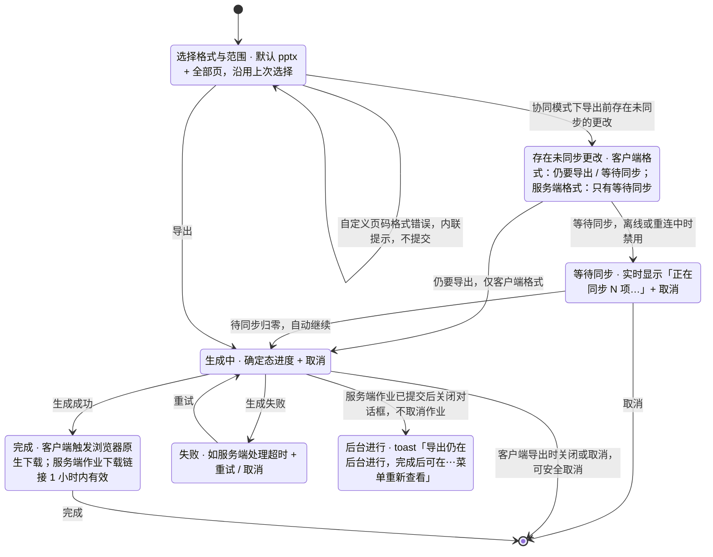

> 状态：草稿 | 负责：设计 | 更新：2026-09-18；2026-09-24（rulings §4.15 Q8：PDF 时点改 M3 后半段）；2026-09-25（补图）；2026-09-25（矛盾收口，rulings §4.18） | 依赖：charter v0.2；rulings §4.10 Q14 / Q20（应用栏「⋯」菜单）；`10-prd/07-design-coverage-and-gaps.md`

# 03-22 导出对话框

> **设计基准（2026-09-15 起）**：组件规格以 [`09-design-specification.md`](../09-design-specification.md) v3.0（shadcn Rhea + 材质层）为准；对应 playground 路由 `#/export`（[已发布 artifact](https://claude.ai/code/artifact/cf6e1a1a-986b-48bb-b743-5758dff419d2)，源码 `playground/src/routes/`）。本文引用的 `mockups/*.html` 与线框图为历史静态稿，以 playground 实际渲染为终稿。

新增界面，`02-user-flows.md` F6 此前只有流程文字，没有对应线框。覆盖缺口 **G-25**（OF-18/OF-19/SV-02）。对应产品默认答案 D17（默认 pptx + 全部页，记忆上次选择，文件名=文档标题）。

---

## 线框（默认态）

```
┌───────────────────────────────────────────────┐
│ 导出"季度汇报.pptx"                          [×]│
├───────────────────────────────────────────────┤
│ 格式                                            │
│ (●PowerPoint .pptx) (○PNG 图片) (○SVG 矢量图)   │
│ (○PDF · 服务端生成)                              │
│ 图片宽度（仅图片格式）[1280▾]                     │
├───────────────────────────────────────────────┤
│ 范围                                            │
│ (●全部页 12) (○当前页) (○选定页) (○自定义页码)   │
│ 自定义页码 [例如 1,3,5-8..............]           │
├───────────────────────────────────────────────┤
│ ⓘ 未修改的内容将原样保留 [查看导入详情]           │
│                                    [取消] [导出] │
└───────────────────────────────────────────────┘
```

---

## 状态

### 生成中（确定态进度）

```
│ 正在导出…                                        │
│ 正在重新打包未修改的部件… ▓▓▓▓▓▓▓░░░░░░ 58%       │
│                                        [取消]    │
```

### 完成

```
│ ✓ 导出完成                                       │
│ 季度汇报.pptx（2.4 MB）                          │
│ 服务端作业：下载链接 1 小时内有效                  │
│                                        [完成]    │
```

（客户端导出触发浏览器原生下载；本设计文档不假设具体下载 UI，由浏览器承担；原型演示阶段以"生成完成"状态提示代替，不提供下载链接，见 prototype 约束。）

### 失败

```
│ ⚠ 导出失败                                       │
│ 服务端处理超时，请重试                             │
│                                  [重试] [取消]    │
```

### 存在未同步更改（协同模式）

客户端格式（pptx / PNG / SVG，在浏览器里用本地最新状态生成）：

```
│ ⚠ 存在 3 项未同步的更改                           │
│ 导出将包含本地最新内容，但可能与其他协作者          │
│ 看到的版本存在差异                                 │
│                            [仍要导出] [等待同步]   │
```

服务端格式（PDF、M3 起的批量 PNG；服务端按已持久化的版本生成，不含本地未同步更改）——**须先同步，不提供「仍要导出」**：

```
│ ⚠ 需先同步 3 项更改                               │
│ PDF 由服务端生成，只包含已同步到服务器的内容         │
│                               [取消] [等待同步]   │
```

点「等待同步」后对话框停在等待态，实时显示剩余项数，归零后**自动进入生成中**；期间可随时取消：

```
│ ↻ 正在同步 2 项…                                  │
│ 同步完成后将自动开始导出                            │
│                                         [取消]    │
```

离线或重连中时「等待同步」禁用，下方提示"恢复连接后才能同步"；客户端格式此时仍可「仍要导出」。「导出将包含本地最新内容」这句只用于客户端格式（rulings §4.18 UX-05）。

**导出对话框状态**



怎么读：主干是配置 → 生成中 → 完成；有未同步更改时先经过提示，服务端格式只能等同步归零后自动继续；生成中是唯一不能用 Esc / 遮罩随意关闭的状态，关闭的后果取决于导出在客户端还是服务端进行。导出失败不影响文档本身的编辑状态。

---

## 交互说明

- 入口：编辑器应用栏右侧「⋯」更多菜单（应用栏右侧顺序：在场头像 · 分享 · 模式下拉 · **⋯** · 账户头像，rulings §4.10 Q14；菜单项：**导出…（`Mod+E`）**/ 保真报告 / 版本历史 / 插件管理器 / 重命名 / 创建副本 /（开发者，仅开发模式），Q20）、命令面板搜索"导出"、`Mod+E`。
- 格式选项按里程碑显隐：PNG/SVG 为 M2 P1，PDF（服务端）为 M3 后半段（rulings §4.15 Q8：M3 前半段先交付服务端缩略图，PDF 与缩略图共用独立 renderer sidecar；PDF 中外链图片一律为占位、受限字体按只读渲染使用原字体，见 03-screens/13；PDF 与 M3 起的批量 PNG 属服务端格式，存在未同步更改时须先同步，见「存在未同步更改」）；插件贡献的导出格式（`core.format`，`canImport:false`）追加在列表末尾并带归属标识（06-extensibility-ux.md §4）。
- 记忆上次选择（格式+范围，本地偏好，见产品默认答案 D17），下次打开对话框默认沿用；文件名默认等于文档标题。
- 对话框语义与焦点管理遵循 03-screens/10/08 已确立的规则：`role="dialog"` + `aria-modal="true"`，焦点循环与归还，`Esc`/遮罩点击可关闭（生成中除外，见边界情况）。

## 边界情况

- 生成中关闭对话框：客户端导出可安全取消；服务端作业已提交后关闭对话框不取消作业，toast 提示"导出仍在后台进行，完成后可在⋯菜单重新查看"。
- 自定义页码格式错误（如"1,3,x"）：内联错误提示"页码格式不正确，请使用如 1,3,5-8 的格式"，不提交。
- 文档含不透明保留内容：对话框底部常驻说明"未修改的内容将原样保留"，与保真报告呼应，避免用户误以为导出会"修复"未建模内容。
- 导出失败不影响文档本身的编辑状态，用户可继续编辑同时重试导出。
