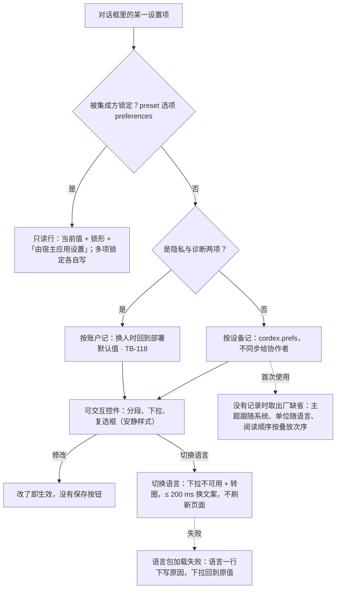

> 状态：草稿 | 负责：设计 | 更新：2026-09-18；2026-09-25（补图）；2026-09-26（§4.20：FE-15 线框与控件说明补「隐私与诊断」组）；2026-10-08（design-language-v3 第 1 批收口：只补「单位切换」一条——段前、段后与固定行距同字号一样始终用 pt、不随度量单位换算（rulings §4.25 TB-33），文档与样张的数值按 pt 书写、产品按本设置显示（DS-27）；其余界面描述随第 3 批回写）；2026-10-22（design-language-v3 第 3 批：按已拍板样张 `settings` 整篇改写，标题改为「偏好设置」——§1 线框按 v3 重画：居中模态对话框宽 480、顶部锚定在 max(64px, 12vh)、只向下伸展、最高到视口底留 32，标题「偏好设置」+ 说明一句，改了即生效、没有保存按钮，原右侧玻璃抽屉、iOS 式内嵌分组与旧控件写法作废（DS-113）；分组改为 外观 · 语言与单位 · 无障碍 · 通知 · 隐私与诊断 · 关于，删去「密度」（DS-76）、「智能参考线默认开启」与「粘贴默认」；§2 入口与关闭：账户菜单「偏好设置… ⌘,」是唯一的常驻入口，命令面板「阅读顺序…」打开对话框并聚焦到「无障碍 › 阅读顺序」，打开时焦点在对话框本身；§3 列 10 个样张状态与 4 条未采纳的备选（DS-63）；§4 主题三项与账户菜单同一偏好（DS-90），语言与单位合成一组，新增「无障碍 › 阅读顺序」常驻入口、检查器不设入口（DS-116），通知组只留「协作者加入时提示」（DS-114），隐私与诊断两项按账户记、换人回到部署默认（TB-118），语言包加载失败与「已复制诊断信息」写在框里，「插件 · 查看」打开个人插件面板，开发者面板说明写用途，单人 preset 的自动保存间隔补「关闭」；§5 集成方锁定经 preset 选项 `preferences` 锁定、只读行各项各自写，SDK 里出现的组（TB-118），图 5-1 改写；§6 几何；§7 紧凑同一对话框，手机为贴底的底部面板（上沿留 24，TB-118），原「抽屉接近全宽」作废；依据 rulings §4.25 DS-35…DS-37、DS-56、DS-63、DS-76、DS-90、DS-113、DS-114、DS-116、TB-33、TB-40、TB-118）；2026-10-22（design-language-v3 第 3 批回写补改：§2、§7 补平板（触控、≥ 640）——编辑器的仅查看形态没有账户入口，只能从开始页打开，形态是同一个居中对话框、控件按触控命中区（07 §2），手机的底部面板只对 < 640（TB-118）；与新增的 TB-130…TB-151 核对，其余各节不受影响）；2026-10-22（design-language-v3 第 3 批回写收口：§2「手机与平板」补触控形态账户菜单的「偏好设置…」不写 ⌘, 键位提示（同 TB-154 对「⌘/」的处理）；§7 手机一条注明开始页与文档列表在手机上打开的键盘快捷键面板用同一个底部面板的画法与几何（03-24 §1.5）；与 TB-152…TB-162 逐条核对，其余各节不受影响；依据 rulings §4.25 TB-154；2026-10-22 复核修正：§2「手机与平板」改为开始页与文档列表都能打开，用户行在左栏底部——手机与 640–1024 的平板上左栏收在导航抽屉里、≥ 1024 的平板左栏常驻（TB-165），触控形态的菜单项一律不写键位提示（TB-164）；依据 rulings §4.25 TB-164、TB-165）；2026-10-23（design-language-v3 第 3 批评审修改：对话框随 rulings §4.25 DS-142 改为标题栏 40、圆角 12、× 用正文色——§1.2 线框注记、§6、§11 同步，§3 写明各态随之改画（`alt-drawer` 的抽屉标题行同改）；手机底部面板改为 kit `BottomSheet`（由本目录的 `sheet.tsx` 并入底座），标题行 48 + 关闭 44 是触控画法、不随之改（设计基准、§7、§11）） | 依赖：charter v0.2；rulings §4.10（D13 入口口径）、§4.20 FE-15、§4.25 DS-10、DS-18、DS-27、DS-35…DS-37、DS-56、DS-63、DS-76、DS-90、DS-113、DS-114、DS-116、TB-33、TB-40、TB-118、TB-154、TB-164、TB-165；`10-prd/07-design-coverage-and-gaps.md` D1、D13、G-30；PRD `08-app-shell` AS-06，`05-embedding-and-integration` EM-06、EM-11、EM-12，`04-non-functional-requirements` NF-05、NF-06、NF-11；设计 03-29 §2.5、03-24 §1.5、§8、03-09；09 §3.4；前端 `50-frontend/10` §10.3、`50-frontend/02` §9.4、§10.1；playground `#/v3/editor?state=settings.*`（`src/v3/scenarios/settings/`）

# 03-23 偏好设置

> **设计基准（2026-10-22 起，rulings §4.25 DS-113、DS-114、DS-116）**：以已拍板的 playground 第 3 批样张 `settings` 为准——路由 `#/v3/editor?state=settings.<状态 id>`（`from-home`、`phone` 两态画在开始页上，路由 `#/v3/home?state=settings.<状态 id>`；暗 / 亮另加 `&theme=dark|light`），10 个状态加 2 个未采纳的备选（§3）。源码在 `playground/src/v3/scenarios/settings/`：`settings.scenario.tsx`（各状态的标题与说明）、`SettingsHost.tsx`（对话框、未采纳的抽屉与手机底部面板，语言切换与「阅读顺序」的落点）、`SettingsBody.tsx`（正文：分组与行、只读行、框内反馈）、`prefs.ts`（状态与中英两份文案）、`inspector-alt.tsx`（未采纳备选的检查器节）；手机底部面板是 kit `BottomSheet`（`kit/BottomSheet.tsx`，2026-10-23 由本目录原来的 `sheet.tsx` 并入底座，导入对话框的手机形态同用这个件）。对照截图 `openspec/changes/design-language-v3/screens/batch3/settings-<状态>-dark.jpg` / `-light.jpg`。外壳与浮层的通用规格见 [03-02](02-editor-main.md) 与设计 [04](../04-design-system.md)（`Dialog` 见 04 §4.1a），数据与命令以前端 [50/10](../../50-frontend/10-editor-shell-and-interaction.md) §10.3、[50/02](../../50-frontend/02-app-shell-routing-and-session.md) §9.4、§10.1 为准。此前的线框（右侧玻璃抽屉、iOS 式内嵌分组 `.cordex-well` / `.cordex-group`、`ToggleGroup` / `Select` 写法、旧路由 `#/settings`）与「密度」一项一并作废，标题由「设置（主题/密度/语言/单位）」改为「偏好设置」。

个人偏好：主题、界面语言、度量单位、阅读顺序、通知与诊断开关，另有版本、诊断信息与插件的入口。全部是个人偏好，改了即生效、不同步给协作者；集成方可以锁定其中几项。覆盖缺口 **G-30**（PRD EM-06 主题、EM-11 语言）、默认答案 D1（度量单位）与 D13（设置入口：账户菜单「偏好设置…」是唯一的常驻入口，`Mod+,`），以及 PRD NF-05（阅读顺序）、NF-06（语言包加载）、NF-11（诊断与遥测的同意）、EM-12（复制诊断信息）、ED-23（单人 preset 的自动保存间隔）。

---

## 1. 线框

### 1.1 在编辑器中的位置（桌面 1600 × 1000，从右上自己的头像打开）

```
┌──────────────────────┬──────────────────────────────────────────────────────┬────────────────────────┐
│ [Logo▾]   [单页][网格]│ ░░░░░░░░░░░░░░░░░░░░░░░░░░░░░░░░░░░░░░░░░░░░░░░░ │ (周)(王)(李)  ▶ [分享] │
│ 2026 年 Q2 业绩汇报 ▾│ ░░░░░░░░░ ╭──────────────────────────────╮ ░░░░░░░ │ ░░░░░░░░░░░░░░░░░░░░░░ │
│ ✓ 已同步             │ ░░░░░░░░░ │ 偏好设置                    × │ ░░░░░░░ │ ░░░░░░░░░░░░░░░░░░░░░░ │
│ ░░░░░░░░░░░░░░░░░░░░ │ ░░░░░░░░░ ├──────────────────────────────┤ ░░░░░░░ │ ░░░░░░░░░░░░░░░░░░░░░░ │
│ ░░░░░░░░░░░░░░░░░░░░ │ ░░░░░░░░░ │ 改动立即生效，只保存在这台    │ ░░░░░░░ │ ░░░░░░░░░░░░░░░░░░░░░░ │
│ ░░░░░░░░░░░░░░░░░░░░ │ ░░░░░░░░░ │ 设备上，不影响协作者。        │ ░░░░░░░ │ ░░░░░░░░░░░░░░░░░░░░░░ │
│ ░░░░░░░░░░░░░░░░░░░░ │ ░░░░░░░░░ │ 外观 · 语言与单位 · 无障碍 ·  │ ░░░░░░░ │ ░░░░░░░░░░░░░░░░░░░░░░ │
│ ░░░░░░░░░░░░░░░░░░░░ │ ░░░░░░░░░ │ 通知 · 隐私与诊断 · 关于      │ ░░░░░░░ │ ░░░░░░░░░░░░░░░░░░░░░░ │
│ ░░░░░░░░░░░░░░░░░░░░ │ ░░░░░░░░░ ╰──────────────────────────────╯ ░░░░░░░ │ ░░░░░░░░░░░░░░░░░░░░░░ │
└──────────────────────┴──────────────────────────────────────────────────────┴────────────────────────┘
```

图例：`░` 遮罩（`--v3-scrim`）后的编辑器；对话框宽 480、水平居中、顶部锚定在 max(64px, 12vh)（视口 1000 高时距顶 120），只向下伸展，最高到视口底留 32（这里 848），超出时正文在框内滚动、标题与说明固定。截图：`screens/batch3/settings-default-*.jpg`，样张 `settings.default`。

### 1.2 对话框结构

```
┌────────────────────────────────────────────────┐
│ 偏好设置                                     × │  ← 标题栏 40：标题 13px 600 + 关闭（Esc）
├────────────────────────────────────────────────┤
│ 改动立即生效，只保存在这台设备上，不影响协作者。 │  ← 说明（固定）
│ 外观                                           │  ← 节标题 12px 600 + 1px 分隔
│ 主题                  [浅色|深色|跟随系统]     │  ← 名称 · 200 宽控件列
├────────────────────────────────────────────────┤
│ 语言与单位                                     │
│ 界面语言              [简体中文           ▾]   │
│ 度量单位              [厘米 (cm)          ▾]   │
│ 字号、段距与固定行距始终以磅显示               │  ← 说明 12px 次级文字色
├────────────────────────────────────────────────┤
│ 无障碍                                         │
│ 阅读顺序              [按叠放次序         ▾]   │
│ 读屏软件朗读、按 Tab 切换对象时的先后          │
├────────────────────────────────────────────────┤
│ 通知                                           │
│ ☐ 协作者加入时提示                             │  ← 复选框行占整行
│   有人打开同一份文档时，在画布底部提示         │
├────────────────────────────────────────────────┤
│ 隐私与诊断                                     │
│ ☑ 发送错误报告                                 │
│   出错时把错误信息发给本部署的服务器，不含文档内容│
├────────────────────────────────────────────────┤
│ 关于                                           │
│ 版本                  0.3.2（4f2a9c1）          │
│ 诊断信息              [复制]                   │
│ 版本、插件与近期事件，不含文档与令牌           │
│ 插件                  [查看]                   │  ← 只在编辑器里
│ 本会话有 15 个插件在运行                       │
└────────────────────────────────────────────────┘
```

正文是一条分组列表：节标题 12px 600 + 1px 分隔（同检查器的节，不套卡片）；分段、下拉与按钮行左边是名称 12px（下一行说明 12px `--v3-text-2`）、右边 200 宽的控件列，控件左缘对齐（「关于」的版本值与下面按钮的外框同一条左缘）；复选框行（通知、隐私与诊断）不进控件列、占整行：16 的框 + 名称 + 下一行说明。控件全按安静样式（分段、下拉、复选框，rulings §4.25 DS-35…DS-37；开关只给个人插件面板）。

### 1.3 手机：底部面板（< 640，390 × 844）

```
┌────────────────────────────────────┐
│ ░░░░░░░░░░░░░░░░░░░░░░░░░░░░░░░░░ │  ← 上沿离视口顶 24，背后是开始页手机形态
│╭──────────────────────────────────╮│
││               ──                 ││  ← 把手 40 × 4
││ 偏好设置                     [×] ││  ← 标题行 48，关闭 44
││ 改动立即生效，只保存在这台设备上，││
││ 不影响协作者。                   ││
│├──────────────────────────────────┤│
││ 外观                             ││
││ 主题                             ││  ← 上下排：名称在上，
││ [ 浅色 |  深色  | 跟随系统 ]     ││     控件占满一行，高 44
││ 语言与单位 …                     ││
│╰──────────────────────────────────╯│
└────────────────────────────────────┘
```

贴底、上圆角 12、1px 上边、`--v3-panel` 底、浮层阴影，最宽 560、水平居中；同仅查看形态的底部面板（03-02 §5a.2、03-06 §9.5）。样张 `settings.phone`（§7）。

---

## 2. 入口、打开与关闭

- **入口**：账户菜单「偏好设置… ⌘,」是唯一的常驻入口（rulings §4.25 DS-10、DS-18，PRD AS-06，D13）——编辑器里由右上角自己的头像打开（03-02 §7），开始页与文档列表由左栏底部用户行打开（03-29 §2.5）；另有 `Mod+,`（⌘, / Ctrl+,），编辑器与应用壳都接（应用壳由布局按 `KeyboardEvent.code` 接住，50/02 §2.1）。命令面板里的「偏好设置…」「阅读顺序…」是不常驻的第二入口（03-24 §8）：「阅读顺序…」打开本对话框并把焦点放在「无障碍 › 阅读顺序」上（DS-116，§4.3）。工具条、侧栏与顶栏都不放设置按钮。
- **路由**：`/settings` 叠在来路之上（50/02 §2、50/10 §10.3），关闭后回到原页面。
- **打开时的焦点**：落在对话框本身（读屏念标题与说明），不自动聚焦第一个分段，免得方向键误改主题；从命令面板「阅读顺序…」打开时，焦点交给阅读顺序的下拉并把它滚进可视区。
- **关闭**：× / Esc / 点遮罩；没有保存按钮——改了即生效（主题选了画面立即换肤）。关闭后焦点回打开它的控件（编辑器里自己的头像、开始页的用户行）；没有用户动作就开着的（样张状态）关闭后落在画布或主区，不掉到 `body`（07 §2.4）。
- **从开始页打开**（`settings.from-home`）：同一个对话框叠在开始页上；开始页没有 host 与本会话插件集，「关于」里没有「插件」一行。
- **手机与平板**：编辑器的仅查看形态（< 640 或触控）没有账户入口（03-02 §5a.2），只能从开始页与文档列表打开——左栏底部用户行的账户菜单「偏好设置…」（手机与 640–1024 的平板上左栏收在导航抽屉里，≥ 1024 的平板左栏常驻，rulings §4.25 TB-165，03-29 §2.6；触控形态的菜单项一律不写键位提示，⌘, 也不写，TB-164，03-29 §2.5）；< 640 是贴底的底部面板，平板（触控、≥ 640）是同一个居中对话框（§7）。

---

## 3. 状态

样张路由为 `#/v3/editor?state=settings.<状态 id>`（标「开始页」的两态是 `#/v3/home?state=…`），视口未写的按 1600 × 1000。2026-10-23 起对话框按 rulings §4.25 DS-142 改为标题栏 40、圆角 12、× 用正文色（§6）：除手机底部面板 `phone`（触控画法，不随之改，§7）与不开对话框的 `alt-reading-order-inspector`，下表与 §3.1 各态随之改画（未采纳的 `alt-drawer` 是 kit 抽屉，标题行与对话框同一画法、一起改），要点不变。

| 状态（样张标题） | 要点 | 样张 id | 里程碑 |
|---|---|---|---|
| 默认 · 编辑器里打开 | 居中模态对话框 480、顶部锚定；分组 外观 · 语言与单位 · 无障碍 · 通知 · 隐私与诊断 · 关于；通知只有「协作者加入时提示」；没有「密度」；打开时焦点在对话框本身 | `default` | M2（G-30） |
| 从开始页打开（开始页） | 同一个对话框叠在开始页上（`/settings` 叠在来路之上）；「关于」没有「插件」一行 | `from-home` | M2 |
| 手机 · 底部面板（开始页） | 390 × 844：仅查看形态那种贴底的底部面板，上沿离视口顶 24；正文上下排、控件高 44；入口是导航抽屉里的账户菜单 | `phone` | M2 |
| 嵌入 · 集成方锁定 | SDK 单人 preset：说明一句不写「不影响协作者」；主题与语言被锁定，各自画成只读行（当前值 + 锁形 +「由宿主应用设置」）；多「编辑 › 自动保存间隔」；没有通知、隐私与诊断与插件一行 | `embedded-locked` | M2（EM-01、ED-23） |
| 切换语言中 | 选了 English：下拉不可用、当前值后转圈，≤ 200 ms 后对话框文案即时换成英文、不刷新页面，播报一次「Language changed to English」，焦点留在下拉 | `language-switching` | M2（EM-11、NF-06） |
| 语言包加载失败 | 语言一行下方：危险色图标 +「语言包加载失败，已保留当前语言」，下拉回到原值、焦点留在下拉；写在框里，不弹轻提示 | `language-failed` | M2 |
| 已复制诊断信息 | 「复制」后说明一行换成成功色对勾 +「已复制诊断信息」，约 4 秒后换回说明 | `copied` | M1（EM-12） |
| M3 · 部署开了产品遥测出口 | 隐私与诊断多「☐ 发送使用统计」+ 说明「功能使用情况与性能数据，只发给本部署的服务器」（缺省关）；这一组两项按账户记 | `telemetry` | M3（NF-11） |
| 开发构建 | 「关于」最后多「开发者面板 · 打开」，说明「贡献列表、事件流与协同诊断」；生产缺省不出现 | `dev-build` | M2（PS-09，内部） |
| 紧凑窗口 1000 × 760 | 同一个对话框、宽 480 不变；顶部锚定在 max(64px, 12vh)（这里 91）、最高到视口底留 32（这里 637），视口矮时正文在框内滚动 | `compact` | M2 |

样张没有单独画、行为照常的：复制失败（同一位置写危险色图标「复制失败，请检查浏览器的剪贴板权限」）；度量单位与阅读顺序的切换（选了即生效）；从命令面板「阅读顺序…」打开（命令面板样张里可以点着试，03-24 §8）。

### 3.1 未采纳的备选（DS-63）

拍板时画给用户对照的备选留在样张里，标题前加「未采纳 · 」、说明写明由哪一条 DS 定为推荐；路由不变，实现以上表的状态为准。

| 备选 | 样张 id | 内容 | 结论 |
|---|---|---|---|
| 右侧抽屉 | `settings.alt-drawer` | 右侧贴边整高抽屉 320、带遮罩（09 T-06 原口径），盖住检查器；正文换成上下排 | 未采纳，DS-113 定为居中对话框 480 |
| 阅读顺序在检查器 | `settings.alt-reading-order-inspector` | 常驻入口放在检查器无选中态「放映」节最后一行，偏好设置里没有「无障碍」一组 | 未采纳，DS-116 定为偏好设置「无障碍」一组 |
| 命令面板直接执行 | （没有出图） | 命令面板给两条直接执行的命令「阅读顺序：按叠放次序 / 按占位符次序」 | 未采纳，DS-116 定为打开偏好设置并聚焦 |
| 保留通知组的两个开关 | （没有出图） | 保留「评论 @ 我时提示」「导入完成后高亮详情」 | 未采纳，DS-114 两项都删 |

---

## 4. 分组与设置项

| 组 | 项 | 控件与取值 | 出厂缺省 | 说明 |
|---|---|---|---|---|
| 外观 | 主题 | 分段单选：浅色 / 深色 / 跟随系统 | 跟随系统 | 与账户菜单的主题三项同一偏好、同一组取值与顺序（DS-90，03-29 §2.5） |
| 语言与单位 | 界面语言 | 下拉：简体中文 / English（语言名用各自的写法） | 随浏览器 / 账户语言 | §4.2 |
| 语言与单位 | 度量单位 | 下拉：厘米 (cm) / 英寸 (in) / 磅 (pt) / 像素 (px)；说明「字号、段距与固定行距始终以磅显示」 | 随语言：zh-CN → cm，en-US → in（D1） | §4.2「单位切换」 |
| 无障碍 | 阅读顺序 | 下拉：按叠放次序（「从底层到顶层」）/ 按占位符次序（「标题 → 副标题 → 正文 → 其余」）；说明「读屏软件朗读、按 Tab 切换对象时的先后」 | 按叠放次序 | §4.3 |
| 通知 | 协作者加入时提示 | 复选框；说明「有人打开同一份文档时，在画布底部提示」 | 关（PRD 07 D8） | §4.4 |
| 隐私与诊断 | 发送错误报告 | 复选框；说明「出错时把错误信息发给本部署的服务器，不含文档内容」 | 开 | §4.5 |
| 隐私与诊断 | 发送使用统计（M3，部署开了产品遥测出口时） | 复选框；说明「功能使用情况与性能数据，只发给本部署的服务器」 | 关 | §4.5 |
| 关于 | 版本 · 诊断信息 · 插件（编辑器里）· 开发者面板（开发构建） | 只读值与次按钮 | — | §4.6 |
| 编辑（只在 SDK 单人 preset） | 自动保存间隔 | 下拉：15 秒 / 30 秒 / 1 分钟 / 关闭；说明「有改动时按这个间隔交给宿主应用保存」 | 30 秒 | §4.7 |

旧稿里不再出现的项：「密度」（v3 只有单档尺寸，要更大的界面用浏览器缩放，rulings §4.25 DS-76）；「智能参考线默认开启」（与主菜单「视图 › 网格与参考线」是同一份本机偏好，PRD ED-09，03-20）；「粘贴默认」（没有 PRD 出处）；通知组的「评论 @ 我时提示」与「导入完成后高亮详情」（失去对象，DS-114）；「已加载插件：N 个 → 管理」改为「插件 · 查看」（打开个人插件面板，§4.6）。

### 4.1 外观

- **主题**（PRD EM-06）：分段控件三项，单选（`radiogroup`）；选了立即换肤、无闪烁（50/09 §3）。账户菜单的「主题」三项写同一个偏好（DS-90）：在任一处改，另一处随之勾上。

### 4.2 语言与单位

- **语言切换生效**（PRD EM-11、NF-06）：选了新语言后，下拉不可用（`aria-disabled`，菜单不再打开、焦点留在下拉上），当前值后 14 的转圈（读屏名「正在切换语言」，`aria-busy`）；≤ 200 ms 内对话框与界面文案即时换成新语言，不刷新页面；对话框外的 polite 区播报一次（如「Language changed to English」），焦点留在语言下拉（07 §2：异步替换不静默移焦点）。
- **语言包加载失败**：语言一行下方写一行——14 的危险色图标 + 主文字色「语言包加载失败，已保留当前语言」（状态色只给图标，DS-41），下拉回到原值、焦点留在下拉上；这一行自己是 polite 播报区，不另弹轻提示（模态遮罩会盖住画布底部的轻提示，结果写在框里，DS-56）；再次切换语言或关闭对话框时消失。
- **单位切换**（D1）：只影响检查器等处数值的显示单位与输入解析（支持带单位后缀输入，如「2.5cm」自动换算），不改变内部存储（始终 EMU）；字号始终以 pt 显示，段前、段后与固定行距同样始终用 pt、不随度量单位换算（同 PowerPoint，2026-10-08，rulings §4.25 TB-33），控件下的说明一句写明这一点。设计文档与样张里的数值一律按 pt 书写，产品按本设置的单位显示（DS-27）。原「语言」「度量单位」两组各一行，合成一组「语言与单位」，免得节标题与行名重复。

### 4.3 无障碍（DS-116）

- **阅读顺序**（PRD NF-05）：读屏软件朗读与按 Tab 切换对象的先后，个人偏好（`Preferences.a11y.readingOrder`，50/16 §9.3），对全部页生效。下拉两项，每项带说明：「按叠放次序」（从底层到顶层）·「按占位符次序」（标题 → 副标题 → 正文 → 其余）。
- **入口**：本组是常驻入口；命令面板「阅读顺序…（无障碍）」是第二入口——↵ 打开本对话框，焦点落在这个下拉上（03-24 §8）。检查器不设入口（检查器只管选中对象的属性，DS-1）。原「M2 只经命令面板进入」（rulings §4.25 TB-42）随 DS-116 改写。

### 4.4 通知

- 只有「协作者加入时提示」（缺省关，PRD 07 D8）：有人打开同一份文档时，在画布底部出一条轻提示。
- 「导入完成后高亮详情」与「评论 @ 我时提示」两项删去（DS-114）：导入详情不再有角标高亮，保真差异只出一次轻提示并按文档自己记已读（DS-51）；评论 @ 我在 PRD CO-04 里没有应用内提示。

### 4.5 隐私与诊断

- **发送错误报告**（缺省开）与 M3 的**发送使用统计**（缺省关，只在部署开了产品遥测出口——`RuntimeConfig.telemetry.otlp` 为真——时出现，50/02 §3、50/15 §9）：开了才发，关掉即清空对应的待发送队列（PRD NF-11、PD-10，rulings §4.20 FE-15）。两项的说明是同意的依据，经 `aria-describedby` 读出。
- **按账户记**（rulings §4.25 TB-118）：这一组两项（`diagnostics.*`）按账户记，换人时回到部署默认值——同意须由本人作出，不沿用同一台设备上前一个人的选择；其余偏好仍按设备记（50/02 §10.1 写明这个例外）。
- SDK 嵌入的单人 preset 不出现这一组（SDK 出厂不发数据，50/15 §9）。

### 4.6 关于

- **版本**：「0.3.2（4f2a9c1）」这类版本号 + 构建号（`RuntimeConfig.appVersion`），数字等宽。
- **诊断信息 · 复制**（次按钮，读屏名「复制诊断信息」；PRD EM-12）：复制 `diagnostics.dump()`（版本、插件与近期事件，不含文档内容与令牌，50/15 §10）；说明「版本、插件与近期事件，不含文档与令牌」。复制后说明一行换成 14 的成功色对勾 + 主文字色「已复制诊断信息」，约 4 秒后换回说明，这一行自己播报一次（写在框里，DS-56；文案与个人插件面板底栏统一）；剪贴板未授权时同一位置写危险色图标「复制失败，请检查浏览器的剪贴板权限」。
- **插件 · 查看**（只在编辑器里）：说明「本会话有 N 个插件在运行」（数字与个人插件面板计数行同一份）；「查看」关掉偏好设置、打开个人插件面板（03-09），面板关闭后焦点回到头像。本对话框不重复插件的启用与停用。开始页没有 host 与本会话插件集，不出这一行。
- **开发者面板 · 打开**（开发构建或 `features.developerMenu` 打开时，读屏名「打开开发者面板」）：说明「贡献列表、事件流与协同诊断」（PRD PS-09、CO-13）；出现条件与主菜单「帮助」最后一组的「开发者面板」相同（rulings §4.25 TB-40，03-02 §2.3），生产缺省不出现。

### 4.7 编辑（只在 SDK 单人 preset）

- **自动保存间隔**（PRD ED-23「可配置或关闭」）：15 秒 / 30 秒 / 1 分钟 / 关闭（旧稿缺「关闭」，补上），缺省 30 秒；有改动时按这个间隔交给宿主应用保存（回调式保存，50/04 §8.1）。参考应用 `apps/web` 的服务端文档以协同快照为唯一事实源（rulings §4.19 D-M2-CONTENT），不显示这一组。单人 preset 的快捷键面板同时多「保存 ⌘S」（03-24 §4）。

---

## 5. 集成方锁定态

- 集成方经 preset 选项锁定其中几项（`preferences: { locked?, values? }`，可锁主题、界面语言、度量单位、阅读顺序与自动保存间隔，键名在 40/10 §2.5 登记，rulings §4.25 TB-118）。
- 被锁定的项画成**只读行**：当前值 + 12px 锁形 +「由宿主应用设置」（`--v3-text-2`），不画不可用的控件（DS-15「只读展示当前值」的类比）；多项锁定时各自写，不合并成一条统一提示，用户能分别理解「为什么改不了」（样张 `settings.embedded-locked`：主题与语言被锁、单位与阅读顺序照常可改）。
- 账户菜单的「主题」三项随之留在原位、不可用，组顶一行同一句「由宿主应用设置」（03-29 §2.5），不能在菜单里绕过锁定。
- SDK 里出现的组（TB-118）：外观 · 语言与单位 · 编辑（仅单人 preset）· 无障碍 · 关于；没有通知（单人没有协作者）、隐私与诊断（§4.5）与「插件」一行（插件管理走集成方的壳意图）。单人 preset 的说明一句写「改动立即生效，只保存在这台设备上。」（没有协作者，不写「不影响协作者」）。

**图 5-1 一个设置项的取值与修改**



怎么读：先判定是否被集成方锁定，锁定的只读展示；其余按存放位置分两路——隐私与诊断两项按账户记，其余按设备记，没有记录时取出厂缺省；改了即生效，语言切换另有转圈与失败的处理。
依据：rulings §4.25 DS-113、DS-114、DS-116、TB-118；PRD EM-06、EM-11、NF-06、NF-11；样张 `settings.default`、`settings.embedded-locked`、`settings.language-switching`、`settings.language-failed`、`settings.telemetry`。

---

## 6. 形态与几何（DS-113）

- **居中模态对话框**：kit `Dialog` md 480，带遮罩（`--v3-scrim`），焦点圈定在框里；圆角 12，标题栏 40：标题「偏好设置」13px 600 + 24 的 ×（用正文色，工具提示 Esc；标题栏、圆角与 × 2026-10-23 按 rulings §4.25 DS-142 统一），标题栏下是说明一句「改动立即生效，只保存在这台设备上，不影响协作者。」。
- **顶部锚定**：水平居中，上沿在 max(64px, 12vh)，只向下伸展，最高到视口底留 32（视口 1000 高时上沿 120、最高 848；760 高时上沿 91、最高 637）；高随内容，超出时正文滚动、标题与说明固定。内容会增减（语言包失败多一行、M3 的使用统计多一行），顶部锚定让标题不随之上下移动（09 §3.4、04 §4.1a）。
- 与个人插件面板同一类件（低频、设置类，09 §3.4），不另添桌面抽屉；原 09 §4 T-06「右侧抽屉」改为对话框。

---

## 7. 窄屏与触控

- **紧凑窗口（640–1024）**（`settings.compact`）：同一个对话框、宽 480 不变，几何同桌面；对话框照样盖在编辑器上。
- **平板（触控、≥ 640）**：同一个居中对话框，几何同桌面（不用手机的底部面板，TB-118 只对 < 640）；控件按触控命中区——分段、下拉与按钮高 44、相邻间距 ≥ 8，复选框整行可点（07 §2：`pointer: coarse` 时主要控件 ≥ 44）。样张没有单独画。
- **手机（< 640）**（`settings.phone`，TB-118）：仅查看形态那种贴底的底部面板（同第 1 批 `narrow` 的底部面板与第 2 批 `comments.phone`）——贴底、上圆角 12、1px 上边、`--v3-panel` 底、浮层阴影，顶部把手 40 × 4，标题行 48「偏好设置」+ 右侧关闭 44（读屏名「关闭偏好设置」；kit `BottomSheet` 的触控画法，不随对话框的 DS-142 改）；上沿离视口顶 24（最高 100dvh − 24：内容更高时正文在面板里滚动，标题与说明固定），最宽 560、水平居中。模态，同桌面的对话框：遮罩、焦点圈定，Esc / 关闭 / 点遮罩关闭；打开时焦点落在面板本身，关闭后焦点回到打开前的元素（状态里一出现就打开的回到顶栏的「显示导航」）。正文是上下排（名称、说明在上，控件占满一行），控件按触控尺寸：分段、下拉、按钮高 44，复选框整行可点（命中区 ≥ 44）；分组同开始页（没有「插件」一行）。原「抽屉扩展为接近全宽的浮层」作废。开始页与文档列表在手机上打开的键盘快捷键面板用同一个底部面板的画法与几何（03-24 §1.5，rulings §4.25 TB-154）。

---

## 8. 交互与键盘

| 键 | 作用 |
|---|---|
| ⌘, / Ctrl+, | 打开偏好设置（编辑器与应用壳都接） |
| Tab / ⇧Tab | 在框里的控件间移动（焦点圈定） |
| ← → | 主题分段里换选项（选了即生效） |
| ↵ / 空格 / ↓ | 打开下拉；下拉里方向键移动、↵ 选定并收起 |
| 空格 | 勾选 / 取消复选框 |
| Esc | 下拉开着时先关下拉，否则关闭对话框 |

- 分段与下拉选了即生效；复选框勾了即生效。
- 「插件 · 查看」把焦点交给个人插件面板（同一个任务里设置收起、面板打开），面板关闭后焦点回到头像（偏好设置是从它打开的）。

---

## 9. 可及性

- 对话框 `role="dialog"`、`aria-modal`，读屏名取标题，说明经 `aria-describedby` 读出。
- 每个下拉的读屏名是「名称 + 当前值」（`aria-labelledby` 指向名称与按钮自己），说明经 `aria-describedby` 读出；分段是 `radiogroup`；复选框的说明经 `aria-describedby` 读出（隐私两项的说明是同意的依据）。
- 语言切换中的转圈读屏名「正在切换语言」（`aria-busy`）；切换完成由对话框外的 polite 区播报一次；语言包失败与「已复制诊断信息」的行自己是 polite 播报区，出现两帧后才放进无障碍树（07 §3）。
- 只读行（集成方锁定）读作「当前值，由宿主应用设置」，不是不可用的控件。
- 中文说明按标点分段、不在词中间折行（上下排布局里说明会折成两行）。

---

## 10. 边界情况

- 度量单位切换时已输入但未提交的数值：按新单位重新格式化显示，不改变它代表的实际数值（先按旧单位解析为 EMU，再按新单位格式化）。
- 集成方同时锁定多项：各项各自写锁定说明（§5）。
- 换人登录：隐私与诊断两项回到部署默认值，其余偏好按设备保留（§4.5）。
- 部署没开产品遥测出口（M2 一律没有）：不出现「发送使用统计」，对话框少一行；顶部锚定，标题位置不变。
- 语言包加载失败后再选同一种语言：照常重试，成功后失败那一行消失。

---

## 11. 设计规格（速查）

| 项 | 规格 | 来源 |
|---|---|---|
| 对话框 | kit `Dialog` md 480，带遮罩；圆角 12；水平居中、上沿 max(64px, 12vh)、最高到视口底留 32；标题栏 40：标题 13px 600 + 24 的 ×（正文色），说明固定 | `SettingsHost.tsx`；04 §4.1a；DS-113、DS-142 |
| 正文 | 节标题 12px 600 + 1px 分隔；行：名称 12px + 说明 12px `--v3-text-2` · 200 宽控件列；复选框行占整行（框 16） | `SettingsBody.tsx` |
| 控件 | 分段 28 高（安静样式）、下拉 28 高（选择触发器外框）、复选框 16、次按钮 28（透明底加 1px 细边，DS-37） | kit `Segmented`、`SelectTrigger`、`Checkbox`、`Button` |
| 只读行 | 当前值 12px `--v3-text` + 12px 锁形 +「由宿主应用设置」12px `--v3-text-2` | `SettingsBody.tsx` `LockedValue` |
| 框内反馈 | 14 的图标（危险色 / 成功色）+ 12px 主文字色，polite | `SettingsBody.tsx` `InlineFeedback`；DS-56 |
| 手机底部面板 | 贴底、上圆角 12、上沿离视口顶 24、最宽 560；把手 40 × 4；标题行 48、关闭 44；控件 44 | kit `BottomSheet`（`kit/BottomSheet.tsx`）；TB-118 |
| 层级 | 对话框一档（遮罩 `--layer-modal-backdrop`、本体 `--layer-modal`） | 04 §2.11 |
