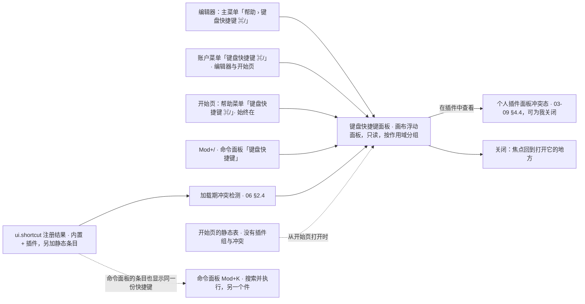

> 状态：草稿 | 负责：设计 | 更新：2026-09-18；2026-09-25（补图）；2026-10-01（§4.23 插件管理样张回写：冲突条目文案改为「与『插件：聚焦搜索』冲突」，「查看插件管理器」改为打开个人插件面板冲突态（`?state=conflict`，03-09 §4.4），在那里对可由用户关闭的一方「为我关闭」；入口图同步）；2026-10-05（design-language-v3 第 0 批修正：只改快捷键值与对应说明，界面描述随第 3 批回写——线框、交互说明与入口图的命令面板由 `Mod+Shift+P` 改为 `Mod+K`（rulings §4.25 DS-11）；默认态补键值以 ED-16 为准的说明（超链接 `Mod+Shift+K`、替换 `Ctrl+H` / `⇧⌘H`，DS-16），工具单键 V / T / S / C 与开始页 `Mod+K` 聚焦搜索在面板中的分组随第 3 批）；2026-10-07（design-language-v3 第 1 批：只补快捷键清单，面板的界面描述随第 3 批回写——默认态新增「须列入的键值」：DS-29 的删除线 `Mod+Shift+X`、上标 `Mod+Shift+=`、下标 `Mod+=`（只在文本编辑时生效）与粘贴为纯文本 `Mod+Shift+V`（P2），DS-11 定的放映 `F5` / `Shift+F5`、缩放适应 `Mod+0` / 100% `Mod+1` 与放大 / 缩小、DS-16 的替换键，以及数字 + Enter 跳页说明条目；交互说明与入口图的「?」改指 v3 入口主菜单「帮助 › 键盘快捷键」（03-02 §2.3，原 Ribbon 入口已被取代））；2026-10-08（design-language-v3 第 1 批收口：默认态的链接键改称「链接…」（rulings §4.25 TB-6）；边界情况补开发者面板在主菜单「帮助」最后一组的入口（TB-40）；面板的界面描述仍随第 3 批回写）；2026-10-22（design-language-v3 第 3 批：按已拍板样张 `shortcuts`、`command-palette` 整篇改写，标题改为「键盘快捷键面板与命令面板」——§1 线框按 v3 重画：画布浮动面板（非模态，画布列右上，宽 360，与查找和替换同一位置、同一时刻只开一个，上沿让开横幅、下沿与备注框底边对齐，开着时画布照常可点、可试键），开始页上浮在主区右上，网格与紧凑形态让开右上胶囊，原右侧玻璃抽屉作废（DS-115）；§2 入口（图 2-1 按新入口与数据来源改写）：主菜单「帮助 › 键盘快捷键 ⌘/」、账户菜单与 ⌘/，开始页另有帮助菜单的「键盘快捷键 ⌘/」（DS-89），Esc 先清空搜索词再关闭；§3 列 13 个样张状态与 3 条未采纳的备选（DS-63；`entry-main-menu` 拍板时兼作 DS-89 未采纳备选的对照，转正后按 DS-89 改画）；§4 分组 全局 · 工具 · 画布 · 文本编辑 · 左栏缩略图与网格 · 视图 · 放映 + 插件各一组，「开始页」一组只在从开始页打开时列三条，参考应用不列 ⌘S、SDK 单人 preset 列「保存 ⌘S」，功能名与主菜单、命令面板、放映「更多」同一份，「左栏缩略图」改名并补「打开（网格）↵」「选中（网格）空格」（TB-105、TB-116），居中 ⌘E、导出 ⇧⌘E（DS-78），放映组照列键位（DS-107），静态条目一并列出；§5 搜索的过滤与播报、无结果一句；§6 冲突两侧都写、按钮改为「在插件中查看」、为我关闭后即时刷新与焦点去向；§7 评审与只读浏览置灰写原因（FE-06、TB-22），两套键名与可互换键的写法；新增 §8 命令面板：⌘K 或「帮助 › 命令面板…」打开，不加遮罩、宽 480、顶部锚定、层级盖过对话框（DS-117），搜索框为淡底字段、不加清除按钮，「常用」为产品固定的 8 条（TB-117），结果行 = 图标 · 标题 · 分类 · 快捷键、第三方另起一行「来自〈插件〉」、不可用的置灰写原因（TB-106），「阅读顺序…」打开偏好设置并聚焦（DS-116），组合框读屏与结果数播报；依据 rulings §4.25 DS-11、DS-29、DS-35、DS-63、DS-78、DS-89、DS-107、DS-115…DS-117、TB-22、TB-105、TB-106、TB-116、TB-117）；2026-10-22（design-language-v3 第 3 批回写补改：设计基准的源码改指转正后的件（命令面板本体 kit `CommandPalette`、键位写法 kit `chord.ts`、菜单与 ⌘, ⌘/ ⌘K 的接线并入底座命令）；§3 仅查看形态（< 640 或触控）外接键盘按 ⌘/ 不出面板；§4「放映」组核对键位与功能名，与放映控制条、「更多」同一份（「全屏」没有快捷键、不列，DS-107），「适应窗口」「100%」在命令面板里各是一条无参命令（TB-149）；§8.3 命令面板的「帮助中心」只在配置了帮助链接时出现（TB-132）；依据 rulings §4.25 DS-107、TB-116、TB-132、TB-149）；2026-10-22（design-language-v3 第 3 批回写收口：新增 §1.5 手机与触控——编辑器仅查看形态打不开面板不变，开始页与文档列表的入口照常保留，手机（< 640）是贴底的底部面板（几何同偏好设置的手机形态，带遮罩、焦点圈定），平板（触控、≥ 640）用桌面浮动面板、关闭与搜索框 44，两种触控形态打开时焦点落在面板本身、不自动聚焦搜索框（免得弹出屏幕键盘），触控形态的菜单项不写「⌘/」（TB-154）；§2 入口与打开时的焦点、§3 表后说明、§9 命中区、§11 速查随之补一行，§1.3 注明从文档列表打开时位置与内容同开始页；§8.3 壳意图（导出…、版本历史、保真报告、插件…、帮助中心）经 shell-glue 各注册的无参 Operation 与 `ui.command` 进命令面板，「帮助中心」仍只在配置了链接时注册（TB-162、TB-132）；依据 rulings §4.25 DS-89、DS-105、TB-118、TB-154、TB-162；2026-10-22 复核修正：§1.5、§2、§11 触控形态的菜单项一律不写键位提示，⌘/ 与 ⌘, 都不写（TB-164）；§1.5 入口所在的左栏在手机与 640–1024 的平板上收在导航抽屉里、≥ 1024 的平板常驻（TB-165）；依据 rulings §4.25 TB-164、TB-165）；2026-10-23（design-language-v3 第 3 批评审修改：§3.1 `shortcuts.alt-dialog` 注明对话框画法随 rulings §4.25 DS-142 改、框高 720 不变；§8 命令面板注明圆角 8 按菜单的规则、不随对话框改为 12）；2026-11-04（design-language-v3 母版视图改版：§4 母版视图的三个键「插入版式（母版视图）⌘M」「占位符（母版视图）P」「复制版式（母版窗格）⌘D」放进全局、工具、左栏缩略图与网格三组，功能名一条写作用域与关键词（「复制版式」另带「副本」），键值一条补 ⌘M、⌘D 的两个视图不按冲突标记；§1.1 截图注明随之重拍；§3 补相关状态 `master-view.shortcuts`、`master-view.palette` 与快捷键面板画面多这三行；§8.3 补母版视图里的「母版」一类命令、两条无参 Operation 与普通视图命令的不可用原因；§8.6 补 `master-view.palette` 一行（「更换版式…」与「重置页…」写「母版视图下不可用」）；§10 补仅查看形态外接键盘按 ⌘K 未定；rulings §4.25 DS-150、DS-152、DS-157、DS-161、DS-172、TB-196、TB-203、TB-207；需求编号、优先级与里程碑不变） | 依赖：charter v0.2；rulings §4.9 Q9 / §4.10（D12 三入口）/ §4.20 FE-06 / §4.25 DS-1、DS-11、DS-16、DS-29、DS-35、DS-63、DS-78、DS-89、DS-107、DS-115、DS-116、DS-117、DS-150、DS-152、DS-157、DS-161、DS-172、TB-6、TB-22、TB-40、TB-105、TB-106、TB-116、TB-117、TB-118、TB-132、TB-149、TB-154、TB-162、TB-164、TB-165、TB-196、TB-203、TB-207、DS-105；设计 03-11 §1.2、§4.1；架构 30/05（`slide.zoomToFit` / `slide.zoomTo100`）、模块 40/11（壳意图的无参 Operation）；`10-prd/07-design-coverage-and-gaps.md` D12、G-21；PRD `02-editing` ED-16、ED-30，`09-plugin-manager` PM-11，`08-app-shell` AS-01、AS-04、AS-06；设计 06 §2.4、§4，07 §2、§2.4，03-09 §4.4，03-23 §1.3、§7，03-29 §2.4、§2.5、§2.6，03-02 §2.3、§5a.2；前端 `50-frontend/10` §10.1、§10.2、§10.4；playground `#/v3/editor?state=shortcuts.*`、`command-palette.*`（`src/v3/scenarios/shortcuts/`、`command-palette/`）

# 03-24 键盘快捷键面板与命令面板

> **设计基准（2026-10-22 起，rulings §4.25 DS-115、DS-117，TB-105、TB-106、TB-116、TB-117）**：以已拍板的 playground 第 3 批样张为准——快捷键面板 `#/v3/editor?state=shortcuts.<状态 id>`（`from-home` 画在开始页上，路由 `#/v3/home?state=shortcuts.from-home`），13 个状态加 1 个未采纳的备选（§3；`entry-main-menu` 拍板时兼作 DS-89 备选的对照，见 §3.1）；命令面板 `#/v3/editor?state=command-palette.<状态 id>`，2 个状态（§8）；暗 / 亮另加 `&theme=dark|light`。源码在 `playground/src/v3/scenarios/shortcuts/`（`shortcuts.scenario.tsx` 各状态的标题与说明、`ShortcutsPanel.tsx` 面板、列表与冲突行、`data.ts` 分组与条目、`keys.ts` 键位写法（实现在 kit `chord.ts`，这里转出原名）、`nav.ts`（带参数发命令的接线；主菜单「帮助」与 ⌘, ⌘/ ⌘K 的接线 2026-10-22 起并入底座命令 `kit/commands.ts`）、`home-backdrop.tsx` / `compact-backdrop.tsx` 背景）与 `scenarios/command-palette/`（`command-palette.scenario.tsx` 各状态、`CommandPalette.tsx` 宿主、`commands.ts` 命令清单、搜索与不可用原因）；命令面板本体是底座件 kit `CommandPalette`（`playground/src/v3/kit/CommandPalette.tsx`）。对照截图 `openspec/changes/design-language-v3/screens/batch3/shortcuts-<状态>-dark.jpg`、`command-palette-<状态>-dark.jpg`（另有 `-light`）。编辑器外壳以 [03-02](02-editor-main.md) 为准，浮层的通用规格见设计 [04](../04-design-system.md)（`FloatingPanel` 见 04 §4.1a）；数据与命令以前端 [50/10](../../50-frontend/10-editor-shell-and-interaction.md) §10.1、§10.2、§10.4 为准。此前的线框（右侧玻璃抽屉、Ribbon 页签行「?」入口、旧路由 `#/settings` 的快捷键面板）作废，标题由「快捷键速查面板」改为「键盘快捷键面板与命令面板」。

键盘快捷键面板是只读速查：查有哪些快捷键、开着面板在画布上对照着试；命令面板是「搜索并执行」。两者是两个不同的件、不合并（50/10 §10.2）。覆盖缺口 **G-21**（PRD ED-16 快捷键速查面板）与 PRD ED-30（命令面板）；对应默认答案 D12（快捷键面板三个入口）。插件贡献的快捷键与冲突按 PRD PM-11、设计 06 §2.4、§4；开发者面板（PS-09、CO-13）只记入口（§10）。

---

## 1. 线框

### 1.1 在编辑器中的位置（桌面 1600 × 1000，单页视图）

```
←──────── 240 ────────→←────────────────── 画布 ──────────────────→←────── 280 ──────→
┌──────────────────────┬──────────────────────────────────────────────┬────────────────┐
│ [Logo▾]  [单页][网格]│                  ╭────────────────────────╮  │ (周)(王)(李) ▶ │
│ 2026 年 Q2 业绩汇报 ▾│                  │ 键盘快捷键           × │  │ [设计]  评论   │
│ ✓ 已同步             │ ┌──────────────┐ │ [⌕ 搜索快捷键        ] │  │ 幻灯片 2       │
│ [新建幻灯片  ▾] [+]  │ │ 议程         │ ├────────────────────────┤  │ 版式           │
│ 1 ┌──────────────┐   │ │ 01 关键指标  │ │ 全局                   │  │ 主题           │
│   └──────────────┘   │ │ 02 营收趋势  │ │ 撤销               ⌘Z │  │ 背景           │
│▌2 ┏━━━━━━━━━━━━━━┓   │ │ 03 区域分布  │ │ 重做       ⇧⌘Z 或 ⌘Y │  │ 放映           │
│▌  ┗━━━━━━━━━━━━━━┛   │ │ 04 下半年计划│ │ 新建幻灯片         ⌘M │  │                │
│ 3 ┌──────────────┐   │ └──────────────┘ │ …                      │  │                │
│   └──────────────┘   │       ════       │ 工具                   │  │                │
│ ⋮                    │ ┌──────────────┐ │ 焦点在画布或工具条、…  │  │                │
│                      │ │ 演讲者备注   │ │ 选择                 V │  │                │
│                      │ └──────────────┘ ╰────────────────────────╯  │                │
│                      │      ╭──────────────────────────────╮        │                │
│                      │      │ [选择][文本] … [评论][+]     │        │                │
│                      │      ╰──────────────────────────────╯        │                │
└──────────────────────┴──────────────────────────────────────────────┴────────────────┘
```

面板浮在画布列右上（距画布列上、右各 12；有横幅时上沿让开横幅），宽 360，下沿与备注框底边对齐（离画布列底 72），列表在面板里滚动；与查找和替换同一位置，同一时刻只开一个。开着时画布照常可点、可试键。截图：`screens/batch3/shortcuts-default-*.jpg`（母版视图改版后多母版视图的三行，§4，截图随之重拍），样张 `shortcuts.default`。

### 1.2 面板结构

```
┌────────────────────────────────────┐
│ 键盘快捷键                       × │  ← 标题行 44：13px 600 + 关闭 24（Esc）
│ [⌕ 搜索快捷键                    ] │  ← kit 淡底字段，不加清除按钮
├────────────────────────────────────┤
│ 全局                               │  ← 组标题 12px 600，滚动时吸顶
│ 撤销                           ⌘Z │  ← 功能名 12px · 键位 11px 次级文字色
│ 下一个区域            F6 或 ⌃F6   │
├────────────────────────────────────┤  ← 组间 1px 分隔
│ 工具                               │
│ 焦点在画布或工具条、不在输入时生效 │  ← 组的生效条件（12px 次级文字色）
│ 选择                             V │
├────────────────────────────────────┤
│ 文本编辑                           │
│ 下标                           ⌘= │
│ 在画布上同一组键是放大             │  ← 条目的补充说明（下一行）
├────────────────────────────────────┤
│ ⧉ 聚焦搜索 · 内置                  │  ← 插件每个一组：归属图标 + 名称 + 来源
│ 打开全局搜索                  ⌥⌘F │
└────────────────────────────────────┘
```

### 1.3 开始页上

开始页没有画布：同一个浮动面板浮在主区右上——顶栏（56）之下 12、右缘与顶栏内容边对齐（与「新建演示文稿」同一条右缘）、离底 24。最上一组「开始页」，其下一行「以下快捷键在编辑器中生效」再接编辑器的各组（§4）。文档列表与开始页是同一个应用壳、⌘K 同为开始页作用域的聚焦搜索（03-01 §5），从那里打开时位置与内容同此。样张 `shortcuts.from-home`。

### 1.4 网格视图与紧凑窗口

网格视图与紧凑形态（640–1024）里，面板让到右上「协作与分享」胶囊下方（48 + 12，同紧凑形态的查找面板），宽 360 不变，下沿规则同单页；紧凑形态展开右侧检查器抽屉时，面板随画布的未遮挡区让到抽屉左侧（同底部工具条），不被抽屉盖住。样张 `shortcuts.grid`、`shortcuts.compact`（1000 × 760）。

### 1.5 手机与触控（开始页、文档列表；rulings §4.25 TB-154）

编辑器的仅查看形态（< 640 或触控）没有主菜单与账户入口，打不开这个面板（§3）；开始页与文档列表在手机与触控形态里入口照常保留（左栏的帮助菜单与账户菜单——手机与 640–1024 的平板上左栏收在导航抽屉里，≥ 1024 的平板左栏常驻，DS-89、TB-165，03-29 §2.4、§2.6）。

- **手机（< 640）**：贴底的底部面板，画法与几何同偏好设置的手机形态（03-23 §1.3、§7，TB-118）——上沿离视口顶 24、上圆角 12、把手 40 × 4、标题行 48「键盘快捷键」+ 关闭 44（读屏名「关闭键盘快捷键」），最宽 560、水平居中；搜索框高 44，列表在面板里滚动，标题与搜索框固定。同偏好设置的手机形态带遮罩、焦点圈定（手机上没有可以对照试键的画布），Esc / 关闭 / 点遮罩关闭，关闭后焦点回到打开前的元素，那里已不在时回到顶栏的「显示导航」（不掉到 `body`，07 §2.4）。内容同从开始页打开的静态表（§4）。
- **平板（触控、≥ 640）**：桌面那块浮动面板，位置同 §1.3（主区右上，宽 360）；关闭按钮与搜索框按触控命中区高 44（07 §2）。
- 两种触控形态打开时焦点都落在面板本身（读屏先念标题），不自动聚焦搜索框，免得一打开就弹出屏幕键盘（同偏好设置手机形态的做法，03-23 §7）；点搜索框才开始输入。
- 触控形态（手机与平板）的菜单项一律不写键位提示：「键盘快捷键」的 ⌘/、「偏好设置…」的 ⌘, 都不写，与手机搜索框不写 ⌘K 一致（TB-154、TB-164）；面板里的键位照常列出（外接键盘照样可用）。

---

## 2. 入口、打开与关闭

- **入口**（D12，rulings §4.10；DS-89）：编辑器里是主菜单「帮助 › 键盘快捷键 ⌘/」、账户菜单「键盘快捷键 ⌘/」（03-29 §2.5、03-02 §7）与 `Mod+/`（⌘/ / Ctrl+/）三个入口；开始页与文档列表上是左栏帮助菜单「键盘快捷键 ⌘/」（始终在，03-29 §2.4）、账户菜单与 `Mod+/`（应用壳布局按 `KeyboardEvent.code` 接住，50/02 §2.1）；手机与触控形态里这两个菜单项照常保留、不写「⌘/」（触控形态的菜单项一律不写键位提示，TB-154、TB-164，§1.5）。命令面板里的「键盘快捷键」同样打开它。三个入口打开同一个面板；「唯一入口」的说法只对偏好设置成立。原 Ribbon 页签行右侧的「?」按钮已被主菜单「帮助」取代（DS-1）。
- **形态**（DS-115）：画布浮动面板（kit `FloatingPanel`，非模态，`role="dialog"`、读屏名「键盘快捷键」，不困住焦点），层级 `--layer-panel`（04 §2.11）。与查找和替换同一位置、同一时刻只开一个：打开其中一个时另一个收起。
- **打开时的焦点**：用户打开时焦点进搜索框（从菜单打开时，菜单条目卸载的那一刻焦点直接交给搜索框，不经过 `body`；触控形态落在面板本身，§1.5）；没有用户动作就开着的（样张状态）不抢焦点。面板已开着时再按 `Mod+/` 收起。
- **关闭**：× 或 Esc；关闭后焦点回到打开它的地方——打开前的焦点元素，没有时回主菜单按钮或画布（开始页回用户行或「帮助」，没有时落在主区），不掉到 `body`（07 §2.4）。
- **Esc**：面板里任意位置都响应（同查找和替换）——焦点在搜索框且有搜索词时先清空，再按一次关闭；焦点在 ×（工具提示写着 Esc）或「在插件中查看」上时一下就关；输入法组合中不响应。

**图 2-1 快捷键面板的入口与数据来源**



怎么读：左侧几个入口等价，都打开同一个只读面板；编辑器里的内容来自 `ui.shortcut` 注册结果与静态条目，冲突在加载期检出、两侧都写；开始页没有 host，用静态表。冲突条目的「在插件中查看」进个人插件面板的冲突态。命令面板的条目显示同一份快捷键，但它是「搜索并执行」，与本面板不合并。
依据：rulings §4.10 D12；§4.25 DS-89、DS-115、TB-105、TB-116；PRD ED-16、PM-11；样张 `shortcuts.default`、`shortcuts.from-home`、`shortcuts.conflict`。

---

## 3. 状态

样张路由均为 `#/v3/editor?state=shortcuts.<状态 id>`（标「开始页」的一态为 `#/v3/home?state=…`），视口未写的按 1600 × 1000。

| 状态（样张标题） | 要点 | 样张 id | 里程碑 |
|---|---|---|---|
| 默认 · 编辑器（macOS） | 画布浮动面板，宽 360；分组 全局 · 工具 · 画布 · 文本编辑 · 左栏缩略图与网格 · 视图 · 放映 + 插件各一组；键值按 PRD ED-16（居中 ⌘E、导出 ⇧⌘E，DS-78）；参考应用不列 ⌘S | `default` | M2（G-21，ED-16 P1） |
| 入口 · 主菜单「帮助」 | 主菜单「帮助」展开：命令面板… ⌘K · 键盘快捷键 ⌘/ ┊ 帮助中心（配置了才出现、带外链图标，DS-89）；「键盘快捷键」为当前项，选它打开面板、焦点交给搜索框（菜单条目卸载的那一刻接住，不经过 `body`）；选「命令面板…」打开命令面板 | `entry-main-menu` | M2 |
| 搜索：缩放 | 输入即时过滤：「缩放」命中全局组的适应窗口 ⌘0 · 100% ⌘1 · 放大 ⌘+ · 缩小 ⌘− 与画布组的调整大小 ⌥⇧ 方向键，空组连标题隐藏；输入停顿 300 ms 后播报「找到 5 个快捷键」 | `search` | M2 |
| 搜索无结果 | 列表区只有一句「没有与「动画」相关的快捷键」，不出组标题；同一句由播报区念一次 | `search-empty` | M2 |
| 冲突 · 可为我关闭 | ⌘− 被内置「缩小」与界面级插件「聚焦搜索」同时绑定：「缩小」下一行警告色三角 +「与插件「聚焦搜索」冲突，当前由「缩小」生效」+「在插件中查看」；插件组那一条标「未生效」 | `conflict` | M2（PM-11） |
| 冲突 · 一方由管理员统一启用 | ⌥⌘M 被内置「母版视图」与内容级插件「流程图形状包」同时绑定；「在插件中查看」打开的冲突态写「请联系管理员」、没有「为我关闭」 | `conflict-locked` | M2 |
| Windows / Linux 键名 | Ctrl / Alt / Shift 用「+」连接（Ctrl+Shift+Z、Ctrl+Alt+M）；替换 Ctrl+H、导出 Ctrl+Shift+E；删除「Delete 或 Backspace」；键位一侧不折行 | `windows` | M2 |
| 列表中段 · 画布与文本编辑 | 演示列表中段：画布组的粘贴为纯文本（P2）、调整大小、翻页、对象循环、跳至页码…，再接文本编辑整组（含删除线、上标、下标，下标下一行「在画布上同一组键是放大」） | `text-scope` | M2 |
| 从开始页打开（开始页） | 浮在主区右上、顶栏之下 12；静态表、没有插件组与冲突；最上一组「开始页」：聚焦搜索框 ⌘K · 偏好设置… ⌘, · 键盘快捷键 ⌘/ | `from-home` | M2（AS-01、AS-04） |
| 评审模式里打开 | 搜索框下一行锁形「评审模式：编辑类快捷键不可用」，改文档的条目留在原位、退到 `--v3-text-3`；工具组「选择」在评审条里叫「浏览」 | `review` | M2 |
| 网格视图里打开 | 面板让到右上胶囊下方；列表演示「左栏缩略图与网格」组：打开（网格）↵ · 选中（网格）空格 | `grid` | M2 |
| 紧凑窗口 1000 × 760 | 同一个面板，宽 360，让到右上胶囊下方；展开检查器抽屉时让到抽屉左侧 | `compact` | M2 |
| 嵌入 · 单人 preset（保存 ⌘S） | SDK 单人 preset：「全局」组在「100% ⌘1」之后多一行「保存 ⌘S」（回调式保存） | `embedded-solo` | M2（EM-01、ED-23） |

样张没有单独画、行为照常的：只读浏览（查看者）里打开（同评审，说明行写「只有查看权限：编辑类快捷键不可用」，评论 C 也不可用）；与查找和替换互斥；编辑器的仅查看形态（< 640 或触控）外接键盘按 ⌘/——仅查看形态没有主菜单与账户入口（03-02 §5a.2），面板不出现；开始页与文档列表在手机上打开（贴底的底部面板）与在平板上打开（桌面浮动面板），见 §1.5（TB-154）。

相关状态在母版视图的场景里：`master-view.shortcuts`（快捷键面板搜「母版」：「母版视图 ⌥⌘M」之外，母版视图的三个键写在现有分组里、作用域写在名称的括号里——全局「插入版式（母版视图）⌘M」、工具「占位符（母版视图）P」、左栏缩略图与网格「复制版式（母版窗格）⌘D」，§4）与 `master-view.palette`（§8.6）。母版视图改版（2026-11-03 拍板，rulings §4.25 TB-196）随之改：这三行在普通视图里同样列出，上表列出全部条目的画面随之多这三行。

### 3.1 未采纳的备选（DS-63）

拍板时画给用户对照的备选留在样张里，标题前加「未采纳 · 」、说明写明由哪一条 DS 定为推荐；路由不变，实现以上表的状态为准。

| 备选 | 样张 id | 内容 | 结论 |
|---|---|---|---|
| 居中模态对话框 | `shortcuts.alt-dialog` | 宽 480、固定高 720 的模态对话框（带遮罩），开着时不能在画布上对照试键；对话框画法 2026-10-23 起随 rulings §4.25 DS-142 改（标题栏 40、圆角 12、× 正文色），框高不变、画面随之改 | 未采纳，DS-115 定为画布浮动面板 |
| 编辑器主菜单「帮助」维持第 1 批画法 | （拍板时借 `shortcuts.entry-main-menu` 的画面） | 主菜单「帮助」里的「帮助中心」常在、不带外链图标；转正后这一态按 DS-89 改画，从这里打开快捷键面板的行为不变 | 未采纳，DS-89 定为「帮助中心」配置了才出现、带外链图标（03-02 §2.3） |
| 命令面板加遮罩 | （没有出图） | 同对话框，加 `--v3-scrim` 遮罩 | 未采纳，DS-117 定为不加遮罩（§8） |

---

## 4. 分组与条目（TB-105、TB-116）

按作用域分组（50/10 §10.2），组内按 50/10 §10.4 的行序，一个功能一行（「撤销 / 重做」拆成两行，搜索时各自命中）：

| 组 | 条目（macOS 写法） |
|---|---|
| 开始页（只在从开始页打开时，放在最上；编辑器里不列） | 聚焦搜索框 ⌘K · 偏好设置… ⌘, · 键盘快捷键 ⌘/；其下一行「以下快捷键在编辑器中生效」 |
| 全局 | 撤销 ⌘Z · 重做 ⇧⌘Z 或 ⌘Y · 新建幻灯片 ⌘M · 插入版式（母版视图）⌘M · 查找… ⌘F · 替换… ⇧⌘H · 从头放映 F5 · 从当前页放映 ⇧F5 · 适应窗口 ⌘0 · 100% ⌘1 ·（只在 SDK 单人 preset）保存 ⌘S · 命令面板… ⌘K · 偏好设置… ⌘, · 键盘快捷键 ⌘/ · 导出… ⇧⌘E · 放大 ⌘+ · 缩小 ⌘− · 下一个区域 F6 或 ⌃F6 · 上一个区域 ⇧F6 或 ⌃⇧F6 |
| 工具（组标题下一行「焦点在画布或工具条、不在输入时生效」） | 选择 V · 文本 T · 形状 S · 评论 C · 占位符（母版视图）P |
| 画布 | 复制 ⌘C · 剪切 ⌘X · 粘贴 ⌘V · 原位复制 ⌘D · 全选 ⌘A · 组合 ⌘G · 取消组合 ⇧⌘G · 删除 ⌫ · 微移 方向键 · 大幅微移 ⇧ 方向键 · 上移一层 ⌘] · 下移一层 ⌘[ · 置于顶层 ⇧⌘] · 置于底层 ⇧⌘[ · 编辑文字 ↵ · 退出组合编辑 Esc · 粘贴为纯文本 ⇧⌘V（P2）· 调整大小 ⌥⇧ 方向键 · 上一页 PageUp · 下一页 PageDown · 第一页 Home · 最后一页 End · 选中下一个对象 Tab · 选中上一个对象 ⇧Tab · 跳至页码… 数字 ↵（下一行「在画布上输入页码后回车」） |
| 文本编辑 | 粗体 ⌘B · 斜体 ⌘I · 下划线 ⌘U · 增大字号 ⇧⌘> · 减小字号 ⇧⌘< · 左对齐 ⌘L · 居中 ⌘E · 右对齐 ⌘R · 两端对齐 ⌘J · 增加缩进 Tab · 减少缩进 ⇧Tab · 退出文本编辑 Esc · 链接… ⇧⌘K · 删除线 ⇧⌘X · 上标 ⇧⌘= · 下标 ⌘=（下一行「在画布上同一组键是放大」） |
| 左栏缩略图与网格 | 复制幻灯片 ⌘D · 复制版式（母版窗格）⌘D · 删除幻灯片 ⌫ · 上移一页 ⇧⌘↑ · 下移一页 ⇧⌘↓ · 新建同版式幻灯片（左栏）↵ · 打开（网格）↵ · 选中（网格）空格 |
| 视图 | 母版视图 ⌥⌘M（下一行「进入与退出」） |
| 放映 | 下一页 →、空格 或 PageDown · 上一页 ← 或 PageUp · 第一页 Home · 最后一页 End · 跳至页码… 数字 ↵ · 黑屏 B · 白屏 W（两行的下一行「再按任意翻页键恢复」）· 退出放映 Esc |
| 插件（每个插件一组，排在末尾） | 组标题：12px 归属图标 + 插件名 +「· 来源」（内置，或「第三方 · 供应商」，06 §4）；条目同内置的画法，不特殊降权 |

- **键值**以 PRD ED-16 与 50/10 §10.4 为准：居中对齐 ⌘E、「文件 › 导出…」⇧⌘E（Windows / Linux Ctrl+Shift+E，rulings §4.25 DS-78）；替换 ⇧⌘H（Windows / Linux Ctrl+H，DS-16）；命令面板 ⌘K、链接 ⇧⌘K（DS-11，命令名「链接…」，TB-6）；放映 F5 / ⇧F5；删除线、上标、下标只在文本编辑时生效（DS-29）。文本编辑态的 ⌘= 是下标、画布上是放大，分属两个作用域，不按冲突标记；⌘M、⌘D 的母版视图一行与普通视图一行分属两个视图，同样不按冲突标记（rulings §4.25 TB-196）。粘贴为纯文本是 P2，随「粘贴选项」上线，上线前条目带 P2 标记（DS-29）。
- **⌘S**（TB-116，50/10 §10.4 第 17 行）：参考应用（协同）不列——协同文档随时保存，按键只消费、不下载，列了会让人以为按了能另存一份；SDK 单人 preset 在「全局」组「100% ⌘1」之后列「保存 ⌘S」（回调式保存，出现条件与偏好设置「编辑 › 自动保存间隔」相同，03-23 §4.7）。
- **功能名**与主菜单、命令面板、放映「更多」同一份（TB-116）：缩放写「适应窗口 ⌘0」「100% ⌘1」（同主菜单「视图 › 缩放」；在命令面板里各是一条命令，接 slide-ui 另注册的两个无参 Operation `slide.zoomToFit`、`slide.zoomTo100`，快捷键表绑的也是这两个，rulings §4.25 TB-149，架构 30/05、40/10 登记），跳页写「跳至页码… 数字 ↵」（同放映「更多」、03-11）；工具组的四个名字取工具条的工具提示（选择 · 文本 · 形状 · 评论），主菜单「插入」与命令面板里同一键的命令叫「文本框」「形状库…」（插入命令）；母版视图的三个键把作用域写在名称的括号里（同「新建同版式幻灯片（左栏）」；2026-11-04，rulings §4.25 TB-196）——「占位符（母版视图）」用工具条上的工具名、排在工具组末尾，「插入版式（母版视图）」「复制版式（母版窗格）」排在普通视图同一和弦那一行之后，三行的关键词都带「母版」「版式」（「占位符」一行另带「占位符」，「复制版式」一行另带「副本」），搜「母版」时与「母版视图 ⌥⌘M」一起列出；文本格式的名字与检查器「文本 › 字体」切换条的工具提示同一份（03-16 §4.1）。
- **左栏缩略图与网格**（TB-116，原「缩略图栏」「左栏缩略图」改名）：重排在网格里同样有效，作用域同 50/10 §10.4 第 30 行；同一个 ↵ 在左栏是新建同版式幻灯片、在网格里是打开那一页（03-02 §5.3、03-14 §3.8），两行各自标出作用域；网格里空格选中；方向键与 Home / End 在网格里移动焦点，与画布组的翻页同名同键，不再重复。「复制幻灯片 ⌘D」是缩略图右键写着的键（03-14 §3.7）。
- **放映**组照列键位，与 03-11 §4.1 的键位表逐条对上（见上表；F5 / ⇧F5 在放映中吞掉、V / T / S / C 无效，都不是放映的功能，不列）。功能名与放映控制条、「更多」同一份（「白屏」「跳至页码…」与「更多」的条目同名；「更多」里的「全屏」没有快捷键，不列，03-11 §1.2、§2.3）。进入放映时不另弹键盘提示浮层，键位在这里与按钮提示里查得到（DS-107）。
- **静态条目**：不登记 `ui.shortcut`、由别的管线处理的键也列出——剪贴板三键与粘贴为纯文本、Esc 逐级、F6 区域循环（写出备用键 ⌃F6 / ⌃⇧F6，50/10 §10.4 第 34 行）、数字 + ↵ 跳页、文本里的 Tab 缩进；外观与登记的条目相同（否则 ⌘C / ⌘V 这类最常用的键不会出现在面板里）。
- **开始页**是静态表：开始页没有 host，不走 `ui.shortcut`（40/11 G-10），没有插件组、也没有冲突；「开始页」组的 ⌘K 是聚焦搜索框，不是命令面板（AS-01，DS-11）；⌘, 与 ⌘/ 在开始页上同样可用，与下面「全局」组的同名两行重复可以接受。
- 本面板只读，不提供改键（重映射是集成方能力，PRD ED-16、PM-11）。

---

## 5. 搜索

- 输入即时过滤（不区分大小写、去掉首尾空格），按功能名与关键词匹配（如「缩放」命中放大、缩小、适应窗口、100% 与画布组的「调整大小」）；评审条里的名字（「浏览」）同样能搜到。没有命中的组连组标题一起隐藏，插件组同样参与过滤。
- 列表高度不随结果变：面板仍在横幅与备注框底边之间，输入时框体不跳。
- **播报**（07 §3「结果数量变化播报」）：输入停顿 300 ms 后，搜索框下的 polite 区写一次「找到 N 个快捷键」；先清空、下一帧再写，同一句也会再念；状态里一出现就带着搜索词的不念。
- **无结果**：列表区只有一句「没有与「X」相关的快捷键」（12px `--v3-text-2`，检索词用「」包、不断行），不出任何组标题；这一行本身不设 `role="status"`（由搜索框下的播报区念，免得同一句念两遍）。
- 搜索框是 kit 的淡底字段（rulings §4.25 DS-35），不加清除按钮（TB-117）；Esc 先清空搜索词（§2）。

---

## 6. 冲突标记（PRD PM-11）

```
│ 缩小                                 ⌘− │
│ △ 与插件「聚焦搜索」冲突，当前由「缩小」生效 │
│    [在插件中查看]                        │
│ …                                        │
│ ⧉ 聚焦搜索 · 内置                        │
│ 打开全局搜索［未生效］               ⌘− │
│ △ 与内置「缩小」冲突，未生效             │
│    [在插件中查看]                        │
```

- 加载期检出的快捷键冲突（06 §2.4）在两侧都写，不隐藏冲突：被占的内置条目下一行 12px 警告色三角（状态色只给图标，DS-41）+ 主文字色「与插件「〈插件〉」冲突，当前由「〈内置〉」生效」；插件组里没生效的那一条标「未生效」，下一行「与内置「〈内置〉」冲突，未生效」。搜索只剩一侧时也看得到冲突。
- 两侧各有一个 ghost 文字按钮「在插件中查看」（不用强调色链接；原文案「查看插件管理器」，v3 这个面板叫「插件」）：打开个人插件面板的冲突态（对话框路由 `/documents/:id/plugins?state=conflict`，50/02 §2；03-09 §4.4），对话框盖在快捷键面板上、面板留着。冲突一方是允许用户选择的界面级插件时，那里给「为我关闭」——关闭后该插件的快捷键随插件卸载，快捷键面板即时刷新：插件组与两处冲突行一起消失；关闭对话框后焦点回到「在插件中查看」，冲突已解决时交给被占的那一条（如「缩小」，只可被程序聚焦、不进 Tab 顺序）。双方都不可由用户关闭时，冲突态写「请联系管理员」、没有「为我关闭」，管理员在「管理 › 插件」处理（03-32）。
- 样张：`shortcuts.conflict`（⌘−，内置「缩小」对界面级插件「聚焦搜索」，可为我关闭）、`shortcuts.conflict-locked`（⌥⌘M，内置「母版视图」对内容级插件「流程图形状包」，请联系管理员），与第 2 批 `plugins.conflict`、`plugins.conflict-locked` 是同一对。

---

## 7. 评审、只读浏览与平台键名

- **评审模式与只读浏览**（FE-06「禁用而不隐藏」、TB-22「同一原因写在顶部一行」）：搜索框下一行锁形「评审模式：编辑类快捷键不可用」（只读浏览写「只有查看权限：编辑类快捷键不可用」）；改文档的条目留在原位，功能名与键位退到 `--v3-text-3`（读屏附「评审模式下不可用」/「只有查看权限」）；复制、全选、查找、缩放、放映、命令面板、翻页照常。工具组的 V 在评审条里叫「浏览」，评论 C 照常，文本 T、形状 S 不可用（50/10 §3.2）；查看者另有评论 C 也不可用。
- **平台适配**（ED-16）：底层按 `KeyboardEvent.code` 匹配、不受键盘布局与输入法影响，只是文案按平台不同。macOS 写 ⌃⌥⇧⌘ 修饰键，按这个顺序连写在键名前（⇧⌘Z、⌥⌘M、⇧F5；修饰键与中文键名之间留空，如「⇧ 方向键」）；放大 / 缩小照主菜单写 ⌘+ / ⌘−。Windows / Linux 写 Ctrl、Alt、Shift，用「+」连接、按 Ctrl · Alt · Shift 的顺序（Ctrl+Shift+Z、Ctrl+Alt+M、Shift+F5、Alt+Shift+方向键），放大 / 缩小写实际按的键 Ctrl+= / Ctrl+-。
- **可互换的键**：两个写「或」，三个以上「、」分隔、最后一个前写「或」（「→、空格 或 PageDown」）；「、」紧贴前一个键，「或」两边各留 4；读屏同一句。键位一侧不折行、不截断，功能名一侧可以换行。写法与菜单、工具提示、命令面板同一种（TB-106）。

---

## 8. 命令面板（PRD ED-30；rulings §4.25 DS-11、DS-117、TB-106、TB-117）

### 8.1 线框

```
           ╭──────────────────────────────────────────────────╮
           │ [⌕ 搜索命令                                    ] │  ← kit 淡底字段 28，四周 8
           ├──────────────────────────────────────────────────┤
           │ 常用                                             │  ← 分组小标题 12px 次级文字色
           │▐＋ 新建幻灯片                    幻灯片       ⌘M │  ← 当前项铺 --v3-panel-2
           │ ▷ 从当前页放映                  放映        ⇧F5 │
           │ ⌕ 查找…                         编辑         ⌘F │
           │ ⤓ 导出…                         文件        ⇧⌘E │
           │ ↺ 版本历史                      文档             │
           │ ▤ 母版视图                      视图        ⌥⌘M │
           │ ▦ 键盘快捷键                    帮助         ⌘/ │
           │ ◎ 偏好设置…                     账户         ⌘, │
           ╰──────────────────────────────────────────────────╯
```

宽 480（同对话框 md 一档）、水平居中、顶部锚定在 max(64px, 12vh)（同顶部锚定的对话框）；`--v3-panel` 底、1px `--v3-border`、圆角 8（按菜单的规则取弹层一档；对话框 2026-10-23 起改为 12，命令面板不是 kit 对话框、不跟，rulings §4.25 DS-142）、浮层阴影，**不加遮罩**（背后照常可见）；高随内容，列表最高 12 行后在框内滚动。截图：`screens/batch3/command-palette-default-*.jpg`。

### 8.2 打开与关闭

- **打开**：`Mod+K`（⌘K / Ctrl+K，PRD ED-30；2026-10-05 由 `Mod+Shift+P` 改，DS-11），或主菜单「帮助 › 命令面板… ⌘K」（命令面板不常驻界面，「帮助」里的是它的可见入口，设计质量门 Q2 不算重复，03-02 §2.3）。文本编辑态照常放行（焦点移出前保存光标，关闭后恢复，50/10 §10.1）。开始页没有命令面板：那里的 ⌘K 是聚焦搜索框（TB-105）。
- **外观按菜单的规则**（DS-117，04 §4.2）：是临时的选择层，不加遮罩；层级盖过对话框（`--layer-command-palette`，04 §2.11）。亮色下面板压在白色幻灯片上，只靠 1px 边与阴影区分。
- **焦点**：打开时焦点在搜索框；焦点圈定在面板里。
- **关闭**：Esc、点外面或再按 ⌘K；Esc 直接关闭（同菜单，不先清空搜索词）；关闭后焦点回到打开前的元素。

### 8.3 内容

- **列出什么**：本会话全部已注册、有 `ui.command` 呈现元数据且 `when` 为真的命令，含插件命令与内置的导航命令（50/10 §10.1）；条目随角色与模式按 `when` 增减。交给宿主处理的壳意图（导出…、版本历史、保真报告、插件…、帮助中心）各是一条：shell-glue 为每个要进命令面板的意图各注册一个无参 Operation、配一条 `ui.command`，与「适应窗口」「100%」同一做法（rulings §4.25 TB-162、TB-149，名称在 40/11 登记），所以「常用」里的「导出…」「版本历史」与搜索结果里的这几条照常出现，不可用时照常写原因（如降权后的「导出…」写「需要编辑权限」，DS-105）。「帮助中心」只在集成方配置了帮助链接时注册，新标签页打开、带外链图标（与帮助菜单、主菜单「帮助 › 帮助中心」同一规则，rulings §4.25 TB-132、DS-89）。
- **母版视图里**（rulings §4.25 DS-150、DS-152、DS-161、DS-172、TB-203、TB-207）：「母版视图」一条叫「关闭母版视图 ⌥⌘M」，其后另列「母版」一类——插入版式 ⌘M · 复制所选版式 ⌘D · 新建母版 · 从模板导入母版… · 插入占位符… P · 在普通视图查看引用页，与「新建版式 ▾」菜单、工具条「占位符 ▾」和窗格右键同名同键、同一可用性与原因；「插入占位符…」「在普通视图查看引用页」各对应一个 slide-ui 无参 Operation（`slide.openPlaceholderMenu` 打开工具条的「占位符 ▾」，`slide.viewLayoutPages` 退出母版视图并在普通视图选中所选版式的引用页，TB-207）；普通视图里这一类一条都不出现。普通视图的命令在母版视图里留在原位、不可用并写原因：「单页视图」与「幻灯片」一组（新建、复制、更换版式、隐藏、上移、下移）与「网格视图」写「母版视图下不可用」（DS-172），「备注」写「母版视图下不显示」，「评论」写「母版与版式不支持评论」，「重置页…」「版本历史」「保真报告」「插件…」写「母版视图下不可用」（DS-157、TB-203）；放映类照常，执行时先退出母版视图再放映（03-26 §8）。
- **还没输入时**：只列「常用」一组——产品固定的 8 条，按这个顺序：新建幻灯片 ⌘M · 从当前页放映 ⇧F5 · 查找… ⌘F · 导出… ⇧⌘E · 版本历史 · 母版视图 ⌥⌘M · 键盘快捷键 ⌘/ · 偏好设置… ⌘,（TB-117：不记录个人使用，ED-30 只要求模糊搜索；清单在 50/10 §10.1 登记）。
- **一行**（28 高、圆角 4、左右 8，与搜索框同一条左右缘）：图标 16（`--v3-text-2`）· 标题 12px（打开对话框的带「…」）· 分类（12px `--v3-text-2`，左缘对齐成一列）· 快捷键（11px，只写主写法，读屏念全部可互换的写法；写法与菜单、快捷键面板同一种，TB-106）。第三方插件的命令在标题下另起一行「来自「〈插件名〉」」（12px `--v3-text-2`），这一行高 44；内置插件不写。当前项铺 `--v3-panel-2`（同菜单的键盘高亮，不用强调色）。
- **标题与分类**：标题与主菜单、快捷键面板里的命令名同一份（TB-116：缩放是「适应窗口 ⌘0」「100% ⌘1」，命令面板补上「100%」一条，即 `slide.zoomTo100`，TB-149）。分类沿用主菜单的顶层名（文件 · 编辑 · 视图 · 插入 · 排列），菜单之外的按入口取（文档菜单「文档」、缩略图「幻灯片」、「放映」、账户菜单「账户」、「帮助」），阅读顺序是「无障碍」；插件命令的分类由插件给。
- **不可用的命令**（`enablement` 为假或能力位未授予）：留在原位、图标与标题退到 `--v3-text-3`，右侧写原因、代替分类与快捷键（如「未选中对象」「需选中 2 个以上对象」「评审模式下不可用」「只有查看权限」「后续版本提供」，09 §3.4 菜单条目规范第 4 条，50/10 §10.1）；仍可停上去（`aria-disabled`，原因经 `aria-describedby` 读出）；↵ 或点按不执行，只把「〈命令〉：〈原因〉」播报一次，面板不关（ED-30「执行不可用命令时提示原因」）。

### 8.4 搜索与执行

- **搜索**：输入即时搜索（标题与关键词，不区分大小写，标题末尾的「…」不参与）；排序：标题以查询词开头的在前，其次标题包含，再次只有关键词命中，同档按清单顺序；分类不参与匹配。当前项回到第一条。没有命中时列表区只有一句「没有与「xxx」相关的命令」。输入停顿 300 ms 后，框内的 polite 区写一次「找到 N 条命令」或那句无结果（先清空、下一帧再写，同快捷键面板，07 §3）。
- **执行**：↵ 或点按当前项——先关面板、把焦点交回打开前的元素，再执行（50/10 §10.1）；打开别的界面的命令（偏好设置、键盘快捷键、插件…）由那个界面接走焦点。
- **「阅读顺序…（无障碍）」**（DS-116）：打开偏好设置并把焦点放在「无障碍 › 阅读顺序」上（03-23 §4.3）；常驻入口是偏好设置，命令面板是第二入口。
- 样张 `command-palette.search` 搜「顺序」：阅读顺序…（无障碍）· 置于顶层 / 上移一层 / 下移一层 / 置于底层（排列；没有选中对象，置灰写「未选中对象」）· 上移一页 ⇧⌘↑ / 下移一页 ⇧⌘↓（幻灯片，与缩略图右键同名同键）· 随机排列投票选项（第三方「来自「现场投票」」，置灰写「需选中投票」）。

### 8.5 键盘与读屏

| 键 | 作用 |
|---|---|
| ⌘K / Ctrl+K | 打开；开着时关闭 |
| ↑ / ↓ | 换当前项（首尾循环），列表随之滚动 |
| ↵ | 执行当前项（不可用的只播报原因） |
| Esc / 点外面 | 关闭 |

- 搜索框是组合框（`role="combobox"`，`aria-controls` 指向列表，`aria-autocomplete="list"`，`aria-activedescendant` 指向当前项）；焦点始终在搜索框里，指针点按不移走焦点。列表 `role="listbox"`、每行 `role="option"`（`aria-selected` 标当前项）；「常用」是带读屏名的 `group`。
- 输入法组合中的 ↵ 不确认（50/16 §6.4）。

### 8.6 状态

| 状态（样张标题） | 要点 | 样张 id | 里程碑 |
|---|---|---|---|
| 打开 · 常用命令 | ⌘K 或主菜单「帮助 › 命令面板…」打开：搜索框 +「常用」8 条；不加遮罩、顶部锚定、宽 480 | `command-palette.default` | M2（ED-30） |
| 搜索结果「顺序」 | 结果行 = 图标 · 标题 · 分类 · 快捷键；第三方另起一行「来自「〈插件〉」」；不可用的置灰写原因；「阅读顺序…」是偏好设置的第二入口 | `command-palette.search` | M2 |
| 母版视图里打开（相关状态） | 原地打开、搜「版式」：「母版」类命令（插入版式 ⌘M、复制所选版式 ⌘D、插入占位符… P、在普通视图查看引用页，另有新建母版、从模板导入母版…）与「关闭母版视图 ⌥⌘M」；「更换版式…」与「重置页…」写「母版视图下不可用」（DS-172、TB-203），↵ 只播报原因、面板不关（§8.3） | `master-view.palette` | M2（母版编辑类命令 M3） |

样张没有单独画、行为照常的：评审 / 只读浏览里打开（同一面板，编辑类命令写「评审模式下不可用」「只有查看权限」）；没有命中（一句「没有与「xxx」相关的命令」）。

---

## 9. 可及性

- 快捷键面板 `role="dialog"`、读屏名「键盘快捷键」，非模态、不困住焦点；每组是带标题的 `section`（组标题 `h3`，滚动时吸顶）；键位的读屏名写全可互换的写法（「⇧⌘Z 或 ⌘Y」）。
- 冲突说明与「未生效」标记都是文字，不只靠警告色图标（WCAG 1.4.1）；评审、只读浏览的置灰条目读屏附原因。
- 搜索与无结果的播报见 §5、§8.4；面板与命令面板都不在打开时抢走用户正在操作的焦点（只有用户打开时才进搜索框）。
- 命中区：关闭按钮 24（WCAG 2.5.8），命令面板的行 28 / 44；触控形态（§1.5）的关闭按钮与搜索框 44（07 §2）。

---

## 10. 边界情况

- 没有任何插件快捷键：不显示插件分组（同 03-09 的空分组隐藏规则）。
- 文本编辑态与画布上的同一组键（⌘= 下标 / 放大）分属两个作用域，不按冲突标记（§4）。
- 面板开着时进网格视图或窗口缩到紧凑形态：面板跟着让到右上胶囊下方（§1.4）；缩到仅查看形态（< 640）时随形态切换收起（03-02 §5a）。
- 打开查找和替换时快捷键面板收起，反之亦然（同一位置只开一个）。
- 编辑器仅查看形态外接键盘按 ⌘K 是否打开命令面板未定，样张照常打开，随后续批次定。
- 开发者面板（贡献列表、事件流、协同诊断，PRD PS-09、CO-13）面向插件开发者与技术支持，不是最终用户缺省可见的入口：编辑器主菜单「帮助」最后一组（分隔线之后）在开发构建或 `features.developerMenu` 打开时出现「开发者面板」（rulings §4.25 TB-40，03-02 §2.3）；同一条件下偏好设置「关于」另有「开发者面板 · 打开」（03-23 §4.6）。本文不展开该面板，只记录入口。

---

## 11. 设计规格（速查）

| 项 | 规格 | 来源 |
|---|---|---|
| 快捷键面板 | kit `FloatingPanel`，宽 360；编辑器：画布列右上（上、右各 12，上沿让开横幅，下沿离画布列底 72），网格与紧凑形态再让开右上胶囊（48 + 12）；开始页：上 68、右 32、下 24；层级 `--layer-panel` | `ShortcutsPanel.tsx`；DS-115 |
| 面板头 | 标题行 44：13px 600 + 关闭 24（工具提示 Esc）；搜索框 kit 淡底字段 28，左右 12、下 12 | `ShortcutsPanel.tsx` |
| 手机与平板（开始页、文档列表） | 手机（< 640）：贴底的底部面板，几何同偏好设置的手机形态（上沿离视口顶 24、把手 40 × 4、标题行 48、关闭 44、最宽 560，带遮罩）；平板（触控、≥ 640）：桌面浮动面板，关闭与搜索框 44；触控形态的菜单项不写键位提示 | 03-23 §11「手机底部面板」；TB-154、TB-164（样张没有单独画） |
| 列表 | 组标题 12px 600、高 32、吸顶；组间 1px 分隔；行左右 16、上下 6：功能名 12px · 键位 11px `--v3-text-2`；补充说明 12px `--v3-text-2` 另起一行；P2 与「未生效」用 kit `Tag` | `ShortcutsPanel.tsx` |
| 冲突行 | 12px 警告色三角 + 12px 主文字色说明 + ghost 文字按钮 24 高 | `ShortcutsPanel.tsx` `ConflictNote` |
| 只读说明行 | 锁形 + 一句原因（检查器说明行同一个件） | kit `InspectorNotice`；TB-22 |
| 命令面板 | 宽 480、上沿 max(64px, 12vh)、`--v3-panel` 底 + 1px `--v3-border` + `--v3-shadow`、圆角 8，不加遮罩；层级 `--layer-command-palette` | kit `CommandPalette`；DS-117 |
| 命令行 | 28 高（第三方 44）、圆角 4；图标 16 · 标题 12px · 分类 12px `--v3-text-2` · 快捷键 11px；当前项 `--v3-panel-2` | kit `CommandPalette` |
| 键位写法 | macOS ⌃⌥⇧⌘ 连写；Windows / Linux Ctrl+Alt+Shift；可互换的写「或」与「、」 | kit `chord.ts`（`formatChord` / `joinAlternatives`）；TB-106 |
