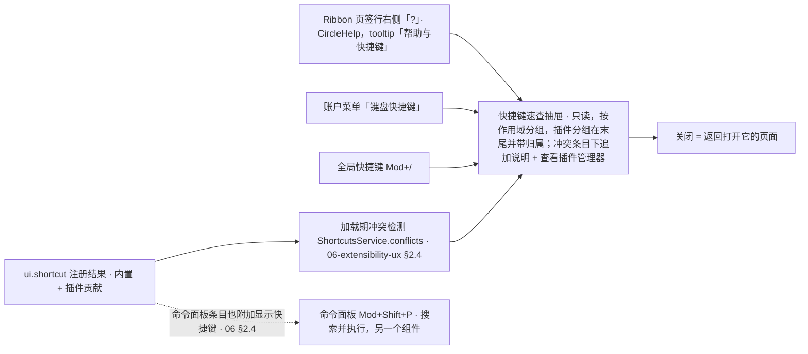

> 状态：草稿 | 负责：设计 | 更新：2026-09-18；2026-09-25（补图） | 依赖：charter v0.2；rulings §4.9 Q9 / §4.10（D12 三入口）；`10-prd/07-design-coverage-and-gaps.md` D12；PRD `08-app-shell` AS-06；09 v3.0 §2 `UserMenu`、§3；playground `Ribbon.tsx` / `Settings.tsx`

# 03-24 快捷键速查面板

> **设计基准（2026-09-15 起）**：组件规格以 [`09-design-specification.md`](../09-design-specification.md) v3.0（shadcn Rhea + 材质层）为准；对应 playground 路由 `#/settings`（快捷键面板）（[已发布 artifact](https://claude.ai/code/artifact/cf6e1a1a-986b-48bb-b743-5758dff419d2)，源码 `playground/src/routes/`）。本文引用的 `mockups/*.html` 与线框图为历史静态稿，以 playground 实际渲染为终稿。

新增界面，此前"?"按钮只是一句帮助入口的占位。覆盖缺口 **G-21**（ED-16）。对应产品默认答案 D12（三个入口：Ribbon 页签行右侧「?」按钮、账户菜单「键盘快捷键」、`Mod+/`；抽屉形态。2026-09-18 按 rulings §4.10 回写：「?」位于 Ribbon 页签行右侧而非状态栏；清单补 `Mod+Alt+M` / `Mod+,` / `Mod+/` 三条）。同时承载 **G-44**（PS-09，开发者面板，仅开发模式）与 **G-67**（CO-13，协同诊断，仅开发模式）的入口说明。

---

## 线框（抽屉，右侧滑入）

```
                                          ┌───────────────────────┐
                                          │ 快捷键                [×]│
                                          │ [搜索快捷键..........]  │
                                          ├───────────────────────┤
                                          │ 全局                    │
                                          │ 命令面板      Mod+Shift+P│
                                          │ 撤销/重做     Mod+Z /Y  │
                                          │ 保存         Mod+S     │
                                          │ 设置         Mod+,     │
                                          │ 快捷键面板    Mod+/     │
                                          ├───────────────────────┤
                                          │ 画布                    │
                                          │ 全选         Mod+A     │
                                          │ 组合/取消组合 Mod+G/⇧G  │
                                          │ 复制对象      Mod+D     │
                                          │ ⚠ 缩小        Mod+-    │← 冲突标记
                                          ├───────────────────────┤
                                          │ 文本编辑                │
                                          │ 粗/斜/下划线  Mod+B/I/U │
                                          ├───────────────────────┤
                                          │ 缩略图栏                │
                                          │ 新建幻灯片    Mod+M     │
                                          │ 页面重排      Mod+⇧+↑/↓│
                                          ├───────────────────────┤
                                          │ 视图                    │
                                          │ 进入/退出母版视图 Mod+Alt+M│
                                          ├───────────────────────┤
                                          │ 放映                    │
                                          │ 下一页/上一页  →/← Space│
                                          ├───────────────────────┤
                                          │ 🧩 插件（来自 ACME）     │
                                          │ 插入流程图节点 Mod+⇧+F  │
                                          └───────────────────────┘
```

---

## 状态

### 默认态

按作用域分组（全局 / 画布 / 文本编辑 / 缩略图栏 / 视图 / 放映；「全局」含设置 `Mod+,` 与快捷键面板 `Mod+/`，「视图」含进入 / 退出母版视图 `Mod+Alt+M`——与 playground `Settings.tsx` `shortcutGroups` 一致），插件贡献的快捷键单独归入末尾分组并带归属标识（06-extensibility-ux.md §4），与内置快捷键视觉一致仅加标签，不特殊降权。

### 搜索过滤

输入即时过滤全部分组的条目（按功能名匹配），空分组标题自动隐藏。

### 冲突标记

```
│ ⚠ 缩小        Mod+-    │
│    与「插件A：聚焦搜索」冲突，[查看插件管理器]
```

- 加载期检测到的快捷键冲突（06-extensibility-ux.md §2.4）在对应条目下追加一行说明与跳转，不隐藏冲突信息。

### 平台适配

- macOS 显示 `⌘`/`⌥`/`⇧` 符号；Windows/Linux 显示 `Ctrl`/`Alt`/`Shift`；底层基于 `KeyboardEvent.code` 不受键盘布局/输入法影响，仅展示文案随平台切换。

---

## 交互说明

- 入口共三个（D12，rulings §4.10；「唯一入口」的说法只对「设置」成立）：Ribbon 页签行右侧「?」图标按钮（Lucide `CircleHelp`，tooltip「帮助与快捷键（⌘/）」，与视图模式分段、主题切换同一行，见 02-editor-main.md §2.4 线框；不在状态栏）、账户菜单（头像 `UserMenu`）「键盘快捷键」、全局快捷键 `Mod+/`。抽屉为 `Sheet`（玻璃，`rounded-l-3xl`），关闭 = 返回打开它的页面（同 03-screens/23）。面板本身不可通过快捷键编辑（只读速查，不提供"自定义快捷键"入口，重映射为集成方级别能力，不面向最终用户）。
- 面板与命令面板（`Mod+Shift+P`）是两个不同入口：命令面板用于"搜索并执行"，本面板用于"查阅有什么快捷键"，两者可同时存在但不合并为一个组件。
- 抽屉打开时不遮挡画布，允许用户对照面板内容在画布上实际操作验证。

**快捷键面板的入口与数据来源**



怎么读：左侧三个入口等价，都打开同一个只读抽屉；抽屉内容来自 `ui.shortcut` 注册结果，冲突在加载期检出并原样展示，不隐藏。命令面板条目也会附加显示同一份快捷键，但它用于搜索并执行，与本面板职责不同、不合并。

## 边界情况

- 无任何已注册的插件快捷键：不显示"插件"分组标题（与 03-screens/09 空分组隐藏规则一致）。
- 极窄屏幕：抽屉展开为接近全宽浮层，分组标题吸顶以便滚动时保持上下文。
- 开发模式下，"关于"设置面板（03-screens/23）"复制诊断信息"旁追加"打开开发者面板"入口（Fiber 树/贡献列表/事件流/协同诊断，PS-09/CO-13），面向插件开发者与技术支持，非最终用户默认可见；本文件不展开该面板线框，仅记录入口存在。
