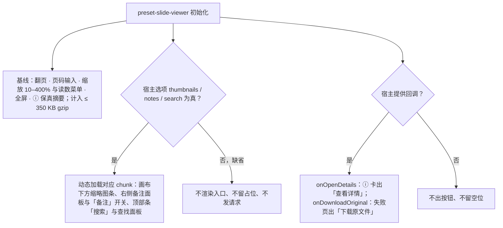
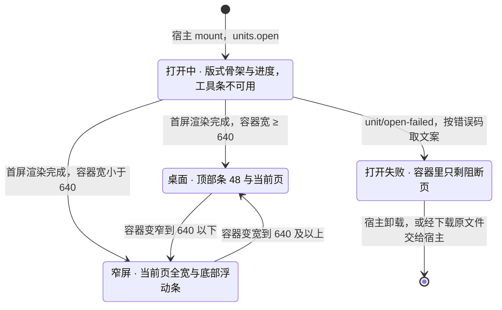

> 状态：草稿 | 负责：设计 | 更新：2026-09-18；2026-09-24（复核修正，rulings §4.17）；2026-09-25（补图）；2026-10-15（design-language-v3 第 2 批：只改「ⓘ 保真摘要卡片」一节——按已拍板样张 `fidelity.viewer-shell` 改为工具条 ⓘ 弹出的极简摘要卡「保真摘要」，只给影响「看」的计数（以占位显示的内容、以静态画面显示的动画与切换、替代字体），仅授权查看的字体与编辑类差异不列，「查看详情」外链只在集成方配置时出现、未配置时不显示也不留占位，不内嵌完整报告；原「导入摘要」卡片的写法作废；缺插件元素的占位画法与「一行说明」的落点一并注明；查看器壳本身的 v3 呈现仍随第 3 批；依据 rulings §4.25 DS-51、DS-52）；2026-10-22（design-language-v3 第 3 批：按已拍板样张 `viewer` 整篇改写——§1 线框按 v3 重画：贴边顶部条 48（翻页 · 页码输入 ┊ 缩放读数菜单 ┊ 全屏 · 搜索 · ⓘ · 备注），⛶ 只表示「全屏」（查看器没有放映舞台），原玻璃工具条作废；§2 宿主选项：缩略图条、备注、搜索都是惰性可选件、缺省关（搜索按前端 50/12 §4 改为宿主选项），「查看详情」「下载原文件」只在宿主提供回调时出现；§3 列 21 个样张状态与 2 个未采纳的备选（DS-63）；§4 桌面壳：缩放读数点开与编辑器 03-20 §4 同一份菜单（补「适应窗口」）、键位 + / −；ⓘ 卡缺插件时最前多一行「N 处内容需要插件「…」，以占位显示」、不加横幅（DS-110），没有影响查看的差异时写「未发现影响查看的差异」（TB-114）；搜索复用 03-21 去掉替换的面板、不占 ⌘F；缩略图条与备注改为贴边面板；打开中与编辑器打开中同一画法（版式骨架 + 进度，不画骨架呼吸）；打开失败只剩阻断页，只在宿主提供下载回调时出「下载原文件」（TB-114）；§5 窄屏向编辑器仅查看形态靠齐：当前页全宽、底部浮动翻页条，「更多」、幻灯片、保真摘要是底部面板，备注是当前页下方的只读卡，搜索是顶部窄屏查找条（DS-111）；第 2 批 `fidelity.viewer-shell` 的最小壳随之换成本文的桌面壳、卡片不动；依据 rulings §4.25 DS-2、DS-36、DS-51…DS-53、DS-63、DS-110、DS-111、TB-114；同日再补（回写中新增的裁决）：§4.6、§5 没有备注时的一句按 DS-138 定为桌面只读态、查看器与仅查看形态同一句「这一页没有演讲者备注」；§4.1 不允许全屏时不渲染「全屏」注明与放映「更多 › 全屏」同一规则（TB-134）；§4.3 补整页无法解析的页级占位在渲染层画（TB-151）；设计基准按样张转正后的去向补写窄屏件与 ⓘ 卡的复用出处；同日再补（回写中新增的技术口径）：§4.3 末条补运行时某一页渲染出错时同样只换这一页的页级占位「此页内容暂时无法显示」、不算打开失败（与放映单页渲染失败同一画法，rulings §4.25 TB-151，03-11 §6）；2026-10-22 复核修正：§5「更多」底部面板的条目不写键位提示（rulings §4.25 TB-164）；§6 超链接一条里前端 50/12 §3 已改定的说法不再写成待改） | 依赖：charter v0.2；rulings §4.3（查看器体积）、§4.10 Q18、§4.18 UX-19、§4.20 FE-06、§4.25 DS-2、DS-36、DS-51…DS-53、DS-63、DS-110、DS-111、DS-138、TB-114、TB-134、TB-151、TB-164；PRD 01 OF-14、OF-16，02 ED-19，09 PM-12；`10-prd/07-design-coverage-and-gaps.md`；前端 [50/12](../../50-frontend/12-viewer-embedding-and-render-page.md) §3、§4；设计 01 §8、03-11 §6、03-13、03-20 §4、03-21；playground `#/v3/editor?state=viewer.*`（`src/v3/scenarios/viewer/`）

# 03-25 只读查看器 preset 壳

> **设计基准（2026-10-22 起，rulings §4.25 DS-110、DS-111）**：以已拍板的 playground 第 3 批样张 `viewer` 为准——路由 `#/v3/editor?state=viewer.<状态 id>`（暗 / 亮另加 `&theme=dark|light`），21 个状态加 2 个未采纳的备选（§3）。源码在 `playground/src/v3/scenarios/viewer/`：`viewer.scenario.tsx`（各状态的标题与说明）、`shell.tsx`（桌面壳：顶部条、页码输入、缩放读数菜单、搜索、备注面板、打开中与打开失败）、`narrow.tsx`（窄屏：底部浮动条、底部面板、备注卡、查找条，以及未采纳的顶部工具条；底部面板、触控按钮、轻扫与浮动翻页条取编辑器仅查看形态 `scenarios/narrow/viewer.tsx` 的同一份，查找条是 03-21 查找面板的 `placement="plain"`）、`parts.tsx`（缩略图条、备注正文）、`summary.tsx`（ⓘ 保真摘要的条目；第 2 批已定稿的卡片 `fidelity/viewer.tsx` 的 `ViewerSummary` 原样复用，条目、结尾句与「查看详情」由它的 `rows` / `footer` / `details` 传入）、`data.ts`（宿主选项与示例数据）。对照截图 `openspec/changes/design-language-v3/screens/batch3/viewer-<状态>-dark.jpg`。行为（句柄、事件、键位、惰性可选件）以前端 [50/12](../../50-frontend/12-viewer-embedding-and-render-page.md) §3、§4 为准，本文定画面与文案。此前的玻璃工具条线框（`glass-strong rounded-2xl`、09 v3.0 T-04）、「⛶ 全屏 / 放映」、窄屏顶部工具条与顶部 / 底部两种抽屉、加载骨架呼吸与旧路由 `#/viewer` 一并作废；第 2 批 `fidelity.viewer-shell` 搭的最小壳随之换成本文的桌面壳，ⓘ 卡片不动（DS-110）。

`preset-slide-viewer`（章程 v0.2 §5.2）的界面：只读查看器，没有编辑 UI、没有协同（01 §8）。覆盖缺口 **G-04**（PRD OF-14，M1 P0）。它不是编辑器的一个模式，而是与 `preset-slide(-collab)` 平级的另一个更小的组装形态；参考应用里 `/documents/:id/view` 只留给 M1 查看器与嵌入（rulings §4.18 UX-19），嵌入形态 C（查看器挂在宿主自己的容器里）用的也是这个壳。查看者角色打开协同文档走编辑器的查看者变体，不走本壳（01 §8.2）。

---

## 1. 线框

### 1.1 桌面（1600 × 1000，第 3 / 6 页）

```
┌────────────────────────────────────────────────────────────────────────────────┐
│ [‹] [›] [ 3 ] / 6               [−]  118% ▾  [+]                 [⛶] [⌕] [ⓘ]   │  ← 48，贴边，1px 下边线
├────────────────────────────────────────────────────────────────────────────────┤
│                                                                                │
│     ┌────────────────────────────────────────────────────────────────────┐     │
│     │ 关键指标                                                           │     │
│     │                                                                    │     │
│     │                      当前页（适应窗口，只读）                      │     │
│     │                                                                    │     │
│     │ 2026 年 Q2 业绩汇报                                             3  │     │
│     └────────────────────────────────────────────────────────────────────┘     │
│                                                                                │
└────────────────────────────────────────────────────────────────────────────────┘
```

图例：`[‹]` `[›]` 上一页 / 下一页；`[ 3 ] / 6` 页码输入 / 总页数；`[−] 118% ▾ [+]` 缩小 · 缩放读数（点开菜单）· 放大，居中；`[⛶]` 全屏；`[⌕]` 搜索（宿主开了 `search` 才有）；`[ⓘ]` 保真摘要；宿主开了 `notes` 时末尾另有「备注」。没有标题、返回、左栏、检查器、评论、协同与插件面板（01 §8.1、PRD PM-12）。截图：`batch3/viewer-default-*.jpg`。

### 1.2 宿主开启缩略图条与备注

```
┌──────────────────────────────────────────────────────────────────────────────┐
│ [‹] [›] [ 3 ] / 6            [−]  118% ▾  [+]                [⛶] [⌕] [ⓘ] [▤] │
├──────────────────────────────────────────────────────┬───────────────────────┤
│                                                      │ 备注 · 第 3 页    [×] │
│     ┌────────────────────────────────────────────┐   │ 关键指标              │
│     │                                            │   ├───────────────────────┤
│     │                   当前页                   │   │ 开场先说结论：三项指  │
│     │                                            │   │ 标同比全部上升。      │
│     └────────────────────────────────────────────┘   │ 毛利率按百分点（pt）  │
│                                                      │ 计，不是百分比。      │
├──────────────────────────────────────────────────────┤                       │
│  1 ▭   2 ▭   3 ▣   4 ▭   5 ▭   6 ▭   ← 缩略图条      │                       │
└──────────────────────────────────────────────────────┴───────────────────────┘
```

图例：`[▤]` 备注（开关，按下态强调色淡底）；右侧备注面板宽 320、从顶部条下沿到底；缩略图条贴在画布下方、只占画布这一列；`▣` 当前页。两者都是宿主选项，缺省关（§2）。截图：`batch3/viewer-thumbnails-*.jpg`、`viewer-notes-*.jpg`（样张里两者分画）。

### 1.3 窄屏（< 640，390 × 844，DS-111）

```
查看                              「更多」底部面板
┌────────────────────────┐        ┌────────────────────────┐
│                        │        │                        │
│ ┌────────────────────┐ │        │ ┌────────────────────┐ │
│ │ 当前页（全宽）     │ │        │ │ 当前页             │ │
│ └────────────────────┘ │        │ └────────────────────┘ │
│ ┌────────────────────┐ │        │╭──────────────────────╮│
│ │ 演讲者备注         │ │        ││          ──          ││
│ │ 开场先说结论：…    │ │        ││ 更多             [×] ││
│ └────────────────────┘ │        │├──────────────────────┤│
│                        │        ││ ⤢  适应窗口          ││
│                        │        ││ ⛶  全屏              ││
│  ╭──────────────────╮  │        ││ ⌕  搜索              ││
│  │‹   3 / 6   › ┊ ⋯ │  │        ││ ⓘ  保真摘要          ││
│  ╰──────────────────╯  │        │├──────────────────────┤│
└────────────────────────┘        ││    显示演讲者备注 ✓  ││
                                  │╰──────────────────────╯│
                                  └────────────────────────┘
```

图例：左图开着备注（宿主开了 `notes` 且「更多 › 显示演讲者备注」勾上）；底部浮动条按钮 44、间距 8；右图的面板项按宿主选项增减（§5）。截图：`batch3/viewer-narrow-*.jpg`、`viewer-narrow-more-*.jpg`。

---

## 2. 宿主选项与入口

- **基线**（计入 ≤ 350 KB gzip，PRD OF-14、NF-01）：翻页、页码输入、缩放（10–400%、适应窗口）、全屏、ⓘ 保真摘要、超链接点击。
- **惰性可选件**（缺省关；宿主选项为真才渲染入口、按需加载，不计入 350 KB 基线；为假时不渲染入口、不留占位、不发请求，rulings §4.10 Q18，50/12 §4）：缩略图条 `thumbnails`、备注 `notes`、搜索 `search`（M2 P1）。03-25 原把搜索画在基线工具条里，按 50/12 §4 改为宿主选项。
- **宿主回调**：`onOpenDetails`——ⓘ 卡的「查看详情」（去哪里由集成方决定）；`onDownloadOriginal`——打开失败页的「下载原文件」。没提供的不出按钮、不留空位。
- 查看器壳本身不加导出入口（`allowExport` 只开放命令，50/12 §4）。

**宿主选项与按需加载**



怎么读：三个惰性可选件彼此独立，缺省都关，只有开启时才加载对应模块，所以都不计入 350 KB 基线；两个回调只决定按钮出不出现。任何配置下都没有工具条、检查器、评论、版本历史、插件面板与协同。
依据：PRD OF-14；rulings §4.10 Q18；50/12 §3、§4；40/11 §3.1。

---

## 3. 状态

样张路由均为 `#/v3/editor?state=viewer.<状态 id>`；未写视口的按 1600 × 1000。宿主选项写在状态数据里：缺省开了搜索与「查看详情」（与第 2 批 `fidelity.viewer-shell` 一致），缩略图条、备注与下载回调没开。

| 状态（样张标题） | 要点 | 样张 id | 里程碑 |
|---|---|---|---|
| 桌面默认 | 贴边顶部条 48；当前页适应窗口（四周留 48 / 40，容器窄于 960 时收到 16）；只读，没有选中与手柄 | `viewer.default` | M1 P0（OF-14） |
| 打开中 | 与编辑器打开中同一画法：这一页的版式骨架 + 下方「正在解析母版与版式… 62%」；没有「取消」；工具条照常画出、全部不可用「文档打开后可用」 | `viewer.loading` | M1 P0 |
| 打开失败 · 通用兜底 | 容器里只剩阻断页：「无法打开该文档」·「请稍后重试；如果问题持续，请联系管理员」·「下载原文件」（宿主提供回调时）；工具条不画 | `viewer.failed` | M1 P0 |
| 打开失败 · 宿主没有下载回调 | 同一阻断页，不出按钮、不留空位 | `viewer.failed-no-download` | M1 P0 |
| 打开失败 · 按错误码 | 以加密为例：锁形文件图标 ·「此文件已加密，当前版本无法打开」·「请先在 PowerPoint 中去除密码后再打开」；其余错误码同此只换图标与文案 | `viewer.failed-code` | M1 P0 |
| ⓘ 保真摘要卡 | 第 2 批卡片原样复用：只列影响「看」的计数 +「内容都已原样保留，不影响原文件。」+「查看详情」（宿主配了才有） | `viewer.summary` | M1（OF-14，DS-51） |
| ⓘ · 没有影响查看的差异 | ⓘ 留在原位，卡片只写「未发现影响查看的差异」（中性对勾） | `viewer.summary-none` | M1（TB-114） |
| 缺插件元素 | 第 6 页三个二维码画缺插件占位；ⓘ 卡最前一行「3 处内容需要插件「二维码形状」，以占位显示」（警告色拼图）；不加横幅、没有插件面板入口 | `viewer.missing-plugin` | M2（PM-12，DS-110） |
| 缩放读数菜单 | 与编辑器 03-20 §4 同一份菜单：比例输入 ┊ 放大 + · 缩小 − ┊ 适应窗口 · 适应宽度 ┊ 50%–200% | `viewer.zoom-menu` | M1 P0 |
| 搜索 | 03-21 的查找面板去掉替换，挂在画布右上；查找「营收」3 / 6，跨页跳转 | `viewer.search` | M2 P1（OF-16） |
| 宿主开启缩略图条 | 画布下方贴边一条，每项与编辑器左栏缩略图同款，当前页强调色边 + 淡底 | `viewer.thumbnails` | M1（可选，Q18） |
| 缩略图条 · 加载中与单页失败 | 第 4、6 页还是版式骨架，第 5 页生成失败是页码 + 灰块 + 图片失效图标 | `viewer.thumbnails-loading` | M1（可选） |
| 宿主开启备注 | 右侧贴边非模态面板 320，「备注 · 第 3 页」+ 页标题 + ×；只读纯文本 | `viewer.notes` | M1（可选，Q18） |
| 备注 · 本页没有备注 | 面板照常开着，一句「这一页没有演讲者备注」 | `viewer.notes-empty` | M1（可选） |
| 只有 1 页 | 上一页 / 下一页不可用，页码「1 / 1」；开了缩略图条也不显示 | `viewer.single-page` | M1 P0 |
| 窄屏 | 390 × 844：没有顶部条；当前页全宽，底部浮动条「上一页 · 3 / 6 · 下一页 ┊ 更多」；左右轻扫翻页 | `viewer.narrow` | M1（DS-111） |
| 窄屏 · 更多 | 底部面板：适应窗口 · 全屏 · 搜索 · 保真摘要 ┊ 显示演讲者备注 | `viewer.narrow-more` | M1（DS-111） |
| 窄屏 · 备注 | 备注是当前页下方的只读卡，翻页跟着换 | `viewer.narrow-notes` | M1（可选） |
| 窄屏 · 幻灯片 | 宿主开了缩略图时页码是按钮，点开两列缩略图底部面板 | `viewer.narrow-slides` | M1（可选） |
| 窄屏 · 保真摘要 | 「更多 › 保真摘要」换成底部面板，条目与桌面卡同一份 | `viewer.narrow-summary` | M1 |
| 窄屏 · 搜索 | 顶部窄屏查找条（宽 320、离上沿 24），底部浮动条照常可用 | `viewer.narrow-search` | M2 P1 |

样张没有单独画、规格写在相关状态里的：全屏（整个查看器容器进浏览器全屏、工具条照常，画面同 `default`）；宿主页面里的小容器（画在嵌入场景 `embed.viewer-box`，四周留白收到 16）；容器 < 320（底部浮动条约 216 宽，照样一行）。

### 3.1 未采纳的备选（DS-63）

拍板时画给用户对照的备选留在样张里，标题前加「未采纳 · 」、说明写明由哪一条 DS 定为推荐；路由不变，实现以上表的状态为准（rulings §4.25 DS-63）。

| 备选 | 样张 id | 内容 | 结论 |
|---|---|---|---|
| 工具条下的缺插件细条 | `viewer.alt-missing-plugin-bar` | 工具条下方一条可关闭的细条，与编辑器缺插件横幅同一个件（中性底 + 警告色拼图、高 40）：「本文档用到了插件「二维码形状」」+「3 处内容以占位显示，内容已保留」+ × | 未采纳，DS-110 定为放进 ⓘ 卡（不为查看器新造横幅通道，壳保持 ≤ 15 KB） |
| 窄屏顶部工具条（03-25 原写法） | `viewer.alt-narrow-toolbar` | 顶部工具条收敛（贴边、高 52、命中区 44）：翻页 · 页码 ┊ 缩放 ┊ ⋯（全屏 · 搜索 · 保真摘要 ┊ 缩略图 · 备注），缩略图是工具条下方的顶部抽屉、备注是底部抽屉（40vh），容器 < 320 时工具条折两行 | 未采纳，DS-111 定为向编辑器仅查看形态靠齐 |

**查看器的打开与形态**



怎么读：查看器只按容器宽度分两种形态（< 640 窄屏，其余同桌面；查看器没有两侧栏可收，所以没有编辑器的「紧凑」形态）；打开失败后容器里只剩阻断页，重试与离开都交给宿主。
依据：50/12 §3；rulings §4.25 DS-111、TB-114。

---

## 4. 桌面壳

### 4.1 顶部条

- 贴边、高 48、`--v3-panel` 底、1px `--v3-border` 下边线（与第 2 批 `fidelity.viewer-shell` 同高同位置，ⓘ 卡的位置不变）。自左至右：上一页 `←` · 下一页 `→` · 页码输入（28 高、宽 40，字段外框同检查器数值字段）+「/ 6」┊（居中）缩小 `−` · 缩放读数「118% ▾」· 放大 `+` ┊ 全屏 `F` · 搜索 · ⓘ 保真摘要 · 备注（宿主开了 `notes`）。图标按钮 28、图标 16。
- 第一页 / 最后一页时上一页 / 下一页留在原位不可用，写「已是第一页」/「已是最后一页」；缩放到 10% / 400% 时缩小 / 放大不可用，写「已是最小」/「已是最大」（rulings §4.20 FE-06）。
- 页码输入：只收数字，`↵` 跳到该页；越界或空时恢复为当前页；失焦时恢复显示当前页。页码只跟着引擎发布的 `view/page-changed` 走，壳不另存一份（50/12 §3）。
- **全屏**（`F`）：整个查看器容器进入浏览器全屏，工具条照常、不自动隐藏；宿主 iframe 没授权全屏（`document.fullscreenEnabled` 为假）时不渲染这颗按钮、不留占位（与放映窗口内舞台「更多 › 全屏」同一规则，rulings §4.25 TB-134）。图标用 `Fullscreen`（`Maximize` 留给「适应窗口」，一个图标只表示一件事）。03-25 与 01 §8.1 原写的「全屏 / 放映」改为只有全屏：查看器没有放映舞台。
- 「搜索」与「ⓘ」是开关（`aria-expanded`），开着时铺按下的浅底；「备注」是开关（`aria-pressed`），按下态用强调色淡底（rulings §4.25 DS-36，同放映的「黑屏」）。

### 4.2 缩放

- 打开时适应窗口：当前页四周留 48（左右）/ 40（上下），与编辑器相同；容器窄于 960（宿主页面里的小容器）时收到 16，先保证幻灯片大。
- 读数是量出来的实际比例（幻灯片显示宽 ÷ 1280，与编辑器同一口径，03-20 §4），读数按钮的读屏名「缩放 118%」；档位不打勾。
- 点读数打开与编辑器 03-20 §4 同一份菜单（宽 200、读数下方 4、居中）：顶部比例输入框（28 高：「缩放」· 数字 · %，只收数字，`↵` 确认并夹到 10–400）┊ 放大 + · 缩小 − ┊ 适应窗口 · 适应宽度 ┊ 50% · 75% · 100% · 150% · 200%——补上 OF-14 要的「适应窗口」入口（原工具条只有 − 100% +）。
- 快捷键按 50/12 §3 写 `+` / `−`（编辑器是 ⌘+ / ⌘−：查看器嵌在宿主页里，不抢浏览器的缩放）；适应窗口与 100% 没有快捷键。`⌘ + 滚轮`缩放。放大超过窗口时画布出原生滚动条。

### 4.3 ⓘ 保真摘要（DS-51、DS-110、TB-114）

```
┌──────────────────────────────────────┐   ┌──────────────────────────────────────┐
│ 保真摘要                             │   │ 保真摘要                             │
│ ⚠ 1 处内容暂不支持显示               │   │ ⧉ 3 处内容需要插件「二维码形状」，   │
│ ▶ 6 处动画与切换以静态画面显示       │   │   以占位显示                         │
│ T 1 种缺失字体已用替代字体显示       │   │ ▶ 6 处动画与切换以静态画面显示       │
│ 内容都已原样保留，不影响原文件。     │   │ 内容都已原样保留，不影响原文件。     │
│ [查看详情 ↗]   ← 宿主配了才有        │   │ [查看详情 ↗]                         │
└──────────────────────────────────────┘   └──────────────────────────────────────┘
  缺省（viewer.summary）                     缺插件（viewer.missing-plugin）
```

- 工具条 ⓘ（读屏名「保真摘要」，`aria-haspopup="dialog"`、`aria-expanded`）开关一张弹层：锚在 ⓘ 下方、右对齐、距 8，宽 264、内边距 12；标题「保真摘要」，下面逐行「图标 + 计数句」（12px / 行高 18，图标 16），再一句「内容都已原样保留，不影响原文件。」（12px `--v3-text-2`）；Esc 或点外面收起、焦点回到 ⓘ。卡片沿用第 2 批定稿（`fidelity/viewer.tsx` `ViewerSummary`），不重做。
- **只给影响「看」的计数**（DS-51）：暂不支持显示 / 以占位显示的内容（警告色三角）、以静态画面显示的动画与切换、用了替代字体的缺失字体（类型图标，`--v3-text-2`）；查看器里本来就用原字体显示的「仅授权查看的字体」与只影响编辑的差异不列。计数来自导入诊断与 `render/element-degraded`（50/12 §3）。
- **缺插件**（DS-110，PRD PM-12「查看器只显示占位与一行说明，无面板入口」）：那「一行说明」放进 ⓘ 卡、排在最前——警告色拼图图标（与编辑器缺插件横幅同一个图标）+「N 处内容需要插件「〈插件名〉」，以占位显示」，其余计数照常。不加横幅、不占画布，没有个人插件面板入口（查看器里没有插件面板）。纸面上照常是缺插件占位（虚线框 + 拼图图标 + 插件名 +「插件已停用，内容已保留」，DS-52，03-13）。
- **没有影响查看的差异**（TB-114）：ⓘ 留在原位（工具条不随文档跳位），卡片只写一句「未发现影响查看的差异」——中性对勾（`CircleCheck`，`--v3-text-2`，同第 2 批 `fidelity.no-differences`，不用成功色：这不是一次操作的结果），不写「内容都已原样保留」。
- 「查看详情」（次按钮，带 14px 外链图标）只在宿主提供 `onOpenDetails` 时出现，去哪里由集成方决定，没提供时不显示、不留占位；不内嵌 03-10 的完整报告。没有差异时宿主配了照常出现（完整报告里可能还有只影响编辑的差异）。原「导入摘要 · N 处内容已按原样保留」的写法作废。
- 画布上画不出来的元素照常显示纸面占位（与编辑器同一画法，03-13「降级渲染占位」），查看器里不出页级提示条；整页无法解析时这一页是页级占位「此页内容无法解析」，在渲染层的纸面内画，查看器与编辑器、放映同一份（rulings §4.25 TB-151）；打开后某一页渲染时出错，同样只把这一页换成渲染层的页级占位「此页内容暂时无法显示」·「渲染这一页时出错，原内容已保留」（与放映单页渲染失败同一画法，03-11 §6），其余页照常翻看，不算打开失败。

### 4.4 搜索（宿主 `search`，M2 P1）

- 「搜索」打开与编辑器查找面板同一个件（03-21 的 v3 浮动面板），查看器里没有替换行、也不给「展开替换」留空列（03-21 §7）；挂在画布右上、工具条下方 12。当前命中填充高亮、其余描边，`↵` / `⇧↵` 或上一个 / 下一个跨页跳转；没有结果时「未找到匹配内容」。
- Esc 或 × 关闭、焦点回画布；面板开着时「搜索」是按下态。
- 查看器**不占 ⌘F**：50/12 §3 的查看器键位没有它；查看器嵌在宿主页里，与缩放不占 ⌘+ / ⌘− 同一口径，⌘F 照常打开浏览器自己的查找。所以「搜索」的工具提示只写「搜索」。

### 4.5 缩略图条（宿主 `thumbnails`）

- 画布下方贴边一条（只占画布这一列），`--v3-panel` 底、1px 上边线；每项与编辑器左栏缩略图同款：页码 11px 在左、缩略图 96 宽真实渲染、圆角 4、1px 边，当前页强调色边 + 强调色淡底（`aria-current`）。原玻璃条（`h-20 rounded-2xl`）作废。
- 点选跳页；条内 `←` `→` / `Home` / `End` 移动焦点（只有当前页在 Tab 顺序里），`↵` 跳转；翻页时当前页滚入条内。语义是导航 + 列表（与 v3 左栏的按钮列表同一口径；原写的 listbox / option 作废）。
- 视口附近懒渲染，≥ 50 页虚拟化；文档只有 1 页时不显示这一条；宿主没开时完全不渲染。
- 生成超过 300 ms 的页先显示这一页的版式骨架（与编辑器左栏「其余页面加载中」同一画法：母版装饰与页脚是真的、占位符虚线框，不是灰色骨架卡）；单页生成失败是页码 + `--v3-panel-2` 灰块 + 图片失效图标，读屏「第 N 页：〈页名〉，缩略图暂时无法显示」，不阻塞其他页。

### 4.6 备注面板（宿主 `notes`）

- 工具条末尾「备注」开关；右侧贴边的非模态面板，宽 320、`--v3-panel` 底、1px 左边线、从工具条下沿到底，不加遮罩、点画布不关（原玻璃 `rounded-l-3xl` 抽屉作废）。
- 标题行 56：「备注 · 第 N 页」13px 600 + 页标题 12px `--v3-text-2` + 关闭 ×（Esc）；正文 13px / 行高 20，只读纯文本、保留换行、不渲染富文本；翻页时保持打开并换成那一页的备注。没有备注时一句「这一页没有演讲者备注」（12px `--v3-text-2`；桌面只读态、查看器与仅查看形态同一句，rulings §4.25 DS-138）。
- 焦点在面板里按 Esc 或点 × 关闭，焦点回「备注」按钮。全屏下第一次 Esc 由浏览器退出全屏、面板保持（原写的「Esc 先关抽屉再退全屏」做不到）。

### 4.7 打开中与打开失败

- **打开中**（只在容器内呈现、不跳独立页）：与编辑器 `main-states.opening` 同一画法——这一页的版式骨架（母版装饰与页脚是真的、占位符画成虚线框）+ 下方一行阶段文字与确定态进度「正在解析母版与版式… 62%」（Progress 160、百分比 11px）；打开时停在第 1 页（页数在母版与版式解析完就已知道，页码「1 / 6」照常可读）。没有「取消」（来源在宿主手里，宿主自己卸载即可）。工具条照常画出、全部不可用，工具提示「文档打开后可用」（FE-06），读数置灰、菜单打不开。原「骨架呼吸」作废（rulings §4.25 DS-53；第 1 批打开中的版式骨架不在 DS-53「不画骨架」之列）。
- **打开失败**（rulings §4.25 TB-114）：容器里只剩阻断页，与编辑器打开失败同一布局（kit `BlockingPage`：32px 线性图标 `--v3-text-2` · 16px 标题 · 12px 说明 · 一行按钮，03-02 §6.2），不画残缺的工具条。文案按 03-13「打开失败态」错误码表取，查看器里把「后再导入」改写成「后再打开」（如加密：锁形文件图标 ·「此文件已加密，当前版本无法打开」·「请先在 PowerPoint 中去除密码后再打开」）；通用兜底「无法打开该文档」·「请稍后重试；如果问题持续，请联系管理员」，不出现「已损坏」。按钮只有宿主提供 `onDownloadOriginal` 时的「下载原文件」（画布底上的次按钮 outline + 下载图标，rulings §4.25 TB-128）；没有「返回文档列表」（查看器没有文档列表）、「重试」（来源在宿主手里）与「复制诊断信息」（诊断由集成方经 `error/raised` 事件取，50/12 §3）。

---

## 5. 窄屏（< 640，DS-111）

向编辑器仅查看形态（03-02 §5a.2，第 1 批 `narrow.narrow`）靠齐：同一套触控件与底部面板，只是查看器没有标题、返回与评论。

- **画面**：不画顶部条；当前页全宽（左右 16），整页落在容器上沿与底部浮动条之间，内容整体垂直居中、超高时从顶部滚动。
- **底部浮动条**：与编辑器底部工具条同一外观（`--v3-panel` 底、1px 边、圆角 12、浮层阴影），按钮 44、间距 8：上一页 · 页码「3 / 6」· 下一页 ┊ 更多。宿主开了 `thumbnails` 时页码是按钮（读屏名「第 3 页，共 6 页，打开幻灯片列表」），没开时只是文字（读屏「第 3 页，共 6 页」）。容器 < 320 时这条约 216 宽，照样一行。
- **翻页与缩放**：左右轻扫翻页（单指、水平位移 ≥ 48 且明显大于竖直位移；页面被双指放大时不翻、让给平移）；双指缩放是浏览器原生的；外接键盘 `←` `→` / `PageUp` `PageDown` / `Home` `End` 翻页，`Esc` 关面板。
- **底部面板**（同一时刻只开一个，开着时浮动条让位；用户点开时焦点进面板，关闭后回到打开它的按钮）：
  - **更多**（行高 48、图标 20 `--v3-text-2`）：适应窗口 · 全屏（`document.fullscreenEnabled` 为假时不出，如 iOS Safari）· 搜索（宿主开了 `search`）· 保真摘要 ┊ 显示演讲者备注（勾选项，宿主开了 `notes`）。只放查看类命令，条目不写键位提示（触控形态的菜单项一律不写键位，rulings §4.25 TB-164）；点面板外即收起，焦点回「更多」。
  - **幻灯片**（宿主开了 `thumbnails`）：两列真实缩略图（页码与页名在左上，当前页 2px 强调色环与 `aria-current`，其余 1px 边），点一页跳过去并收起、焦点回页码按钮；标题行「幻灯片 · 6 页」+ 关闭 44；最高 min(72dvh, 640)，超高时在面板里滚动；点面板外或 Esc 收起。与编辑器仅查看形态的幻灯片列表同一个件、同一画法（查看器没有评论，所以没有评论角标）；单页生成失败同桌面缩略图条。
  - **保真摘要**（从「更多」打开）：条目与桌面 ⓘ 卡同一份（§4.3，含缺插件一行与「未发现影响查看的差异」），触控字号 13 / 行高 20、图标 16；宿主配了 `onOpenDetails` 时底部是整宽 44 高的「查看详情」次按钮（14px 外链图标），没配不出、不留空位。× 或 Esc 关闭，焦点回「更多」。
- **备注**：「更多 › 显示演讲者备注」打开后，备注是当前页下方的只读卡（同编辑器仅查看形态：圆角 8、1px 边、`--v3-panel` 底，小标题「演讲者备注」，正文 13px 保留换行；没有备注时「这一页没有演讲者备注」，同桌面一句，DS-138），翻页跟着换。不另画底部抽屉（原写的 40vh 底部抽屉见 §3.1 备选）。
- **搜索**：「更多 › 搜索」收起面板，顶部出 03-21 窄屏的查找条（查找框 · 计数 · 上一个 · 下一个 · 更多查找选项（区分大小写 · 全字匹配；没有「替换…」）· 关闭，宽 320），水平居中、离上沿 24，焦点进查找框；命中高亮同桌面；底部浮动条照常可用；Esc 或 × 关闭、焦点回画布。

---

## 6. 交互与键盘

| 键 | 作用 |
|---|---|
| `←` `→`、`PageUp` `PageDown` | 上一页 / 下一页 |
| `Home` / `End` | 第一页 / 最后一页 |
| `+`（`=`）/ `−` | 放大 / 缩小（按 10 / 25 / 50 / 75 / 100 / 125 / 150 / 200 / 300 / 400 档位步进） |
| `⌘ + 滚轮` | 缩放 |
| `F` | 全屏（不允许全屏时无效） |
| `Esc` | 关闭打开中的菜单、卡片、面板；全屏下由浏览器退出全屏 |
| `Tab` | 依次到达顶部条全部按钮与开着的面板 |

- 焦点在输入框、菜单、面板或缩略图条里时，这些键交给它们；带修饰键（除 ⌘ + 滚轮）的按键不处理。查看器不占 ⌘F 与 ⌘+ / ⌘−（§4.2、§4.4）。
- **超链接**：http(s) 在新窗口打开（`noopener`）；页内跳转调 `goToPage`；mailto / tel 只显示目标、可复制（前端 50/14 §5、PRD ED-19）；不劫持宿主页面导航（前端 50/12 §3 同此，原「只放行 http(s) 与 mailto」作废）。
- 体积：`preset-slide-viewer` 整体 ≤ 350 KB gzip（PRD OF-14、NF-01）；查看器壳本身是框架无关的 TS + CSS、≤ 15 KB（rulings §4.3），不依赖 ui-react / slide-ui 的完整依赖树，只复用 `@cordexjs/design` 的 token 与最小必要的件（按钮、进度条、转圈）；缩略图条、备注与搜索是惰性模块，不计入基线（Q18）。
- 与评审模式的关系：查看器壳大致对应评审模式的一个更极简子集，但两者不是同一回事——评审模式是同一编辑器实例的降级呈现（仍加载检查器等基础设施）；查看器壳是另一个更小的 preset 组装，从根本上不加载这些基础设施（01 §8.2）。

## 7. 可及性

- 顶部条是 `header`（「查看器工具条」），按钮都能 Tab 到；不可用按钮留在原位、可聚焦，读屏名带原因（07 §3）。缩放读数按钮的读屏名含可见读数（「缩放 118%」，WCAG 2.5.3）。页码输入的读屏名「页码（1–N）」。
- ⓘ 卡、搜索面板、备注面板、底部面板关闭后焦点回到打开它的按钮；交接不经过 `body`（07 §2.4）。
- 缩略图条只有当前页在 Tab 顺序里（roving tabindex），方向键在条内移动。
- 触控形态的按钮与面板行 ≥ 44、相邻间距 ≥ 8（04 §5、50/16）。

## 8. 边界情况

- 容器窄于 320：底部浮动条约 216 宽，照样一行；画布优先保证可见（原「工具条折两行」只对未采纳的备选成立）。
- 集成方没提供「下载原文件」回调：失败页不出按钮、不留空位；没提供「查看详情」回调：ⓘ 卡不出按钮、不留空位。
- 文档含受保护或需要鉴权的内容：查看器壳本身不处理鉴权 UI，鉴权失败视为一种打开失败（错误码由集成方的 `FormatCodec` / 加载回调决定），用 §4.7 的阻断页。
- 文档只有 1 页：上一页 / 下一页不可用，开了缩略图条也不显示。
- 宿主 iframe 没授权全屏：桌面不渲染「全屏」，窄屏「更多」里没有「全屏」。
- 备注与全屏：全屏下第一次 Esc 退出全屏、备注面板保持，再按 Esc（焦点在面板里）才关面板。

## 9. 设计规格（速查）

| 项 | 规格 | 来源 |
|---|---|---|
| 顶部条 | 贴边、高 48、`--v3-panel` 底、1px `--v3-border` 下边线、左右内边距 12；图标按钮 28、图标 16 | `viewer/shell.tsx` |
| 页码输入 | 28 高、宽 40，字段外框同检查器数值字段；12px 数字等宽 | `shell.tsx` `PageField` |
| 缩放读数 | 28 高、12px 数字等宽 `--v3-text-2`，展开时 `--v3-panel-2` 底；菜单宽 200，同 03-20 §4 | `shell.tsx` `ZoomReadout` |
| 画布留白 | 适应窗口时左右 48、上下 40；容器窄于 960 时四周 16 | `shell.tsx` |
| ⓘ 卡 | Popover 锚在 ⓘ、下方右对齐、距 8；宽 264、内边距 12；条目 12px / 18、图标 16；「查看详情」次按钮 + 14px 外链图标 | `fidelity/viewer.tsx`、`viewer/summary.tsx` |
| 搜索面板 | 03-21 浮动面板，去掉替换列；画布右上、工具条下方 12 | `find-view-undo/FindReplace.tsx` |
| 缩略图条 | 画布列下方贴边、`--v3-panel` 底、1px 上边线；缩略图 96 宽、圆角 4、1px 边，页码 11px；当前页强调色边 + 淡底 | `viewer/parts.tsx` `ThumbStrip` |
| 备注面板 | 右侧贴边、宽 320、`--v3-panel` 底、1px 左边线；标题行 56；正文 13px / 20 | `shell.tsx` `NotesPanel` |
| 打开中 | 版式骨架 + 进度行（12px 阶段文字、Progress 160、11px 百分比），停在第 1 页 | `shell.tsx` |
| 打开失败 | kit `BlockingPage`；「下载原文件」outline + 下载图标 | `shell.tsx` `ViewerFailed` |
| 窄屏浮动条 | 与编辑器底部工具条同一外观；按钮 44、间距 8 | `viewer/narrow.tsx` |
| 窄屏底部面板 | 同编辑器仅查看形态：把手、标题行、行高 48、图标 20；幻灯片面板最高 min(72dvh, 640) | `narrow.tsx` |
| 窄屏备注卡 | 圆角 8、1px 边、`--v3-panel` 底；小标题「演讲者备注」，正文 13px | `narrow.tsx` |
| 窄屏查找条 | 03-21 窄屏查找条，宽 320、水平居中、离上沿 24 | `narrow.tsx` |
