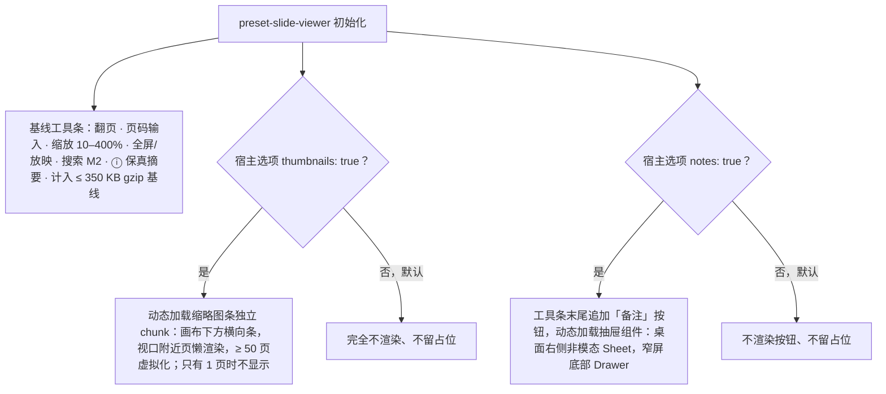

> 状态：草稿 | 负责：设计 | 更新：2026-09-18；2026-09-24（复核修正，rulings §4.17）；2026-09-25（补图） | 依赖：charter v0.2；rulings §4.10 Q18；PRD `01-open-and-fidelity.md` OF-14；`10-prd/07-design-coverage-and-gaps.md`；09 v3.0 T-04；playground `Viewer.tsx`

# 03-25 只读查看器 preset 壳

> **设计基准（2026-09-15 起）**：组件规格以 [`09-design-specification.md`](../09-design-specification.md) v3.0（shadcn Rhea + 材质层）为准；对应 playground 路由 `#/viewer`（[已发布 artifact](https://claude.ai/code/artifact/cf6e1a1a-986b-48bb-b743-5758dff419d2)，源码 `playground/src/routes/`）。本文引用的 `mockups/*.html` 与线框图为历史静态稿，以 playground 实际渲染为终稿。

`preset-slide-viewer`（章程 v0.2 §5.2）的完整界面细化，此前仅有 `01-information-architecture.md` §8 的最小 IA 描述（无状态与交互）。覆盖缺口 **G-04**（OF-14，M1 P0）。**2026-09-18 修订**：按 rulings §4.10 Q18 补「可选缩略图条」与「备注抽屉」两节（默认关、宿主选项开启、按需加载、不计入 350 KB 基线）；playground `/viewer` 已以 `thumbnails` / `notes` 两个宿主开关演示两态，尺寸按其实现回写。这不是编辑器主界面的一个模式，而是另一个更小的组装形态，与 `preset-slide(-collab)` 平级（见 01-IA §8.2）。

---

## 线框（默认态，桌面宽度）

```
┌─────────────────────────────────────────────────┐
│ [◂] [▸]   [3___] / 12   [− 100% +]  [⛶] [🔍] [ⓘ] │
├─────────────────────────────────────────────────┤
│                                                   │
│                                                   │
│              当前幻灯片渲染区（只读）                │
│                                                   │
│                                                   │
└─────────────────────────────────────────────────┘
```

工具条（`glass-strong rounded-2xl mx-2 mt-2`，高 44，09 T-04）自左至右：上一页/下一页、页码（可点击输入跳转）/总页数、缩放（10–400%，−/+ 与百分比胶囊）、全屏/放映、搜索（M2）、`ⓘ` 保真摘要；宿主开启备注时追加「备注」按钮（见下）。**不含**：Ribbon、检查器坞、评论、版本历史、插件管理器、协同——这些贡献点槽位在查看器壳中没有渲染宿主（01-IA §8.1 已定）。**可选**（默认关，由宿主选项开启，rulings §4.10 Q18 / PRD OF-14）：底部缩略图条（`thumbnails: true`）与备注抽屉（`notes: true`），见下方「可选缩略图条」「备注抽屉」两节；两者均按需加载，不计入 350 KB gzip 基线。

**宿主选项与按需加载**



怎么读：两个菱形是互相独立的宿主开关，默认都关；只有开启时才加载对应模块，因此两者都不计入 350 KB 基线。查看器壳在任何配置下都没有 Ribbon、检查器坞、评论、版本历史、插件管理器与协同。

---

## 状态

### 加载中

```
┌─────────────────────────────────────────────────┐
│                  ▓▓▓▓▓▓▓▓▓▓▓▓（骨架，呼吸动效）      │
└─────────────────────────────────────────────────┘
```

复用 03-screens/13 的打开进度语义，但只在容器内呈现（不跳转到独立错误页）。

### 失败

```
┌─────────────────────────────────────────────────┐
│              ⚠ 无法打开该文档                       │
│        请稍后重试；问题持续请联系管理员         │
│      [下载原文件]（若集成方提供该能力）               │
└─────────────────────────────────────────────────┘
```

错误文案按错误码区分，复用 03-screens/13 的错误码变体表（线框为通用兜底文案，不含"已损坏"措辞）；查看器壳内无"返回列表"（无文档列表概念），改为"下载原文件"或空白（由集成方决定是否提供该按钮）。

### `ⓘ` 保真摘要卡片

```
┌───────────────────────────┐
│ 导入摘要                    │
│ 2 处内容已按原样保留          │
│ 1 种缺失字体已替代           │
│ [查看详情]（外链，由集成方决定）│
└───────────────────────────┘
```

极简形态：仅摘要计数，不内嵌 03-screens/10 的完整报告面板；"查看详情"是否可点击、跳转到何处由集成方配置。

### 窄屏（< 640px）

- 工具条收敛为：翻页、缩放、"更多 ⋯"（内含全屏/搜索/`ⓘ`）；命中区 ≥ 44px，间距 ≥ 8px（与评审模式窄屏工具条同规则，01-IA §6）。
- 画布支持双指缩放与平移。

### 搜索（M2，P1）

- 点击"🔍"展开与 03-screens/21 相同的查找面板（不含替换区）。

### 可选缩略图条（Q18，PRD OF-14；默认关，宿主 `thumbnails: true` 开启）

```
┌─────────────────────────────────────────────────┐
│ [◂] [▸]   [3___] / 12   [− 100% +]  [⛶] [🔍] [ⓘ] │
├─────────────────────────────────────────────────┤
│              当前幻灯片渲染区（只读）                │
├─────────────────────────────────────────────────┤
│ [1] [2] [3▪] [4] [5] [6] [7] …  ← 底部横向缩略图条 │
└─────────────────────────────────────────────────┘
```

- 位置与尺寸（playground `Viewer.tsx` `ThumbnailStrip`）：画布下方一条横向滚动的缩略图条，`glass-strong mx-2 mb-2 rounded-2xl px-3`，高 80（`h-20`），项间距 10；缩略图宽 96（`w-24`，16:9 → 高 54）`rounded-lg`，页码 11px 置于卡内左下角；当前页 `ring-2 ring-primary ring-offset-2 ring-offset-transparent`，其余 `ring-1 ring-border`、悬停 `ring-ring`，与编辑器缩略图项同款卡片（09 §2）；内容用 `MiniSlide` 小幅面渲染；语义 `role="listbox"` / `role="option"` + `aria-selected`。
- 交互：点击跳页；条内 `←`/`→` 移动焦点、`Enter` 跳转；翻页时当前页自动滚入视口；窄屏（< 640）不常驻，改为「更多 ⋯」内的「缩略图」开关，开启后以顶部抽屉呈现。
- 状态：加载中为与页数等量的骨架卡（> 300ms 才显示）；单页缩略图渲染失败显示页码灰块（不阻塞其它页）；文档只有 1 页时不显示该条；宿主未开启时完全不渲染、不留占位。
- 按需加载与体积：条本身与缩略图渲染模块仅在 `thumbnails: true` 时动态加载（独立 chunk），**不计入 350 KB gzip 基线**；缩略图按视口附近页懒渲染，≥ 50 页虚拟化。

### 备注抽屉（Q18，PRD OF-14；默认关，宿主 `notes: true` 开启）

```
┌────────────────────────────────┬────────────────┐
│ [◂] [▸]  3 / 12  [− 100% +] [⛶] [🔍] [ⓘ] [📝]     │
├────────────────────────────────┬────────────────┤
│  当前幻灯片渲染区（只读）          │ 备注         [×]│
│                                │ 本页备注文本…   │
└────────────────────────────────┴────────────────┘
```

- 入口：工具条末尾追加「备注」图标按钮（Lucide `StickyNote`，`aria-pressed`，仅 `notes: true` 时渲染）；桌面为右侧**非模态**抽屉（`Sheet side="right" modal={false}`，宽 320 `w-80`，玻璃、`rounded-l-3xl`、与顶底留 8px，点击画布不关闭；头部「备注 · 第 N 页」+ 页标题，正文 14px `leading-relaxed`，playground `Viewer.tsx`），窄屏（< 640）为底部抽屉（`Drawer`，高 40vh）。
- 内容：仅显示当前页备注，只读纯文本（保留换行，不渲染富文本）；翻页时抽屉保持开启并切换内容；无备注时显示「本页没有备注」。
- 键盘：`Esc` 关闭抽屉（全屏态下 `Esc` 先关抽屉再退全屏）；抽屉打开不改变翻页快捷键。
- 按需加载与体积：备注文本随文档已加载，但抽屉组件与样式仅在 `notes: true` 时动态加载，**不计入 350 KB gzip 基线**；宿主未开启时不渲染按钮，不留占位。

---

## 交互说明

- 键盘：方向键/`PageUp`/`PageDown` 翻页，`Mod+滚轮`缩放，`F` 全屏，`Esc` 退出全屏，`Tab` 可达全部工具条按钮；超链接可点击（新窗口打开，不劫持宿主页面导航）。
- 体积预算 ≤ 350 KB gzip（PRD OF-14/NF-01），要求样式与交互不依赖 `ui-react`/`slide-ui` 完整依赖树，只复用 `@cordexjs/design` 的 token 与最小必要原子组件（Button、Progress/Spinner），本文件的线框已按此约束控制在最小控件集合内；可选缩略图条与备注抽屉为按需加载模块，不计入该基线（Q18）。
- 与评审模式的关系：查看器壳大致对应评审模式的一个更极简子集，但两者不是同一回事——评审模式是同一编辑器实例的降级呈现（仍加载检查器坞等基础设施）；查看器壳是另一个更小的 preset 组装，从根本上不加载这些基础设施（01-IA §8.2 已定，此处不重复）。

## 边界情况

- 容器尺寸小于 320px：工具条允许换行为两行，画布优先保证可见而非工具条完整一行。
- 集成方未提供"下载原文件"回调：失败态该按钮不出现，不留空白占位。
- 文档含受保护/需要鉴权的内容：查看器壳本身不处理鉴权 UI，鉴权失败视为一种打开失败态（错误码由集成方的 `FormatCodec`/加载回调决定），复用本文件"失败"状态的通用布局。
