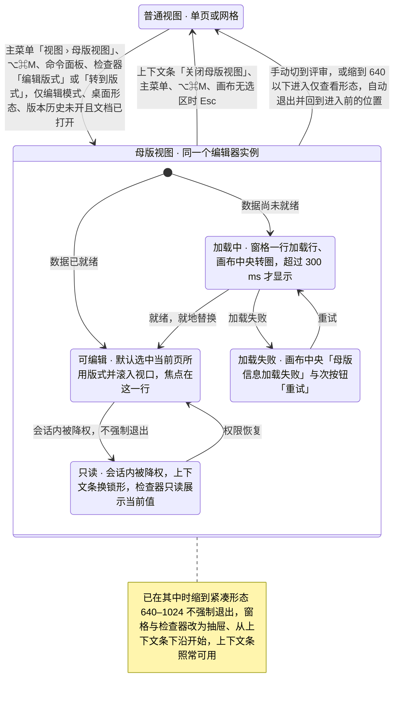
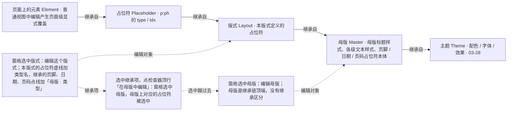
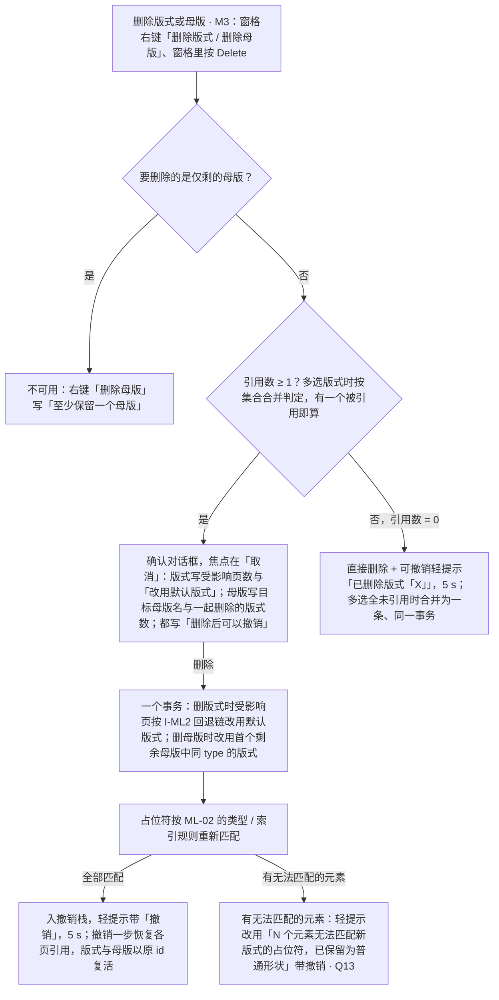

> 状态：草稿 | 负责：设计 | 更新：2026-09-18；2026-09-25（补图）；2026-09-25（矛盾收口，rulings §4.18）；2026-09-25（§4.19）；2026-09-26（§4.20：删除被引用版式 / 母版确认后可撤销与对话框文案（FE-05、FE-23）、并发删除提示与信号（FE-03、FE-14）、窗格滚动随会话记忆（FE-15））；2026-10-05（design-language-v3 第 0 批修正：只改快捷键值——入口表的命令面板由 `Mod+Shift+P` 改为 `Mod+K`（rulings §4.25 DS-11）；界面描述随第 1 批回写）；2026-10-07（design-language-v3 第 1 批：按已拍板的 `master-view` 场景 18 态与 `narrow` 紧凑母版两态整篇改写——§1 入口改为主菜单「视图 › 母版视图」/ `Mod+Alt+M` / 命令面板、不设常驻按钮，画布列顶部横幅的「关闭母版视图」是唯一常驻退出入口，可用性表补查看者与紧凑形态的原因，新增 §1.2 原母版页签命令去向表；§2 按 v3 外壳重画线框（左栏 240、检查器 280、底部工具条，横幅取代原应用栏徽标与状态栏文案）；§3 窗格改为真实缩略图行、去掉母版编号，「新建版式 ▾」取代底部「新建母版」按钮，补版式 / 母版右键条目；§4 范围条、继承虚线与选中框、M2 锁定、工具条「占位符」与同类上限；§5 检查器版式 / 母版 / 占位符 / 继承项 / 多选五种分区，降权按 DS-15 只读展示、背景按 DS-20；§6 改为逐个列出 21 个样张状态与里程碑，补横幅文案表、紧凑形态（DS-17）与从网格进入；§7 规格与状态矩阵改为 v3 token；§8 删除对话框文案按样张，补放映与他人删除；§9 UX 留痕同步；§10 关闭常驻入口、徽标落位与母版页签去向三项，新增横幅通道、「关于母版继承」与仅查看形态三项待决（rulings §4.25 DS-1、DS-5、DS-6、DS-15、DS-17、DS-20、DS-21、DS-23、DS-24））；2026-10-07（design-language-v3 第 1 批：§6.3、§2 母版横幅常驻在上、其余横幅按 03-12 优先级在它下方另占一条（TB-14），会话内被降权时 03-12 的降权横幅在第二条；§6.3 母版视图中主菜单「帮助」多一项「关于母版继承」（TB-15）；§1.1、图 1-1、§6.6、§8 进入仅查看形态（< 640）即退出母版视图（TB-16）；§4.3 占位符菜单类型以样张为准，「文本」取代「正文」、无 SmartArt（DS-30）；§1.1 查看者原因定为「只有查看权限」；§10 三项待决与措辞差异结案；依据 rulings §4.25 DS-30、TB-14、TB-15、TB-16）；2026-10-08（design-language-v3 第 1 批收口：§0 说明、§1.1 可用性与原因表、图 1-1、§6.5、§8 进入判定改为「编辑模式、有 `doc.write` 且为桌面形态（视口 ≥ 1024、不是触控设备）」，不是完整形态时（紧凑形态与仅查看形态）原因统一为「在更大窗口中编辑」，原「需要 ≥ 1024 宽度」作废、§6 `narrow.compact` 样张跟改（TB-44），查看者原因表删去已完成的 50/11 跟改字样；§1.2、§3 母版改名的命令 `slide.renameMaster`（TB-46）；§4.2、§5 母版检查器「占位符」节的勾选项「正文」改为「文本」，与插入菜单同名（TB-34，样张跟改），正文类占位符的说法同步；§6.3 横幅的影响页数二选一、取同一计数（DS-32），「关于母版继承」走壳意图 `help-center`（TB-39）；§8 删除对话框文案按样张（DS-32）；§10 末条与 PRD / 前端的措辞差异已同步，关闭；依据 rulings §4.25 DS-32、TB-34、TB-39、TB-44、TB-46）；2026-10-08（design-language-v3 第 1 批评审修改：§6.3 与 §7 横幅「关闭母版视图」改为透明底加细边的次按钮（rulings §4.25 DS-37，原 outline 写法作废）；§7 范围条选中项由 `--v3-panel-3` 改为 `--v3-panel-2` 底，与检查器页签的选中同一画法（DS-35））；2026-10-22（design-language-v3 第 3 批：只改与第 3 批裁决有关的段落——§1.1 可用性表：紧凑形态在嵌入（iframe）里的原因写「当前区域太窄，暂不可用」（DS-112），仅查看形态的提示按为什么进了这一形态写：宽度 < 640「在更大窗口中编辑」、平板「在电脑上编辑」、嵌入「当前区域太窄，暂不可用」（TB-125、TB-136）；图 1-1 注记、§6 状态表 `narrow.compact-master`、`compact-master-pane` 与 §6.6 紧凑形态：两个抽屉从横幅下沿开始、不再盖住母版横幅与「关闭母版视图」，第 1 批这两个画面随之改（DS-130）；§6.3「关于母版继承」与「帮助中心」同一规则，只在集成方配置了对应链接时出现、带外链图标（DS-89、TB-132）；依据 rulings §4.25 DS-89、DS-112、DS-130、TB-125、TB-132、TB-136；同日再补：§1.1 可用性表「仅查看形态」一行补嵌入里又是触控设备时仍是「在电脑上编辑」——按原因定先后、触控优先，嵌入只改写「在更大窗口中编辑」那一句（rulings §4.25 TB-159）；2026-10-22 复核修正：§1.1 可用性表「仅查看形态」一行写明手机不论是否触控都按窗口窄写（rulings §4.25 TB-163）；状态头的回写轮次字样改为「同日再补」）；2026-10-23（design-language-v3 第 3 批评审修改：删除版式 / 母版的确认框圆角随 rulings §4.25 DS-142 改为 12——§6 两个删除确认态与 §7「确认对话框」一行同步）；2026-11-04（design-language-v3 母版视图改版：按改版后的样张整篇改写，节号不变，需求编号、优先级与里程碑不变——设计基准改为改版后的 `master-view` 49 态与 `narrow` 紧凑、仅查看形态的母版态，拍板时的对比场景另列；§1 表与 §1.1：画布列顶部的模式横幅改为上下文条（DS-145、TB-208），入口补检查器「编辑版式」与「转到版式」（DS-147、DS-174，修订 DS-21「不设常驻按钮」半句），「转到版式」写明对应占位符的匹配与从文本编辑进入时先提交，可用性补版本历史开着与文档打开中，写明五个入口同一原因与判定先后（DS-162、DS-164、TB-209），⌥⌘M 不可用时给一次轻提示（DS-163），放映中按 ⌥⌘M 不响应、不给轻提示，新增「进入时」与「母版视图里普通视图的入口」两段（DS-157、DS-158、DS-162、DS-165…DS-167、DS-177、TB-203…TB-205；整栏面板只举保真报告，插件整页面板归依附选中对象的一类；菜单、命令面板、头像与「+N」在线列表逐项写明，在线列表底部说明在母版视图里写「母版视图下不能跟随协作者」），Esc 逐级写全七级（TB-195），退出后补工具、整栏面板、浮动层与「在普通视图查看」（停在第一个引用页；DS-150、DS-168、DS-169、TB-204），图 1-1；§1.2 改名、快捷键与「占位符 ▾」；§2 线框、图例与区域表按上下文条、无范围行、新工具条与检查器节序重画，画布几何按普通视图缺省几何下移横幅通道高（TB-187）；§3 窗格：选中即编辑对象（DS-146）、缩略图一种细线与整行取舍（一行指提示文字的一行，框线只有横排的上边线、竖排的右边线在框外；DS-149、TB-191）、名称换行不截断不限行数（DS-175、TB-192）、「未命名版式 n」（DS-160）、「新建版式 ▾」与 ⌘M / ⌘D（DS-150、TB-196）、键盘与窗格 Esc（DS-159、TB-195）、右键写快捷键、多选形态与菜单执行后的焦点（TB-197、TB-200），新增就地改名（读屏名与提交、取消后的焦点），拖拽与在场画法，右键「保留母版」是勾选菜单项、与检查器「保留母版」同一个值；§4 标题改为「画布：编辑对象、占位符标注与插入占位符」，§4.1 由原范围条改为「编辑对象」（DS-146；「在母版中编辑」找不到对应占位符时只选中母版，TB-205），§4.2 占位符标注、类型名与 M2 锁签的落位规则（DS-148、DS-156、TB-188…TB-190）、选中恢复尺寸角标、提示文本编辑与级别跟随（DS-150、TB-194），图 4-1，§4.3「占位符 ▾」第 2 位、单键 P 与键盘等价（DS-152、TB-196、TB-202、TB-207、TB-210），新增 §4.4 M2 与 M3 的差别（DS-156）；§5 面板标题只写类型、节序同普通视图，新增顶行与名称字段，线框、分区表、覆盖、背景、主题与三种不可编辑（DS-151、DS-155、TB-193、TB-200；顶行组合注明 M2 + 继承项是「原因写在顶行」的例外）；§6 引言、状态表原有 21 行按新画法改写并新增 33 行，§6.1、§6.2 加载与失败改用统一画法（DS-154），§6.3 上下文条的段落、字重、换行与播报（DS-145、TB-199），§6.4 多选画布（DS-153、TB-198），§6.5–§6.8 跟改，新增 §6.9 未采纳的对比画法（DS-63、DS-173）；§7 规格表与状态矩阵；§8 删除后的选中、多选删除文案、协同与导出前提示；§9 UX 留痕与读屏（含改名输入框、M2 锁签、在线列表各行，窗格里用键盘重排后播报「已移到第 N 个版式」）；§10 常驻入口一条补注，新增母版视图改版一条，导出提示按钮样式与尺寸角标压住相邻内容（M3）两条待决；依据 rulings §4.25 DS-63、DS-144…DS-175、DS-177、TB-186…TB-205、TB-207…TB-210） | 依赖：charter v0.2；`10-prd/03-features/07-masters-layouts-and-themes.md`（ML-01–ML-05）；`00-charter/rulings-2026-09-14.md` §4.9 Q9–Q10、§4.10 Q11–Q13 / Q16、§4.18 UX-06 / UX-11 / UX-20、§4.20 FE-03 / FE-04 / FE-05 / FE-14 / FE-15 / FE-23、§4.25 DS-1、DS-2、DS-5、DS-6、DS-11、DS-15、DS-17、DS-20、DS-21…DS-26、DS-30、DS-32、DS-35、DS-37、DS-39、DS-53、DS-58、DS-63、DS-75、DS-89、DS-112、DS-130、DS-137、DS-142、DS-144…DS-175、DS-177、TB-14、TB-15、TB-16、TB-22、TB-34、TB-39、TB-44、TB-46、TB-125、TB-132、TB-136、TB-159、TB-161、TB-163、TB-186…TB-205、TB-207…TB-210；`03-screens/02`、`03`、`04`、`09`、`12`、`14`、`16`、`24`、`27`、`28`；`05-collaboration-ux.md` §1a；`07-accessibility-and-i18n.md` §1.2、§1.2a；前端 `50-frontend/11`、`16`；playground 第 1 批场景 `master-view`、`master-view-options`、`narrow`（`src/v3/scenarios/masters-themes/`、`narrow/`）；ui-ux-pro-max skill 评审（见 04-design-system.md「与 ui-ux-pro-max 设计系统基线的比对」）

# 03-26 母版视图与母版 / 版式编辑（Master View）

> **设计基准（2026-11-04 起，rulings §4.25 DS-144…DS-175、DS-177；原 2026-10-07 第 1 批的 18 态基准随之更新）**：以 playground 第 1 批场景 `master-view` 改版后的 49 个状态为准（原有 18 态的 id 不变、画法换新，另增 31 态），紧凑形态见场景 `narrow` 的 `compact-master`、`compact-master-pane`、`compact-master-inspector`，仅查看形态按 ⌥⌘M 见 `narrow.viewonly-master-key`，与其他横幅叠放见 03-12 的 `offline-conflict.master-offline`、`master-degraded`；路由 `#/v3/editor?state=master-view.<状态 id>`，状态清单见 §6。拍板时画给用户对照的场景 `master-view-options` 留在样张里，没有采纳的画法标「未采纳」（§6.9）。源码在 `playground/src/v3/scenarios/masters-themes/`：`master-impl.tsx`（母版视图各件的登记处）、`MasterChrome.tsx`（上下文条（母版视图的模式横幅）、工具条、检查器外框、母版键位与确认框）、`MasterRail.tsx`（母版窗格）、`MasterStage.tsx`（画布与占位符标注层）、`master-sections.tsx`（检查器分区）、`mv-state.ts`（前端 50/11 §4 `MasterViewState` 的样张版与各条规则）；母版视图的宿主接口在 `src/v3/editor/master/`，母版与版式的真实渲染、示例数据在 `src/v3/editor/layouts/`。标杆截图在 `openspec/changes/design-language-v3/benchmarks/master-view/`（web、desktop）；对照截图 `openspec/changes/design-language-v3/screens/batch1/master-view-default-*.jpg` 按改版后的画面重拍，`screens/master-view/` 是拍板时的对照记录（改前、改后、新增与对比各态），画面以样张为准。本文写结构、尺寸、行为与状态，token 只写名字（取值见设计 04）。旧版路由 `#/editor/masters` 与 `mockups/26-master-view.html` 的母版页签、分段入口与线框已被 v3 取代，不再作实现依据。

对应产品线 `10-prd/03-features/07-masters-layouts-and-themes.md`：**ML-01 母版视图**（M2 P0）、**ML-02 版式应用与重置**（M2 P0，见 03-screens/27）、**ML-03 母版与版式编辑**（M3 P0）、**ML-04 主题**（M3 P1，见 03-screens/28）；ML-05 备注 / 讲义母版（M4 P2）本文不涉及；`02-editing.md` ED-25 为索引。本文沿用的既有裁决：删除被引用的版式 / 母版「确认后可撤销」（rulings §4.10 Q11，§4.20 FE-05 修订）与删母版的目标版式（FE-23）、默认版式 `defaultLayoutOf`（FE-03）、并发删除的提示与信号（FE-14）、窗格滚动随会话记忆（FE-15）、入口只在编辑模式且为桌面形态（Q12；桌面形态 = 视口 ≥ 1024 且不是触控设备，§4.25 TB-44）、版式不匹配统一轻提示（Q13）、多选 / 同类上限 / 影响页数（Q16；Q16 补进的范围条一项由 §4.25 DS-146 撤销、作废，母版数据的加载骨架一项由 DS-154 改为「转圈 + 一句文字」）、Esc 逐级（§4.18 UX-06，母版视图补的三级见 §4.25 TB-195）、手动切到评审即退出（§4.18 UX-20）。

---

## 1. 定位与入口

母版视图是同一个编辑器里的另一种视图模式（`viewMode: 'normal' | 'master'`，01 §2.4、§5a），对齐 PowerPoint 的幻灯片母版视图，同时参照 Google Slides「编辑主题」与 Keynote「编辑幻灯片版式」（rulings §4.25 DS-144）：编辑器实例、协同连接、撤销历史与 `UnitScope` 都不重建，只把「正在编辑的对象」从页换成母版或版式——窗格里选中谁就编辑谁（DS-146）。它与单页 / 网格（03-02 §2）是两个维度，母版视图本身没有网格形态。与普通视图相比，v3 外壳里只有五处不同（线框见 §2）：

| 区域 | 母版视图中的样子 | 依据 |
|---|---|---|
| 左栏 | 同一个 240 左栏，顶部（主菜单、文档菜单、同步状态）不变；「新建幻灯片 ▾ / +」换成「新建版式 ▾ / +」；没有「单页 / 网格」；缩略图列表换成母版窗格（§3） | 样张 `MasterRail.tsx` |
| 画布列顶部 | 上下文条（母版视图的模式横幅）：图标 +「母版视图」┊ 正在编辑的对象与继承来源 ┊ 说明（影响页数或当前状态）+ 右端「关闭母版视图」（§1.1、§6.3） | DS-145、TB-208；取代原应用栏两枚徽标与状态栏文案（DS-6） |
| 画布 | 只放幻灯片：渲染窗格所选的版式或母版；占位符一律虚线 + 类型名，继承项点线 +「母版 · 类型」；画布上方没有别的元界面，没有图例与备注区（§4） | DS-146、DS-148；样张 `MasterStage.tsx` |
| 底部工具条 | 「占位符 ▾」排在「选择」之后第 2 位、后接竖分隔；其余创建工具与普通视图相同；没有「评论」（母版与版式不支持评论）（§4.3） | DS-1：插入类走工具条；DS-152 |
| 检查器 | 外框（协作行、页签行、缩放）不变；「评论」页签留在原位、不可用，原因「母版与版式不支持评论」；「设计」页签按选中对象显示版式 / 母版 / 占位符分区，面板标题只写类型，节序同普通视图（§5） | DS-5、DS-151；禁用不隐藏 |

### 1.1 入口、可用性与退出

本节是母版视图入口、不能进入的原因与判定先后的归属；设计 01、03-20 只点名其中的情形并指回这里，前端 50/11 §3 的 `masterEntryState` 按这里的原因与先后实现。

**入口**（五处，同一可用性与原因）：主菜单、快捷键与命令面板三者等价（rulings §4.25 DS-21）；普通视图另有两个上下文入口（DS-147）——DS-21 原写的「不设常驻按钮」由 DS-147 修订、这半句作废：普通视图里常驻的进入入口只有检查器的「编辑版式」。

| 入口 | 位置 | 说明 |
|---|---|---|
| 主菜单「视图 › 母版视图」 | 左栏左上 logo ▾（网格视图在左上胶囊，紧凑形态在左上胶囊与窗格抽屉）→「视图」子菜单，排在「网格与参考线 ▸ · 缩放 ▸」之后、「模式」之前，右侧提示 ⌥⌘M | 样张 `master-view.entry`、`master-view.from-grid`；主菜单条目见 03-02 §2.3 |
| 快捷键 `Mod+Alt+M` | 全局，显示 ⌥⌘M；文本编辑中按下先提交并退出文本编辑 | PRD ED-16；rulings §4.9 Q9 |
| 命令面板 | `Mod+K` 在当前编辑器上原地打开，搜「母版视图」 | rulings §4.25 DS-11、DS-161 |
| 检查器「编辑版式」 | 普通视图无选中时，检查器「版式」节标题右侧的 24px 动作（03-02 §3.5 节标题右侧的动作位）；图标同上下文条（lucide `PanelsTopLeft`，TB-186），工具提示「编辑版式 ⌥⌘M」；进入后窗格选中本页所用的版式（含刚在版式画廊里换过的） | 样张 `master-view.entry-inspector`；DS-147 |
| 「转到版式」 | 普通视图里选中的对象本身是占位符形状时——空占位符，或来自版式占位符的标题与文本框（含正在编辑文字）——检查器顶行「继承自版式「〈名〉」」+「转到版式 ›」；填进占位符的表格、图表、图片与媒体按各自对象的分区，不出这一行。点它进入后，窗格选中本页所用的版式，版式上对应的占位符同时被选中（按继承链匹配：同类型、同索引），焦点落在画布上那个占位符；正在编辑文字时点它，先提交并退出文本编辑再进入（同文本编辑中按 ⌥⌘M），退出母版视图后选区清空、不回到文本编辑；文档里找不到这个版式时整行不画，找不到对应占位符时只选中版式（TB-205）；顶行画法以 03-03 为准 | 样张 `master-view.goto-layout`（空占位符）；文本与空占位符各态的顶行见 03-16；DS-147、DS-174 |

原「普通｜母版」分段、「视图」页签按钮与「母版」页签随 ribbon 废弃（DS-1；DS-21 取代原 Q8 的分段主入口）。

**可用性**（rulings §4.10 Q12、§4.18 UX-11、§4.25 TB-44、TB-209）：只有编辑模式、有 `doc.write`、为桌面形态，而且版本历史面板没开着、文档已经打开时可进入——桌面形态即 TB-44 所说的完整形态：视口 ≥ 1024，且不是触控设备（触控设备在任何宽度下都是仅查看形态，03-02 §5a）。不能进入时五个入口写同一条原因：主菜单与命令面板的「母版视图」留在原位、不可用并在右侧写原因；检查器「编辑版式」留在原位、不可用，工具提示「编辑版式 · 〈原因〉」、不写快捷键，评审、查看者与降权的只读检查器里同样留在原位、不可用（DS-147：它是进入另一个模式的动作，作为 DS-15「只读展示不画禁用控件」的例外）；「转到版式」照画、动作不可用并写原因（03-03）；`Mod+Alt+M` 不切换，给一次轻提示「母版视图：〈原因〉」，停留 3.5 秒，同一原因还在显示时不另出一条，与已在显示的轻提示叠放、新的在下，进入母版视图时清掉还在显示的这一条（DS-163，样张 `master-view.entry-blocked`）。几条同时成立时按下表从上往下取第一条——模式（评审、只读浏览）先于降权，降权先于形态（紧凑与仅查看形态），形态先于版本历史开着，版本历史开着先于文档打开中（TB-209）：

| 情形（按判定先后） | 原因（样张文案） | 样张 |
|---|---|---|
| 评审模式 | 评审模式下不可用 | `main-states.commenter`；⌥⌘M 的轻提示见 `master-view.entry-blocked` |
| 只读浏览（查看者） | 只有查看权限（与主菜单其余项同一口径，03-02 §2.3） | `main-states.viewer` |
| 编辑模式已降权（`readonly-degraded`） | 需要编辑权限 | `main-states.degraded-menu` |
| 紧凑形态（视口 640–1024） | 在更大窗口中编辑（不是完整形态时与仅查看形态顶部状态行同一口径，TB-44；原「需要 ≥ 1024 宽度」作废，样张跟改）；嵌入（iframe）里写「当前区域太窄，暂不可用」——容器尺寸由宿主定，「更大窗口」用户照做不了（rulings §4.25 DS-112，03-02 §5a.4） | `narrow.compact`；嵌入 `embed.compact-menu` |
| 仅查看形态（视口 < 640，或触控设备） | 这一形态没有主菜单，外接键盘按 `Mod+Alt+M` 或从命令面板请求时不切换，提示按为什么进了这一形态写（rulings §4.25 TB-136）：宽度 < 640「在更大窗口中编辑」（手机不论是否触控都这样写，TB-163）；平板（触控、≥ 640）「在电脑上编辑」，与这一形态的状态行同一口径（TB-125）；嵌入里因容器窄而进入这一形态时「当前区域太窄，暂不可用」（DS-112）；嵌入里又是触控设备时仍是「在电脑上编辑」——按原因定先后、触控优先，嵌入只改写「在更大窗口中编辑」那一句（rulings §4.25 TB-159） | `narrow.viewonly-master-key`（手机宽度；平板外壳的写法没有单独画） |
| 版本历史面板开着（含正在预览旧版本） | 关闭版本历史后可用（与此时「网格视图」同一句，DS-162） | 没有单独画：`version-history` 面板开着的各态里按 ⌥⌘M 或展开主菜单「视图」即见 |
| 文档打开中 | 文档打开后可用（DS-164） | 没有单独画：`main-states.opening` 里按 ⌥⌘M 即见 |

放映没有编辑器外壳，不出现该项，按 `Mod+Alt+M` 也不响应、不给轻提示（放映不参与入口判定，前端 50/11 §3）；查看器 preset 没有此入口。

**进入时**（rulings §4.25 DS-158、DS-162、DS-165…DS-167、TB-204、TB-205；前端 50/11 §2）：

1. 窗格选中当前页所用的版式（含刚在版式画廊里换过的）并滚入视口，焦点落在这一行，不经过 `body`；从「转到版式」进入时还选中版式上对应的占位符，焦点落在画布上那个占位符；窗格没有内容（加载中、加载失败）时焦点交给画布（DS-166）。检查器回到「设计」页签，工具回到「选择」。
2. 开着的菜单与弹层收起；普通视图带进来的浮动层——轻提示（含带「撤销」的）、键盘快捷键面板、查找面板、跳页提示条与页级提示条——各自收起，母版视图里不画，所以点不到普通视图的「撤销」（DS-158、TB-204）。母版视图里再打开的（`Mod+F` 查找、快捷键面板、敲数字出现的跳页提示条）属于母版视图，`Esc` 逐层照旧，退出时一并收起（TB-204）。离开确认、导出等对话框的宿主不受影响，母版视图里照常可用。
3. 跟随协作者时先停止跟随（DS-167）。
4. 开着的整栏面板（如保真报告）收起，退出后恢复到进入前的样子：当前条目与画布定位一起还原，恢复时不抢焦点。依附选中对象的整栏面板（如图表数据面板、插件整页面板，03-09）退出后不恢复：退出时选区清空，面板随之收起，与普通视图「选中别的对象即收起」同一规则（DS-162）。个人插件面板是居中对话框、不是整栏面板，开着时按 `Mod+Alt+M` 不响应（第 5 条）。版本历史开着时不能进入（见上表）。
5. 模态对话框或命令面板开着时按 `Mod+Alt+M` 不响应；菜单或弹层开着时先逐层收起再切换；对话框开着时经命令面板明确选了「母版视图」，先逐层收起对话框再切换（DS-165）。

**母版视图里普通视图的入口**（rulings §4.25 DS-157、TB-203、DS-177）：版本历史、保真报告、插件、重置页与跟随协作者属于普通视图，它们的入口在母版视图里留在原位、不可用，写「母版视图下不可用」；母版视图里又被降权时仍写这句（TB-200）。母版检查器不设历史与插件页签。

- 菜单：文档菜单「版本历史」（同一菜单的「重命名」「创建副本」不受影响）、主菜单「文件 › 保真报告」「编辑 › 重置页…」与主菜单的「插件…」，条目右侧写原因，选了无效。
- 命令面板：「版本历史」「保真报告」「插件…」「重置页…」同一可用性、同一原因，选中后按 ↵ 只播报原因、面板不关（与「单页视图」与「幻灯片」一组同一口径，DS-172；样张 `master-view.palette` 搜「版式」时列出「重置页…」）。
- 检查器协作行他人的头像：外观不变——身份色不变灰，只去掉悬停外圈；工具提示「跟随 〈姓名〉 · 母版视图下不可用」，`aria-disabled`，点了不跟随（DS-177：变灰的头像通常表示对方离线，容易误读）。
- 「+N」在线列表（05 §1a）：自己那一行照旧不可点；其余各行的「跟随」同头像——行的外观不变、只去掉悬停底色，工具提示同头像、出在行的左侧，`aria-disabled`，点了不跟随。列表底部的说明在母版视图里写「母版视图下不能跟随协作者」（普通视图里是「点按协作者即可跟随其视图」）。
- 头像与在线列表各行的读屏名见 §9。

**已在母版视图中**：缩到紧凑形态（640–1024）不强制退出，进入仅查看形态（< 640）即退出（§6.6，TB-16）；会话内被降权原地只读（§6.5）；手动切到评审（主菜单「视图 › 模式」，DS-23）即退出母版视图，回到进入前的位置；按 `F5` 或点检查器顶行「放映」先退出再放映（§8）。

**退出**（四种等价，PRD ML-01）：

1. 上下文条右端「关闭母版视图」——**唯一的常驻退出入口**（DS-21），加载中、加载失败、只读、紧凑形态下都可用；
2. 主菜单「视图」同一位置的「关闭母版视图 ⌥⌘M」；母版视图中该子菜单的「网格视图」不可用、写「母版视图下不可用」，「备注」不可用、写「母版视图下不显示」，单选「单页视图」不置灰（样张 `master-view.view-menu`）；命令面板「关闭母版视图」是同一条命令，面板里「单页视图」与「幻灯片」一组（新建、复制、更换版式、隐藏、上移、下移）同「网格视图」写「母版视图下不可用」，「备注」写「母版视图下不显示」，「评论」写「母版与版式不支持评论」，选中不可用的条目按 ↵ 只播报原因、面板不关（DS-161、DS-172；样张 `master-view.palette`）；母版类命令只在母版视图里列（03-24 §8.3）；
3. 再按 `Mod+Alt+M`；
4. 画布上没有选中对象时按 `Esc`。`Esc` 每按一次只退一级、不越级（rulings §4.18 UX-06，50/10 §7.1；母版视图的七级见 §4.25 TB-195）：
   ① 收起打开着的菜单、弹层、对话框（含主题画廊与主题颜色）与紧凑形态的抽屉（母版视图里再打开的查找面板、跳页提示条同样逐层收起，DS-158；查找框刚聚焦时按一次就关，DS-171）→ ② 进行中的拖动（窗格里拖拽重排、画布上拖动占位符）取消并回弹 → ③ 创建工具或占位符的绘制态回到「选择」→ ④ 退出提示文本编辑 → ⑤ 焦点在母版窗格时把焦点交给画布 → ⑥ 取消占位符（或普通形状）选中 → ⑦ 画布无选区时退出母版视图。
   其中 ②③⑤ 是母版视图在 UX-06 逐级链上补的三级，UX-06 原有各级与次序不变；焦点在输入框（含窗格里的改名输入框）、可编辑文本、菜单或对话框里时不触发退出。

退出后回到进入前的页、缩放、滚动（含放大后画布自己的滚动）、检查器页签与视图（单页或网格），选区清空，工具回到「选择」，焦点交给画布列（不掉到 `body`，DS-168）；进入时收起的整栏面板照 DS-162 恢复，不抢焦点；母版视图里再打开的查找面板、快捷键面板与跳页提示条一并收起，普通视图也不再弹出进入前开着的浮动层（TB-204，同 DS-169 往返后不还原的口径），检查器顶行的在线列表回到缺省的开合状态（DS-169）；经「在普通视图查看（引用页）」退出时不回进入前的页：当前页停在第一个引用页，并在普通视图选中这些页——左栏画多选，退回网格视图时网格画同样的多选环——换页即清（DS-150）。进入与退出都不产生历史项，各发一次 `view/mode-changed{mode}`；会话记忆只在内存（50/11 §2）。

**图 1-1 视图模式与母版视图内部状态**



怎么读：外层两态是视图模式切换，三条转移标的是入口、手动退出与自动退出；可用性限制（§1.1）只拦「进入」这一条，五个入口同一可用性，自动退出只有切到评审与进入仅查看形态两种（TB-16）。内层是母版视图自身的加载、编辑与只读态，只读只由会话内降权触发、权限恢复即回到可编辑；上下文条与「关闭母版视图」在内层每个状态里都可用。
依据：rulings §4.10 Q12、§4.18 UX-20、§4.25 DS-21、DS-23、DS-130、DS-145、DS-147、DS-154、DS-162、DS-164、DS-166、TB-16、TB-44、TB-209；前端 50/11 §2–§4。

### 1.2 原母版页签命令的去向（DS-1、DS-5）

原「母版」页签五组（编辑母版 / 母版版式 / 主题 / 背景 / 关闭）随 ribbon 作废，命令集合不变（PRD ML-03「母版编辑命令的去处」），落位如下：

| 原分组 · 命令 | v3 去向 | 里程碑 |
|---|---|---|
| 编辑母版 · 新建母版 | 左栏「新建版式 ▾ › 新建母版」；母版右键「插入母版」 | M3 |
| 编辑母版 · 插入版式 | 「新建版式 ▾ › 插入版式」与右侧「+」；版式右键「插入版式」；母版视图里 `Mod+M`（TB-196） | M3 |
| 编辑母版 · 删除版式 | 版式右键「删除版式」；窗格里按 `Delete`（§8） | M3 |
| 编辑母版 · 重命名 | 检查器「名称」字段（常驻）；窗格里双击名称或右键「重命名」就地改名（§3，DS-150）。两处写同一条命令：版式 `slide.renameLayout`，母版 `slide.renameMaster`（与前者对称，rulings §4.25 TB-46） | M3 |
| 复制版式 / 复制母版（原在右键） | 「新建版式 ▾ › 复制所选版式」与焦点在窗格时的 `Mod+D`（TB-196）；右键「复制版式」「复制母版」（「复制母版」不绑 `Mod+D`） | M3 |
| 母版版式 · 插入占位符 ▾ | 底部工具条「占位符 ▾」，母版视图里单键 P 打开它（§4.3，TB-196） | M3 |
| 母版版式 · 标题 / 页脚复选 | 检查器「占位符」节（§5） | M3 |
| 主题 · 编辑主题 / 颜色 / 字体 | 检查器「主题」节：卡片展开主题画廊，「调整主题」打开主题颜色与字体，与普通视图同一对弹层（03-screens/28） | M3 P1 |
| 背景 · 背景样式 / 隐藏背景图形 / 背景格式… | 检查器「背景」节（DS-20；版式多「跟随母版」与「隐藏背景图形」，§5） | M3 |
| 保留母版（PRD ML-03） | 检查器「母版」节「保留母版」；母版右键「保留母版」 | M3 |
| 从模板导入母版（PRD ML-03、ML-04 模式 B） | 「新建版式 ▾ › 从模板导入母版…」；之后的对话框流程随 M3 在 03-28 §6 出稿，样张这一轮不画（TB-201） | M3 |
| 关闭 · 关闭母版视图 | 上下文条「关闭母版视图」、主菜单、`Mod+Alt+M`、`Esc`（§1.1） | M2 |

---

## 2. 线框（桌面 1600 × 1000，默认态：窗格选中「标题和内容」）

```
←───────── 240 ─────────→←──────────────────────────────── 画布列 flex（1600 宽视口下 1080） ────────────────────────────────→←──────────── 280 ─────────────→
┌────────────────────────┬────────────────────────────────────────────────────────────────────────────────────────────────────┬──────────────────────────────┐
│ [Logo▾]                │ ▤ 母版视图 ┊ 版式「标题和内容」· 继承自母版「Office」 ┊ 改动将影响 1 页（第 2 页）  [关闭母版视图] │ (周)(王)(李)        ▶ [分享] │
│ 2026 年 Q2 业绩汇报 ▾  ├────────────────────────────────────────────────────────────────────────────────────────────────────┼──────────────────────────────┤
│ ✓ 已同步               │                                                                                                    │ [设计]  评论(不可用)   77% ▾ │
│ [新建版式        ▾] [+]│                                                                                                    ├──────────────────────────────┤
│                        │    ┌────────────────────────────────────────────────────────────────────────────────────────┐      │ 版式                         │
│ 母版 Office 7 版式·6 页│    │                                                                                        │      ├──────────────────────────────┤
│ ┌────────────────────┐ │    │  标题                                                                                  │      │ [名称  标题和内容       ]    │
│ │ 母版缩略图（整宽） │ │    │  ┌╌╌╌╌╌╌╌╌╌╌╌╌╌╌╌╌╌╌╌╌╌╌╌╌╌╌╌╌╌╌╌╌╌╌╌╌╌╌╌╌╌╌╌╌╌╌╌╌╌╌╌╌╌╌╌╌╌╌╌╌╌╌╌╌╌╌╌╌╌╌╌╌╌╌╌╌╌╌╌╌╌╌┐  │      │ 使用此版式    1 页 · 第 2 页 │
│ └────────────────────┘ │    │  ┆ 单击此处编辑母版标题样式                                                         ┆  │      │             在普通视图查看 › │
│  │┌────┐ 标题幻灯片    │    │  └╌╌╌╌╌╌╌╌╌╌╌╌╌╌╌╌╌╌╌╌╌╌╌╌╌╌╌╌╌╌╌╌╌╌╌╌╌╌╌╌╌╌╌╌╌╌╌╌╌╌╌╌╌╌╌╌╌╌╌╌╌╌╌╌╌╌╌╌╌╌╌╌╌╌╌╌╌╌╌╌╌╌┘  │      │ 所属母版              Office │
│  │└────┘ 1 页          │    │  ▬▬▬                                                                                   │      ├──────────────────────────────┤
│  │┏━━━━┓ 标题和内容    │    │  内容                                                                                  │      │ 占位符                       │
│  │┗━━━━┛ 1 页          │    │  ┌╌╌╌╌╌╌╌╌╌╌╌╌╌╌╌╌╌╌╌╌╌╌╌╌╌╌╌╌╌╌╌╌╌╌╌╌╌╌╌╌╌╌╌╌╌╌╌╌╌╌╌╌╌╌╌╌╌╌╌╌╌╌╌╌╌╌╌╌╌╌╌╌╌╌╌╌╌╌╌╌╌╌┐  │      │ ☑ 标题                       │
│  │┌────┐ 两栏内容      │    │  ┆ • 单击此处编辑母版文本样式                                                       ┆  │      │ ☑ 页脚        页脚·日期·页码 │
│  │└────┘ 未使用        │    │  ┆   • 二级                                                                         ┆  │      ├──────────────────────────────┤
│  │┌────┐ 比较          │    │  ┆     • 三级                                                                       ┆  │      │ 主题                  随母版 │
│  │└────┘ 未使用        │    │  ┆       • 四级                                                                     ┆  │      │ ┌──────────────────────────┐ │
│  │┌────┐ 仅标题        │    │  ┆         • 五级                                                                   ┆  │      │ │[■] Office          [调整]│ │
│  │└────┘ 4 页          │    │  ┆                                                                                  ┆  │      │ │    思源黑体              │ │
│  │┌────┐ 章节标题      │    │  ┆                            ▦       ▣       ▥       ▷                             ┆  │      │ └──────────────────────────┘ │
│  │└────┘ 未使用        │    │  ┆                           表格    图片    图表    视频                           ┆  │      ├──────────────────────────────┤
│  │┌────┐ 空白          │    │  ┆                                                                                  ┆  │      │ 背景                         │
│  │└────┘ 未使用        │    │  └╌╌╌╌╌╌╌╌╌╌╌╌╌╌╌╌╌╌╌╌╌╌╌╌╌╌╌╌╌╌╌╌╌╌╌╌╌╌╌╌╌╌╌╌╌╌╌╌╌╌╌╌╌╌╌╌╌╌╌╌╌╌╌╌╌╌╌╌╌╌╌╌╌╌╌╌╌╌╌╌╌╌┘  │      │ [  ▤   │  ■   │  ▥   │  ▣  ] │
│                        │    │  母版 · 页脚                           母版 · 日期                 母版 · 页码         │      │ [□ #FFFFFF    背景 1│100% ]  │
│ 母版 简约 [导入]       │    │  ┌┈┈┈┈┈┈┈┈┈┈┈┈┈┈┈┈┈┈┈┈┈┈┈┈┈┈┈┈┈┈┈┈┈┈┐  ┌┈┈┈┈┈┈┈┈┈┈┈┈┈┈┈┈┐          ┌┈┈┈┈┈┈┈┈┈┈┈┈┈┈┈┈┐  │      │ 与母版「Office」相同：       │
│           4 版式·未使用│    │  ┊ 2026 年 Q2 业绩汇报              ┊  ┊   2026/10/5    ┊          ┊            ‹#› ┊  │      │ 纯色 · 背景 1                │
│ ┌────────────────────┐ │    │  └┈┈┈┈┈┈┈┈┈┈┈┈┈┈┈┈┈┈┈┈┈┈┈┈┈┈┈┈┈┈┈┈┈┈┘  └┈┈┈┈┈┈┈┈┈┈┈┈┈┈┈┈┘          └┈┈┈┈┈┈┈┈┈┈┈┈┈┈┈┈┘  │      │ ☐ 隐藏背景图形  母版上的图形 │
│ │ 母版缩略图（整宽） │ │    │                                                                                        │      │                              │
│ └────────────────────┘ │    └────────────────────────────────────────────────────────────────────────────────────────┘      │                              │
│  │┌────┐ 标题和内容    │                                                                                                    │                              │
│  │└────┘ 未使用        │                                                                                                    │                              │
│  │ …                   │                                                                                                    │                              │
│                        │                                                                                                    │                              │
│                        │                                                                                                    │                              │
│                        │                  ╭──────────────────────────────────────────────────────────────╮                  │                              │
│                        │                  │ [选择] [⬚ 占位符 ▾] ┊ [文本] [形状] [图片] [表格] [图表] [+] │                  │                              │
│                        │                  ╰──────────────────────────────────────────────────────────────╯                  │                              │
│                        │                                                                                                    │                              │
└────────────────────────┴────────────────────────────────────────────────────────────────────────────────────────────────────┴──────────────────────────────┘
```

图例：第一行是上下文条，`▤` 是它的图标（lucide `PanelsTopLeft`，与检查器「编辑版式」、背景分段「跟随母版」同一个，TB-186；只读时换成锁形）；`┌╌┐` / `┆` 是本版式定义的占位符：虚线，类型名写在框外上方（落位规则见 §4.2）；`┌┈┐` / `┊` 是从母版继承的页脚、日期、页码：点线 +「母版 · 类型」；`▦ ▣ ▥ ▷` 是内容占位符的类型图标条（表格 · 图片 · 图表 · 视频，只示意）；`▬▬▬` 是母版图形（品牌短线），不画框；`┏━┓` 是窗格中的选中项（进入时为当前页所用版式：行底淡强调色、缩略图强调色边）；`[⬚ 占位符 ▾]` 是排在「选择」之后第 2 位的占位符工具，其后的 `┊` 是竖分隔；检查器背景分段 `▤ │ ■ │ ▥ │ ▣` 依次是跟随母版、纯色、渐变、图片（名称进工具提示与读屏名），跟随母版时 `[□ #FFFFFF 背景 1│100%]` 颜色字段留在原位、不可改；「在普通视图查看 ›」只在 M3、有页面使用这个版式时画；`评论(不可用)` 为留在原位的不可用页签。样张 `master-view.default`。

| 区域 | 尺寸与表面 | 说明 |
|---|---|---|
| 左栏 | 与普通视图同一个 240 左栏（可拖 160–420），`--v3-panel`，右侧 1px `--v3-border` | §3 |
| 上下文条 | 画布列顶部、左右栏之间，高 40（含底部 1px 分隔），放不下时撑高；`--v3-panel` 中性底；常驻在上，其余横幅在它下方另占一条（§6.3，TB-14） | §6.3；横幅通道见 03-02 §6.2 |
| 画布 | `--v3-canvas`；幻灯片的大小与上沿按普通视图的缺省几何算（同一宽度上限、同一上沿，按备注区缺省显示、高 120 计），再整体下移横幅通道的高度——一条横幅时下移 40，第二条横幅出现时同样下移；母版视图没有备注区，但不因此垂直居中（TB-187；例：1600 × 1000 下幻灯片 984 × 554，上沿由普通视图的 128 移到 168，两条横幅时 208）。从非缺省几何进入（普通视图已有横幅、备注拖高、改过缩放）时，进出的位移不是 40 | §4 |
| 底部工具条 | 同 03-02 §3.4；「占位符 ▾」排在「选择」之后第 2 位、后接竖分隔，没有「评论」 | §4.3 |
| 检查器 | 宽 280，外框同 03-02 §3.5；面板标题只写类型 | §5 |

---

## 3. 母版缩略图窗格（左栏）

```
┌─ 左栏 240 ─────────────────────────────┐
│ [Logo▾]                                │  ← 主菜单：「视图」子菜单里同一位置是「关闭母版视图 ⌥⌘M」
│ 2026 年 Q2 业绩汇报 ▾                  │  ← 文档菜单
│ ✓ 已同步                               │  ← 同步状态行
│ [新建版式                 ▾] [+]       │  ← 「新建版式 ▾」：插入版式 · 复制所选版式 ┊ 新建母版 · 从模板导入母版…；「+」与母版视图里的 ⌘M = 插入版式（M3）
│                                        │
│ 母版 Office              7 版式 · 6 页 │  ← 母版行：「母版」灰字 + 名称（+「导入」）+ 右侧「N 版式 · M 页」或「N 版式 · 未使用」
│ ┌────────────────────────────────────┐ │  ← 母版缩略图：整宽，真实渲染
│ │       母版大缩略图（真实渲染）     │ │
│ └────────────────────────────────────┘ │
│   │ ┌────────┐ 标题幻灯片              │  ← 版式行：缩进 18、左侧 1px 连接线；92 宽缩略图 + 名称（换行、不截断）/ 引用页数
│   │ └────────┘ 1 页                    │
│   │ ┏━━━━━━━━┓ 标题和内容              │  ← 当前页所用版式：进入时选中、焦点在这一行，行底淡强调色、缩略图强调色边
│   │ ┗━━━━━━━━┛ 1 页                    │
│   │ ┌────────┐ 两栏内容                │
│   │ └────────┘ 未使用                  │  ← 引用数 0：「未使用」，不隐藏、不用警示色
│   │ …                                  │
│                                        │
│ 母版 简约 [导入]       4 版式 · 未使用 │  ← 第二个母版（合并或导入产生），不折叠
│ ┌────────────────────────────────────┐ │
│ │            母版大缩略图            │ │
│ └────────────────────────────────────┘ │
│   │ …                                  │
└────────────────────────────────────────┘
```

- **结构**：母版 → 版式两级平铺，不折叠（母版分组折叠为 P2，PRD ML-01）；文档只有一个母版时照样显示母版行，不隐藏层级。母版行在上：标签行 + 整宽缩略图；其版式在下方缩进 18、左侧 1px `--v3-border` 连接线，每行「92 宽缩略图 + 名称 / 引用页数」。缩略图都是母版 / 版式的真实渲染（标题按母版标题样式画字形，占位符显示提示文字；DS-2），与画布、版式画廊（03-screens/27）同一份内容渲染。缩略图里每个占位符只画一种细线框，本版式与继承项一样画、不写类型名（DS-149）；单段占位符（标题、副标题等）的提示字在框里垂直居中，多段的文本类从顶上排；提示字按缩略图尺寸排版，放不下的行整行省去、不裁半字——一行指提示文字的一行（标题、文本的每一级、页脚各为一行），在缩略图里折成几行时随这一行一起取舍（DS-149 的「整行取舍」即此）；框线只有横排的上边线（竖排的右边线）画在框外、与框隔开半个像素，其余边在框内，字顶不压线（TB-191）。
- **标签**：母版行「母版」（`--v3-text-2`）+ 名称（`--v3-text`，500）+ 导入的母版带「导入」标记（数据来源标识）+ 右侧「N 版式 · M 页」，没有页面使用时「N 版式 · 未使用」。版式行名称 +「N 页」或「未使用」（`--v3-text-2`；不是错误，不用警示色、不隐藏）。名称在行里换行显示，不截断、不加省略号、不限行数，计数在名称下一行；按均衡折行排，末行不只剩一个字（DS-175、TB-192，样张 `master-view.long-names`）。名称为空时显示「未命名版式 n」：n 是同一母版里空名版式的序号，从 1 起；在已有的空名版式之前再插入一个空名版式时原来的编号顺延，名称一改就固定（DS-160）。上下文条、检查器与读屏名用同一个显示名。原母版标签前的编号已去掉（以样张为准）。
- **工具提示与读屏名**：母版「此母版的版式被第 1–6 页使用」/「此母版的版式还没有页面使用」，读屏名「母版：Office，7 个版式」；版式「使用此版式：第 3–6 页」/「没有页面使用此版式」，读屏名「版式：仅标题，4 页使用」/「版式：比较，未使用」，有人在场时末尾加「，〈姓名〉正在编辑」。页码列表把连续页合成区间（「第 1、3–6 页」）。引用数随页的 `layoutId` 实时更新。
- **选中**：单击母版或版式即单选，选中谁就编辑谁——选中母版编辑母版、选中版式编辑版式（DS-146）；同时清掉画布上的占位符选中与多选。进入母版视图时选中当前页所用版式并滚入视口，焦点在这一行（§1.1）。选中行底 `--v3-accent-soft`、缩略图 1px `--v3-accent` 边 + 0.5px 同色外环、名称 500；悬停行底 `--v3-panel-2`（与普通视图缩略图同一画法，03-02 §3.1）。
- **「新建版式 ▾」与「+」**（M3）：与普通视图「新建幻灯片」同一行、同一尺寸。「▾」是普通菜单：插入版式 · 复制所选版式 ┊ 新建母版 · 从模板导入母版…。「+」= 插入版式，与母版视图里的 `Mod+M`（文本编辑时不生效）是同一条命令（TB-196）：插到所选版式之后（选中母版时插到该母版末尾），新版式只含标题与页脚三件套、名称为空（显示「未命名版式 n」），插入后选中它（PRD ML-03）。「复制所选版式」与焦点在窗格时的 `Mod+D` 同一条：复制为「〈名〉 副本」（同一母版里重名时加序号），插在原版式之后并选中；选中母版时不可用，原因「未选中版式」（TB-200）。M2、会话内降权、加载中或加载失败、多选版式时两者留在原位不可用，原因依次为「版式编辑将在后续版本提供」「需要编辑权限」「母版信息加载后可用」「多选版式时不能插入」，几条同时成立时按 TB-200 的先后取第一条（加载 > 降权 > M2）。原窗格底部的「新建母版」虚线按钮由「新建版式 ▾」取代。
- **键盘**（列表式；母版窗格的键位与读屏名以本节与 §9 为准，设计 07 §1.2 与前端 50/16 同步）：容器 `role="listbox"`（`aria-label="母版与版式"`），每行 `role="option"` + `aria-selected`，单一 Tab 停靠点（选中行可聚焦，其余行不进 Tab 顺序）；`↑/↓` 按视觉顺序在母版与版式间移动并选中（母版 1 → 其版式 → 母版 2 → …），`Home/End` 到首 / 末；`Enter` 把焦点交给画布外框；`Esc` 先把焦点交给画布外框，下一次 `Esc` 才按 §1.1 逐级（TB-195 第 ⑤ 级）；这两处落点不画焦点环，当前对象由选中框、检查器面板标题与读屏名表达（DS-159）；`Shift+F10` / 菜单键在原位打开右键菜单。M3 起：`Delete` / `Backspace` 删除（被引用的走确认对话框、焦点在「取消」，§8）；`Mod+D` 复制所选版式；`Shift+↑/↓` 扩展多选（只限同一母版）；`Mod+Shift+↑/↓` 在本母版内重排，为拖拽重排的键盘等价，到边界不动，移动后播报「已移到第 N 个版式」（N 按所属母版里的次序数；原句以 §9 为准）。不用 `role="tree"` 与 `←/→`。
- **右键菜单**（M3，线框见下）：版式——重命名 · 复制版式 ⌘D · 插入版式 ⌘M ┊ 在普通视图查看引用页（右侧写页码；退出母版视图并在普通视图选中这些页，与检查器「在普通视图查看 ›」同一条命令，DS-150）┊ 删除版式 ⌫（危险色）；母版——重命名 · 复制母版（含全部版式；不写 ⌘D）· 插入母版 ┊ 保留母版（勾选，「没有页面使用时也不删除」；画 16px 勾选框，未勾时也有一个空框，勾没勾都看得出）┊ 删除母版 ⌫（危险色）。「保留母版」是勾选菜单项（`menuitemcheckbox`，`aria-checked` 随勾选变；菜单勾选项的通用语义见设计 07 §1.2「菜单」一行），与检查器里（窗格选中母版时）的「保留母版」复选框是同一个值，在一处改了另一处随之变（§5）；选它只切换勾选、菜单不关，用指针、`Enter` 或空格都一样。「在普通视图查看引用页」在没有页面使用时留在原位不可用，原因「没有页面使用此版式」。文档只剩一个母版时「删除母版」不可用并写「至少保留一个母版」（样张 `master-view.single-master-menu`）。右键「重命名」在行内就地改名（见下），检查器「名称」字段保留，版式与母版分别写 `slide.renameLayout`、`slide.renameMaster`（TB-46）。焦点：锚在窗格行上的菜单执行的动作把选中移到别的行（插入版式、复制版式）时，焦点跟新的选中行——listbox 里焦点、选中与 Tab 停靠点不分家；锚在按钮上的菜单（「新建版式 ▾」「+」）执行后焦点回到按钮（TB-197）。会话内降权时改文档的条目留在原位、不可用，原因相同的一组写在菜单顶部一行「需要编辑权限」（TB-22），快捷键照写；「在普通视图查看引用页」只是导航，照常可用（样张 `master-view.readonly-menu`）。M2 不开右键菜单。多选时在已选中的任一行上右键（或 `Shift+F10`）打开版式菜单的多选形态：单对象操作留在原位不可用——「重命名」写「多选版式时不能重命名」、「复制版式」写「多选版式时不能复制」、「插入版式」写「多选版式时不能插入」；「在普通视图查看引用页」取所选版式用量的并集，并集为空时不可用「没有页面使用所选版式」；「删除版式」按集合合并判定（§8，TB-200）；在没选中的行上右键先单选该行。
- **就地改名**（M3，DS-150）：双击名称或右键「重命名」，名称换成 28 高的输入框（占名称列，进入时全选，读屏名「版式名称」/「母版名称」，§9）；`↵` 提交并同步到检查器「名称」，`Esc` 取消，两种情况焦点都回到该行；失焦即提交。超过 64 字写「名称最多 64 个字」，同一母版里重名写「同一母版里已有「X」」：红字说明在输入框下方、占整行宽，输入框经 `aria-describedby` 指向它，有错时 `↵` 不提交、焦点留在输入框里，失焦则不提交、还原原名；空串不报错，提交时还原原名。M2 与会话内降权不进入改名；多选时双击某一行先回到单选该行再进入改名（样张 `master-view.rename-inline`）。检查器「名称」字段用同一套校验（§5）。
- **多选**（M3）：`⌘` / `Shift` 单击或 `Shift+↑/↓` 多选**同一母版内**的版式（点到另一个母版的版式时只保留同一母版的项）；每个选中行与单选同一画法，母版行不再高亮；右键的多选形态见上；画布与检查器见 §6.4、§5。
- **拖拽重排**（M3）：版式只能在所属母版内重排，母版之间可调顺序；拖动时源行变淡（不透明度 0.4），目标处一条 2px 强调色插入线画在两行间隙正中，拖影是同一张缩略图（半透明、带浮层阴影），在指针右下；拖到另一个母版下不画插入线、显示禁止光标，松手回弹；`Esc` 取消并回弹（TB-195 第 ② 级）；`Mod+Shift+↑/↓` 为键盘等价；一次拖放是一个可撤销命令（50/11 §5；样张 `master-view.reorder`、`master-view.reorder-blocked`——截图拍不到光标，后者用拖影右上角的禁止标记作替身）。
- **协同**（M3）：他人正在编辑的版式行右端一枚 20px 身份色头像，与名称块垂直居中，名称列相应变窄；工具提示「〈姓名〉正在编辑此版式」，读屏名末尾加「，〈姓名〉正在编辑」（50/11 §5；样张 `master-view.presence`）。
- **规模**：≥ 3 个母版或 ≥ 30 个版式时虚拟化；滚动位置随会话记忆保存在内存，不写本地偏好、不同步（rulings §4.20 FE-15）。加载与失败见 §6.1、§6.2。

```
┌─ 版式「仅标题」 ───────────────────────┐   ┌─ 母版「Office」 ───────────────────────────┐
│ 重命名                                 │   │ 重命名                                     │
│ 复制版式                            ⌘D │   │ 复制母版                        含全部版式 │
│ 插入版式                            ⌘M │   │ 插入母版                                   │
│────────────────────────────────────────│   │────────────────────────────────────────────│
│ 在普通视图查看引用页         第 3–6 页 │   │ ☐ 保留母版          没有页面使用时也不删除 │
│────────────────────────────────────────│   │────────────────────────────────────────────│
│ 删除版式（危险色）                   ⌫ │   │ 删除母版（危险色）                       ⌫ │
└────────────────────────────────────────┘   └────────────────────────────────────────────┘
```

样张 `master-view.context-menu`、`master-view.master-context-menu`；降权时的菜单见 `master-view.readonly-menu`，只剩一个母版见 `master-view.single-master-menu`。

---

## 4. 画布：编辑对象、占位符标注与插入占位符

### 4.1 编辑对象

窗格里选中谁，画布就画谁、改谁（rulings §4.25 DS-146，同 PowerPoint、Google Slides、Keynote）：窗格选中版式时画布是这个版式，选中母版时画布是母版本身；画布与检查器随窗格选中即时更新（窗格内切换节点 ≤ 100 ms，已缓存，PRD ML-01）。从版式改它的母版上的项（如统一改页脚样式），选中继承项后点检查器顶行的「在母版中编辑 ›」：窗格选中母版行，母版上对应的占位符（同类型、同索引）被选中，焦点落在画布上那个占位符；母版上找不到对应占位符时只选中母版行（TB-205，§5）；M2 下同样可用，只是换查看对象。正在编辑的对象与继承来源写在上下文条的对象段（§6.3），画布上方没有别的元界面。原画布上方的「版式 │ 母版」范围条、它的图例与前缀键 `slide.editScope` 随之撤销、作废（DS-146、DS-148；原 2026-09-18 Q16 补进的写法）。

### 4.2 占位符标注、选中与里程碑

本节是占位符类型名与 M2 锁形标签落位规则的归属，前端 50/11 §6 与模块 40/07 只写实现要点并指回这里。

- **占位符标注**（DS-148、TB-188）：标注只画在母版视图的画布上，不进缩略图、放映与导出；按屏幕像素画，不随缩放变粗变细。窗格选中版式时，本版式定义的占位符画 1px 虚线（与普通视图空占位符同一条线，03-16），从母版继承的页脚、日期、页码画 1px 点线；框里照常渲染提示文字与页脚文字。每个占位符写类型名（12px、纸面次级字色，两套界面主题同一外观）：本版式写「标题」「内容」「文本」「图片」「副标题」……，继承项写「母版 · 页脚」「母版 · 日期」「母版 · 页码」——线型 + 文字双编码，不设图例（原「图例配文字」的写法作废，DS-148）。内容族占位符（内容、图片）中央是类型图标条（内容为表格 · 图片 · 图表 · 视频，同 03-16），只示意：不可点、不进 Tab 顺序，框宽或文本下方的剩余高度放不下时不画。文本占位符按大纲级别显示 1–5 级示例文本（「单击此处编辑母版文本样式」「二级」…「五级」）。继承项可以选中查看（见下「选中」），检查器顶行给「在母版中编辑 ›」（§5）——这是对 OOXML 继承链的编辑期简化，不新增模型不支持的编辑路径（章程「忠实优先」）。
- **选中母版时**：画布是母版本身的占位符（母版标题样式、文本 1–5 级示例、页脚 / 日期 / 页码本体），全部虚线 + 类型名，没有继承区分（母版是继承链顶端）。
- **类型名的落位**（TB-189）：
  - 同一画面只用一种落位：先试全部写在框外上方（文字下沿离上边框 2），放不全再试全部嵌在上边框（文字中线压在边框上，边框在字处断开）；能全部放下的直接用，都放不全时用放下多的那种，一样多时用先试的。框高 < 40 的占位符（如页脚、日期、页码）只能写在框外。
  - 横向先靠左（框左缘 + 8）；碰到品牌短线这类母版图形或角标时，这一枚靠右（框右缘 − 8）。
  - 碰撞按优先级判：一枚类型名的文字矩形外扩 2 后，碰到更高优先级的件（选中项的尺寸角标、M2 锁签）、别的占位符框线、各占位符提示文字的首行文字矩形、母版图形与普通形状、幻灯片边缘中的任何一个，就算放不下；放不下的那几枚不写，也不改用另一种落位。
  - 选中项不写自己的类型名（类型在检查器面板标题里）；尺寸角标压到邻近的类型名时，那个类型名让位。
  - 落位在占位符的几何上算（数据里的框，不量画出来的界面、不等过渡），换版式或母版后立刻定（TB-188）。
  - 例（样张）：1600 × 1000 下默认态的类型名都在框外上方；紧凑形态 1000 × 760 下「内容」一枚左边碰到品牌短线，靠右；选中内容占位符时，框下的尺寸角标压到「母版 · 日期」，它改靠右。窗口或画布很小（800 × 600 紧凑、1000 × 700 桌面一档）时，页脚一行与部分内容框放不下类型名就不写：点线与虚线仍区分继承项与本版式，选中后检查器顶行写明继承来源（DS-148 子题）。
- **选中**：单击占位符选中；点画布空白处或按 `Esc` 取消。可编辑（M3）时同普通对象：1px 强调色实线 + 8 个手柄 + 框下 8 的尺寸角标（如「840 × 300」；03-02 §3.2，DS-24 统一用强调色），选中项的灰色框线由选中框代替；继承项为 1px 强调色虚线、没有手柄；M2 与会话内降权为 1px 强调色实线、没有手柄（04 §2.3a）。原「不画尺寸角标」随 DS-148 作废：角标压到类型名时由类型名让位，压到别的内容时怎样避让见 §10。母版与版式上的普通形状按普通对象选中（8 个手柄 + 尺寸角标），不写类型名，检查器同普通形状（样张 `master-view.master-shape`）。
- **M2 锁形标签**（DS-156、TB-190）：M2 选中占位符时，选中框旁画一枚锁形标签「版式编辑将在后续版本提供」（纸面画法，两套界面主题同一外观）。落位依次试框里左下 → 框里右下 → 框下方（靠左、靠右）→ 框上方（靠左、靠右），取第一个不压字、不压母版图形、不压别的框线、不出幻灯片的；框里的两个落位还要框放得下这枚标签；都不行就不画，原因仍写在上下文条与检查器顶行，选中框也没有手柄（DS-156 子题；1600 × 1000 及以上都画得下）。锁签与类型名同一遍定落位，类型名给锁签让位；锁签压到内容占位符的图标条时那条图标条省去；继承项不画锁签。原「框内左下角」的固定位置作废（TB-190）。
- **提示文本编辑与拖动**（M3）：双击可编辑的占位符，或焦点在画布、恰好选中一个可编辑占位符时按 `Enter`，进入提示文本编辑：1px 强调色框、无手柄 + 插入符（按 `Enter` 进入时落在文本末尾）；文本编辑里 `Enter` 照常分段，`Esc` 先退出编辑回到选中（TB-194）。插入符所在的级别同步到检查器「级别」与其下各字段（DS-150 ④，样张 `master-view.master-text-level`）。M2、会话内降权与继承项不进入，按 `Enter` 与双击给同一条原因，写进画布的读屏播报区，不新造句子（TB-194）。拖动占位符时框画在新位置、不画手柄，尺寸角标换成位置（如「X 84 · Y 62」），上下文条写「未保存改动 · 影响 N 页」（04 §2.3a、§6.3，样张 `master-view.unsaved`）。
- **里程碑**：M2（ML-01）占位符可选中、不能移动和编辑（锁签见上，其余差别见 §4.4，样张 `master-view.m2-locked`；这是里程碑限制，不是权限态）。M3（ML-03）起可移动、缩放、旋转，设填充、描边与文本样式，编辑提示文本，同族内改类型、方向与大小；母版与版式上也可以插入并选中普通形状与图片（M2 时创建工具不可用，原因同上）。

**图 4-1 继承链与编辑对象**



怎么读：实线是 OOXML 继承链，箭头指向上游；虚线是窗格选中项决定的编辑对象——选中谁就编辑谁，没有另一套与窗格选中正交的范围（DS-146）。要从版式改它的母版，选中继承项后点「在母版中编辑」，窗格随之选中母版、选中母版上对应的占位符，少了「切换范围、再找一次」两步。M2 占位符可选中不可编辑，M3 起可编辑。
依据：PRD ML-01、ML-03；rulings §4.25 DS-146、DS-148、TB-205；前端 50/11 §4、§6。

### 4.3 插入占位符（工具条「占位符 ▾」，M3）

```
    ┌─ 插入占位符 ───────────────────────────────┐
    │ ⬚ 内容              文字、表格、图表、图片 │
    │ ⬚ 文本                                     │
    │ ⬚ 图片                                     │
    │ ⬚ 表格                                     │
    │ ⬚ 图表                                     │
    │ ⬚ 媒体 [P2]                   后续版本提供 │
    │────────────────────────────────────────────│
    │ ⬚ 标题                              已包含 │
    │ ⬚ 页脚                              已包含 │
    │ ⬚ 日期                              已包含 │
    │ ⬚ 页码                              已包含 │
    │────────────────────────────────────────────│
    │ 选好类型后在画布上拖出占位符               │
    └────────────────────────────────────────────┘
╭───────────────────────────────────────────────────────╮
│[选择][⬚ 占位符 ▾▪] ┊ [文本][形状][图片][表格][图表][+]│
╰───────────────────────────────────────────────────────╯
```

- **位置与外观**（DS-152）：「占位符 ▾」排在「选择」之后第 2 位（48 × 36：`SquareDashed` 20 + ▾ 12），后接一条竖分隔，把「插占位符」与「插普通对象」分开（竖分隔由创建工具条按条目的分组画，TB-210）；其余创建工具与普通视图同一外观（03-02 §3.4），没有「评论」（母版与版式不支持评论）。工具提示「插入占位符 P」。点它向上弹出菜单（最小宽 240、距工具条 13）：内容（右侧写「文字、表格、图表、图片」）· 文本 · 图片 · 表格 · 图表 · 媒体（P2，不可用，写「后续版本提供」）┊ 标题 · 页脚 · 日期 · 页码 ┊ 底部一行「选好类型后在画布上拖出占位符」。菜单项图标是 16px 虚线方框里叠一个 8px 的类型图形，与插入普通对象的图标区分开（「图片」占位符与静态图片不混）。
- **单键 P**（TB-196）：打开「占位符 ▾」菜单；只在母版视图里、焦点在画布或底部工具条、且不在文本编辑与输入（含输入法组合）时生效，与 V / T / S / C 同一规则（前端 50/16 §6.4）；「占位符」不可用时按键无效。快捷键面板写「占位符（母版视图）P」（03-24 §4）；命令面板「插入占位符… P」打开同一个菜单（TB-207）。
- **插入**：用指针时选好类型后在画布上拖出占位符，或点击插入默认尺寸；用键盘时焦点在菜单的某一类型上按 `Enter`（`Space` 同），按该类型的默认尺寸插到视口中心并选中、焦点交给画布，连续插入依次错位——与插入工具在按钮上按 `Enter` 的规则相同（TB-202；03-04 §8，设计 07 §1.2a）。命令见 50/11 §6。
- **同类上限**（标题、页脚、日期、页码各 1 个，rulings §4.10 Q16）：按当前版式已有的占位符把对应项预先置为不可用并写「已包含」（样张 `master-view.insert-placeholder` 选中「仅标题」，四项都已包含，上下文条写影响第 3–6 页）；竞态下仍超限时轻提示「该版式已包含〈类型〉占位符」（样张 `master-view.limit-toast`）。同类上限、不可用与原因对键盘插入同样适用。
- **不可用**（TB-200）：加载中与加载失败时整条工具条不可用（连「选择」也不可用），原因「母版信息加载后可用」；会话内降权「需要编辑权限」、M2「版式编辑将在后续版本提供」时只有「选择」可用；多选版式时「占位符」写「多选版式时不能插入占位符」，文本、形状、图片、表格、图表与「更多」写「多选版式时不能插入」（DS-153）。创建工具不可用时单键 P、T、S 不响应。
- 类型清单以样张为准（rulings §4.25 DS-30）：内容 / 文本 / 图片 / 表格 / 图表 / 媒体（P2）┊ 标题 / 页脚 / 日期 / 页码；「文本」取代 PRD ML-03 原清单里的「正文」，不提供 SmartArt 占位符（产品只渲染导入的 SmartArt，不支持创建）；PRD ML-03 随之改写。

### 4.4 M2 与 M3 的差别

M2 只交付 ML-01 的浏览，M3 交付 ML-03 的编辑（DS-156：主画面按 M3 画，另有一组 M2 画面 `master-view.m2-default`、`m2-edit-master`、`m2-inherited`、`m2-theme`、`m2-locked`）：

| | M2（ML-01 浏览，首个交付） | M3（ML-03 编辑） |
|---|---|---|
| 上下文条 | 对象段 + 说明「可以查看并选中占位符，版式编辑将在后续版本提供」 | 对象段 +「改动将影响 N 页」/「未保存改动 · 影响 N 页」 |
| 窗格 | 可以浏览，选中即查看；「新建版式 ▾ / +」留在原位、不可用；没有右键菜单，不能就地改名、拖拽重排；`Delete`、`Mod+M`、`Mod+D` 不响应 | 新建、右键、多选、拖拽、就地改名、`Mod+M` / `Mod+D` |
| 画布 | 占位符可以选中：实线、无手柄 + 锁形标签（§4.2）；标注同 M3；不进入提示文本编辑 | 8 个手柄 + 尺寸角标，可移动、缩放，双击或 `Enter` 编辑提示文本 |
| 检查器 | 顶行「版式编辑将在后续版本提供」；字段（含名称、占位符勾选、背景分段、填充与描边）留在原位、不可用；没有「在普通视图查看」 | 可编辑，有覆盖与重置，文本样式含项目符号、缩进、行距与段距 |
| 工具条 | 只有「选择」可用，「占位符」与创建工具留在原位、不可用；单键 P、T、S 不响应 | 全部可用 |
| 主题 | 卡片只展示（不展开主题画廊），「调整主题」留在原位、不可用，原因「当前版本暂未开放」（03-28 §3.8） | 可以调整（M3 P1） |
| 继承项 | 「在母版中编辑」照常可用（只换查看对象），落到母版后选中框为实线、无手柄 | 同，落到母版后可编辑 |

---

## 5. 检查器：版式、母版与占位符属性

外框与普通视图相同（03-02 §3.5）：顶行协作者头像组 · 放映 · 分享；页签行「设计 / 评论」，「评论」不可用；缩放读数（多选、加载中与加载失败时写「—」）。面板标题只写类型：「版式」「母版」「〈类型〉占位符」（如「内容占位符」「页脚占位符」）、「N 个版式」，普通形状写「矩形」等（同普通视图）；第一节（名称那一节）不写节标题，名称在上下文条与「名称」字段里（rulings §4.25 DS-151）。版式与母版同一骨架「对象 → 占位符 → 主题 → 背景」，与普通视图「版式 → 主题 → 背景」同序。分区按选中种类挂载（`ui.inspectorSection`；前端以 50/11 §6 的 `editTargetKind` 与前缀键 `slide.placeholderSelected`、`slide.multiSelectLayouts` 区分）。

**顶行（为什么不能改）**（DS-151、TB-200）：在面板标题之上，外观同检查器的说明行（DS-58 的位置），最多两行——权限行在上、对象行在下；有动作时动作在下一行右对齐（文字按钮 + ›）。

- 会话内降权：锁形「只读 · 需要编辑权限」（DS-15）。
- 选中继承项：信息图标「〈类型〉继承自母版「〈名〉」」+「在母版中编辑 ›」——窗格选中母版行，母版上对应的占位符（同类型、同索引）被选中，焦点落在画布上那个占位符；母版上找不到对应占位符时只选中母版行（DS-146、TB-205）。
- M2：信息图标「版式编辑将在后续版本提供」，没有动作。
- 组合：降权 + 继承项写两行（「在母版中编辑」是导航，降权下仍可用）；M2 + 继承项只写继承那一行——这是 DS-151、DS-156「原因写在顶行」的例外：顶行要放继承项的「在母版中编辑」，M2 的原因由上下文条与不可用的字段给出，字段的原因按 TB-200 取 M2 那句（样张 `master-view.m2-inherited`）；降权 + M2 只写权限行（只读展示，没有不可用控件要解释）。

```
版式（缺省）                      母版                              占位符（M3，字号已覆盖）
┌──────────────────────────────┐  ┌──────────────────────────────┐  ┌──────────────────────────────┐
│ (周)(王)(李)        ▶ [分享] │  │ (周)(王)(李)        ▶ [分享] │  │ (周)(王)(李)        ▶ [分享] │
├──────────────────────────────┤  ├──────────────────────────────┤  ├──────────────────────────────┤
│ [设计]  评论(不可用)   77% ▾ │  │ [设计]  评论(不可用)   77% ▾ │  │ [设计]  评论(不可用)   77% ▾ │
├──────────────────────────────┤  ├──────────────────────────────┤  ├──────────────────────────────┤
│ 版式                         │  │ 母版                         │  │ 内容占位符                   │
├──────────────────────────────┤  ├──────────────────────────────┤  ├──────────────────────────────┤
│ [名称  标题和内容         ]  │  │ [名称  Office             ]  │  │ 占位符                       │
│ 使用此版式    1 页 · 第 2 页 │  │ 版式                    7 个 │  │ [类型  内容             ▾]   │
│             在普通视图查看 › │  │ 使用此母版              6 页 │  │ 方向         [ 横排 │ 竖排 ] │
│ 所属母版              Office │  │ ☐ 保留母版                   │  │ 大小 [全尺寸│半尺寸│四分之一]│
├──────────────────────────────┤  │   没有页面使用时也不删除     │  │ 索引                       1 │
│ 占位符                       │  ├──────────────────────────────┤  │ 来自      版式「标题和内容」 │
│ ☑ 标题                       │  │ 占位符                       │  ├──────────────────────────────┤
│ ☑ 页脚        页脚·日期·页码 │  │ ☑ 标题          ☑ 文本       │  │ 位置与大小                   │
├──────────────────────────────┤  │ ☑ 页脚          ☑ 页码       │  │ [X 60   pt] [Y 156  pt]      │
│ 主题                  随母版 │  │ ☑ 日期                       │  │ [W 840  pt] [H 300  pt] [锁] │
│ [■] Office            [调整] │  ├──────────────────────────────┤  │ [旋转 0°   ] [水平│垂直]     │
│     思源黑体                 │  │ 主题                         │  ├──────────────────────────────┤
├──────────────────────────────┤  │ [■] Office            [调整] │  │ 文本样式（大纲级别）         │
│ 背景                         │  │     思源黑体                 │  │ [级别  第 1 级          ▾]   │
│ [  ▤   │  ■   │  ▥   │  ▣  ] │  ├──────────────────────────────┤  │ [字体  思源黑体         ▾]   │
│ [□ #FFFFFF    背景 1│100% ]  │  │ 背景                         │  │ [字号 32 pt] [■ 文字 1  ▾]   │
│ 与母版「Office」相同：       │  │ [    ■    │    ▥    │   ▣   ]│  │ [项目符号 • ▾] [缩进 0 pt]   │
│ 纯色 · 背景 1                │  │ [□ #FFFFFF    背景 1│100% ]  │  │ [行距 1.2   ] [段距 14 pt]   │
│ ☐ 隐藏背景图形  母版上的图形 │  │ [□][□][■][■][■][■]           │  │ 字号已在此版式覆盖           │
└──────────────────────────────┘  └──────────────────────────────┘  │               ↺ 重置为母版值 │
                                                                    ├──────────────────────────────┤
                                                                    │ 填充与描边                 › │
                                                                    └──────────────────────────────┘
```

```
继承项（选中继承的页脚）          M2（浏览版式）                    只读（会话内被降权）              多选版式（M3）
┌──────────────────────────────┐  ┌──────────────────────────────┐  ┌──────────────────────────────┐  ┌──────────────────────────────┐
│ (周)(王)(李)        ▶ [分享] │  │ (周)(王)(李)        ▶ [分享] │  │ (周)(王)(李)        ▶ [分享] │  │ (周)(王)(李)        ▶ [分享] │
├──────────────────────────────┤  ├──────────────────────────────┤  ├──────────────────────────────┤  ├──────────────────────────────┤
│ [设计]  评论(不可用)   77% ▾ │  │ [设计]  评论(不可用)   77% ▾ │  │ [设计]  评论(不可用)   77% ▾ │  │ [设计]  评论(不可用)     — ▾ │
├──────────────────────────────┤  ├──────────────────────────────┤  ├──────────────────────────────┤  ├──────────────────────────────┤
│ ⓘ 页脚继承自母版「Office」   │  │ ⓘ 版式编辑将在后续版本提供   │  │ [锁] 只读 · 需要编辑权限     │  │ 3 个版式                     │
│               在母版中编辑 › │  ├──────────────────────────────┤  ├──────────────────────────────┤  ├──────────────────────────────┤
├──────────────────────────────┤  │ 版式                         │  │ 版式                         │  │ 所选版式                     │
│ 页脚占位符                   │  ├──────────────────────────────┤  ├──────────────────────────────┤  │ 比较                  未使用 │
├──────────────────────────────┤  │ [名称  标题和内容（不可用）] │  │ 名称              标题和内容 │  │ 章节标题              未使用 │
│ 占位符                       │  │ 使用此版式    1 页 · 第 2 页 │  │ 使用此版式    1 页 · 第 2 页 │  │ 空白                  未使用 │
│ 类型                    页脚 │  │ 所属母版              Office │  │             在普通视图查看 › │  ├──────────────────────────────┤
│ 索引                      11 │  ├──────────────────────────────┤  │ 所属母版              Office │  │ 背景                         │
│ 来自          母版「Office」 │  │ 占位符（勾选原位不可用）     │  ├──────────────────────────────┤  │ [  ▤   │  ■   │  ▥   │  ▣  ] │
├──────────────────────────────┤  │ ☑ 标题                       │  │ 占位符                       │  │ [□ #FFFFFF    背景 1│100% ]  │
│ 位置与大小（原位不可用）     │  │ ☑ 页脚        页脚·日期·页码 │  │ 标题                    显示 │  │ 与母版「Office」相同：       │
│ [X 60   pt] [Y 486  pt]      │  ├──────────────────────────────┤  │ 页脚        显示（页脚、日   │  │ 纯色 · 背景 1                │
│ [W 400  pt] [H 26   pt]      │  │ 主题                  随母版 │  │             期、页码）       │  │ ☐ 隐藏背景图形  母版上的图形 │
│ [旋转 0°   ] [水平│垂直]     │  │ [■] Office     [调整](不可用)│  ├──────────────────────────────┤  ├──────────────────────────────┤
├──────────────────────────────┤  │     思源黑体                 │  │ 主题                  随母版 │  │ 按 Delete 或右键删除；       │
│ 文本样式（原位不可用）       │  ├──────────────────────────────┤  │  [■] Office · 思源黑体       │  │ 单击任一版式回到单选         │
│ [字体  思源黑体         ▾]   │  │ 背景（分段原位不可用）       │  ├──────────────────────────────┤  └──────────────────────────────┘
│ [字号 13 pt] [■ 说明灰  ▾]   │  │ [  ▤   │  ■   │  ▥   │  ▣  ] │  │ 背景                         │
└──────────────────────────────┘  └──────────────────────────────┘  │ 填充        跟随母版 · 纯色  │
                                                                    │             · 背景 1         │
                                                                    │ 背景图形                显示 │
                                                                    └──────────────────────────────┘
```

| 选中 | 分区（自上而下） | 样张 |
|---|---|---|
| 版式（窗格选中版式、画布无选中） | 面板标题「版式」；名称（字段）· 使用此版式（「N 页 · 第 x 页」或「未使用」），其下右对齐「在普通视图查看 ›」（M3、有页面使用时才画；降权的只读展示里照画、可用——它只是导航；M2 不画；DS-150 ③）· 所属母版 ┊ 占位符：标题、页脚（勾选；「页脚」一项管页脚、日期、页码三件）┊ 主题（节标题右侧写「随母版」，03-screens/28）┊ 背景（见下） | `default` |
| 母版（窗格选中母版） | 面板标题「母版」；名称 · 版式「N 个」· 使用此母版（「N 页」或「未使用」）· 保留母版（勾选，「没有页面使用时也不删除」；与窗格右键菜单的「保留母版」同一个值，§3）┊ 占位符：标题、文本、页脚、页码、日期（两列勾选；「文本」与工具条「占位符 ▾」菜单同名，同一个占位符不出现两个名字，原「正文」作废，rulings §4.25 TB-34）┊ 主题 ┊ 背景（没有「跟随母版」） | `edit-master` |
| 占位符（画布选中占位符） | 面板标题「〈类型〉占位符」；占位符：M3 且不是继承项时「类型」（同族下拉：内容族「内容 · 文本 · 图片 · 表格 · 图表 · 媒体」，媒体为 P2、不可用、写「后续版本提供」；标题族「标题 · 居中标题」；页脚族不可改）、「方向」（横排 / 竖排）、「大小」（全尺寸 / 半尺寸 / 四分之一）可改，其下只读「索引」「来自」（「版式「标题和内容」」或「母版「Office」」；产品化名称，不露 OOXML 标识）；M2、会话内降权与继承项时只列「类型」「索引」「来自」三行只读 ┊ 位置与大小（与普通对象同一几何分区，pt）┊ 文本样式：内容与文本占位符为「文本样式（大纲级别）」——级别（第 1–9 级，其下各字段随级别切换）· 字体 · 字号 + 颜色 · 项目符号 + 缩进 · 行距 + 段距，值取画布上实际画的那一级（PRD ML-03）┊ 填充与描边（折叠，缺省收起） | `placeholder`、`placeholder-more`、`master-text-level` |
| 继承项（窗格选中版式时选中页脚、日期或页码） | 顶行「〈类型〉继承自母版「〈名〉」」+「在母版中编辑 ›」；其下同「占位符」，字段留在原位不可用、写「继承自母版，在母版中编辑」；没有填充与描边 | `inherited`、`m2-inherited` |
| 普通形状（母版或版式上） | 同普通视图的形状分区与节序，面板标题「矩形」等，位置与大小取这个形状的框 | `master-shape` |
| 多选版式（M3） | 面板标题「N 个版式」；所选版式（逐行名称 +「N 页」/「未使用」）┊ 背景（与单个版式同一节，改动作用于全部所选）┊ 节末一行「按 Delete 或右键删除；单击任一版式回到单选」 | `multi-select` |

- **名称字段**：检查器「名称」与窗格就地改名同一套校验（≤ 64 字、同一母版里不重名，§3）；红字说明画在字段下方、占整行，字段经 `aria-describedby` 指向它，出错时焦点留在字段里；两处写同一条命令（TB-46）。
- **覆盖与重置**（M3）：版式上的占位符某属性与母版不同时，该分区节末一行不带边框的次级文字「字号已在此版式覆盖」+ 右侧 ghost 按钮「↺ 重置为母版值」（DS-151；原 Tag 画法作废）；重置是一次可撤销命令，删除该字段的显式覆盖、恢复继承，与 03-screens/27 §3「重置为版式默认」是同一机制的两种粒度（单个属性 / 整个占位符，50/11 §6）。覆盖的值画布与检查器同用一份（样张 `master-view.placeholder`：第 1 级字号覆盖后画布上的第 1 级文本按它画）。选中母版时没有覆盖概念，不显示标记。
- **背景**（DS-20、DS-151）：与普通页同一个「背景」节、同一个图标分段——版式为 跟随母版（图标同上下文条）· 纯色 · 渐变 · 图片，「跟随母版」缺省选中；母版没有「跟随母版」；名称进工具提示与读屏名。颜色字段写色块 + 色值 + 色槽名，常用主题色做成色块快捷项，取该母版关联的主题（细则见 03-screens/28 §3.6）。版式「跟随母版」时颜色字段留在原位不可改（提示「跟随母版；改成「纯色」等方式后可改颜色」），下方一行「与母版「Office」相同：纯色 · 背景 1」，节末「隐藏背景图形」（母版上的图形，对应 `showMasterSp`）。
- **主题**：与普通视图同一张主题卡与同一对弹层（主题画廊、主题颜色与字体），显示该母版关联的主题，预览对象是「当前母版」（03-screens/28，样张 `master-view.theme`）；「主题颜色与字体」盖在检查器栏上，宽随检查器，画布整页可见、不动（DS-155、TB-193，03-28 §2）。M2 卡片只展示（不展开主题画廊），「调整主题」留在原位不可用，原因「当前版本暂未开放」（样张 `master-view.m2-theme`）。
- **三种不可编辑**（原因都写在顶行，DS-151）：①会话内被降权——按 DS-15 只读展示当前值：顶行锁形「只读 · 需要编辑权限」，各节只列属性与当前值、不画禁用控件，主题只写名称与字体；②M2——顶行「版式编辑将在后续版本提供」，字段（含填充与描边）留在原位不可用、写同一原因；③继承项——顶行「在母版中编辑 ›」，字段留在原位不可用、原因「继承自母版，在母版中编辑」；M2 加继承项时字段取 M2 那句（TB-200）。②③是暂时不能改，控件留在原位；①是权限，只读展示。
- **加载中 / 加载失败**：内容区只有一行说明「正在加载母版信息…」/「母版信息未能加载，属性暂不可用」。

---

## 6. 状态

样张路由 `#/v3/editor?state=<下表 id>`（可加 `&theme=dark|light`），视口没写的按 1600 × 1000。里程碑按 PRD 07：ML-01、ML-02 为 M2，ML-03 为 M3，ML-04 为 M3 P1；主画面按 M3 画，M2 另有一组画面（`m2-default`、`m2-edit-master`、`m2-inherited`、`m2-theme`、`m2-locked`，rulings §4.25 DS-156，§4.4）。删除确认（`master-view.delete-confirm`、`delete-master-confirm`、`multi-delete-confirm`）的确认框圆角 2026-10-23 起为 12（rulings §4.25 DS-142）。上下文条与其他横幅叠放的两态 `offline-conflict.master-offline`、`master-degraded` 登记在 03-12。

| 状态 id | 样张标题 | 要点 | 里程碑 |
|---|---|---|---|
| `master-view.entry` | 入口 · 主菜单「视图」 | 普通视图下展开主菜单「视图」，「母版视图 ⌥⌘M」被高亮；点它真的进入，与 ⌥⌘M、命令面板等价（§1.1） | M2 |
| `master-view.default` | 编辑版式（默认） | 进入时窗格选中当前页（第 2 页）所用的「标题和内容」；上下文条「版式「标题和内容」· 继承自母版「Office」┊ 改动将影响 1 页（第 2 页）」；本版式虚线 + 类型名，页脚、日期、页码点线 +「母版 · 类型」，文本 1–5 级，内容占位符带类型图标条；「占位符 ▾」在「选择」之后；检查器 版式 → 占位符 → 主题（随母版）→ 背景，「使用此版式」下有「在普通视图查看 ›」 | M2 浏览；字段可编辑为 M3 |
| `master-view.edit-master` | 编辑母版 | 窗格选中母版即编辑母版；上下文条「母版「Office」· 7 个版式继承此母版 ┊ 改动将影响 6 页（第 1–6 页）」；画布是母版本身的五个占位符，全部虚线 + 类型名、没有继承区分，文本 1–5 级；检查器为母版属性 | M2 浏览；M3 编辑 |
| `master-view.placeholder` | 占位符属性 · 覆盖与重置 | 选中内容占位符：8 个手柄 + 框下尺寸角标「840 × 300」，不写自己的类型名；检查器 类型 · 方向 · 大小 + 索引 · 来自、位置与大小、文本样式（大纲级别，含项目符号与缩进、行距与段距）；第 1 级字号已在此版式覆盖，画布上的第 1 级文本按它画，节末一行「字号已在此版式覆盖」+「↺ 重置为母版值」 | M3 |
| `master-view.inherited` | 选中继承的页脚 | 点线框换成强调色虚线、无手柄；检查器顶行「页脚继承自母版「Office」」+「在母版中编辑 ›」，点它窗格选中母版、母版上的页脚被选中、焦点落在它上面；位置与大小、文本样式留在原位不可用，原因「继承自母版，在母版中编辑」；没有填充与描边 | M2 |
| `master-view.m2-locked` | M2 · 占位符只能查看 | 选中框是实线、没有手柄，锁形标签在框里左下（§4.2）；检查器顶行「版式编辑将在后续版本提供」，字段与「填充与描边」留在原位不可用；上下文条写 M2 的说明；「新建版式」与创建工具不可用，只有「选择」可用；「分享」按 M2 留在原位不可用（DS-137、TB-161） | M2 |
| `master-view.insert-placeholder` | 插入占位符（M3） | 「占位符 ▾」菜单展开，菜单项图标是虚线框里叠类型图形；按当前版式「仅标题」已有的占位符预先不可用标题 / 页脚 / 日期 / 页码并写「已包含」，媒体写「后续版本提供」；上下文条写影响第 3–6 页 | M3（媒体 P2） |
| `master-view.context-menu` | 右键版式缩略图（M3） | 重命名 · 复制版式 ⌘D · 插入版式 ⌘M ┊ 在普通视图查看引用页（右侧写「第 3–6 页」）┊ 删除版式 ⌫（危险项置末）；与指针右键、⇧F10 / 菜单键打开的是同一份菜单 | M3 |
| `master-view.delete-confirm` | 删除被引用的版式 | 被 4 页引用：先确认，确认后仍可撤销（FE-05）；对话框文案的页数与页码由文档算；从右键或 `Delete` 打开时焦点在「取消」，关闭后回到该版式的行 | M3 |
| `master-view.master-context-menu` | 右键母版缩略图（M3） | 重命名 · 复制母版（含全部版式）· 插入母版 ┊ 保留母版（16px 勾选框，Office 不是导入的母版、缺省未勾，画的是空框）┊ 删除母版 ⌫ | M3 |
| `master-view.delete-master-confirm` | 删除被引用的母版 | 各页改用首个剩余母版（简约）中同类型的版式，不加母版选择器（FE-23）；一个事务、可撤销；页数、剩余母版名与一起删除的版式数由文档算 | M3 |
| `master-view.delete-undo` | 删除未使用的版式 | 引用数 0 直接删除 + 可撤销轻提示「已删除版式「比较」」（5 s）；窗格里它消失，选中移到同一母版里它前面的版式，上下文条写「此版式还没有页面使用」 | M3 |
| `master-view.unsaved` | 未保存改动 | 拖动标题占位符中：框画在新位置、不画手柄，尺寸角标换成位置「X 84 · Y 62」；上下文条「未保存改动 · 影响 1 页（第 2 页）」 | M3 |
| `master-view.multi-select` | 多选版式（M3） | 同一母版内多选三个版式：画布按网格画法排出三张真实渲染（卡下写名称与用量）；上下文条「已选中 3 个版式」；检查器「3 个版式」→ 所选版式 → 背景 → 节末说明；「新建版式 ▾ / +」与创建工具不可用（「占位符」写「多选版式时不能插入占位符」，其余写「多选版式时不能插入」） | M3 |
| `master-view.theme` | 编辑主题 · 预览当前母版 | 「主题」节与普通视图同一张卡片、同一对弹层；「主题颜色与字体」盖在检查器栏上（宽随检查器），画布整页可见、不动；强调色 1 改成孔雀绿，画布实时预览，缩略图不变 | M3 P1 |
| `master-view.readonly` | 只读 · 已在其中被降权 | 不强制退出；上下文条换锁形图标与「只能查看母版与版式」、不写影响页数；检查器顶行「只读 · 需要编辑权限」，各节只读展示当前值（DS-15），「在普通视图查看 ›」照常可用；新建版式、创建工具不可用并写原因，窗格照常可浏览；03-12 的降权横幅在上下文条下方另占一条（TB-14，画面见 03-12 `offline-conflict.master-degraded`） | M2 |
| `master-view.loading` | 加载中 | 超过 300 ms 才显示：窗格一行加载行（转圈 +「正在加载母版与版式…」），画布正中一个转圈（不画空白页框），检查器一行「正在加载母版信息…」；工具条整条不可用（含「选择」）；上下文条与「关闭母版视图」照常 | M2 |
| `master-view.load-failed` | 加载失败 | 窗格一行「母版与版式未能加载」；画布中央图标、标题与说明 + 次按钮「重试」（只此一处）；检查器一行「母版信息未能加载，属性暂不可用」；工具条整条不可用；上下文条的「关闭母版视图」可用 | M2 |
| `master-view.entry-inspector` | 入口 · 检查器「编辑版式」 | 普通视图第 2 页无选中，检查器「版式」节标题右侧 24px 动作「编辑版式」（图标同上下文条，工具提示「编辑版式 ⌥⌘M」）；点它进入，窗格选中本页所用的版式、焦点在这一行；不能进入时留在原位写原因，只读检查器里同样留在原位不可用 | M2 |
| `master-view.goto-layout` | 入口 · 转到版式 | 普通视图第 7 页选中内容占位符，检查器顶行「继承自版式「标题和内容」」+「转到版式 ›」；点它进入，窗格选中「标题和内容」、版式上的内容占位符被选中、焦点落在它上面，上下文条写影响第 2、7 页；评审时这一行照画、动作不可用并写原因 | M2 |
| `master-view.from-grid` | 入口 · 网格视图 | 网格视图左上胶囊的主菜单「视图 › 母版视图 ⌥⌘M」；母版视图没有网格形态，进入后按单页结构画，退出回到网格（§6.8） | M2 |
| `master-view.entry-blocked` | 入口不可用 · ⌥⌘M | 评审模式下按 ⌥⌘M 不切换，一条轻提示「母版视图：评审模式下不可用」（与主菜单同一句）；再按不另出一条 | M2 |
| `master-view.shortcuts` | 键盘快捷键 · 母版视图的键 | 快捷键面板搜「母版」：母版视图 ⌥⌘M，以及写进现有分组、作用域写在名称括号里的「插入版式（母版视图）⌘M」「占位符（母版视图）P」「复制版式（母版窗格）⌘D」（03-24 §4） | M3 |
| `master-view.view-menu` | 母版视图里的主菜单「视图」 | 同一位置是「关闭母版视图 ⌥⌘M」；「网格视图」写「母版视图下不可用」、「备注」写「母版视图下不显示」，单选「单页视图」不置灰；主菜单的「插件…」写「母版视图下不可用」（§1.1） | M2 |
| `master-view.help-menu` | 主菜单「帮助 › 关于母版继承」 | 母版视图里主菜单「帮助」多一项「关于母版继承」（外链图标，新标签页打开）；只在集成方配置了帮助链接时出现（TB-15、TB-132）；主菜单的「插件…」同样写「母版视图下不可用」 | M2 |
| `master-view.palette` | 母版视图里的命令面板 | 原地打开、搜「版式」：「母版」类命令（插入版式 ⌘M、复制所选版式 ⌘D、插入占位符… P、在普通视图查看引用页）只在母版视图里列，可用与否与原因同「新建版式 ▾」、工具条「占位符 ▾」与窗格右键；「更换版式…」与「重置页…」写「母版视图下不可用」（DS-172、TB-203），↵ 只播报原因、面板不关；「关闭母版视图 ⌥⌘M」与主菜单同一条 | M2（编辑类 M3） |
| `master-view.m2-default` | M2 · 浏览版式 | 上下文条「可以查看并选中占位符，版式编辑将在后续版本提供」；检查器顶行「版式编辑将在后续版本提供」，名称、占位符勾选与背景分段留在原位不可用，没有「在普通视图查看」；工具条只有「选择」可用；窗格没有右键菜单、不能改名或拖动 | M2 |
| `master-view.m2-edit-master` | M2 · 浏览母版 | 同 `m2-default`，窗格选中母版：上下文条换成母版，母版属性留在原位不可用、原因写在顶行 | M2 |
| `master-view.m2-inherited` | M2 · 选中继承项 | 强调色虚线、无手柄；顶行「页脚继承自母版「Office」」+「在母版中编辑 ›」照常可用（只换查看对象），落到母版后母版页脚的选中框是实线、无手柄；字段的原因写 M2 那句 | M2 |
| `master-view.m2-theme` | M2 · 主题只展示 | 母版的主题卡片照画、不展开主题画廊；「调整主题」留在原位不可用，工具提示「当前版本暂未开放」（03-28 §3.8） | M2 |
| `master-view.master-text-level` | 母版 · 改第 2 级文本 | 双击母版文本进入提示文本编辑：1px 强调色框、无手柄，插入符在「二级」那一行末尾；检查器「级别」跟着是第 2 级，字号、缩进、行距、段距取第 2 级（与画布上同一组数） | M3 |
| `master-view.placeholder-more` | 占位符 · 类型、方向与段落 | 选中「两栏内容」右栏的内容占位符，「类型」下拉展开：同族的内容 · 文本 · 图片 · 表格 · 图表，媒体写「后续版本提供」；其下「方向」（横排 / 竖排）与「大小」（全尺寸 / 半尺寸 / 四分之一），文本样式含项目符号与缩进、行距与段距 | M3 |
| `master-view.master-shape` | 母版上的普通形状 | 母版上的普通形状（右侧整高的品牌浅色竖条）按普通对象选中：8 个手柄 + 尺寸角标、不写类型名；检查器面板标题「矩形」；它同时出现在这个母版各版式的缩略图里，在版式上不可选 | M3 |
| `master-view.new-doc` | 新文档 · 默认母版 | 新文档自带一个母版「Office」与 11 个标准版式（同 PowerPoint 新建演示文稿的顺序），除「标题幻灯片」外都「未使用」；缩略图都是真实渲染、放不下的行整行不画（§3）；没有空状态插画 | M2 |
| `master-view.long-names` | 长名与未命名 | 版式名换行、不截断、不限行数，窗格里没有横向滚动；名称为空时显示「未命名版式 1」；上下文条、检查器与读屏名用同一个显示名 | M2 |
| `master-view.rename-inline` | 就地改名 | 名称换成输入框、占名称列；同一母版里重名时这一行下方红字「同一母版里已有「标题和内容」」，↵ 不提交 | M3 |
| `master-view.reorder` | 拖拽重排 | 源行变淡，目标处 2px 强调色插入线，拖影是同一张缩略图（半透明、带浮层阴影）；版式只在所属母版内重排 | M3 |
| `master-view.reorder-blocked` | 拖到别的母版 | 不画插入线，拖影右上角一枚禁止标记（截图拍不到光标，它是禁止光标的替身），松手回弹 | M3 |
| `master-view.readonly-menu` | 降权时的右键菜单 | 改文档的条目留在原位不可用，菜单顶部一行「需要编辑权限」，快捷键照写；「在普通视图查看引用页」照常可用 | M3 |
| `master-view.single-master-menu` | 只剩一个母版 | 母版右键「删除母版」留在原位不可用，写「至少保留一个母版」 | M3 |
| `master-view.multi-delete-confirm` | 多选批量删除 | 「删除 3 个版式？」+「其中 1 个版式仍被 4 个页面使用（第 3–6 页）…删除后可以撤销。」；合并判定、一次确认、同一事务；用 `Delete` 打开时焦点在「取消」，关闭后回到窗格的行 | M3 |
| `master-view.delete-reassigned` | 删除被引用的版式之后 | 受影响的页改用默认版式，轻提示「已删除版式，4 页已改用默认版式」带「撤销」；接手这些页的版式计数随之增加，选中移到被删版式前面的版式 | M3 |
| `master-view.delete-placeholder` | 删除版式上的占位符 | 画布与缩略图都不再画内容占位符；轻提示「已影响 1 页，其中的占位符已保留为普通形状」带「撤销」 | M3 |
| `master-view.committed` | 提交之后 | 提交拖动后轻提示「已更新 1 页」，标题占位符仍选中，上下文条回到「改动将影响 1 页（第 2 页）」 | M3 |
| `master-view.limit-toast` | 竞态超限 | 「占位符 ▾」菜单里同类上限已预先不可用，竞态下仍超限才出轻提示「该版式已包含标题占位符」 | M3 |
| `master-view.presence` | 他人在编辑 | 「仅标题」行右端王小明的 20px 身份色头像，读屏名带「王小明正在编辑」；上下文条不变 | M3 |
| `master-view.remote-deleted` | 选中的版式被他人删除 | 选中移到它的母版，检查器随之是母版属性；轻提示「「两栏内容」已被 王小明 删除」 | M3 |
| `master-view.remote-updated` | 他人同时改同一个字段 | 王小明同时改了标题占位符的 Y：标题框在新位置并画王小明的远端选区，检查器 Y 字段外圈换成他的身份色，节末一行写明已更新（同 03-02 §4「远端覆盖」） | M3 |
| `master-view.export-unused` | 导出前提示未使用的母版 | 普通视图里导出前：「保留母版」没勾且没有页面使用的母版会被移除，对话框「未使用的母版「简约」将被移除」[保留][移除]（§8） | M3 |
| `narrow.compact` | 紧凑 · 两侧收起 | 视口 < 1024 时主菜单「视图 › 母版视图」不可用，写「在更大窗口中编辑」（TB-44；样张原写「需要 ≥ 1024 宽度」，作废、跟改）；嵌入里写「当前区域太窄，暂不可用」（DS-112，样张 `embed.compact-menu`） | M2 |
| `narrow.compact-master` | 紧凑 · 母版视图 | 视口 1000 × 760；已在母版视图中缩窄：不退出，上下文条整宽在画布列最上，两个胶囊排在它下面，左上胶囊没有单页 / 网格；窗格与检查器收成抽屉；幻灯片与同一视口的普通紧凑画布同大、只下移上下文条的高度（DS-130、TB-187） | M2 |
| `narrow.compact-master-pane` | 紧凑 · 母版视图 · 窗格抽屉 | 视口 1000 × 760；左上角开关展开母版窗格抽屉（与幻灯片抽屉同一外框，「新建版式」、没有网格切换），从上下文条下沿开始、不盖住它（DS-130）；`Esc` 或同一开关收起 | M2 |
| `narrow.compact-master-inspector` | 紧凑 · 母版视图 · 检查器抽屉 | 视口 1000 × 760；右上角开关展开检查器抽屉（与普通紧凑形态同一外框），从上下文条下沿开始、不盖住它（DS-130）；「评论」页签留在原位不可用；`Esc` 或同一开关收起 | M2 |
| `narrow.viewonly-master-key` | 仅查看形态 · 按 ⌥⌘M | 视口 390 × 844；不进入母版视图，一条轻提示「母版视图：在更大窗口中编辑」，再按不另出一条；平板外壳写「在电脑上编辑」（§1.1） | M2 |

样张没有单独画、行为照常的：未被引用的母版直接删除并给可撤销轻提示（§8；样张里「删除母版」只画到确认框）；「从模板导入母版…」之后的对话框流程（随 M3 在 03-28 §6 出稿，TB-201）；「关于母版继承」在集成方没配置帮助链接时不出现；平板外壳里按 ⌥⌘M 的「在电脑上编辑」；版本历史开着、文档打开中时各入口的原因（§1.1）。

### 6.1 加载中（rulings §4.10 Q16 经 §4.25 DS-154 修订，PRD ML-01）

母版 / 版式数据尚未就绪且超过 300 ms 才显示，用 DS-53 的统一画法（转圈 + 一句文字；DS-154 取消了母版视图原来的豁免）：窗格一行加载行（转圈 +「正在加载母版与版式…」）；画布正中一个 24px 转圈（读屏名「正在加载母版与版式…」），不画空白页框；检查器一行「正在加载母版信息…」；工具条整条不可用（连「选择」也不可用，原因「母版信息加载后可用」）；上下文条「正在加载母版与版式…」+「关闭母版视图」照常。就绪后就地替换，不闪回普通视图。原窗格里 1 张母版大卡 + 4 行版式的占位块与画布空白页框作废（DS-154）。

### 6.2 加载失败（rulings §4.10 Q16 经 §4.25 DS-154 修订，PRD ML-01）

窗格只写一行「母版与版式未能加载」（不放第二个「重试」）；画布中央危险色图标 +「母版信息加载失败」+「可以重试；也可以关闭母版视图，回到普通视图继续编辑页面。」+ 次按钮「重试」（全页只此一处，`role="alert"`；原主按钮的写法作废，DS-154）；检查器一行「母版信息未能加载，属性暂不可用」；工具条整条不可用；上下文条「母版信息未能加载」+「关闭母版视图」可用。重试成功后恢复到失败前的选中项。

### 6.3 上下文条：段落、说明文案、影响页数与未保存改动

上下文条（母版视图的模式横幅；rulings §4.25 DS-145、TB-208）取代原应用栏「母版视图」「改动将影响 N 页」两枚徽标与状态栏「编辑版式 · 〈名称〉 · 未保存改动 · 影响 N 页」文案（DS-6、DS-21；措辞沿用 PRD ML-01 / ML-03 定稿），一条写清在哪、改谁、影响多少、怎么出去；与版本预览的模式横幅同形（DS-39），主语是对象。位置、高 40、中性底、叠放与唯一的常驻出口不变（DS-21、DS-37、DS-75、TB-14）。本节是上下文条画法（段落、字重、分隔与换行）的归属，设计 04、03-12 与前端只写组成并指回这里。

**段落**（自左向右）：16px 图标（lucide `PanelsTopLeft`，次级文字色；会话内降权时换锁形，TB-186）+「母版视图」（12px、600）┊ 对象段 ┊ 说明段，右端「关闭母版视图」。

- 竖分隔：1 × 12、`--v3-border`，左右各留 8。
- 对象段（12px）：选中版式时「版式「〈名〉」· 继承自母版「〈名〉」」，选中母版时「母版「〈名〉」· N 个版式继承此母版」；「版式「〈名〉」」「母版「〈名〉」」用 500、主文字色，其后的来源用 400、次级文字色。多选、加载中与加载失败时不写对象段，连同它后面的分隔一起不画，条上只有「母版视图 ┊ 说明」。对象段是纯文字、不可点，不做面包屑（DS-145）。
- 说明段（12/18、次级文字色）：按下表从上往下取第一条。
- 「关闭母版视图」：28 高次按钮（透明底加 1px 细边，与 03-02 §6.2 横幅按钮同一画法，DS-37），工具提示带 ⌥⌘M；唯一的常驻退出入口（DS-21）。

**换行**：「」里的名称整段不断行；说明段放不下时整段换到第二行，与对象段左缘对齐，换行时它前面的竖分隔不画；任何一段都不截断、不加省略号；条随之撑高，按钮垂直居中。1600 × 1000 与紧凑 1000 × 760 下一行放得下。

| 条件 | 说明段 |
|---|---|
| 加载中 | 正在加载母版与版式… |
| 加载失败 | 母版信息未能加载 |
| 会话内被降权 | 只能查看母版与版式（图标换锁形；权限变更的原因与补救动作在下方 03-12 的降权横幅，权限说明在检查器顶行，上下文条不重复；原「，可以切换范围」半句随 DS-146 作废） |
| M2 | 可以查看并选中占位符，版式编辑将在后续版本提供 |
| 多选版式 | 已选中 N 个版式 |
| 有未提交改动 | 未保存改动 · 影响 N 页（第 x 页）；N = 0 时只写「未保存改动」 |
| 引用数 ≥ 1 | 改动将影响 N 页（第 x–y 页） |
| 引用数 0 | 此版式还没有页面使用 / 此母版还没有页面使用 |

- N = 当前编辑对象的引用页数：版式 = 使用它的页数；母版 = 其全部版式引用页数之和；随窗格选中即时更新（50/11 §4 `impactCount`）。「改动将影响 N 页」与「未保存改动 · 影响 N 页」是说明段的二选一、取同一个 N，不另设第二处影响页数说明（以样张为准，PRD ML-01 原两处说明并存的写法随之改，rulings §4.25 DS-32）。
- 「未提交改动」= 拖拽预览、字段已输入未提交、母版 / 版式上的文本编辑未退出；命令执行即提交（不等服务器确认，落库由文件名旁的同步状态行表达），提交后轻提示「已更新 N 页」（3 s，50/11 §4，样张 `master-view.committed`）并回到「改动将影响 N 页」。
- **播报**（TB-199）：上下文条出现时作为 `status` 播报一次；之后用户自己的操作改了对象段或说明段（如在窗格里换选中），在同一次提交里换成不播报的写法，不整条重读；重新进入母版视图再从 `status` 开始。不是用户引起的变化（远端删除、降权等）各有自己的轻提示或横幅。段与段之间的竖分隔对读屏隐藏，读屏按「母版视图，版式「X」，继承自母版「Y」，改动将影响 1 页」这样分句念。
- **与其他横幅**（rulings §4.25 TB-14）：上下文条常驻在上、不让位；03-12 的其余横幅（连接、权限 / 文档状态、服务器保存、插件等）按 03-12 的优先级取最高的一条，在上下文条下方另占一条——母版视图中最多两条横幅，是 03-12「同一时刻最多一条」的例外。两条都占文档流，幻灯片按两条的总高度下移（TB-187），紧凑形态的两个胶囊与抽屉从第二条下沿开始。会话内被降权时，第二条一般就是 03-12 的 `readonly-degraded` 横幅（权限变更的原因与补救动作在那一条），上下文条只换锁形图标与说明。样张 `offline-conflict.master-offline`、`master-degraded`（03-12）。
- **「关于母版继承」**（PRD ML-01，rulings §4.25 TB-15）：母版视图中主菜单「帮助」多一项「关于母版继承」，打开帮助中心的母版继承说明——与「帮助 › 帮助中心」走同一个壳意图 `help-center`，只多带母版继承这一主题（TB-39，50/11 §4）；普通视图没有这一项，上下文条上不另放链接。与「帮助中心」同一规则（rulings §4.25 DS-89、TB-132）：只在集成方配置了对应链接时出现——帮助配置里的「母版与版式」指南或帮助中心链接（配置项以前端 50/11 §4 为准）——新标签页打开、右侧带外链图标；两者都没配置时这一项不出现、也不占位（03-02 §2.3）。样张 `master-view.help-menu`。

### 6.4 多选（版式，M3）

`⌘` / `Shift` 单击或 `Shift+↑/↓` 多选同一母版内的版式：画布按网格视图的画法排出所选版式的真实渲染——最多三列、列宽上限 320、间距 24，卡片 1px 边、圆角 4，卡下一行「〈名〉 · N 页 / 未使用」，整组在画布里垂直居中；点卡片（或焦点在卡片上按 `Enter`、空格）回到单选该版式，焦点先交给画布外框、不经过 `body`（TB-198）。「已选中 N 个版式」只写在上下文条；检查器「N 个版式」：所选版式列表 + 背景（作用于全部所选）+ 节末一行「按 Delete 或右键删除；单击任一版式回到单选」。「新建版式 ▾ / +」「占位符 ▾」与创建工具留在原位不可用（「多选版式时不能插入占位符」「多选版式时不能插入」，§4.3）；重命名、复制、插入等单对象操作不可用，删除可用（§8 合并判定），右键的多选形态见 §3。原画布中央「版式图标 +「已选中 N 个版式」+ 说明」的画法作废（DS-153）。

### 6.5 只读（已在其中被降权）；切到评审即退出

按 rulings §4.10 Q12，评审模式、无 `doc.write` 或不是桌面形态（窄屏或触控设备，§4.25 TB-44）时不提供进入的入口（§1.1）。已在母版视图中时分两种情况（rulings §4.18 UX-20）：

- **手动切到评审模式**（主菜单「视图 › 模式」，DS-23）：自动退出母版视图，回到进入前的页、缩放与滚动——评审模式的评审条替换底部工具条，没有承载只读母版态的位置。
- **会话内被降权**（仍在编辑模式，`readonly-degraded`）：唯一的只读母版态，不强制退出。上下文条换锁形图标、说明「只能查看母版与版式」，不提示影响页数；「新建版式 ▾」「+」、创建工具、「占位符 ▾」与「更多」留在原位不可用（「需要编辑权限」），「选择」照常；窗格可浏览，右键菜单里改文档的条目不可用、「在普通视图查看引用页」照常（§3，样张 `master-view.readonly-menu`）；检查器按 DS-15 只读展示当前值（顶行「只读 · 需要编辑权限」），「在普通视图查看 ›」只是导航、照常可用；03-12 的降权横幅在上下文条下方另占一条（§6.3，TB-14）；主菜单与右键里改文档的命令不可用并写同一原因；母版视图里普通视图的入口仍写「母版视图下不可用」（§1.1，TB-200）；四种退出方式照常。权限恢复即回到可编辑，留在母版视图。

### 6.6 窄屏（已在母版视图中缩窄）

```
   ←────────────────────────────── 视口 1000 × 760（紧凑 640–1024） ──────────────────────────────→
┌────────────────────────────────────────────────────────────────────────────────────────────────────┐
│ ▤ 母版视图 ┊ 版式「标题和内容」· 继承自母版「Office」 ┊ 改动将影响 1 页（第 2 页）  [关闭母版视图] │
├────────────────────────────────────────────────────────────────────────────────────────────────────┤
│ ╭───────────────────────────────────╮                        ╭───────────────────────────────────╮ │
│ │ [≡] [Logo▾] 2026 年 Q2 业绩汇报 ▾ │                        │ (周)(王)(李) 64% ▾ │ ▶ [分享] [≡] │ │
│ ╰───────────────────────────────────╯                        ╰───────────────────────────────────╯ │
│      ┌──────────────────────────────────────────────────────────────────────────────────────┐      │
│      │                                                                                      │      │
│      │  标题                                                                                │      │
│      │  ┌╌╌╌╌╌╌╌╌╌╌╌╌╌╌╌╌╌╌╌╌╌╌╌╌╌╌╌╌╌╌╌╌╌╌╌╌╌╌╌╌╌╌╌╌╌╌╌╌╌╌╌╌╌╌╌╌╌╌╌╌╌╌╌╌╌╌╌╌╌╌╌╌╌╌╌╌╌╌┐    │      │
│      │  ┆ 单击此处编辑母版标题样式                                                     ┆    │      │
│      │  └╌╌╌╌╌╌╌╌╌╌╌╌╌╌╌╌╌╌╌╌╌╌╌╌╌╌╌╌╌╌╌╌╌╌╌╌╌╌╌╌╌╌╌╌╌╌╌╌╌╌╌╌╌╌╌╌╌╌╌╌╌╌╌╌╌╌╌╌╌╌╌╌╌╌╌╌╌╌┘    │      │
│      │  ▬▬▬                                                                       内容      │      │
│      │  ┌╌╌╌╌╌╌╌╌╌╌╌╌╌╌╌╌╌╌╌╌╌╌╌╌╌╌╌╌╌╌╌╌╌╌╌╌╌╌╌╌╌╌╌╌╌╌╌╌╌╌╌╌╌╌╌╌╌╌╌╌╌╌╌╌╌╌╌╌╌╌╌╌╌╌╌╌╌╌┐    │      │
│      │  ┆ • 单击此处编辑母版文本样式                                                   ┆    │      │
│      │  ┆   • 二级                                                                     ┆    │      │
│      │  ┆     • 三级                                                                   ┆    │      │
│      │  ┆       • 四级                                                                 ┆    │      │
│      │  ┆         • 五级                                                               ┆    │      │
│      │  ┆                          ▦       ▣       ▥       ▷                           ┆    │      │
│      │  ┆                         表格    图片    图表    视频                         ┆    │      │
│      │  └╌╌╌╌╌╌╌╌╌╌╌╌╌╌╌╌╌╌╌╌╌╌╌╌╌╌╌╌╌╌╌╌╌╌╌╌╌╌╌╌╌╌╌╌╌╌╌╌╌╌╌╌╌╌╌╌╌╌╌╌╌╌╌╌╌╌╌╌╌╌╌╌╌╌╌╌╌╌┘    │      │
│      │  母版 · 页脚                         母版 · 日期                 母版 · 页码         │      │
│      │  ┌┈┈┈┈┈┈┈┈┈┈┈┈┈┈┈┈┈┈┈┈┈┈┈┈┈┈┈┈┈┈┈┈┐  ┌┈┈┈┈┈┈┈┈┈┈┈┈┈┈┐            ┌┈┈┈┈┈┈┈┈┈┈┈┈┈┈┐    │      │
│      │  ┊ 2026 年 Q2 业绩汇报            ┊  ┊  2026/10/5   ┊            ┊          ‹#› ┊    │      │
│      │  └┈┈┈┈┈┈┈┈┈┈┈┈┈┈┈┈┈┈┈┈┈┈┈┈┈┈┈┈┈┈┈┈┘  └┈┈┈┈┈┈┈┈┈┈┈┈┈┈┘            └┈┈┈┈┈┈┈┈┈┈┈┈┈┈┘    │      │
│      │                                                                                      │      │
│      └──────────────────────────────────────────────────────────────────────────────────────┘      │
│                                                                                                    │
│                  ╭──────────────────────────────────────────────────────────────╮                  │
│                  │ [选择] [⬚ 占位符 ▾] ┊ [文本] [形状] [图片] [表格] [图表] [+] │                  │
│                  ╰──────────────────────────────────────────────────────────────╯                  │
│                                                                                                    │
└────────────────────────────────────────────────────────────────────────────────────────────────────┘
```

- **紧凑（640–1024，DS-17）**：不强制退出（rulings §4.10 Q12）。外壳同普通紧凑形态（03-02 的窄屏形态、01 §6）：左栏与检查器收成左上「文档」、右上「协作与分享」两个胶囊，开关在窗口两个外角，按需展开为盖在画布上的抽屉（同一时刻一个）；上下文条整宽在画布列最上，两个胶囊排在它下面，两个抽屉都从上下文条下沿开始（有第二条横幅时从第二条下沿开始），不盖住上下文条与它的「关闭母版视图」（2026-10-22 第 3 批拍板，rulings §4.25 DS-130，03-02 §5a.1）；母版窗格抽屉与幻灯片抽屉同一外框（含「新建版式」、没有网格切换），检查器抽屉里「评论」不可用；左上胶囊没有「单页 / 网格」，其主菜单「视图」里是「关闭母版视图」；画布上方没有别的元界面，幻灯片与同一视口的普通紧凑画布同大、上沿下移横幅通道的高度（TB-187）；工具条与桌面同一次序（「占位符 ▾」第 2 位），在未遮挡区居中；说明段放不下时换到第二行，1000 宽下一行放得下。在紧凑形态里退出母版视图时收起打开中的抽屉，焦点不交给胶囊上的开关、落在画布，退回单页或网格都一样，与普通视图开着抽屉切网格时一并收起同一口径（DS-170；紧凑形态不能进入母版视图，§1.1）。样张 `narrow.compact-master`、`narrow.compact-master-pane`、`narrow.compact-master-inspector`。
- **仅查看（< 640）**（rulings §4.25 TB-16）：进入仅查看形态即退出母版视图、回到进入前的页，与手动切到评审同理——仅查看形态没有左栏、检查器与创建工具条，无从承载母版视图。窗口再变宽时停在普通视图，不自动回到母版视图；640–1024 之间仍不强制退出（rulings §4.10 Q12、§4.18 UX-11 不变）。在仅查看形态里外接键盘按 ⌥⌘M 只给一次原因提示（§1.1，样张 `narrow.viewonly-master-key`）；已在母版视图中缩到 < 640 的过程没有单独画，随实现。

### 6.7 空（新文档，只有默认母版）

窗格照常显示默认母版与其标准版式（PowerPoint 新建文档自带 11 个标准版式，顺序同 PowerPoint），除「标题幻灯片」外都标「未使用」——这是正常初始态，不设插画空状态（有默认内容就不是需要引导的空）。每个缩略图都是真实渲染，放不下的行整行不画（§3）。样张 `master-view.new-doc`。

### 6.8 从网格视图进入

网格视图左上胶囊的主菜单里同样有「母版视图」（样张 `master-view.from-grid`）。母版视图没有网格形态：进入后按单页结构显示（左栏、画布、检查器），退出时按会话记忆回到网格视图（50/11 §2 `editorView`）；经「在普通视图查看引用页」退回网格时，网格画同样的多选环（§1.1）。

### 6.9 未采纳的对比画法（rulings §4.25 DS-63、DS-173）

拍板时画给用户对照的场景 `master-view-options`（14 态，推荐与备选并排）留在样张里：没有采纳的状态标题前加「未采纳 · 」、说明写明由哪一条 DS 定为推荐；推荐的状态标题不变，与对应的正式状态同一画面；备选画法由这个场景自己的数据打开，路由 `#/v3/editor?state=master-view-options.<状态 id>` 不变，实现以 §6 主表的状态为准。

| 状态 id | 样张标题 | 画的是 | 结论 |
|---|---|---|---|
| `bar-recommended` | 推荐 · 上下文条 | 推荐的上下文条，与 `master-view.default` 同一画面，放在这里与备选并排 | 已采纳（DS-145） |
| `bar-toolbar` | 未采纳 · 备选 C · 工具条模式段 | 不画上下文条、横幅通道空出来；工具条末端「母版视图 · 完成」（借评审条「评审模式 · 返回编辑」的写法），影响页数挪到检查器面板标题下一行 | 未采纳，DS-145 定为推荐：上下文条 |
| `bar-toolbar-compact` | 未采纳 · 备选 C · 紧凑形态 | 备选 C 在紧凑形态（1000 × 760）里：两个胶囊从窗口顶端开始，影响页数只在检查器抽屉打开后才看得到 | 未采纳，DS-145 |
| `scope-pane` | 推荐 · 点哪编辑哪 | `master-view.inherited` 里点「在母版中编辑」之后：窗格选中母版，母版上同类型的占位符被选中，上下文条换成母版 | 已采纳（DS-146） |
| `scope-segment` | 未采纳 · 备选 A′ · 条里的范围分段 | 上下文条的对象段前加「版式 │ 母版」分段：选中版式时可以切到「母版」，窗格仍选版式、母版行写「正在编辑」 | 未采纳，DS-146 定为推荐：窗格选中即编辑对象 |
| `ph-labels` | 推荐 · 虚线 + 类型名 | 本版式虚线 + 类型名，继承项点线 +「母版 · 类型」，与 `master-view.default` 同一画面 | 已采纳（DS-148） |
| `ph-hover` | 未采纳 · 备选 1 · 选中才写类型 | 本版式的框照画虚线，静止时不写类型名（悬停时出现），继承项常驻「母版 · 类型」 | 未采纳，DS-148 |
| `ph-hover-selected` | 未采纳 · 备选 1 · 选中时的类型标签 | 备选 1 选中内容占位符时，框上方贴一枚强调色实底的类型标签 | 未采纳，DS-148 定为推荐：选中项不写自己的类型名，类型在检查器面板标题里 |
| `ph-legacy` | 未采纳 · 备选 2 · 实线 / 虚线 + 图例 | 本版式实线，继承项虚线 + 框外「母版 · 类型」，幻灯片右上方外侧画线型图例 | 未采纳，DS-148 定为推荐：每个占位符自带类型名，不设图例 |
| `thumbs` | 缩略图三种 | 同一份缩略渲染的三种框线画法放大并排：第 1 列一种细线，第 2 列不画框，第 3 列维持原画法只修裁字；各行是窗格缩略、版式画廊卡片与检查器「版式」字段的小缩略；板上的列标题保持对比时的写法，第 3 列的「现画法」指改版前的画法 | 第 1 列已采纳，第 2、3 列未采纳（DS-149） |
| `gallery-thumbs` | 推荐 · 版式画廊缩略 | 普通视图的版式画廊、检查器「版式」字段与重置确认里的缩略改用与窗格同一画法，与 `layout-picker.default` 同一画面 | 已采纳（DS-149） |
| `theme-over-inspector` | 推荐 · 盖检查器栏 | 「主题颜色与字体」盖在检查器栏上，画布整页可见，与 `master-view.theme` 同一画面 | 已采纳（DS-155） |
| `theme-over-canvas` | 未采纳 · 原位置（盖画布右侧） | 原：弹层锚在「调整主题」上、贴检查器左缘向左展开（定宽 300），盖住画布右侧，实时预览要看的地方被挡住 | 未采纳，DS-155 定为推荐：盖检查器栏 |
| `theme-normal` | 推荐 · 普通视图同改 | 普通视图同一对弹层一起改，与 `design-themes.colors` 同一画面 | 已采纳（DS-155） |

---

## 7. 设计规格

| 项 | 规格 | 样张源码 |
|---|---|---|
| 左栏 | 与普通视图同一个 240 左栏，顶部同普通视图；「新建版式 ▾」行与「新建幻灯片」行同尺寸（28 高，▾ 按钮占满剩余宽 + 间距 8 + 28 的「+」）；没有「单页 / 网格」 | `MasterRail.tsx`、`editor/LeftRail.tsx` |
| 母版窗格 | 列表上距 12、左右 8、底 16；母版组之间 16 | `MasterRail.tsx` |
| 母版行 | 按钮内边距 8、圆角 6；标签行高 18（12px：「母版」`--v3-text-2` + 名称 `--v3-text` 500 + 导入标记 + 右侧计数 `--v3-text-2`），其下 6 是整宽缩略图（圆角 4、1px `--v3-border`） | 同上 |
| 版式行 | 左缩进 18 + 1px `--v3-border` 连接线 + 左内边距 6；行间距 2；行内边距 6、圆角 6、列间距 10；缩略图宽 92（16:9）、圆角 4、1px 边；名称 12/16 `--v3-text`（选中 500），换行、不截断、不限行数，按均衡折行排（TB-192）；计数 12/16 `--v3-text-2`，在名称下一行；有人在场时行右端 20px 身份色头像、与名称块垂直居中，名称列变窄 24 | 同上 |
| 缩略图 | 窗格、多选卡片与版式画廊同一份内容渲染；每个占位符一种细线框：1px 实线、`--s-mute` 45%，只有横排的上边线（竖排的右边线）画在框外、与框隔开半个像素，其余边在框内；放不下的行整行不画，一行指提示文字的一行（标题、文本的每一级、页脚各为一行，§3；TB-191） | `editor/layouts/LayoutArt.tsx`（`thumb` 画法） |
| 上下文条 | 高 40（含底部 1px `--v3-border`），放不下时撑高；`--v3-panel` 中性底；左内边距 16、右 12；16px `PanelsTopLeft`（`--v3-text-2`，降权换锁形）+「母版视图」12px 600；竖分隔 1 × 12 `--v3-border`、左右 8；对象段 12px（名称 500 `--v3-text`，来源 400 `--v3-text-2`）；说明段 12/18 `--v3-text-2`；右端 28 高次按钮「关闭母版视图」（透明底加 1px 细边，DS-37；原 outline 写法作废），工具提示带 ⌥⌘M；段落与换行见 §6.3 | `MasterChrome.tsx` `MasterContextBar`、`kit/Banner.tsx` |
| 画布 | 幻灯片的大小与上沿按普通视图的缺省几何算，再整体下移横幅通道的高度（TB-187，§2）；不因没有备注区而垂直居中；没有备注区 | `MasterStage.tsx` |
| 占位符标注 | 1px、按屏幕像素、从角点起画：本版式虚线 4 / 3、继承项点线 1 / 2，`--s-mute` 70%；类型名 12/16、纸面次级字色（PaperScope `text-2`），落位见 §4.2；内容族占位符的类型图标条走纸面作用域、只示意，4 项时框宽不足 296（4 × 64 + 3 × 8，左右各留 8）或文本下方剩余高度不足 80（64 + 上下各 8）就不画（TB-188） | `MasterStage.tsx` |
| 占位符选中 | M3 同普通对象：1px 强调色实线 + 8 个手柄 + 框下 8 的尺寸角标（DS-24）；继承项 1px 强调色虚线、无手柄；M2 与会话内降权 1px 强调色实线、无手柄；M2 另有锁形标签（纸面作用域，两套主题同一外观，落位见 §4.2）；原「框内左下锁形标签、不画尺寸角标」作废 | 同上 |
| 多选画布 | 最多三列，列宽 = (可用宽 − 2 × 24) / 3、上限 320，间距 24；卡片 1px `--v3-border`、圆角 4；卡下 8 处一行「〈名〉 · N 页 / 未使用」（名称 500 `--v3-text`，其余 `--v3-text-2`）；整组垂直居中 | 同上 |
| 工具条 | 同 03-02 §3.4（按钮 36、图标 20）；「占位符 ▾」第 2 位，48 × 36（`SquareDashed` 20 + ▾ 12），后接竖分隔（TB-210）；占位符菜单向上弹出、最小宽 240、距工具条 13；菜单项图标 16px 虚线方框（圆角 2、虚线 2 / 2、描边 1.5）里叠 8px 类型图形 | `MasterChrome.tsx` `MasterToolbar` |
| 检查器 | 280，外框同 03-02 §3.5；分区骨架同 03-02 §3.5「节与控件」；面板标题只写类型；顶行同检查器说明行（图标 16 + 12/18 `--v3-text-2`），动作是 24 高文字按钮 + 12px ›、右对齐；覆盖行是不带边框的 12/18 `--v3-text-2` 文字 + ghost 按钮「↺ 重置为母版值」（原 Tag 画法作废） | `MasterChrome.tsx` `MasterInspectorBody`、`master-sections.tsx` |
| 主题弹层 | 「主题颜色与字体」盖在检查器栏上，宽随检查器，铺到视口下沿（03-28 §4，DS-155、TB-193） | `ThemeParts.tsx` |
| 就地改名 | 28 高输入框占名称列；红字说明在输入框下方、占整行 | `MasterRail.tsx` |
| 「保留母版」菜单行 | 16px 勾选框（未勾为 `--v3-border-control` 空框，勾上为 `--v3-accent` 底 + 12px 白勾）+「保留母版」+ 右侧次级文字「没有页面使用时也不删除」 | 同上 |
| 拖拽 | 源行不透明度 0.4；2px `--v3-accent` 插入线，左起版式行左缘、右到列表右缘 − 8；拖影是同一张缩略图，不透明度 0.6、`--v3-shadow`，在指针右下 12 | 同上 |
| 加载 | 画布正中 24px 转圈（`--v3-text-2`）；窗格一行加载行（转圈 14 +「正在加载母版与版式…」） | `MasterStage.tsx`、`MasterRail.tsx` |
| 确认对话框 | confirm 形态：宽 360、圆角 12（2026-10-23，rulings §4.25 DS-142）、无分隔线与关闭钮；主按钮危险色「删除」、次按钮「取消」；遮罩 `--v3-scrim` | `kit/Dialog.tsx` |
| 轻提示 | 画布底部、工具条上方居中；带「撤销」时 5 s；`role="status"`，不抢焦点 | `kit/Toast.tsx` |

**状态矩阵**（母版行与版式行）：

| 状态 | 视觉 |
|---|---|
| 默认 | 透明底；缩略图 1px `--v3-border` |
| 悬停 | 行底 `--v3-panel-2` |
| 选中 / 当前 | 行底 `--v3-accent-soft`；缩略图 1px `--v3-accent` + 0.5px 同色外环；名称 500 |
| 键盘聚焦 | 全局焦点环（2px 强调色，03-02 §7） |
| 未使用（引用数 0） | 计数位写「未使用」`--v3-text-2`；行与缩略图不变 |
| 多选（M3） | 每个选中行同「选中」；母版行不高亮 |
| 拖拽中（M3） | 源行不透明度 0.4；目标位置 2px 强调色插入线；跨母版不画插入线、显示禁止光标并回弹 |
| 改名中（M3） | 名称换成 28 高输入框；有错时下方红字说明 |
| 有人在场（M3） | 行右端 20px 身份色头像，名称列变窄 |
| 加载 | 一行加载行（转圈 +「正在加载母版与版式…」），超过 300 ms 才显示 |
| 失败 | 一行文字（§6.2） |

---

## 8. 边界情况

```
┌──────────────────────────────────────────────────┐   ┌──────────────────────────────────────────────────┐
│ 删除版式「仅标题」？                             │   │ 删除母版「Office」？                             │
│                                                  │   │                                                  │
│ 该版式仍被 4 个页面使用（第 3–6 页），删除后这   │   │ 6 个页面将改用剩余母版「简约」中对应的版式，母   │
│ 些页面将改用默认版式，占位符里的内容会保留。     │   │ 版下的 7 个版式会一起删除。删除后可以撤销。      │
│ 删除后可以撤销。                                 │   │                                                  │
│                                                  │   │                                                  │
│                                   [取消]  [删除] │   │                                   [取消]  [删除] │
└──────────────────────────────────────────────────┘   └──────────────────────────────────────────────────┘
```

- **删除仍被 ≥ 1 页引用的版式**（rulings §4.10 Q11，§4.20 FE-05 修订为确认后可撤销；版式与母版两个删除对话框的文案按样张，PRD ML-03 随之改，§4.25 DS-32）：确认对话框「删除版式「X」？」+「该版式仍被 N 个页面使用（第 x 页），删除后这些页面将改用默认版式，占位符里的内容会保留。删除后可以撤销。」[取消][删除]（样张把原文案「与当前页相同的默认版式」写成「默认版式」）。从右键或 `Delete` 打开时焦点在「取消」，关闭后焦点回到该版式的行。确认后受影响页改用默认版式（`defaultLayoutOf`：同母版同 type 首个 → 该母版首个 → 首个母版首个，PRD ML-03 §1 术语），占位符按 ML-02 的类型 / 索引规则重新匹配，一个事务、入撤销栈，轻提示「已删除版式，N 页已改用默认版式 [撤销]」（5 s；接手这些页的版式计数随之增加，选中移到被删版式前面的版式，样张 `master-view.delete-reassigned`）；有无法匹配的元素时改用 rulings §4.10 Q13 的统一文案「N 个元素无法匹配新版式的占位符，已保留为普通形状 [撤销]」。撤销一步恢复各页引用、版式以原 id 复活，协同下他人后写的键按 rulings §4.15 Q3 跳过并提示。仍然先确认，是因为影响批量页面、撤销栈只在会话内有效且墓碑 24 h 后硬删（产品默认答案 D9 的「确认 + 可撤销」双层例外）。
- **删除引用数 = 0 的版式**：直接删除，可撤销轻提示「已删除版式「X」[撤销]」（5 s）；窗格里该版式消失，选中移到同一母版里的前一个版式，没有前一个版式时选中它的母版（样张 `master-view.delete-undo`）。按轻提示的「撤销」时版式回来、选中回到删除前，焦点交给画布——删除后 1 秒内按与之后按结果相同（TB-197）。
- **版式多选批量删除**（M3，rulings §4.10 Q16）：对选中集合合并判定——有一个被引用就走确认对话框：标题「删除 N 个版式？」，文案「其中 K 个版式仍被 M 个页面使用（第 x 页），删除后这些页面将改用默认版式，占位符里的内容会保留。删除后可以撤销。」[取消][删除]，用 `Delete` 打开时焦点在「取消」（样张 `master-view.multi-delete-confirm`）；全部未引用则直接删除 + 一条可撤销轻提示「已删除 N 个版式 [撤销]」；同一事务。
- **删除母版**：只剩一个母版时「删除母版」不可用并写「至少保留一个母版」（样张 `master-view.single-master-menu`）；删除被引用的母版（rulings §4.20 FE-23）：确认对话框「删除母版「X」？」+「N 个页面将改用剩余母版「Y」中对应的版式，母版下的 K 个版式会一起删除。删除后可以撤销。」[取消][删除]；不加母版选择器，目标母版取按 order 排序的首个剩余母版，各页改用其中与原版式同 type 的首个版式，没有同 type 时落目标母版首个版式；占位符按 ML-02 规则重新匹配；一个事务，确认后同样入撤销栈、轻提示带「撤销」。未被引用的母版直接删除 + 可撤销轻提示（样张只画到确认框，§6）。
- **插入占位符超过版式同类上限**：菜单项预先不可用并写「已包含」（§4.3）；竞态下命令仍超限时轻提示「该版式已包含〈类型〉占位符」（样张 `master-view.limit-toast`）。
- **删除版式上的占位符**（M3）：引用该版式的页上，对应占位符脱离为普通形状、内容保留，轻提示「已影响 N 页，其中的占位符已保留为普通形状 [撤销]」（PRD ML-03）；画布与缩略图都不再画这个占位符（样张 `master-view.delete-placeholder`）。
- **未保存改动影响页数为 0**（正在编辑未被引用的版式）：上下文条只写「未保存改动」，不出现「影响 0 页」（§6.3）。
- **窗格版式数量很多**（导入多个母版合并的复杂文档）：窗格虚拟滚动，滚动位置随会话记忆保存在内存（rulings §4.20 FE-15）。
- **协同并发编辑同一母版属性**：键级后写者胜，受影响用户在对应字段看到短暂高亮 +「已更新」（03-03 的字段级远端覆盖交互，样张 `master-view.remote-updated`），不另设母版专属的冲突提示；版式被他人删除时按 PRD ML-03 冲突表：本端轻提示「版式「L」已被 A 删除，第 P 页已改用「〈默认版式名〉」」（墓碑期读时容错，信号 `collab/soft-conflict{type:'delete-vs-reference'}`；墓碑到期硬删时写修复 `collab/repair{rule:'dangling-layout'}`，rulings §4.20 FE-04、FE-14）。窗格里选中的版式或母版被他人删除时，选中移到其母版（母版被删时移到首个母版），检查器随之是母版属性，轻提示「〈名称〉已被 {姓名} 删除」（50/11 §10，样张 `master-view.remote-deleted`）。他人正在编辑的版式行显示在场头像（§3，样张 `master-view.presence`）。
- **在母版视图中按 `F5` 或点检查器顶行「放映」**：先退出母版视图并恢复位置，再从恢复后的当前页开始放映（50/11 §3）。
- **导出前未使用的母版**：「保留母版」没勾且引用数 = 0 时，导出前提示「未使用的母版「X」将被移除」[保留][移除]（PRD ML-03；样张 `master-view.export-unused`）。「移除」只从导出文件里去掉这个母版，不改文档；「保留」即把它的「保留母版」勾上，导出文件里留着它。「移除」用哪种按钮样式见 §10。
- **评审模式 / 窄屏与触控设备**：不提供入口（§1.1，TB-44）；已在母版视图中缩到紧凑形态或被降权不强制退出，手动切到评审或进入仅查看形态（< 640）则自动退出（§6.5、§6.6，TB-16）。

**图 8-1 删除版式或母版的判定**



怎么读：先挡住删除最后一个母版，再按引用数分流；被引用时影响批量页面，所以先走确认对话框，确认后仍入撤销栈、轻提示带撤销（确认 + 可撤销双层）；未被引用时直接删除 + 可撤销轻提示。对话框「取消」不产生命令，图中省略。
依据：rulings §4.10 Q11（经 §4.20 FE-05 修订）、Q13、Q16、§4.20 FE-03、FE-23；产品默认答案 D9；PRD ML-03；样张 `master-view.delete-confirm`、`delete-master-confirm`、`multi-delete-confirm`、`delete-undo`、`delete-reassigned`。

---

## 9. 应用的 UX 规则（ui-ux-pro-max 留痕）

| 规则 id | 来源检索 | 落实方式 |
|---|---|---|
| `keyboard-navigation` | "listbox sidebar keyboard" --domain ux | 母版窗格为列表式键盘模式（§3，`role="listbox"/"option"`，单一 Tab 停靠点）：`↑/↓/Home/End` 移动并选中，`Enter` 把焦点交给画布外框，`Esc` 先把焦点交给画布外框、下一次才按 §1.1 逐级，`Shift+F10` / 菜单键在原位打开右键菜单，`Delete` 删除，`Mod+D` 复制所选版式，就地改名里 `↵` 提交、`Esc` 取消，焦点都回到该行；不是只有鼠标可达，不用树形模式。插入占位符的键盘等价：焦点在「占位符 ▾」菜单的某一类型上按 `Enter`（`Space` 同），按默认尺寸插到视口中心并选中（TB-202，§4.3）；选中一个可编辑占位符时按 `Enter` 进入提示文本编辑（TB-194，§4.2） |
| `focus-appearance-aaa` | "modal dialog focus" --domain ux | 窗格行与对话框按钮的 `:focus-visible` 沿用全局 2px 强调色焦点环与 3:1 对比度基线；画布外框接焦点时（「跳至画布」、窗格 `Enter` / `Esc` 的落点）不画焦点环，当前对象由选中框、检查器面板标题与读屏名表达（DS-159）；确认对话框打开时焦点进框、关闭后回到触发的行 |
| `empty-state-cta` / realistic-content | "placeholder empty state" --domain ux | 新文档的默认母版不做插画空状态（§6.7），未使用的版式用真实计数「未使用」；加载用转圈 + 一句文字（DS-53、DS-154），不画假内容 |
| `color-not-only` | "color picker swatches accessible" --domain ux | 本版式虚线 + 类型名、继承项点线 +「母版 · 类型」，线型 + 文字双编码，不设图例（DS-148）；覆盖用文字标记；窗格选中用底色 + 边框 + `aria-selected`；母版视图里不可用的头像不变灰（变灰通常表示对方离线），不可用由读屏名、工具提示与 `aria-disabled` 表达（DS-177） |
| `drag-keyboard-equivalent`（WCAG 2.5.7，07 §1.2a 原则的延伸） | "resize handle drag" --domain ux（Dragging Movements） | 拖拽重排（M3）：版式只在所属母版内重排、母版之间可调顺序，2px 强调色插入线，禁止跨母版并回弹，`Esc` 取消；`Mod+Shift+↑/↓` 为键盘等价，移动后播报新位置（与 03-14 幻灯片重排一致，见下「读屏与播报」）；重排为可撤销命令。拖出占位符的键盘等价见上「插入占位符」一条（TB-202） |
| `destructive-action-confirm` / `toast-undo` | "destructive action undo confirmation" --domain ux | 影响批量页面的删除（被引用的版式 / 母版、含被引用版式的多选）先确认、确认后仍给可撤销轻提示（rulings §4.10 Q11 经 §4.20 FE-05 修订）；删除未引用版式、多选全未引用直接走可撤销轻提示（§8） |
| `react-tab-context`（compound component 模式） | "compound component composition state" --stack react | 实现建议：检查器分区、上下文条与窗格共享同一份母版视图状态（窗格选中、占位符选中），避免逐级透传；样张以 `useMasterView` 读写同一份状态（架构落地细节，非设计强制） |

**读屏与播报**（母版窗格的键位见 §3，读屏名与播报以本节为准；设计 07 与前端 50/16 同步）：

- 上下文条出现时作为 `status` 播报一次；用户自己的操作改了对象段或说明段后不整条重读，重新进入母版视图再播报；段与段之间的竖分隔对读屏隐藏，按「母版视图，版式「X」，继承自母版「Y」，改动将影响 1 页」这样分句念；不是用户引起的变化（远端删除、降权等）走各自的轻提示与横幅（TB-199，§6.3）。
- 窗格行：母版「母版：Office，7 个版式」，版式「版式：仅标题，4 页使用」/「版式：比较，未使用」，有人在场时末尾加「，〈姓名〉正在编辑」（§3）。就地改名的输入框与检查器的「名称」字段读作「版式名称」/「母版名称」，红字说明经 `aria-describedby` 关联（§3、§5）。
- 窗格里用 `Mod+Shift+↑/↓` 重排版式后（§3），读屏播报「已移到第 N 个版式」：N 是它在所属母版里的新次序（该母版的第几个版式），同 03-14 幻灯片重排移动后播报的「已移到第 N 页」，也是设计 07 §1.2a「移动后播报新位置」的同一规则。
- 画布：每个占位符有一个点选区，读屏名「选择〈类型〉占位符」（如「选择内容占位符」）；占位符标注的框线、类型名与 M2 锁签对读屏隐藏——类型由点选区的读屏名与检查器面板标题给出，M2 的原因由检查器顶行与画布的读屏播报区给出（DS-156、TB-194）；内容占位符的类型图标条只示意，不进 Tab 顺序。加载中画布的转圈读屏名「正在加载母版与版式…」。
- 进不了提示文本编辑时（M2、会话内降权、继承项），`Enter` 与双击的原因写进画布的读屏播报区（TB-194）。
- 母版视图里不可用的「跟随」（§1.1）：检查器协作行他人的头像读「跟随 〈姓名〉（母版视图下不可用）」；「+N」在线列表各行在原读屏名后加同一个括注，如「跟随 王小明（编辑者，第 2 页）（母版视图下不可用）」；都带 `aria-disabled`（DS-177、TB-203）。

**检索未命中（如实记录）**："canvas selection handles"、"comment thread anchored"、"template layout master icon"（首次查询）均 0 结果，已按 skill 协议重试一次（"resize handle drag"、"inline comment annotation"、"layout grid icon"）取得可用结果，纳入上表；图标一律 Lucide 线性（`PanelsTopLeft`、`SquareDashed`、`Lock` 等；`LayoutTemplate` 留给「更换版式…」，TB-186）。

## 10. 待决事项

- ~~「未保存改动影响 N 页」措辞是否会让用户误以为存在真实的脏状态~~ —— **已销项（2026-09-18）**：PRD ML-01 / ML-03 定稿，2026-10-07 起文案在画布列顶部的横幅里（2026-11-02 起按 DS-145 称上下文条，§6.3）。
- ~~v3 是否另设常驻进入入口~~ —— **已关闭（2026-10-07，rulings §4.25 DS-21）**：不设常驻按钮，入口为主菜单「视图 › 母版视图」、`Mod+Alt+M` 与命令面板（§1.1）。2026-11-02 起由 DS-147 修订、原「不设常驻按钮」半句作废：普通视图检查器「版式」节标题右侧有常驻进入入口「编辑版式」，选中占位符形状时另有「转到版式」（§1.1）。
- ~~原应用栏徽标与状态栏文案（两者均已作废）、「关闭母版视图」在 v3 中的落位~~ —— **已关闭（2026-10-07，DS-21）**：并入画布列顶部的横幅（2026-11-02 起按 DS-145 改为上下文条），其「关闭母版视图」是唯一常驻退出入口（§6.3）。
- ~~原母版页签五组命令的 v3 落位~~ —— **已关闭（2026-10-07，DS-1、DS-21）**：见 §1.2。
- `Mod+Alt+M` 是否与平台保留键冲突：实现期由 06-extensibility-ux.md §2.4 的 `ShortcutsService.conflicts()` 校验（已登记于 03-screens/24）；母版视图里的 `Mod+M`、`Mod+D` 与单键 P 登记前同样先过这一校验（TB-196）。
- ~~母版视图横幅与横幅通道的关系~~ —— **已关闭（2026-10-07，rulings §4.25 TB-14）**：母版视图的横幅（上下文条）常驻在上，其余横幅按 03-12 的优先级在它下方另占一条，母版视图中最多两条（§6.3）。
- ~~「关于母版继承」帮助入口~~ —— **已关闭（2026-10-07，rulings §4.25 TB-15）**：母版视图中主菜单「帮助」多一项「关于母版继承」（§6.3）。
- ~~已在母版视图中缩窄到 < 640（仅查看形态）~~ —— **已关闭（2026-10-07，rulings §4.25 TB-16）**：进入仅查看形态即退出母版视图，恢复宽度后停在普通视图（§6.6）。
- ~~与 PRD / 前端的措辞差异：插入占位符的类型清单（§4.3，DS-30）；删除对话框文案（§8）；查看者的不可用原因「只有查看权限」（§1.1）；母版行编号与底部「新建母版」按钮的取消（§3）；横幅与其他横幅的关系、「关于母版继承」与仅查看形态退出（§6.3、§6.6，TB-14…TB-16）~~ —— **已关闭（2026-10-08）**：PRD ML-01…ML-03 与前端 50/11 §3（查看者原因）、§4（母版横幅与 TB-14…TB-16、「关于母版继承」）、§5（去编号与「新建版式 ▾ / +」）、§8（删除对话框文案）已按本文同步。另按 rulings §4.25 TB-44 改的进入判定（§1.1）与 TB-34 改的「文本」勾选项（§5）由 50/11 §3、样张各自跟改。
- ~~母版视图「切换不过去」之后怎么改~~ —— **已关闭（2026-11-03，rulings §4.25 DS-144…DS-172；回写中又定 DS-173…DS-175、DS-177）**：按 PowerPoint、Google Slides、Keynote 重做，方向「同壳上下文条 · 点哪编辑哪」，本文整篇按改版后的样张改写；拍板时的对比画法见 §6.9；「从模板导入母版…」之后的对话框流程仍随 03-28 §6（TB-201）。
- 导出前提示「未使用的母版「X」将被移除」里「移除」的按钮样式：样张为品牌蓝主按钮，要不要改危险样式实现时再定。「移除」只从导出文件里去掉这个母版、不改文档（§8）。
- 尺寸角标压住相邻内容（M3）：母版视图恢复了选中项框下的尺寸角标（§4.2），占位符紧挨页脚一行时，角标会压住相邻的类型名或内容。压到类型名时由类型名让位（§4.2，TB-189）；角标自身怎样避让随 M3 再定——普通视图用的是同一个尺寸角标，要改两边一起改（前端 50/11 §11.4）。
