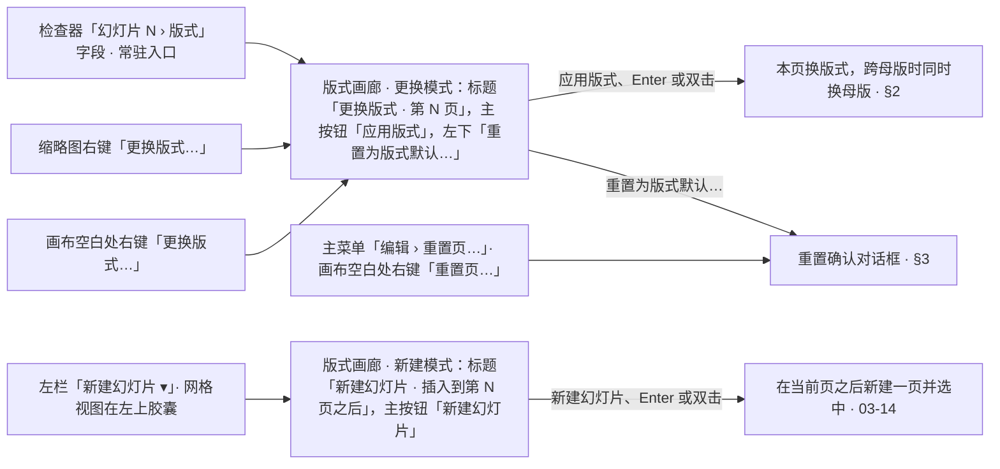
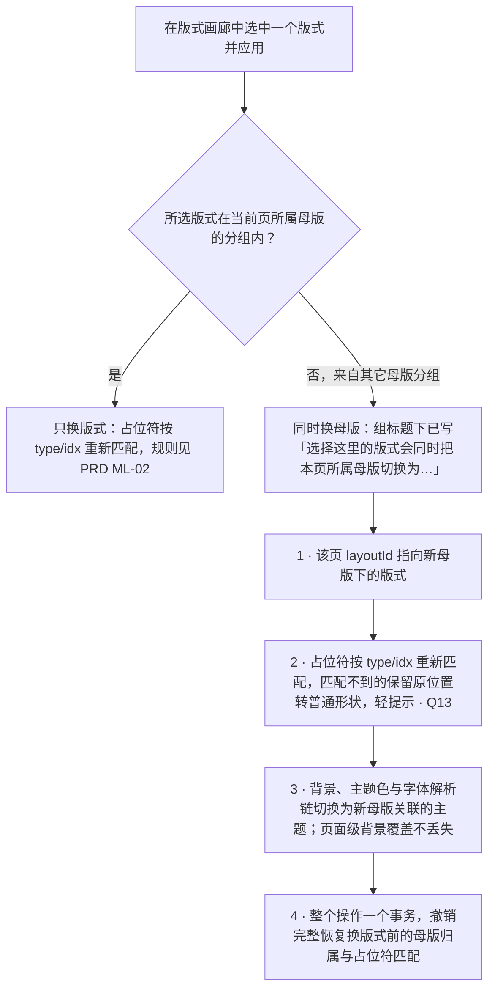
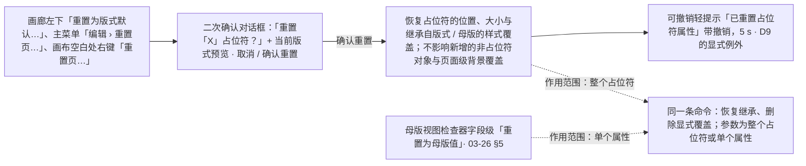

> 状态：草稿 | 负责：设计 | 更新：2026-09-18；2026-09-25（补图）；2026-10-07（design-language-v3 第 1 批：按已拍板的 `layout-picker` 场景 10 态改写——新增 §0 入口与两种模式（检查器「版式」字段、缩略图与画布空白处右键「更换版式…」、左栏「新建幻灯片 ▾」共用同一个画廊组件，重置页三个入口）与图 0-1；§1 线框改为贴检查器左缘的 472 宽弹层，补键盘、读屏与关闭；§2 图 2-1 措辞；§3 重置改为 confirm 对话框，补入口与焦点去向；§4 改为逐个列出样张状态，补打开中（取消画廊骨架态）与评审、降权下的入口；§5 规格与卡片状态矩阵改为 v3 token；§6 补并发、多页与紧凑形态；§7 UX 留痕同步（rulings §4.25 DS-1、DS-2、DS-15、DS-21、DS-23））；2026-10-07（design-language-v3 第 1 批：§4、§4.3 评审与只读时缩略图与画布右键的「更换版式…」「重置页…」留在原位、不可用（TB-17），同一原因写在菜单顶部说明行（TB-22），样张 `layout-picker.readonly` 说明「缩略图右键也没有『版式』」按 TB-17 改正；依据 rulings §4.25 TB-17、TB-22）；2026-10-08（design-language-v3 第 1 批收口：§3 重置的「确认对话框 + 可撤销轻提示」写明以样张为准、PRD ML-02 原内嵌确认卡随之改（DS-32）；§4 `readonly` 行与 §4.3 注明样张说明与降权缩略图右键已改为菜单顶部说明行，补各模式的说明行文案（评审「评审模式下不可用」，与主菜单同一口径，TB-51）；依据 rulings §4.25 DS-32、TB-51）；2026-10-08（design-language-v3 第 1 批评审修改：§5 检查器「版式」字段注明下拉画法（透明底加细边，悬停与画廊打开时铺 `--v3-panel-2`，rulings §4.25 DS-35），底栏「取消」为透明底加细边的次按钮（DS-37）；卡片状态矩阵的悬停边由 `--v3-border-control` 改为 `--v3-hover-line`（DS-35））；2026-10-23（design-language-v3 第 3 批评审修改：重置确认框圆角随 rulings §4.25 DS-142 改为 12——§4 `reset-confirm` 与 §5「重置确认」一行同步）；2026-11-04（design-language-v3 母版视图改版：§0 入口表「版式」字段补节标题右侧的「编辑版式」不是画廊入口；§1 卡片与 §3 重置确认的预览改为与母版窗格缩略图同一画法（一种细线框、提示字整行取舍）；§4 `layout-picker.readonly` 一行（标题改为「评审模式 · 画廊入口不出现」）与 §4.3 补只读时「编辑版式」留在原位不可用（DS-15 的例外），表后补随之改的画面；§5 卡片网格与检查器字段、§7 UX 规则同步；rulings §4.25 DS-147、DS-149、TB-191；需求编号、优先级与里程碑不变） | 依赖：charter v0.2；PRD `07-masters` ML-02；rulings §4.10 Q13 / Q16（D9 显式例外）、§4.25 DS-1、DS-2、DS-15、DS-21…DS-26、DS-32、DS-35、DS-37、DS-147、DS-149、TB-17、TB-22、TB-51、TB-191；`10-prd/07-design-coverage-and-gaps.md`；03-screens/05、14、26；前端 `50-frontend/11` §7；playground 第 1 批场景 `layout-picker`（`src/v3/editor/layouts/LayoutGallery.tsx`）

# 03-27 版式选择器（按母版分组的版式画廊）与重置页

> **设计基准（2026-10-07 起，rulings §4.25 DS-21）**：以 playground 第 1 批场景 `layout-picker`（10 个状态）为准；新建模式与「更换版式」在幻灯片管理里的状态见 03-14 的场景 `slide-management`（`new-slide-menu`、`new-slide-after-cover`、`change-layout`、`layout-unmatched`）。画廊是底座唯一的一份组件：`playground/src/v3/editor/layouts/LayoutGallery.tsx`（`LayoutGallery`、检查器字段 `SlideLayoutSection`、重置确认 `ResetDialog`、轻提示 `LayoutToasts`），卡片与画布、母版窗格共用 `LayoutArt.tsx` 的真实渲染。路由 `#/v3/editor?state=layout-picker.<状态 id>`，状态清单见 §4。本文写结构、尺寸、行为与状态，token 只写名字（取值见设计 04）。旧版 `#/editor/layouts`（672 宽对话框）与 `mockups/27-layout-picker-and-reset.html` 已被 v3 取代，不再作实现依据。

对应产品线 `10-prd/03-features/07-masters-layouts-and-themes.md` **ML-02 版式应用与重置**（M2 P0）。分工：03-14 管幻灯片的新建、排序、隐藏与「新建」的触发方式；本文管画廊组件本身（分组、搜索、跨母版、键盘、状态）与「更换版式」「重置页」的完整流程。两处打开的是同一个组件，只是标题、第一张卡、主按钮与选择后的动作不同（§0），不是两套设计。pptx 文档可以有多个母版（原生多母版设计，或跨文档粘贴、合并导入产生），所以画廊必须按母版分组，否则用户分不清两个同名「标题和内容」分属哪个母版。

---

## 0. 入口与两种模式

| 入口 | 位置 | 打开 |
|---|---|---|
| 检查器「版式」字段 | 无选中时「幻灯片 N › 版式」：32 × 18 版式缩略 + 版式名 + ▾（常驻入口，DS-1：格式类在检查器）；点开是版式画廊，不是简单下拉。节标题右侧另有「编辑版式」，进入母版视图（03-26 §1.1，rulings §4.25 DS-147），不是画廊入口 | 更换模式 |
| 缩略图右键「更换版式…」 | 左栏与网格同一份右键菜单（03-05） | 更换模式，作用于该页 |
| 画布空白处右键「更换版式…」 | 03-05 | 更换模式 |
| 左栏「新建幻灯片 ▾」 | 左栏顶部（网格视图在左上胶囊）；旁边的「+」直接按缺省版式新建、不开画廊（03-14） | 新建模式 |
| 重置页 | 画廊左下「↺ 重置为版式默认…」；主菜单「编辑 › 重置页…」；画布空白处右键「重置页…」 | 重置确认对话框（§3），后两个不经过画廊 |

| | 更换模式 | 新建模式（03-14） |
|---|---|---|
| 标题 | 更换版式 · 第 N 页 | 新建幻灯片 · 插入到第 N 页之后 |
| 第一张卡 | 「与当前页相同」（第二行灰字写出当前版式名），缺省选中 | 同；当前页是标题幻灯片时换成「建议」（第二行「标题和内容」，首页之后很少再要一张标题页） |
| 当前版式 | 卡片名称后「当前」标记 | 无 |
| 其它母版组的说明 | 选择这里的版式会同时把本页所属母版切换为「X」 | 用这里的版式新建的页属于母版「X」 |
| 底栏 | 左「↺ 重置为版式默认…」；右「取消」「应用版式」 | 右「取消」「新建幻灯片」 |
| 选择后 | 应用到本页（§2）；有元素不匹配时轻提示（§4.1） | 在当前页之后新建一页并选中 |
| 弹出位置 | 贴检查器左缘向左展开，顶端与「版式」字段对齐；从右键打开时的位置样张未画，随实现 | 贴左栏右缘向右展开 |

原「开始」页签的「新建 ▾」「版式 ▾」与原属性面板「幻灯片属性」里的入口随 ribbon 作废（DS-1），改为上表。

**图 0-1 一个画廊组件、两种模式与重置**



怎么读：左侧五类入口，前三个打开更换模式、第四个打开新建模式，两者是同一个画廊组件；重置页有三个入口，都落到同一个确认对话框。
依据：rulings §4.25 DS-1、DS-21；样张 `editor/layouts/LayoutGallery.tsx` 文件头、`slides-selection` 场景的右键菜单条目。

---

## 1. 线框：版式画廊（更换模式，多母版）

```
←────────────── 画廊 472（贴检查器左缘向左展开） ──────────────→←──────── 检查器 280 ────────→
                                                                ┌────────────────────────────┐
                                                                │ 幻灯片 3                   │
                                                                ├────────────────────────────┤
                                                                │ 版式                       │
┌──────────────────────────────────────────────────────────────┐│ [▭ 仅标题              ▾]  │  ← 锚点「版式」字段：画廊顶端与它对齐
│ 更换版式 · 第 3 页                                       [×] │├────────────────────────────┤
│ [⌕ 搜索版式                                              ]   ││ 主题                       │
│──────────────────────────────────────────────────────────────││ [■] Office          [调整] │
│ ▤ Office · 当前页所用母版                                    ││     思源黑体               │
│ ┏━━━━━━━━━━━┓ ┌───────────┐ ┌───────────┐ ┌───────────┐      │├────────────────────────────┤
│ ┃           ┃ │           │ │           │ │           │      ││ 背景                       │
│ ┗━━━━━━━━━━━┛ └───────────┘ └───────────┘ └───────────┘      ││ …                          │
│ 与当前页相同  标题幻灯片    标题和内容    两栏内容           │
│ 仅标题                                                       │
│ ┌───────────┐ ┌───────────┐ ┌───────────┐ ┌───────────┐      │
│ │           │ │           │ │           │ │           │      │
│ └───────────┘ └───────────┘ └───────────┘ └───────────┘      │
│ 比较          仅标题[当前]  章节标题      空白               │
│                                                              │
│ ▤ 简约 [导入]                                                │
│ ⓘ 选择这里的版式会同时把本页所属母版切换为「简约」           │
│ ┌───────────┐ ┌───────────┐ ┌───────────┐ ┌───────────┐      │
│ │           │ │           │ │           │ │           │      │
│ └───────────┘ └───────────┘ └───────────┘ └───────────┘      │
│ 标题和内容    标题幻灯片    空白          仅标题             │
│──────────────────────────────────────────────────────────────│
│ ↺ 重置为版式默认…                         [取消]  [应用版式] │
└──────────────────────────────────────────────────────────────┘
```

图例：`▤` 组标题的版式图标（Lucide `LayoutTemplate`）；`┏━┓` 选中的卡（强调色边）；`[当前]` 当前版式标记；`[导入]` 导入的母版标记；`ⓘ` 说明图标。样张 `layout-picker.default`。

- **分组**：当前页所属母版**置顶**，组标题写「· 当前页所用母版」；其余母版按文档内顺序；组标题含 `LayoutTemplate` 图标 + 母版名 +（导入的母版）「导入」标记，与母版窗格（03-screens/26 §3）同一标记。其它母版组的标题下多一行说明（§0 表）。只有一个母版时退化为扁平网格，不显示组标题与说明（§4.2）。
- **「与当前页相同」**只在当前母版组、排第一张并缺省选中，第二行灰字写它实际是哪个版式；不在其它组重复（它只对「不换母版」有意义）。
- **卡片**：版式的真实渲染（母版装饰、占位符排布、母版标题样式的字形，DS-2），与母版窗格缩略图同一画法——占位符只画一种细线框，不分本版式与继承、不写类型名；提示字按卡片尺寸排，放不下的行整行省去、不裁半字（rulings §4.25 DS-149、TB-191）；4 列；名称在卡片下方；当前版式名称后「当前」标记。
- **搜索**：按名称不区分大小写模糊过滤全部分组；0 命中的组连同组标题隐藏（不留空的组标题），全部无匹配时正文「未找到匹配「〈搜索词〉」的版式」（§4）；「与当前页相同」按它的名称与实际版式名参与匹配。`Esc` 先清空搜索，再按一次才关闭。
- **键盘与读屏**：Tab 顺序与视觉顺序一致，卡片网格里只有选中的卡是 Tab 停靠点；方向键按卡片的实际位置移动（左右取同一行前后一张，上下取上 / 下一行水平最近的一张，跨组也行），选中跟随焦点；`Enter` 或双击执行主按钮（应用版式 / 新建幻灯片）；已被删除的卡片跳过。每组是一个 `section`（「母版 Office」），网格 `role="listbox"`（「Office 的版式」），卡片 `role="option"` + `aria-selected`，可读名附「（当前）」「（已被删除）」与第二行文字。
- **关闭**：右上「关闭」（提示 Esc）、`Esc`、点外部、「取消」；关闭后焦点回到触发处（检查器「版式」字段或「新建幻灯片 ▾」）。执行主按钮后同样关闭。

---

## 2. 跨母版选择的后果

从非当前母版的分组选择版式，不只是「换版式」，同时是「换母版」——组标题下已有说明（§1），应用后（样张 `layout-picker.cross-master` 选中「简约 › 标题和内容」）：

1. 该页的 `layoutId` 指向新母版下的版式；
2. 占位符按 `type` / `idx` 重新匹配（规则见 PRD ML-02），匹配不到的内容保留原位置、转为普通形状，并给轻提示（§4.1）；
3. 该页的背景、主题色 / 字体解析链随之切换为新母版关联的主题（页面级背景覆盖不丢失，只是继承基准变化）；
4. 整个操作是一个事务（一次撤销粒度），撤销完整恢复到换版式前的母版归属与占位符匹配。

**图 2-1 选择版式时是否跨母版**



怎么读：只有从非当前母版分组选择时才走 1–4 四步；「与当前页相同」只出现在当前母版分组，所以它永远走「只换版式」。
依据：PRD ML-02「跨母版选版式」；rulings §4.10 Q13、Q16；前端 50/11 §7。

---

## 3. 重置页 / 重置占位符

入口见 §0：画廊左下「↺ 重置为版式默认…」（ghost 按钮，与右侧「取消 / 应用版式」分开、降权为次要操作）、主菜单「编辑 › 重置页…」、画布空白处右键「重置页…」。点后关闭画廊，弹出二次确认对话框：

```
┌──────────────────────────────────────────────────┐
│ 重置「仅标题」占位符？                           │
│                                                  │
│ 已对占位符做的位置、样式改动将恢复为版式定义；   │
│ 你新增的形状、图片不受影响。                     │
│                                                  │
│             ┌──────────────────────┐             │
│             │   当前版式预览       │             │
│             └──────────────────────┘             │
│                                                  │
│                               [取消]  [确认重置] │
└──────────────────────────────────────────────────┘
```

- 对话框为 confirm 形态（宽 360）：标题「重置「〈版式名〉」占位符？」，说明「已对占位符做的位置、样式改动将恢复为版式定义；你新增的形状、图片不受影响。」，其下 220 宽的当前版式预览（真实渲染，与画廊卡片同一画法，DS-149），[取消][确认重置]（主按钮强调色）。打开时焦点进框；关闭后焦点回到检查器「版式」字段（画廊已关闭，不回到画廊里的按钮）。样张 `layout-picker.reset-confirm`。
- 确认后：可撤销轻提示「已重置占位符属性 [撤销]」（5 s，样张 `layout-picker.reset-done`）。「确认 + 可撤销」两层保留，是产品默认答案 D9「可逆操作只用可撤销轻提示」的显式例外（rulings §4.10 Q16，PRD ML-02）；确认的形态以已拍板样张为准，是确认对话框而不是内嵌确认卡，PRD ML-02 原「内嵌确认卡」的写法随之改（rulings §4.25 DS-32）。
- 作用范围：**只**作用于占位符（位置、大小、继承自版式 / 母版的样式覆盖），文本内容不变；不影响用户新增的非占位符对象，也不影响页面级背景覆盖——背景重置是 03-03（G-35）的独立动作「重置为版式背景」，两者不合并进同一按钮，避免一次点击产生超出预期的连锁重置。
- 页上没有任何覆盖时命令不可用（PRD ML-02）：三个入口留在原位、不可用并写原因（文案样张未画，随实现）。
- 同一机制在母版视图里以字段级「重置为母版值」出现（03-screens/26 §5），作用范围更细（单个属性而非整个占位符）；实现时共用同一条命令，只有作用范围参数不同（前端 50/11 §6）。

**图 3-1 重置占位符的两层防护与共用命令**



怎么读：实线是一次页面级重置的顺序，二次确认与可撤销轻提示两层同时保留；虚线表示两个入口在实现上共享同一条命令，只是作用范围参数不同。
依据：rulings §4.10 Q16；PRD ML-02；前端 50/11 §6、§7。

---

## 4. 状态

样张路由 `#/v3/editor?state=<下表 id>`（可加 `&theme=dark|light`）。ML-02 全部在 M2。

| 状态 id | 样张标题 | 要点 | 里程碑 |
|---|---|---|---|
| `layout-picker.default` | 版式画廊 · 多母版分组 | 当前页（第 3 页「仅标题」）所用母版「Office」置顶并标注，「与当前页相同」只在这一组、缺省选中；导入的「简约」组标「导入」，组标题下写会同时切换母版；左下「重置为版式默认…」与右侧「取消 / 应用版式」分开 | M2 |
| `layout-picker.cross-master` | 选中其它母版的版式 | 选中「简约 › 标题和内容」：应用后本页的版式、所属母版与主题解析链在一个事务里一起切换，可一步撤销 | M2 |
| `layout-picker.search` | 搜索过滤 | 搜「标题」：按名称模糊过滤全部分组；`Esc` 先清空搜索再关闭 | M2 |
| `layout-picker.no-match` | 搜索无结果 | 0 命中的分组连同标题隐藏，全部无匹配时正文「未找到匹配「图表」的版式」 | M2 |
| `layout-picker.single-master` | 只有一个母版 | 退化为扁平网格，不显示组标题与「会同时切换母版」提示 | M2 |
| `layout-picker.deleted` | 版式刚被他人删除 | 画廊打开期间协作者删掉「比较」：卡片置灰并标「已被删除」，点击无效、方向键跳过，下次打开时消失 | M2 |
| `layout-picker.mismatch` | 应用后有元素不匹配 | 改成「标题和内容」后 3 张指标卡匹配不到占位符：原位保留为普通形状，警告轻提示带「撤销」（5 s）；检查器字段已显示新版式 | M2 |
| `layout-picker.reset-confirm` | 重置占位符 · 确认 | 二次确认（D9 显式例外，Q16）带当前版式预览；只恢复占位符的位置与样式；确认框圆角 2026-10-23 起为 12（rulings §4.25 DS-142），画面随之改 | M2 |
| `layout-picker.reset-done` | 重置后可撤销 | 轻提示「已重置占位符属性」带「撤销」（5 s） | M2 |
| `layout-picker.readonly` | 评审模式 · 画廊入口不出现 | 检查器「版式」只写当前版式（缩略 + 名称），没有画廊入口；节标题右侧的「编辑版式」留在原位、不可用，写「评审模式下不可用」（rulings §4.25 DS-147 子题，§4.3）；工具条换成评审条、左栏不提供新建；缩略图右键「更换版式…」留在原位、不可用，原因写在菜单顶部一行「评审模式下不可用」（TB-17、TB-22、TB-51；样张说明原写「缩略图右键也没有『版式』」，已改正，§4.3） | M2 |

相关状态（归 03-14、03-05 与 03-02）：`slide-management.new-slide-menu`、`new-slide-after-cover`（新建模式）、`slide-management.change-layout`、`layout-unmatched`（幻灯片管理里的更换版式）、`context-menu.thumbnail`、`context-menu.canvas`（右键入口）、`main-states.degraded-thumb-menu`（降权时右键入口不可用）。

母版视图改版（2026-11-03 拍板，rulings §4.25 DS-147、DS-149）随之改：画廊卡片、检查器「版式」字段的缩略与重置确认里的预览换成一种细线框、提示字整行取舍；只读态的「版式」节多「编辑版式」（留在原位、不可用）。

### 4.1 版式不匹配提示

更换版式后有内容匹配不到占位符时：轻提示（警告档，带警告图标）「N 个元素无法匹配新版式的占位符，已保留为普通形状 [撤销]」（rulings §4.10 Q13，PRD ML-02；版式画廊、缩略图右键与 03-14 三处统一为这一条，带操作的轻提示停留 5 s）。点「撤销」一步回到原版式（跨母版时也回到原母版）。全部匹配时不提示。原「画布内联警告条」与对话框内描述的做法已作废。

### 4.2 只有一个母版

不显示组标题与「会同时切换母版」说明，分组结构退化为扁平网格（与 03-14 原有的单母版形态是同一组件的两种渲染结果），避免给单母版用户制造多余的层级。

### 4.3 评审模式、只读浏览与降权

- 评审模式与只读浏览（DS-15、DS-23）：检查器「版式」只读展示当前值（版式缩略 + 名称），没有画廊入口；节标题右侧的「编辑版式」照画、留在原位不可用，写与主菜单「母版视图」同一条原因（评审「评审模式下不可用」、查看者「只有查看权限」、降权「需要编辑权限」）——DS-15「只读展示不画禁用控件」的例外，因为它是进入另一个模式的动作、不是值字段（rulings §4.25 DS-147 子题；样张这一态的标题随之由「评审模式 · 入口不出现」改为「评审模式 · 画廊入口不出现」）；左栏不提供「新建幻灯片」；工具条换成评审条（浏览条）。缩略图与画布空白处右键的「更换版式…」「重置页…」按 03-05 §4 的只读规则留在原位、不可用（rulings §4.25 TB-17），与同组其余改文档的条目共用一个原因，写在菜单顶部的说明行（TB-22，03-05 §2.3；样张 `main-states.degraded-thumb-menu` 已改为说明行）：评审模式「评审模式下不可用」（与主菜单同一口径，TB-51）、只读浏览「只有查看权限」、编辑模式已降权「需要编辑权限」；主菜单「编辑 › 重置页…」同样不可用，原因写在条目右侧（03-02 §2.3，样张 `main-states.degraded-menu`）。所以评审时没有任何能打开画廊或重置确认的入口。
- 编辑模式已降权：检查器同上只读展示；「新建幻灯片 ▾」与「+」留在原位不可用（「需要编辑权限」）；右键与主菜单条目同上。

### 4.4 打开中

文档打开、首屏可交互之前，检查器「版式」字段与「新建幻灯片 ▾」留在原位不可用（「文档打开后可用」，样张 `main-states.opening`），画廊只在版式数据就绪后才能打开，所以不设画廊骨架态（原「网格骨架」加载态作废）。

### 4.5 离线

画廊本身不需要网络（版式定义随文档加载到本地），可以正常使用；应用后的事务与其它本地编辑一样走乐观本地优先，联网后同步。

---

## 5. 设计规格

| 项 | 规格 | 样张源码 |
|---|---|---|
| 画廊弹层 | 宽 472；浮层表面（`--v3-panel` 底、1px `--v3-border`、圆角 8、`--v3-shadow`）；位置见 §0 表 | `LayoutGallery.tsx`、`kit/Popover.tsx` |
| 标题行 | 内边距 12；高 24，标题 12px 600；右侧 24px「关闭」（工具提示带 Esc） | `LayoutGallery` |
| 搜索 | 28 高字段（03-02 §3.5 的字段外框），左侧搜索图标，占位文字「搜索版式」 | 同上 |
| 滚动区 | 最高 440，内边距 12；组间距 16，组标题与网格间距 8 | 同上 |
| 组标题 | 高 18、12px：16px `LayoutTemplate` 图标 `--v3-text-2` + 母版名 600 +「· 当前页所用母版」`--v3-text-2` +「导入」标记；其它母版组下一行说明（Info 图标 + 12/18 `--v3-text-2`） | 同上 |
| 卡片网格 | 4 列，列距 8、行距 12；卡片为版式真实渲染（16:9、圆角 4、1px `--v3-border`；占位符一种细线框、提示字整行取舍，同 03-26 §3，DS-149、TB-191）+ 下方名称（高 18、12px，选中 500）；「与当前页相同」「建议」卡第二行 12/16 `--v3-text-2` | 同上 |
| 底栏 | 上方 1px 分隔、内边距 12：左 ghost「↺ 重置为版式默认…」（仅更换模式），右 secondary「取消」（次按钮：透明底加 1px 细边，rulings §4.25 DS-37）+ primary「应用版式」/「新建幻灯片」 | 同上 |
| 检查器「版式」字段 | 28 高下拉字段（03-02 §3.5 的下拉画法：透明底加 1px 细边，悬停与画廊打开时铺 `--v3-panel-2`，即按下态；rulings §4.25 DS-35）：32 × 18 版式缩略（真实渲染、1px 边、圆角 2，画法同卡片）+ 版式名 + ▾；只读时只写缩略与名称 | `SlideLayoutSection` |
| 重置确认 | confirm 对话框（宽 360、圆角 12，无分隔线、无关闭钮；圆角 2026-10-23 按 rulings §4.25 DS-142 改）+ 220 宽版式预览（圆角 4、1px 边） | `ResetDialog`、`kit/Dialog.tsx` |
| 轻提示 | 画布底部、工具条上方居中；不匹配为警告档（`TriangleAlert`），重置为中性档；都带「撤销」，5 s | `LayoutToasts`、`kit/Toast.tsx` |

**状态矩阵**（版式卡片）：

| 状态 | 视觉 |
|---|---|
| 默认 | 1px `--v3-border` |
| 悬停 | 边换 `--v3-hover-line`（`--v3-text-3` 与分隔线之间的一档，2026-10-08 安静样式，rulings §4.25 DS-35；原「边换 `--v3-border-control`」作废） |
| 选中 | 边换 `--v3-accent` + 0.5px 同色外环；名称 500 |
| 键盘聚焦 | 2px 强调色描边、偏移 2（焦点即选中） |
| 当前版式 | 名称后「当前」标记（更换模式） |
| 已被删除 | 40% 不透明、名称退到 `--v3-text-3` +「已被删除」标记；`aria-disabled`，点击与方向键都跳过 |
| 搜索 0 命中 | 组连同标题隐藏；全部无匹配时正文一行说明（§4） |

卡片本身没有「不可用」态：没有权限时整个入口不可用或只读展示（§4.3），不渲染不可点的画廊。

---

## 6. 边界情况

- **母版数量很多**（导入合并产生 ≥ 5 个母版）：滚动区内纵向滚动，当前母版分组只在顶部出现一次，不做吸顶复制。
- **目标版式在画廊打开期间被删除**（协作者并发删除）：该卡片置灰 +「已被删除」，点击无效，下次打开时消失（样张 `layout-picker.deleted`）。若已在应用时被删，按 PRD ML-03 冲突表处理：删除胜、墓碑期读时容错，本端轻提示「版式「L」已被 A 删除，第 P 页已改用「〈默认版式名〉」」（03-screens/26 §8）。
- **同一页的版式被并发改写**：`layoutId` 键级后写者胜，提示 `prop-lww` 与「恢复我的值」（前端 50/11 §7）。
- **多页一起更换**（多选缩略图后右键「更换版式…」）：每页一个事务；不匹配提示里的 N 为各页之和，「撤销」一次回退本次全部事务，前提是它们仍在本地撤销栈顶（前端 50/11 §7）；样张未画多选形态。
- **紧凑形态**（640–1024）：检查器在抽屉里，画廊随「版式」字段从抽屉打开；样张未画，随实现。
- 名称超长：卡片名称与组标题不换行，放不下时省略号截断，完整名称进工具提示与可读名。

---

## 7. 应用的 UX 规则（ui-ux-pro-max 留痕）

| 规则 id | 来源检索 | 落实方式 |
|---|---|---|
| `gallery-grid-keyboard`（Accessibility/Keyboard Navigation） | "gallery grid keyboard navigation" --domain ux | 方向键按卡片实际位置移动、跨组连续，Tab 顺序与视觉顺序一致，卡片网格只有一个 Tab 停靠点（§1） |
| `realistic-content` | "placeholder empty state" --domain ux（Content/Placeholder Content：Use realistic sample data） | 卡片是版式的真实渲染（母版装饰 + 占位符排布 + 标题字形），不用骨架条或灰块（DS-2）；占位符画一种细线、提示字整行取舍，不裁半字（DS-149） |
| `truncate-ellipsis` | "resize handle drag" 检索副产出（Content/Truncation） | 版式名称、母版名称超长时省略号截断 + 完整名称进工具提示，不做无提示硬截断（§6） |
| `undo-support` | 仓库既有规则（设计 README §8 #9），交叉验证于 "toast undo" --domain ux（Feedback/Toast：3–5 秒自动消失） | 重置走 5 秒可撤销轻提示，二次确认只用于「重置」入口本身（§3），两层防护不冲突——作为 D9 的显式例外保留（rulings §4.10 Q16） |
