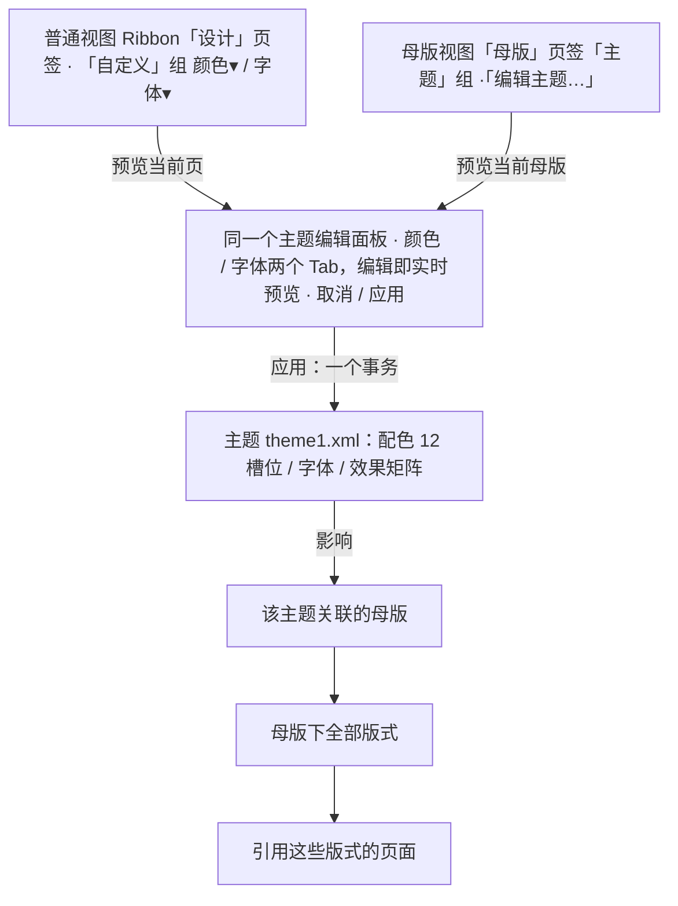

> 状态：草稿 | 负责：设计 | 更新：2026-09-18；2026-09-25（补图）；2026-09-26（§4.20：FE-07 应用主题改为直接执行 + 可撤销 toast，§6 该项已定） | 依赖：charter v0.2；rulings §4.8 Q6（Geist）/ §4.9 Q10 / §4.10 Q17 / §4.20 FE-07；`10-prd/07-design-coverage-and-gaps.md` G-75；PRD `07-masters` ML-04；03-screens/26；09 v3.0 §3（主题卡 84×60、变体 44×28）；playground `DesignTab.tsx` / `ThemeEditorPanel.tsx`

# 03-28 设计页签：主题、变体、主题色与字体编辑

> **设计基准（2026-09-15 起）**：组件规格以 [`09-design-specification.md`](../09-design-specification.md) v3.0（shadcn Rhea + 材质层）为准；对应 playground 路由 `#/editor/design`（[已发布 artifact](https://claude.ai/code/artifact/cf6e1a1a-986b-48bb-b743-5758dff419d2)，源码 `playground/src/routes/`）。本文引用的 `mockups/*.html` 与线框图为历史静态稿，以 playground 实际渲染为终稿。

新增界面。对应产品线 `10-prd/03-features/07-masters-layouts-and-themes.md` **ML-04 主题**（M3 P1）。本文件覆盖 Ribbon"设计"页签（此前 02-editor-main.md 线框中只列出页签名，未展开内容）与其驱动的主题编辑面板；与 03-screens/26 的关系：主题（`theme1.xml`：配色/字体/效果矩阵）是母版的**上游**——同一文档可有多个母版，但典型场景下同一母版关联一个主题，编辑主题会影响该母版下全部版式与页面，因此"编辑主题…"在母版视图 Ribbon 的"主题"分组中也提供入口（见 03-screens/26 §2 线框），两处入口指向同一面板。

对应高保真设计稿：`mockups/28-design-tab-and-themes.html`（历史静态稿，尺寸与分组以 playground `#/editor/design` 为准）。**2026-09-18 修订**：按 rulings §4.10 Q17 删除「设置为默认主题」「另存为新主题」及其状态；线框补插件页签与页签行右侧控件；尺寸改为 84×60 / 44×28；字体口径改 Geist 优先。

**主题的上游位置与两个编辑入口**



怎么读：两个入口打开同一个面板，只是预览对象不同；从「主题」往下是主题向下游的影响链，一次「应用」影响该主题下所有母版、版式与页面，但已断开主题色引用的显式覆盖值保持不变。

---

## 1. 线框："设计"页签

```
┌─────────────────────────────────────────────────────────────────────────┐
│[开始][插入][设计▪][切换][视图][数据图表插件▸]        [普通|母版] [◐主题] [?] │
├─────────────────────────────────────────────────────────────────────────┤
│┌主题──────────────────────────┐┌变体──────┐┌自定义──────────────────┐  │
││[Office✓][极简灰][暖色商务][深色科技]││[▪][ ][ ]  ││颜色▾ 字体▾              │  │
│└──────────────────────────────┘└──────────┘└────────────────────────┘  │
└─────────────────────────────────────────────────────────────────────────┘
```

- "主题"分组：横向滚动的主题缩略卡片库（PowerPoint 惯例，不做成下拉，因为主题选择是高频、需要视觉比较的操作）；当前应用主题右上角 ✓ 标记。
- "变体"分组：同一主题的配色变体（同一整体风格，强调色/中性色比例不同的小色条缩略），选中态 `ring-2 ring-primary`；变体数定稿为**每主题 3 个变体**（playground `themePresets`），PRD ML-04 允许 ≤ 4。
- "自定义"分组：颜色▾/字体▾ 打开主题编辑面板对应分区（见 §2；playground 以 `Popover` 承载 `ThemeEditorPanel`，宽 288）。原"设置为默认主题"按钮已删除（rulings §4.10 Q17，设计与 playground 同删；ML-04 不变）。
- 页签行右侧的「普通 | 母版」分段、主题切换与「?」与其它页签相同（02-editor-main.md §2.4）；母版视图下"设计"页签隐藏，同一套主题控件出现在"母版"页签"主题"组（rulings §4.9 Q10）。

## 2. 线框：主题编辑面板（检查器坞位置，Tab 切换）

```
┌───────────────────┐
│ 颜色 │ 字体         │
├───────────────────┤
│ ■背景·浅1 ■文字·深1 │
│ ■背景·浅2 ■文字·深2 │
│ ■强调色1  ■强调色2  │
│ ■强调色3  ■强调色4  │
│ ■强调色5  ■强调色6  │
│ ■超链接   ■已访问链接│
│ 强调色1·Hex[#4A54E1]│
├───────────────────┤
│         [取消][应用] │
└───────────────────┘
```

字体分区（Tab 切换后）：标题字体下拉 + 实时预览"AaBb 标题示例 123"，正文字体下拉 + 实时预览，说明文字标注"仅影响文档内容字体映射（`+mj-lt`/`+mn-lt`），不影响编辑器 chrome 字号"（呼应 04-design-system.md §2.8 的既有边界声明，避免用户误以为改主题字体会连带改变 UI 本身字号）。

12 个颜色槽位对应 OOXML `theme1.xml` 的 `<a:clrScheme>` 12 个节点（`dk1`/`lt1`/`dk2`/`lt2`/`accent1`–`accent6`/`hlink`/`folHlink`），面板用产品化措辞（"背景·浅1"而非"lt1"）呈现，符合 07-accessibility-and-i18n.md §7 文案规范"不使用裸露技术标识面向最终用户"；技术标识仅在插件开发文档/`aria-describedby` 的辅助说明中出现。

---

## 3. 状态

### 默认态
显示文档当前主题（若从未修改则为导入 pptx 自带的主题，或新建文档的内置"Office 主题"）。

### 自定义颜色/字体编辑中
颜色槽位的色块点击弹出颜色选择器 popover（复用 03-screens/16 已定的颜色选择器组件：主题色/标准色/最近使用/自定义 Hex-RGB-HSL），编辑任一槽位后画布预览区**实时**更新（渲染当前选中页或母版的代表性内容，具体取决于面板从何处打开：从"设计"页签打开预览当前页；从母版视图"编辑主题…"打开预览当前母版）。

### 只读（评审模式 / 无编辑权限）
"设计"页签整体不出现主题编辑相关的可交互控件（页签本身可保留用于查看，但"自定义"分组按钮禁用），与 03-screens/26 母版视图的评审模式降级手法一致。

### 保存
"应用"直接写入当前主题（一个事务，影响该主题下所有母版/版式/页面），**不弹确认**；执行后给 `sonner` toast「已应用主题「X」，影响 N 页 [撤销]」（N 为该母版引用的页数，5 s），点「撤销」一步恢复原主题与 12 个色槽（rulings §4.20 FE-07；PRD D9「可逆操作用可撤销 toast」与 ML-04「一个事务可撤销」）。主题卡、变体色块与本面板的「应用」是同一行为、同一条 toast。原"另存为新主题"入口及其状态已删除（rulings §4.10 Q17；playground `ThemeEditorPanel` 同删），面板底部仅保留 [取消][应用]。

---

## 4. 设计规格

| 项 | 数值 | token |
|---|---|---|
| 主题缩略卡片 | 84×60（`h-[60px] w-[84px]`，与 Ribbon 大按钮同高）：16:9 缩略 + 11px 名称；选中 `border-primary ring-1 ring-primary` + `CircleCheck` | 09 §3 高度节奏；playground `DesignTab.tsx` |
| 变体色条 | 44×28（`h-7 w-11`，与小控件同高），3 色横向平分；选中 `ring-2 ring-primary` | 09 §3；playground `DesignTab.tsx` |
| 颜色槽位网格 | 2 列，槽位间距 `gap-2` / `gap-3` | playground `ThemeEditorPanel` |
| 颜色槽位色块 | 20×20px，`rounded-sm` | 09 §2「颜色块」（`ColorSwatch`） |
| 字体预览文字 | 20px 示例文字 | 结构值（预览用途，非 chrome 字号 token） |

**状态矩阵**（主题缩略卡片）：默认（1px 发丝描边）/悬停（`hover:border-ring`）/选中（`border-primary ring-1 ring-primary` + `CircleCheck`）/聚焦（`:focus-visible`）/禁用（评审模式，40% 不透明）——不设计加载态（主题库为文档内置数据，随文档加载完成，无独立异步加载阶段）。

对应基准：playground `#/editor/design`；`docs/20-design/mockups/28-design-tab-and-themes.html` 为历史静态稿。

## 5. 边界情况

- 应用新主题后，某版式的占位符曾被显式覆盖颜色（未使用主题色引用）：覆盖值保留不变（章程"只写显式覆盖"原则的延伸，主题切换只影响引用主题色的元素，不追溯覆盖已断开继承链的元素），面板内不做特殊提示（这是预期行为，与 PowerPoint 一致）。
- 强调色 1–6 的默认取值需与设计 04 §2 的协作者/语义色板保持色相区分（避免用户把某文档主题强调色调成与 presence 色或 danger/warning 语义色混淆的色相）：本文件不做强制校验，仅建议插件/实现在"自定义颜色"面板对高度接近语义色/presence 色的取值给出弱提示（P2，非本轮阻塞）。
- 深色主题卡片（如"深色科技"）：其预览缩略图与实际画布渲染一致（深底浅字），选中后画布本身背景随之变深——这与 04-design-system.md §2.2a"文档内容与舞台色不随编辑器主题切换"是两个独立维度：编辑器 chrome 的亮/暗（`data-cordex-theme`）与**文档主题**的明暗是正交的，用户可以在亮色编辑器 chrome 下编辑一份深色背景的演示主题，反之亦然，面板不应把两者混为一谈。

## 6. 待决事项

- ~~"应用"主题前是否需要确认~~ **已定**（2026-09-26，rulings §4.20 FE-07）：直接应用 + 可撤销 toast「已应用主题「X」，影响 N 页 [撤销]」，不弹确认，见 §3「保存」。
- 主题库（内置 4 套之外）是否支持组织级/团队共享主题：超出 M3 P1 范围，登记供后续里程碑评估。
- **ML-04 三项待出稿（M3 P1，G-75）**：效果方案（`fmtScheme`）名称只读展示、「重置为原主题」一键回退（一个事务可撤销）、主题字体分 latin / ea（`+mj-lt`/`+mj-ea`、`+mn-lt`/`+mn-ea`）——本文件 §2 面板与 playground 尚未演示，随 M3 出稿补入。

## 7. 应用的 UX 规则（ui-ux-pro-max 留痕）

| 规则 id | 来源检索 | 落实方式 |
|---|---|---|
| `color-contrast` | "color picker swatches accessible" --domain ux（4.5:1 最低比例） | 内置 4 套主题卡片预览色组合均满足文字/背景 4.5:1（沿用设计 04 §2.6 对比度基线核算方法，新增主题预设需同样核算，登记为实现期校验项） |
| `dashboard-accent-separation`（色板检索交叉验证，非仓库既有 id，本轮新增） | "dense dashboard accent color" / "semantic status color pairs" --domain color | 检索结果印证"强调色应与状态色分离"的既有决策（04-design-system §2.1），未采纳检索给出的具体色值（与已裁决的靛蓝 accent 冲突），仅作方法论验证，见 §5 边界情况的强调色/语义色区分提示 |
| `font-pairing-not-adopted`（未采纳，如实记录） | "dense ui small text hierarchy" --domain typography（返回 Academic/Archival、Soft Rounded 两种字体配对） | 未采纳：编辑器 UI 字族为 **Geist 优先**（`Geist Variable` → 系统字体 → PingFang / 微软雅黑回退，rulings §4.8 Q6、09 §1.3），主题字体编辑面板中的"标题/正文字体"选项本身面向**文档内容**而非编辑器 UI，两者不冲突，但编辑器 UI 本身不引入这两种外链字体配对 |
