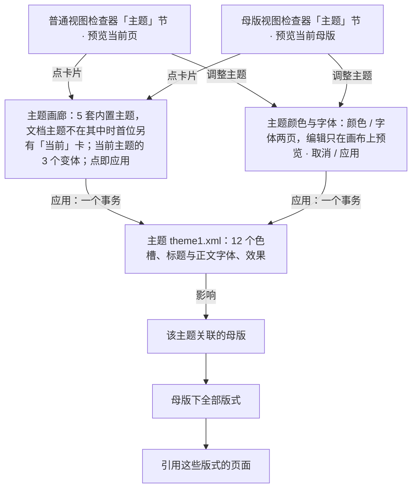

> 状态：草稿 | 负责：设计 | 更新：2026-09-18；2026-09-25（补图）；2026-09-26（§4.20：FE-07 应用主题改为直接执行 + 可撤销 toast，§6 该项已定）；2026-10-07（design-language-v3 第 1 批：按已拍板的 `design-themes` 场景 6 态与 `master-view.theme` 整篇改写，标题由「设计页签」改为「设计主题」——新增 §0 定位与入口（普通视图与母版视图的检查器「主题」节、原「设计」页签三组去向表）并改写图 0-1；§1 检查器主题卡 + 320 宽主题画廊（点即应用、可撤销）；§2 300 宽主题颜色与字体（12 色槽产品化名称、只预览不写文档）；§3 改为逐个列出样张状态，新增 §3.6 背景节随主题（DS-20 合并为一节、主题色快捷项与渐变 / 图片）、§3.7 评审与降权只读展示（DS-15）、§3.8 M2；§4 规格改为 v3 token；§5 补多主题与协同；§6 关闭 v3 呈现一项、补从模板应用主题（rulings §4.25 DS-1、DS-2、DS-5、DS-15、DS-20、DS-21））；2026-10-07（design-language-v3 第 1 批收尾：§3.7 只读说明补查看者「只读 · 你只有查看权限」，三种角色的顶部说明与 03-02 §6.2 一致；第一步无跨线影响指向本文，其余不变；依据 rulings §4.25 DS-15）；2026-10-08（design-language-v3 第 1 批收口：§0 去向表补原「设计」页签的「幻灯片大小」→ 主菜单「文件 › 幻灯片大小…」，P2 前留在原位、不可用并标 P2（DS-31）；§1 主题画廊改为与开始页模板同一套的 5 套内置主题「简约 / 商务 / 暗色 / 学术 / 活力」（DS-33，原 Office / 极简灰 / 暖色商务 / 深色科技 4 套作废），文档主题不在内置清单里时首位另放一张「当前」卡（推荐做法，§6 交用户确认），每个主题 3 个变体（DS-32，原「PRD 允许 ≤ 4」作废），线框、图 0-1 与 §4 规格同步；§3 三个状态的示例主题改为「简约」「暗色」，§3.1 新建文档的主题来源（PRD OF-22、AS-03）、§3.5、§3.6、§6、§7 跟改；样张画廊按 §1 跟改；依据 rulings §4.25 DS-31、DS-32、DS-33）；2026-10-08（design-language-v3 第 1 批评审修改：§4 主题画廊卡片的悬停边与变体色条的悬停环由 `--v3-text-3` 改为 `--v3-hover-line`；主题卡注明与下拉同一画法（透明底加细边，悬停与画廊打开时铺 `--v3-panel-2`）；依据 rulings §4.25 DS-35）；2026-11-04（design-language-v3 母版视图改版：§0 入口表母版视图「主题」节的位置改为第 3 节；§1 线框「版式」节补「编辑版式」；§2 线框按「主题颜色与字体」盖在检查器栏上重画，外框一条改写，「字体」页的说明一行放不下时在逗号后分两行、两句各自不断行；§3 状态表补弹层位置与 `master-view.m2-theme`，表后补随之改的两态；§3.6 版式背景的「跟随母版」改为图标分段；§3.8 去掉「样张未画」，补 M2 色块的画法；§4 主题颜色与字体、弹层位置两行改写；rulings §4.25 DS-147、DS-151、DS-155、DS-156、TB-186、TB-193、TB-200；需求编号、优先级与里程碑不变） | 依赖：charter v0.2；PRD `07-masters` ML-04、`08-app-shell` AS-03、`01-open-and-fidelity` OF-22；rulings §4.8 Q6（Geist）、§4.9 Q10、§4.10 Q17、§4.20 FE-07、§4.25 DS-1、DS-2、DS-5、DS-15、DS-20、DS-21…DS-26、DS-31…DS-33、DS-35、DS-147、DS-151、DS-155、DS-156、TB-186、TB-193、TB-200；`10-prd/07-design-coverage-and-gaps.md` G-75；03-screens/02 §4.1、16、26；前端 `50-frontend/11` §9；playground 第 1 批场景 `design-themes`（`src/v3/scenarios/masters-themes/ThemeParts.tsx`）

# 03-28 设计主题：主题画廊、变体、主题颜色与字体

> **设计基准（2026-10-07 起，rulings §4.25 DS-21）**：以 playground 第 1 批场景 `design-themes`（6 个状态）与母版视图的 `master-view.theme` 为准；路由 `#/v3/editor?state=design-themes.<状态 id>`，状态清单见 §3。源码在 `playground/src/v3/scenarios/masters-themes/`：`ThemeParts.tsx`（主题卡 `ThemeCard`、主题画廊 `ThemeGallery`、主题颜色与字体 `ThemeEditor`、组装 `ThemeControl`、轻提示 `ThemeToast`）、`slide-sections.tsx`（普通视图的「主题」「背景」节）、`master-sections.tsx`（母版视图的同名节）；内置主题数据在 `src/v3/editor/layouts/data.ts`，「背景」节为底座 `editor/inspector/builtin.tsx` 的 `BackgroundControl`。本文写结构、尺寸、行为与状态，token 只写名字（取值见设计 04）。旧版 `#/editor/design`、`mockups/28-design-tab-and-themes.html` 与「设计」页签的线框已被 v3 取代，不再作实现依据。

对应产品线 `10-prd/03-features/07-masters-layouts-and-themes.md` **ML-04 主题**（M3 P1）；M2 只读展示当前主题（§3.8）。主题（`theme1.xml`：配色、字体、效果矩阵）是母版的**上游**：同一文档可有多个母版，典型情况下一个母版关联一个主题，改主题会影响该母版下全部版式与页面，所以普通视图与母版视图（03-screens/26）各有一个入口，打开同一对弹层（rulings §4.9 Q10）。

---

## 0. 定位与入口

| 入口 | 位置 | 预览对象 |
|---|---|---|
| 普通视图检查器「主题」节 | 无选中时「幻灯片 N」的第二节：一张主题卡（§1）。整块点开**主题画廊**；右侧「调整主题」打开**主题颜色与字体** | 当前页（作用于当前页所属母版的主题） |
| 母版视图检查器「主题」节 | 版式或母版选中态的第 3 节（占位符之后、背景之前；选中版式时节标题右侧写「随母版」，rulings §4.25 DS-151），同一张卡、同一对弹层（03-screens/26 §5） | 当前母版（作用于该母版关联的主题） |

原「设计」页签各组（主题、变体、自定义、背景、幻灯片大小）与母版页签里的主题、背景组随 ribbon 作废（DS-1、DS-5），去向如下：

| 原分组 | v3 去向 |
|---|---|
| 主题（横向滚动的主题卡库） | 检查器「主题」节 → 主题画廊（2 列真实预览） |
| 变体 | 主题画廊下方「变体 · 〈主题名〉」 |
| 自定义（颜色 ▾ / 字体 ▾） | 「调整主题」→ 主题颜色与字体（「颜色 / 字体」两页） |
| 母版视图的主题组（编辑主题 / 颜色 / 字体） | 母版视图检查器「主题」节（同一卡片与弹层） |
| 背景（背景样式等，含原「页面颜色」） | 检查器「背景」节（DS-20 合并为一节，§3.6） |
| 幻灯片大小（P2，前端 50/18 SLD-07） | 主菜单「文件 › 幻灯片大小…」（条目归 03-02 §2.3）：作用于整篇文档，不进只管当前页的无选中检查器；P2 上线前留在原位、不可用并标 P2（rulings §4.25 DS-31）；样张补这一状态，改后由用户确认 |

**图 0-1 主题的上游位置与两个编辑入口**



怎么读：两个入口打开同一对弹层，只是预览对象不同；从「主题」往下是主题向下游的影响链，一次应用影响该主题下的母版、版式与页面，已断开主题色引用的显式颜色保持不变（§5）。
依据：rulings §4.9 Q10、§4.20 FE-07、§4.25 DS-1、DS-21、DS-32、DS-33；PRD ML-04；样张 `design-themes.gallery`、`design-themes.colors`、`master-view.theme`。

---

## 1. 线框：检查器「主题」节与主题画廊

```
←────────────── 主题画廊 320 ──────────────→←──────── 检查器 280 ────────→
                                            ┌────────────────────────────┐
                                            │ 幻灯片 2                   │
                                            ├────────────────────────────┤
                                            │ 版式                   [▤] │
                                            │ [▭ 标题和内容          ▾]  │
                                            ├────────────────────────────┤
                                            │ 主题                       │
┌──────────────────────────────────────────┐│ ┌────────────────────────┐ │
│ 主题                                 [×] ││ │[▀▀] Office       [调整]│ │  ← 卡片整块可点：展开主题画廊（画廊顶端与卡片对齐）
│ ┏━━━━━━━━━━━━━━━━━┓  ┌─────────────────┐ ││ │[▄▄] 思源黑体           │ │  ← 「调整主题」：打开主题颜色与字体
│ ┃  第 2 页预览    ┃  │  第 2 页预览    │ ││ └────────────────────────┘ │
│ ┗━━━━━━━━━━━━━━━━━┛  └─────────────────┘ │├────────────────────────────┤
│ Office  当前         简约                ││ 背景                       │  ← 首位「当前」卡：示例文档自带的主题不在内置清单里
│ ┌─────────────────┐  ┌─────────────────┐ ││ [ 纯色 │ 渐变 │ 图片 ]     │
│ │  第 2 页预览    │  │  第 2 页预览    │ ││ [□ #FFFFFF 背景 1│100%]    │
│ └─────────────────┘  └─────────────────┘ ││ [□][□][■][■][■][■]         │
│ 商务                 暗色                │├────────────────────────────┤
│ ┌─────────────────┐  ┌─────────────────┐ ││ 放映                       │
│ │  第 2 页预览    │  │  第 2 页预览    │ ││ …                          │
│ └─────────────────┘  └─────────────────┘ │└────────────────────────────┘
│ 学术                 活力                │
│──────────────────────────────────────────│
│ 变体 · Office                            │
│ [▰▰▰]  [▰▰▰]  [▰▰▰]                      │
└──────────────────────────────────────────┘
```

图例：`[▤]` 是「版式」节标题右侧的「编辑版式」（rulings §4.25 DS-147，03-02 §4.1）；`[▀▀]/[▄▄]` 28 × 28 主题缩略（上方一整块强调色 + 下方四小块）；`[调整]` 24px「调整主题」图标按钮（Lucide `SlidersHorizontal`）；`┏━┓` 画廊里当前生效的主题；`当前` 是首位「当前」卡名称后的标记；卡下右侧的标题字体图中从略；`[▰▰▰]` 变体色条。样张 `design-themes.gallery`（按本节跟改，rulings §4.25 DS-33）。

- **主题卡**：一行卡片，左侧主题缩略 + 两行文字（主题名；字体，标题与正文字体不同时写「标题 / 正文」，如「Inter / 思源黑体」），右侧「调整主题」（工具提示「主题颜色与字体」）。卡片左半整块是按钮（`aria-haspopup="dialog"`，可读名「主题：Office，思源黑体。展开主题画廊」），点开主题画廊；画廊打开时卡片底换 `--v3-panel-2`，「调整主题」打开时为按下态。两个弹层同一时刻只开一个。
- **主题画廊**（弹层宽 320，贴检查器左缘向左展开、顶端与卡片对齐）：标题「主题」+ 关闭；5 套内置主题——简约、商务、暗色、学术、活力，与开始页「从模板开始」的 5 套模板同一套（模板 = 主题 + 母版 + 版式包，PRD AS-03、PD-23；rulings §4.25 DS-33，原 Office / 极简灰 / 暖色商务 / 深色科技 4 套作废）——排成 2 列，每张是示例文档第 2 页套上该主题的真实预览（暗色主题的卡片与画布一致，DS-2），卡下一行主题名 + 右侧标题字体；选中项是当前生效的主题（`role="radiogroup"`）。
- **「当前」卡**（推荐做法：DS-33 只定了内置清单，没定文档主题不在清单里时怎么显示，这一形态随样张跟改由用户确认，见 §6）：打开画廊时文档的主题不在内置清单里（导入的 pptx 自带的主题，或空白演示文稿默认的「Office」主题，PRD OF-22），首位另放一张「当前」卡并选中（名称后带「当前」标记，与 PowerPoint 主题库首位的「此演示文稿」同理），保住「当前主题选中」这一既有行为；画廊打开期间这张卡不变，应用别的主题后仍可点它回到原主题；文档的主题本身就是某套内置主题时不另放，直接选中那一套。
- **变体**：分隔线下「变体 · 〈当前主题名〉」与该主题的 3 个变体色条（每个主题 3 个，PRD ML-04，rulings §4.25 DS-32；原「PRD 允许 ≤ 4」作废）。
- **点即应用**：点主题卡或变体即应用，不弹确认（rulings §4.20 FE-07）：一个事务，左栏缩略图与画布一起换色，轻提示「已应用主题「X」，影响 N 页 [撤销]」（N 为该母版引用的页数，5 s；「撤销」一步恢复原主题与 12 个色槽）。画廊保持打开，便于连续比较；`Esc`、关闭、点外部收起，焦点回到卡片。
- **样张跟改**：5 套内置主题的配色、字体与变体，以及首位的「当前」卡，随样张画廊跟改一并画出（DS-33），改后由用户确认。

---

## 2. 线框：主题颜色与字体（「调整主题」）

```
「颜色」页（盖在检查器栏上，宽同检查器）   「字体」页
┌──────────────────────────────────────┐   ┌──────────────────────────────────────┐
│ (周)(王)(李)             ▶ [分享]    │   │ (周)(王)(李)             ▶ [分享]    │
│ [设计]  评论                 77% ▾   │   │ [设计]  评论                 77% ▾   │
╞══════════════════════════════════════╡   ╞══════════════════════════════════════╡
│ 主题颜色与字体 · Office          [×] │   │ 主题颜色与字体 · Office          [×] │
│ [ 颜色▪          │ 字体           ]  │   │ [ 颜色           │ 字体▪          ]  │
│ □ 背景 1           ■ 文字 1          │   │ 标题字体                             │
│ □ 背景 2           ■ 文字 2          │   │ [思源宋体                     ▾]     │
│ ▣ 强调色 1         ■ 强调色 2        │   │ AaBb 标题示例 123（20px）            │
│ ■ 强调色 3         ■ 强调色 4        │   │ 正文字体                             │
│ ■ 强调色 5         ■ 强调色 6        │   │ [思源黑体                     ▾]     │
│ ■ 超链接           ■ 已访问链接      │   │ AaBb 正文示例 123（20px）            │
├──────────────────────────────────────┤   │ ⓘ 只影响文档内容的字体，             │
│ 强调色 1              原为 #3A5CE6   │   │   不影响编辑器界面                   │
│ [■ #0F8B8D              │ 100%]      │   │                                      │
│ 标准色                               │   │                                      │
│ ■ ■ ■ ■ ■ ■ ▣ ■ ■ ■                  │   │                                      │
│ 最近使用                             │   │                                      │
│ ■ ■ ■                                │   │                                      │
│                  ⋮                   │   │                                      │
├──────────────────────────────────────┤   ├──────────────────────────────────────┤
│ 正在预览当前页      [取消]  [应用]   │   │ 正在预览当前页      [取消]  [应用]   │
└──────────────────────────────────────┘   └──────────────────────────────────────┘
```

样张 `design-themes.colors`、`design-themes.fonts`、`master-view.theme`。图例：两页都盖在检查器栏上——顶端在页签行下沿（`╞═╡`），协作行与页签行不被盖住；宽取检查器当前宽度（240–480，缺省 280），下沿铺到窗口下沿；页头与底栏固定，中间内容区在弹层里滚动（`⋮`）；画布在左侧整页可见（图中从略）。

- **外框**（2026-11-03 母版视图改版拍板，rulings §4.25 DS-155、TB-193；原「弹层宽 300、贴检查器左缘向左展开」作废）：盖在检查器栏上——右缘贴窗口、顶端在页签行下沿，宽取检查器当前宽度（240–480），下沿铺到窗口下沿、高度不随内容缩短；页头与底栏固定、中间内容区在弹层里滚动，检查器原有内容在弹层外一处都不露；四角不圆、只画左边线。仍是弹层：浮层层级、带阴影，有「取消 / 应用」，`Esc` 关闭、焦点回到「调整主题」；画布整页可见，开合时不动、不缩放，不做碰撞避让；紧凑形态盖在检查器抽屉上，规则相同；普通视图与母版视图是同一件；主题画廊的位置不变（§1）。标题「主题颜色与字体 · 〈主题名〉」+ 关闭；分段「颜色 / 字体」；底栏左侧一行状态（没改动时「改动会实时预览当前页」，有改动时「正在预览当前页」；母版视图里写「当前母版」），右侧「取消」「应用」。
- **颜色页**：12 个色槽 2 列（`role="radiogroup"`「主题色槽」），对应 OOXML `<a:clrScheme>` 的 12 个节点，用产品化名称：背景 1、文字 1、背景 2、文字 2、强调色 1–6、超链接、已访问链接（不露 `lt1` / `dk1` / `accent1` 这类标识，07-accessibility-and-i18n.md §7；技术标识只在开发文档与辅助说明里出现）。选中一个色槽后，下方编辑区写色槽名（改过时右侧「原为 #xxxxxx」）、一个颜色字段（色块 + 十六进制 + 不透明度）与「标准色」「最近使用」两组色块（与 03-16 颜色选择器同款内容；编辑主题色时不再列「主题色」组）。
- **字体页**：「标题字体」「正文字体」两个下拉，各带一行 20px 示例「AaBb 标题示例 123」「AaBb 正文示例 123」（示例是文档内容，不是界面字号）；底部说明「只影响文档内容的字体，不影响编辑器界面」（对应 `+mj-lt` / `+mn-lt` 映射，呼应设计 04「文档内容与编辑器界面字号分开」的边界）：一行放不下时在逗号后分成两行，两句各自不断行——检查器 240、280 宽时两行，480 宽时一行，普通视图与母版视图同此。
- **只预览、不写文档**：编辑中的值只作为画布上的渲染覆盖（不入文档、不产生事务、不广播，前端 50/11 §9），左栏缩略图不变；「应用」= 一个事务 + 与 §1 同一条可撤销轻提示；「取消」、关闭或 `Esc` 丢弃预览。

---

## 3. 状态

样张路由 `#/v3/editor?state=<下表 id>`（可加 `&theme=dark|light`）。ML-04 为 M3 P1；查看当前主题自 M2 起（§3.8）。

| 状态 id | 样张标题 | 要点 | 里程碑 |
|---|---|---|---|
| `design-themes.gallery` | 主题画廊 | 点检查器主题卡展开：首位「当前」卡（示例文档自带的 Office）+ 5 套内置主题，都用示例文档第 2 页真实预览，当前主题选中；下方当前主题的 3 个变体；点卡片或变体即应用，不弹确认（样张按 §1 跟改，DS-33） | M3 P1 |
| `design-themes.applied` | 应用主题 · 可撤销 | 应用「简约」后左栏与画布一起换色，轻提示「已应用主题「简约」，影响 6 页」带撤销；第 4、5 页图表的显式颜色保持不变（§5）（样张按 DS-33 跟改，原示例「极简灰」作废） | M3 P1 |
| `design-themes.colors` | 编辑主题颜色 | 「调整主题」打开主题颜色与字体（盖在检查器栏上，画布整页可见，DS-155）：选中「强调色 1」在下方改色（标准色 / 最近使用 / 色值）；画布实时预览当前页，缩略图不变；[取消][应用] | M3 P1 |
| `design-themes.fonts` | 编辑主题字体 | 「字体」页：标题、正文字体 + 20px 示例；标题换成思源宋体，画布标题实时预览；写明只影响文档内容字体 | M3 P1 |
| `design-themes.dark-theme` | 深色文档主题 | 应用「暗色」后幻灯片变深，编辑器界面仍按自己的亮 / 暗（两套截图对照，§5）（样张按 DS-33 跟改，原示例「深色科技」作废） | M3 P1 |
| `design-themes.readonly` | 评审模式 · 只能查看 | 主题节只写当前主题与字体，不能展开画廊、没有「调整主题」；工具条换成评审条、左栏不提供新建 | M2 起 |
| `master-view.theme` | 编辑主题 · 预览当前母版 | 母版视图「主题」节同一卡片与面板，弹层同样盖在检查器栏上，预览对象是当前母版（03-screens/26） | M3 P1 |
| `master-view.m2-theme` | M2 · 主题只展示 | 母版视图 M2 一组：主题卡只展示，「调整主题」留在原位不可用、工具提示「调整主题 · 当前版本暂未开放」；色块保持满色（§3.8） | M2 |

母版视图改版（2026-11-03 拍板，rulings §4.25 DS-155）随之改：`design-themes.colors`、`design-themes.fonts` 两态的弹层改盖检查器栏。

### 3.1 默认

「主题」节显示文档当前主题：导入的 pptx 是它自带的主题；空白演示文稿是默认的「Office」主题（PRD OF-22；它不在主题画廊的内置清单里，按 §1 的推荐做法在画廊首位以「当前」卡出现）；从开始页模板新建的是该模板的主题，即 5 套内置主题之一（PRD AS-03，rulings §4.25 DS-33）。卡片显示主题缩略、名称、字体与「调整主题」。

### 3.2 主题画廊与应用

见 §1。应用后：左栏缩略图、网格与画布按新主题渲染；主题卡与「背景」节随之更新（§3.6）；轻提示带「撤销」。主题卡、变体色条与主题颜色与字体的「应用」是同一行为、同一条轻提示。

### 3.3 编辑主题颜色

见 §2。改任一色槽后画布**实时**预览（只画布，缩略图不变），预览对象取决于从哪里打开：普通视图预览当前页，母版视图预览当前母版。

### 3.4 编辑主题字体

见 §2。改标题或正文字体后画布实时预览；字体下拉的候选与 03-16 字体下拉一致（样张为思源黑体、思源宋体、苹方、Inter、Georgia）。主题字体分 latin / ea 两组是 ML-04 的待出稿项（§6）。

### 3.5 深色文档主题

文档主题的明暗与编辑器界面的亮 / 暗无关：应用「暗色」后幻灯片、缩略图与主题画廊的预览都变深，编辑器 chrome 仍按自己的主题（`data-cordex-theme`），用户可以在亮色界面下编辑深色主题的文稿，反之亦然（§5）。

### 3.6 背景节随主题（DS-20）

普通视图无选中时的「背景」节（03-02 §4.1）与母版视图的「背景」节是同一个控件，DS-20 把原「背景」与「页面颜色」合并为这一节：

- 先用分段选填充方式：纯色 / 渐变 / 图片（图标分段，工具提示写名称）；版式多首项「跟随母版」，同样是图标分段（图标同上下文条，即母版视图的模式横幅），名称进工具提示与读屏名，缺省选中（rulings §4.25 DS-151、TB-186，03-screens/26 §5；原「文字分段」作废）。
- 再选颜色：颜色字段写色块 + 色值 + 色槽名（取主题色时写明是哪个色槽，如「#FFFFFF 背景 1」）+ 不透明度；其下一排 6 个主题色色块快捷项，取当前主题的 背景 1 · 背景 2 · 文字 1 · 文字 2 · 强调色 1 · 强调色 3；当前颜色 2px 强调色外圈（隔 2px），悬停 1px 灰圈，工具提示「名称 色值」。
- 渐变：颜色字段左侧色块换成渐变预览（所选颜色到白色；选的是白色时到浅蓝，免得看不出渐变），色块快捷项选的是渐变起始色；后续的方向、色标编辑随 ED-20 的实现。图片：颜色字段换成「选择图片…」按钮。
- **随主题**：应用主题后色块快捷项与色槽名换成新主题的取值（如应用「暗色」后，颜色字段写暗色主题背景 1 的深色色值与「背景 1」，六个色块换成暗色主题的取值，不再写「白色」）。
- 只读时只写当前值（「填充 纯色 · 背景 1 · #FFFFFF」，DS-15）；不可用时（打开中、M2 等）字段留在原位、写原因。「应用到全部」「重置为版式背景」等背景动作归 03-02 / 03-03（PRD ED-20），本文不重复。

### 3.7 评审模式、只读浏览与降权

评审模式、只读浏览与编辑模式已降权（DS-15）：「主题」节只写当前主题缩略、名称与字体，不画卡片外框，不能展开画廊、没有「调整主题」；「背景」节只写当前值；顶部一行说明权限（评审「只读 · 评审模式下不可编辑」、查看者「只读 · 你只有查看权限」、降权「只读 · 需要编辑权限」，与 03-02 §6.2 一致）。样张 `design-themes.readonly`（评审模式）。

### 3.8 M2

ML-04 在 M3，M2 只展示当前主题：主题卡照常显示，「调整主题」留在原位不可用、写「当前版本暂未开放」，卡片不展开画廊（与「需要编辑权限」区分，前端 50/11 §9）；主题色块与背景色块保持满色，当前色外圈退成灰，读屏名与工具提示带原因（同普通视图的不可用字段）。母版视图的 M2 一组画了这一态：样张 `master-view.m2-theme`（rulings §4.25 DS-156、TB-200）。

---

## 4. 设计规格

| 项 | 规格 | 样张源码 |
|---|---|---|
| 主题卡 | 与下拉同一画法（透明底加 1px `--v3-border` 细边，悬停与画廊打开时铺 `--v3-panel-2`；03-02 §3.5，rulings §4.25 DS-35）、圆角 4；左半按钮内边距 8、间距 12：28 × 28 主题缩略（圆角 4、1px 内描边）+ 两行 12/16 文字（名称 `--v3-text`、字体 `--v3-text-2`，超长截断）；右侧 24px「调整主题」（打开时为按下的图标按钮，只铺 `--v3-panel-2`、图标描边加粗），距右缘 8 | `ThemeCard` |
| 主题画廊 | 弹层宽 320、内边距 12、间距 12；标题行高 24（12px 600 + 24px 关闭）；主题卡 2 列、列距 12（首位「当前」卡 + 5 套内置主题时为 3 行，§1），预览为 16:9 真实渲染（圆角 4、1px `--v3-border`），选中边 `--v3-accent` + 0.5px 外环，悬停边 `--v3-hover-line`（`--v3-text-3` 与分隔线之间的一档，rulings §4.25 DS-35；原「悬停边 `--v3-text-3`」作废）；卡下一行高 16、12px（选中 500）+ 右侧标题字体 `--v3-text-2`；「当前」标记在名称后，与 03-27 版式卡的「当前」同款；1px 分隔线；「变体 · 名称」12px `--v3-text-2`；变体色条 44 × 28（三色等分、圆角 4、1px 内描边），间距 8，选中 2px 强调色环偏移 2，悬停 1px `--v3-hover-line` 环偏移 1（同上，原 `--v3-text-3` 作废） | `ThemeGallery` |
| 主题颜色与字体 | 宽同检查器（240–480，缺省 280）；内容左缘取检查器节内容的同一内距（16）、间距 12（rulings §4.25 TB-193）；色槽两列、标准色一行随宽度排，240 宽也不截断，底栏放不下「说明 + 取消 + 应用」一行时两枚按钮一起换到下一行、靠右；分段「颜色 / 字体」28 高；色槽 2 列、行高 28、圆角 4、16px 色块（圆角 3、1px 内描边），选中行 `--v3-panel-2` 底 + 色块 2px 强调色环；编辑区：颜色字段 28 高，色块 20px、间距 6，选中 2px 强调色环偏移 2；字体页标签 12px `--v3-text-2`、下拉 28 高、示例 20/28（标题 600）、说明 12/18 带 Info 图标；底栏上 1px 分隔、内边距 12 | `ThemeEditor` |
| 弹层位置 | 主题画廊锚在主题卡上，贴检查器左缘向左展开、顶端与卡片对齐，浮层表面同 03-02（`--v3-panel`、1px 边、圆角 8、`--v3-shadow`）；主题颜色与字体盖在检查器栏上（§2，DS-155、TB-193）：四角不圆、只画左边线、带浮层阴影 | `ThemeControl`、`kit/Popover.tsx` |
| 轻提示 | 画布底部、工具条上方居中：「已应用主题「X」，影响 N 页」+「撤销」，5 s | `ThemeToast` |
| 背景节 | 分段 28 高；颜色字段 28 高（03-02 §3.5 字段外框）；色块快捷项 24px、圆角 4、间距 8 | `BackgroundControl` |

**状态矩阵**（画廊里的主题卡）：默认（1px `--v3-border`）/ 悬停（边 `--v3-text-3`）/ 选中（强调色边 + 0.5px 外环，`aria-checked`）/ 键盘聚焦（全局 2px 强调色焦点环）/ 只读（不出现画廊，§3.7）——不设加载态（内置主题随文档与应用一起就绪，没有独立的异步加载）。

---

## 5. 边界情况

- 应用新主题后，某版式的占位符或页上元素曾被显式设置颜色（没有引用主题色）：显式值保留不变（章程「只写显式覆盖」原则的延伸，主题切换只影响引用主题色的元素），面板内不做特殊提示，与 PowerPoint 一致（样张 `design-themes.applied` 中第 4、5 页图表）。
- 强调色 1–6 与协作者身份色、危险 / 警告语义色的区分：本文不做强制校验，只建议在「颜色」页对高度接近语义色或身份色的取值给出弱提示（P2，非本轮阻塞；04 §2.4、§2.5）。
- 深色文档主题与编辑器亮 / 暗正交（§3.5）：设计 04「幻灯片内容色与纸面不随编辑器主题切换」与文档主题的明暗是两个独立维度，面板不把两者混为一谈。
- 多主题文档（每个母版一个主题）：普通视图的「主题」节作用于当前页所属母版的主题，母版视图作用于所选母版关联的主题，两处分别展示与编辑（PRD ML-04）。
- 他人修改了主题：本地重算，以通知弱提示「主题已被〈姓名〉更新」；同一色槽后写覆盖时提示 `prop-lww`（前端 50/11 §9）。
- 编辑中（弹层打开、画布有预览）时他人应用了别的主题：样张未画，随实现（预览基于打开时的取值）。

---

## 6. 待决事项

- ~~「应用」主题前是否需要确认~~ **已定**（2026-09-26，rulings §4.20 FE-07）：直接应用 + 可撤销轻提示「已应用主题「X」，影响 N 页 [撤销]」，不弹确认，见 §1、§2。
- ~~v3 下主题入口与主题编辑面板的呈现~~ **已定**（2026-10-07，rulings §4.25 DS-21）：检查器「主题」节的主题卡 + 主题画廊 +「调整主题」弹层，见 §0–§2；背景节按 DS-20 合并，见 §3.6。
- ~~主题画廊的内置主题与变体数~~ **已定**（2026-10-08，rulings §4.25 DS-33、DS-32）：与开始页模板统一为简约 / 商务 / 暗色 / 学术 / 活力 5 套（原 Office / 极简灰 / 暖色商务 / 深色科技 4 套作废），每个主题 3 个变体，见 §1；样张画廊按 §1 跟改，改后由用户确认。
- **文档主题不在内置清单里时画廊怎么显示当前主题**（DS-33 未涉及，交用户确认）：推荐首位另放一张「当前」卡并选中、画廊打开期间不变（§1，同 PowerPoint「此演示文稿」）；备选是只列 5 套，当前主题不在其中时不选中任何卡，回到原主题只能撤销。本文与样张跟改先按推荐。
- ~~原「设计」页签「幻灯片大小」的去向~~ **已定**（2026-10-08，rulings §4.25 DS-31）：主菜单「文件 › 幻灯片大小…」，P2 上线前留在原位、不可用并标 P2，见 §0。
- 主题库（内置 5 套之外）是否支持组织级 / 团队共享主题：超出 M3 P1 范围，登记供后续里程碑评估。
- **ML-04 待出稿项（M3 P1，G-75）**：效果方案（`fmtScheme`）名称只读展示、「重置为原主题」一键回退（一个事务可撤销）、主题字体分 latin / ea（`+mj-lt` / `+mj-ea`、`+mn-lt` / `+mn-ea`）——第 1 批样张未画，随 M3 出稿补入 §2。
- **从模板应用主题（PRD ML-04 模式 A「仅应用主题」/ 模式 B「导入母版与版式并应用」）**：入口与预览样张未画；模式 B 在母版视图的入口为「新建版式 ▾ › 从模板导入母版…」（03-screens/26 §1.2），随 M3 出稿。

---

## 7. 应用的 UX 规则（ui-ux-pro-max 留痕）

| 规则 id | 来源检索 | 落实方式 |
|---|---|---|
| `color-contrast` | "color picker swatches accessible" --domain ux（4.5:1 最低比例） | 内置 5 套主题（DS-33）的预览色组合均满足文字 / 背景 4.5:1（沿用设计 04 §2.6 对比度核算方法，新增主题预设同样核算，登记为实现期校验项） |
| `dashboard-accent-separation`（色板检索交叉验证） | "dense dashboard accent color" / "semantic status color pairs" --domain color | 印证「强调色与状态色分离」的既有决策（设计 04 §2.3、§2.5），未采纳检索给出的具体色值，只作方法论验证，见 §5 的强调色 / 语义色区分建议 |
| `color-not-only` | 同上 | 色槽、主题卡、变体都以「色块 + 文字名称」或可读名呈现（色槽可读名「强调色 1 #3A5CE6」），选中另有边框 / 外环与 `aria-checked` |
| `font-pairing-not-adopted`（未采纳，如实记录） | "dense ui small text hierarchy" --domain typography（返回 Academic/Archival、Soft Rounded 两种字体配对） | 未采纳：编辑器界面字族为 Geist 优先（`Geist Variable` → 系统字体 → 苹方 / 微软雅黑回退，rulings §4.8 Q6、设计 04 §2.8）；主题字体编辑面板里的「标题 / 正文字体」面向**文档内容**而非编辑器界面，两者不冲突 |
