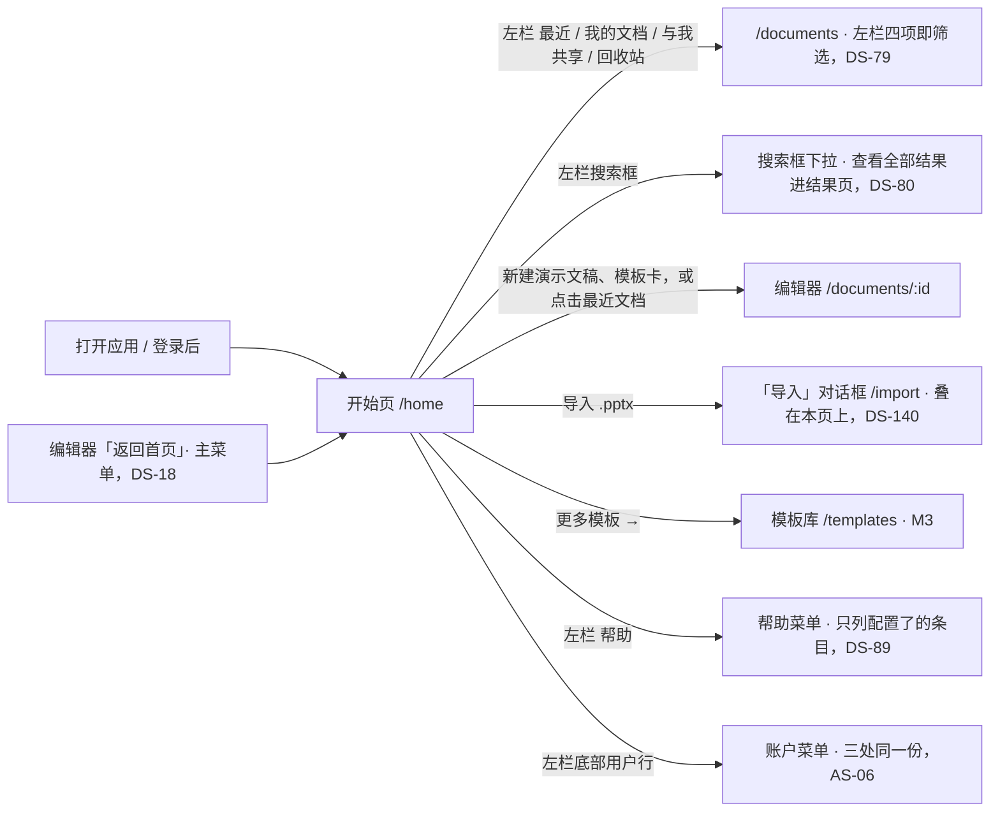

> 状态：草稿 | 负责：设计 | 更新：2026-09-17；2026-09-24（rulings §4.15：Q8 最近列表缩略图来源；T-0 账户行去掉"套餐"）；2026-09-25（补图）；2026-10-04（design-language-v3 第 0 批：按 v3 首页样张整篇重写——左侧 220 导航贴边 + 56 高顶栏，主区为「从模板开始」模板行与「最近」网格 / 列表，模板与最近文档都是真实渲染的 16:9 封面，去掉问候语与日期、主题分段与「指南与帮助」卡片区（rulings §4.25 DS-2）；样张未覆盖的首次使用、加载中、离线等状态保留行为要求、随第 3 批补齐；新增 §6 样张与 PRD AS-01…AS-06 等既有口径的差异）；2026-10-04（design-language-v3 第 0 批：复验修正——§4 图标与命中区按样张改为「可点击控件 ≥ 24、工具类按钮 28」，注明 24px「+」与 LogoMark 两个例外；§5「AS-01…AS-06 待回写」改为已回写）；2026-10-04（design-language-v3 第 0 批：复验第 2 轮修正——§2.1 品牌行 logo 方标由「单色、跟随文字色」改为三种中性色填充（与 04 §2.14、09 §2 一致）；§1 表与图中编辑器「返回首页」改为样张已起草的主菜单首项（03-02 §2.3））；2026-10-05（design-language-v3 第 0 批修正：按 rulings §4.25 DS-10 删去左栏底部「设置」项——§1 入口表去掉「左栏『设置』」行、§2 线框与 §2.1 底部只留帮助 · 分隔线 · 用户行，设置只在账户菜单；§1 表与图 1-1 中编辑器「返回首页」改为 DS-18 已定的主菜单入口，§2.1 用户行注明编辑器账户菜单的条目见 03-02 §7；§5 去掉「设置项」待决）；2026-10-05（design-language-v3 第 0 批修正：§6 八条样张差异按 rulings §4.25 DS-10、DS-11、DS-12 全部结案（标题改为「已全部结案」，处理列改写为结案结论，与 PRD 08 AS-01…AS-06、PRD README PD-28 一致）；§3 默认与首次使用两行、§5 第 2 条去掉「待产品线确认」措辞；§2.1 搜索框 ⌘K 注明开始页作用域的聚焦搜索（DS-11））；2026-10-05（design-language-v3 第 0 批修正：§1 入口表与图 1-1 的左栏「帮助」由「帮助中心」改为帮助菜单（PRD AS-04，帮助中心是其中一项），与 §3、§6 第 3 条一致；§2.1 搜索框按 rulings §4.25 DS-9 与样张写字段框 1px `--v3-border-control` 内描边、「⌘K」提示改用 `--v3-text-2`、聚焦换强调色内描边；§2.1 用户行的账户菜单条目改为引用 PRD AS-06（三处同一菜单、同一份条目），不再复述清单）；2026-10-08（design-language-v3 第 1 批评审修改：只改控件画法——§2.1 搜索框改为透明底加细边、悬停铺 `--v3-panel-2`（安静样式，rulings §4.25 DS-35；原「字段框同检查器字段：`--v3-panel-2` 底 + 1px `--v3-border-control` 内描边」作废）；§2.2「网格 / 列表」当前项只铺 `--v3-panel-2`、图标描边加粗；界面描述随第 3 批）；2026-10-22（design-language-v3 第 3 批：按已拍板样张 `home`、`account-menu`、`templates` 回写受影响的节——设计基准补第 3 批样张路由与截图；§1 入口表与图 1-1 改为左栏四项即文档列表的筛选（加「回收站」，DS-79）、搜索框下拉（DS-80）、「导入 .pptx」先进导入页并保留拖入落区（DS-98）、「最近」卡片菜单与分享路由（DS-81、TB-109）、M3 模板库（§7），路由改写为产品路由；§2 线框按 M2 缺省 `home.m2-default` 重画（左栏五项、M2 不显示「更多模板 →」、第二行与头像、图钉与角色徽标、无封面占位）；§2.1 主导航五项，搜索结果的呈现结案为下拉（DS-80），底部帮助与用户行改指 §2.4、§2.5；§2.2 不可用的顶栏按钮（DS-123）、「更多模板 →」M3 才出现且命中区补足 24、排序菜单是开始页这一段的本机视图偏好（TB-127、DS-84）、「最近」卡片与文档列表同一张卡片（DS-81、DS-83、TB-108）；§2.3 无封面占位定稿为白纸面 + 演示图标；新增 §2.4 帮助菜单（只列配置了的条目、外链图标、「键盘快捷键 ⌘/」始终在，DS-89）、§2.5 账户菜单（主题三项 DS-90，「个人资料…」M2 不显示、M3 出现 DS-91，帮助中心按配置出现，管理，嵌入时的退出登录与主题锁定，M3 个人资料对话框，TB-123）、§2.6 窄屏与触控（DS-87）；§3 改为开始页 18 个、账户菜单 5 个样张状态与 §3.1 未采纳的备选（DS-63），首次使用不放按钮（DS-88）、加载为加载行（DS-86）、离线横幅在顶栏之下（DS-92）、正在创建与新建失败、普通成员访问管理页（TB-101）；§4 卡片网格的键盘与链接（TB-107、TB-108），开始页上的 ⌘, 与 ⌘/；§5 登记第 3 批待产品线回写的 AS-01…AS-06；§6 第 3、4、6 条补第 3 批去向；新增 §7 模板库（来源分段 + 预览，不做分类与搜索，顶栏不放按钮、网格不含「空白」，DS-72、DS-93、TB-110）；依据 rulings §4.25 DS-63、DS-72、DS-79…DS-93、DS-98、DS-123、TB-101、TB-107…TB-110、TB-123、TB-127…TB-129）；2026-10-22（design-language-v3 第 3 批回写补改：设计基准的源码改指转正后的件（主区 `HomeBody.tsx`、账户菜单条目 `accountMenuItems`、底座 kit `ShellLayout` / `DocumentCard` / `library`）；§1、§3、§4 卡片菜单的「分享…」M2 留在原位、不可用，标 M3、右侧「后续版本提供」（DS-137），拖入松开即进上传中、跳过导入页，编辑器「返回首页」在嵌入里只在宿主声明 `navigate-back` 时渲染（TB-145）；§2.2 网格 / 列表与文档列表共用一份本机视图偏好（TB-131）；§2.4 命令面板的「帮助中心」同一规则（TB-132）；§2.5「退出登录」在嵌入里按宿主给的去处（SDK 登出回调、iframe 声明 `sign-out`）才可用（TB-145），M3 个人资料对话框只改显示名、不传头像（TB-137、TB-142）；§2.6 手机与触控的搜索下拉每行 44（TB-130）；§3 拖入落区的文件大小上限读部署配置（TB-147）；§4 从导入页进入的「取消」回到打开导入页之前的那一页（TB-133）；§5 第 3 条补 DS-137；依据 rulings §4.25 DS-137、TB-130…TB-133、TB-137、TB-142、TB-145、TB-147）；2026-10-22（design-language-v3 第 3 批回写收口：§2.4、§2.5 手机与触控形态里「键盘快捷键」入口照常保留，手机上快捷键面板是贴底的底部面板、平板照桌面浮动面板，触控形态的菜单项不写「⌘/」键位提示（TB-154），「偏好设置…」的 ⌘, 按同一理由不写；§2.6 顶部提示行按设备分开——< 640 仍写「在更大窗口中新建或导入演示文稿」，平板（触控、≥ 640）写「在电脑上新建或导入演示文稿」（TB-153），并注明从抽屉打开的偏好设置与快捷键面板的形态；§3 表后补平板与手机上打开快捷键面板两条；§5 第 1 条补帮助与模板来源的去向，第 3 条「待回写」改为已回写（PRD 08 AS-01…AS-06 已改写，另补 TB-130、TB-131、TB-133、TB-137、TB-142、TB-144、TB-145、DS-137）；§6 第 7 条与 §7 模板库：来源与审核仍随 PD-23，M3 前端先按 RuntimeConfig `templates.sources` 静态列表设计、某一源失败只影响那一段，原「端点登记前不渲染入口」改为「M3 才渲染入口」（TB-160）；依据 rulings §4.25 DS-89、TB-153、TB-154、TB-160；2026-10-22 复核修正：§2.6 形态按两件事取——平板（触控、≥ 640）的左栏与「最近」列数按窗口宽度、同桌面与紧凑，单列、搜索框在主区与不放网格 / 列表与排序只对手机（TB-165），「触控设备」只指平板（TB-163），触控形态的搜索框不写 ⌘K（平板的搜索框随左栏，TB-154、TB-164），手机与平板上直接打开 `/import` 照常显示导入页（TB-167）；§2.4、§2.5、§2.6 触控形态的菜单项一律不写键位提示，⌘/ 与 ⌘, 都不写（TB-164）；§3「手机 / 触控」一行与表后说明随之改；§7 跨源取模板清单的 CSP 由 web 容器放行（TB-168）；§2.2、§2.6 与 §3「手机 / 触控」一行、表后说明：平板「最近」标题行的网格 / 列表切换与排序菜单照常保留、同桌面与紧凑，只有手机（< 640）不放，平板搜索框随左栏、命中区 44、不写 ⌘K（TB-170）；§2.2「最近」卡片第二行缺 `lastEditor`（系统作业建的文档）只写相对时间，`lastEditor` 与 `contentUpdatedAt` 都缺（还没有快照）时按 `createdAt` 写相对时间、不写编辑者，不拿所有者顶替，列表显示时编辑者一列空着（TB-171，03-01 §4.2），「创建时间」排序的来源写明 `DocumentSummary.createdAt`（60/15 §3.3 已登记，原写「后端补」）；§2.2「最近编辑」排序与卡片第二行同一个时间——取 `contentUpdatedAt`、缺省时取 `createdAt`，与后端 `last_activity_at` 同口径（TB-171、TB-144），列表显示的时间一列同第二行的取法、还没有快照时取 `createdAt`（TB-171），第五列写作「≥ 44」（同 03-01 §13 与 kit `DocumentCard`）；依据 rulings §4.25 TB-144、TB-163、TB-164、TB-165、TB-167、TB-168、TB-170、TB-171）；2026-10-23（design-language-v3 第 3 批评审修改：顶栏「导入 .pptx」改为在本页上打开叠在开始页之上的「导入」对话框（锚点 `import.entry`、`aria-haspopup="dialog"`，样张 `import.dialog`，规格见 03-13），整屏导入页与过渡页的写法作废（rulings §4.25 DS-140 取代 DS-97、DS-98）——§1 入口表、图 1-1 与图后说明、§2.2 顶栏与 §4 拖入与取消一条随之改：上传与解析中「取消」、×、Esc 都是中止并关闭、留在开始页，`/import` 叠在本页之上、后退即关闭（TB-179，修订 TB-129、TB-133）；拖入落区改为强调色虚线加淡底、松开即打开对话框的上传态、焦点落在「取消」（TB-180、DS-141，§3 `drop-import` 一行）；§2.6 手机与平板上直接打开 `/import` 为底部面板与对话框（TB-181，修订 TB-167）；对话框按全站新画法（标题栏 40、圆角 12、× 正文色，DS-142），§2.5 个人资料对话框与 §7 模板预览对话框注明，设计基准写明 `drop-import`、`account-menu.profile-dialog`、`templates.preview`、`templates.creating`、`templates.offline` 的画面随之变；依据 rulings §4.25 DS-140…DS-142、TB-179…TB-181） | 依赖：charter v0.2；01-information-architecture.md §1；rulings §4.15 Q8、§4.20 FE-06、§4.25 DS-2、DS-7、DS-8、DS-10、DS-18、DS-35、DS-63、DS-72、DS-79…DS-93、DS-98、DS-123、DS-137、DS-140…DS-142、TB-101、TB-107…TB-110、TB-123、TB-127…TB-133、TB-137、TB-142、TB-144、TB-145、TB-147、TB-153、TB-154、TB-160、TB-163…TB-165、TB-167、TB-168、TB-170、TB-171、TB-179…TB-181；PRD AS-01…AS-06、CO-15，README PD-23；前端 50/02 §3、§10.1，50/12 §9；设计 03-01、03-13、03-23、03-24、03-32、03-33；playground `#/v3/home`（`src/v3/Home.tsx`、`CoverArt.tsx`、`data.ts`、`v3.css`）与 `#/v3/home?state=home.*` / `account-menu.*`、`#/v3/templates?state=templates.*`（`src/v3/scenarios/home/`、`account-menu/`、`templates/`、`documents/`）、`#/v3/home?state=import.*`（`src/v3/scenarios/import/`，kit `importDialog`、`DropOverlay`）

# 03-29 应用首页（开始页）

> **设计基准（2026-10-04 起，rulings §4.25 DS-2；2026-10-22 起补第 3 批，DS-79…DS-93）**：以 playground `#/v3/home` 样张为准（宿主 `playground/src/v3/Home.tsx`；主区 `HomeBody.tsx`——模板行 `TemplateRow` 与「最近」`RecentSection`，2026-10-22 第 3 批转正时换成补态的画法；封面渲染 `CoverArt.tsx`，模板清单 `data.ts`，token `v3.css`）；对照截图 `openspec/changes/design-language-v3/screens/home-dark.jpg` / `home-light.jpg`（1600 × 1000）。第 3 批补态与相关页面以已拍板的三个场景为准：开始页 `#/v3/home?state=home.<状态 id>`（M2 的缺省样子是 `home.m2-default`，不带 state 的首页已随第 3 批转正换成同一画法）、账户菜单 `#/v3/home?state=account-menu.<状态 id>`（两态画在编辑器里）、模板库 `#/v3/templates?state=templates.<状态 id>`（§7）；源码 `playground/src/v3/scenarios/home/`（`home.scenario.tsx` 各状态的标题与说明、`HomeMain.tsx` 状态数据的写法与窄屏的导航开关和抽屉）、`scenarios/account-menu/`（`account-menu.scenario.tsx` 各状态、`ProfileDialog.tsx`；条目是 `src/v3/editor/chrome.tsx` 的 `accountMenuItems`，三处同一份）、`scenarios/templates/`；应用壳、卡片、搜索框下拉与帮助菜单是与文档列表共用的底座件（kit `ShellLayout`、`DocumentCard`、`library`、`roving`、`DropOverlay`，03-01）；对照截图 `openspec/changes/design-language-v3/screens/batch3/<场景>-<状态>-dark.jpg` / `-light.jpg`。2026-10-23 第 3 批评审修改起：顶栏「导入 .pptx」打开叠在本页上的「导入」对话框（rulings §4.25 DS-140，样张 `import.dialog`，规格见 03-13），拖入落区改为强调色虚线加淡底（TB-180），对话框按全站新画法（标题栏 40、圆角 12、× 正文色，DS-142）——`drop-import`、`account-menu.profile-dialog`、`templates.preview`、`templates.creating`、`templates.offline` 的画面随之变。token 只写名字（样张作用域名 `--v3-*`），取值见设计 [04](../04-design-system.md) 的 v3 改写。旧版 `#/home`（`routes/Home.tsx`：224 玻璃导航卡、问候语、指南卡片区）在全量迁移后删除（DS-7）。

用户反馈（2026-09-17）："少了个首页，进入编辑器的一个官方首页，最好还带指南入口的"。对应 PowerPoint 的"开始/后台"首页与 Keynote/Google Slides 的开始页：打开应用先到这里，而不是直接进入文档列表或编辑器。2026-10-04 按设计语言 v3 改版（变更 `design-language-v3` proposal：「首页去掉问候大标题与『指南与帮助』卡片区，改为模板行 + 最近文档网格」）：中性平面、品牌蓝只做强调，模板与最近文档都是真实渲染的封面，主区约占应用宽 86%（设计质量门 Q1）。2026-10-22 第 3 批补齐：左栏五项（加「回收站」）、搜索框下拉、帮助菜单与账户菜单的条目和画法、「最近」卡片的菜单与第二行、首次使用、加载、出错、离线、正在创建、窄屏与触控形态，以及 M3 的模板库页（§7）。

## 1. 位置与入口

| 入口 | 目标 |
|---|---|
| 打开应用 / 登录后 | `/home` |
| 编辑器「返回首页」 | `/home`（原为文档列表；编辑器中的入口是主菜单「返回首页」，rulings §4.25 DS-18，03-02 §2.3；嵌入时不渲染，宿主在 `cordex:init` 声明了 `navigate-back` 才出现、点了交宿主处理，DS-112、TB-145） |
| 左栏「最近 / 我的文档 / 与我共享 / 回收站」 | `/documents` 的对应视图（`filter=recent / owned / shared / trashed`）：左栏就是文档列表的筛选，列表页不设页内筛选条（rulings §4.25 DS-79，03-01 §2.1） |
| 左栏搜索框 | 输入即在下方弹出即时结果（前 5 条），「查看全部结果」进 `/documents?filter=all&q=…`（DS-80，03-01 §5） |
| 顶栏「新建演示文稿」、模板行「空白」 | 新建空白文档并进入编辑器 `/documents/:id`（首页为标题版式，D14） |
| 模板行其余模板卡 | 以该主题新建并进入编辑器（PRD AS-03） |
| 「最近」卡片 / 行 | 打开该文档 `/documents/:id`（卡片是链接，按我的角色进入编辑、评审或只读浏览，TB-108） |
| 「最近」卡片「⋯」 | 卡片菜单，与文档列表同一份（DS-81，03-01 §4.3）；「分享…」M3 起打开分享对话框、叠在本页路由 `/home?share=<id>` 上（TB-109），M2 留在原位、不可用（DS-137） |
| 顶栏「导入 .pptx」 | 在本页上打开「导入」对话框（地址 `/import` 叠在本页之上、后退即关闭，rulings §4.25 DS-140、TB-179；规格见 03-13） |
| 把 .pptx 拖进主区 | 落区（强调色虚线 + 淡底），松开即在本页上打开「导入」对话框的上传态（与入口按钮无关，照常保留，TB-180；03-01 §8、03-13） |
| 模板行「更多模板 →」（M3） | 模板库 `/templates`（§7，PRD AS-03） |
| 左栏「帮助」 | 帮助菜单（§2.4，PRD AS-04，DS-89） |
| 左栏底部用户行 | 账户菜单（§2.5，PRD AS-06）；设置只在账户菜单，首页左栏不设「设置」项（rulings §4.25 DS-10） |

**图 1-1 开始页的导航去向**



怎么读：左侧两条箭头说明谁会落到开始页，右侧是从开始页出发的全部去向，边上写入口所在的位置；把 .pptx 拖进主区与顶栏「导入 .pptx」殊途同归，打开的是同一个「导入」对话框（拖入时从上传中开始，图中略）。离线时新建、模板与导入不可用，最近文档中本会话内仍保活的仍可打开（§3）。
依据：PRD AS-01…AS-06；rulings §4.25 DS-2、DS-10、DS-12、DS-18、DS-79、DS-80、DS-89、DS-140；样张 `home.m2-default`、`import.dialog`。

## 2. 布局

```
←──────── 220 ────────→←────────────────────────── 主区 flex（1600 宽视口下 1380）──────────────────────────→
┌──────────────────────┬────────────────────────────────────────────────────────────────────────────────────┐
│ [Logo] Cordex        │ 首页                                                 [⇪ 导入 .pptx] [新建演示文稿] │
│                      ├────────────────────────────────────────────────────────────────────────────────────┤
│ [⌕ 搜索          ⌘K] │                                                                                    │
│                      │ 从模板开始                                                                         │
│ ▌首页                │ ┌──────────┐  ┌──────────┐  ┌──────────┐  ┌──────────┐  ┌──────────┐  ┌──────────┐ │
│  最近                │ │    +     │  │ 简约演示 │  │ 年度经营 │  │ 产品发布 │  │ 研究进展 │  │ 新品发布 │ │
│  我的文档            │ │ 空白演示 │  │          │  │   分析   │  │          │  │   报告   │  │          │ │
│  与我共享            │ └──────────┘  └──────────┘  └──────────┘  └──────────┘  └──────────┘  └──────────┘ │
│  回收站              │ 空白          简约          商务          暗色          学术          活力         │
│                      │                                                                                    │
│                      │ 最近                                                    [▦][☰]   最近打开 ▾ │
│                      │ ┌─────────────────┐  ┌─────────────────┐  ┌─────────────────┐  ┌─────────────────┐ │
│                      │ │   2026 年 Q2    │  │                 │  │   产品路线图    │  │    设计评审     │ │
│                      │ │    业绩汇报     │  │       [▭]       │  │                 │  │                 │ │
│                      │ └─────────────────┘  └─────────────────┘  └─────────────────┘  └─────────────────┘ │
│  帮助                │ 2026年Q2业绩汇报 *   未命名演示文稿       产品路线图           设计评审            │
│ ──────────────────── │ 王小明·2 小时前  ●●  我 · 刚刚            李雷 · 昨天       ●  我 · 3 天前         │
│ (周) 周明远          │ （第二行 4 张：招聘计划［可评论］· 新人培训手册 · 季度 OKR 复盘 · 客户成功案例［仅查看］）│
└──────────────────────┴────────────────────────────────────────────────────────────────────────────────────┘
```

图例：`▌` 当前导航项；`*` 固定的文档（标题后 12px 图钉）；`●●` 我拥有的共享文档右下叠放的两位协作者头像；`●` 别人共享给我的文档右下一枚所有者头像；`[▭]` 没有封面时的占位（§2.3）；`［可评论］``［仅查看］` 角色徽标；`[▦][☰]` 网格 / 列表切换；封面框内的文字只示意真实渲染的封面内容。M2 的「从模板开始」右端不显示「更多模板 →」（M3 才有模板库，§7）。截图：`home-dark.jpg` / `home-light.jpg`（第 0 批首页）、`screens/batch3/home-m2-default-*.jpg`（M2 缺省），样张 `home.m2-default`。

### 2.1 左栏（220，贴边）

| 元素 | 规格 | 行为 |
|---|---|---|
| 容器 | 宽 220、全高，`--v3-panel` 底、右侧 1px `--v3-border` | — |
| 品牌行 | 高 56、左右 20：20px logo 方标（三种中性色填充：底 `--v3-text`、内框 `--v3-panel`、两条横线 `--v3-text` 与 `--v3-text-2`，不用强调色；04 §2.14）+「Cordex」13px 600，间距 8 | — |
| 搜索 | 外边距左右 12；高 28、圆角 6，透明底加 1px 细边（`--v3-search-*`，与分隔线同档；不铺淡底，免得与同为 `--v3-panel-2` 底的当前导航项混淆；2026-10-08 安静样式，设计 04 §2.6 使用规则；原为「字段框同检查器字段：`--v3-panel-2` 底 + 1px `--v3-border-control` 内描边」，按 rulings §4.25 DS-35 修订）、左右 8：16px 搜索图标 · 输入框（12px，占位「搜索」，`aria-label="搜索文档"`）· 右侧「⌘K」（11px `--v3-text-2`，提示是可读信息；开始页作用域的聚焦搜索，AS-01，rulings §4.25 DS-11），有字时换成 20 的清除按钮「清除搜索」 | 悬停铺 `--v3-panel-2`；聚焦时细边换成强调色；`Mod+K` 把焦点移到这里（`aria-keyshortcuts`）。输入即在搜索框下方弹出即时结果——前 5 条 +「查看全部结果」，不写数量；结果页、下拉画法与键盘（组合框，焦点留在搜索框，TB-130）见 03-01 §5（rulings §4.25 DS-80，原「搜索结果的呈现随第 3 批定稿」结案） |
| 主导航 | 上距 12、左右 12、项间距 4；导航项高 28、圆角 6、左右 8、图标 16 + 文字 13px，间距 8：首页（`House`）/ 最近（`Clock`）/ 我的文档（`FileText`）/ 与我共享（`Users`）/ 回收站（`Trash2`，画法同其余四项，2026-10-22 按 rulings §4.25 DS-79 加入） | `nav aria-label="主导航"`；当前项 `--v3-panel-2` 底 + 500 字重 + `--v3-text`、`aria-current="page"`（模板库里「首页」保持当前项、读屏为 `aria-current="true"`，§7）；其余 `--v3-text-2`，悬停 `--v3-panel-2` 底；「最近 / 我的文档 / 与我共享 / 回收站」进文档列表对应视图，左栏就是筛选（DS-79，03-01 §2.1） |
| 底部 | 贴底、左右 12、下 12：帮助（`CircleHelp`，画法同导航项）· 上下 8 的 1px 分隔线 · 用户行（高 28：24px 头像 + 姓名 13px，超长截断）；样张原有的「设置」项按 DS-10 删除 | 「帮助」打开帮助菜单（§2.4）；用户行打开账户菜单（§2.5）：条目与次序以 PRD AS-06 为准，编辑器（右上角自己的头像，DS-18，03-02 §7）与文档列表打开的是同一个菜单、同一份条目；设置只在账户菜单（DS-10，按 AS-06 与 D13） |

### 2.2 主区

- **顶栏**：高 56、左右 32、下方 1px 分隔；左侧标题「首页」（16px / 24px 600），右侧间距 8：「导入 .pptx」（28px 描边按钮，`--v3-panel` 底 + 1px 边，16px 上传图标；点了在本页上打开「导入」对话框，锚点 `import.entry`、`aria-haspopup="dialog"`，DS-140）·「新建演示文稿」（28px 主按钮，强调色）。不可用时（离线、正在创建）两个按钮留在原位、写原因：「导入 .pptx」是 outline 的不可用态，「新建演示文稿」保持 kit 主按钮的不可用态（rulings §4.25 DS-123，宽度不变）。顶栏下方是横幅通道（应用壳的横幅在顶栏之下、只横跨主区，DS-92，§3「离线」）。
- **内容区**：左右 32、上 24、下 32，纵向滚动；底色 `--v3-canvas`。
- **从模板开始**：标题行高 28（「从模板开始」13px / 20px 600；右侧「更多模板 →」12px `--v3-text-2`，悬停 `--v3-text`，只在 M3 出现，M2 不显示，PRD AS-03；命中区补足 24 高、外观不变，WCAG 2.5.8）；下距 8 为一行 6 张模板卡（等宽六列，卡内边距 8）：16:9 真实封面（圆角 6、1px `--v3-border`，悬停边框变强调色）+ 下距 8 的名称（12px `--v3-text-2`，悬停 `--v3-text`）。第一张「空白」在白色纸面上画 24px「+」与「空白演示文稿」（纸面上的文字固定取亮色 token，避免暗色主题下灰字落在白底上对比不足）。样张六张：空白 / 简约 / 商务 / 暗色 / 学术 / 活力。每张卡是一个按钮，读屏名「新建空白演示文稿」/「从模板「商务」新建」；这一行 6 张照常逐个 `Tab`（不是漫游网格）。不可用时（离线、正在用别的模板新建）封面与名称变淡、不响应悬停，工具提示与读屏名写原因（rulings §4.20 FE-06）。
- **最近**：上距 32；标题行高 28（「最近」13px / 20px 600；右侧「显示方式」两枚 24px 图标按钮「网格 / 列表」（`aria-pressed`，当前项只铺 `--v3-panel-2` 底、不描边，图标描边加粗到 2，按下的图标按钮画法见 03-02 §3.5，rulings §4.25 DS-35）+ 排序菜单「最近打开 ▾」（12px `--v3-text-2`，单选：最近打开 / 最近编辑 / 名称 / 创建时间，选了即收起））。网格 / 列表与排序只在有内容时出现：加载中、出错与空态都不放（与文档列表的列表头同一口径）；手机（< 640）也不放，平板照常（§2.6，rulings §4.25 TB-170）。排序菜单只管开始页这一段，是本机的视图偏好、不带到文档列表；按缺省「最近打开」排序时，这 8 条就是文档列表「最近」的前 8 条（rulings §4.25 TB-127，DS-84）。网格 / 列表的显示方式同为本机视图偏好，但与文档列表共用一份：在这里切成列表，文档列表打开时也是列表（TB-131，存储键由前端 50/02 §10.1 登记）；按「最近编辑」排用与卡片第二行同一个时间：取 `contentUpdatedAt`，缺省（还没有快照）时取 `createdAt`，与后端 `last_activity_at` 同口径（rulings §4.25 TB-171、TB-144，60/15 §3.3）；按「创建时间」排用文档的创建时间（`DocumentSummary.createdAt`，60/15 §3.3 已登记）。
  - **数据**：最多 8 条（AS-02，DS-12），与文档列表「最近」同一份——固定的在前，其后按我最近打开的时间倒序（本机缓存与服务端合并，50/02 §9.1）。
  - **卡片**：与文档列表同一张卡片、同一份「⋯」菜单（DS-81，规格见 03-01 §4）：16:9 真实封面 + 两行文字（标题 13px / 20px 500，固定的标题后 12px 图钉，评审者 / 查看者的标题后带「可评论」「仅查看」徽标；第二行「编辑者 · 相对时间」12px / 16px `--v3-text-2`，最近一次编辑内容的人与时间，DS-83——缺 `lastEditor`（系统作业建的文档）时只写相对时间，`lastEditor` 与 `contentUpdatedAt` 都缺（还没有快照）时按 `createdAt` 写相对时间、不写编辑者，不拿所有者顶替编辑者，rulings §4.25 TB-171）；右下 16px 头像：我拥有的共享文档叠两位协作者（后者左移 3、描边取画布底色；读屏「共享给 X、Y」），别人共享给我的是一枚所有者头像（读屏「所有者 X」）；16px 头像只画身份色、不写首字（TB-123）。卡片是链接（TB-108），悬停或焦点在卡片里时封面右上出现「⋯」。
  - **网格**（默认）：四列，卡片内边距 8、圆角 8，悬停底 `--v3-card-hover`（暗色 `--v3-panel-2`、亮色白，亮色画布与 panel-2 几乎同色，所以改用白）。
  - **列表**：每行内边距 8、圆角 8、悬停同上，五列 120 / 弹性 / 96 / 132 / ≥ 44、列距 16：120 宽封面 · 标题（13px 500，图钉与徽标在后）· 编辑者（缺 `lastEditor` 时这一列空着）· 相对时间（12px `--v3-text-2`；还没有快照时取 `createdAt`）· 头像；行尾「⋯」——编辑者与时间两列的取法同卡片第二行（TB-171，03-01 §4.2）。
- 视觉（DS-2）：无渐变、光晕与毛玻璃；面板贴边、1px 分隔；圆角 4 / 6 / 8；只有菜单等浮层带阴影；含中文的文字不小于 12px。

### 2.3 封面来源

样张的模板与最近文档用真实渲染的封面示例（DS-2「缩略图与模板用真实渲染」，不再用骨架条）。产品中最近文档的封面来源不变：M2 用导入文件包内封面、无则中性占位，M3 起服务端渲染（与文档列表卡片封面同一口径，03-01 §4.1，rulings §4.15 Q8）。无封面时的中性占位是 16:9 白纸面 + 居中 24px 演示图标（纸面上的 `--v3-text-3`），与真实封面同尺寸、不画骨架条（2026-10-22 定稿，样张 `home.m2-default` 的「未命名演示文稿」；应用内新建的空白 / 模板文档在 M2 一律是它）；M3 起换成服务端渲染的封面（样张 `home.m3-more-templates`）。

### 2.4 帮助菜单（PRD AS-04，rulings §4.25 DS-89）

- 左栏「帮助」打开，向上、左对齐（与用户行的账户菜单同一落位），最小宽 220；菜单开着时「帮助」铺 `--v3-panel-2`。
- **只列集成方配置了链接的条目**（`RuntimeConfig.help`，50/02 §3），都在新标签页打开、右侧 12px 外链图标（方框加箭头，`--v3-text-2`；与第 2 批「在新标签页中登录」、DS-52 同一个，站内跳转用的斜箭头不用于这里），读屏名带「在新标签页打开」：5 分钟快速入门 · 母版与版式 · 协同编辑 ┊ 键盘快捷键 ⌘/ ┊ 帮助中心 · 新功能。
- **「键盘快捷键 ⌘/」始终在**：打开快捷键面板（开始页上浮在主区右上，03-24）；集成方什么都没配置时菜单只剩这一项，左栏「帮助」照常保留（样张 `home.help-menu-unconfigured`）。手机与触控形态里入口照常保留：手机（< 640）上面板是贴底的底部面板，平板（触控、≥ 640）上是桌面那块浮动面板（rulings §4.25 TB-154，03-24 §1.5）；触控形态的菜单项一律不写键位提示（这一项不写「⌘/」），与手机搜索框不写 ⌘K 一致（TB-154、TB-164）。
- 不做站内的占位指南页（PRD AS-04 的「内置指南」随 DS-89 删去）。账户菜单的「帮助中心」与编辑器主菜单「帮助 › 帮助中心」按同一规则：配置了才出现、带外链图标（§2.5，03-02 §2.3）；编辑器命令面板里的「帮助中心」同此（rulings §4.25 TB-132，03-24 §8.3）。

### 2.5 账户菜单（PRD AS-06，rulings §4.25 DS-89、DS-90、DS-91）

条目与次序的唯一归属是 PRD AS-06；开始页用户行、编辑器右上角自己的头像（03-02 §7）与文档列表打开的是同一个菜单、同一份条目（DS-18）。开始页上从用户行向上、左对齐打开，最小宽 220（编辑器里向下、与头像左缘对齐）。

```
┌────────────────────────────────────┐
│ (周) 周明远                         │  ← 头部：只作标识、不可聚焦
│      zhou.mingyuan@example.com      │
├────────────────────────────────────┤
│ 主题                                │  ← 分组小标题
│   浅色                              │
│   深色                              │
│ ✓ 跟随系统                          │
├────────────────────────────────────┤
│   偏好设置…                    ⌘,  │
│   键盘快捷键                   ⌘/  │
│   帮助中心                      ↗  │  ← 配置了才出现
├────────────────────────────────────┤
│   退出登录                          │
└────────────────────────────────────┘
```

图例：`✓` 当前选中的主题；`↗` 表示外链图标（方框加箭头，§2.4）。画的是 M2 普通成员（样张 `account-menu.member`）：M2 不显示「个人资料…」；平台管理员（M3）在「键盘快捷键」与「帮助中心」之间多一项「管理」（`account-menu.admin`）。

- **头部**：24px 头像（身份色底 + 白色首字，TB-123）· 姓名 12px 600 · 邮箱 12px `--v3-text-2`；只作标识、不可聚焦。
- **个人资料…**：M2 不显示，连同它下面的分隔线（菜单从头部直接到主题，DS-91）；M3 起出现在头部与主题之间、上下各一条分隔线，打开个人资料对话框（下文）。
- **主题**：分组小标题「主题」+ 三项单选「浅色 / 深色 / 跟随系统」，与偏好设置「外观 › 主题」是同一偏好、同一组取值与顺序（出厂缺省「跟随系统」，03-23）；选了菜单不关、立即换肤（DS-90；09 §3.4 菜单条目规范第 7 条）。
- **偏好设置… ⌘,** 打开偏好设置对话框（03-23）；**键盘快捷键 ⌘/** 打开快捷键面板（03-24）。触控形态（手机与平板，§2.6）的菜单项一律不写键位提示：「键盘快捷键」的 ⌘/ 与「偏好设置…」的 ⌘, 都不写，快捷键面板里的键位照常列出（rulings §4.25 TB-154、TB-164）；两项的去处照常，形态随设备（偏好设置见 03-23 §7，快捷键面板见 03-24 §1.5）。
- **管理**（只对平台管理员，M3）：在「键盘快捷键」与「帮助中心」之间，16px 盾牌图标 + 右侧弱化小字「插件」（`--v3-text-2`），点了直接进 `/admin/plugins`「管理 › 插件」（03-32 §1）；这一项带图标，同一面板里其余条目随之留出图标列。普通成员不显示、也不占位（PRD PM-01、PM-06）。
- **帮助中心**：集成方配置了才出现，新标签页打开、右侧 12px 外链图标（§2.4）；没配置时这一项不出现、也不占位。
- **退出登录**：走 OIDC 登出（`POST /auth/logout`，有 `endSessionUrl` 时整页跳往 IdP，否则回 `/login`，PRD AS-06）；有未同步更改时的确认见 03-33 §8。**嵌入时**登出交给宿主，宿主给了去处才可用：SDK 嵌入传了登出回调，iframe 嵌入在 `cordex:init` 的 `intents` 里声明了 `sign-out`（选了发 `cordex:intent` 交宿主处理，前端 50/12 §9，rulings §4.25 TB-145）；都没有时这一项留在原位、不可用，右侧写「由宿主应用管理登录」（AS-06，rulings §4.20 FE-06；样张 `account-menu.embedded-logout` 画的是 SDK 单人 preset 没配置登出回调）。
- **集成方锁定了主题**（嵌入，03-23「集成方锁定态」）：三项留在原位、不可用，勾着宿主定的那一套，组顶一行 12px 锁形 +「由宿主应用设置」（同一原因写一行、三项共用，读屏经 `aria-describedby` 念到；与偏好设置里只读行同一句）——不能在账户菜单里绕过锁定。
- **个人资料对话框（M3）**（样张 `account-menu.profile-dialog`）：M3 起「个人资料…」打开它（rulings §4.25 TB-137）。kit `Dialog` md 480（标题栏 40、圆角 12、× 正文色，rulings §4.25 DS-142），标题「个人资料」；正文三行，行的画法同偏好设置对话框（左：名称 12px + 说明 12px `--v3-text-2`，右：200 宽的控件列）——头像（40px 身份色底 + 白色显示名首字，只读、随显示名实时预览；说明「身份色底与显示名首字，暂不支持上传」，TB-123）· 显示名（可改，1–128 字；空时行内报错「显示名不能为空」、超长「最多 128 个字」，「保存」不可用并写原因；说明「协作者在头像、光标名签与评论里看到它」）· 邮箱（只读，说明「由组织账号提供」）。底栏「取消」·「保存」（`PATCH /users/me/profile`，只改显示名、不传头像，TB-142）；保存失败写在底栏左侧、不关对话框（DS-56），成功后关闭并轻提示「已更新个人资料」（成功色），菜单头部与协作者看到的头像随之更新。

### 2.6 窄屏与触控（rulings §4.25 DS-87、TB-165、TB-170）

形态按两件事取（rulings §4.25 TB-165、TB-170）：左栏、「最近」列数与「最近」标题行的网格 / 列表和排序只看窗口宽度——≥ 1024 左栏常驻、四列，640–1024 左栏收成抽屉、三列，< 640 收进抽屉、单列、不放网格 / 列表与排序；提不提供新建与导入、命中区与「⋯」看是不是手机或触控设备，判据同编辑器的仅查看形态（50/09 `detectBreakpoint`：< 640 或 `pointer: coarse`，DS-17）。「触控设备」只指平板（触控、≥ 640），手机（< 640）不论是否触控都按窗口窄写（TB-163）。抽屉与编辑器紧凑形态的抽屉同一套（03-02 §5a「开与关在同一处点」、07 §1.2「抽屉（紧凑形态）」）。

- **紧凑窗口（640–1024，非触控）**（样张 `home.compact`、`home.compact-drawer`，1000 × 760）：左栏收成左侧抽屉，顶栏标题左侧多一枚「显示导航」开关（28 图标按钮，`aria-expanded` / `aria-controls`）。抽屉就是左栏本身（宽 220、整高、浮层阴影 `--v3-shadow`），盖在主区左侧、不加遮罩（背后的页面照常可用），`role="region"`「导航」（非模态，不是对话框）；第一行最左是按下态的同一枚「收起导航」，与顶栏开关在同一位置（左 32、上 14），品牌行右移让位；顶栏开关被盖住时移出 Tab 顺序与读屏（`inert`）。用户展开时焦点交给「收起导航」；点它、Esc、点导航项都收起，收起后焦点交回顶栏「显示导航」（先交焦点再卸载，不经过 `body`）。「从模板开始」六张等宽、最小 156：这一宽度下正好铺满一行、右缘与「最近」网格对齐，窗口再窄放不下时才一行横向滚动（不换行、不缩小封面）；「最近」网格改三列；顶栏两个按钮照常。
- **手机与触控（< 640 或 `pointer: coarse`）**：不渲染「从模板开始」一行与顶栏「导入 .pptx」「新建演示文稿」，顶部一行提示（12px `--v3-text-2` + 显示器图标）：< 640 写「在更大窗口中新建或导入演示文稿」（DS-87），平板（触控、≥ 640）写「在电脑上新建或导入演示文稿」——平板是因为触控才不能新建，窗口再大也没用（rulings §4.25 TB-153，与仅查看形态状态行的 TB-125、不可用原因的 TB-136 同一理由）。在手机与平板上新建出来的文档当场打不开编辑，不如不给入口（01 §6「减少控件而非缩小控件」）；直接打开 `/import` 时照常显示、不另拦——手机是贴底的底部面板、平板是对话框（rulings §4.25 TB-181，修订 TB-167；03-13），导入完成后按设备进编辑器的仅查看形态。主要控件命中区 44（07 §2 命中区尺寸），卡片「⋯」常显在文字行末、44 命中区（触控没有悬停）。点卡片进编辑器的仅查看形态（PRD NF-07：手机查看 + 评论，平板只读评审）。
  - **手机（< 640）**（样张 `home.phone`、`home.phone-drawer`，390 × 844）：提示行之下是搜索框（触控高 44、不写 ⌘K；同用桌面的下拉、不另做整页搜索，每行 44，rulings §4.25 TB-130）；左栏收进抽屉，顶栏左端「显示导航」开关 44（左缘与内容左缘 16 对齐），抽屉同一位置是 44 的「收起导航」，抽屉里导航项、帮助、用户行都是 44 高、间距 8，不再放搜索框；内容区左右 16。「最近」单列，不放网格 / 列表与排序。
  - **平板（触控、≥ 640）**：左栏与「最近」列数按窗口宽度，同桌面与紧凑——≥ 1024 左栏常驻、四列，640–1024 左栏收成抽屉、三列（rulings §4.25 TB-165）；「最近」标题行的网格 / 列表切换与排序菜单照常保留，同桌面与紧凑，只有手机（< 640）不放（与左栏、列数按窗口宽度同一理由，TB-170）；搜索框随左栏（触控高 44、不写 ⌘K，与触控形态的菜单项不写键位提示同一理由，TB-154、TB-164、TB-170；下拉每行 44，TB-130）；其余照上面的触控形态：不提供新建与导入、命中区 44（网格 / 列表切换与排序菜单的触发器同此，07 §2）、「⋯」常显。样张没有单独画。
- **从左栏的帮助菜单或账户菜单打开的偏好设置与键盘快捷键面板**（手机与 640–1024 的平板上左栏在抽屉里）：手机（< 640）都是贴底的底部面板，平板（触控、≥ 640）照桌面画法（03-23 §7、03-24 §1.5，rulings §4.25 TB-118、TB-154），菜单项不写键位提示（§2.5，TB-164）。

## 3. 状态

开始页的状态路由为 `#/v3/home?state=home.<状态 id>`，视口未写的按 1600 × 1000。

| 状态（样张标题） | 要点 | 样张 id | 里程碑 |
|---|---|---|---|
| M2 默认 | 已拍板首页的版式不动：左栏五项（含「回收站」，DS-79）；「从模板开始」右端不显示「更多模板 →」（AS-03）；「最近」8 条，新建的「未命名演示文稿」画白纸面占位；第二行「编辑者 · 相对时间」（DS-83）；固定的「2026 年 Q2 业绩汇报」带图钉、排在最前；别人共享给我的带角色徽标与一枚所有者头像，我拥有的共享文档叠 2 位协作者；悬停或焦点在卡片里时封面右上出「⋯」；排序菜单照已拍板画面保留（TB-127） | `m2-default` | M2（AS-01、AS-02） |
| 最近卡片的「⋯」菜单 | 与文档列表同一份菜单：分享… · 创建副本 · 重命名 ┊ 取消固定（没固定的写「固定」）· 从最近移除 ┊ 移到回收站（只给所有者、危险色）；M2 的「分享…」留在原位、不可用，标 M3、右侧「后续版本提供」（DS-137，03-01 §4.3）；点「⋯」或焦点在卡片上按 ⇧F10 / 菜单键打开；右键是浏览器原生的链接菜单 | `card-menu` | M2；「分享…」M3 起可用（PRD CO-15） |
| 首次使用（最近为空） | 「最近」区换成空态（中性演示图标）「还没有最近打开的文档」+「从上方的模板开始，或新建一份空白演示文稿」，不放按钮（顶栏已有「新建演示文稿」、模板行第一张就是「空白」，DS-88）；标题行不放网格 / 列表与排序 | `first-run` | M2（AS-02、AS-05） |
| 加载中 | 超过 300 ms 才出现：「最近」区居中一行加载行「正在加载最近的文档…」，不画骨架、不显示空态（DS-86）；标题行不放网格 / 列表与排序；模板行、顶栏与左栏照常可用（模板来自前端内置清单，不等列表） | `loading` | M2 |
| 最近加载失败 | 列表请求失败且没有本机缓存：「最近」区换成整块出错——危险色图标 ·「最近的文档加载失败」·「请检查网络连接后重试」·「重试」（outline，TB-128；`role="alert"`）；模板行、顶栏与左栏不受影响，新建照常；有缓存时先显示缓存、不报错 | `error` | M2 |
| 离线 | 横幅在主区顶栏之下、只横跨主区（导航不动、标题不跳），高 40（非触控形态；触控形态按钮 44、横幅随之撑高，见 03-12 §1.2、§2.1，rulings §4.25 TB-172），与编辑器离线横幅同一个件（警告浅底 + 离线云）：「本次打开过的文档可以继续编辑；新建、模板与导入将在恢复连接后可用」+「立即重连」（DS-92）；「导入 .pptx」「新建演示文稿」与 6 张模板卡留在原位、不可用，工具提示与读屏名「离线时不可用」（「新建演示文稿」保持 kit 主按钮不可用态，DS-123）；最近里本会话仍保活的照常可开，其余变淡、不能打开，工具提示「离线时只能打开本次打开过的文档」；卡片「⋯」里除「分享…」外全部不可用，顶部一行「离线时不可用」（M2 的「分享…」本来就不可用，照写「后续版本提供」） | `offline` | M2（AS-01） |
| 正在创建 | 点了模板卡「商务」：这张卡的名称换成转圈 +「正在创建…」（`role="status"`、`aria-busy`），封面不变；其余模板卡与顶栏两个按钮暂时不可用（变淡，工具提示「正在创建演示文稿」）；成功后直接进入编辑器（首页为标题版式，D14），版本历史最早一条「从模板『商务』新建」（DS-70）；不生成占位卡片（rulings §4.18 UX-14）。从顶栏「新建演示文稿」新建时，同一个按钮保持 kit 主按钮的不可用态 + 转圈「正在创建…」（宽度不变，DS-123） | `creating` | M2 |
| 新建失败 | 服务端建档失败时入口恢复可用，主区底部轻提示（错误，`role="alert"`）「无法新建演示文稿」+「重试」（沿用同一个 `Idempotency-Key`，不会建出两份；文案登记在 50/02 §8） | `create-failed` | M2 |
| 从最近移除 | 不删除文档：卡片立即移走、其后补位，焦点交给相邻卡片；轻提示「已从最近移除「设计评审」」+「撤销」（5 秒，到期才真正发请求）；文档仍在「我的文档」或「与我共享」里 | `removed-undo` | M2（AS-02） |
| 帮助菜单 | 左栏「帮助」向上打开：5 分钟快速入门 · 母版与版式 · 协同编辑 ┊ 键盘快捷键 ⌘/ ┊ 帮助中心 · 新功能；外链项右侧 12px 外链图标（§2.4） | `help-menu` | M2（AS-04） |
| 帮助菜单 · 没配置帮助链接 | 只剩「键盘快捷键 ⌘/」；账户菜单的「帮助中心」按同一规则不出现 | `help-menu-unconfigured` | M2 |
| M3：更多模板 | 「从模板开始」右端出现「更多模板 →」，点了进模板库（§7）；M3 起封面由服务端渲染，「未命名演示文稿」换成真实封面 | `m3-more-templates` | M3（AS-03） |
| 拖入 .pptx | 文件拖进主区时，顶栏以下整块换成落区（强调色虚线 + 淡底 · 32px 文件图标 ·「松开以导入」·「只支持 .pptx，单个文件最大 200 MB」，上限读部署配置，TB-147），松开即在本页上打开「导入」对话框的上传态、焦点落在「取消」（TB-180）；拖出窗口或 Esc 恢复；不写文件名（规格同 03-01 §8） | `drop-import` | M2 |
| 紧凑窗口 640–1024 | 1000 × 760：左栏收成左侧抽屉，顶栏左端「显示导航」；模板六张最小 156、放不下时横向滚动；「最近」三列（§2.6） | `compact` | M2 |
| 紧凑窗口 · 导航抽屉展开 | 抽屉就是左栏本身（220、整高、浮层阴影、不加遮罩），「收起导航」与顶栏开关同一位置；焦点交接见 §2.6 | `compact-drawer` | M2 |
| 手机 / 触控 | 390 × 844（画的是手机；平板的左栏、列数与网格 / 列表和排序按窗口宽度，TB-165、TB-170，§2.6）：不渲染模板行与顶栏两个按钮，顶部一行「在更大窗口中新建或导入演示文稿」；搜索框在主区（44、不写 ⌘K，下拉每行 44，TB-130）；「最近」单列、不放网格 / 列表与排序，「⋯」常显（§2.6） | `phone` | M2 |
| 手机 / 触控 · 导航抽屉展开 | 导航项、帮助、用户行 44 高、间距 8；抽屉里不放搜索框 | `phone-drawer` | M2 |
| 普通成员直接访问管理页 | 普通成员打开 `/admin/plugins`，守卫把人送回开始页，主区底部轻提示「需要管理员权限」（中性，`role="status"`，只出一次）；不画「无权限」拦截页（rulings §4.25 TB-101）；同屏展开的账户菜单里没有「管理」、也不占位，「个人资料…」（M3）可用 | `admin-denied` | M3（PM-01） |

账户菜单的状态（路由 `#/v3/home?state=account-menu.<状态 id>`，标「编辑器」的是 `#/v3/editor?state=…`）：

| 状态（样张标题） | 要点 | 样张 id | 里程碑 |
|---|---|---|---|
| 普通成员（M2，开始页用户行） | 头部 ┊ 主题 浅色 / 深色 / 跟随系统 ┊ 偏好设置… ⌘, · 键盘快捷键 ⌘/ · 帮助中心 ↗ ┊ 退出登录；M2 不显示「个人资料…」（DS-91） | `member` | M2（AS-06） |
| 平台管理员（M3） | 多一项「管理」（盾牌图标 + 弱化小字「插件」），在「键盘快捷键」与「帮助中心」之间；「个人资料…」出现在头部与主题之间 | `admin` | M3（PM-01、PM-06） |
| 个人资料对话框（M3） | kit `Dialog` md 480：头像只读 · 显示名可改 · 邮箱只读；底栏「取消」·「保存」（§2.5） | `profile-dialog` | M3 |
| 在编辑器里打开（编辑器） | 右上角自己的头像打开同一份菜单，向下、与头像左缘对齐、落在检查器一侧（03-02 §7） | `editor` | M2 |
| 嵌入：没配置登出回调（编辑器） | SDK 单人 preset 没配置登出回调：「退出登录」留在原位、不可用，写「由宿主应用管理登录」（iframe 嵌入没在 `cordex:init` 声明 `sign-out` 时同此，TB-145）；集成方锁定了主题时三项不可用、组顶一行锁形「由宿主应用设置」 | `embedded-logout` | M2（嵌入，EM-01） |

样张没有单独画、行为照常的：「导入 .pptx」打开的「导入」对话框画在 import 场景（`import.dialog`，03-13）；平板（触控、≥ 640）的左栏、列数与「最近」的网格 / 列表和排序按窗口宽度、同桌面与紧凑，其余照触控形态，顶部提示行写「在电脑上新建或导入演示文稿」（TB-165、TB-170、TB-153，§2.6）；手机与平板上从帮助菜单打开键盘快捷键面板（TB-154，03-24 §1.5）；「最近」列表显示（03-01 `documents.list` 同一画法）；在开始页上内联重命名与打开分享（同 03-01 `documents.rename`、`documents.share-from-card`；分享 M3 起可用，叠在 `/home?share=<id>`）；从开始页搜索（下拉同 03-01 `documents.search-dropdown`）；偏好设置与快捷键面板从开始页打开（03-23 `settings.from-home`、03-24 `shortcuts.from-home`）。

### 3.1 未采纳的备选（DS-63）

拍板时画给用户对照的备选留在样张里，标题前加「未采纳 · 」、说明写明由哪一条 DS 定为推荐；路由不变，实现以上表的状态为准。

| 备选 | 样张 id | 内容 | 结论 |
|---|---|---|---|
| 空态里放「新建演示文稿」 | `home.alt-empty-create` | 照 PRD AS-02 原文，空态里放次按钮「新建演示文稿」——同一屏就有顶栏主按钮、模板行「空白」与这里三处同一操作 | 未采纳，DS-88 定为空态只留引导句 |
| 骨架卡片 | `home.alt-loading-skeleton` | 加载时保留与卡片同尺寸的骨架卡片，作为 DS-53「不画骨架」的例外 | 未采纳，DS-86 定为加载行 |
| 手机上照常新建与导入 | `home.alt-phone-create` | 手机上照常显示顶栏两个按钮与「从模板开始」（一行横向滚动），新建后进的却是仅查看形态 | 未采纳，DS-87 定为手机不提供新建与导入 |
| 账户菜单主题只有两项 | `account-menu.alt-theme-two` | 「浅色 / 深色」两项，勾当前实际生效的一套；在菜单里一选就固定成浅色或深色 | 未采纳，DS-90 定为三项 |
| 「个人资料…」在 M2 原位不可用并标 M3 | `account-menu.alt-profile-m2` | M2 留在原位、不可用，标 M3、右侧「后续版本提供」 | 未采纳，DS-91 定为 M3 前不显示 |
| 编辑器主菜单「帮助」维持第 1 批画法 | （拍板时借 `shortcuts.entry-main-menu` 的画面，转正后按 DS-89 改画） | 编辑器的「帮助 › 帮助中心」常在、不带外链图标 | 未采纳，DS-89 定为同一规则（03-02 §2.3） |
| 站内指南页 | （没有出图） | 按 AS-04 做站内内置指南页（新增 `/help` 路由，M2 只有占位文案） | 未采纳，DS-89 不做站内占位指南页 |
| 卡片菜单两处各一份、第二行只写相对时间、开始页也不排序、M2 不显示「分享…」 | （没有出图） | 文档列表的同组备选（03-01 §3.1） | 未采纳，DS-81、DS-83、DS-84、DS-137 |

## 4. 交互与规则

- 左栏「首页」为当前页；「最近 / 我的文档 / 与我共享 / 回收站」跳转文档列表的对应视图（左栏就是筛选，DS-79）；原主导航的「新建 / 指南」页内锚点随 v3 取消。`Mod+K` 把焦点移到搜索框（开始页作用域，编辑器内 `Mod+K` 是命令面板，ED-30）；`Mod+,` 与 `Mod+/` 在开始页上同样打开偏好设置与快捷键面板，由应用壳布局按 `KeyboardEvent.code` 接住（50/02 §2.1，03-23、03-24）。
- 点击「新建演示文稿」、模板卡（含空白）直接创建文档并进入编辑器（首页为标题版式，D14）：服务端以内置模板字节为导入源建档（rulings §4.19 D-M2-CONTENT），建档期间按「正在创建」显示（§3），失败时轻提示 +「重试」；点击最近文档卡 / 行打开该文档。
- 最近文档的「固定」（置顶并持久，M2 服务端同步）、「从最近移除」（可撤销轻提示 5 秒，不删除文档）、「仅查看 / 可评论」徽标与「⋯」菜单（PRD AS-02）按文档列表同一张卡片、同一份菜单落地（DS-81、DS-83，规格见 03-01 §4）；「重命名」在开始页同样内联；「分享…」M3 起在开始页上打开分享对话框，路由 `/home?share=<id>`，关闭后回到原位置、焦点回卡片（TB-109），M2 留在原位、不可用，标 M3、右侧「后续版本提供」（DS-137）。
- **卡片网格的键盘**（rulings §4.25 TB-107，07 §1.2b）：「最近」整个网格一个 Tab 停靠点，方向键 / Home / End 在卡片间走，Enter 打开，⇧F10 / 菜单键开「⋯」菜单，「⋯」不进 Tab 顺序；卡片是链接（⌘ / Ctrl 点按或中键在新标签页打开，TB-108）；「从模板开始」一行 6 张照常逐个 Tab。细则同 03-01 §10。
- 拖入 .pptx 见 §3「拖入 .pptx」；「导入」对话框里上传与解析中「取消」、×、Esc 都是中止并关闭对话框、留在开始页，失败后底栏只有「关闭」，关闭后焦点回到顶栏「导入 .pptx」；`/import` 叠在本页之上，浏览器后退等于关闭（rulings §4.25 TB-179，修订 TB-129、TB-133；03-01 §8、03-13）。
- 图标：Lucide，通用 16px、描边 1.5；两个例外——空白模板卡的「+」为 24px Lucide 图标，品牌方标是自绘 SVG（`LogoMark`，04 §2.14）。可点击控件 ≥ 24（WCAG 2.5.8）：工具类按钮 28，「最近」标题行的「网格 / 列表」是 24px 图标按钮，「更多模板 →」（M3）是文字按钮，命中区补足 24 高、外观不变（2026-10-22 定稿，样张 `home.m3-more-templates`）；16px 头像只做展示、不可点；封面 `role="img"` 带可读名称；两个区块各用 `aria-labelledby` 关联标题。触控形态的命中区按 §2.6（44）。

## 5. 待产品线登记

- 已登记（2026-09-17）：PRD 新增应用壳需求域 `AS-01…06`（`10-prd/03-features/08-app-shell.md`），本页对应 AS-01 开始页、AS-02 最近与固定、AS-03 模板库、AS-04 指南与帮助入口、AS-05 首次使用引导、AS-06 账户菜单；模板库与帮助中心的内容来源当时为待决（PRD README §5）。其后的去向：帮助与指南只用集成方配置的链接（2026-10-22，rulings §4.25 DS-89，§2.4）；模板来源与审核仍随 PRD README PD-23，M3 前端先按 RuntimeConfig 的静态来源列表设计（rulings §4.25 TB-160，§7）。
- 2026-10-04 已回写（变更 `design-language-v3` 第 0 批，proposal「需求编号」：修改 AS-01…AS-06）：PRD 08 已按本页 §2 改写 AS-01 布局验收（去掉 224 导航卡、问候语 + 日期、主题分段与「指南与帮助」卡片区）、AS-02 网格 / 列表与排序及空态、AS-03 模板行、AS-04 帮助入口、AS-05 引导与 AS-06 用户行；§6 的八条差异已于 2026-10-05 按 rulings §4.25 DS-10、DS-11、DS-12 全部结案（PRD 08 AS-01…AS-06 已按 v3 首页改写，登记见 PRD README PD-28）；左栏「设置」项已按 DS-10 删除（§2.1）。
- 2026-10-22 已回写（变更 `design-language-v3` 第 3 批，产品线负责，需求编号、优先级、里程碑不变）：PRD 08 AS-01…AS-06 已按下列各项逐项改写；回写中另补了 TB-130 搜索框下拉的键盘与手机同用下拉、TB-131 网格 / 列表的视图偏好共用、TB-133 导入「取消」的去向、TB-137 与 TB-142「个人资料…」M3 只改显示名、TB-144「我的文档」「与我共享」的次序、TB-145 嵌入里「返回首页」「退出登录」按宿主声明的壳意图、DS-137 M2 卡片菜单的「分享…」不可用（PRD 08 状态头 2026-10-22 两条更新）。原登记的各项：AS-01 左栏五项（含「回收站」）、搜索框下拉、离线横幅的说法（「本次打开过的文档可以继续编辑」）、加载为加载行、窄屏与手机形态（手机不提供新建与导入）（DS-79、DS-80、DS-86、DS-87、DS-92）；AS-02 卡片菜单与文档列表同一份、第二行与头像、空态只留引导句，M2 的「分享…」留在原位、不可用（DS-81、DS-83、DS-88、DS-137）；AS-03 M3 只做来源分段与预览，删去「分类、搜索」（DS-93，§7）；AS-04 只列配置了的条目、删去「内置指南」（DS-89）；AS-05 措辞随 AS-02 空态；AS-06 主题三项、「个人资料…」M2 不显示（M3 出现，「个人资料…」的待决结案）、「帮助中心」按配置出现（DS-89、DS-90、DS-91）。

## 6. 样张与既有口径的差异（2026-10-05 已全部结案）

2026-10-05 用户逐题裁决（rulings §4.25 DS-10、DS-11、DS-12）后，本节八条均已结案：PRD 08 已按已拍板的 v3 首页改写 AS-01…AS-06，登记见 PRD README PD-28（需求的唯一归属是 PRD 08，本表只留差异原文与处理结果，供追溯）。第 3 批（2026-10-22）的变化写在 §1–§4、§7，不在本表。

| # | 差异（第 0 批样张与当时的 PRD） | 处理 |
|---|---|---|
| 1 | 左栏底部有「设置」项；PRD AS-06 与 D13 定「设置的唯一入口为账户菜单，侧栏、顶栏不再单独放设置按钮」 | 已结案（DS-10）：首页左栏去掉「设置」项，设置只在账户菜单（AS-06，§2.1）；左栏「帮助」是 AS-04 的帮助入口，不在冲突之列 |
| 2 | 最近区示例 8 条（四列两行）；PRD AS-02 原写「最多 5 条」 | 已结案（DS-12）：AS-02 改为最多 8 条（网格四列两行、可切列表） |
| 3 | 删除「指南与帮助」区（PRD AS-04 原为五张指南卡 + 新功能徽标），只剩左栏「帮助」；AS-05 原要「突出新建与指南卡」 | 已结案（DS-12）：原「指南与帮助」条目收进左栏「帮助」菜单（AS-04），AS-05 的指南经帮助菜单进入；帮助菜单的条目与画法 2026-10-22 定稿（§2.4，DS-89） |
| 4 | 删除问候语 + 日期与主题分段（PRD AS-01 原验收列有） | 已结案（DS-12）：不显示问候语与日期，AS-01 已改写；亮暗切换在账户菜单「主题」（AS-06，DS-18；2026-10-22 起为三项，DS-90） |
| 5 | 用户行只显示头像 + 姓名；PRD AS-06 原写「头像 + 姓名 + 邮箱 + ⌃⌄」 | 已结案（DS-12）：AS-06 改为头像 + 姓名，邮箱在菜单头部显示；菜单条目不变 |
| 6 | 搜索框的「⌘K」提示未登记快捷键（PRD ED-16 与快捷键面板 03-24 都没有）；编辑器内 `Mod+K` 当时为超链接（ED-19） | 已结案（DS-11）：命令面板改用 `Mod+K`、超链接改为 `Mod+Shift+K`；搜索框的 ⌘K 是开始页作用域的聚焦搜索（AS-01、PRD 08 §2），编辑器内 `Mod+K` 为命令面板（ED-30）；在快捷键面板里只在从开始页打开时列出，放在最上一组「开始页」（2026-10-22，03-24，rulings §4.25 TB-105、TB-116） |
| 7 | 模板行为「空白 + 简约 / 商务 / 暗色 / 学术 / 活力」五套；PRD AS-03 原为 M2 内置四套（Office / 极简灰 / 暖色商务 / 深色科技） | 已结案（DS-12）：AS-03 的 M2 内置模板按样张改为 5 套；模板库内容来源随 PRD README PD-23 定，M3 前端先按 RuntimeConfig 的静态来源列表设计（2026-10-22，rulings §4.25 TB-160，§7） |
| 8 | 左栏宽 220；PRD AS-01 原写 224 px 导航卡 | 已结案（DS-12）：AS-01 改为 220 |

## 7. 模板库（M3，PRD AS-03；rulings §4.25 DS-72、DS-93、TB-110）

模板库页 `/templates`（前端 50/02 §2 已登记路由，M3 才渲染入口），入口只有开始页「从模板开始」右端的「更多模板 →」（M3）。M3 只做来源分段与预览（内置 5 套 + 集成方若干套），不做分类与搜索（DS-93）。模板的来源与审核随 PRD README PD-23 定；在那之前按静态来源列表设计（rulings §4.25 TB-160）：集成方的模板源由 web 容器渲染进 RuntimeConfig `templates.sources`（每项 id、名称与清单地址，字段以前端 50/02 §3 为准），浏览器取各来源的清单（跨源取清单要的 CSP `connect-src` 由 web 容器按同一份来源列表放行，rulings §4.25 TB-168），某一源加载失败只影响那一段（下文「模板源加载失败」）；没有配置时只有内置 5 套。样张 `#/v3/templates?state=templates.<状态 id>`，源码 `playground/src/v3/scenarios/templates/`（`TemplateLibrary.tsx` 主区与预览对话框、`data.tsx` 模板与母版图形），对照截图 `screens/batch3/templates-<状态>-*.jpg`。

```
←──────── 220 ────────→←──────────────────────────── 主区 ────────────────────────────→
┌──────────────────────┬────────────────────────────────────────────────────────────────┐
│ [Logo] Cordex        │ 模板                                                           │
│ [⌕ 搜索          ⌘K] ├────────────────────────────────────────────────────────────────┤
│ ▌首页                │ [全部|内置|公司模板]                                           │
│  最近                │ 内置                                                           │
│  我的文档            │ ┌──────────┐ ┌──────────┐ ┌──────────┐ ┌──────────┐ ┌──────────┐ │
│  与我共享            │ │ 简约演示 │ │ 年度经营 │ │ 产品发布 │ │ 研究进展 │ │ 新品发布 │ │
│  回收站              │ └──────────┘ └──────────┘ └──────────┘ └──────────┘ └──────────┘ │
│                      │ 简约         商务         暗色         学术         活力         │
│                      │ 公司模板                                                       │
│                      │ ┌──────────┐ ┌──────────┐ ┌──────────┐                          │
│                      │ │ 季度经营 │ │ 项目立项 │ │ 培训课件 │                          │
│                      │ └──────────┘ └──────────┘ └──────────┘                          │
│                      │ 季度经营汇报 项目立项     培训课件                               │
└──────────────────────┴────────────────────────────────────────────────────────────────┘
```

- **页面**：应用壳页面；左栏「首页」保持当前项（模板库是首页的下一层，读屏为 `aria-current="true"`，不念成「当前页面」）；顶栏标题「模板」，不放「导入 .pptx」「新建演示文稿」，网格里也不含「空白」——模板库只做从模板新建，新建空白与导入在上一层的开始页（TB-110）。
- **来源分段**「全部 · 内置 · 〈集成方来源名〉」（kit 分段控件单选，宽 280）只在集成方配置了模板源时出现（来源名取 `templates.sources` 里的名称，TB-160）；「全部」按来源分组，组标题 13px 600（不写数量），组间距 24；选某个来源时只列它。没有配置模板源时不显示分段、不分组，主区就是内置 5 套的网格（样张 `templates.no-source`）。
- **模板卡**：与开始页「从模板开始」同一画法（16:9 真实封面、圆角 6 + 1px 边、悬停描边变强调色；名称 12px `--v3-text-2`，悬停转 `--v3-text`），五列；内置 5 套就是开始页与主题画廊的那 5 套（DS-33）。整卡一个按钮，读屏名「预览模板「〈名〉」」（`aria-haspopup="dialog"`）；点了打开预览。
- **键盘**（TB-107，与文档卡片网格同一份）：Tab 到分段，再 Tab 进每一组的网格各停一次（落在上次那张），方向键 / Home / End 在组内的卡片间走，Enter 打开预览。
- **预览对话框**（样张 `templates.preview`）：kit `Dialog` lg 640（标题栏 40、圆角 12、× 正文色，rulings §4.25 DS-142）、顶部锚定（版式数不同、高度会变，标题不跟着上下动）；标题是模板名，说明行写来源（「内置模板」/「〈来源名〉 · 由集成方提供」）。正文：首页大图（真实封面，圆角 6 + 1px 边）· 两列要点「主题色」（强调色 1–6 的色块 16px、圆角 4，读屏念「6 种主题色」）与「字体」（标题 / 正文；同名时写「标题与正文 〈字体〉」）·「版式 N」一节：按这套模板自己的母版画的版式缩略——标题幻灯片就是封面的样子，章节标题是同一套图形的变体，其余版式用这套模板的轻量图形；占位符画成新建页上的空占位符（虚线框 +「单击此处添加标题」），四列、名称 12px `--v3-text-2`。底栏「关闭」·「使用此模板」（主按钮）：以这套模板新建（服务端以模板字节为导入源，rulings §4.19 D-M2-CONTENT），进编辑器后首页是标题版式（D14），版本历史最早一条「从模板『〈名〉』新建」（DS-70）。Esc / × /「关闭」后焦点回到这张卡片。
- **正在创建**（`templates.creating`）：「使用此模板」换成 kit 主按钮的不可用态 + 转圈「正在创建…」（`aria-busy`，不能再点；DS-123），背后其余模板卡暂时不可用（变淡，工具提示「正在创建演示文稿」）；作业成功后直接进入编辑器，不生成占位卡（rulings §4.18 UX-14）；关闭对话框不取消作业；失败时对话框留着、主按钮恢复，底栏左侧一行错误（DS-56）。
- **模板源加载中**（`templates.source-loading`）：超过 300 ms 还没回来时，集成方来源那一组只有一行加载行「正在加载「〈来源名〉」…」（左对齐、行高 32，DS-86、DS-53），组标题照常；内置模板来自前端内置清单，照常可用。
- **模板源加载失败**（`templates.source-error`）：只在那一组内联报错——危险色图标 ·「模板源加载失败，内置模板不受影响」·「重试」（outline，TB-128；`role="alert"`）；内置照常，分段照常（选集成方来源时只剩这一行）；「重试」转为加载行，成功后出现模板。
- **离线**（`templates.offline`）：应用壳横幅在顶栏之下、只横跨主区（DS-92）：「模板为最近一次取到的内容，可以预览；使用模板将在恢复连接后可用」；列表为最近一次取到的内容（封面走本机缓存），仍可预览；预览里「使用此模板」留在原位、不可用（kit 主按钮不可用态），工具提示与读屏名「离线时不可用」（FE-06）。

| 状态（样张标题） | 要点 | 样张 id | 里程碑 |
|---|---|---|---|
| 模板库（配置了集成方模板源） | 来源分段 · 按来源分组 · 五列模板卡；顶栏不放按钮、网格不含「空白」 | `templates.default` | M3（AS-03） |
| 预览 | lg 640 对话框：首页大图 · 主题色 · 字体 ·「版式 N」+「使用此模板」 | `templates.preview` | M3 |
| 正在创建 | 主按钮 kit 不可用态 + 转圈，背后模板卡暂时不可用 | `templates.creating` | M3 |
| 模板源加载中 | 那一组一行加载行，内置照常 | `templates.source-loading` | M3 |
| 模板源加载失败 | 那一组内联报错 +「重试」，内置照常 | `templates.source-error` | M3 |
| 没有配置模板源 | 不显示分段、不分组，只有内置 5 套 | `templates.no-source` | M3 |
| 离线 | 横幅在顶栏之下；仍可预览，「使用此模板」不可用 | `templates.offline` | M3 |

未采纳的备选（DS-63）：「保留分类与搜索」（AS-03 原文，M3 前补「分类 + 搜索」样张）只作文字说明、没有出图——未采纳，DS-93 定为只做来源分段与预览；G-76 草稿的「右侧预览抽屉」不采用（DS-72 定为对话框）。
