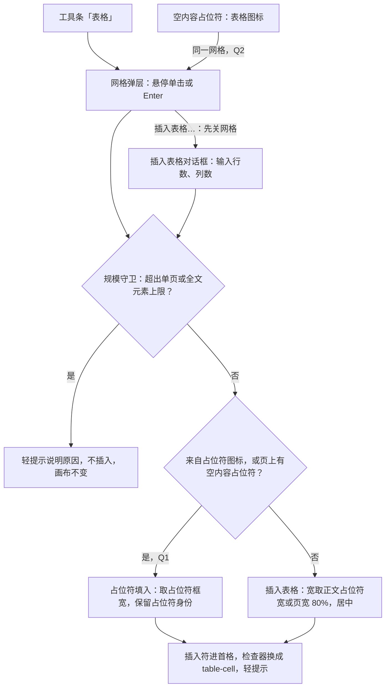
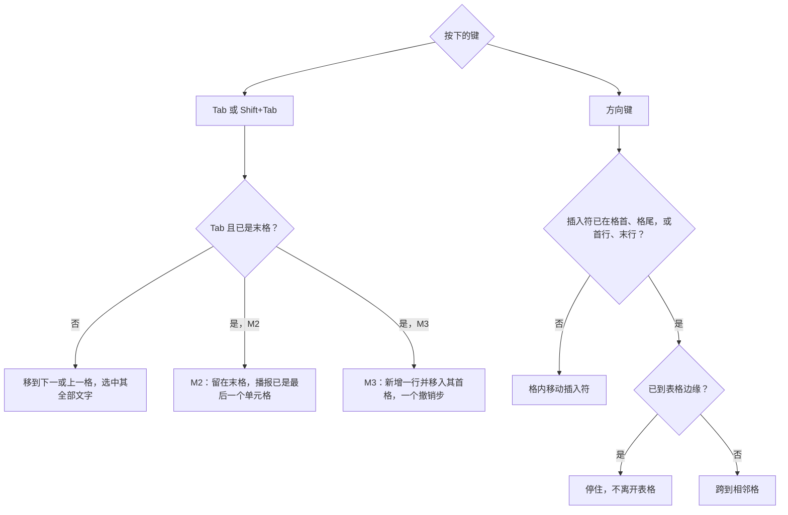
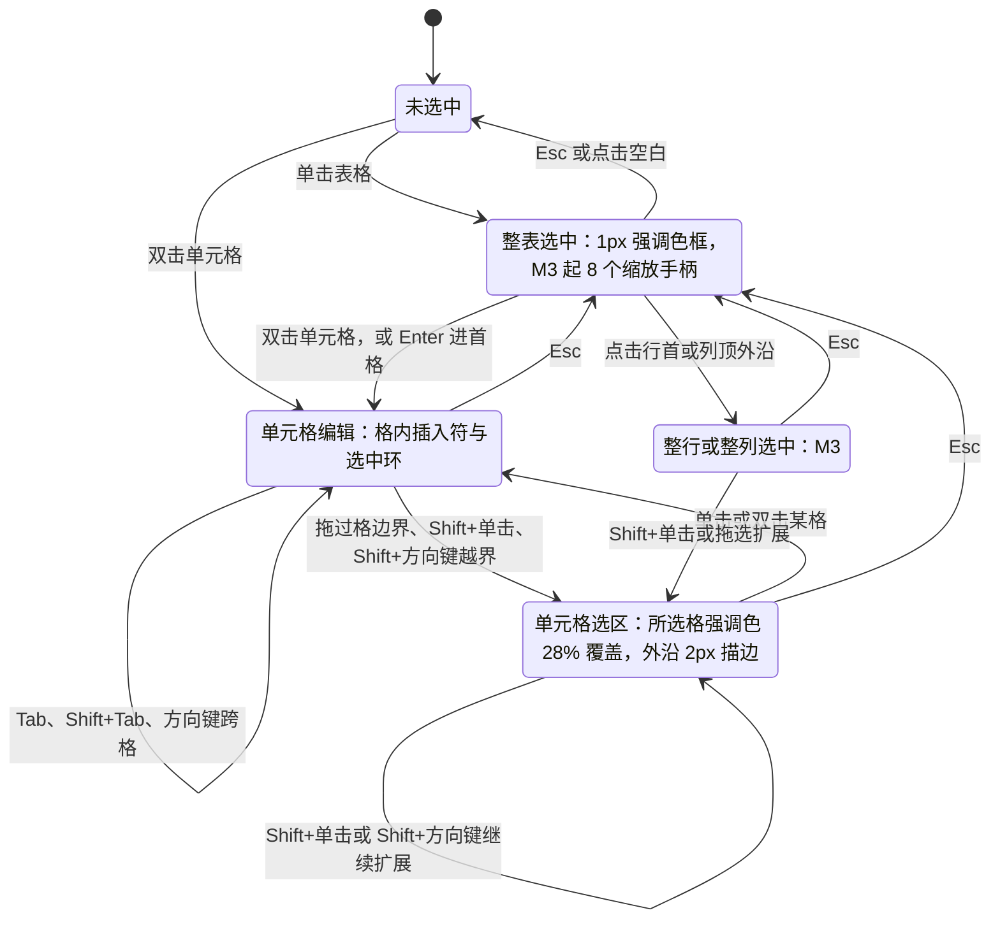
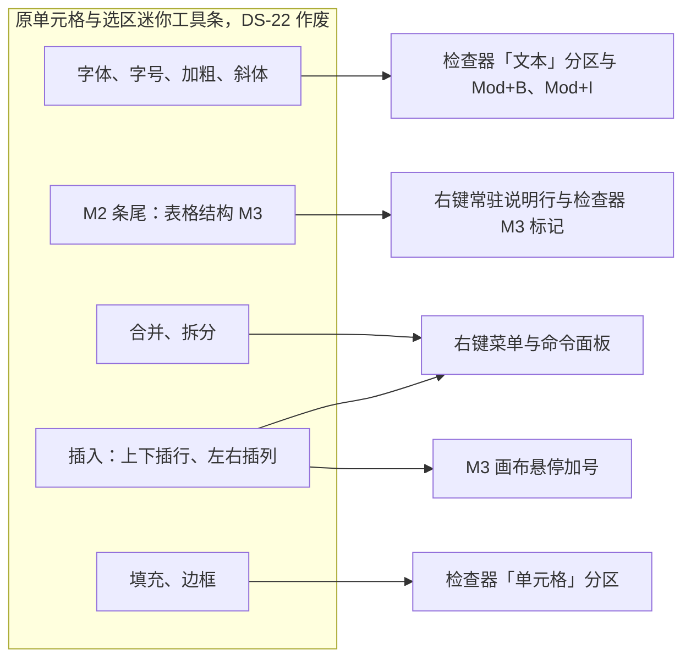
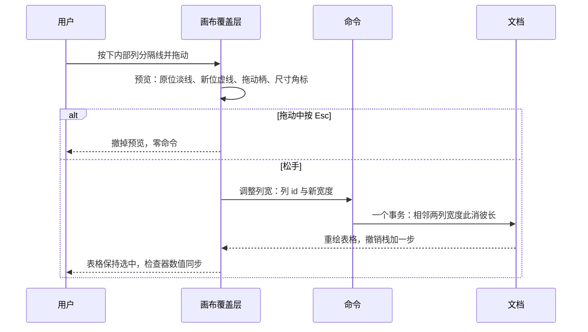
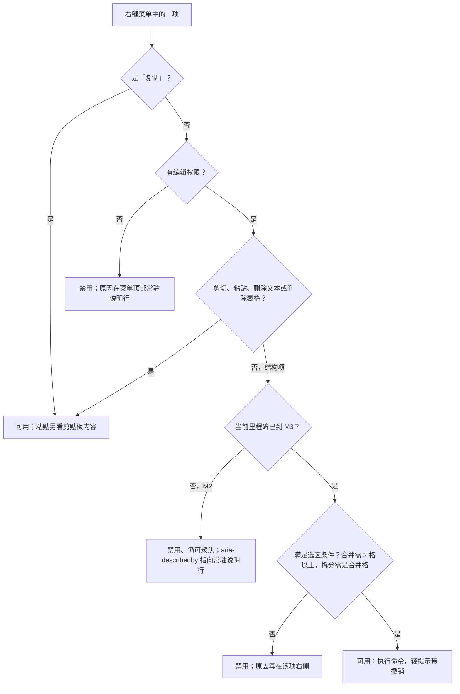
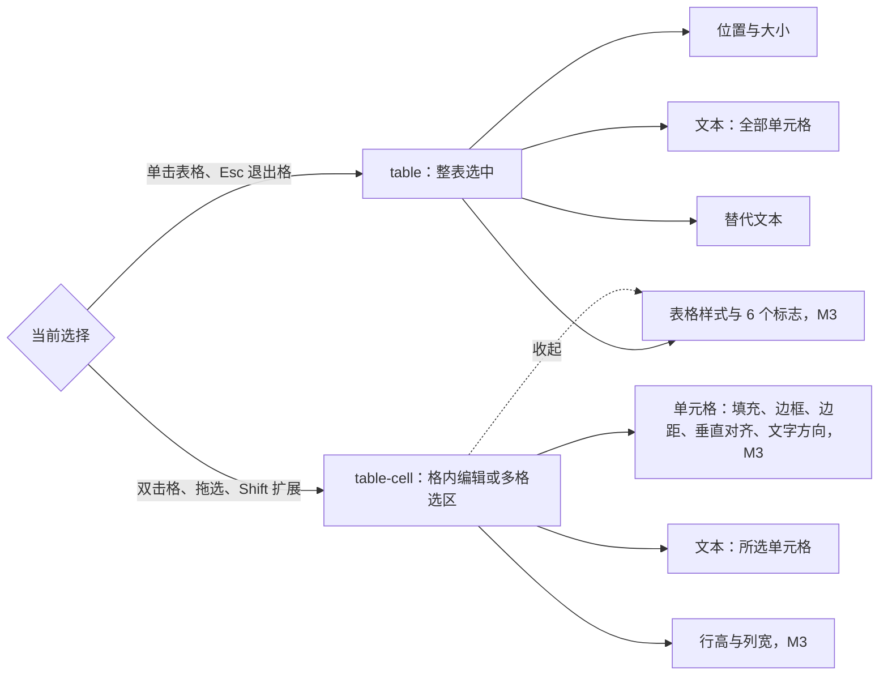
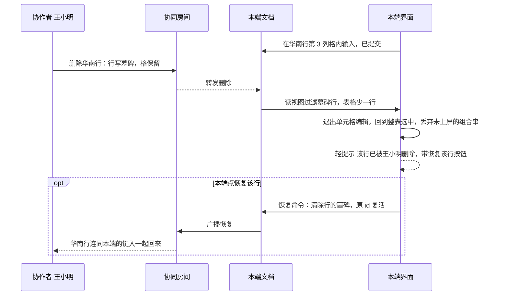

> 状态：草稿 | 负责：设计 | 更新：2026-09-30（§4.21 剩余缺口样张回写：新建，覆盖 G-32 表格插入与单元格文本（M2）、G-62 表格结构编辑（M3），对应 ED-10；样张由主会话抽查通过，最终以用户确认为准）；2026-09-30（§4.21 剩余缺口样张回写 · 整合：§10、§12 的跟改状态回写——03-05、03-03、50/18 §10、50/07 §12 已跟改，边框预设三处已按样张对齐）；2026-09-30（§4.21 剩余缺口样张回写 · 复核修正：占位符「表格」图标的去向以 §13 第 7 条为唯一登记点并改图 2；如实登记样张的外框画法、M2 演示态的检查器、只读角色、禁用实现与边框预览差异（§12 第 10–12 行，§13 第 20–23 条）；「拆分单元格…」对普通格的命令缺口；插入落点与 03-31 合并为一条；「禁用而不隐藏」出处改为 rulings §4.20 FE-06）；2026-09-30（§4.22 设计待决收口：按用户裁决 Q1（插入时填入空内容占位符）、Q2（占位符表格图标弹同一网格）、Q3（放宽对话框上限，暂按 75 × 75 待性能评估）与样张 SF-05–08、SF-14 回写——网格改 8 行 × 10 列、读数「R 行 × C 列」，「插入表格…」对话框出样张，新增 5 个演示态（共 17 个）；插入后检查器改 `table-cell`，M2 检查器锁定与 M2 选区文本条定稿；右键菜单补粘贴与删除文本、全部改 `aria-disabled`、M2「删除表格」可用、普通格拆分禁用；只读画布关闭插入符与手柄；单元格顶端对齐、检查器以 in 显示并补文字方向；§12 全部关闭，§13 已定项改为定稿说明，5 项推迟见 rulings §4.22）；2026-09-30（§4.22 整合：§13 第 12 条注明样张单位不一待用户确认（SR-4），第 24 条（a）指向 SR-3）；2026-09-30（§4.22 复核修正：§2.2 对话框改由 react-hook-form 管理（样张已装依赖）；§2.4 落点补「已选中的空占位符优先」、行高括注与 PRD 一致、插入页签入口的 toast 按有无空占位符区分；§2.3 弹层避让改为 112 px；§5 迷你工具条改引 50/24 §2.6 现行口径；§11 样式库全部态注明「收起」需下滚可见；文首 §13 说明更正）；2026-10-07（design-language-v3 第 1 批：按已拍板的 v3 样张 `table` 场景 19 个状态重写全文——文首设计基准改指 v3 场景源码；§1 补入口唯一与无状态栏、M2 / M3 分界表改列样张状态；§2.1 工具条「表格」网格（弹层在工具条上方、读数「R 行 × C 列」移到标题行右侧、目标占位符画框）、§2.2 对话框（宽 360、主按钮「插入」、说明行只写当前上限、焦点进「行数」）、§2.3 占位符网格（位置以 03-16 为准、112 px 避让作废）、§2.4 插入后状态（补「页上没有空占位符」、轻提示代替迷你条与状态栏反馈）；§3–§4 去掉文字与选区迷你工具条，原迷你条条目逐项写明去处（新增图 4a）；§5 悬停「+」与拖动柄改强调色方块、尺寸角标、右键菜单原因写在条目右侧或常驻说明行、命令面板同名命令；§6 检查器分区、样式库、边框选择器、色块与单位按样张（pt）；§7 远端单元格选区画法与轻提示位置；§8 键盘补 Mod+B / I / U 与 Mod+K；§9 改为「只读、权限与窄屏」（评审条、只读展示、只读右键、紧凑与仅查看）；§10 命令表补右键与命令面板入口；§11 改为「状态」（19 个状态、路由与里程碑）；§12 增第 13–23 行 v3 差异；§13 关闭第 3、24（c）条、改写第 6、8、12、20–22、24 条，新增第 25–27 条。依据 rulings §4.25 DS-1、DS-5、DS-6、DS-9、DS-11、DS-13、DS-14、DS-15、DS-17、DS-21…DS-24；§4.22 D-01、D-02、SF-01 已按 DS-22 修订）；2026-10-07（design-language-v3 第 1 批：§2.1、§2.2、§12 第 14–15 行、§13 第 6、27 条表格插入文案按 TB-8 定稿（「被修订的既有口径」已补登）；§3、§13 第 25 条按键提示签维持演示说明、样张标为演示（TB-9）；§2.3、§13 第 24 条占位符网格弹层按 03-16 §6.6 向下展开、离视口不足 8 才翻上，SR-3 结案（TB-10）；§2.3、§2.4、§6.2、§6.4、§6.6、§12 第 20 行、§13 第 12 条数值按 pt 书写、产品按设置的单位显示，SR-4 结案（DS-27）；§5.1、§8 悬停「+」命中区扩到 24（07 §2）；§2.1 主菜单「插入 › 表格…」打开同一网格弹层（03-04）；§4、§12 第 13 行补 `toolbar.<selectionKind>` 槽位删除（TB-29）；§12 第 16、17、22 行更新跟改状态；依据 rulings §4.25 DS-27、TB-8、TB-9、TB-10、TB-29）；2026-10-08（design-language-v3 第 1 批收口：§2.1 插入网格未选格的内描边改用 `--v3-border-control`（对比度 ≥ 3:1，WCAG 1.4.11），底色不变，样张跟改（TB-35），§13 第 24 条（b）结案；§2.1、§2.4、§7 三张线框的工具条「选择」去掉 ▾（同 03-02 §3.4）；§3、§11 第 7 行、§13 第 25 条注明样张提示签已挂「演示」标记（TB-9）；§11 开头与 §12 第 23 行：capture-screens 第 30 条已改登记 19 个状态；§12 第 13–16、18、22 行与 §13 第 27 条按各线已完成的跟改关闭；依据 rulings §4.25 TB-9、TB-29、TB-35）；2026-10-08（design-language-v3 第 1 批收口复核：§12 第 22 行改记两份样张已统一）；2026-10-08（design-language-v3 第 1 批评审修改：按安静样式改检查器控件画法（rulings §4.25 DS-35）——§6.4「填充」更正为下拉式触发器（`SELECT_FRAME`，透明底加细边，原「字段式按钮、`FIELD_FRAME` 外框」与样张不符、作废），边框选择器的当前项改为面板色加细边、示意格线条加粗；§6.3 样式缩略图悬停环改 `--v3-hover-line`；§2.1 插入网格未选格仍是 `--v3-border-control`、≥ 3:1（TB-35，DS-35 不改这一项），§13 第 24 条（b）去掉「与 DS-9 字段边界同一 token」的说法）；2026-10-23（design-language-v3 第 3 批评审修改：§2.2「插入表格」对话框随 rulings §4.25 DS-142 改为标题栏 40、圆角 12、✕ 用正文色（原圆角 8 作废），§11 注明 `table-dialog`、`table-dialog-error` 随之改画） | 依赖：charter v0.2；`10-prd/07-design-coverage-and-gaps.md`（G-32、G-62）；PRD `03-features/02-editing.md` ED-10；前端 50/24、50/10、50/18、50/06、50/21；ADR-0018；playground `#/v3/editor?state=table.<状态 id>`（`src/v3/scenarios/table/`、`src/v3/kit/TableGridPicker.tsx`）；rulings §4.21（q-table-depth、R-d-61、R-d-72）、§4.20 FE-06（禁用而不隐藏）、§4.22（设计待决收口，用户裁决 Q1–Q3）、§4.25（DS-1、DS-5、DS-6、DS-9、DS-11、DS-13…DS-15、DS-17、DS-21…DS-27、DS-35、TB-8…TB-10、TB-29、TB-35）

# 03-30 表格编辑

> **设计基准（2026-10-07 起，rulings §4.25 DS-21）**：以已拍板的 playground v3 场景 `table` 为准——19 个状态，路由 `#/v3/editor?state=table.<状态 id>`（§11）。源码 `playground/src/v3/scenarios/table/`：`table.scenario.tsx`（各状态的 title 与 note）、`overlays.tsx`（画布叠加层：选中框、选中环、插入符、选区、手柄、提示签）、`inspector.tsx` 与 `controls.tsx`（检查器分区）、`StyleGallery.tsx`（样式库）、`menus.tsx`（右键菜单）、`InsertTableDialog.tsx`、`GridPicker.tsx`、`model.ts`（示例数据、几何与着色规则）；插入网格是共用件 `playground/src/v3/kit/TableGridPicker.tsx`（工具条与占位符共用）。外壳、浮层、控件与轻提示的通用规格见 [03-02](02-editor-main.md) 与设计 [04](../04-design-system.md)。旧版 ribbon 样张 `#/editor/table`（`routes/editor/TableEditing.tsx`）作废，v3 全量迁移后删除（DS-7）。
>
> 行为口径与前端 [50/24](../../50-frontend/24-elements-tables-and-charts.md) §2 一致，视觉与文案以本文为准。样张没画到的规格（M3 的远端单元格选区与整行整列选中、命令面板里的表格命令、触屏、紧凑窗口下的表格编辑等）保留原意，只把入口改成 v3 的落点，并在原处注明「样张未画，随实现」。§12 登记样张与既有口径的差异，§13 登记待决与取舍。

覆盖缺口 **G-32**（ED-10 M2：插入与单元格文本）与 **G-62**（ED-10 M3：结构与样式）。底部工具条「表格」的位置与工具条整体规格见 [03-04](04-insert-menu.md) 与 03-02 §3.4，本文写它打开的网格、对话框与插入之后的全部状态；右键菜单是 [03-05](05-context-menu.md)「表格单元格」变体的完整版；检查器是 03-02 §4.5 所列 `table` / `table-cell` 两种选中态的分区（[03-03](03-properties-panel.md) G-19 表指向本文 §6）；空内容占位符图标条本身（G-80）见 [03-16](16-text-editing-and-formatting.md)，本文只写其中「表格」图标的去向。

---

## 1. 界面目标与范围

- **M2 先能用**：插一张表、在格里打字、在格间跳、选多格批量改字，不必等结构编辑（rulings §4.21 q-table-depth 把插入与单元格文字从 M3 提前到 M2）。
- **M3 补齐结构与样式**：增删行列、合并标题格、拖宽列、套样式、画边框——PowerPoint 用户最常用的表格操作。
- **入口唯一**（DS-1、DS-22）：创建只在底部工具条「表格」与空内容占位符的图标条；格式只在检查器——字符格式在「文本」分区，填充、边框、边距、对齐与文字方向在「单元格」分区，样式与 6 个标志在「表格样式」分区，行高列宽的数值在「行高与列宽」分区；插删行列、合并拆分、删除表格走右键菜单与命令面板（⌘K），M3 起画布另有悬停「+」与分隔线手柄。表格不设任何迷你工具条——单元格、选区、整表都没有（DS-13、DS-22；原迷你工具条各条目的去处见 §4 表与图 4a）。
- **没有状态栏**（DS-6）：检查器面板标题与轻提示取代原状态栏——当前格与选区的位置写在检查器面板标题（「单元格 · 第 3 行第 3 列」「单元格 · 2 行 × 2 列」「表格 · 6 行 × 4 列」）；插入、合并、他人删行等反馈走轻提示（画布底部居中、工具条上方 12，03-02）；读屏另有 live region 播报（§8）。
- **禁用而不隐藏**：M3 才开放的菜单项、检查器分区在 M2 留在原位，带 M3 标记、禁用并说明原因，用户能预期、不会以为功能不存在（rulings §4.20 FE-06；50/10 §4）。画布手柄不在此列：M2 直接不出现（§5.1、§5.2）。
- **表格是幻灯片内容**：画在纸面上，颜色取文档主题（样张强调 1 为 `#3A5CE6`），不随界面亮暗变化；叠在表格上的选中框、选中环、插入符、选区、手柄与尺寸角标是界面件，一律用界面强调色 `--v3-accent`（DS-24，亮 `#3A5CE6` / 暗 `#5B7CFF`），只在强调色实底的格上改用白色加深色的双层画法（§2.4）。

**M2 / M3 分界**

| 能力 | M2（P1） | M3（P1） | 样张状态（§11） |
|---|---|---|---|
| 插入：工具条网格、「插入表格」对话框、占位符的表格图标 | 可用；页上有空内容占位符时填入它（Q1） | 同 M2 | `grid`、`placeholder-grid`、`table-dialog`、`table-dialog-error` |
| 默认表格、插入后光标进首格 | 可用 | 同 M2 | `inserted`、`inserted-free` |
| 单元格文字与字符格式 | 可用（检查器「文本（所选单元格）」与快捷键） | 同 M2 | `cell-nav` |
| Tab / Shift+Tab / 方向键跨格 | 可用；末格 Tab 不加行，播报「已是最后一个单元格」 | 末格 Tab 加一行 | `cell-nav` |
| 多格选区 | 批量字符格式、Delete 清空文字、复制；右键结构项灰显并由说明行给原因，检查器 M3 分区锁定 | 另可合并、拆分（右键 / 命令面板）、改填充与边框（检查器「单元格」） | `m2-range`、`m2-menu`、`range`、`context-menu` |
| 整表选中 | 1px 强调色选中框、可移动，无缩放手柄 | 8 个缩放手柄，整体缩放按比例分配行列 | `hover-insert`、`resize`、`styles`、`styles-all`、`remote-delete` |
| 行列插入与删除 | 右键项禁用并指向说明行；画布不出现「+」 | 悬停「+」、右键、命令面板 | `hover-insert`、`context-menu`、`m2-menu` |
| 拖分隔线调列宽 / 行高 | 不出现分隔线手柄 | 可用，松手一个撤销步 | `resize` |
| 合并 / 拆分 | 禁用并说明原因 | 可用；拆分只对合并格 | `context-menu`、`merged` |
| 检查器「单元格」「行高与列宽」 | 分区在原位、标题带 M3，控件 `aria-disabled`，提示「M3 提供」 | 可用 | `cell-nav`、`m2-range`、`borders` |
| 检查器「表格样式」与 6 个标志 | 分区在原位、标题带 M3，当前样式高亮，不可改 | 可用 | `styles`、`styles-all` |
| 检查器「位置与大小」「文本」「替代文本」 | 可用（宽、高与锁定比例 M3） | 同 M2 | `hover-insert` 等 |
| 远端协作者的单元格选区 | 不显示 | 按单元格矩形画远端选区（§7），样张未画，随实现 | — |
| 他人删除你正在编辑的行 / 列 | 不会发生（M2 无结构编辑） | 退出编辑 + 轻提示「恢复该行」 | `remote-delete` |
| 评审、查看角色（只读） | 画布只读、检查器只读展示、右键只能复制 | 同 M2 | `readonly` |
| 对角线边框、单元格内图片 | — | —（P2） | — |

**图 1 表格能力的里程碑分层**


怎么读：左边是 M2 就能走通的一条路径（插入 → 打字 → 跳格 → 选多格，Esc 退到整表）；右边是 M3 在同一选区、同一张表上追加的结构与样式操作；虚线表示 M2 时这些入口不隐藏，而是禁用并说明原因（右键菜单的说明行、检查器分区的 M3 标记，§5.3、§6）。拖分隔线与悬停「+」是画布手柄，不属于「禁用而不隐藏」的控件，M2 直接不出现（与 50/24 §2.5、§2.6 同一口径；FE-06 只管贡献控件）。
依据：PRD ED-10；rulings §4.21 q-table-depth、§4.20 FE-06、§4.22 D-01（2026-10-07 经 §4.25 DS-22 修订：只去掉迷你条，悬停「+」不变）。

---

## 2. 插入入口与默认表格

### 2.1 工具条「表格」：8 行 × 10 列悬停网格

线框（状态 `grid`，1600 × 1000 视口；备注区在幻灯片下方，从略）：

```
←────── 240 ──────→←──────────────────────── 画布 ─────────────────────────→←────────── 280 ───────────→
┌──────────────────┬────────────────────────────────────────────────────────┬──────────────────────────┐
│[▣▾]       [▭][⊞] │                                                        │(周)(王)(李)    ▶ [分享]  │
│2026 年 Q2 … ▾    │   ┌────────────────────────────────────────────────┐   │──────────────────────────│
│✓ 已同步          │   │ 区域分布                                       │   │[设计] 评论        77% ▾  │
│[新建幻灯片 ▾] [+]│   │ Q2 各区域月度营收，单位：万元                  │   │──────────────────────────│
│                  │   │ ┏━━━━━━━━━━━━━━━━━━━━━━━━━━━━━━━━━━━━━━━━━━━━┓ │   │幻灯片 5                  │
│ 1 [标题页    ]   │   │ ┃ • 单击此处添加文本                         ┃ │   │──────────────────────────│
│ 2 [议程      ]   │   │ ┃        ▦       ▨       ▥ M3     ▶ P2       ┃ │   │版式                      │
│ 3 [关键指标  ]   │   │ ┃       表格    图片     图表      视频      ┃ │   │[▭ 标题和内容         ▾]  │
│ 4 [营收趋势  ]   │   │ ┃       单击图标插入，或把图片拖到这里       ┃ │   │──────────────────────────│
│▌5 [区域分布  ]   │   │ ┗━━━━━━━━━━━━━━━━━━━━━━━━━━━━━━━━━━━━━━━━━━━━┛ │   │主题                      │
│ 6 [下半年计划]   │   │ 2026 年 Q2 业绩汇报                          5 │   │[■] Office · 思源黑体  ≡  │
│                  │   └────────────────────────────────────────────────┘   │──────────────────────────│
│                  │                 ┌──────────────────────────────┐       │背景                      │
│                  │                 │ 插入表格         3 行 × 4 列 │       │[ 纯色 │ 渐变 │ 图片 ]    │
│                  │                 │ ■ ■ ■ ■ □ □ □ □ □ □          │       │[□ #FFFFFF   背景 1 100%] │
│                  │                 │ ■ ■ ■ ■ □ □ □ □ □ □          │       │──────────────────────────│
│                  │                 │ ■ ■ ■ ■ □ □ □ □ □ □          │       │放映                      │
│                  │                 │ □ □ □ □ □ □ □ □ □ □          │       │[切换 无              ▾]  │
│                  │                 │ …（共 8 行）                 │       │☐ 放映时跳过此页          │
│                  │                 ├──────────────────────────────┤       │                          │
│                  │                 │ ▦ 插入表格…                  │       │                          │
│                  │                 └──────────────────────────────┘       │                          │
│                  │              ╭────────────────────────────────────╮    │                          │
│                  │              │ ↖   T   ◇   ▨  [▦]  ▥   ▢   +      │    │                          │
│                  │              ╰────────────────────────────────────╯    │                          │
└──────────────────┴────────────────────────────────────────────────────────┴──────────────────────────┘
```

图例：`┏━┓` 是新表格将填入的空正文占位符——网格打开期间画 1px 强调色框（kit `HoverBox`），提示「选定后填进这里」（Q1）；`[▦]` 是按下的工具条「表格」（强调色底）；`▌` 是当前页；检查器此时是无选中态「幻灯片 5」（03-02 §4.1），不放说明卡。

| 项 | 规格 |
|---|---|
| 入口 | 底部工具条「表格」（`Table` 图标，无单键；工具提示「表格」，网格视图里为「在第 N 页添加表格」；`aria-haspopup="dialog"`、`aria-expanded`）。点按即开网格弹层，弹层或对话框开着时按钮为当前工具（强调色底），关闭后工具回到「选择」。主菜单「插入 › 表格…」打开锚在工具条「表格」上的同一个网格弹层，命令面板「插入表格」与之等价（入口清单归 03-04；样张主菜单未接线，随实现） |
| 弹层 | kit `Popover`：在「表格」按钮正上方居中，距工具条外沿 8（距按钮 13，与形状弹层一致）；`--v3-panel` 底、1px `--v3-border`、浮层阴影、圆角 8、内边距 8；宽随网格（196）。用户（指针或键盘）打开时焦点移进网格（落在当前高亮角，未悬停时第 1 行第 1 列），`Tab` / `⇧Tab` 在弹层内循环；点外面或 `Esc` 关闭，`Esc` 关闭后焦点回到「表格」按钮 |
| 标题行 | 左「插入表格」（12px 600，`--v3-text`）；右读数「R 行 × C 列」（12px `--v3-text-2`、等宽数字；rulings §4.25 TB-8），未悬停时「移入选择尺寸」；指针移出网格即复位；读数区 `aria-live="polite"`，随高亮更新 |
| 格子 | 16 × 16、圆角 3、间距 4，10 列 8 行（网格宽 196）；未高亮：`--v3-panel-2` 底 + 1px `--v3-border-control` 内描边（对比度 ≥ 3:1，WCAG 1.4.11；rulings §4.25 TB-35，原 1px `--v3-border` 亮暗两套都低于 3:1，作废；样张 `kit/TableGridPicker.tsx` 已跟改）；2026-10-08 安静样式不改这一项——格子就是控件本身，与复选框、单选圈同为仍 ≥ 3:1 的控件边界（DS-35）；高亮（左上角到悬停格的矩形）：`--v3-sel` 底（强调色 28%）+ 1px 强调色内描边；亮暗两套用同一组 token |
| 网格范围与上限 | 网格只是悬停范围 8 行 × 10 列（用户裁决 2026-09-30 Q3）；更大的表用「插入表格…」，对话框上限待性能评估（暂按 75 × 75 占位，§2.2） |
| 「插入表格…」 | 网格下一条通栏分隔线，其下 ghost 按钮（高 28、左对齐，前置 16px `Table` 图标 `--v3-text-2`）；先关网格弹层，再开 §2.2 对话框 |
| 选定 | 单击高亮角的格（或 `Enter` / `Space`）即插入并关闭弹层；不经插入工具态（03-04「图片、图标、表格、图表不经工具态」） |
| 键盘 | 网格 `role="grid"`（`aria-labelledby` 指标题、`aria-describedby` 指读数），行 `row`、格 `gridcell`（`aria-selected` 标高亮），roving tabindex，只占一个 Tab 停靠点；方向键移动高亮角，`Home` / `End` 到本行第 1 / 第 10 列，`Enter` / `Space` 插入，`Esc` 关闭并把焦点还给触发按钮；每格读屏名「R 行 C 列」；触屏改为先展开数字输入（03-04 边界情况；样张未画，随实现） |

### 2.2 「插入表格」对话框

线框（左：状态 `table-dialog`，初值 12 × 4；右：`table-dialog-error`，行数 80）：

```
┌──────────────────────────────────────┐   ┌──────────────────────────────────────┐
│ 插入表格                          ✕  │   │ 插入表格                          ✕  │
├──────────────────────────────────────┤   ├──────────────────────────────────────┤
│ 输入行数和列数；插入后光标在第一个   │   │ 输入行数和列数；插入后光标在第一个   │
│ 单元格。                             │   │ 单元格。                             │
│ 行数                列数             │   │ 行数                列数             │
│ [12             ]  [4              ] │   │ [80             ]  [4              ] │
│ 行数、列数各 1–75                    │   │ 行数最多 75                          │
├──────────────────────────────────────┤   ├──────────────────────────────────────┤
│                      [取消]  [插入]  │   │                      [取消]  [插入]  │
└──────────────────────────────────────┘   └──────────────────────────────────────┘
```

| 项 | 规格 |
|---|---|
| 形态 | kit `Dialog` `sm`：宽 360（rulings §4.25 TB-8），`--v3-panel` 底、1px 边、圆角 12、浮层阴影，遮罩 `--v3-scrim`；标题栏 40：「插入表格」（13px 600）+ 右上 24 的 ✕（用正文色），与正文、底栏之间各一条 1px 分隔（标题栏、圆角与 ✕ 2026-10-23 按 rulings §4.25 DS-142 统一，原圆角 8 作废）；正文首行说明「输入行数和列数；插入后光标在第一个单元格。」（12px `--v3-text-2`）；两个字段由 react-hook-form 管理（50/24 §2.12，R-d-18），`mode="onChange"` 逐字段即时校验，打开时先校验一次（演示态传入的超限初值直接画出报错帧） |
| 字段 | 行数、列数两个整数字段并排（间距 12），顺序与网格读数「行 × 列」一致；标签在框上方（12px `--v3-text-2`），字段高 28、`FIELD_FRAME` 外框、数字键盘（`inputMode="numeric"`）、等宽数字；初值 3 × 4 |
| 上限 | 行数、列数各 1–75：上限待性能评估，评估前暂按 75 × 75 占位（用户裁决 2026-09-30 Q3，推迟项见 §13 第 6 条）。「待评估」是工程备注，不写进界面：说明行常显「行数、列数各 1–75」（TB-8） |
| 校验 | 说明行就地变为内联错误（`--v3-danger`、`role="alert"`），出错字段 `aria-invalid`、外框换成危险色；文案按「必填 → 下限 → 上限 → 整数」取第一条：「请输入行数」「行数至少为 1」「行数最多 75」「行数须为整数」，列数同理，两个字段都错时用「；」连接 |
| 主按钮 | 「插入」（对话框主按钮写动作，不写「确定」；TB-8）。非法时仍是同一个按钮：`aria-disabled`、可聚焦、工具提示复述错误，点了或在字段内按 `Enter` 都不提交。合法时与网格走同一条插入命令、一个撤销步，插入后插入符进首格（§2.4） |
| 焦点 | 用户打开时焦点落在「行数」字段（APG 模态对话框）；焦点陷阱，`Tab` / `⇧Tab` 只在框内循环；字段内 `Enter` 提交 |
| 打开与关闭 | 「插入表格…」先关网格弹层，再开对话框（不叠在弹层上）；「取消」、✕、点遮罩或 `Esc` 关闭，焦点回到打开网格的按钮（工具条「表格」；占位符入口回到表格图标，图标条折叠时回到「插入 ▾」，§2.3）；从工具条打开的，关闭后工具回到「选择」 |

### 2.3 空内容占位符的「表格」图标

线框（状态 `placeholder-grid`：版式「标题和内容」的空正文占位符，图标条的「表格」按下）：

```
┌╌╌╌╌╌╌╌╌╌╌╌╌╌╌╌╌╌╌╌╌╌╌╌╌╌╌╌╌╌╌╌╌╌╌╌╌╌╌╌╌╌╌╌╌╌╌╌╌╌╌╌╌┐
╎ • 单击此处添加文本                                 ╎
╎        ┌──────┐                                    ╎
╎        │  ▦   │     ▨        ▥           ▶         ╎   ← 占位符图标条（03-16）：表格 M2 可用，图表 M3、视频 P2 禁用而不隐藏
╎        │ 表格 │    图片    图表 [M3]   视频 [P2]   ╎   ← 表格图标按下（--v3-panel-2 底，aria-expanded）
╎        └──────┘                                    ╎
╎        ┌────────────────────────────┐              ╎   ← 与工具条同一个网格弹层（Q2）；弹层打开期间图标条下的提示行收起
╎        │ 插入表格       3 行 × 4 列 │              ╎
╎        │ ■ ■ ■ ■ □ □ □ □ □ □        │              ╎
└╌╌╌╌╌╌╌╌│ ■ ■ ■ ■ □ □ □ □ □ □        │╌╌╌╌╌╌╌╌╌╌╌╌╌╌┘
         │ ■ ■ ■ ■ □ □ □ □ □ □        │
         │ …（共 8 行）               │
         ├────────────────────────────┤   ← 网格下方超出占位符与幻灯片时照样展开；放不下时翻到图标上方
         │ ▦ 插入表格…                │
         └────────────────────────────┘
```

- 图标条本身（布局、按屏幕尺寸绘制、窄占位符折叠为「插入 ▾」、单一 Tab 停靠点、禁用原因、拖入图片）见 [03-16](16-text-editing-and-formatting.md)；v3 外观：纸面上没有容器，一排 64px 方形按钮（24px 图标 + 12px 名称，圆角 8），未到里程碑的项带标记、禁用而不隐藏。其中「表格」图标 M2 可用，读屏名「插入表格到占位符」，工具提示「插入表格」。
- 点击 → 弹出与工具条**同一个** `TableGridPicker`（§2.1，含「插入表格…」；用户裁决 2026-09-30 Q2）。弹层打开期间表格图标保持按下态（`--v3-panel-2` 底，`aria-expanded`），图标条下的提示行「单击图标插入，或把图片拖到这里」暂时收起（免得被弹层压住半句）；图标条折叠时锚在「插入 ▾」按钮上。
- 弹层位置以 03-16 §6.6 为准：在图标正下方 8 居中展开，下方离视口不足 8 时才翻到图标上方（rulings §4.25 TB-10，§4.22 SR-3 结案）；v3 没有状态栏与缩放条，原「为状态栏与缩放条留 112 px」作废（DS-6，§13 第 24 条）。网格下方加一行说明「填入这个占位符，表格宽度取占位符宽」，同样以 03-16 为准；本场景样张左对齐、距 4、不加说明，随 playground 迁移按 03-16 统一（§12 第 22 行）。
- 「插入表格…」与工具条同一流程：先关网格、再开 §2.2 对话框；取消或 `Esc` 后焦点回到表格图标（折叠时回到「插入 ▾」）。
- 选定行列后以占位符填入命令写入：宽取占位符框宽、行高 370840 EMU（29.2 pt）、高度按内容，保留占位符身份（同 `type`、同 `idx`）；轻提示「已在占位符插入 R 行 × C 列表格，宽取占位符框宽」，第二行「填入是一个撤销步；删除内容后占位符恢复为空」。
- 往占位符里插内容只有画布图标条与底部工具条两个入口：检查器 `placeholder-empty` 不设「插入到占位符」按钮组（DS-14，03-16）。评审、查看角色下图标条不出现（03-16）。
- 填入后与其它入口插入的表格完全相同（§2.4）；按 Q1，工具条网格与对话框在页上有空内容占位符时也走同一条填入命令。

### 2.4 默认表格与插入后状态

线框（状态 `inserted`：3 × 4 新表格填入空正文占位符）：

```
←────── 240 ──────→←──────────────────────── 画布 ─────────────────────────→←────────── 280 ───────────→
┌──────────────────┬────────────────────────────────────────────────────────┬──────────────────────────┐
│[▣▾]       [▭][⊞] │                                                        │(周)(王)(李)    ▶ [分享]  │
│2026 年 Q2 … ▾    │   ┌────────────────────────────────────────────────┐   │──────────────────────────│
│✓ 已同步          │   │ 区域分布                                       │   │[设计] 评论        77% ▾  │
│[新建幻灯片 ▾] [+]│   │ Q2 各区域月度营收，单位：万元                  │   │──────────────────────────│
│                  │   │ ┌───────────┬──────────┬──────────┬──────────┐ │   │单元格 · 第 1 行第 1 列   │
│ 1 [标题页    ]   │   │ │[▏        ]│          │          │          │ │   │  新表格 3 × 4            │
│ 2 [议程      ]   │   │ ├───────────┼──────────┼──────────┼──────────┤ │   │──────────────────────────│
│ 3 [关键指标  ]   │   │ │           │          │          │          │ │   │表格样式 [M3]          ›  │
│ 4 [营收趋势  ]   │   │ ├───────────┼──────────┼──────────┼──────────┤ │   │──────────────────────────│
│▌5 [区域分布 ▦]   │   │ │           │          │          │          │ │   │单元格 [M3]            ›  │
│ 6 [下半年计划]   │   │ └───────────┴──────────┴──────────┴──────────┘ │   │──────────────────────────│
│                  │   │                                                │   │文本（所选单元格）     ˅  │
│                  │   │ 2026 年 Q2 业绩汇报                          5 │   │[思源黑体             ▾]  │
│                  │   └────────────────────────────────────────────────┘   │[字号 18   pt] [ B │ I ]  │
│                  │                                                        │──────────────────────────│
│                  │                                                        │行高与列宽 [M3]        ›  │
│                  │   ┌────────────────────────────────────────────────┐   │                          │
│                  │   │ 已在占位符插入 3 行 × 4 列表格，宽取占位符框宽 │   │                          │
│                  │   │ 填入是一个撤销步；删除内容后占位符恢复为空     │   │                          │
│                  │   └────────────────────────────────────────────────┘   │                          │
│                  │              ╭────────────────────────────────────╮    │                          │
│                  │              │ [↖]  T   ◇   ▨   ▦   ▥   ▢   +     │    │                          │
│                  │              ╰────────────────────────────────────╯    │                          │
└──────────────────┴────────────────────────────────────────────────────────┴──────────────────────────┘
```

图例：`[▏        ]` 是首格——标题行是强调色实底，所以首格画 2px 白 + 2px 深蓝双层环与白色插入符；表格外框是 1px 强调色选中框，格内编辑时不画缩放手柄；检查器面板标题后的灰字「新表格 3 × 4」只在刚插入时出现。另一状态 `inserted-free`：版式「仅标题」没有空内容占位符，新表格宽取页宽 80%、水平居中、垂直落在视口中心，其余相同。

| 项 | 规格 |
|---|---|
| 尺寸 | 填入空内容占位符时宽取占位符框宽（样张 820.8 pt）；普通插入时宽取当前版式正文占位符宽（没有则页宽 80%，样张 768 pt）；列等宽；行高 370840 EMU（29.2 pt，同 PowerPoint 新表格，PRD ED-10；样张画作 29.5 pt，是按 0.41 in 取的近似，§12 第 20 行）；高 = 行数 × 行高，内容多时行高随之撑高 |
| 位置 | 页上有空内容占位符（`obj`，或同类 `tbl`）时填入阅读序第一个（已选中的空占位符优先），保留 `p:ph`，走 `slide.fillPlaceholder`（用户裁决 2026-09-30 Q1；`inserted`）；没有时水平居中、垂直落在视口中心，重复插入错位 14.4 pt（50/24 §2.3；`inserted-free`） |
| 样式 | 内置「中度样式 2 - 强调 1」`{5C22544A-7EE6-4342-B048-85BDC9FD1C3A}` + 标题行、镶边行两个标志：标题行强调色实底、白字加粗，正文行强调色两档浅色交替，白色网格线；颜色由主题 accent1 派生，换主题跟随；单元格不写显式填充与边框；文字顶端对齐、各列左对齐，边距左右 7.2 pt、上下 3.6 pt（OOXML 缺省 91440 / 45720 EMU） |
| 选中与焦点 | 插入后直接进入首格的单元格编辑；首格选中环：普通格为 2px 强调色内描边，强调色实底的格（标题行等）上改为 2px 白 + 2px 深蓝（强调色与黑按 55 : 45 混合）双层环、插入符改白，保证在强调色上可辨 |
| 反馈 | 迷你工具条与状态栏均已作废（DS-22、DS-6），反馈只走轻提示与读屏：填入占位符时为 §2.3 的两行文案；没有空占位符时为「已插入 R 行 × C 列表格」，M2 带第二行「M2 可编辑单元格文字；行列增删、合并与样式在 M3」；读屏播报「已插入 R 行 C 列表格」 |
| 检查器 | 取值 `table-cell`（插入符已在首格，同 50/24 §2.7）：面板标题「单元格 · 第 1 行第 1 列」+ 灰字「新表格 R × C」；只展开「文本（所选单元格）」（首格在标题行，「粗体」显示为按下），「表格样式」「单元格」「行高与列宽」收起，M2 时三者标题带 M3；按 `Esc` 退到整表后换成 `table` 分区 |
| 工具条 | 插入后工具回到「选择」 |
| 撤销 | 插入（全部行、列、格）是一个撤销步；选中与进首格是视图操作，不入历史 |

**图 2 两个入口到默认表格**



怎么读：两个入口（工具条、占位符图标）都先到同一个网格弹层，网格与「插入表格…」对话框只负责收集行列数，真正写入的是一条命令、一个事务、一个撤销步；规模守卫在事务之前；页上有空内容占位符时（包括从工具条进入）一律填入，保留占位符身份，删除这张表后空占位符连同图标条一起回来（50/21 §3.2）。主菜单「插入 › 表格…」与命令面板是第二入口，落到同一条命令。命令 id 见 §10。
依据：rulings §4.22 Q1、Q2、Q3；§4.25 DS-1、DS-6、DS-21；PRD ED-10。

---

## 3. 单元格编辑与跨格导航（M2）

线框（状态 `cell-nav`；示例表在第 5 页「区域分布」，与示例文档第 4、5 页同一组数据）：

```
┌───────────┬──────────┬──────────┬──────────┐   外框：1px 强调色选中框，不画缩放手柄
│ 区域      │     4 月 │     5 月 │     6 月 │   ← 标题行：强调色实底、白字
│ 华东      │    1,450 │    1,600 │    1,814 │
│ 华南      │      910 │[  1,010▏]│    1,152 │   ← 第 3 行第 3 列：2px 强调色内描边 + 插入符（数字右对齐，插入符在末尾）
│ 华北      │      800 │      880 │    1,008 │
│ 西部      │      420 │      460 │      528 │
│ 海外      │      220 │      250 │      298 │
└───────────┴──────────┴──────────┴──────────┘
┌───────────────────────────────────────────────────────────────────┐
│ Tab 下一格 · ⇧Tab 上一格 · ←→↑↓ 在格边越界到相邻格 · Esc 回到表格 │   ← 按键提示签（演示说明）
└───────────────────────────────────────────────────────────────────┘
检查器：单元格 · 第 3 行第 3 列（展开「单元格」与「文本（所选单元格）」）
```

示例数据的数值列为用户设置的右对齐；新表格按样式默认左对齐（§2.4）。格内文字一律顶端对齐。

- **进入**：双击单元格；或整表选中后按 `Enter` 进首格；插入后直接在首格。
- **编辑**：格内的字符与段落格式只在检查器「文本（所选单元格）」分区（§6.5），粗体、斜体、下划线等快捷键（`Mod+B` / `Mod+I` / `Mod+U`）照常；不设文字迷你工具条（DS-13）。编辑目标是「这张表的某行某列」，按行列 id 寻址（§10）。
- **视觉**：当前格 2px 强调色内描边 + 2px 强调色插入符（强调色实底的格上改双层环与白色插入符，同 §2.4）；表格外框保持 1px 强调色选中框，不画缩放手柄。
- **检查器**：面板标题「单元格 · 第 R 行第 C 列」；展开「单元格」（M2 带 M3 标记、控件锁定）与「文本（所选单元格）」，「表格样式」「行高与列宽」收起（§6）。
- **按键提示签**：样张在表格底边下方 10 处画了一枚画布提示签（kit `CanvasTag`：高 24、`--v3-panel` 底 + 1px 边 + 浮层阴影、圆角 4、12px `--v3-text-2`，按键用键帽），内容「Tab 下一格 · ⇧Tab 上一格 · ←→↑↓ 在格边越界到相邻格 · Esc 回到表格」，与表格左缘对齐、画在屏幕覆盖层、不随画布缩放。它是演示说明，产品不画（rulings §4.25 TB-9；样张签首已挂「演示」标记，§13 第 25 条）。按键见下表与 §8。

**跨格导航**（规则与 50/06 §9.2 一致）

| 按键 | 行为 |
|---|---|
| `Tab` | 到下一格（行主序，跳过被合并覆盖的格、落到其锚格），并选中目标格全部文字 |
| `Shift+Tab` | 到上一格；首格不动 |
| 末格 `Tab` | M2：不新增行，光标留在末格，读屏播报「已是最后一个单元格」；M3：新增一行并移入其首格，加行与移动是一个撤销步 |
| `←` / `→` | 在格首 / 格尾继续按时跨到前 / 后一格 |
| `↑` / `↓` | 在格内首行 / 末行继续按时跨到上 / 下一格，保持水平位置；到表格边缘停住，不离开表格 |
| `Enter` / `Shift+Enter` | 格内分段 / 软换行，不跳格 |
| `Esc` | 退出单元格编辑，回到整表选中；再按一次取消选择 |
| 格内制表符 | 不提供（PowerPoint 的 Ctrl+Tab 被浏览器占用，50/06 §9.2） |

**图 3 跨格导航的落点判定**



怎么读：Tab 永远按格跳，只在末格分出里程碑差异；方向键先在格内走，走到格边再按一次才跨格，跨到表格边缘就停住。任何一种跨格都停留在文本编辑态内，只改编辑目标，不经过「整表选中」，检查器面板标题随之改成新格的位置。
依据：50/06 §9.2；PRD ED-10。

---

## 4. 单元格选区

线框（状态 `range`；`m2-range` 的画布相同，只有检查器换成 M2 锁定形态）：

```
┌───────────┬──────────┬──────────┬──────────┐   外框：1px 选中框，不画缩放手柄
│ 区域      │     4 月 │     5 月 │     6 月 │
├───────────╔══════════╤══════════╗──────────┤
│ 华东      ║▒   1,450 │▒   1,600 ║    1,814 │   ← 所选格：强调色 28% 覆盖（--v3-sel）
│ 华南      ║▒     910 │▒   1,010 ║    1,152 │
├───────────╚══════════╧══════════╝──────────┤   ← 选区外沿：2px 强调色描边
│ 华北      │      800 │      880 │    1,008 │
│ …         │        … │        … │        … │
└───────────┴──────────┴──────────┴──────────┘
检查器：单元格 · 2 行 × 2 列；画布上没有任何工具条（DS-22）
```

- **形成**：文本编辑中拖过格边界；在某格内 `Shift+单击` 另一格（以当前格为锚点扩成矩形）；文本编辑中 `Shift+方向键` 越过格边界；选区态 `Mod+A` 选中全部格。选区态下 `Shift+方向键` 继续扩展。点击行首或列顶外沿选中整行 / 整列（M3，视觉同单元格选区，样张未画，随实现）。
- **形状**：选区始终是矩形；跨到合并区的一部分时扩展到覆盖整个合并区（与 PowerPoint 一致）。
- **视觉**：每个所选格叠 `--v3-sel`（强调色 28%），选区外沿 2px 强调色描边（不只靠颜色，高对比度模式可辨）；表格外框保持 1px 选中框、不画缩放手柄；覆盖层不进缩略图与导出。
- **反馈**：检查器面板标题「单元格 · R 行 × C 列」；读屏播报「B2 到 C3，共 4 格」。
- **M2 可做**：批量字符格式（检查器「文本（所选单元格）」与快捷键）；`Delete` / `Backspace` 清空所选格文字（一个撤销步）；复制。结构操作在右键菜单里灰显并由说明行给原因（§5.3），检查器「单元格」「行高与列宽」带 M3 标记并锁定（§6.1）。
- **M3 追加**：检查器「单元格」分区（填充、边框、边距、垂直对齐、文字方向，§6.4）；插入、合并、拆分走右键菜单与命令面板（§5.3）。
- **不设选区工具条**（DS-22）：画布上没有任何浮在选区上方的工具条，M2 没有、M3 也没有。原规格里的两种迷你工具条按下表逐项改投，均已作废（rulings §4.22 D-06 与 §4.25「被修订的既有口径」§4.22 D-01、D-02 行）。

| 原迷你工具条条目（作废） | 原出现时机 | v3 去处 | 里程碑 |
|---|---|---|---|
| 字体、字号、加粗、斜体（文本编辑迷你条） | 插入后、单元格编辑中，悬在表格上沿 | 检查器「文本（所选单元格）」（字体、字号、粗体、斜体；完整格式见 §6.5）；`Mod+B` / `Mod+I` / `Mod+U` | M2 |
| 字体、字号、加粗、斜体（M2 选区文本条） | M2 单元格选区 | 同上，作用于全部所选格 | M2 |
| 条尾禁用入口「表格结构 M3」（tooltip「表格结构编辑将在后续版本提供」） | M2 单元格选区 | 取消；同一提示由右键菜单的常驻说明行承担（「[M3] 表格结构编辑将在后续版本提供；当前可编辑单元格文字与字符格式」），检查器「单元格」「行高与列宽」的 M3 标记与锁定提示「M3 提供」承担禁用而不隐藏 | M2 |
| 插入 ▾（在上方 / 下方插入行、在左侧 / 右侧插入列） | M3 选区工具条 `toolbar.table-cell` | 右键「插入」四项、命令面板同名命令；画布悬停「+」（§5.1） | M3 |
| 合并、拆分 | 同上 | 右键「合并单元格」「拆分单元格…」、命令面板 | M3 |
| 填充 ▾ | 同上 | 检查器「单元格 › 填充」 | M3 |
| 边框 ▾ | 同上 | 检查器「单元格 › 边框」（10 个预设与线型、粗细、颜色，§6.4） | M3 |
| 整表选中时的对象条（槽位 `toolbar.table`，原登记未画） | 整表选中 | 不设，`ui.toolbar` 的 `toolbar.<selectionKind>` 槽位随之删除，插件针对所选对象的命令改走 `ui.inspectorSection` 与右键（rulings §4.25 TB-29）；删除表格走右键、命令面板与 `Delete` | — |

**图 4 表格选中与单元格选区状态机**



怎么读：`Esc` 每次只退一级（与 50/10 §7.1 的画布 Esc 逐级同一口径）：选区或单元格编辑 → 整表选中 → 未选中；跨格导航留在「单元格编辑」内部；整行整列选中是 M3 才出现的状态，视觉同单元格选区，不另出样张。检查器只在「整表选中」时取 `table`，其余三种状态都取 `table-cell`。状态机的实现口径是 50/24 §2.6 图 2-3，本图只补上各状态的视觉。
依据：50/24 §2.6；50/10 §7.1；rulings §4.25 DS-24。

**图 4a 原单元格迷你工具条条目的去处**



怎么读：左边是原规格里浮在表格上方的两种迷你工具条的全部条目，右边是 v3 的落点；每个条目只落到一个常驻入口（检查器或画布手柄），右键菜单、命令面板与快捷键是次入口，所以满足设计质量门 Q2「入口唯一」。
依据：rulings §4.25 DS-13、DS-22（修订 §4.22 SF-01、D-01、D-02；D-06 的文本条随 DS-13、条尾入口与 `toolbar.table-cell` 随 DS-22 作废）。

---

## 5. 结构编辑（M3）

### 5.1 悬停插入手柄「+」

线框（状态 `hover-insert`：整表选中）：

```
                                     [+]      ← 列顶「+」：指针未停留时 45% 不透明度，下接短虚线指向第 3、4 列之间
                                      ╎
    □───────────┬──────────□──────────┬──────────□   □ 整表选中的 8 个缩放手柄（M3）
    │ 区域      │     4 月 │     5 月 │     6 月 │
    │ 华东      │    1,450 │    1,600 │    1,814 │
    │ 华南      │      910 │    1,010 │    1,152 │
    □ 华北      │      800 │      880 │    1,008 □
[+]╌╌╌╌╌╌╌╌╌╌╌╌╌╌╌╌╌╌╌╌╌╌╌╌╌╌╌╌╌╌╌╌╌╌╌╌╌╌╌╌╌╌╌╌╌╌╌   ← 行首「+」悬停中：第 4、5 行之间画贯穿表宽的 2px 强调色虚线
    │ 西部      │      420 │      460 │      528 │
    │ 海外      │      220 │      250 │      298 │
    □───────────┴──────────□──────────┴──────────□
```

| 项 | 规格 |
|---|---|
| 出现 | 表格被选中或在格内编辑时，指针靠近表格左外沿的行分隔处（行首）或上外沿的列分隔处（列顶） |
| 形态 | 20px 强调色方块（圆角 4）、白色加号（12px、描边 2.25）、2px 白环，落在强调色标题行上也可辨；不带阴影（v3 只有浮层带阴影）；行首「+」在表格左外侧 30、垂直对准分隔线；列顶「+」在表格上外侧 30、水平对准分隔线，下接一段 8 高的强调色短虚线；未停留时 45% 不透明度；两处都避开整表选中框四边中点的缩放手柄 |
| 预示 | 指针停在「+」上：插入位置画一条贯穿表宽（插列时贯穿表高）的 2px 强调色虚线 |
| 点击 | 在该分隔处插入一行 / 一列，一个撤销步；新格继承相邻格的属性（50/24 §2.8） |
| 读屏与等价路径 | 读屏名「在此插入行」「在此插入列」，工具提示同名；键盘与读屏用户走右键菜单与命令面板 |
| 命中区 | 视觉 20 的方块，指针命中区扩到 24 × 24（WCAG 2.5.8，[07-accessibility-and-i18n.md](../07-accessibility-and-i18n.md) §2；样张未扩）；触屏 ≥ 44 px（样张未画）；均随实现 |
| M2 | 不出现（§1） |

样张此态的检查器为 `table`：「表格 · 6 行 × 4 列」，「位置与大小」与「表格样式」展开（§6）。

### 5.2 拖分隔线调列宽 / 行高

线框（状态 `resize`：第 1 列右分隔线拖动中）：

```
                    ┊      ← 新位置：2px 强调色虚线，上下各超出表格 10
    ┌───────────┃───┊──────┬──────────┬──────────┐
    │ 区域      ┃   ┊ 4 月 │     5 月 │     6 月 │
    │ 华东      ┃   ┊1,450 │    1,600 │    1,814 │
    │ 华北      ┃  [↔] 800 │      880 │    1,008 │   ← 中点拖动柄：20px 强调色方块、白色 ↔、2px 白环
    │ 海外      ┃   ┊  220 │      250 │      298 │
    └───────────┃───┊──────┴──────────┴──────────┘
                    ┊
                ↑ 原位置：2px 强调色 35% 实线
                    [第 1 列 216 → 252 pt · 右侧列等量收窄]   ← 尺寸角标：强调色实底、白字，贴新分隔线、表格底边下方 10
```

- **命中**：指针在表格内部的列分隔线（行分隔线）上时，光标变为左右（上下）调整光标；表格被选中或在格内编辑时生效。
- **拖动中**：原位置留 2px 强调色 35% 实线；新位置画 2px 强调色虚线（上下各超出表格 10）；中点 20px 强调色方块拖动柄（白色 ↔ 图标、2px 白环）；尺寸角标「第 N 列 A → B · 右侧列等量收窄」（kit `SizeTag`：高 20、`--v3-accent-solid` 底、白字 12px、等宽数字、圆角 4）贴新分隔线、位于表格底边下方 10，画在屏幕覆盖层、不随缩放变小；数值由实际几何换算，单位随设置（03-23；样张为 pt，§6.2）。
- **语义**：相邻两列此消彼长、表宽不变（样张口径）；行高拖不到内容所需高度以下。是否改为「只改左列、表宽随之变」：推迟（触发条件：M3 表格结构开工前、维护机完成 PowerPoint 对照，见 rulings §4.22 DF-03；§13 第 13 条），对照不符时改角标与本条。
- **结束**：松手 = 一次命令、一个撤销步；拖动中按 `Esc` 撤掉预览、零命令。
- **数值等价**：检查器「行高与列宽」（§6.6，WCAG 2.5.7）。
- **整表缩放**（M3）：整表选中时的 8 个缩放手柄按比例重新分配列宽与行高（行高不低于内容高）；graphicFrame 不旋转，无旋转手柄。

**图 5 拖分隔线：从预览到一次命令**



怎么读：拖动过程只是画布覆盖层上的预览，不写文档，所以协作者看不到半途的宽度；只有松手才发一次命令，撤销一步即回到拖动前。命令 id 见 §10。
依据：50/24 §2.6、§2.8；rulings §4.22 DF-03。

### 5.3 右键菜单（M3）与 M2 的禁用

线框（左：状态 `context-menu`，M3；右：`m2-menu`，M2；两态都在 2 行 × 2 列选区里「华南 · 5 月」一格上右键）：

```
┌────────────────────────────────────────────┐   ┌────────────────────────────────────────────┐
│   剪切                                  ⌘X │   │   剪切                                  ⌘X │
│   复制                                  ⌘C │   │   复制                                  ⌘C │
│   粘贴                                  ⌘V │   │   粘贴                                  ⌘V │
│   删除文本                               ⌫ │   │   删除文本                               ⌫ │
├────────────────────────────────────────────┤   ├────────────────────────────────────────────┤
│    插入                                    │   │    [M3] 表格结构编辑将在后续版本提供；     │
│ ▤ 在上方插入行                             │   │    当前可编辑单元格文字与字符格式          │
│ ▤ 在下方插入行                             │   │ ▤ 在上方插入行                      （灰） │
│ ▥ 在左侧插入列                             │   │ ▤ 在下方插入行                      （灰） │
│ ▥ 在右侧插入列                             │   │ ▥ 在左侧插入列                      （灰） │
├────────────────────────────────────────────┤   │ ▥ 在右侧插入列                      （灰） │
│ ⊞ 合并单元格                               │   ├────────────────────────────────────────────┤
│ ⊟ 拆分单元格…   只有合并过的单元格可以拆分 │   │ ⊞ 合并单元格                        （灰） │
├────────────────────────────────────────────┤   │ ⊟ 拆分单元格…                       （灰） │
│ × 删除行                        （危险色） │   ├────────────────────────────────────────────┤
│ × 删除列                        （危险色） │   │ × 删除行                            （灰） │
│ × 删除表格                      （危险色） │   │ × 删除列                            （灰） │
└────────────────────────────────────────────┘   │ × 删除表格                （危险色，可用） │
                                                 └────────────────────────────────────────────┘
```

图例：（灰）为不可用项（文字退到 `--v3-text-3`，不用半透明）；（危险色）为 `--v3-danger` 文字；右侧小字是不可用原因或快捷键。

- **触发**：在单元格或单元格选区上右键，或 `Shift+F10` / 菜单键；从落点向右下展开，放不下时自动翻转（距视口 8）。面板为 kit `ContextMenu`：`--v3-panel` 底、1px `--v3-border`、浮层阴影、圆角 8、内边距 4，最小宽 168、随内容变宽；条目高 28、圆角 4、12px，左列 16px 图标（剪切、复制、粘贴、删除文本、在上方 / 下方插入行、在左侧 / 右侧插入列、合并、拆分、删除），快捷键提示在右侧（`⌘X` `⌘C` `⌘V` `⌫`）。
- **分组**：剪贴板（剪切、复制、粘贴、删除文本）┊ 小标题「插入」（12px `--v3-text-2`）下四项：在上方插入行、在下方插入行、在左侧插入列、在右侧插入列 ┊ 合并单元格、拆分单元格… ┊ 删除行、删除列、删除表格（危险色，放在末尾）。菜单平铺，不用子菜单（50/18 §10 已按此跟改，见 §12 第 2 行）。
- **执行**：一个撤销步，轻提示带「撤销」（样张只演示了合并：「已合并 3 个单元格」；其余文案随 i18n 定稿）；删除行 / 列作用于选区覆盖的全部行 / 列，删光全部行或列即删除表格。
- **禁用的实现**：不可用项一律 `aria-disabled`、仍可聚焦，方向键可达，选中不执行。原因有两种写法：单项条件写在该项右侧（代替快捷键，12px `--v3-text-2`，读屏经 `aria-describedby` 读到）；一组项共用一个原因时改为菜单内一行常驻说明（12px `--v3-text-2`、可换行），组内各项以 `aria-describedby` 指向它。不逐项弹工具提示（菜单里的工具提示不易触达）。
- **可用条件**（M3）：合并需选区 ≥ 2 格；拆分只对合并格，拆回合并前的格。普通格上「拆分单元格…」禁用，右侧写原因「只有合并过的单元格可以拆分」，不做按行列数拆分的对话框（定稿，rulings §4.22 D-05；与 `slide.table.splitCell{shapeId, cell}`、ADR-0018 决策 6 一致）；按行列数拆分推迟，见 §13 第 23 条。
- **M2**：小标题「插入」换成一行常驻说明「[M3] 表格结构编辑将在后续版本提供；当前可编辑单元格文字与字符格式」（M3 为里程碑标记），插删行列、合并拆分全部禁用、以 `aria-describedby` 指向它；剪贴板项照常可用；「删除表格」M2 可用（危险色），与整表选中按 `Delete` 同一口径（定稿，rulings §4.22 D-04）。
- **无编辑权限**（评审、查看角色）：见 §9 的线框——顶部一行常驻说明「需要编辑权限：评审模式下只能复制」，除「复制」外全部禁用并指向它；权限先于里程碑判断，所以此时 M2 的说明行换回普通小标题「插入」，带 M3 标记（图 6）。
- **命令面板**（⌘K，PRD ED-30，P2）：同名命令（在上方 / 下方插入行、在左侧 / 右侧插入列、删除行、删除列、合并单元格、拆分单元格、删除表格）与右键绑定同一批命令 id，可用条件与原因相同（ED-30「执行不可用命令时提示原因」）；样张未画命令面板里的表格命令，随实现。

**图 6 表格右键菜单项的可用性**



怎么读：先看是不是「复制」（任何角色都可用），再看权限，然后把剪贴板项与「删除表格」（M2 可用）分出去，只有插删行列与合并拆分才看里程碑与选区条件；每一道判断失败都落到「禁用 + 原因」，没有一条分支把菜单项藏起来。整组共用的原因（无编辑权限、M2）写成菜单内一行常驻说明，单项条件（拆分需是合并格）写在该项右侧。命令面板里的同名命令走同一套判断。
依据：rulings §4.20 FE-06；§4.22 D-04、D-05；§4.25 DS-15、DS-22；50/10 §4。

### 5.4 合并与拆分

线框（状态 `merged`）：

```
┌───────────┬────────────────────────────────┐   外框只有 1px 选中框（选中的是合并格，不画缩放手柄）
│ 区域      │[          Q2 各月营收（万元） ]│   ← 第 1 行（标题行）：跨 3 列的锚格，白 + 深蓝双层环；沿用该列的右对齐
│（跨 2 行）├──────────┬──────────┬──────────┤
│           │     4 月 │     5 月 │     6 月 │   ← 第 2 行：普通正文行，按镶边着色
├───────────┼──────────┼──────────┼──────────┤
│ 华东      │    1,450 │    1,600 │    1,814 │
│ …         │        … │        … │        … │
└───────────┴──────────┴──────────┴──────────┘
轻提示：已合并 3 个单元格 [撤销]（画布底部居中）    检查器：合并单元格 · 1 行 × 3 列
```

- **合并**：选区 → 右键或命令面板「合并单元格」；被合并格的文字按 PowerPoint 规则并入锚格（左上格），合并区作为一个格绘制、导航与选择；一个撤销步，轻提示「已合并 N 个单元格」带「撤销」；检查器面板标题「合并单元格 · R 行 × C 列」。
- **拆分**：选中合并格 → 右键或命令面板「拆分单元格…」，拆回合并前的格；普通格上该项禁用，右侧写「只有合并过的单元格可以拆分」，不做拆分对话框（定稿，§5.3；按行列数拆分推迟，§13 第 23 条）。
- **对齐与标题行**：合并不改对齐，合并格沿用锚格所在列的对齐（样张标题「Q2 各月营收（万元）」沿用第 2 列的右对齐，§3）；标题行标志只作用于第一行，跨行合并的「区域」格按第一行着色，第二行「4 月 · 5 月 · 6 月」是普通正文行、按镶边着色。
- **选中画法**：选中的是合并格，表格外框只有 1px 选中框、不画缩放手柄；合并格在强调色标题行上，所以用白 + 深蓝双层环（§2.4）。
- **合并区与结构编辑**：在合并区内部插入行列时合并区随之变大；删除与合并区相交的行列时合并区先拆分或收缩（同一事务，50/24 §2.8）。

---

## 6. 检查器

### 6.1 分区总表

检查器「设计」页签按选中种类取分区（`ui.inspectorSection`，槽位 `inspector.table` / `inspector.table-cell`，DS-5；取值定义见 50/10 §5，R-d-72）。分区可折叠（标题行右端 › / ˅），节间 1px 分隔，控件规格同 03-02 §3.5。

线框（左：`hover-insert` 等整表选中态，M3；右：`m2-range`，M2）：

```
整表选中 · table（M3 样张）            格内编辑或选区 · table-cell（M2 样张）
┌──────────────────────────────────┐   ┌──────────────────────────────────┐
│ 表格 · 6 行 × 4 列               │   │ 单元格 · 2 行 × 2 列             │
├──────────────────────────────────┤   ├──────────────────────────────────┤
│ 位置与大小                       │   │ 表格样式 [M3]                 ›  │
│ [X  67.2   pt] [Y  201.6  pt]    │   ├──────────────────────────────────┤
│ [W  820.8  pt] [H  216 pt] [锁]  │   │ 单元格 [M3]                   ˅  │
│ 表格不可旋转或翻转；改尺寸按比   │   │ 填充  [■ 跟随样式            ▾]  │
│ 例缩放行列                       │   │ 边框  10 个预设（5 × 2，§6.4）   │
├──────────────────────────────────┤   │       [实线    ▾][1.5 pt ▾][■]   │
│ 表格样式                      ˅  │   │ 边距  [左右 7.2 pt][上下 3.6 pt] │
│ 文档中 · 浅色 · 中等 · 深色      │   │ 垂直对齐 · 文字方向              │
│ 显示全部 74 种 ˅                 │   ├──────────────────────────────────┤
│ ☑ 标题行       ☐ 第一列          │   │ 文本（所选单元格）            ˅  │
│ ☐ 汇总行       ☐ 最后一列        │   │ [思源黑体                   ▾]   │
│ ☑ 镶边行       ☐ 镶边列          │   │ [字号 18    pt]  [ B │ I ]       │
├──────────────────────────────────┤   ├──────────────────────────────────┤
│ 文本（全部单元格）            ›  │   │ 行高与列宽 [M3]               ›  │
├──────────────────────────────────┤   └──────────────────────────────────┘
│ 替代文本                      ›  │
└──────────────────────────────────┘
```

图例：`[锁]` 是锁定比例开关（M2 时与 W、H 一起锁定）；`›` / `˅` 是分区收起 / 展开；`[M3]` 是 M2 时分区标题上的里程碑标记，M3 起不画。

| 分区（样张分区 id，次序） | `table`（整表选中） | `table-cell`（格内编辑或多格选区） | M2 | M3 |
|---|---|---|---|---|
| 面板标题 | 「表格 · R 行 × C 列」 | 「单元格 · 第 R 行第 C 列」（刚插入时后接灰字「新表格 R × C」）/「单元格 · R 行 × C 列」/「合并单元格 · R 行 × C 列」 | 可用 | 同 M2 |
| 位置与大小（`table.position`，10） | 常展开 | 不出现 | X、Y 可改；W、H 与锁定比例 M3 | 改宽高即按比例缩放行列 |
| 表格样式（`table.style` 20 / `table.cell-style` 10） | 展开 | 收起，排第一 | 标题带 M3；缩略图可见、只读 | 可用 |
| 单元格（`table.cell`，20） | 不出现 | 展开 | 标题带 M3，控件锁定 | 可用 |
| 文本（`table.text` 30 / `table.cell-text` 30） | 「文本（全部单元格）」，收起 | 「文本（所选单元格）」，展开 | 可用 | 同 M2 |
| 行高与列宽（`table.cell-size`，40） | 不出现 | 收起 | 标题带 M3，控件锁定 | 可用 |
| 替代文本（`table.alt`，40） | 收起 | 不出现 | 可用 | 同 M2 |

- **缺省展开**：上表「展开 / 收起」是缺省值；刚插入时 `table-cell` 只展开「文本」（§2.4）。样张各状态的展开组合见 §11（如 `borders` 只展开「单元格」）。分区 id 与次序是样张登记，产品 id 以 40/10 为准。
- **M2 锁定**：M3 分区标题带 M3 标记、分区可展开查看；分区内控件 `aria-disabled`、仍可聚焦，工具提示「名称 · M3 提供」，读屏名附「（M3 提供）」（如「宽（M3 提供）」）；X、Y、文本、替代文本照常可用。M3 起分区标题没有标记。
- **只读**（评审、查看与降权，DS-15）：检查器固定为 `table`，各节只列属性与当前值、不画控件，顶部一行说明权限，见 §9。

**图 7 选择类型决定检查器分区**



怎么读：同一张表按「选中整表」与「进到格里」两种取值给出不同分区，文本分区两边都有，只是作用范围不同；虚线表示单元格态下表格样式分区收起、排在最前但仍在原位。取值定义见 50/10 §5（R-d-72）。
依据：rulings §4.21 R-d-72；§4.25 DS-5、DS-21；50/24 §2.7。

### 6.2 位置与大小

kit `GeometrySection`（与形状、图片、图表同一套字段）：X、Y ┊ W、H + 锁定比例；没有旋转与翻转；节末说明「表格不可旋转或翻转；改尺寸按比例缩放行列」（12px `--v3-text-2`）。M2 下 W、H 与锁定比例锁定（工具提示「M3 提供」），X、Y 可改。

数值由表格实际几何换算。本文与样张按 pt 书写（kit `LENGTH_UNIT`，与其它对象同一单位），产品按设置的度量单位显示（中文缺省 cm、英文缺省 in，03-23）；rulings §4.25 DS-27，§4.22 SR-4 结案（§13 第 12 条）。样张整表示例：X 67.2、Y 201.6、W 820.8、H 216 pt（6 行；开汇总行的 `styles`、`styles-all` 为 7 行 252，他人删行后的 `remote-delete` 为 5 行 180）。

### 6.3 表格样式库与 6 个标志（M3）

线框（状态 `styles`：整表选中，表格开了汇总行与第一列）：

```
表格样式                                    ˅      ← M2 时标题后带 M3 标记、缩略图只读；M3 起没有标记
文档中
[▦]                                                ← 文档里已有的样式排最前（样张 1 个：「Cordex 汇报表（文档中）」）
浅色
[▦] [▦] [▦] [▦] [▦]
中等
[▦] (▦) [▦] [▦] [▦]                                ← (▦) 当前样式：2px 强调色外圈、1px 偏移
[▦] [▦]
深色
[▦] [▦] [▦] [▦] [▦]
显示全部 74 种 ˅
──────────────────────────────
☑ 标题行          ☑ 第一列
☑ 汇总行          ☐ 最后一列
☑ 镶边行          ☐ 镶边列
```

| 项 | 规格 |
|---|---|
| 分组 | 文档中 → 浅色 → 中等 → 深色（展开后再加「其它」）；组头 12px `--v3-text-2`，组头与缩略图间距 8，组间距 12；每组 5 列网格、间距 6；收起时每组只列首屏（浅色样式 1 的前 5 种、中度样式 2 的 7 种、深色样式 1 的前 5 种） |
| 缩略图 | 44 : 30 的 5 × 5 示意表，白色纸底、1px `--v3-border` 边、圆角 4；按当前主题与 6 个标志着色（与画布同一规则），勾选标志后立即刷新 |
| 悬停 / 当前 | 悬停 1px `--v3-hover-line` 外圈（1px 偏移；`--v3-text-3` 与分隔线之间的一档，2026-10-08 安静样式，rulings §4.25 DS-35，原 `--v3-text-3` 作废）；当前样式 2px 强调色外圈（1px 偏移，`aria-pressed`）；工具提示为样式名（锁定时为「样式名 · 原因」） |
| 命名 | 「浅色样式 N」「中度样式 N」「深色样式 N」，带强调色时加「 - 强调 1」…「 - 强调 6」；深色样式 2 的带色版本为「深色样式 2 - 强调 1/强调 2」这类配对名；文档自带样式用文档里的名称（样张「Cordex 汇报表（文档中）」） |
| 显示全部 | 分组下方 ghost 按钮「显示全部 74 种 ˅」（`aria-expanded`），展开后按组列出全部内置样式，组头带计数：浅色 · 21、中等 · 28、深色 · 11、其它 · 14（主题样式 1、2 各带强调 1–6，以及「无样式，无网格」「无样式，网格型」），读屏组名「浅色 21 种」；按钮变为「收起 ˄」，在检查器内下滚到底才可见（状态 `styles-all`）。展开 / 收起是查看操作，M2 与只读时照常可用 |
| 应用 | 点击缩略图即应用，一个撤销步，轻提示「已应用表格样式」带「撤销」；画布、缩略图与左栏缩略图同时刷新；悬停实时预览 P2（50/24 §2.7） |
| 6 个标志 | 分隔线下 2 列勾选：左列行向（标题行、汇总行、镶边行）、右列列向（第一列、最后一列、镶边列）；新表格默认勾标题行、镶边行；每次勾选一个撤销步，画布与缩略图同时刷新 |
| M2 | 分区在原位、标题带 M3；缩略图可见，当前样式保留 2px 外圈，其余降到 60% 不透明度；缩略图与 6 个勾选 `aria-disabled`、可聚焦，工具提示「M3 提供」，点击不生效 |

**已知近似**（缩略图逐部件保真推迟，见 §13 第 1 条）：样张的 74 种样式按族近似着色，分组与计数已定稿；产品缩略图由 `table.renderer` 按真实样式数据逐部件绘制，以表格样式数据与 50/24 §2.5 的叠加顺序为准（50/24 §2.7）。样张的着色规则：浅色——白底，标题行下沿与表格上下沿强调色细线，镶边为强调色约 16% 浓度；中等——标题行、汇总行与首末列强调色实底白字，正文强调色约 38% / 18% 交替，白色网格线；深色——强调色实底白字，标题行与汇总行再加深约 45%，首末列加深约 25%，镶边加深约 12%。

### 6.4 单元格：填充、边框、边距、垂直对齐、文字方向（M3）

线框（状态 `borders`：选区 2 行 × 2 列，选中「外侧框线」）：

```
单元格                                       ˅      ← M2 时标题后带 M3 标记，控件全部锁定
填充
[■ 跟随样式                                 ▾]      ← 色块显示样式算出的颜色
边框
[ ⬚ │ ⊞ │(□)│ ┼ │ ═ ]                               ← 无框线 / 所有框线 / 外侧框线（选中）/ 内部框线 / 内部横框线
[ ▔ │ ▁ │ ▏ │ ▕ │ ┃ ]                               ← 上框线 / 下框线 / 左框线 / 右框线 / 内部竖框线
[实线               ▾] [1.5 pt  ▾] [■]             ← 线型 / 粗细 / 颜色（深墨 #141B2D）
边距
[左右  7.2       pt] [上下  3.6       pt]
垂直对齐                  文字方向
[ 顶端 │ 居中 │ 底端 ]    [横排                ▾]
```

- **填充**：下拉式触发器（高 28、`SELECT_FRAME` 外框，与 03-02 §3.5 的下拉同一画法：透明底加 1px 细边，悬停铺 `--v3-panel-2`，右侧 ▾；rulings §4.25 DS-35。原写「字段式按钮、`FIELD_FRAME` 外框」与样张 `FillField` 不符，作废）：16px 色块 + 当前值，默认「跟随样式」（色块显示样式算出的颜色）；打开 03-03 的颜色选择器（贴检查器左缘向左展开），选色后写入所选格的填充。色块一律 16px、圆角 3、1px `--v3-swatch-line` 内描边，深色色块在亮暗两套界面上都可辨。
- **边框选择器**：10 个预设排成 5 × 2 单选组（`role="radiogroup"`，项为 `role="radio"` + `aria-checked`），外观与分段控件同一槽：只铺 `--v3-panel-2` 底、不描边，内边距与项间距 2（5 × 2 两行，不像单行分段那样贴边），圆角 4，每项高 24、圆角 3；当前项为面板色选中块（`--v3-seg-on`）加 1px 细边（`--v3-seg-on-line`，与分隔线同档；原按 `--v3-border-control` 取值，rulings §4.25 DS-35 改），当前项示意格的线加粗（实线 1.5 → 2、淡虚线 1 → 1.5）作选中的非颜色线索；图标是 16px 的 2 × 2 示意格——实线是本预设要画的边，40% 淡虚线是不画的边；工具提示为预设名。下一行依次是线型（实线 / 虚线 / 点线）、粗细（0.5 / 1 / 1.5 / 2.25 / 3 pt）、28px 颜色按钮（样张深墨 `#141B2D`，读屏名含色值）。
- **边框的作用范围**：作用于当前单元格选区，一个撤销步；画布上按所选预设、线型粗细即时预览——外侧、内部、内部横、内部竖与单条边各按其要画的边出线（文档边框色）。预览期间不画选区外沿的 2px 强调色描边（否则会盖住预览），所选格的 `--v3-sel` 覆盖保留。10 个预设的枚举已定稿（`none / all / outer / inner / innerH / innerV / top / bottom / left / right`，rulings §4.22 D-03，§12 第 4 行）。
- **边距**：左右、上下两个数值字段，默认 7.2 pt / 3.6 pt（OOXML 缺省 91440 / 45720 EMU）；画布按同一边距排字。
- **垂直对齐**：顶端 / 居中 / 底端三段分段控件；缺省顶端（OOXML `a:tcPr@anchor` 缺省，PowerPoint 新表格同样），检查器显示真实值，画布按顶端绘制。
- **文字方向**：与「垂直对齐」同一行右半的下拉：横排 / 所有文字旋转 90° / 所有文字旋转 270° / 堆积（50/24 §2.7；对应 `a:tcPr@vert` 的 `horz`、`vert`、`vert270`、`wordArtVert`）。
- **M2**：本分区全部控件 `aria-disabled`、可聚焦，工具提示「名称 · M3 提供」，读屏名附「（M3 提供）」；锁定的边框预设保留当前项的选中块、其余退到 `--v3-text-3`，点了不改变任何值。

### 6.5 文本

- **控件**：字体下拉（样张：思源黑体 / 苹方 / Inter / 思源宋体 / Arial）；字号数值字段（pt，样张 18）+ 字形切换条（粗体 ⌘B、斜体 ⌘I）。整表选中时作用于全部格（「文本（全部单元格）」），格内编辑或选区时作用于所选格（「文本（所选单元格）」）；M2 可用。
- **完整格式**：v3 没有其它格式入口（DS-13），单元格文字的其余字符与段落格式（下划线、删除线、颜色、对齐、行距、列表等，PRD ED-03）在本分区按 03-16 文本分区同一组控件提供（字体 · 段落 · 颜色 · 列表，03-02 §4.3）；样张只画了字体、字号、粗体、斜体，其余随实现。快捷键在格内照常。

### 6.6 行高与列宽（M3）

行高、列宽两个数值字段（pt），作用于选区所在的行与列；所选列宽不一致时显示「多个值」；是拖分隔线的数值等价路径。样张示例数据：行高 36 pt（视为用户拉高过），第 1 列 216 pt、其余列 201.6 pt；新表格行高 29.2 pt（370840 EMU；样张显示 29.5，§12 第 20 行）、列宽 205.2 pt。行高低于内容所需时按内容高显示（声明值保留为最小高）。M2 下两个字段锁定（§6.1）。

### 6.7 替代文本

标题（单行字段）+ 描述（3 行多行字段），样张示例「区域月度营收表」「五个区域 2026 年 4–6 月营收，单位万元」；M2 可用。读屏用它命名表格（§8）。

---

## 7. 协同

表格按行、列、格各自的 id 存放（归一化模型，§10），所以两人同时插行、插列、合并时表格保持规整，绝大多数并发没有任何提示（结果表见 50/24 §2.9）：

| 情形 | 界面表现 |
|---|---|
| 两人同时改同一格文字 | 字符级合并，无提示（同形状文本） |
| 他人插行插列、调列宽 | 表格就地更新；本端光标仍在原来那一格（按行列 id 定位，不按序号），检查器面板标题里的序号随之更新 |
| 并发造成缺格或合并区重叠 | 读时补齐、服务端修复一次，无提示 |
| 远端协作者的单元格选区（M3） | 按单元格矩形画远端选区，沿用远端对象选区的画法：协作者身份色 1.5px 实线框、不画手柄、左上角外侧姓名签（[05](../05-collaboration-ux.md) §3、样张件 `RemoteSelection`；awareness `selection.kind = 'tableCells'`，行为见 50/24 §2.6）；样张未画，随实现 |
| **他人删除了你正在编辑的行 / 列（M3）** | 本节下文，状态 `remote-delete` |

**他人删除了你正在编辑的行**（状态 `remote-delete`）：

```
    □───────────┬──────────□──────────┬──────────□   整表选中（M3：8 个缩放手柄）
    │ 区域      │     4 月 │     5 月 │     6 月 │
    │ 华东      │    1,450 │    1,600 │    1,814 │
    □ 华北      │      800 │      880 │    1,008 □   ← 「华南」行消失，本端退出单元格编辑，回到整表选中
    │ 西部      │      420 │      460 │      528 │
    │ 海外      │      220 │      250 │      298 │
    □───────────┴──────────□──────────┴──────────□
                                            ↖ 王小明
      ┌────────────────────────────────────────────┐
      │ 该行已被 王小明 删除            [恢复该行] │   ← 轻提示：画布底部居中、工具条上方 12
      │ 恢复即可找回你在该行的修改                 │
      └────────────────────────────────────────────┘
          ╭────────────────────────────────────╮
          │ [↖]  T   ◇   ▨   ▦   ▥   ▢   +     │
          ╰────────────────────────────────────╯
```

- **触发**：本端正在编辑的格所在的行（列）被远端删除。
- **界面**：本端退出单元格编辑，回到整表选中（检查器「表格 · 5 行 × 4 列」）；轻提示在画布底部居中、工具条上方，标题「该行已被〈姓名〉删除」（列为「该列已被〈姓名〉删除」），带操作按钮时停留 5 s、悬停暂停（50/04 §6.3）；姓名取协作者显示名，查不到时「一位协作者」。删行的协作者光标照常显示（样张「王小明」）。
- **按钮与说明**（定稿，rulings §4.22）：按钮「恢复该行」（列为「恢复该列」，样张只演示行），第二行说明「恢复即可找回你在该行的修改」（列同理）；点后轻提示「已恢复该行」。按协同语义，恢复是本端的一个新事务（清除行的墓碑、原 id 复活），不是撤销；本端已提交的键入落在被删的行上、不丢失，恢复后一起回来，只有输入法尚未上屏的组合串会被丢弃（30/06 §8 第 2 行、50/06 §5.5）。图表的类别 / 系列被删时沿用同一组件（03-31）。

**图 8 他人删除了正在编辑的行**



怎么读：删除只是给行写墓碑，格与本端已提交的文字都还在，所以恢复能把本端的修改一起带回来；恢复是本端的新事务，删除方自己的撤销栈不受影响。行列粒度的提示已登记在客户端软冲突分流表（50/07 §12，2026-09-30；见 §12 第 6 行）。
依据：30/06 §8；50/04 §6.3；50/07 §12；rulings §4.22。

---

## 8. 键盘与无障碍

**键盘总表**（M2 起生效，标 M3 的除外）

| 按键 | 整表选中 | 单元格编辑 | 单元格选区 |
|---|---|---|---|
| `Enter` | 进首格编辑 | 格内分段 | 进选区锚格编辑 |
| `Tab` / `Shift+Tab` | 按层次切到下一个 / 上一个对象（50/10 §7.1） | 下一 / 上一格；末格见 §3 | 同单元格编辑 |
| 方向键 | 微移表格 | 格内移动；格边继续按时跨格 | 移动选区焦点 |
| `Shift+方向键` | 大步微移 | 扩展文字选区；越过格边界转为单元格选区 | 扩展选区 |
| `Delete` / `Backspace` | 删除表格 | 删除字符 | 清空所选格文字 |
| `Mod+A` | 全选页面对象 | 全选格内文字 | 选中全部格 |
| `Mod+B` / `Mod+I` / `Mod+U` | 作用于全部格文字 | 作用于选中文字 | 作用于所选格文字 |
| `Shift+F10` / 菜单键 | 表格右键菜单 | 单元格右键菜单（§5.3） | 同左 |
| `Mod+K` | 命令面板（ED-30，P2；表格命令见 §5.3） | 同左 | 同左 |
| `Esc` | 取消选择 | 回到整表选中 | 回到整表选中 |

结构操作（插删行列、合并拆分、行高列宽）没有默认快捷键，键盘用户走右键菜单、命令面板与检查器数值（WCAG 2.5.7：每个拖动都有非拖动的等价路径）。

**无障碍**

- 画布上的表格以 `role="table"` 暴露，名称依次取替代文本标题 → 首行文字摘要 → 「表格 N」；可访问镜像按行列输出，标题行开启时首行作列标题（50/24 §2.11）。
- 播报：插入「已插入 3 行 4 列表格」；跨格「第 2 行第 3 列：〈文字摘要〉」，合并格加「合并 2 列」；选区「B2 到 C3，共 4 格」；M2 末格 Tab「已是最后一个单元格」。轻提示区 `aria-live="polite"`。
- 网格弹层是 `role="grid"`，只占一个 Tab 停靠点（roving tabindex），每格读屏名「R 行 C 列」，读数区 `aria-live="polite"` 随高亮更新（§2.1）。
- 「插入表格」对话框：出错字段 `aria-invalid`，说明行变内联错误并 `role="alert"`，「插入」`aria-disabled` 仍可聚焦、工具提示复述错误（§2.2）。
- 选中不只靠颜色：单元格编辑有 2px 描边，选区有 2px 外沿描边；强调色标题行上改用白 + 深蓝双层环。
- M3 控件在 M2 为 `aria-disabled` 且可聚焦，原因可读：菜单结构项以 `aria-describedby` 指向常驻说明行，检查器控件用工具提示与读屏名后缀「（M3 提供）」。
- 文字对比度按 DS-9：可读信息（组头、标签、读数、原因、说明行）用 `--v3-text-2`，`--v3-text-3` 只给不可用项。
- 命中区：悬停「+」桌面 ≥ 24 × 24（§5.1，07 §2）；触屏时「+」与分隔线的命中区 ≥ 44 px；网格弹层改为先展开数字输入（03-04；样张未画，随实现）。

---

## 9. 只读、权限与窄屏

线框（状态 `readonly`：评审者，检查器切到「设计」页签查看所选表格）：

```
←────── 240 ──────→←──────────────────────── 画布 ─────────────────────────→←─────────── 280 ────────────→
┌──────────────────┬────────────────────────────────────────────────────────┬────────────────────────────┐
│[▣▾]       [▭][⊞] │                                                        │(周)(王)(李)      ▶ [分享]  │
│2026 年 Q2 … ▾    │   ┌────────────────────────────────────────────────┐   │────────────────────────────│
│✓ 已同步          │   │ 区域分布                                       │   │[设计] 评论          77% ▾  │
│                  │   │ Q2 各区域月度营收，单位：万元                  │   │────────────────────────────│
│ 1 [标题页    ]   │   │ ┌───────────┬──────────┬──────────┬──────────┐ │   │◔ 只读 · 评审模式下不可编辑 │
│ 2 [议程      ]   │   │ │ 区域      │     4 月 │     5 月 │     6 月 │ │   │────────────────────────────│
│ 3 [关键指标  ]   │   │ │ 华东      │    1,450 │    1,600 │    1,814 │ │   │表格 · 6 行 × 4 列          │
│ 4 [营收趋势 3]   │   │ │ 华南      │      910 │    1,010 │    1,152 │ │   │────────────────────────────│
│▌5 [区域分布 ▦]   │   │ │ 华北      │      800 │      880 │    1,008 │ │   │位置与大小                  │
│ 6 [下半年计划]   │   │ │ 西部      │      420 │      460 │      528 │ │   │位置    67.2, 201.6 pt      │
│                  │   │ │ 海外      │      220 │      250 │      298 │ │   │大小    820.8 × 216 pt      │
│                  │   │ └───────────┴──────────┴──────────┴──────────┘ │   │────────────────────────────│
│                  │   │ 2026 年 Q2 业绩汇报                          5 │   │表格样式                 ˅  │
│                  │   └────────────────────────────────────────────────┘   │样式    中度样式 2 - 强调 1 │
│                  │   ┌────────────────────────────────────────────────┐   │选项    标题行、镶边行      │
│                  │   │ 这一页没有演讲者备注                           │   │────────────────────────────│
│                  │   └────────────────────────────────────────────────┘   │文本（全部单元格）       ›  │
│                  │     ╭────────────────────────────────────────────╮     │────────────────────────────│
│                  │     │ [↖]  ▢  ✎  │  ‹  3 条评论  ›  │  评审模式  │     │替代文本                 ›  │
│                  │     ╰────────────────────────────────────────────╯     │                            │
└──────────────────┴────────────────────────────────────────────────────────┴────────────────────────────┘
```

无编辑权限时的右键菜单（同一状态，在「华南 · 5 月」上右键）：

```
┌────────────────────────────────────────────┐
│    需要编辑权限：评审模式下只能复制        │
├────────────────────────────────────────────┤
│   剪切                            （灰）⌘X │
│   复制                                  ⌘C │
│   粘贴                            （灰）⌘V │
│   删除文本                        （灰） ⌫ │
├────────────────────────────────────────────┤
│    插入 [M3]                               │
│ ▤ 在上方插入行                      （灰） │
│ ▤ 在下方插入行                      （灰） │
│ ▥ 在左侧插入列                      （灰） │
│ ▥ 在右侧插入列                      （灰） │
├────────────────────────────────────────────┤
│ ⊞ 合并单元格                        （灰） │
│ ⊟ 拆分单元格…                       （灰） │
├────────────────────────────────────────────┤
│ × 删除行                            （灰） │
│ × 删除列                            （灰） │
│ × 删除表格                          （灰） │
└────────────────────────────────────────────┘
```

- **评审与查看角色**：底部评审条替换创建工具条（DS-23）：浏览 · 评论 · 高亮 ┊ 上一处 / 下一处评论（「3 条评论」）┊「评审模式」标识，有编辑权限的编辑者切到评审时另有「返回编辑」，评审者没有；查看者是浏览条（上一处 / 下一处评论 +「只读浏览中」，03-02 §6.2）。左栏不提供「新建幻灯片」，备注只读（「这一页没有演讲者备注」）。
- **画布**：可单击选中表格查看属性（只画 1px 选中框、不画手柄）；不能进入单元格编辑，没有插入符、单元格选区、悬停「+」、分隔线手柄与缩放手柄；空占位符的图标条不出现（03-16）。
- **检查器**（DS-15）：评审模式下缺省打开「评论」页签（DS-23），切到「设计」页签时为只读展示——顶部一行带锁形图标的说明（评审「只读 · 评审模式下不可编辑」；查看者「只读 · 你只有查看权限」、降权「只读 · 需要编辑权限」，03-02 §6.2）；面板固定为 `table`；各节只列属性与当前值（左侧 64px 标签列 + 值），不画字段外形与禁用控件：位置与大小两行（「位置 67.2, 201.6 pt」「大小 820.8 × 216 pt」）；表格样式只写样式名与已勾选项（「中度样式 2 - 强调 1」「标题行、镶边行」），不出样式库；文本列字体、字号、字形；替代文本列标题与描述。
- **右键菜单**：顶部一行常驻说明「需要编辑权限：评审模式下只能复制」+ 分隔线，除「复制」外全部禁用并以 `aria-describedby` 指向它；危险项禁用时同样退到 `--v3-text-3`；M2 时小标题「插入」带 M3 标记（权限先于里程碑，图 6）。编辑者切到评审、查看者与降权时说明行的文案按各自原因写，样张只画评审者，其余随实现（与上一条检查器顶部说明同一口径）。
- **编辑者被降权为只读时**：退出单元格编辑并显示只读横幅（03-12），输入法尚未上屏的组合串丢弃（50/06 §5.5）；画布、检查器与右键同上。
- **窄屏**（DS-17）：紧凑窗口（640–1024）下表格编辑与桌面相同，检查器收为右侧抽屉，打开后原样显示本文 §6 的分区（03-02、样张 `narrow.compact-inspector`）；表格的紧凑形态样张未画，随实现。仅查看形态（< 640）只能查看表格，不能进入单元格编辑（03-02、样张 `narrow.narrow`）。

---

## 10. 与模型、命令的对应

**模型要点**（事实源：30/04 §3.8、50/24 §2.4；决策：[ADR-0018](../../30-architecture/adr/0018-editor-element-model-and-insert-commands.md) 决策 6）：

- 表格是 `graphicFrame` 下的 `Table`，**归一化**为三张以 id 为键的记录表：`columns`（列 id → 顺序键与宽度）、`rows`（行 id → 顺序键与最小行高）、`cells`（`RowId:ColId` → 单元格）；顺序由分数索引表达（[ADR-0032](../../30-architecture/adr/0032-ordered-collections-fractional-index.md)），读视图按 `(order, id)` 排序。
- 界面上的「第 R 行第 C 列」「B2 到 C3」只是排序后的显示序号，不进模型、不进命令参数；文本编辑目标与选区锚点一律按行列 id 寻址（30/04 §3.6：单格 `tableCell`，矩形选区 `tableCells{anchor, focus}`）。
- 删行删列写墓碑、格不删，所以恢复能以原 id 连同格内修改一起回来（§7）；合并用锚格的跨度与被覆盖格的标记表达，不变量 I-TBL1（不缺格）、I-TBL2（跨度合法）在读时兜底、服务端修复。
- 表格样式只写样式 id 与 6 个标志，单元格不写显式填充与边框，除非用户在「单元格」分区里改过。

**界面动作 → 命令**（命令 id 与参数的事实源：40/03 §2.6、50/24 §2.8；Mutation 见 30/05 §14）

| 界面动作 | 命令 | 说明 | 里程碑 |
|---|---|---|---|
| 工具条网格或对话框插入（页上没有空内容占位符） | `slide.insertTable{containerId, box, rows, cols, styleId?}` | 全部行、列、格一个事务 | M2 |
| 占位符的表格图标；工具条网格或对话框插入且页上有空内容占位符（Q1） | `slide.fillPlaceholder{shapeId, content:{kind:'table', rows, cols}}` | 空占位符写墓碑 + 同 ref、同顺序插入；工具条入口取已选中的空占位符，否则阅读序第一个 | M2 |
| 格内打字；检查器「文本」分区与快捷键改字符、段落格式 | `slide.insertText` / `deleteText` / 格式命令族，`target:{shapeId, cell:{rowId, colId}}` | 与形状文本同一套 | M2 |
| 选区按 Delete | `slide.table.clearCells{shapeId, cells}` | 逐格清空，一个撤销步 | M2 |
| 选中、跨格、扩展选区 | `slide.setSelection`（锚点 `tableCell` / `tableCells`） | 视图操作，不入历史；M3 起广播给协作者 | M2 |
| 检查器「替代文本」 | `slide.setAltText` | — | M2 |
| 悬停「+」；右键或命令面板插入行列；末格 Tab | `slide.table.insertRow` / `insertColumn` | 参数为参照行列 id 与方向；插在合并区内部时同事务扩大合并区 | M3 |
| 右键或命令面板删除行 / 列 | `slide.table.removeRow` / `removeColumn` | 写墓碑；删光即删表 | M3 |
| 右键或命令面板删除表格；整表选中按 Delete 或主菜单「编辑 › 删除」 | `slide.deleteShapes` | 表格来自占位符时同事务补回空占位符 | M2 |
| 右键或命令面板合并 / 拆分 | `slide.table.mergeCells` / `splitCell` | 被合并格文字并入锚格；拆分只拆回合并前的格，普通格上禁用并给原因（§5.3），按行列数拆分推迟（§13 第 23 条） | M3 |
| 拖分隔线；检查器「行高与列宽」 | `slide.table.resizeColumn` / `resizeRow` | 一次命令一个撤销步 | M3 |
| 整表缩放手柄；检查器宽、高 | `slide.resizeShapes` | 表格分支按比例写列宽行高 | M3 |
| 检查器「单元格」：填充、边距、垂直对齐、文字方向 | `slide.table.setCellProperties` | 作用于所选格 | M3 |
| 检查器「单元格」：边框预设、线型、粗细、颜色 | `slide.table.setBorders{shapeId, cells, borders:{preset, line}}` | 命令内展开为各格边框，相邻格共享边两侧同写 | M3 |
| 检查器「表格样式」：样式库、6 个标志 | `slide.table.setStyle{shapeId, styleId?, flags?}` | 写表级属性 | M3 |
| 他人删行后的「恢复该行」 | `core.history.restoreElement`（50/04 §6.2） | 行列粒度已登记在 50/07 §12（2026-09-30） | M3 |

右键菜单与命令面板绑定同一批命令 id，不设迷你工具条，所以没有第三处绑定（DS-22）；右键「删除表格」与整表选中按 `Delete` 同为 M2 可用，M2 菜单只禁用插删行列与合并拆分（定稿，rulings §4.22 D-04）。

---

## 11. 状态

路由 `#/v3/editor?state=table.<状态 id>`（暗色 / 亮色另加 `&theme=dark|light`；只写 `state=table` 取第一个状态 `grid`）。场景只画第 5 页「区域分布」（版式「标题和内容」；`inserted-free` 换成「仅标题」），示例数据「Q2 各区域月度营收」与示例文档第 4、5 页一致；用户点了别处后叠加层收起，表格仍可点选（M2 只有外框，M3 起 8 个缩放手柄）。评审对照截图见 `openspec/changes/design-language-v3/screens/batch1/table-context-menu-{dark,light}.jpg`；文档站截图按 `docs/_tools/capture-screens.cjs` 第 30 条登记的 v3 路由与下表 19 个状态拍摄（已改登记，§12 第 23 行）。`table-dialog`、`table-dialog-error` 的对话框 2026-10-23 起按 rulings §4.25 DS-142 改画（标题栏 40、圆角 12、✕ 正文色，§2.2），要点不变。

| # | 状态 id · 样张标题 | 要点 | 里程碑 |
|---|---|---|---|
| 1 | `grid` · 插入网格 · 3 行 × 4 列 | 工具条「表格」按下，网格弹层在工具条上方居中，悬停 3 × 4、读数在标题行右侧；页上空正文占位符画 1px 强调色框标出填入位置（Q1）；检查器为无选中「幻灯片 5」（§2.1） | M2 |
| 2 | `placeholder-grid` · 占位符 · 表格网格 | 空正文占位符图标条的「表格」按下，图标下方弹出同一网格（Q2）、提示行收起；图表 M3、视频 P2 禁用而不隐藏（§2.3） | M2 |
| 3 | `table-dialog` · 插入表格对话框 | 初值 12 × 4（超出网格范围），说明行「行数、列数各 1–75」，可直接改值看即时校验（§2.2） | M2 |
| 4 | `table-dialog-error` · 对话框 · 超出上限 | 行数 80：说明行变为危险色内联错误「行数最多 75」（`role="alert"`），行数字段 `aria-invalid`；「插入」`aria-disabled`、可聚焦、悬停复述错误（§2.2） | M2 |
| 5 | `inserted` · 插入后 · 首格光标 | 3 × 4 新表格填入空正文占位符（宽取占位符框宽），中度样式 2 - 强调 1；首格白 + 深蓝双层环与白色插入符；检查器 `table-cell` 只展开「文本」，M3 分区带标记并收起；轻提示「已在占位符插入…」（§2.4） | M2 |
| 6 | `inserted-free` · 插入后 · 页上没有空占位符 | 版式「仅标题」：宽取页宽 80%、水平居中、垂直落在视口中心，同样进首格；轻提示「已插入 3 行 × 4 列表格」+ M2 说明（§2.4） | M2 |
| 7 | `cell-nav` · 单元格编辑 · Tab 导航 | 第 3 行第 3 列编辑中（2px 强调色内描边 + 插入符），外框不画手柄；按键提示签（演示说明，签首挂「演示」标记，TB-9）；检查器展开「单元格」（M3，锁定）与「文本」（§3） | M2 |
| 8 | `m2-range` · M2 · 单元格选区 | 2 行 × 2 列选区：强调色 28% 覆盖 + 外沿 2px 描边；画布上没有工具条；检查器「单元格」「行高与列宽」带 M3 标记并锁定（§4） | M2 |
| 9 | `m2-menu` · M2 · 右键结构编辑灰显 | 同一选区上的右键菜单在 M2：「插入」小标题换成常驻说明行，结构项禁用并指向它；剪贴板项与「删除表格」可用（§5.3） | M2 |
| 10 | `range` · M3 · 单元格选区 | 同一选区在 M3：检查器「单元格」可用；插入、合并、拆分走右键与命令面板，不设选区工具条（§4） | M3 |
| 11 | `context-menu` · M3 · 右键行列与合并 | 平铺：剪贴板 ┊ 插入四项 ┊ 合并、拆分… ┊ 删除行 / 列 / 表格（危险色）；普通格「拆分单元格…」禁用、右侧写原因（§5.3） | M3 |
| 12 | `merged` · M3 · 合并单元格后 | 「区域」跨 2 行、标题跨 3 列（沿用右对齐），只有第一行是标题行；选中合并格（双层环），外框只有选中框；轻提示「已合并 3 个单元格」带撤销（§5.4） | M3 |
| 13 | `borders` · M3 · 边框选择器 | 检查器只展开「单元格」，10 种预设选「外侧框线」，线型 / 粗细 / 颜色在下一行；画布按预设预览出线，预览期间不画选区描边；点其他预设，预览跟着变（§6.4） | M3 |
| 14 | `hover-insert` · M3 · 悬停插入手柄 | 整表选中（8 个缩放手柄）；行首「+」悬停中，第 4、5 行（华北、西部）之间画插入虚线；列顶「+」45% 不透明度（§5.1） | M3 |
| 15 | `resize` · M3 · 拖分隔线调列宽 | 第 1 列右分隔线拖动中：原位淡线、新位虚线、中点拖动柄，角标「第 1 列 216 → 252 pt · 右侧列等量收窄」（§5.2） | M3 |
| 16 | `styles` · M3 · 表格样式库与 6 个标志 | 整表选中，开汇总行与第一列；样式库收起态，当前样式外圈；点缩略图或勾标志，画布、缩略图与左栏同时刷新（§6.3） | M3 |
| 17 | `styles-all` · M3 · 样式库全部 74 种 | 「显示全部 74 种」展开，组头带计数（浅色 · 21、中等 · 28、深色 · 11、其它 · 14），检查器下滚到底是「收起」（§6.3） | M3 |
| 18 | `remote-delete` · 他人删除了正在编辑的行 | 王小明删除「华南」行，本端退出单元格编辑回到整表选中；轻提示「该行已被 王小明 删除」+「恢复该行」（§7） | M3 |
| 19 | `readonly` · 评审者 · 只读 | 评审条替换工具条（评审者没有「返回编辑」）；画布只留表格外框；检查器只读展示当前值、顶部说明权限；右键除「复制」外全部禁用，原因在顶部一行，「插入」小标题带 M3 标记（§9） | M2 起 |

表格尚未插入的四态（1–4）检查器为无选中态「幻灯片 5」。

---

## 12. 样张与既有文档的差异

第 1–12 行是 2026-09-30 旧版样张与当时文档的差异，按用户裁决 Q1–Q3 与 rulings §4.22 收口后全部关闭，保留作追溯（编号供他处引用）；第 13 行起是 2026-10-07 第 1 批 v3 样张（DS-21）与既有文档、裁决原文的差异，本文已按样张写，「处理」列写明还要谁跟改（各线回写由 `design-language-v3` 的 docs-sync 跟踪）。

| # | 项 | 样张（本文） | 既有文档 | 处理 |
|---|---|---|---|---|
| 1 | M2 右键菜单的禁用原因 | 菜单内常驻说明行，结构项 `aria-describedby` 指向它 | [03-05](05-context-menu.md)「表格单元格（M2）」：tooltip 说明 | 已关闭：03-05 已跟改（2026-09-30，「表格单元格变体」） |
| 2 | 右键菜单结构 | 平铺，「插入」带小标题 | [50/18](../../50-frontend/18-editor-capabilities.md) §10 TBL-02：「插入 ▸」「删除 ▸」子菜单 | 已关闭：50/18 §10 已跟改（2026-09-30） |
| 3 | 选区迷你工具条 | 当时：插入 ▾、合并、拆分、填充 ▾、边框 ▾ | [03-03](03-properties-panel.md)：`table-cell`（插入行列 / 合并）；50/10 §5 已含全部五项 | 已关闭（2026-09-30 03-03 跟改）；2026-10-07 整条作废：v3 不设选区迷你工具条（DS-22），条目去处见 §4，后续跟改见第 13 行 |
| 4 | 边框预设 | 10 个，5 × 2：无、全部、外侧、内部、内部横、上、下、左、右、内部竖 | 50/18 §10 TBL-04：9 个 3 × 3（无「内部」）；40/03 §2.6 与 50/24 §2.8 按类写「单条 / 全部 / 内部 / 外部 / 无」；另有 PRD 02 ED-10（M3 行「单条/全部/内/外」）、PRD 07 G-62、40/10 §4 目录树与文件职责表的 `BorderPicker.tsx` | 已关闭：10 个预设定稿（rulings §4.22 D-03）；50/18、40/03、50/24、PRD 07 G-62、40/10 已对齐，PRD 02 ED-10 由产品线改为「10 个预设，见设计 03-30 §6.4」 |
| 5 | 他人删行的 toast | 按钮「恢复该行」，说明「恢复即可找回你在该行的修改」（原为「撤销」+「你在该行未同步的输入已丢弃」） | PRD G-62：「[撤销]」；30/06 §8 第 2 行、50/04 §6.3：「恢复元素（含我的编辑）」，修改不丢 | 已关闭：样张按 30/06 改（§7）；PRD G-62 由产品线改为「[恢复该行]」 |
| 6 | 行列粒度的软冲突提示 | 「该行 / 该列已被〈姓名〉删除」 | 50/07 §12 只登记元素级与页级 | 已关闭：50/07 §12 已补一行（2026-09-30） |
| 7 | 结构与样式的入口位置 | 检查器、右键菜单（当时还有迷你工具条），没有上下文页签 | 50/18 §10 TBL-02、TBL-05：「表格布局」「表格设计」上下文页签（M3） | 已关闭：M3 不加上下文页签（rulings §4.22 D-02），50/18 删该设想；v3 去掉整套页签后自然成立（DS-1），迷你工具条随 DS-22 作废 |
| 8 | 插入落点 | 页上有空内容占位符时填入它 | 50/24 §2.3：水平居中、垂直落在视口中心 | 已关闭：用户裁决 Q1「填入空占位符」，50/24 §2.3、§3.3 与 50/10 §7.4、50/19 §3.1、PRD ED-10 由各负责方回写 |
| 9 | M2 的「表格样式」分区 | 缩略图可见、当前样式保留外圈、其余 60%，`aria-disabled` | 50/10 §5：M2 只读显示行列数与表格样式名 | 已关闭：同为只读，形态以本文为准（§6.3） |
| 10 | 禁用项的实现 | 右键菜单、检查器的禁用项一律 `aria-disabled`、可聚焦（原样张菜单用 Radix `disabled`，键盘跳过） | 本文 §5.3、§8 与 03-05「表格单元格变体」：`aria-disabled`，仍可聚焦，原因可读 | 已关闭：样张已改 |
| 11 | M2 单元格选区的迷你工具条 | 当时：文本工具条 + 条尾禁用「表格结构 M3」 | 50/24 §2.6：M2 文本编辑时沿用文本条；50/10 §5：`toolbar.table-cell` 为 M3 | 已关闭（2026-09-30 三处同一口径）；文本条 2026-10-05 按 DS-13 作废，条尾入口 2026-10-07 按 DS-22 作废，去处见 §4 |
| 12 | 表格的缩放手柄与检查器分区 | M2 只有选中框与移动、M3 起 8 个缩放手柄（§1，与 50/24 §2.6 一致）；边框、行高与列宽在 `table-cell`，`table` 另有「文本（全部单元格）」（§6.1，与 50/24 §2.7 一致） | 50/10 §7.5：8 个缩放手柄对表格 M2 P0 生效；50/10 §5：边框、行高列宽放在 `table`，`table-cell` 只有「文本 + 填充 / 边框」 | 已关闭：50/10 §7.5 与 §5 已重写（2026-09-30 复核修正） |
| 13 | 单元格、选区与整表的迷你工具条（DS-22） | 都不设；条目去处见 §4 表与图 4a | 50/24 §2.6「上下文工具条」与 §2.14 第 8 条 (e)、§5 机械验证、§6 待回写表；50/10 §5、§7.3 的 `toolbar.table` / `toolbar.table-cell`；50/09 §6.1 `ui.toolbar` 槽位；50/18 §10 TBL-02「选区迷你工具条」；40/10 的 `slide.toolbar.tableSelected`、`MiniToolbar.tsx`；设计 03-03 G-19 表后段、04 §4.2、06 §2.6、09 §3；70/06 §5 第 32 行 | 已关闭：本文已改；`toolbar.<selectionKind>` 槽位按 rulings §4.25 TB-29 删除；前端、模块、设计、测试各处已在第 1 批回写中跟改（现存提及都是带作废、删除标记的历史陈述） |
| 14 | 网格读数与位置 | 读数「R 行 × C 列」，在弹层标题行右侧；未悬停「移入选择尺寸」 | rulings §4.22「被修订的既有口径」SF-05 行、PRD ED-10、50/24 §2.3、70/06 §5 第 32 行与无障碍行：读数「R 行 × C 列 表格」；本文旧版与 03-04 另写读数在网格下方、未悬停「移入选择表格尺寸」 | 已关闭：rulings §4.25 TB-8 按样张定稿，「被修订的既有口径」已补登「§4.22 Q3 / SF-05 表格插入文案」一行（§13 第 27 条）；PRD ED-10、50/24 §2.3、70/06 已跟改 |
| 15 | 「插入表格」对话框 | 宽 360（kit `Dialog` `sm`）；主按钮「插入」；说明行只写「行数、列数各 1–75」，报错「行数最多 75」；用户打开时焦点落在「行数」 | rulings §4.22 Q3 与 SF-05：提示「行数、列数各 1–75 · 上限待性能评估（暂按 75 × 75）」、「确定」`aria-disabled`、宽 384；PRD ED-10「校验提示写『上限待性能评估』」；50/24 §2.3；40/10 `InsertTableDialog.tsx`；70/06 §5 第 32 行 | 已关闭：同上（TB-8）；40/10 `InsertTableDialog.tsx` 已跟改 |
| 16 | 右键菜单的原因写法与外形 | 单项条件写在该项右侧；无编辑权限时整组原因在顶部常驻说明行「需要编辑权限：评审模式下只能复制」；M3 时小标题「插入」不带 M3 标记；宽随内容（最小 168） | 03-05「表格单元格变体」：普通格拆分与无编辑权限用 tooltip、「插入」小标题在 M3 也带 M3、宽 240；50/24 §2.6；70/06 §5 第 32 行「tooltip『需要编辑权限』」 | 已关闭：03-05 §3.1、50/24 §2.6 与 70/06 §5 第 32 行已在第 1 批回写中对齐（原「tooltip『需要编辑权限』」作废） |
| 17 | 选中框与画布手柄 | 外框 1px 强调色；选区覆盖 `--v3-sel`（28%）；悬停「+」与拖动柄是 20px 强调色方块、2px 白环、无阴影；尺寸角标为 `SizeTag`；一律用界面强调色（DS-24） | 本文旧版：外框 1.5px、覆盖 25%、「+」为带阴影的主色圆、拖动柄为 24px 深色圆；设计 09 §3「画布覆盖层」 | 本文已改；09 §3 已在第 1 批回写中改写（画法归 04 §2.3a） |
| 18 | 只读检查器 | 只读展示当前值（DS-15）：位置 / 大小两行、样式名与已勾选项，不出样式库与禁用控件 | 03-03「评审模式」段：表格与图表分区例外，控件 `aria-disabled`、tooltip「需要编辑权限」 | 已关闭：本文已改；03-03「只读」段、50/24 §2.7、50/10 §5 已按 DS-15 改（原「表格与图表分区例外」作废） |
| 19 | 轻提示位置 | 画布底部居中、工具条上方 12（kit `Toast`） | 本文旧版：右下 toast | 本文已改 |
| 20 | 长度单位与新表格行高 | 样张统一以 pt 显示（kit `LENGTH_UNIT`）；新表格行高按 0.41 in 画作 29.5 pt | 本文旧版样张以 in 显示；PRD ED-10 与本文 §2.4：370840 EMU（29.2 pt） | 已关闭：单位按 rulings §4.25 DS-27 定（文档与样张按 pt 书写，产品按设置显示，§4.22 SR-4 结案，§13 第 12 条）；实现按 370840 EMU 换算（29.2 pt），样张的 29.5 是按 0.41 in 取的近似 |
| 21 | 示例数据 | 「Q2 各区域月度营收」：华东、华南、华北、西部、海外 × 4–6 月（开汇总行时加「合计」），第 1 列 216 pt、其余 201.6 pt、行高 36 pt | 本文旧版：「区域季度销售」四个区域 × Q1–Q3，行高 0.56 in | 只影响示例与截图，本文已改 |
| 22 | 占位符网格的弹层位置与填入提示 | 本场景样张：图标下方左对齐、距 4、网格下无说明行，填入提示「已在占位符插入 R 行 × C 列表格，宽取占位符框宽」+ 第二行说明 | 03-16 样张（`text-edit.placeholder-table-grid`）：图标正下方居中、距 8，网格下加一行「填入这个占位符，表格宽度取占位符宽」，填入提示「已在占位符里插入 R 行 × C 列 表格」带「撤销」 | 已关闭（文档）：弹层位置与说明行以 03-16 §6.6 为准（图标条归属；方向按 TB-10 定）；填入提示以本文 §2.3 为准，03-16 §6.6 已改为引用本文的两行文案；两份样张已于 2026-10-07 统一（03-16 场景的 `PhToasts` 改为本文 §2.3 的两行文案，本场景的弹层位置与说明行按 03-16） |
| 23 | 截图登记 | v3 路由 `/v3/editor` + `state=table.<id>`，19 个状态 | `docs/_tools/capture-screens.cjs` 第 30 条原登记旧路由 `/editor/table` 的 17 个演示态 | 已关闭：第 30 条已改登记 v3 路由与 19 个状态（文件名沿用 `30--<状态 id>--<主题>.jpg`） |

---

## 13. 待决与取舍

2026-09-30 按用户裁决 Q1–Q3 与 rulings §4.22 收口；2026-10-07 按第 1 批 v3 样张（DS-21…DS-24）再收口一次：过时的条目标为已关闭并写明依据，编号保留，供 03-04、03-05、03-16、03-31、50/18、50/24 等处引用。第 25–27 条是第 1 批新留下的项，同日已按 rulings §4.25 TB-8、TB-9 结案；2026-10-08 第 24 条（b）按 TB-35 结案。

1. **样式缩略图逐部件保真**：推迟（触发条件：74 种样式数据定稿（第 2 条）后、M3 表格样式开工前，见 rulings §4.22 DF-01）。已移到 §6.3「已知近似」注记，不再算待决；展开态、分组与计数（浅色 21 · 中等 28 · 深色 11 · 其它 14）已定稿。负责：设计线 + 前端设计线。
2. **74 种内置样式的数据来源与许可**：推迟（触发条件：M3 表格样式开工前，见 rulings §4.22 DF-02）；唯一登记点 50/24 §2.14 第 2 条，须过 [ADR-0049](../../30-architecture/adr/0049-dependency-admission-and-license-tiers.md) T-05 分级；导出时追加进 `tableStyles.xml` 属 [ADR-0008](../../30-architecture/adr/0008-opaque-preservation.md) 决策 9 白名单。
3. **迷你工具条字号与缩放**：已关闭（作废）——迷你工具条全部取消（DS-13、DS-22，修订 §4.22 SF-01）；屏幕覆盖层保留，承载选中框、手柄、尺寸角标与画布提示签（§4、§5）。
4. **他人删除正在编辑的行：按钮与说明**：已定——「恢复该行」+「恢复即可找回你在该行的修改」（§7）。
5. **插入落点与空内容占位符**（表格与图表共用，03-31「待决与取舍」第 10 条引用本条）：已定（用户裁决 2026-09-30 Q1）——有空内容占位符（`obj` 或同类 `tbl` / `chart` / `pic`）就填入阅读序第一个（已选中的空占位符优先），保留 `p:ph`，走 `slide.fillPlaceholder`；图片插入同口径（§2.4、§10）。v3 样张 `inserted`、`inserted-free` 分别演示两种落点。
6. **读数与插入上限**：读数已定为「R 行 × C 列」、在弹层标题行右侧（v3 样张，DS-21、TB-8；原「R 行 × C 列 表格」作废，§12 第 14 行）。上限已定方向（用户裁决 2026-09-30 Q3「放宽行数」）——网格悬停范围 8 行 × 10 列，对话框上限待性能评估、暂按 75 × 75 占位，界面只写当前上限（§2.1、§2.2）。性能评估推迟（触发条件：M2 表格插入开工前，见 rulings §4.22 DF-10）；定值后回写 ED-10、50/24 §2.3 与 §2.14 第 1 条、本文 §2.2 与对话框校验。负责：前端设计线 + 70 线性能基准。
7. **占位符「表格」图标弹出什么与对话框视觉**（03-04、03-16 引用本条）：已定（用户裁决 2026-09-30 Q2）——图标旁弹出与工具条同一个网格弹层（含「插入表格…」），v3 样张 `placeholder-grid`；对话框见 §2.2（v3 样张 `table-dialog`、`table-dialog-error`）。
8. **M2 态的检查器与工具条**：已定（v3）——M2 态检查器的 M3 分区带标记并锁定（§6.1）；不设任何表格工具条（DS-22），原「M2 选区文本条 + 条尾『表格结构 M3』」作废（§4）；工具条「图表」在 M2 的禁用归 03-31。
9. **插入后首格光标时的检查器取值**：已定——`table-cell`，只展开「文本（所选单元格）」（§2.4）。
10. **垂直对齐默认值**：已定——顶端，画布按顶端绘制（§6.4）。
11. **示意画法**：已定——示例数据数值列右对齐视为用户设置（§3）；合并格沿用列对齐、标题行只第一行（§5.4）。
12. **度量单位**：已定（rulings §4.25 DS-27，§4.22 SR-4 结案）——文档与样张的数值按 pt 书写（kit `LENGTH_UNIT`，与 02、03-31 的样张同一单位，§6.2），产品按设置的度量单位显示（中文缺省 cm、英文缺省 in，03-23）；样张原用 in、各样张不一的问题随 v3 迁移已消失。
13. **列宽拖动语义**：推迟（触发条件：M3 表格结构开工前、维护机完成 PowerPoint 对照，见 rulings §4.22 DF-03）；登记在 50/24 §2.14 第 4 条。样张暂保持「相邻两列此消彼长、表宽不变」，对照不符时改 §5.2 与尺寸角标。负责：前端设计线 + 70 线维护机。
14. **M2 下画布手柄不出现**：已定（§1；50/24 §2.5、§2.6）。
15. **上下文页签**：已定——M3 不加「表格设计」「表格布局」上下文页签（§12 第 7 行）；v3 去掉整套页签后自然成立（DS-1）。
16. **边框预设枚举**：已定——10 个预设（§6.4、§12 第 4 行）。
17. **占位符图标条随画布缩放**：已定——图标条按屏幕尺寸绘制，窄占位符折叠为「插入 ▾」（03-16）。
18. **文字方向**：已定——与「垂直对齐」同一行右半的下拉（§6.4）。
19. **M2 的「删除表格」**：已定——M2 可用（§5.3、§10）。
20. **表格外框的画法**：已定——只有整表选中画 8 个缩放手柄（M3），格内编辑、单元格选区（含合并格）只留选中框；v3 选中框为 1px 强调色（DS-24，§1、图 4）。
21. **评审、查看角色下的画布与检查器**：已定——画布不出插入符、选区与手柄（§9）；检查器按 DS-15 只读展示当前值，评审条替换工具条（DS-23）。
22. **边框预览与色块**：已定——预览按预设出线、不画选区描边（§6.4）；色块改为 v3 的 16px 色块 + 1px `--v3-swatch-line` 内描边，原「双层对比环」作废（DS-21）。
23. **「拆分单元格…」对普通格**：已定选项（a）——普通格上禁用并给原因「只有合并过的单元格可以拆分」，不做拆分对话框（§5.3，v3 原因写在该项右侧）。选项（b）按行列数拆分（扩 `slide.table.splitCell{shapeId, cell, rows?, cols?}` 与 Mutation，登记 40/03 §2.6、30/05 §14、ADR-0018 决策 6、50/24 §2.8 并补对话框样张）推迟（触发条件：M3 之后出现明确用户需求时再议，见 rulings §4.22 DF-04）。
24. **2026-09-30 样张自审留下的取舍**：（a）占位符网格弹层的方向：已关闭（rulings §4.25 TB-10，§4.22 SR-3 结案）——原题「翻到图标上方会盖住标题」与「始终向下会压住状态栏与缩放条」二选一的前提随状态栏作废（DS-6）而消失，弹层向下展开、离视口不足 8 才翻到上方（§2.3，03-16 §6.6）。（b）网格未选格的边界：已关闭（rulings §4.25 TB-35）——原 `--v3-panel-2` 底 + 1px `--v3-border` 内描边在亮暗两套都低于 3:1，改为 1px `--v3-border-control` 内描边（对比度 ≥ 3:1，WCAG 1.4.11），底色不变；样张已跟改（§2.1）。原括注「与 DS-9 字段边界同一 token」作废：2026-10-08 起字段不再描边（rulings §4.25 DS-35 修订 DS-9），这一项与复选框、单选圈同为仍 ≥ 3:1 的控件边界。（c）「表格样式库」态最底一行标志贴近面板底边：已关闭——v3 检查器在 1600 × 1000 下 6 个标志完整可见（样张 `styles`）。
25. **按键提示签是否进产品**：已定（rulings §4.25 TB-9）——维持「演示说明，产品不画」（§3），v3 样张 `cell-nav` 已在签首挂「演示」标记；「首次进入时显示一次」的备选未采用。
26. **单元格文字的完整格式**：已按原意定——「文本（所选单元格）」按 03-16 文本分区同一组控件提供完整字符与段落格式（§6.5）；样张只画了四项，实现时与 03-16 共用分区组件。
27. **§4.22 文案被 v3 样张改动的登记**：已关闭（rulings §4.25 TB-8）——读数「R 行 × C 列」、说明行只写「行数、列数各 1–75」、主按钮「插入」、宽 360 按拍板样张定稿（§12 第 14、15 行），「被修订的既有口径」已补登「§4.22 Q3 / SF-05 表格插入文案」一行；PRD ED-10、50/24 §2.3、40/10、70/06 已跟改。
