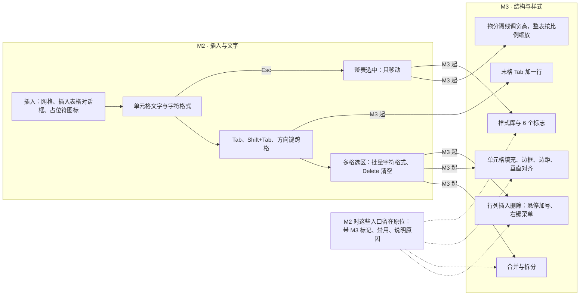
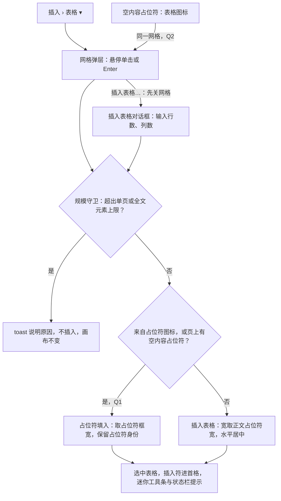
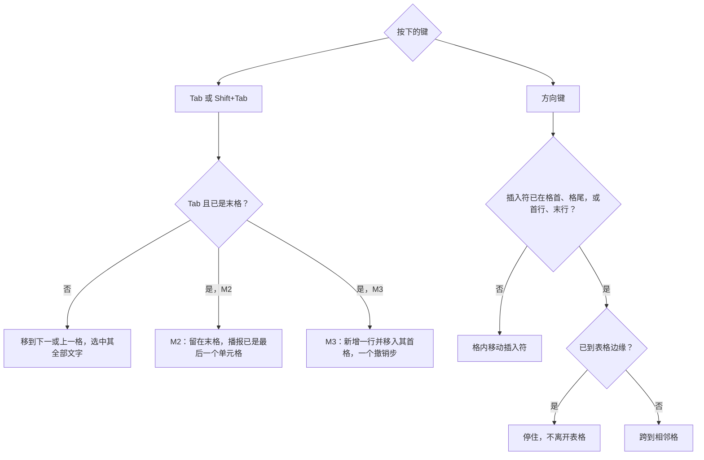
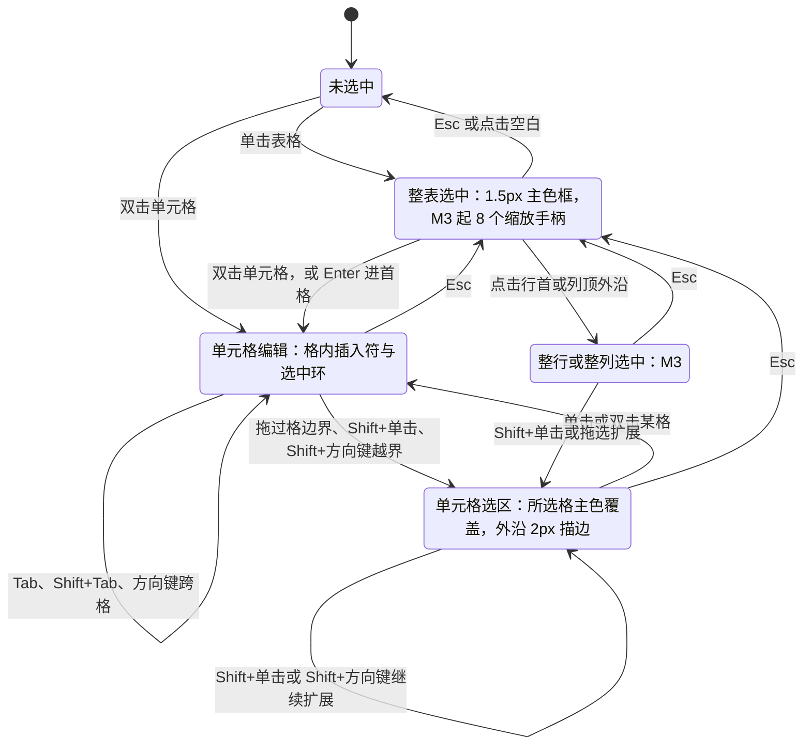
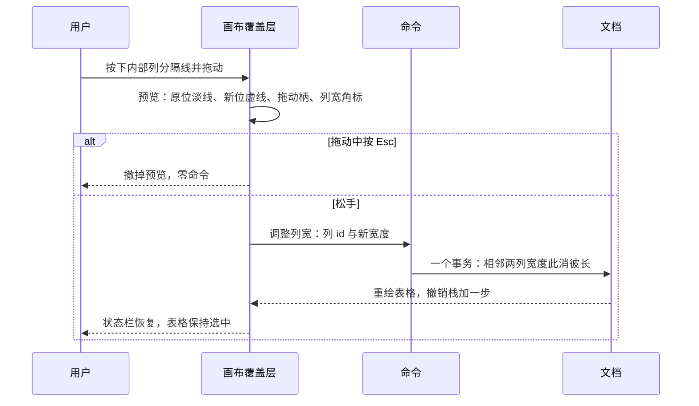
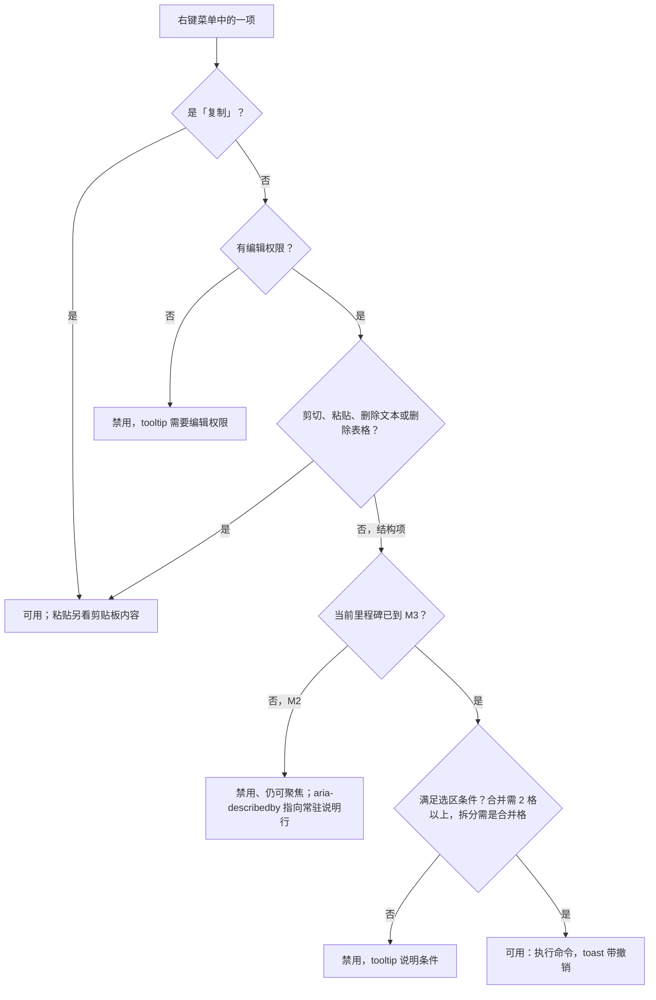
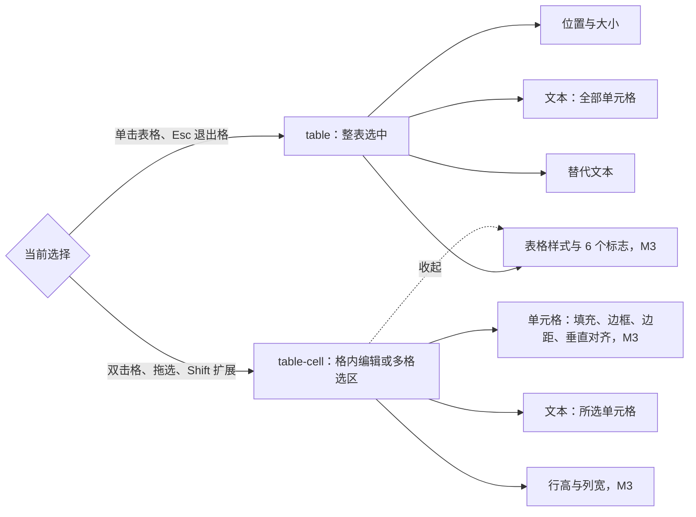
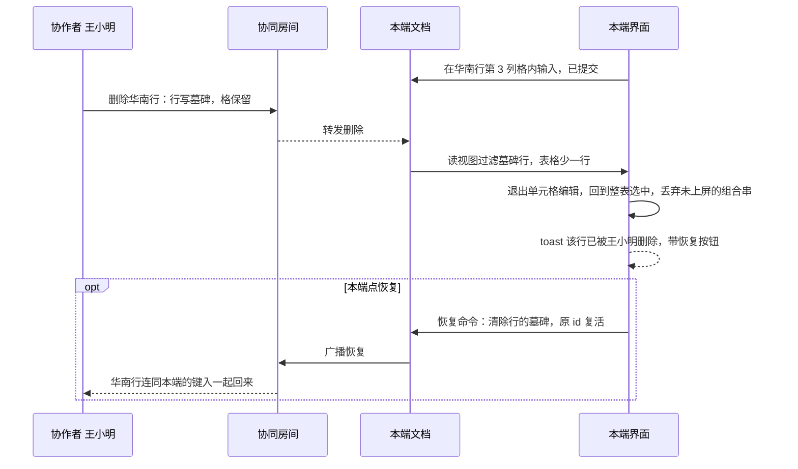

> 状态：草稿 | 负责：设计 | 更新：2026-09-30（§4.21 剩余缺口样张回写：新建，覆盖 G-32 表格插入与单元格文本（M2）、G-62 表格结构编辑（M3），对应 ED-10；样张由主会话抽查通过，最终以用户确认为准）；2026-09-30（§4.21 剩余缺口样张回写 · 整合：§10、§12 的跟改状态回写——03-05、03-03、50/18 §10、50/07 §12 已跟改，边框预设三处已按样张对齐）；2026-09-30（§4.21 剩余缺口样张回写 · 复核修正：占位符「表格」图标的去向以 §13 第 7 条为唯一登记点并改图 2；如实登记样张的外框画法、M2 演示态的检查器、只读角色、禁用实现与边框预览差异（§12 第 10–12 行，§13 第 20–23 条）；「拆分单元格…」对普通格的命令缺口；插入落点与 03-31 合并为一条；「禁用而不隐藏」出处改为 rulings §4.20 FE-06）；2026-09-30（§4.22 设计待决收口：按用户裁决 Q1（插入时填入空内容占位符）、Q2（占位符表格图标弹同一网格）、Q3（放宽对话框上限，暂按 75 × 75 待性能评估）与样张 SF-05–08、SF-14 回写——网格改 8 行 × 10 列、读数「R 行 × C 列」，「插入表格…」对话框出样张，新增 5 个演示态（共 17 个）；插入后检查器改 `table-cell`，M2 检查器锁定与 M2 选区文本条定稿；右键菜单补粘贴与删除文本、全部改 `aria-disabled`、M2「删除表格」可用、普通格拆分禁用；只读画布关闭插入符与手柄；单元格顶端对齐、检查器以 in 显示并补文字方向；§12 全部关闭，§13 已定项改为定稿说明，5 项推迟见 rulings §4.22）；2026-09-30（§4.22 整合：§13 第 12 条注明样张单位不一待用户确认（SR-4），第 24 条（a）指向 SR-3）；2026-09-30（§4.22 复核修正：§2.2 对话框改由 react-hook-form 管理（样张已装依赖）；§2.4 落点补「已选中的空占位符优先」、行高括注与 PRD 一致、插入页签入口的 toast 按有无空占位符区分；§2.3 弹层避让改为 112 px；§5 迷你工具条改引 50/24 §2.6 现行口径；§11 样式库全部态注明「收起」需下滚可见；文首 §13 说明更正） | 依赖：charter v0.2；`10-prd/07-design-coverage-and-gaps.md`（G-32、G-62）；PRD `03-features/02-editing.md` ED-10；前端 50/24、50/10、50/18、50/06、50/21；ADR-0018；playground `#/editor/table`；rulings §4.21（q-table-depth、R-d-61、R-d-72）、§4.20 FE-06（禁用而不隐藏）、§4.22（设计待决收口，用户裁决 Q1–Q3）

# 03-30 表格编辑

> **设计基准（2026-09-15 起）**：组件规格以 [`09-design-specification.md`](../09-design-specification.md) v3.0（shadcn Rhea + 材质层）为准；对应 playground 路由 `#/editor/table`（与其余路由同属 [playground artifact](https://claude.ai/code/artifact/cf6e1a1a-986b-48bb-b743-5758dff419d2)，本路由随本轮样张发布；源码 `playground/src/routes/editor/TableEditing.tsx`）。
>
> **样张（2026-09-30）**：本文以 playground 表格样张为准描述设计；样张由主会话抽查通过，2026-09-30 按用户裁决 Q1–Q3 与 rulings §4.22 的收口改样张后重写本文，样张整体**最终以用户确认为准**。源码：`routes/editor/TableEditing.tsx`（演示状态与画布覆盖层）、`components/editor/elements/SlideTable.tsx`（表格绘制、样式与 6 个标志的着色规则、74 种样式的近似数据）、`elements/TableInspector.tsx`（检查器、样式库、边框选择器）、`ribbon/insert/TableGridPicker.tsx`（插入网格，插入页签与占位符共用）、`ribbon/insert/InsertTableDialog.tsx`（「插入表格…」对话框）、`elements/PlaceholderIconBar.tsx`（占位符图标条）、`SlideCanvas.tsx` 的屏幕覆盖层（迷你工具条与画布浮签 `CanvasFloat`）；截图由 `docs/_tools/capture-screens.cjs` 第 30 条登记的 17 个演示状态生成（§11）。行为口径与前端 [50/24](../../50-frontend/24-elements-tables-and-charts.md) §2 一致，视觉与文案以本文为准；§12 的差异已全部关闭；§13 已定项各留一句定稿说明（编号保留，供他处引用），另有推迟项与本轮样张自审留下的取舍。

覆盖缺口 **G-32**（ED-10 M2：插入与单元格文本）与 **G-62**（ED-10 M3：结构与样式）。与 [03-04](04-insert-menu.md) 是同一「表格 ▾」入口（网格弹层的基础交互见 03-04，本文补插入之后的全部状态）；右键菜单是 [03-05](05-context-menu.md)「表格单元格」变体的完整版；检查器是 [03-03](03-properties-panel.md) 的 `table` / `table-cell` 两种取值；空内容占位符图标条本身（G-80）见 [03-16](16-text-editing-and-formatting.md)，本文只写其中「表格」图标的去向。

---

## 1. 界面目标与范围

- **M2 先能用**：插一张表、在格里打字、在格间跳、选多格批量改字，不必等结构编辑（rulings §4.21 q-table-depth 把插入与单元格文字从 M3 提前到 M2）。
- **M3 补齐结构与样式**：增删行列、合并标题格、拖宽列、套样式、画边框——PowerPoint 用户最常用的表格操作。
- **禁用而不隐藏**：M3 才开放的菜单项、检查器分区在 M2 留在原位，带 M3 标记、禁用并说明原因，用户能预期、不会以为功能不存在（rulings §4.20 FE-06；50/10 §4）。
- **表格是幻灯片内容**：画在纸面上，颜色取文档主题，不随界面亮暗变化（样张暗色截图里表格与亮色一致；叠在表格上的选中环、插入手柄同样用固定色）。

**M2 / M3 分界**

| 能力 | M2（P1） | M3（P1） | 样张演示状态 |
|---|---|---|---|
| 插入：网格、「插入表格…」、占位符的表格图标 | 可用；页上有空内容占位符时填入它（Q1） | 同 M2 | 插入网格 · 3 × 4；占位符 · 表格网格；插入表格对话框（含超出上限） |
| 默认表格、插入后光标进首格 | 可用 | 同 M2 | 插入后 · 默认表格与首格光标 |
| 单元格文字与字符格式 | 可用 | 同 M2 | 单元格编辑 · Tab 导航 |
| Tab / Shift+Tab / 方向键跨格 | 可用；末格 Tab 不加行，播报「已是最后一个单元格」 | 末格 Tab 加一行 | 单元格编辑 · Tab 导航 |
| 多格选区 | 批量字符格式、Delete 清空文字、复制；文本迷你工具条，条尾「表格结构 M3」禁用 | 另可合并、拆分、填充、边框（`toolbar.table-cell`） | M2 · 单元格选区；单元格选区 · 多选 |
| 整表选中 | 1.5px 选中框、可移动，无缩放手柄 | 8 个缩放手柄，整体缩放按比例分配行列 | 悬停插入手柄、拖分隔线调列宽、表格样式库、他人删除了正在编辑的行（只有整表选中画缩放手柄） |
| 行列插入与删除 | 右键项禁用并说明原因；画布不出现「+」 | 悬停「+」、右键菜单 | 悬停插入手柄、右键菜单、M2 · 结构编辑灰显 |
| 拖分隔线调列宽 / 行高 | 不出现分隔线手柄 | 可用，松手一个撤销步 | 拖分隔线调列宽 |
| 合并 / 拆分 | 禁用并说明原因 | 可用；拆分只对合并格 | 合并单元格后 |
| 检查器「单元格」「行高与列宽」 | 分区在原位、带 M3 标记，控件 `aria-disabled`，tooltip「M3 提供」 | 可用 | 边框选择器 |
| 检查器「表格样式」与 6 个标志 | 分区在原位、带 M3 标记，高亮当前样式，不可改 | 可用 | 表格样式库 · 6 个标志；样式库 · 全部 74 种 |
| 检查器「位置与大小」「文本」「替代文本」 | 可用（宽高输入 M3） | 同 M2 | 插入后 |
| 远端协作者的单元格选区 | 不显示 | 按单元格矩形画远端选区，沿用 09 远端选区样式（1.5px presence 色虚线 + 12% 填充 + 姓名胶囊），不另出样张 | — |
| 他人删除你正在编辑的行 / 列 | 不会发生（M2 无结构编辑） | 退出编辑 + toast | 他人删除了正在编辑的行 |
| 对角线边框、单元格内图片 | — | —（P2） | — |

**图 1 表格能力的里程碑分层**



怎么读：左边是 M2 就能走通的一条路径（插入 → 打字 → 跳格 → 选多格，Esc 退到整表）；右边是 M3 在同一选区、同一张表上追加的结构与样式操作；虚线表示 M2 时这些入口不隐藏，而是禁用并说明原因（§5.3、§6）。拖分隔线与悬停「+」是画布手柄，不属于「禁用而不隐藏」的控件，M2 直接不出现（已定，与 50/24 §2.5、§2.6 同一口径；FE-06 只管贡献控件）。

---

## 2. 插入入口与默认表格

### 2.1 插入 › 表格 ▾：8 行 × 10 列悬停网格

线框（演示状态「插入网格 · 3 × 4」）：

```
┌──────────────────────────────────┐
│ 插入表格                           │
│ ■ ■ ■ ■ □ □ □ □ □ □               │
│ ■ ■ ■ ■ □ □ □ □ □ □               │  ← 悬停到第 3 行第 4 列：左上 3 行 × 4 列高亮
│ ■ ■ ■ ■ □ □ □ □ □ □               │
│ □ □ □ □ □ □ □ □ □ □               │
│ …（共 8 行，每行 10 格）              │
│        3 行 × 4 列 表格            │  ← 未悬停时「移入选择表格尺寸」
│ [▦ 插入表格…]                      │  ← 更大的表或要直接输入行列数
└──────────────────────────────────┘
```

| 项 | 规格 |
|---|---|
| 弹层 | Popover，`align="start"` 贴「表格 ▾」大按钮左缘，宽随内容（网格宽 196）；打开期间大按钮保持按下态；打开时不抢焦点（同 03-04）；材质为浮层档玻璃（暗色 96%，叠在白纸面上仍保证说明文字对比度，09 §6） |
| 标题 | 「插入表格」，12px 次要色、中等字重 |
| 格子 | 16 × 16、圆角 2、间距 4，10 列 8 行；未高亮：边框色描边 + muted 底（暗色下为白 20% 描边 + 白 4% 底，否则比弹层底还深）；高亮（左上角到悬停格的矩形）：主色描边 + 主色 70% 填充 |
| 网格范围与上限 | 网格只是悬停范围 8 行 × 10 列（用户裁决 2026-09-30 Q3）；更大的表用「插入表格…」，对话框上限待性能评估（暂按 75 × 75 占位，§2.2） |
| 读数 | 网格下方居中，12px 次要色、等宽数字：「R 行 × C 列 表格」；未悬停时「移入选择表格尺寸」；指针移出网格即复位；读数区 `aria-live="polite"`，随高亮更新 |
| 「插入表格…」 | ghost 小按钮（高 28），前置表格图标；先关网格弹层，再打开 §2.2 对话框 |
| 选定 | 单击高亮角的格（或 `Enter` / `Space`）即插入并关闭弹层；不经插入工具态（03-04「图片、图标、表格、图表不经工具态」） |
| 键盘 | 网格为 `role="grid"`、行为 `row`、格为 `gridcell`，roving tabindex，只占一个 Tab 停靠点：Tab 进入网格落在当前高亮角（未悬停时第 1 行第 1 列）；方向键移动高亮角，`Home` / `End` 到行首 / 行尾，`Enter` / `Space` 插入，`Esc` 关闭并把焦点还给触发按钮；每格读屏名「R 行 C 列」；触屏改为先展开数字输入（03-04 边界情况） |

样张在此状态的检查器放了一张说明卡（「在「插入 › 表格 ▾」里移动鼠标选择行列数（方向键同样可用，Enter 确认）；网格悬停范围 8 行 × 10 列，更大的表用「插入表格…」输入。页上有空内容占位符，新表格填入它。」），属演示说明；产品检查器按当前选择显示，不出这张卡。

### 2.2 「插入表格…」对话框

线框（左：演示状态「插入表格对话框」，初值 12 × 4；右：「插入表格对话框 · 超出上限」，行数 80）：

```
┌──────────────────────────────────┐   ┌──────────────────────────────────┐
│ 插入表格                        ✕ │   │ 插入表格                        ✕ │
│ 输入行数和列数；插入后光标在第一个 │   │ 输入行数和列数；插入后光标在第一个 │
│ 单元格。                          │   │ 单元格。                          │
│ 行数            列数              │   │ 行数            列数              │
│ [ 12        ]   [ 4         ]     │   │ [ 80        ]   [ 4         ]     │ ← 行数字段 aria-invalid
│ 行数、列数各 1–75 · 上限待性能评估 │   │ 行数最多 75 · 上限待性能评估      │ ← 危险色，role="alert"
│ （暂按 75 × 75）                  │   │                                  │
│                  [取消]  [确定]   │   │                  [取消]  [确定]   │ ← 确定 aria-disabled
└──────────────────────────────────┘   └──────────────────────────────────┘
```

| 项 | 规格 |
|---|---|
| 形态 | shadcn Dialog，宽 384（`sm:max-w-sm`，与超链接对话框同宽）；标题「插入表格」，说明「输入行数和列数；插入后光标在第一个单元格。」；两个字段由 react-hook-form 管理（50/24 §2.12，R-d-18），样张同样用 `useForm`：`mode="onChange"` 逐字段即时校验，打开时先校验一次，演示态传入的超限初值直接画出报错帧 |
| 焦点 | 打开时焦点在对话框容器上，`Tab` 进入表单（与 03-15 对话框同一口径）；任一字段内 `Enter` 提交 |
| 字段 | 行数、列数两个整数输入并排，顺序与网格读数「行 × 列」一致；初值 3 × 4 |
| 上限 | 行数、列数各 1–75：上限待性能评估，评估前暂按 75 × 75 占位（参照 PowerPoint 对话框；用户裁决 2026-09-30 Q3，评估推迟项见 §13 第 6 条）；说明行常显「行数、列数各 1–75 · 上限待性能评估（暂按 75 × 75）」 |
| 校验 | 说明行就地变为内联错误（危险色、`role="alert"`），出错字段 `aria-invalid`；文案「请输入行数」「行数须为整数」「行数至少为 1」「行数最多 75 · 上限待性能评估」，列数同理，两个字段都错时用「；」连接 |
| 确定 | 非法时仍是同一个按钮元素，`aria-disabled`、可聚焦，tooltip 复述错误；`Enter` 不提交。合法时与网格走同一条插入命令、一个撤销步，插入后插入符进首格（§2.4） |
| 打开与关闭 | 「插入表格…」先关网格弹层，再开对话框；取消或 `Esc` 关闭，焦点回到打开网格的按钮（插入页签「表格 ▾」；占位符入口回到表格图标，图标条折叠时回到「插入 ▾」，§2.3） |

### 2.3 空内容占位符的「表格」图标

演示状态「占位符 · 表格网格」：页上空正文占位符的图标条里，表格图标的弹层打开、悬停 3 行 4 列；状态栏「选定行列即填入此占位符 · 宽取占位符框宽」。

- 图标条本身（布局、按屏幕尺寸绘制、窄占位符折叠为「插入 ▾」、单一 Tab 停靠点、禁用原因、拖入图片）见 [03-16](16-text-editing-and-formatting.md)；其中「表格」图标 M2 可用，读屏名「插入表格到占位符」，tooltip「插入表格」。
- 点击 → 在图标旁弹出与插入页签**同一个** `TableGridPicker` 网格弹层（§2.1，含「插入表格…」；用户裁决 2026-09-30 Q2，PRD G-32 由产品线同步为同一句）。弹层打开期间表格图标保持按下态（`aria-expanded`）；图标条折叠时锚在「插入 ▾」按钮上。弹层下方放不下时翻到图标上方（为状态栏与缩放条留出 112 px，与占位符图表菜单同一口径），83% 缩放的样张就是向上弹出、盖住标题（取舍见 §13 第 24 条）。
- 「插入表格…」与插入页签同一流程：先关网格、再开 §2.2 对话框；取消或 `Esc` 后焦点回到表格图标（折叠时回到「插入 ▾」）。
- 选定行列后以占位符填入命令写入：宽取占位符框宽、行高约 0.41 in、高度按内容，保留占位符身份（同 `type`、同 `idx`）；toast「已在占位符插入 R 行 × C 列表格，宽取占位符框宽」，说明「填入是一个撤销步；删除内容后占位符恢复为空」。
- 空占位符被选中时，检查器 `placeholder-empty` 的「插入到占位符」按钮组里「表格」与图标条是同一个动作（03-16，样张 `16--placeholder-icons`）。评审、查看角色下图标条与该按钮组都不出现（03-16）。
- 填入后与其它入口插入的表格完全相同（§2.4）；按 Q1，插入页签的网格与对话框在页上有空内容占位符时也走同一条填入命令。

### 2.4 默认表格与插入后状态

线框（演示状态「插入后 · 默认表格与首格光标」）：

```
            ┌ 微软雅黑  14  B  I ┐                 ← 文本编辑迷你工具条（屏幕覆盖层，12px）
┏━━━━━━━━━━━┯━━━━━━━━━━━┯━━━━━━━━━━━┯━━━━━━━━━━━┓
┃[|        ]│           │           │           ┃  ← 标题行：强调色实底；首格白 + 深蓝双层环，插入符闪烁
┠───────────┼───────────┼───────────┼───────────┨
┃           │           │           │           ┃  ← 镶边：强调色约 38%
┠───────────┼───────────┼───────────┼───────────┨
┃           │           │           │           ┃  ← 强调色约 18%，白色网格线
┗━━━━━━━━━━━┷━━━━━━━━━━━┷━━━━━━━━━━━┷━━━━━━━━━━━┛  ← 1.5px 主色选中框（格内编辑，不画缩放手柄）
状态栏：第 3/12 页 · 已插入 3 行 4 列表格 · 光标在第一个单元格
检查器：已选：单元格 · 第 1 行第 1 列（新表格 3 行 × 4 列）
```

| 项 | 规格 |
|---|---|
| 尺寸 | 填入空内容占位符时宽取占位符框宽；普通插入时宽取当前版式正文占位符宽（没有则页宽 80%）；列等宽；行高 370840 EMU（约 0.41 in，与 PRD ED-10 一致）；高 = 行数 × 行高，内容多时行高随之撑高 |
| 位置 | 页上有空内容占位符（`obj`，或同类 `tbl`）时填入阅读序第一个（已选中的空占位符优先），保留 `p:ph`，走 `slide.fillPlaceholder`（用户裁决 2026-09-30 Q1；样张「插入后」即填入页上的空正文占位符）；没有时水平居中、垂直落在视口中心，重复插入错位 0.2 in（50/24 §2.3） |
| 样式 | 内置「中度样式 2 - 强调 1」`{5C22544A-7EE6-4342-B048-85BDC9FD1C3A}` + 标题行、镶边行两个标志：标题行强调色实底、白字加粗，正文行强调色两档浅色交替，白色网格线；颜色由主题 accent1 派生，换主题跟随；单元格不写显式填充与边框；文字顶端对齐、各列左对齐，边距左右 0.1 in、上下 0.05 in（OOXML 缺省） |
| 选中与焦点 | 插入后直接进入首格的单元格编辑（表格外框 1.5px 选中框，插入符在首格）；首格画选中环：普通格为 2px 主色内描边，标题行（强调色实底）上改为 2px 白 + 2px 深蓝（`#1E3AA8`）双层环，保证在强调色上可辨 |
| 迷你工具条 | 文本编辑迷你工具条：字体、字号、加粗、斜体；画在屏幕覆盖层，文字 12px、不随画布缩放（浮层档玻璃），悬在表格上沿上方 |
| 反馈 | 状态栏左侧「已插入 R 行 C 列表格 · 光标在第一个单元格」；读屏播报「已插入 R 行 C 列表格」；从插入页签插入时，页上有空内容占位符（按 Q1 填入）用 §2.3 的占位符 toast，没有时为 03-04 所定 toast「已插入 R 行 × C 列表格」（说明「M2 可编辑单元格文字；行列增删、合并与样式在 M3」）；从占位符图标插入时 toast 见 §2.3。样张 `#/editor/table` 从插入页签插表时同此：网格、对话框演示态页上有空正文占位符，弹占位符 toast |
| 检查器 | 取值 `table-cell`（插入符已在首格，同 50/24 §2.7）：「已选：单元格 · 第 1 行第 1 列（新表格 R 行 × C 列）」；只展开「文本（所选单元格）」，「单元格」「行高与列宽」（M3 标记，M2 下控件锁定）收起；按 `Esc` 退到整表后换成 `table` 分区 |
| 撤销 | 插入（全部行、列、格）是一个撤销步；选中与进首格是视图操作，不入历史 |

**图 2 三个入口到默认表格**



怎么读：两个入口（插入页签、占位符图标）都先到同一个网格弹层，网格与「插入表格…」对话框只负责收集行列数，真正写入的是一条命令、一个事务、一个撤销步；规模守卫在事务之前；页上有空内容占位符时（包括从插入页签进入）一律填入，保留占位符身份，删除这张表后空占位符连同图标条一起回来（50/21 §3.2）。命令 id 见 §10。

---

## 3. 单元格编辑与跨格导航（M2）

线框（演示状态「单元格编辑 · Tab 导航」）：

```
            ┌ 微软雅黑  14  B  I ┐
┌──────────┬────────┬────────┬────────┐
│ 区域      │     Q1 │     Q2 │     Q3 │  ← 标题行
│ 华东      │  1,280 │  1,420 │  1,560 │
│ 华南      │    960 │[1,040|]│  1,210 │  ← 第 3 行第 3 列：2px 主色内描边 + 插入符
│ 华北      │    880 │    930 │  1,010 │
│ 西南      │    640 │    720 │    805 │
└──────────┴────────┴────────┴────────┘
状态栏：单元格编辑中 · 第 3 行第 3 列        检查器：已选：单元格 · 第 3 行第 3 列
```

示例数据的数值列为用户设置的右对齐；新表格按样式默认左对齐（§2.4）。格内文字一律顶端对齐。

- **进入**：双击单元格；或整表选中后按 `Enter` 进首格；插入后直接在首格。
- **编辑**：格内字符与段落格式同 03-16 的文本编辑态（开始页签、迷你工具条可用）；编辑目标是「这张表的某行某列」，按行列 id 寻址（§10）。
- **视觉**：当前格 2px 主色内描边 + 闪烁插入符（标题行上改双层环，同 §2.4）；表格外框保持 1.5px 主色选中框，不画缩放手柄。
- **检查器**：展开「单元格」（M3 标记，M2 下控件锁定）与「文本（所选单元格）」，「表格样式」收起（§6）。
- **按键提示条**：样张在表格下方画了一条提示（`Tab` 下一格 · `⇧Tab` 上一格 · `↑↓←→` 在首末字符处越界到相邻格 · `Esc` 回到表格 · 末格 Tab：M2 留在原格并播报，M3 新增一行），属演示说明，产品不画；它和其它画布浮签一样画在屏幕覆盖层（`CanvasFloat`）：12px、与表格同宽、可折成两行，放在表格底边下方 10 px。按键见下表与 §8。

**跨格导航**（规则与 50/06 §9.2 一致）

| 按键 | 行为 |
|---|---|
| `Tab` | 到下一格（行主序，跳过被合并覆盖的格、落到其锚格），并选中目标格全部文字 |
| `Shift+Tab` | 到上一格；首格不动 |
| 末格 `Tab` | M2：不新增行，光标留在末格，读屏播报「已是最后一个单元格」；M3：新增一行并移入其首格，加行与移动是一个撤销步 |
| `←` / `→` | 在格首 / 格尾继续按时跨到前 / 后一格 |
| `↑` / `↓` | 在格内首行 / 末行继续按时跨到上 / 下一格，保持水平位置；到表格边缘停住，不离开表格 |
| `Enter` / `Shift+Enter` | 格内分段 / 软换行，不跳格 |
| `Esc` | 退出单元格编辑，回到整表选中；再按一次取消选择 |
| 格内制表符 | 不提供（PowerPoint 的 Ctrl+Tab 被浏览器占用，50/06 §9.2） |

**图 3 跨格导航的落点判定**



怎么读：Tab 永远按格跳，只在末格分出里程碑差异；方向键先在格内走，走到格边再按一次才跨格，跨到表格边缘就停住。任何一种跨格都停留在文本编辑态内，只改编辑目标，不经过「整表选中」。

---

## 4. 单元格选区

线框（演示状态「单元格选区 · 多选」）：

```
            ┌ M3 │ ＋插入 ▾  合并  拆分 │ 填充 ▾  边框 ▾ ┐    ← 选区迷你工具条（M3）
┌──────────┬─────────────────┬────────┐
│ 区域      │     Q1       Q2 │     Q3 │
├──────────╔═════════════════╗────────┤
│ 华东      ║▓ 1,280 ▓ 1,420 ▓║  1,560 │  ← 所选格：主色 25% 覆盖
│ 华南      ║▓   960 ▓ 1,040 ▓║  1,210 │
├──────────╚═════════════════╝────────┤  ← 选区外沿：2px 主色描边
│ 华北      │    880      930 │  1,010 │
│ 西南      │    640      720 │    805 │
└──────────┴─────────────────┴────────┘
状态栏：已选 4 个单元格                   检查器：已选：单元格 2 行 × 2 列
```

M2 形态（演示状态「M2 · 单元格选区」）只换迷你工具条，选区画法相同：

```
            ┌ 微软雅黑  14  B  I ┊ ▦ 表格结构 [M3] ┐   ← 条尾入口 aria-disabled，tooltip「表格结构编辑将在后续版本提供」
```

- **形成**：文本编辑中拖过格边界；在某格内 `Shift+单击` 另一格（以当前格为锚点扩成矩形）；文本编辑中 `Shift+方向键` 越过格边界；选区态 `Mod+A` 选中全部格。选区态下 `Shift+方向键` 继续扩展。点击行首或列顶外沿选中整行 / 整列（M3），视觉同单元格选区。
- **形状**：选区始终是矩形；跨到合并区的一部分时扩展到覆盖整个合并区（与 PowerPoint 一致）。
- **视觉**：每个所选格叠主色 25% 覆盖，选区外沿 2px 主色描边（不只靠颜色，高对比度模式可辨）；表格外框保持 1.5px 选中框、不画缩放手柄；覆盖层不进缩略图与导出。
- **反馈**：状态栏「已选 N 个单元格」；检查器「已选：单元格 R 行 × C 列」；读屏播报「B2 到 C3，共 4 格」。
- **M2 可做**：批量字符格式（开始页签、迷你工具条、检查器「文本（所选单元格）」）；`Delete` / `Backspace` 清空所选格文字（一个撤销步）；复制。
- **M2 的迷你工具条**（定稿，rulings §4.22）：文本迷你工具条（字体、字号、加粗、斜体），条尾一个「表格结构 M3」入口——`aria-disabled`、可聚焦，tooltip「表格结构编辑将在后续版本提供」，读屏名「表格结构（M3 提供）」；M3 起整条换成 `toolbar.table-cell`。与 50/24 §2.6「迷你工具条」、50/10 §5 同一口径（rulings §4.22 D-06）。
- **M3 追加**：选区迷你工具条 `toolbar.table-cell`（左端 M3 标记 · 插入 ▾ · 合并 · 拆分 ┊ 填充 ▾ · 边框 ▾，居于选区上方）；右键菜单（§5.3）；检查器「单元格」分区（§6.4）。
- **迷你工具条画法**：两种工具条都画在屏幕覆盖层，入参是幻灯片坐标，按屏幕尺寸绘制、文字 12px，不随画布缩放；材质为浮层档玻璃（暗色 96%）。

**图 4 表格选中与单元格选区状态机**



怎么读：`Esc` 每次只退一级（与 50/10 §7.1 的画布 Esc 逐级同一口径）：选区或单元格编辑 → 整表选中 → 未选中；跨格导航留在「单元格编辑」内部；整行整列选中是 M3 才出现的状态，视觉同单元格选区，不另出样张。状态机的实现口径是 50/24 §2.6 图 2-3，本图只补上各状态的视觉。

---

## 5. 结构编辑（M3）

### 5.1 悬停插入手柄「+」

线框（演示状态「悬停插入手柄（M3）」）：

```
                           (+)   ← 列顶「+」：指针未停留时 45% 不透明度，下接一段短虚线指向列分隔
┌──────────┬────────┬────────┬────────┐
│ 区域      │     Q1 │     Q2 │     Q3 │
│ 华东      │  1,280 │  1,420 │  1,560 │
│ 华南      │    960 │  1,040 │  1,210 │
(+)╌╌╌╌╌╌╌╌╌╌╌╌╌╌╌╌╌╌╌╌╌╌╌╌╌╌╌╌╌╌╌╌╌╌╌╌╌╌   ← 行首「+」悬停中：插入位置画贯穿表宽的 2px 主色虚线
│ 华北      │    880 │    930 │  1,010 │
│ 西南      │    640 │    720 │    805 │
└──────────┴────────┴────────┴────────┘
```

| 项 | 规格 |
|---|---|
| 出现 | 表格被选中或在格内编辑时，指针靠近表格左外沿的行分隔处（行首）或上外沿的列分隔处（列顶） |
| 形态 | 20px 主色圆、白色加号（描边 2.5）、2px 白环 + 阴影；行首「+」在表格左外侧 30、垂直对准分隔线；列顶「+」在表格上外侧 30、水平对准分隔线；未停留时 45% 不透明度 |
| 预示 | 指针停在「+」上：插入位置画一条贯穿表宽（插列时贯穿表高）的 2px 主色虚线 |
| 点击 | 在该分隔处插入一行 / 一列，一个撤销步；新格继承相邻格的属性（50/24 §2.8） |
| 读屏与等价路径 | 读屏名「在此插入行」「在此插入列」，tooltip 同名；键盘与读屏用户走右键菜单与命令面板 |
| 触屏 | 命中区 ≥ 44 px（[07-accessibility-and-i18n.md](../07-accessibility-and-i18n.md) §2） |
| M2 | 不出现（已定，§1） |

样张此态为整表选中（8 个缩放手柄），并在表格底边下方 10 px 附了说明条（「M3 悬停行首或列顶的「+」：点击在第 3、4 行之间插入一行（列顶同理插入列）」，屏幕覆盖层 12px），属演示说明，产品不画。

### 5.2 拖分隔线调列宽 / 行高

线框（演示状态「拖分隔线调列宽（M3）」）：

```
            ┊  ← 新位置：2px 主色虚线，上下各超出表格 10
┌──────────┃┊───────┬────────┬────────┐
│ 区域      ┃┊    Q1 │     Q2 │     Q3 │
│ 华南      ┃(◫)  960 │  1,040 │  1,210 │  ← 中点：24px 深色圆形拖动柄，白色分栏图标，2px 白环
│ 西南      ┃┊   640 │    720 │    805 │
└──────────┃┊───────┴────────┴────────┘
           ↑ 原位置：2px 主色 35% 实线
            [第 1 列宽 3.00 in → 3.56 in · 右侧列等量收窄  M3]   ← 拖动角标（屏幕覆盖层，12px）
状态栏：拖动调整列宽 · 松开为一个撤销步
```

- **命中**：指针在表格内部的列分隔线（行分隔线）上时，光标变为左右（上下）调整光标；表格被选中或在格内编辑时生效。
- **拖动中**：原位置留 2px 主色 35% 实线；新位置画 2px 主色虚线（上下各超出表格 10）；中点 24px 深色圆形拖动柄；角标「第 N 列宽 A → B · 右侧列等量收窄」画在屏幕覆盖层（12px、不随缩放变小），贴新分隔线、位于表格底边下方 10 px；数值由实际几何换算，单位随设置（03-03 度量单位，样张为 in）；状态栏「拖动调整列宽 · 松开为一个撤销步」。
- **语义**：相邻两列此消彼长、表宽不变（样张口径）；行高拖不到内容所需高度以下。是否改为「只改左列、表宽随之变」：推迟（触发条件：M3 表格结构开工前、维护机完成 PowerPoint 对照，见 rulings §4.22；§13 第 13 条），对照不符时改角标与本条。
- **结束**：松手 = 一次命令、一个撤销步；拖动中按 `Esc` 撤掉预览、零命令。
- **数值等价**：检查器「行高与列宽」（§6.6，WCAG 2.5.7）。
- **整表缩放**（M3）：整表选中时的 8 个缩放手柄按比例重新分配列宽与行高（行高不低于内容高）；graphicFrame 不旋转，无旋转手柄。

**图 5 拖分隔线：从预览到一次命令**



怎么读：拖动过程只是画布覆盖层上的预览，不写文档，所以协作者看不到半途的宽度；只有松手才发一次命令，撤销一步即回到拖动前。命令 id 见 §10。

### 5.3 右键菜单（M3）与 M2 的禁用

线框（左：演示状态「右键菜单 · 行列与合并（M3）」；右：「M2 · 结构编辑灰显」）：

```
┌────────────────────────────┐   ┌──────────────────────────────────┐
│ 剪切                    ⌘X │   │ 剪切                          ⌘X │
│ 复制                    ⌘C │   │ 复制                          ⌘C │
│ 粘贴                    ⌘V │   │ 粘贴                          ⌘V │
│ 删除文本                 ⌫ │   │ 删除文本                       ⌫ │
├────────────────────────────┤   ├──────────────────────────────────┤
│ 插入 [M3]                   │   │ [M3] 表格结构编辑将在后续版本提供； │
│ ▤ 在上方插入行              │   │      当前可编辑单元格文字与字符格式 │
│ ▤ 在下方插入行              │   │ ▤ 在上方插入行      （aria-disabled）│
│ ▥ 在左侧插入列              │   │ ▤ 在下方插入行      （aria-disabled）│
│ ▥ 在右侧插入列              │   │ ▥ 在左侧插入列 …    （aria-disabled）│
├────────────────────────────┤   ├──────────────────────────────────┤
│ ⊞ 合并单元格                │   │ ⊞ 合并单元格        （aria-disabled）│
│ ⊟ 拆分单元格…  （普通格禁用） │   │ ⊟ 拆分单元格…       （aria-disabled）│
├────────────────────────────┤   ├──────────────────────────────────┤
│ × 删除行          （危险色）  │   │ × 删除行 / 删除列   （aria-disabled）│
│ × 删除列          （危险色）  │   │ × 删除表格      （危险色，M2 可用）│
│ × 删除表格        （危险色）  │   └──────────────────────────────────┘
└────────────────────────────┘
```

- **触发**：在单元格或单元格选区上右键，或 `Shift+F10` / 菜单键；形态同 03-05（DropdownMenu，宽 240，贴指针右侧展开，底部避让 48）。
- **分组**：剪贴板（剪切、复制、粘贴、删除文本）┊ 插入（小标题带 M3 标记）：在上方插入行、在下方插入行、在左侧插入列、在右侧插入列 ┊ 合并单元格、拆分单元格… ┊ 删除行、删除列、删除表格（危险色）。菜单平铺，不用子菜单（50/18 §10 已按此跟改，见 §12 第 2 行）。
- **执行**：一个撤销步，toast 带「撤销」（样张 toast 文案直接用菜单项名，正式文案随 i18n 定稿）；删除行 / 列作用于选区覆盖的全部行 / 列，删光全部行或列即删除表格。
- **禁用的实现**：不可用项一律 `aria-disabled`、仍可聚焦，方向键可达，选中不执行；原因的出处见下两条与图 6。
- **可用条件**（M3）：合并需选区 ≥ 2 格；拆分只对合并格，拆回合并前的格。普通格上「拆分单元格…」禁用并以 tooltip 给原因「只有合并过的单元格可以拆分」，不做按行列数拆分的对话框（定稿，rulings §4.22；与 `slide.table.splitCell{shapeId, cell}`、ADR-0018 决策 6 一致）；按行列数拆分推迟，见 §13 第 23 条。
- **M2**：行列插删与合并拆分全部禁用，「插入」小标题换成一行常驻说明「M3 表格结构编辑将在后续版本提供；当前可编辑单元格文字与字符格式」，各结构项以 `aria-describedby` 指向这一行，不再逐项 tooltip（菜单里禁用项的 tooltip 不易触达）；剪贴板项照常可用；「删除表格」M2 可用，与整表选中按 `Delete` 同一口径（定稿，rulings §4.22）。
- **无编辑权限**（评审、查看角色）：除「复制」外全部禁用，tooltip「需要编辑权限」；权限先于里程碑判断，所以此时 M2 的常驻说明行换回普通的「插入 M3」小标题（图 6）。

**图 6 表格右键菜单项的可用性**



怎么读：先看是不是「复制」（任何角色都可用），再看权限，然后把剪贴板项与「删除表格」（M2 可用）分出去，只有行列插删与合并拆分才看里程碑与选区条件；每一道判断失败都落到「禁用 + 原因」，没有一条分支把菜单项藏起来；M2 的原因是整组共用的一行说明，其余原因逐项放在 tooltip。权限与原因文案的来源见 50/10 §4。

### 5.4 合并与拆分

线框（演示状态「合并单元格后（M3）」）：

```
┌──────────┬────────────────────────────────┐   外框只有 1.5px 选中框（选区是合并格，不画缩放手柄）
│          │        [ 2026 年季度销售（万元）]│  ← 第 1 行（标题行）：跨 3 列的锚格，带选中环；沿用该列的右对齐
│  区域     ├──────────┬──────────┬──────────┤
│（跨 2 行） │       Q1 │       Q2 │       Q3 │  ← 第 2 行：普通正文行，按镶边着色
├──────────┼──────────┼──────────┼──────────┤
│ 华东      │    1,280 │    1,420 │    1,560 │
│ …        │        … │        … │        … │
└──────────┴──────────┴──────────┴──────────┘
toast：已合并 3 个单元格 [撤销]           检查器：已选：合并单元格（1 行 × 3 列）
```

- **合并**：选区 → 合并单元格；被合并格的文字按 PowerPoint 规则并入锚格（左上格），合并区作为一个格绘制、导航与选择；一个撤销步，toast「已合并 N 个单元格 [撤销]」；检查器「已选：合并单元格（R 行 × C 列）」。
- **拆分**：选中合并格 → 拆分单元格…，拆回合并前的格；普通格上该项禁用，tooltip「只有合并过的单元格可以拆分」，不做拆分对话框（定稿，§5.3；按行列数拆分推迟，§13 第 23 条）。
- **对齐与标题行**：合并不改对齐，合并格沿用锚格所在列的对齐（样张示例数据第 2–4 列为右对齐，§3）；标题行标志只作用于第一行，跨行合并的「区域」格按第一行着色。
- **合并区与结构编辑**：在合并区内部插入行列时合并区随之变大；删除与合并区相交的行列时合并区先拆分或收缩（同一事务，50/24 §2.8）。

---

## 6. 检查器

### 6.1 分区总表

| 分区 | `table`（整表选中） | `table-cell`（格内编辑或多格选区） | M2 | M3 |
|---|---|---|---|---|
| 顶部「已选：…」 | 表格（R 行 × C 列） | 单元格 · 第 R 行第 C 列（插入后附「（新表格 R 行 × C 列）」）/ 单元格 R 行 × C 列 / 合并单元格（R 行 × C 列） | 可用 | 同 M2 |
| 位置与大小 | 展开 | 不出现 | X、Y 可改；宽、高 M3 | 改宽高即按比例缩放行列 |
| 表格样式（M3 标记） | 展开 | 收起 | 当前样式保留 2px 环，其余缩略图降到 60%，点选与复选禁用；展开 / 收起全部样式照常可用 | 可用 |
| 单元格（M3 标记） | 不出现 | 展开 | 控件禁用 | 可用 |
| 文本 | 「文本（全部单元格）」 | 「文本（所选单元格）」 | 可用 | 同 M2 |
| 行高与列宽（M3 标记） | 不出现 | 收起 | 控件禁用 | 可用 |
| 替代文本 | 标题 + 描述 | 不出现 | 可用 | 同 M2 |

M2 下分区标题带 M3 标记、分区可展开查看；分区内控件 `aria-disabled`、仍可聚焦，tooltip「M3 提供」，读屏名附「（M3 提供）」（如「宽（M3 提供）」）；X、Y、文本、替代文本照常可用。样张的 M2 演示态（插入后、单元格编辑、M2 · 单元格选区、M2 · 结构编辑灰显）检查器同为 M2 形态，同一路由的 Ribbon「图表 ▾」也按 M2 禁用并给原因（03-31）。评审、查看角色下检查器固定为 `table`，编辑类控件同样 `aria-disabled`，原因「需要编辑权限」（§9）。

**图 7 选择类型决定检查器分区**



怎么读：同一张表按「选中整表」与「进到格里」两种取值给出不同分区，文本分区两边都有，只是作用范围不同；虚线表示单元格态下表格样式分区收起但仍在原位。取值定义见 50/10 §5（R-d-72）。

### 6.2 位置与大小

X、Y、宽、高四个数值输入（单位随设置）；分区底部说明行「表格不可旋转或翻转；改尺寸按比例缩放行列（M3）」（12px）。没有旋转与翻转字段。M2 下宽、高锁定（§6.1）。

数值由表格实际几何换算：样张检查器、列宽角标与「行高与列宽」统一以 in 显示、两位小数（1 in = 72 幻灯片单位），产品按设置的度量单位显示（03-03 补充 D1）。样张整表示例：X 1.25、Y 2.08、宽 10.83、高 2.78 in（5 行；「他人删除了正在编辑的行」为 2.22，开了汇总行的「表格样式库」为 3.33）。

### 6.3 表格样式库与 6 个标志（M3）

线框（演示状态「表格样式库 · 6 个标志（M3）」，表格开了汇总行与第一列）：

```
表格样式  [M3]                                  ˄
文档中
[▦]                                      ← 文档里已有的样式排最前（样张 1 个）
浅色
[▦] [▦] [▦] [▦] [▦]
中等
[▦] (▦) [▦] [▦] [▦]                      ← (▦) 当前样式：2px 主色环、1px 偏移
[▦] [▦]
深色
[▦] [▦] [▦] [▦] [▦]
显示全部 74 种 ˅
──────────────────────────────
☑ 标题行          ☑ 第一列
☑ 汇总行          ☐ 最后一列
☑ 镶边行          ☐ 镶边列
```

| 项 | 规格 |
|---|---|
| 分组 | 文档中 → 浅色 → 中等 → 深色（展开后再加「其它」）；组头 12px 次要色，组头与缩略图间距 6，组间距 12；每组 5 列网格、间距 6；收起时每组只列首屏（浅色样式 1 × 5、中度样式 2 × 7、深色样式 1 × 5） |
| 缩略图 | 44 : 30 的 5 × 5 示意表，纸色底、1px 10% 描边、圆角 6；按当前主题与 6 个标志着色（与画布同一规则），勾选标志后立即刷新 |
| 悬停 / 当前 | 悬停 1.5px 主色描边；当前样式 2px 主色环（1px 偏移）；tooltip 为样式名（锁定时为「样式名 · 原因」） |
| 命名 | 「浅色样式 N」「中度样式 N」「深色样式 N」，带强调色时加「 - 强调 1」…「 - 强调 6」；文档自带样式用文档里的名称（样张「Cordex 汇报表（文档中）」） |
| 显示全部 | 分组下方 ghost 按钮「显示全部 74 种 ˅」（`aria-expanded`），展开后按组列出全部内置样式，组头带计数：浅色 · 21、中等 · 28、深色 · 11、其它 · 14（主题样式 1、2 各带强调 1–6，以及「无样式，无网格」「无样式，网格型」），读屏组名「浅色 21 种」；按钮变为「收起 ˄」。展开 / 收起是查看操作，M2 与只读时照常可用。演示状态「样式库 · 全部 74 种（M3）」 |
| 应用 | 点击缩略图即应用，一个撤销步，toast「已应用表格样式 [撤销]」；悬停实时预览 P2（50/24 §2.7） |
| 6 个标志 | 分隔线下 2 列复选：左列行向（标题行、汇总行、镶边行）、右列列向（第一列、最后一列、镶边列）；新表格默认勾标题行、镶边行；每次勾选一个撤销步，画布与缩略图同时刷新 |
| M2 | 分区在原位、标题带 M3；缩略图可见，当前样式保留 2px 环，其余降到 60% 不透明度；缩略图与 6 个复选 `aria-disabled`、可聚焦，tooltip「M3 提供」，点击不生效 |

**已知近似**（缩略图逐部件保真推迟，见 §13 第 1 条）：样张的 74 种样式按族近似着色，分组与计数已定稿；产品缩略图由 `table.renderer` 按真实样式数据逐部件绘制，以表格样式数据与 50/24 §2.5 的叠加顺序为准（50/24 §2.7）。样张的着色规则：浅色——白底，标题行下沿与表格上下沿强调色细线，镶边为强调色约 16% 浓度；中等——标题行、汇总行与首末列强调色实底白字，正文强调色约 38% / 18% 交替，白色网格线；深色——强调色实底白字，标题行与汇总行再加深约 45%，首末列加深约 25%，镶边加深约 12%。

### 6.4 单元格：填充、边框、边距、垂直对齐、文字方向（M3）

线框（演示状态「边框选择器（M3）」，选区 2 行 × 2 列、选中「外侧框线」）：

```
单元格  [M3]                                    ˄
填充    [■ 跟随样式                        ]
边框
[⬚] [⊞] (□) [┼] [═]       ← 无框线 / 所有框线 / 外侧框线（选中）/ 内部框线 / 内部横框线
[▔] [▁] [▏] [▕] [┃]       ← 上框线 / 下框线 / 左框线 / 右框线 / 内部竖框线
[实线          ˅] [1.5 磅 ˅] [■]        ← 色块带双层对比环
左右  [0.10 in]      上下  [0.05 in]
垂直  (顶端) [居中] [底端]                ← 缺省顶端
文字方向  [横排                      ˅]
```

- **填充**：色块按钮，默认「跟随样式」（色块显示样式算出的颜色）；打开 03-03 的颜色选择器，选色后写入所选格的填充。色块（填充与边框颜色）一律带双层对比环：外圈前景 25%（暗色白 60%），内圈白 55%，深色色块在亮暗两套界面上都可辨。
- **边框选择器**：10 个预设排成 5 × 2 单选组（`role="radiogroup"`）；每项高 28、圆角 `rounded-md`（约 6，与 03-31 类别按钮同一写法），图标是 2 × 2 示意格——实线是本预设要画的边，淡虚线是不画的边；当前项主色 12% 底 + 主色 40% 描边 + 主色图标；tooltip 为预设名。下一行依次是线型（实线 / 虚线 / 点线）、粗细（0.5 / 1 / 1.5 / 2.25 / 3 磅）、颜色按钮（样张 `#1A2030`）。
- **边框的作用范围**：作用于当前单元格选区，一个撤销步；画布上按所选预设、线型粗细即时预览——外侧、内部、内部横、内部竖与单条边各按其要画的边出线。预览期间不画选区外沿的 2px 主色描边（否则会盖住预览），所选格的 25% 主色覆盖保留。10 个预设的枚举已定稿（`none / all / outer / inner / innerH / innerV / top / bottom / left / right`，§12 第 4 行）。
- **边距**：左右、上下两个数值，默认 0.10 in / 0.05 in（即 OOXML 缺省 91440 / 45720 EMU）；画布按同一边距排字。
- **垂直对齐**：顶端 / 居中 / 底端三段切换；缺省顶端（OOXML `a:tcPr@anchor` 缺省，PowerPoint 新表格同样），检查器显示真实值，画布按顶端绘制。
- **文字方向**：「垂直」之后一行下拉：横排 / 所有文字旋转 90° / 所有文字旋转 270° / 堆积（50/24 §2.7；对应 `a:tcPr@vert` 的 `horz`、`vert`、`vert270`、`wordArtVert`）。
- **M2**：本分区全部控件 `aria-disabled`、可聚焦，tooltip「M3 提供」，读屏名附「（M3 提供）」；点在锁定的边框预设上不改变任何值。

### 6.5 文本

字体下拉、字号（pt）+ 加粗、斜体；整表选中时作用于全部格（「文本（全部单元格）」），格内编辑或选区时作用于所选格（「文本（所选单元格）」）；M2 可用。完整的字符与段落格式在开始页签（03-16）。

### 6.6 行高与列宽（M3）

行高、列宽两个数值（样张示例数据行高 0.56 in、所选列宽 2.61 in，第 1 列 3.00 in；新表格行高 0.41 in），作用于选区所在的行与列，所选列宽不一致时显示「多个值」；是拖分隔线的数值等价路径。行高低于内容所需时按内容高显示（声明值保留为最小高）。M2 下两个字段锁定（§6.1）。

### 6.7 替代文本

标题（单行）+ 描述（多行），样张示例「区域季度销售表」「四个区域 2026 年 Q1–Q3 销售额，单位万元」；M2 可用。读屏用它命名表格（§8）。

---

## 7. 协同

表格按行、列、格各自的 id 存放（归一化模型，§10），所以两人同时插行、插列、合并时表格保持规整，绝大多数并发没有任何提示（结果表见 50/24 §2.9）：

| 情形 | 界面表现 |
|---|---|
| 两人同时改同一格文字 | 字符级合并，无提示（同形状文本） |
| 他人插行插列、调列宽 | 表格就地更新；本端光标仍在原来那一格（按行列 id 定位，不按序号） |
| 并发造成缺格或合并区重叠 | 读时补齐、服务端修复一次，无提示 |
| 远端协作者的单元格选区（M3） | 按单元格矩形画远端选区，沿用 09 远端选区样式：1.5px presence 色虚线 + 12% 填充 + 姓名胶囊（行为见 50/24 §2.6 协同呈现；不另出样张） |
| **他人删除了你正在编辑的行 / 列（M3）** | 本节下文，样张「他人删除了正在编辑的行」 |

**他人删除了你正在编辑的行**（演示状态「他人删除了正在编辑的行」）：

```
┌──────────┬────────┬────────┬────────┐   整表选中（8 个缩放手柄）
│ 区域      │     Q1 │     Q2 │     Q3 │
│ 华东      │  1,280 │  1,420 │  1,560 │
│ 华北      │    880 │    930 │  1,010 │   ← 「华南」行消失，本端退出单元格编辑
│ 西南      │    640 │    720 │    805 │
└──────────┴────────┴────────┴────────┘
                                ┌─────────────────────────────────────────┐
                                │ 该行已被 王小明 删除              [恢复该行] │
                                │ 恢复即可找回你在该行的修改                  │
                                └─────────────────────────────────────────┘
```

- **触发**：本端正在编辑的格所在的行（列）被远端删除。
- **界面**：本端退出单元格编辑，回到整表选中（检查器「已选：表格（4 行 × 4 列）」）；右下 toast，标题「该行已被〈姓名〉删除」（列为「该列已被〈姓名〉删除」），带操作按钮时停留 5 s、悬停暂停（50/04 §6.3）；姓名取协作者显示名，查不到时「一位协作者」。
- **按钮与说明**（定稿，rulings §4.22）：按钮「恢复该行」（列为「恢复该列」，样张只演示行），说明「恢复即可找回你在该行的修改」（列同理）；点后 toast「已恢复该行」。按协同语义，恢复是本端的一个新事务（清除行的墓碑、原 id 复活），不是撤销；本端已提交的键入落在被删的行上、不丢失，恢复后一起回来，只有输入法尚未上屏的组合串会被丢弃（30/06 §8 第 2 行、50/06 §5.5）。图表的类别 / 系列被删时沿用同一组件（03-31）。

**图 8 他人删除了正在编辑的行**



怎么读：删除只是给行写墓碑，格与本端已提交的文字都还在，所以恢复能把本端的修改一起带回来；恢复是本端的新事务，删除方自己的撤销栈不受影响。行列粒度的提示已登记在客户端软冲突分流表（50/07 §12，2026-09-30；见 §12 第 6 行）。

---

## 8. 键盘与无障碍

**键盘总表**（M2 起生效，标 M3 的除外）

| 按键 | 整表选中 | 单元格编辑 | 单元格选区 |
|---|---|---|---|
| `Enter` | 进首格编辑 | 格内分段 | 进选区锚格编辑 |
| `Tab` / `Shift+Tab` | 按层次切到下一个 / 上一个对象（50/10 §7.1） | 下一 / 上一格；末格见 §3 | 同单元格编辑 |
| 方向键 | 微移表格 | 格内移动；格边继续按时跨格 | 移动选区焦点 |
| `Shift+方向键` | 大步微移 | 扩展文字选区；越过格边界转为单元格选区 | 扩展选区 |
| `Delete` / `Backspace` | 删除表格 | 删除字符 | 清空所选格文字 |
| `Mod+A` | 全选页面对象 | 全选格内文字 | 选中全部格 |
| `Shift+F10` / 菜单键 | 表格右键菜单 | 单元格右键菜单（§5.3） | 同左 |
| `Esc` | 取消选择 | 回到整表选中 | 回到整表选中 |

结构操作（插删行列、合并拆分、行高列宽）没有默认快捷键，键盘用户走右键菜单、命令面板与检查器数值（WCAG 2.5.7：每个拖动都有非拖动的等价路径）。

**无障碍**

- 画布上的表格以 `role="table"` 暴露，名称依次取替代文本标题 → 首行文字摘要 → 「表格 N」；可访问镜像按行列输出，标题行开启时首行作列标题（50/24 §2.11）。
- 播报：插入「已插入 3 行 4 列表格」；跨格「第 2 行第 3 列：〈文字摘要〉」，合并格加「合并 2 列」；选区「B2 到 C3，共 4 格」；M2 末格 Tab「已是最后一个单元格」。
- 网格弹层是 `role="grid"`，只占一个 Tab 停靠点（roving tabindex），每格读屏名「R 行 C 列」，读数区 `aria-live="polite"` 随高亮更新（§2.1）。
- 「插入表格…」对话框：出错字段 `aria-invalid`，说明行变内联错误并 `role="alert"`，「确定」`aria-disabled` 仍可聚焦、tooltip 复述错误（§2.2）。
- 选中不只靠颜色：单元格编辑有 2px 描边，选区有 2px 外沿描边；强调色标题行上改用白 + 深蓝双层环。
- M3 控件在 M2 为 `aria-disabled` 且可聚焦，原因可读（菜单结构项以 `aria-describedby` 指向常驻说明行，检查器与选区工具条用 tooltip 与读屏名后缀「（M3 提供）」）。
- 触屏：悬停「+」与分隔线的命中区 ≥ 44 px；网格弹层改为先展开数字输入（03-04）。

---

## 9. 只读与权限

- 评审、查看角色：Ribbon 显示只读细条（样张文案「评审模式下不可编辑表格」）；不能进入单元格编辑，画布上没有插入符、单元格选区、迷你工具条、按键提示、悬停「+」、分隔线手柄与缩放手柄，表格外框只留 1.5px 选中框；空占位符的图标条不出现（模式对照见 [02-editor-main.md](02-editor-main.md)）。检查器固定为 `table`，编辑类控件 `aria-disabled`、tooltip「需要编辑权限」，样式库的展开 / 收起照常可用。样张各演示态切到评审者或查看者即是这一形态。
- 编辑者被降权为只读时：退出单元格编辑并显示只读横幅，输入法尚未上屏的组合串丢弃（50/06 §5.5）。
- 右键菜单在无编辑权限时，编辑类项禁用并提示「需要编辑权限」（图 6）。

---

## 10. 与模型、命令的对应

**模型要点**（事实源：30/04 §3.8、50/24 §2.4；决策：[ADR-0018](../../30-architecture/adr/0018-editor-element-model-and-insert-commands.md) 决策 6）：

- 表格是 `graphicFrame` 下的 `Table`，**归一化**为三张以 id 为键的记录表：`columns`（列 id → 顺序键与宽度）、`rows`（行 id → 顺序键与最小行高）、`cells`（`RowId:ColId` → 单元格）；顺序由分数索引表达（[ADR-0032](../../30-architecture/adr/0032-ordered-collections-fractional-index.md)），读视图按 `(order, id)` 排序。
- 界面上的「第 R 行第 C 列」「B2 到 C3」只是排序后的显示序号，不进模型、不进命令参数；文本编辑目标与选区锚点一律按行列 id 寻址（30/04 §3.6：单格 `tableCell`，矩形选区 `tableCells{anchor, focus}`）。
- 删行删列写墓碑、格不删，所以恢复能以原 id 连同格内修改一起回来（§7）；合并用锚格的跨度与被覆盖格的标记表达，不变量 I-TBL1（不缺格）、I-TBL2（跨度合法）在读时兜底、服务端修复。
- 表格样式只写样式 id 与 6 个标志，单元格不写显式填充与边框，除非用户在「单元格」分区里改过。

**界面动作 → 命令**（命令 id 与参数的事实源：40/03 §2.6、50/24 §2.8；Mutation 见 30/05 §14）

| 界面动作 | 命令 | 说明 | 里程碑 |
|---|---|---|---|
| 网格或对话框插入（页上没有空内容占位符） | `slide.insertTable{containerId, box, rows, cols, styleId?}` | 全部行、列、格一个事务 | M2 |
| 占位符的表格图标；网格或对话框插入且页上有空内容占位符（Q1） | `slide.fillPlaceholder{shapeId, content:{kind:'table', rows, cols}}` | 空占位符写墓碑 + 同 ref、同顺序插入；插入页签入口取阅读序第一个空内容占位符 | M2 |
| 格内打字、字符与段落格式 | `slide.insertText` / `deleteText` / 格式命令族，`target:{shapeId, cell:{rowId, colId}}` | 与形状文本同一套 | M2 |
| 选区按 Delete | `slide.table.clearCells{shapeId, cells}` | 逐格清空，一个撤销步 | M2 |
| 选中、跨格、扩展选区 | `slide.setSelection`（锚点 `tableCell` / `tableCells`） | 视图操作，不入历史；M3 起广播给协作者 | M2 |
| 替代文本 | `slide.setAltText` | — | M2 |
| 悬停「+」、右键插入行列、末格 Tab | `slide.table.insertRow` / `insertColumn` | 参数为参照行列 id 与方向；插在合并区内部时同事务扩大合并区 | M3 |
| 右键删除行 / 列 | `slide.table.removeRow` / `removeColumn` | 写墓碑；删光即删表 | M3 |
| 右键删除表格、整表选中按 Delete | `slide.deleteShapes` | 表格来自占位符时同事务补回空占位符 | M2 |
| 合并 / 拆分 | `slide.table.mergeCells` / `splitCell` | 被合并格文字并入锚格；拆分只拆回合并前的格，普通格上菜单项禁用并给原因（§5.3），按行列数拆分推迟（§13 第 23 条） | M3 |
| 拖分隔线、行高列宽输入 | `slide.table.resizeColumn` / `resizeRow` | 一次命令一个撤销步 | M3 |
| 整表缩放手柄、宽高输入 | `slide.resizeShapes` | 表格分支按比例写列宽行高 | M3 |
| 填充、边距、垂直对齐、文字方向 | `slide.table.setCellProperties` | 作用于所选格 | M3 |
| 边框选择器 | `slide.table.setBorders{shapeId, cells, borders:{preset, line}}` | 命令内展开为各格边框，相邻格共享边两侧同写 | M3 |
| 样式库、6 个标志 | `slide.table.setStyle{shapeId, styleId?, flags?}` | 写表级属性 | M3 |
| 他人删行后的「恢复」 | `core.history.restoreElement`（50/04 §6.2） | 行列粒度已登记在 50/07 §12（2026-09-30） | M3 |

右键「删除表格」与整表选中按 `Delete` 同为 M2 可用，M2 菜单只禁用行列插删与合并拆分（定稿，rulings §4.22）。

---

## 11. 状态清单

路由 `#/editor/table`，演示状态从 DesignBar「演示状态」下拉切换；截图文件名为 `30--<状态>--light.jpg` / `30--<状态>--dark.jpg`（另有 `.thumb.jpg` 缩略图），由 `docs/_tools/capture-screens.cjs` 第 30 条生成，默认态为「插入后」。

| 状态（下拉文字） | 说明 | 截图 |
|---|---|---|
| 插入后 · 默认表格与首格光标 | 3 × 4 空表填入页上的空正文占位符（Q1），中度样式 2 - 强调 1，标题行首格双层环与插入符，文本迷你工具条；检查器单元格分区，只展开「文本」，M2 锁定 | `30--inserted--light.jpg` / `--dark.jpg` |
| 插入网格 · 3 × 4 | 「表格 ▾」弹层悬停到 3 行 4 列，读数「3 行 × 4 列 表格」，网格 8 行 × 10 列；页上是空正文占位符 | `30--grid--light.jpg` / `--dark.jpg` |
| 单元格编辑 · Tab 导航 | 第 3 行第 3 列编辑中，按键提示条（演示说明，屏幕覆盖层）；检查器单元格分区，M2 锁定 | `30--cell-nav--light.jpg` / `--dark.jpg` |
| 单元格选区 · 多选 | 2 行 × 2 列选区，主色覆盖 + 外沿描边，选区迷你工具条（M3） | `30--range--light.jpg` / `--dark.jpg` |
| 悬停插入手柄（M3） | 整表选中（8 个缩放手柄）；行首「+」悬停、插入位置虚线，列顶「+」淡显，说明条（演示） | `30--hover-insert--light.jpg` / `--dark.jpg` |
| 拖分隔线调列宽（M3） | 整表选中；第 1 列右分隔线拖动中：原位淡线、新位虚线、拖动柄、角标「第 1 列宽 3.00 in → 3.56 in」 | `30--resize--light.jpg` / `--dark.jpg` |
| 右键菜单 · 行列与合并（M3） | 选区上的右键菜单，结构项可用；普通格上「拆分单元格…」禁用并 tooltip 原因 | `30--context-menu--light.jpg` / `--dark.jpg` |
| M2 · 结构编辑灰显 | 同一菜单在 M2：行列插删与合并拆分 `aria-disabled` 并指向常驻说明行，「删除表格」可用；检查器与 Ribbon 同为 M2（「图表 ▾」禁用） | `30--m2-menu--light.jpg` / `--dark.jpg` |
| 合并单元格后（M3） | 「区域」跨 2 行、标题跨 3 列，toast「已合并 3 个单元格」；选区是合并格，外框只有 1.5px 选中框；只有第一行是标题行 | `30--merged--light.jpg` / `--dark.jpg` |
| 边框选择器（M3） | 选区 + 检查器边框选择器选「外侧框线」；画布按预设画预览线，不画选区外沿描边 | `30--borders--light.jpg` / `--dark.jpg` |
| 表格样式库 · 6 个标志（M3） | 整表选中，开汇总行、第一列；检查器样式库收起态与 6 个复选 | `30--styles--light.jpg` / `--dark.jpg` |
| 他人删除了正在编辑的行 | 「华南」行消失，退出编辑回到整表选中，toast「该行已被 王小明 删除」+「恢复该行」 | `30--remote-delete--light.jpg` / `--dark.jpg` |
| 占位符 · 表格网格 | 空正文占位符的图标条，表格图标弹出同一网格（Q2），悬停 3 × 4；83% 下弹层翻到图标上方 | `30--placeholder-grid--light.jpg` / `--dark.jpg` |
| 插入表格对话框 | 「插入表格…」对话框，初值 12 × 4，说明行「行数、列数各 1–75 · 上限待性能评估（暂按 75 × 75）」 | `30--table-dialog--light.jpg` / `--dark.jpg` |
| 插入表格对话框 · 超出上限 | 行数 80：说明行变内联错误「行数最多 75 · 上限待性能评估」，「确定」`aria-disabled` | `30--table-dialog-error--light.jpg` / `--dark.jpg` |
| M2 · 单元格选区 | 2 行 × 2 列选区，文本迷你工具条 + 条尾「表格结构 M3」（禁用）；检查器 M2 锁定 | `30--m2-range--light.jpg` / `--dark.jpg` |
| 样式库 · 全部 74 种（M3） | 整表选中，样式库展开：按组列出全部内置样式，组头带计数，底部「收起」（需在检查器内下滚才可见，1440 × 900 截图只露到「中等」组） | `30--styles-all--light.jpg` / `--dark.jpg` |

表格尚未插入的四态（插入网格、占位符 · 表格网格、两个对话框态）检查器放演示说明卡，不出 `TableInspector`。任一状态在 DesignBar 切到评审者或查看者，即得 §9 的只读形态（画布无插入符、选区、工具条与手柄）。

相关的占位符入口另见 03-16 的样张：`16--placeholder-icons`（图标条，表格图标可用）、`16--placeholder-focus`（键盘焦点与禁用原因）、`16--placeholder-collapsed`（窄占位符折叠为「插入 ▾」）、`16--placeholder-table-grid`（同一网格弹层）。

---

## 12. 样张与既有文档的差异

下表登记样张与既有文档的事实差异；2026-09-30 按用户裁决 Q1–Q3 与 rulings §4.22 收口后**全部关闭**，保留作追溯。「样张（本文）」列是收口后的现状。

| # | 项 | 样张（本文） | 既有文档 | 处理 |
|---|---|---|---|---|
| 1 | M2 右键菜单的禁用原因 | 菜单内常驻说明行，结构项 `aria-describedby` 指向它 | [03-05](05-context-menu.md)「表格单元格（M2）」：tooltip 说明 | 已关闭：03-05 已跟改（2026-09-30，「表格单元格变体」） |
| 2 | 右键菜单结构 | 平铺，「插入」带 M3 小标题 | [50/18](../../50-frontend/18-editor-capabilities.md) §10 TBL-02：「插入 ▸」「删除 ▸」子菜单 | 已关闭：50/18 §10 已跟改（2026-09-30） |
| 3 | 选区迷你工具条 | 插入 ▾、合并、拆分、填充 ▾、边框 ▾ | [03-03](03-properties-panel.md)：`table-cell`（插入行列 / 合并）；50/10 §5 已含全部五项 | 已关闭：03-03 已跟改（2026-09-30） |
| 4 | 边框预设 | 10 个，5 × 2：无、全部、外侧、内部、内部横、上、下、左、右、内部竖 | 50/18 §10 TBL-04：9 个 3 × 3（无「内部」）；40/03 §2.6 与 50/24 §2.8 按类写「单条 / 全部 / 内部 / 外部 / 无」；另有 PRD 02 ED-10（M3 行「单条/全部/内/外」）、PRD 07 G-62、40/10 §4 目录树与文件职责表的 `BorderPicker.tsx` | 已关闭：10 个预设定稿（rulings §4.22）；50/18、40/03、50/24、PRD 07 G-62、40/10 已对齐，PRD 02 ED-10 由产品线改为「10 个预设，见设计 03-30 §6.4」 |
| 5 | 他人删行的 toast | 按钮「恢复该行」，说明「恢复即可找回你在该行的修改」（原为「撤销」+「你在该行未同步的输入已丢弃」） | PRD G-62：「[撤销]」；30/06 §8 第 2 行、50/04 §6.3：「恢复元素（含我的编辑）」，修改不丢 | 已关闭：样张按 30/06 改（§7）；PRD G-62 由产品线改为「[恢复该行]」 |
| 6 | 行列粒度的软冲突提示 | 「该行 / 该列已被〈姓名〉删除」 | 50/07 §12 只登记元素级与页级 | 已关闭：50/07 §12 已补一行（2026-09-30） |
| 7 | 结构与样式的入口位置 | 检查器、迷你工具条、右键菜单，没有上下文页签 | 50/18 §10 TBL-02、TBL-05：「表格布局」「表格设计」上下文页签（M3） | 已关闭：M3 不加上下文页签（rulings §4.22），50/18 删该设想 |
| 8 | 插入落点 | 页上有空内容占位符时填入它 | 50/24 §2.3：水平居中、垂直落在视口中心 | 已关闭：用户裁决 Q1「填入空占位符」，50/24 §2.3、§3.3 与 50/10 §7.4、50/19 §3.1、PRD ED-10 由各负责方回写 |
| 9 | M2 的「表格样式」分区 | 缩略图可见、当前样式保留环、其余 60%，`aria-disabled` | 50/10 §5：M2 只读显示行列数与表格样式名 | 已关闭：同为只读，形态以本文为准（§6.3） |
| 10 | 禁用项的实现 | 右键菜单、检查器、选区工具条的禁用项一律 `aria-disabled`、可聚焦（原样张菜单用 Radix `disabled`，键盘跳过） | 本文 §5.3、§8 与 03-05「表格单元格变体」：`aria-disabled`，仍可聚焦，原因可读 | 已关闭：样张已改 |
| 11 | M2 单元格选区的迷你工具条 | 文本工具条 + 条尾禁用「表格结构 M3」（§4） | 50/24 §2.6：M2 文本编辑时沿用 `textEditing` 条；50/10 §5：`toolbar.table-cell` 为 M3 | 已关闭：三处同一口径（rulings §4.22），50/24 §2.6、50/10 §5 补这一句 |
| 12 | 表格的缩放手柄与检查器分区 | M2 只有选中框与移动、M3 起 8 个缩放手柄（§1，与 50/24 §2.6 一致）；边框、行高与列宽在 `table-cell`，`table` 另有「文本（全部单元格）」（§6.1，与 50/24 §2.7 一致） | 50/10 §7.5：8 个缩放手柄对表格 M2 P0 生效；50/10 §5：边框、行高列宽放在 `table`，`table-cell` 只有「文本 + 填充 / 边框」 | 已关闭：50/10 §7.5 与 §5 已重写（2026-09-30 复核修正） |

---

## 13. 待决与取舍

2026-09-30 按用户裁决 Q1–Q3 与 rulings §4.22 收口：已定项只留一句定稿说明（编号保留，供 03-04、03-05、03-16、03-31、50/18、50/24 等处引用），推迟项写明触发条件；第 24 条是本轮样张自审新留下的取舍。

1. **样式缩略图逐部件保真**：推迟（触发条件：74 种样式数据定稿（第 2 条）后、M3 表格样式开工前，见 rulings §4.22）。已移到 §6.3「已知近似」注记，不再算待决；展开态、分组与计数（浅色 21 · 中等 28 · 深色 11 · 其它 14）已定稿。负责：设计线 + 前端设计线。
2. **74 种内置样式的数据来源与许可**：推迟（触发条件：M3 表格样式开工前，见 rulings §4.22）；唯一登记点 50/24 §2.14 第 2 条，须过 [ADR-0049](../../30-architecture/adr/0049-dependency-admission-and-license-tiers.md) T-05 分级；导出时追加进 `tableStyles.xml` 属 [ADR-0008](../../30-architecture/adr/0008-opaque-preservation.md) 决策 9 白名单。
3. **迷你工具条字号与缩放**：已定——画在屏幕覆盖层，文字 12px，不随画布缩放，浮层档玻璃（§2.4、§4）。
4. **他人删除正在编辑的行：按钮与说明**：已定——「恢复该行」+「恢复即可找回你在该行的修改」（§7）。
5. **插入落点与空内容占位符**（表格与图表共用，03-31「待决与取舍」第 10 条引用本条）：已定（用户裁决 2026-09-30 Q1）——有空内容占位符（`obj` 或同类 `tbl` / `chart` / `pic`）就填入阅读序第一个（已选中的空占位符优先），保留 `p:ph`，走 `slide.fillPlaceholder`；图片插入同口径（§2.4、§10）。
6. **读数顺序与插入上限**：读数已定「R 行 × C 列」；上限已定方向（用户裁决 2026-09-30 Q3「放宽行数」）——网格悬停范围 8 行 × 10 列，对话框上限待性能评估、暂按 75 × 75 占位（§2.1、§2.2）。性能评估推迟（触发条件：M2 表格插入开工前，原定 M3 性能包络，见 rulings §4.22）；定值后回写 ED-10、50/24 §2.3 与 §2.14 第 1 条、本文 §2.2 与对话框校验。负责：前端设计线 + 70 线性能基准。
7. **占位符「表格」图标弹出什么与对话框视觉**（03-04、03-16 引用本条）：已定（用户裁决 2026-09-30 Q2）——图标旁弹出与插入页签同一个网格弹层（含「插入表格…」），样张补「占位符 · 表格网格」；对话框已出样张（§2.2、§2.3）。
8. **M2 演示态的检查器、Ribbon 与选区工具条**：已定——M2 演示态检查器改 M2 锁定形态、Ribbon「图表 ▾」禁用；M2 选区出文本条 + 条尾禁用「表格结构 M3」（§4、§6.1）。
9. **插入后首格光标时的检查器取值**：已定——`table-cell`，只展开「文本（所选单元格）」（§2.4）。
10. **垂直对齐默认值**：已定——顶端，画布按顶端绘制（§6.4）。
11. **示意画法**：已定——示例数据数值列右对齐视为用户设置（§3）；合并格沿用列对齐、标题行只第一行（§5.4）。
12. **度量单位**：已定——样张检查器、列宽角标与「行高与列宽」统一由实际几何换算、以 in 显示；产品按设置的度量单位（§6.2）。与 02、03-31 样张用 pt 不一致，各样张是否统一为一种单位待用户确认（见 rulings §4.22 SR-4）。
13. **列宽拖动语义**：推迟（触发条件：M3 表格结构开工前、维护机完成 PowerPoint 对照，见 rulings §4.22）；登记在 50/24 §2.14 第 4 条。样张暂保持「相邻两列此消彼长、表宽不变」，对照不符时改 §5.2 与拖动角标。负责：前端设计线 + 70 线维护机。
14. **M2 下画布手柄不出现**：已定（§1；50/24 §2.5、§2.6）。
15. **上下文页签**：已定——M3 不加「表格设计」「表格布局」上下文页签（§12 第 7 行）。
16. **边框预设枚举**：已定——10 个预设（§6.4、§12 第 4 行）。
17. **占位符图标条随画布缩放**：已定——图标条按屏幕尺寸绘制，窄占位符折叠为「插入 ▾」（03-16）。
18. **文字方向**：已定——「垂直」之后一行下拉（§6.4）。
19. **M2 的「删除表格」**：已定——M2 可用（§5.3、§10）。
20. **表格外框的画法**：已定——只有整表选中画 8 个缩放手柄（M3），格内编辑、单元格选区（含合并格）只留 1.5px 选中框；样张已统一（§1、图 4）。
21. **评审、查看角色下的画布**：已定——画布不出插入符、选区、工具条与手柄；样张已修（§9）。
22. **边框预览与暗色色块**：已定——预览按预设出线、不画选区描边；色块加双层对比环；样张已修（§6.4）。
23. **「拆分单元格…」对普通格**：已定选项（a）——普通格上禁用并给原因「只有合并过的单元格可以拆分」，不做拆分对话框（§5.3）。选项（b）按行列数拆分（扩 `slide.table.splitCell{shapeId, cell, rows?, cols?}` 与 Mutation，登记 40/03 §2.6、30/05 §14、ADR-0018 决策 6、50/24 §2.8 并补对话框样张）推迟（触发条件：M3 之后出现明确用户需求时再议，见 rulings §4.22）。
24. **本轮样张自审留下的取舍**（待设计负责人确认，不阻塞 M2）：（a）占位符网格弹层下方放不下时翻到图标上方，83% 下会盖住标题「区域销售（万元）」；另一选择是保持向下，代价是压住状态栏与缩放条（§2.3；待用户确认，见 rulings §4.22 SR-3）。（b）暗色下网格未选格描边为白 20%，与亮色浅灰格一样低于 3:1，沿用 PowerPoint 的轻描边观感，可辨认性主要靠悬停高亮与读数（§2.1）。（c）「表格样式库」态检查器最底下一行标志（镶边行 / 镶边列）贴着面板底边，只是勉强可见。
