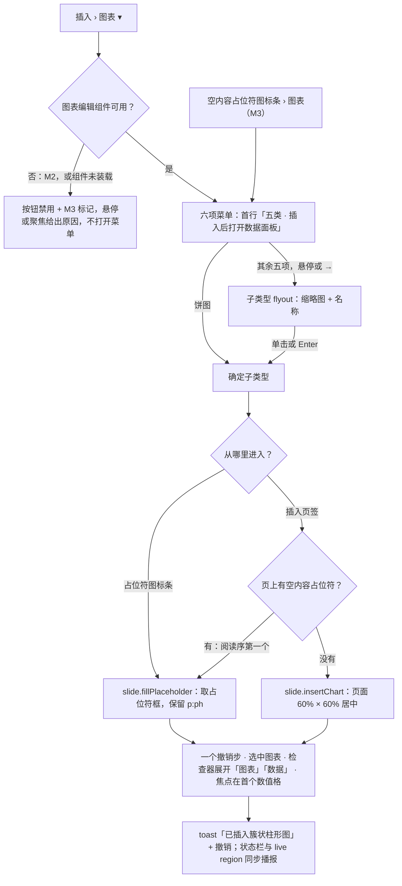
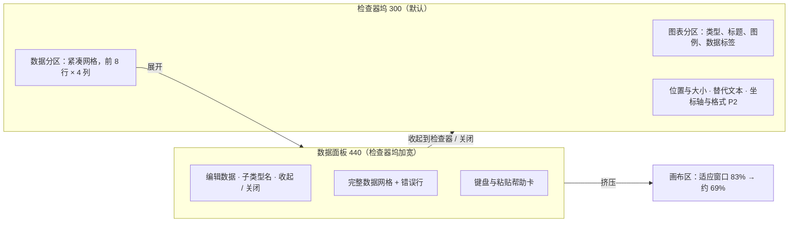
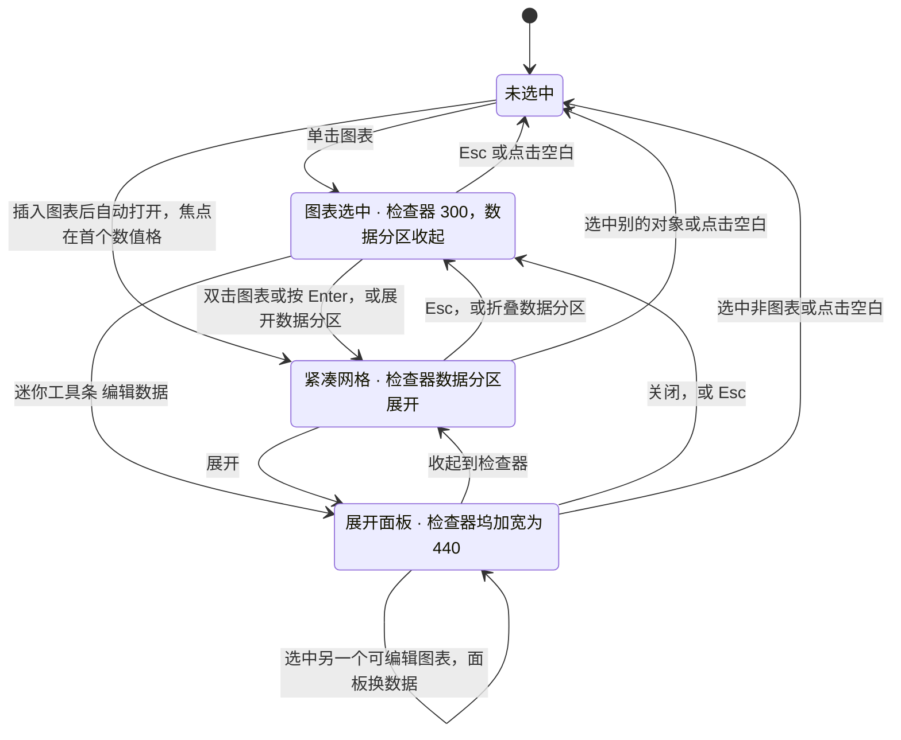
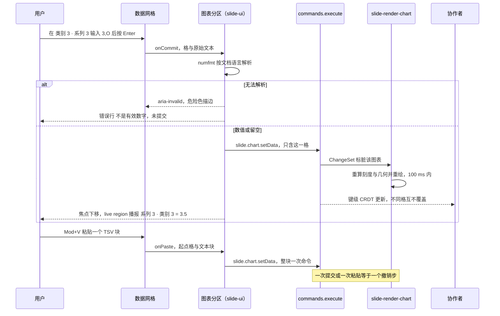
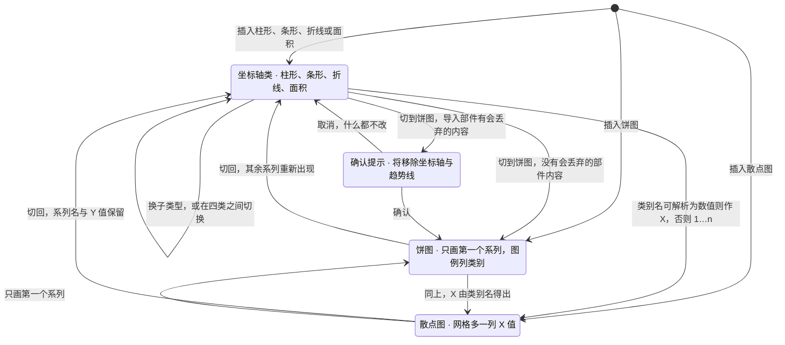

> 状态：草稿 | 负责：设计 | 更新：2026-09-30（§4.21 剩余缺口样张回写：新建，覆盖 G-63——图表 ▾ 六项菜单与子类型 flyout、示例数据、插入后自动打开数据面板、迷你工具条、数据面板与数据网格、更改类型、标题 / 图例 / 数据标签、饼图百分比标签、只读类型与 M2 禁用原因；样张经主会话抽查，最终以用户确认为准）；2026-09-30（§4.21 剩余缺口样张回写 · 整合：「编辑、增删与粘贴」的撤销粒度注明 50/18 §11 已统一）；2026-09-30（§4.21 剩余缺口样张回写 · 复核修正：如实登记样张的只读角色、P2 分区禁用实现、演示说明卡、交互时才出的 toast 与替代文本差异（「待决与取舍」第 12、16、17 条）；他人删除类别或系列改为「恢复」；插入落点与 03-30 合并为一条；帮助卡与圆角按样张 token 更正）；2026-09-30（§4.22 设计待决收口：数据面板定为检查器坞加宽到 440，入口拆为「编辑数据」直开面板、双击只展开数据分区；迷你工具条改画在屏幕覆盖层、12px；「更改类型 ▾」与插入菜单共用 `ChartTypeMenu`；类型切换确认条两种形态；只读类型改为双击时 toast；P2 分区定原因文案与 `aria-disabled`；图例补「右上」；饼图网格列出全部系列、第二列起变淡；行列右键菜单、紧凑网格截断、原工作簿提示、占位符 › 图表、M2 选中导入图表都已出样张；插入落点按用户裁决 Q1 填入空内容占位符；粘贴自动扩展、数字解析、新图表缺口、协同删除类别或系列定稿；状态清单改为 15 个演示态；待决只留推迟项）；2026-09-30（§4.22 整合：待决补「待用户确认的样张取舍」一行，检查器长度单位指向 rulings §4.22 SR-4）；2026-09-30（§4.22 复核修正：图表菜单焦点归还改为「选过类型才不归还」，三处入口未选类型关闭时回到各自触发按钮；占位符入口补下方放不下时上翻；紧凑网格系列表头补窄列规则；只读角色的输入框 `aria-disabled` + tooltip；落点补「已选中的空占位符优先」；状态清单注明饼图说明行需下滚；文首待决说明更正） | 依赖：charter v0.2；`10-prd/07-design-coverage-and-gaps.md` G-63；PRD [02 编辑](../../10-prd/03-features/02-editing.md) ED-15、ED-15a；前端 [50/24](../../50-frontend/24-elements-tables-and-charts.md) §3–§4、[50/10](../../50-frontend/10-editor-shell-and-interaction.md) §4–§5、[50/18](../../50-frontend/18-editor-capabilities.md) §11、[50/17](../../50-frontend/17-reuse-and-dependency-catalog.md) §7、[50/21](../../50-frontend/21-elements-structure.md) §3；[ADR-0036](../../30-architecture/adr/0036-chart-rendering-and-editing.md)、[ADR-0018](../../30-architecture/adr/0018-editor-element-model-and-insert-commands.md)；playground `#/editor/chart`；rulings §4.21（q-chart-route、R-d-34、R-d-35、R-d-72、R-d-74）、§4.20 FE-06（禁用而不隐藏）

# 03-31 图表编辑

> **设计基准（2026-09-15 起）**：组件规格以 [`09-design-specification.md`](../09-design-specification.md) v3.0（shadcn Rhea + 材质层）为准；对应 playground 路由 `#/editor/chart`（[已发布 artifact](https://claude.ai/code/artifact/cf6e1a1a-986b-48bb-b743-5758dff419d2)，源码 `playground/src/routes/`）。本文线框为示意，以 playground 实际渲染为终稿。
>
> **样张（2026-09-30）**：本文各节以 playground `#/editor/chart` 样张为准（主会话已抽查，**最终以用户确认为准**），源码 `playground/src/routes/editor/ChartEditing.tsx`、`playground/src/components/editor/elements/`（`chart-model.ts`、`DemoChart.tsx`、`ChartDataGrid.tsx`、`ChartTypeMenu.tsx`）与 `playground/src/components/editor/ribbon/InsertTab.tsx` 的图表组。15 个演示态见文末「状态清单」（文档站截图按 `31--<状态 id>--light|dark.jpg` 登记在 `docs/_tools/capture-screens.cjs` 第 31 条，默认态 `inserted`）。行为口径与前端 50/24 §3、§4 一致，视觉与文案以本文为准（设计稿是文案权威）；§4.22（2026-09-30）收口后，原「待决与取舍」各条已定稿写入正文，文末只留推迟项与一条待用户确认的样张取舍（SR-4）。

覆盖缺口 **G-63**（PRD ED-15a 插入图表、ED-15 图表数据编辑，均 M3 P1）。「图表」按钮在插入页签中的位置与 M3 标记已在 [03-04](04-insert-menu.md) 定稿，本文从点开「图表 ▾」写起：插入、数据面板与数据网格、换类型、标题图例与数据标签，以及不可编辑类型和未开放时的样子。模型、命令、渲染与协同的事实源是 [50/24](../../50-frontend/24-elements-tables-and-charts.md) 与 [ADR-0036](../../30-architecture/adr/0036-chart-rendering-and-editing.md)，本文只写界面，并在「与模型和渲染的对应」一节列出每个控件落到哪条命令、哪个字段。空内容占位符图标条中的图表图标见 [03-16](16-text-editing-and-formatting.md)（G-80），渲染器未加载与 chartex 的降级占位见 [03-13](13-import-progress-and-degraded-states.md)。

---

## 范围与里程碑

| 里程碑 | 用户能做什么 | 界面表现 |
|---|---|---|
| M1 | 导入的图表按部件数据只读渲染（OF-09） | 渲染器未加载时按 03-13 画降级占位 |
| M2 | 整体选中、移动、缩放、删除、复制；改替代文本 | 「图表 ▾」与占位符图标条的图表图标**禁用而不隐藏**，挂 M3 标记并给原因（下表）；选中导入的图表时检查器 `chart` 分区只读显示类型与系列数，注「数据编辑 M3 提供」（50/10 §5；演示态「M2 · 图表 ▾ 禁用 · 选中导入图表」） |
| M3（P1） | 插入五类图表；编辑数据；换类型与子类型；标题、图例、数据标签 | 本文全部界面 |
| P2 | 坐标轴范围、数字格式、趋势线、误差线；图表内子元素（系列、数据点、标题、图例）单独选中与设格式 | 检查器「坐标轴与格式」分区灰显 + P2 标记，不可展开 |

**可编辑的五类**：柱形 / 条形（同一类 `bar`，方向不同）、折线、饼、面积、散点（U-06、ED-15）。菜单按 PowerPoint 习惯把柱形与条形分成两项，所以是「六项、五类」。

**只读的其它类型**：气泡、雷达、股价、组合、3D、曲面、环形、带次坐标轴或缓存不全的图表，以及 chartex（瀑布、直方等）。它们可以选中、移动、缩放、复制、删除；选中时检查器显示「此类型仅支持查看」说明卡，双击时弹同名 toast（见下文「只读类型」）。插入菜单与类型切换都不列这些类型：它们不是「以后开放」的条目，而是不提供插入（ED-15a），与 03-04「非目标不出现入口」一致（PRD G-63 随 §4.22 改为「其余类型不列入（ED-15a）；导入的非五类图表选中时显示『此类型仅支持查看』」）；「禁用而不隐藏」只用于有里程碑的条目（M3、P2、M4+ 都禁用显示并给原因）。

**禁用原因（样张原文）**

| 条目 | 标记 | 原因文案（tooltip） |
|---|---|---|
| 插入 › 图表 ▾（M2，或 M3 起图表编辑组件未装载） | M3 | 插入图表在 M3 提供：需要装载图表编辑组件。文稿里已有的图表照常查看、放映、移动和缩放。 |
| 空内容占位符图标条 › 图表（M2） | M3 | 图表插入在 M3 提供：随图表编辑组件一起开放。文稿里已有的图表照常查看和放映。 |
| 检查器 › 坐标轴与格式 | P2 | 坐标轴范围、数字格式、趋势线与误差线排在后续版本（P2）；导入文件里已有的设置原样保留。 |

禁用控件用 `aria-disabled`（仍可聚焦与悬停，tooltip 可达），图标与文字 50% 不透明，里程碑标记保持原色、不随按钮变淡；大按钮读屏名「图表（M3）」。P2 分区是一行不可展开的标题：`aria-disabled`、可聚焦，标题文字与 chevron 50%，P2 标记原色，读屏名「坐标轴与格式（P2）」，悬停或聚焦时 tooltip 在左侧给出上表原因。启用条件是 `enablement: slide.hasChartEditor`（50/10 §4），M2 与 M3 组件未装载两种情况共用表中第一条文案。

---

## 线框：图表 ▾ 菜单与子类型 flyout

```
 插入 › 图表组
 ┌────┐
 │ ▥ M3│  ← 大按钮 56 × 60，右上角 M3 标记，菜单打开时按下态
 │图表▾│
 └────┘
 ┌──────────────────────────────┐ ┌──────────────────────────────────────────────┐
 │ [M3] 五类 · 插入后打开数据面板 │ │ 柱形图                                         │
 │ ▥ 柱形图                    › ├─┤ ┌────────┐    ┌────────┐    ┌────────┐       │
 │ ☰ 条形图                    › │ │ │ ▌▌▌ ▌▌ │    │ ▆▆ ▆▆  │    │ ██ ██  │       │
 │ ⟋ 折线图                    › │ │ └────────┘    └────────┘    └────────┘       │
 │ ◔ 饼图                        │ │ 簇状柱形图    堆积柱形图    百分比堆积柱形图  │
 │ ◭ 面积图                    › │ └──────────────────────────────────────────────┘
 │ ⁘ 散点图                    › │   ← 子类型 flyout：悬停或 → 打开
 └──────────────────────────────┘
```

（字符只是示意；菜单图标为 Lucide 的 ChartColumn、ChartBar、ChartLine、ChartPie、ChartArea、ChartScatter，缩略图是用示例数据画出的真实子类型图形。）

### 尺寸与布局

| 项 | 规格 |
|---|---|
| 菜单 | DropdownMenu，`align="start"` 贴按钮左缘，宽 240，非模态；首行说明「[M3] 五类 · 插入后打开数据面板」（12px 次要色，不可选） |
| 组件与三处入口 | 同一个 `ChartTypeMenu` 组件三处共用，只换首行说明：插入 › 图表 ▾（上行原文）；迷你工具条「更改类型 ▾」为「[M3] 更改类型 · 数据与标题保留」，并高亮当前类型（类别图标着主色，flyout 里当前子类型格主色 10% 底 + 主色 40% 描边）；空内容占位符图标条 › 图表为「[M3] 五类 · 填入占位符后打开数据面板」，贴图表图标下缘弹出（图标条折叠时贴「插入 ▾」），下方放不下时翻到图标上方（为状态栏与缩放条留出 112 px，同表格网格弹层，03-16），菜单开着时图表图标为按下态（`aria-expanded`） |
| 菜单项 | 六项，左侧 16 图标 + 名称；有子类型的五项右侧 `›`；饼图只有一个子类型，点击直接插入，不出 flyout |
| 子类型 flyout | 贴菜单右侧、间距 6、内边距 8；首行类名（12px 次要色）；下面一行横排子类型格：每格宽 92、圆角 `rounded-xl`（约 11），内含 72 × 48 缩略图（纸色底、1px 8% 描边）与 11px 名称（居中，可换两行） |
| 缩略图 | 去掉标题、坐标轴与文字，只留图形；系列色取文档主题 accent1–6（幻灯片内容色，亮暗界面下不变） |
| 悬停 / 聚焦 | 菜单项与子类型格悬停为 accent 底；键盘聚焦同底色加焦点环 |
| 焦点 | 选中子类型后焦点交给数据网格首个数值格（`ChartTypeMenu` 记下本次是否选过子类型，选过才在菜单关闭时阻止焦点回到按钮）；`Esc` 或点外部关闭、未选类型时焦点回到触发按钮：插入页签为「图表 ▾」，迷你工具条为「更改类型 ▾」，占位符入口为图表图标（锚点本身不可聚焦，由组件交给图标）（03-04「关闭 / 展开」）；「更改类型 ▾」选定类型后焦点同样回到该按钮 |

### 六项与子类型

| 菜单项 | 子类型（名称即 tooltip 与读屏名） | 写入 `ChartData`（50/24 §3.4） |
|---|---|---|
| 柱形图 | 簇状柱形图、堆积柱形图、百分比堆积柱形图 | `type: 'bar'`、`barDir: 'col'`，`grouping` 依次为 clustered / stacked / percentStacked |
| 条形图 | 簇状条形图、堆积条形图、百分比堆积条形图 | `type: 'bar'`、`barDir: 'bar'`，`grouping` 同上 |
| 折线图 | 折线图、带数据标记的折线图、堆积折线图 | `type: 'line'`；`marker` 为 false / true；堆积为 `grouping: 'stacked'` |
| 饼图 | 饼图（唯一子类型） | `type: 'pie'` |
| 面积图 | 面积图、堆积面积图、百分比堆积面积图 | `type: 'area'`，`grouping` 依次为 standard / stacked / percentStacked |
| 散点图 | 仅带数据标记的散点图、带平滑线和数据标记的散点图 | `type: 'scatter'`，`scatterStyle` 为 marker / smoothMarker |

### 示例数据与默认外观

| 项 | 默认（50/24 §3.3） |
|---|---|
| 外框 | 页上有空的内容占位符（`obj` 或 `chart`）时填入阅读序第一个（已选中的空占位符优先）：取该占位符框并保留 `p:ph`（`slide.fillPlaceholder`，用户裁决 2026-09-30 Q1；样张为「标题和内容」版式的正文框，x 90、y 116、宽 780、高 396 pt）；没有空占位符时取页面 60% × 60% 居中；从占位符图标条进入时填入该占位符 |
| 数据 | 柱形、条形、折线、面积：类别 1–4 × 系列 1–3（系列 1：4.3、2.5、3.5、4.5；系列 2：2.4、4.4、1.8、2.8；系列 3：2、2、3、5）；饼：类别 1–4，系列 1：8.2、3.2、1.4、1.2；散点：点 1–3，X 0.7、1.8、2.6，Y 2.7、3.2、0.8 |
| 名称 | 「类别 {n}」「系列 {n}」「点 {n}」走 i18n 文案键，随界面语言 |
| 外观 | 标题显示「图表标题」、图例在底部、无数据标签；系列色写主题引用 accent1…accent6，第 7 个起按亮度派生（每 6 个一轮，依次叠加 `lumMod` / `lumOff`，同 PowerPoint 默认图表样式），字体取主题次要字体；空值按缺口画，导出写 `c:dispBlanksAs val="gap"`（同 PowerPoint 新建图表） |

**插入流程**



怎么读：未开放时菜单根本打不开，只给原因；开放后两条入口（插入页签、占位符图标条）共用同一个六项菜单与 flyout（`ChartTypeMenu`），差别只在落点与命令：从插入页签插入时，页上有空内容占位符就填进阅读序第一个（已选中的空占位符优先，用户裁决 2026-09-30 Q1），不想放进占位符可以再拖出；占位符图标条这一路直接填入该占位符（演示态「占位符图标条 › 图表（M3）」）。插入与示例数据是一个撤销步，随后展开检查器「数据」分区是视图操作、不入历史（50/24 §3.3）。点击菜单项即插入，不经插入工具态（不拖出绘制，03-04「交互说明」）。

插入成功 toast：标题「已插入〈子类型名〉」，说明「示例数据已写入，数据面板已打开」，操作「撤销」；状态栏左侧追加「已插入〈子类型名〉 · 焦点在首个数值格」；`aria-live` 播报「已插入〈子类型名〉」。

---

## 线框：插入后（示例图表 + 检查器）

```
┌─ 画布（适应窗口 83%）──────────────────────────────┐ ┌─ 检查器 300 ──────────────────┐
│ 季度销售对比                                       │ │ 属性                          │
│              ┌[M3][▦ 编辑数据][▥ 更改类型 ▾]┐      │ │ 图表 M3                     ˄ │
│ ○──────────────────────○──────────────────────○   │ │ 类型                          │
│ │                图表标题                      │   │ │ [▥][☰][⟋][◔][◭][⁘]  ← 六个类别 │
│ │  5 ┤ ▌               ▌                    ▌ │   │ │ [簇状✓] [堆积] [百分比堆积]    │
│ ○    ┤ ▌▌▌   ▌▌▌   ▌▌▌  ▌▌▌                  ○   │ │ 标题                   [●━]   │
│ │  0 ┴──────────────────────────────────────  │   │ │ [图表标题                  ]  │
│ │    类别 1  类别 2  类别 3  类别 4             │   │ │ 图例      [底部 ▾]    [●━]    │
│ │        ■ 系列 1  ■ 系列 2  ■ 系列 3           │   │ │ 数据标签               [━○]   │
│ ○──────────────────────○──────────────────────○   │ │ 数据 M3                     ˄ │
│                                                   │ │ 类别  │■系列1│■系列2│■系列3│ + │
└───────────────────────────────────────────────────┘ │ 类别 1│[ 4.3]│  2.4 │    2 │   │
                                                      │ …                             │
 状态栏：第 4/12 页 · 已插入簇状柱形图 · 焦点在首个数值格 │ + 新增类别                     │
                                                      │ 行 = 类别 · 列 = 系列  [⤢ 展开]│
                                                      │ 位置与大小 ˅   替代文本 ˅       │
                                                      │ 坐标轴与格式 P2（灰显）        │
                                                      └───────────────────────────────┘
```

### 画布：选中框与迷你工具条

| 部件 | 规格 |
|---|---|
| 选中框 | 图表外框 8 个缩放手柄，**没有旋转手柄**（graphicFrame 不旋转、不翻转，50/24 §3.6）；拖动移动、缩放是通用变换 |
| 迷你工具条 | `ui.toolbar` 槽位 `toolbar.chart`（50/10 §5 命名规则），M3 起在选中可编辑图表时出现；`glass-float rounded-xl`（约 11）、内边距 4，画在画布的屏幕坐标覆盖层、按屏幕尺寸绘制，不随画布缩放（与 03-16 同一组件）；位于选中框上缘正中、上移 8，视口边缘不足时翻到下方；内容依次为 M3 标记、「编辑数据」（Table2 图标）、「更改类型 ▾」（图标随当前类别变化）；按钮高 24、12px（`text-xs`）文字 |
| 编辑数据 | 直接打开数据面板的展开形态（440，见下节）：点工具条是明确的编辑意图。双击图表（或图表聚焦时按 `Enter`）只展开检查器的「数据」分区、焦点落到首个数值格（50/24 §3.6），结果同「插入后」演示态 |
| 更改类型 ▾ | 与插入菜单同一个六项菜单与子类型 flyout（`ChartTypeMenu`），首行「[M3] 更改类型 · 数据与标题保留」，高亮当前子类型；菜单开着时按钮为 accent 底；会丢导入内容时菜单底部出确认段（见「更改图表类型」） |
| 只读类型、评审模式 | 不出迷你工具条；评审 / 查看角色下选中框也不画缩放手柄 |

### 检查器（`selectionKind: chart`）

检查器「属性」页签按折叠分区排列（`inspector-groups`，50/10 §5、50/24 §3.7）；插入后「图表」「数据」两个分区展开，其余收起。

| 分区 | 内容与规格 | 里程碑 |
|---|---|---|
| 图表（标题带 M3 标记） | 「类型」：一行六个类别按钮（高 28、圆角 `rounded-md`（约 6，与 03-30 边框选择器同一写法），`role="radiogroup"`，当前类别主色 12% 底 + 主色 40% 描边 + 主色图标）；下面是当前类别的子类型缩略图（60 × 38，纸色底，名称 11px 次要色；三种时三列、散点两列、饼一格），当前子类型主色 10% 底 + 主色 40% 描边。分隔线下依次为「标题」「图例」「数据标签」三行（见下文「标题、图例与数据标签」） | M3 P1 |
| 数据（标题带 M3 标记） | 紧凑数据网格（行高 28、类别列 66（放得下 4 个汉字，更长的以省略号结尾）、表头文字 11px；系列表头的 8 px 色块贴左 4 px、输入框左右内边距各 4 px，300 宽检查器里每个系列列约 52 px，「系列 1」这类默认名放得下，更长的系列名以省略号收尾、悬停 `title` 显示全名，完整内容在展开面板里看）；网格下一行左说明（12px 次要色，平时「行 = 类别 · 列 = 系列」）、右「⤢ 展开」按钮（outline、高 28）。超过 8 行或 4 列时只显示前 8 × 4，截断方向不出「+」，说明行改为「共 N 类别 × M 系列 · 此处显示前 8 × 4」（窄栏里只在「·」处换行），其余在展开面板里编辑（50/24 §3.7）；饼图有多个系列时说明行再接「饼图只画第一个系列」。导入且带内嵌工作簿的图表，分区顶部会出「原工作簿」提示条（见下节「数据面板」）。评审 / 查看角色下「展开」`aria-disabled`，tooltip「需要编辑权限」 | M3 P1 |
| 位置与大小 | X、Y、宽、高（显示单位随设置，见 [03-23](23-settings-panel.md)；样张用 pt，与 03-16、03-30 的 in 不一，见 rulings §4.22 SR-4），无旋转 | M2 |
| 替代文本 | 标题输入 + 描述多行输入（与只读类型的检查器、03-30 §6.7 的表格一致）；两者都空时 12px 警告色「缺少替代文本：读屏用户无法了解图表内容」 | M2 |
| 坐标轴与格式（P2 标记） | 不可展开的标题行（轴范围、数字格式、趋势线、误差线），`aria-disabled`、可聚焦，tooltip 给原因（上文「禁用原因」） | P2 |

---

## 线框：数据面板（展开）

```
┌─ 画布（适应窗口约 69%）────────────────────┐ ┌─ 数据面板 440（检查器坞加宽）─────────────────────┐
│ 季度销售对比                               │ │ 编辑数据 M3                            [⤡] [✕]   │
│         ┌[M3][▦ 编辑数据][▥ 更改类型 ▾]┐   │ │ 簇状柱形图 · 修改后 100 ms 内重绘                  │
│ ○──────────────○──────────────○           │ │ ┌──────────┬───────┬───────┬───────┬───┐       │
│ │    图表标题（已按新数据重绘）  │           │ │ │ 类别      │■ 系列 1│■ 系列 2│■ 系列 3│ + │       │
│ ○  ▌▌▌ ▌▌▌ ▌▌▌ ▌▌▌           ○           │ │ │ 类别 1    │   4.3 │   2.4 │     2 │   │       │
│ │                              │           │ │ │ 类别 2    │   3.8 │   4.4 │     2 │   │       │
│ ○──────────────○──────────────○           │ │ │ 类别 3    │   3.5 │   1.8 │ [3,O] │   │ ← 非法 │
│                                            │ │ │ 类别 4    │   4.5 │   2.8 │     5 │   │       │
└────────────────────────────────────────────┘ │ │ + 新增类别                                │       │
 状态栏：第 4/12 页 · 数据已更新 · 图表重绘      │ └──────────────────────────────────────────┘       │
                                                │ ● 类别 3 · 系列 3：「3,O」不是有效数字，未提交      │
                                                │                                                  │
                                                │ ┌ Enter 提交并下移  Tab 提交并右移  Esc 放弃输入   ┐│
                                                │ │ F2 编辑  ⇧F10 行列菜单                            ││
                                                │ │ 可从 Excel 或表格复制整块粘贴（一次撤销步）；留空表示   ││
                                                │ │ 缺失值；右键类别名或系列名可删除、上移或下移（列为    ││
                                                │ │ 左移、右移）。                                     ││
                                                │ └──────────────────────────────────────────────────┘│
                                                └──────────────────────────────────────────────────┘
```

| 部件 | 规格 |
|---|---|
| 形态（定稿） | **不另开一栏**：检查器坞由 300 加宽到 440，整栏换成数据面板；画布区相应收窄，「适应窗口」缩放由 83% 降到约 69%（1440 × 900 视口）。不做独立右侧抽屉（画布只剩约 40%），也不做浮层（会盖住图表）；与 50/18 §11 CHT-03 同向 |
| 入口 | 迷你工具条「编辑数据」直接打开本面板；检查器「数据」分区的「⤢ 展开」同样打开；双击图表只展开检查器的「数据」分区（紧凑网格），不打开本面板 |
| 标题区 | 「编辑数据」14px 半粗 + M3 标记；次行 12px 次要色「〈子类型名〉 · 修改后 100 ms 内重绘」；右侧两个图标按钮：「收起到检查器」（Minimize2，tooltip 同名）回到 300 的检查器、数据分区展开为紧凑网格；「关闭」（X）回到 300 的检查器、数据分区收起（50/24 §3.6「关闭面板回到图表选中」） |
| 原工作簿提示 | 导入且带内嵌工作簿的图表首次打开数据编辑时，面板顶部与检查器「数据」分区顶部都出一条提示：info-muted 底、圆角 `rounded-xl`（约 11）、Info 图标（信息色）+ 12px「原工作簿里数据区之外的内容（其它工作表、公式）在编辑数据后不保留。」+ 右侧「知道了」（ghost、高 24）；`role="status"`。两处共用一个状态：首次提交数据或点「知道了」后都不再出（50/24 §3.10）。双击图表只展开数据分区、不经过面板，所以分区顶部也要出 |
| 网格 | 完整尺寸：行高 32、首列 84、其余列最小宽 72，全部行列可见；超出面板高度时面板内纵向滚动，超出宽度时横向滚动 |
| 错误行 | 网格下方，6px 红点 + 12px 危险色「类别 N · 系列 M：「〈输入〉」不是有效数字，未提交」 |
| 饼图说明 | 饼图有多个系列时，网格下方（有错误行时在其下）一行 12px 次要色「饼图只画第一个系列；其余系列保留在数据里，切回其它类型后重新画出。」 |
| 帮助卡 | 贴底，`.cordex-group` 分组卡（卡片底 + 6% 发丝描边与极淡投影；暗色为白 5%）：键帽行「Enter 提交并下移 · Tab 提交并右移 · Esc 放弃输入 · F2 编辑 · ⇧F10 行列菜单」；说明行「可从 Excel 或表格复制整块粘贴（一次撤销步）；留空表示缺失值；右键类别名或系列名可删除、上移或下移（列为左移、右移）。」 |
| 画布 | 图表保持选中、迷你工具条仍在；每次提交后按新数据重绘，状态栏追加「数据已更新 · 图表重绘」 |
| 面板开着时换选中 | 选中另一个可编辑图表：面板跟随换数据；选中非图表或点空白：面板收起、检查器按新选区显示（与检查器随选区切换同一规则） |

**面板布局：两种形态**



怎么读：两种形态显示的是同一份数据、同一个网格组件，只是尺寸不同；「展开」没有新开一栏，而是把检查器坞加宽并整栏换成数据面板，代价是画布缩到约 69%、编辑数据时看不到图表分区；比起另开一栏（画布只剩约 40%）或浮层（盖住图表），编辑时图表始终可见。

**数据面板的打开与收起**



怎么读：打开、展开、收起都是视图操作（`slide.chart.openDataEditor`，不入历史）；「收起到检查器」保留紧凑网格以便继续改数，「关闭」与 `Esc` 回到只选中图表。`Esc` 只在没有格处于编辑中时生效，编辑中的第一次 `Esc` 先放弃本格输入。单元格里的输入与提交发生在「紧凑网格」与「展开面板」两个状态内部，见下节时序。

---

## 数据网格

外观取 shadcn Table，产品实现为 @tanstack/react-table 无头表格 + shadcn Table，由 ui-react 封装成通用 `DataGrid`（50/17 §7、ADR-0036 决策 6）。紧凑与展开两种形态是同一组件的两种尺寸。

| 项 | 规格 |
|---|---|
| 行列 | 行 = 类别，列 = 系列；散点：首列「点」、第二列「X 值」、其后各系列的 Y 值 |
| 表头行 | 左上角「类别」（散点「点」），11px 次要色；其余为系列名（可编辑，右对齐 500 字重，左侧 8 × 8 圆角 2 的系列色块，颜色即该系列在图表中的主题色，第 7 个起按亮度派生）；末列宽 28 的「+」，tooltip「新增系列」 |
| 首列 | 类别名（可编辑，左对齐），底色 muted 35%；紧凑形态列宽 66（放得下 4 个汉字，更长的以省略号结尾，完整内容在展开面板里看），展开形态 84 |
| 展开形态的宽度 | 列最小宽 72，系列多到超出面板宽度时容器内横向滚动 |
| 饼图 | 网格仍列出全部系列；第二列起表头与数值格降为 50% 不透明度，表头 tooltip「饼图只画第一个系列；其余系列保留在数据里，切回其它类型后重新画出」（与面板说明行同一句） |
| 数值格 | 右对齐、等宽数字、数字键盘（`inputMode="decimal"`）；空值显示为空白 |
| 末行 | 整行按钮「+ 新增类别」（散点「+ 新增点」），12px 次要色，悬停 5% 前景底 |
| 容器 | 卡片底、1px 10% 描边、圆角 8；表头 muted 70% 底；列间 7% 发丝线；暗色界面下卡片为 3% 白 |

| 格状态 | 视觉 |
|---|---|
| 默认 | 透明底 |
| 焦点 / 编辑中 | 卡片底 + 2px 主色内描边（插入后首个数值格即此态） |
| 非法输入 | 危险色 6% 底 + 危险色文字 + 2px 危险色内描边，`aria-invalid`，不提交；说明见展开面板的错误行 |
| 缺失值 | 空白；新插入的图表按缺口画（导出写 `c:dispBlanksAs val="gap"`），导入的图表按部件原设置 |
| 行列菜单打开 | 对应的类别格或系列表头格主色 10% 底 |

### 编辑、增删与粘贴

- **输入**：每格就是输入框，聚焦后直接键入；Enter 或失焦提交，Esc 恢复原值；值没有改动时失焦不算提交，不产生命令。数值按文档语言用 numfmt 严格解析（50/24 §3.6）：文档语言先取图表部件的 `c:lang`，没有时取演示文稿默认语言；千分位分组不合规的（如英语文档里的「1,5」）判非法、不提交，不静默读成 15。留空写 `null`；无法解析的不提交（样张示例「3,O」把 0 打成了字母 O）。网格说明行可以显示当前小数分隔符，样张不补。
- **新增**：点表头末列「+」在末尾追加「系列 N」（值全空）；点末行在末尾追加「类别 N」（各系列值为空）。新 id 与排序键由命令生成。
- **删除与移动**（演示态「数据网格 · 行列右键菜单」）：在类别格或系列表头格上右键，或聚焦后按 `Shift+F10` / ContextMenu 键，打开行列菜单（`ui/context-menu`）。首行是对象名（如「类别「类别 1」」「系列「系列 2」」）；行菜单为上移、下移、删除类别（散点为删除点），列菜单为左移、右移、删除系列。到边或只剩一个的项 `aria-disabled`、仍可聚焦，tooltip「已是第一个 / 最后一个类别（系列）」「图表至少保留一个类别（系列）」；评审或查看角色下编辑项一律 tooltip「需要编辑权限」。删除写墓碑、可撤销，toast「已删除类别「〈名称〉」」（系列同式）带「撤销」；移动只改排序键（50/24 §3.6）。
- **粘贴**：从 Excel 或表格复制的 TSV 块，以焦点格为左上角整块写入，一次命令、一个撤销步。块超出现有行列时自动新增类别与系列，与粘贴合为同一条命令、同一个撤销步；超过规模上限时整块拒绝并 toast 说明原因（`setData` 可在同一命令里建类别与系列，50/24 §3.8；同 PowerPoint 数据表）。样张不演示。
- **撤销粒度**：一次提交一个撤销步（50/24 §3.6）；50/18 §11 原写「连续输入按 500 ms 合并」，已于 2026-09-30 统一为一次提交一步（格内键入是网格的本地草稿，不写模型）。

| 键 | 作用 |
|---|---|
| 方向键 | 未在编辑时移动焦点格 |
| Enter / F2 | 开始编辑；编辑中 Enter 提交并下移 |
| Tab / Shift+Tab | 提交并右移 / 左移 |
| Esc | 编辑中放弃本格输入；未在编辑时收起数据面板，回到图表选中 |
| Mod+C / Mod+V | 复制 / 粘贴选区（选区状态机与表格共用，R-d-34） |
| Shift+F10 / ContextMenu | 焦点在类别格或系列表头格时打开行列菜单 |

**数据编辑时序：一次提交与一次粘贴**



怎么读：网格只报告「哪一格输入了什么文本」，解析与校验在图表分区完成；非法输入停在网格上、不产生命令，合法输入只写改动的那一格，所以重绘快、并发编辑不同格也不会互相覆盖（50/24 §3.9）。

---

## 更改图表类型

- **入口**：检查器「图表」分区的六个类别按钮与子类型缩略图；迷你工具条「更改类型 ▾」——与插入菜单同一个六项菜单与子类型 flyout（`ChartTypeMenu`），首行「[M3] 更改类型 · 数据与标题保留」，当前类别图标着主色、当前子类型格高亮（演示态「更改类型 ▾ · 下拉」）。只在五类之间切换，其它类型不出现。
- **操作**：点另一个类别即切到该类的第一个子类型（如点「折线图」得到「折线图」），再点子类型缩略图换子类型；点当前项无动作。
- **反馈**：立即重绘，toast「已更改为〈子类型名〉」+「撤销」（撤销同时还原类型与数据换算）；一次切换一个撤销步（`slide.chart.setType`）；迷你工具条「更改类型」的图标随之换成新类别的图标。
- **不变的**：数据、标题、图例与数据标签设置都保留（样张「更改图表类型」演示态：簇状柱形 → 带数据标记的折线，标题与底部图例不变）。
- **会丢东西时先确认**：导入的图表切换后会丢弃部件里的内容（坐标轴格式、趋势线、误差线、饼图分离与起始角等，见 50/24 §3.8「去掉」一列）时先出确认条：警示图标 +「切换为〈子类型名〉将移除坐标轴与趋势线」+ 左「取消」、右「切换」（主色），出现时焦点在「切换」；确认后执行，仍可撤销，部件内容清掉后再切不再确认。确认条有两种形态：
  - **检查器内联**（演示态「更改类型 · 会移除导入内容」）：类型区下方一张 `.cordex-group` 卡，`Esc` 等同「取消」。
  - **下拉内**（演示态「更改类型 ▾ · 下拉内确认」）：从迷你工具条下拉点子类型时，菜单不关，底部分隔线下出现同一段确认，两个按钮是菜单项（方向键可达）；`Esc` 直接关掉整个菜单，等同取消。下拉较窄，文案只在子类型名之后换行（「切换为饼图」接下一行「将移除坐标轴与趋势线」）。

| 切换 | 界面上看到的变化（规则见 50/24 §3.8） |
|---|---|
| 柱形、条形、折线、面积之间 | 系列、类别、标题、图例都保留；只换图形 |
| 任意 → 饼图 | 只画第一个系列，图例改列类别名；其余系列留在数据里，切回后重新出现；网格仍列出全部系列，第二列起变淡 |
| 饼图 → 其它 | 全部系列回到图上；坐标轴按默认新建 |
| 任意 ↔ 散点图 | 网格多出（或去掉）「X 值」列；类别名能解析为数值时作为 X，否则 X 取 1…n；类别轴改为数值轴 |

**类型切换的状态**



怎么读：五类可以任意互切，每次切换（包括确认后的那次）都是一个撤销步；只有导入的图表带着会被丢弃的部件内容时才多一个确认，新插入的图表没有部件，直接切换。散点与其它类型之间的 X 值换算规则以 50/24 §3.8 为准。

---

## 标题、图例与数据标签

位于检查器「图表」分区类型区下方，分隔线隔开；三行都立即重绘。

| 行 | 控件 | 行为 |
|---|---|---|
| 标题 | 行尾小号开关（读屏名「显示标题」）；下一行文字输入（高 28，读屏名「标题文字」） | 关：输入禁用，图表去掉标题、绘图区上移；开：显示输入框里的文字。改文字即时重绘（样张逐字更新） |
| 图例 | 「图例」+ 位置下拉（宽 84：底部 / 顶部 / 左侧 / 右侧 / 右上，读屏名「图例位置」）+ 开关（「显示图例」） | 关：下拉禁用，图例移除；再打开时回到底部。换位置时绘图区让出相应一侧；「右上」时图例在右上角纵排，绘图区右侧让出。导入的右上图例在下拉里显示为「右上」 |
| 数据标签 | 行尾开关（「显示数据标签」） | 开：显示数值——簇状柱形在柱顶上方、条形在右端外侧、堆积在段内居中白字、折线与散点在点上方；百分比堆积也显示各段原值（同 PowerPoint 默认）；饼图见下 |

「标题 / 图例 / 数据标签」演示态：标题改为「各区域季度销售（百万元）」，图例在右侧（纵向排列，绘图区右缩），数据标签开，每根柱顶显示原值。

### 饼图：百分比标签

- 数据标签打开时，开关下方出现一行三个复选：「百分比」（默认勾选）「类别名」「值」，对应 `dataLabels` 的 showPercent、showCategory、showValue，可多选。
- 百分比 = 扇区值 ÷ 合计，四舍五入到整数；各扇区四舍五入后合计可能是 99% 或 101%，不做修正（样张：线上直营 59%、渠道分销 23%、大客户 10%、其它 9%）。
- 标签画在扇区内约 2/3 半径处，白色 12px 半粗；组成是类别名占一行，值与百分比在下一行、用「, 」分隔（PowerPoint 默认分隔符）。扇区太小放不下时移到外侧并加引导线，由渲染器处理（50/24 §3.5 的 bestFit 与左右避让），样张不演示：推迟（触发条件：slide-render-chart 实现并用 70/04 §8.1 饼图语料校准时，见 rulings §4.22）。
- 饼图图例列的是类别名（其它类型列系列名），样张放在右侧；子类型区只有「饼图」一格。
- 演示态「饼图 · 百分比标签」的数据有三个系列（本年、去年、前年），图上只画「本年」；检查器同时展开「图表」「数据」，网格第二、三列变淡，说明行注「饼图只画第一个系列」。

---

## 只读类型：「此类型仅支持查看」

```
┌─ 画布 ──────────────────────────────────────┐ ┌─ 检查器 300 ─────────────────────┐
│ ○───────────────────○───────────────────○  │ │ ⓘ 此类型仅支持查看                │
│ │            ⬠ 团队能力评估                 │  │ │ 雷达图不在可编辑的五类（柱形 /   │
│ │                                          │  │ │ 条形、折线、饼、面积、散点）里。 │
│ ○            （雷达图，无迷你工具条）       ○ │ │ 可以移动、缩放、复制和删除；数据 │
│ │                                          │  │ │ 与格式按原样导出。               │
│ │                                          │  │ │ [↗ 保真详情]                    │
│ ○───────────────────○───────────────────○  │ │ 位置与大小  X 90 Y 116 宽 780 高 396│
└─────────────────────────────────────────────┘ │ 替代文本  标题 / 描述              │
 状态栏：第 4/12 页 · 雷达图 · 仅支持查看         └─────────────────────────────────┘
                    ┌ toast（双击或 Enter 后）──────────────────────┐
                    │ 此类型仅支持查看：雷达图                          │
                    │ 不在可编辑的五类里；可以移动、缩放和复制，数据与    │
                    │ 格式保持原样导出。                [查看保真详情] │
                    └──────────────────────────────────────────────┘
```

- **适用**：非五类（气泡、雷达、股价、组合、3D、曲面、环形）、有次坐标轴或缓存不全的图表（50/24 §3.4 的可编辑判定），样张以雷达图演示。chartex 画的是降级占位，说明见 [03-13](13-import-progress-and-degraded-states.md)，不在本节。
- **画布**：选中框 8 个缩放手柄、无旋转手柄；**没有迷你工具条**；单纯选中不出提示。
- **双击或按 Enter**（50/24 §3.6）：弹 toast，标题「此类型仅支持查看：〈类型名〉」，说明「不在可编辑的五类里；可以移动、缩放和复制，数据与格式保持原样导出。」，按钮「查看保真详情」（打开保真报告的图表分组）。同一对象 10 秒内不重复弹，换演示态时收起；通知区由 sonner 提供 `aria-live="polite"`。演示态进入后约 120 ms 模拟一次双击，toast 停留 10 秒以便截图，产品按 sonner 默认时长。
- **检查器**：不出「图表」「数据」分区，只有三张卡：「此类型仅支持查看」说明卡（标题带 Info 图标，正文列出可编辑的五类，按钮「↗ 保真详情」打开保真报告的图表分组，见 [03-10](10-fidelity-report.md)）、「位置与大小」、「替代文本」（标题 + 描述多行输入）。
- **状态栏**：左侧追加「〈类型名〉 · 仅支持查看」。

## 未开放、只读角色与其它模式

- **M2 · 图表 ▾ 禁用**（演示态「M2 · 图表 ▾ 禁用 · 选中导入图表」）：大按钮图标与文字 50%、M3 标记原色；悬停或聚焦后 tooltip 在按钮下方左对齐展开（最宽 256），文案见上文「禁用原因」。点击无动作。
- **M2 · 选中导入的图表**（同一演示态）：页面是「两栏内容」版式。左栏是导入的簇状柱形图（框 x 90、y 116、宽 380、高 396 pt），已选中：8 个缩放手柄、无旋转手柄、无迷你工具条；可移动、缩放、删除、复制。检查器三组：「图表」（M3）只读显示「簇状柱形图 · 3 个系列」并注「数据编辑 M3 提供；现在可以移动、缩放、复制、删除和改替代文本」（50/10 §5）、「位置与大小」、「替代文本」（标题 + 描述）。右栏是空内容占位符，挂图标条；83% 下一栏放不下整条，按 03-16 规则折叠为「插入 ▾」，打开菜单才能看到「图表」禁用并挂 M3。状态栏「M2 · 导入的簇状柱形图 · 数据编辑 M3 提供」。
- **评审模式与 commenter / viewer 角色**：Ribbon 换成只读细条「评审模式下不可编辑图表」；画布无缩放手柄、无迷你工具条，空占位符不出图标条；数据面板收起；检查器的开关禁用，输入框（图表标题、位置与大小、替代文本）只读并 `aria-disabled`、仍可聚焦，tooltip「需要编辑权限」（同 03-30 §9），紧凑网格「展开」`aria-disabled`、tooltip「需要编辑权限」，行列菜单的编辑项同样给「需要编辑权限」（03-04「只读（评审模式）」、02 模式对照表）。
- **放映与只读查看器**：只渲染，不出现本文任何编辑界面。
- **图表渲染器未加载**：图表位置画降级占位「无法显示：图表渲染器未加载」，可移动、缩放、删除（03-13）；M3 起组件装载完成后原位替换为图表。

---

## 与模型和渲染的对应

每个界面动作只经一条命令写模型；图表外观全部由渲染器从 `Chart.data`（叠加导入部件的只读解析结果）画出，界面不直接画图表。字段与命令的事实源见 50/24 §3.4、§3.8，模型字段登记在 30/04 §3.9，命令登记在 40/03 §2.6 与 30/05 §14。

| 界面动作 | 命令（Command / Operation） | 写入 `Chart.data` | 渲染与反馈 |
|---|---|---|---|
| 从图表 ▾ 选子类型 | 页上没有空内容占位符时 `slide.insertChart{containerId, box, chartType, variant}`；有空内容占位符（Q1）或从占位符图标条进入时走 `slide.fillPlaceholder{content: chart}` | 新建 `type`、`variant`、`categories`、`series`（示例数据）与默认标题、图例 | 同一帧按主题默认样式画出；无部件，导出时才生成图表部件与内嵌工作簿 |
| 打开 / 展开 / 收起数据面板 | Operation `slide.chart.openDataEditor{shapeId, expanded?}` | 不写（视图态，不入历史） | 检查器分区或加宽面板 |
| 改数值、类别名、系列名 | `slide.chart.setData{shapeId, patch}` | 对应格的 `values[CatId]`、`categories[CatId].label`、`series[SerId].name` | 重算刻度与几何，≤ 100 ms（ED-15） |
| 新增、删除、移动类别或系列；粘贴 | `slide.chart.setData`（新 id 与排序键由命令生成；删除写墓碑） | `categories` / `series` 的键、`order`、`_deleted` | 同上；粘贴整块一次命令 |
| 更改类型 / 子类型 | `slide.chart.setType{shapeId, chartType, variant}` → Mutation `slide.chart.setOptions` | `type`、`variant` | 换几何；饼只画第一个系列 |
| 标题开关与文字 | `slide.chart.setTitle{shapeId, title 或 null}` | `title` | 标题区出现 / 消失，绘图区随之调整 |
| 图例开关与位置 | `slide.chart.setLegend{shapeId, legend 或 null}` | `legend.position`：底部 b、顶部 t、左侧 l、右侧 r、右上 tr | 图例重排，绘图区让位 |
| 数据标签、饼图三个复选 | `slide.chart.setDataLabels{shapeId, dataLabels 或 null}` | `dataLabels` 的 showValue / showPercent / showCategory | 标签按类型放置 |
| 移动、缩放、删除、替代文本 | 通用 `slide.moveShapes` / `resizeShapes` / `deleteShapes`、`slide.setAltText` | 不写 `Chart.data` | 通用变换；只读类型同样可用 |

- **渲染**：`slide-render-chart` 按 ADR-0036 的路线绘制——d3-scale、d3-shape、d3-array 只负责比例尺、形状路径与数组运算，框布局、Excel 自动刻度、堆积与百分比、饼图标签避让、图例排布都按 OOXML 语义自研（50/24 §3.5）。样张里的 `DemoChart.tsx` 只是示意这一输出（空值当 0、雷达图标题与轴标签的间距等都是近似；导入图表的虚线趋势线只为让「将移除坐标轴与趋势线」有实物对应），字号、刻度与间距以渲染器为准：推迟（触发条件：slide-render-chart 实现后（ADR-0036、50/24 §3.5），按 70/04 §8.1 图表语料校准，SSIM ≥ 0.80、数据墨迹 IoU ≥ 0.85，见 rulings §4.22）。
- **数据网格**：@tanstack/react-table 无头表格 + shadcn Table，由 ui-react 的 `DataGrid` 单点引入，slide-ui 图表分区与展开面板共用（R-d-34，50/17 §7）；数值显示与输入解析共用 numfmt。
- **系列色**：写主题引用 `schemeClr accent1…accent6`，第 7 个起加 `lumMod` / `lumOff`，不写 RGB；网格表头的色块与缩略图用同一组主题色，换主题后一起变。

---

## 状态清单

演示态按 DesignBar 下拉顺序排列（15 个，默认 `inserted`）；截图按 `31--<状态 id>--light|dark.jpg` 命名。表末两行没有演示态。

| 状态 id | 样张演示态 | 画布 | 检查器 / 面板 | Ribbon、状态栏与提示 |
|---|---|---|---|---|
| `inserted` | 插入后 · 示例图表与数据面板 | 簇状柱形示例图填入正文占位符，选中框（无旋转手柄）、迷你工具条 | 「图表」「数据」展开，首个数值格焦点 | toast「已插入簇状柱形图」+ 撤销（从菜单选子类型时才弹，演示态截图无）；状态栏「已插入簇状柱形图 · 焦点在首个数值格」 |
| `menu` | 图表 ▾ · 五类与子类型 | 空正文占位符挂图标条（图表可用） | 演示说明卡（见表下注） | 六项菜单 + 柱形图 flyout |
| `placeholder-chart` | 占位符图标条 › 图表（M3） | 同上；图表图标为按下态，贴其下缘弹出 `ChartTypeMenu`，首行「[M3] 五类 · 填入占位符后打开数据面板」 | 演示说明卡 | 状态栏「空内容占位符 · 选择图表类型」 |
| `drawer` | 数据网格 · 展开抽屉 | 适应窗口约 69%，按「类别 2 · 系列 1 = 3.8」重绘 | 440 数据面板；「3,O」格危险色，错误行说明未提交 | 状态栏「数据已更新 · 图表重绘」 |
| `grid-menu` | 数据网格 · 行列右键菜单 | 同上 | 440 数据面板；「类别 1」的行菜单展开，「上移」`aria-disabled`（已是第一个类别），表头格主色 10% 高亮 | — |
| `compact-overflow` | 紧凑网格 · 超过 8 × 4 | 带数据标记的折线图，10 类别 × 7 系列（第 7 个系列色按亮度派生），图例在右侧 | 「数据」分区只显示前 8 × 4，截断方向无「+」，说明行「共 10 类别 × 7 系列 · 此处显示前 8 × 4」 | 状态栏「10 类别 × 7 系列 · 检查器显示前 8 × 4」 |
| `workbook-notice` | 数据面板 · 原工作簿提示 | 导入的柱形图「各区域季度销售（百万元）」 | 440 数据面板顶部 info 提示条 +「知道了」 | 状态栏「导入的图表 · 含内嵌工作簿」 |
| `type-switch` | 更改图表类型 | 带数据标记的折线图，标题与图例不变 | 折线类别、第二个子类型选中；「数据」收起 | toast「已更改为带数据标记的折线图」+ 撤销（在检查器里点类别或子类型时才弹，演示态截图无） |
| `type-menu` | 更改类型 ▾ · 下拉 | 迷你工具条「更改类型 ▾」下拉：首行「[M3] 更改类型 · 数据与标题保留」、柱形图 flyout，当前「簇状柱形图」高亮 | 「图表」展开 | — |
| `type-confirm` | 更改类型 · 会移除导入内容 | 导入的柱形图，带虚线趋势线 | 类型区下方确认条「切换为饼图将移除坐标轴与趋势线」+ 取消 / 切换，焦点在「切换」 | 状态栏「导入的簇状柱形图 · 含坐标轴格式与趋势线」 |
| `type-confirm-menu` | 更改类型 ▾ · 下拉内确认 | 同上；迷你工具条下拉底部出同一段确认 | 「图表」展开 | 同上 |
| `options` | 标题 / 图例 / 数据标签 | 新标题、右侧图例、柱顶数值 | 三个开关都开，图例位置「右侧」 | — |
| `pie` | 饼图 · 百分比标签 | 渠道占比饼图（只画「本年」），扇区内百分比 | 「图表」「数据」展开；子类型只有饼图；「百分比」复选已勾；网格第二、三列变淡，说明行注饼图只画第一个系列（说明行需在检查器内下滚才可见，1440 × 900 截图只露到「+ 新增类别」） | — |
| `readonly-type` | 此类型仅支持查看 | 雷达图，无迷你工具条 | 说明卡 + 保真详情、位置与大小、替代文本 | toast「此类型仅支持查看：雷达图」（进入后约 120 ms 弹出）；状态栏「雷达图 · 仅支持查看」 |
| `m2-disabled` | M2 · 图表 ▾ 禁用 · 选中导入图表 | 「两栏内容」：左栏导入的柱形图已选中（无迷你工具条），右栏空内容占位符折叠为「插入 ▾」 | 只读「图表」分区（类型与系列数）、位置与大小、替代文本 | 图表 ▾ 禁用 + M3 标记，tooltip 展开；状态栏「M2 · 导入的簇状柱形图 · 数据编辑 M3 提供」 |
| 评审 / 只读角色 | 任一演示态切到评审者或查看者 | 无手柄、无迷你工具条，空占位符无图标条 | 只读；数据面板收起 | 只读细条「评审模式下不可编辑图表」 |
| 渲染器未加载 | 见 03-13 | 降级占位 | 位置与大小 + 原因 + 查看保真详情 | — |
| 窄屏（640–1024） | 未出：随紧凑断点编辑态统一出样张（与 03-16、03-30 一起），推迟（触发条件见文末推迟项） | 同宽屏 | 数据面板为底部 Sheet（50/18 §11 CHT-03）；小于 640 为仅查看形态，不出编辑界面 | — |

注：`menu`、`placeholder-chart` 两态的检查器里放了一张演示说明卡（如「从「插入 › 图表 ▾」选择类型；页上有空内容占位符时图表填入该占位符（保留占位符），并自动打开数据面板。」），属演示说明；产品检查器按当前选择显示（这里是幻灯片级分区或 `placeholder-empty`），不出这张卡——与 03-30 §2.1 的同类说明卡同一口径。这两态的空占位符图标条上，表格图标同样可用：弹出与插入页签同一网格弹层，「插入表格…」与 03-30 同一流程（先关网格再开对话框，取消后焦点回到表格图标），规格见 [03-16](16-text-editing-and-formatting.md)「填入：点图标、拖入图片」。

## 无障碍

- **画布**：图表节点 `role = 'chart'`，名称取替代文本，缺省时为「〈子类型名〉：〈标题〉」并提示补写；可访问镜像附一份视觉隐藏的数据表摘要（50/05 §11、50/24 §3.11）。
- **数据网格**：`role="grid"`，带行列序号；每格读屏名「〈类别名〉 · 〈系列名〉」（散点 X 列为「〈点名〉 · X」），表头格为「系列名 N」、首列格为「类别名 N」；非法格 `aria-invalid` 并与错误行关联；提交后 live region 播报「系列 3 · 类别 3 = 3.5」。行列菜单可用 `Shift+F10` / ContextMenu 键打开，不可用项 `aria-disabled`、可聚焦并给原因。
- **检查器**：类别按钮组 `role="radiogroup"`、读屏名「图表类别」，每个按钮以类别名为名；子类型缩略图 `aria-pressed` 并带可见名称；三个开关与图例下拉都有读屏名（见「标题、图例与数据标签」）。
- **禁用**：入口与 P2 分区用 `aria-disabled`，仍可聚焦，原因可被读到；只读类型的 toast 在 sonner 通知区（`aria-live="polite"`）播报，说明卡可被读屏读到。
- **颜色**：图表是幻灯片内容，系列色与墨色不随界面亮暗变化；界面部分（网格、面板、工具条）跟随界面主题。

## 边界情况

- **协同**：他人改了图表数据时本地实时重绘；两人改同一格以后写者为准，改不同格都保留，同时新增类别或系列都保留（50/24 §3.9）。他人删除了你正在编辑的类别或系列：先退出该格编辑，toast「该类别（系列）已被〈姓名〉删除」，说明「恢复即可找回你的修改」，按钮「恢复该类别（系列）」，与表格的「恢复该行」同一组件（[03-30](30-table-editing.md) §7）。恢复走 `core.history.restoreElement`：类别、系列删除写墓碑，恢复即清除墓碑、原 id 复活，本端已提交的修改一并回来；50/07 §12 在表格行列之后补登「图表类别 / 系列粒度」（`soft-conflict{delete-vs-edit}`，paths 指向带墓碑的 CatId / SerId）。样张不演示。
- **系列很多**：超过 6 个系列时颜色按主题色亮度派生（第 7 个起每 6 个一轮，见「示例数据与默认外观」）；紧凑网格只显示前 8 行 × 4 列；展开面板超出宽度时面板内横向滚动（列最小宽 72）。
- **小数与千分位**：按文档语言解析与显示（例如德语文档里「3,5」是 3.5）。文档语言先取图表部件的 `c:lang`，没有时取演示文稿默认语言；numfmt 严格解析，千分位分组不合规（如英语文档里的「1,5」）判非法、不提交，不静默读成 15；解析不了的一律标非法、不提交。
- **缺失值**：留空写 `null`。新插入的图表按缺口画，导出写 `c:dispBlanksAs val="gap"`（同 PowerPoint 新建图表）；导入的图表按部件原设置；饼图的空值扇区不画。样张的 `DemoChart` 把空值当 0 画，属渲染示意（见「与模型和渲染的对应」）。
- **撤销插入**：一步回到插入前，导出不残留图表部件与内嵌工作簿（ED-15a）；插入被规模上限拒绝时 toast 说明原因，画布不变。
- **缩放画布**：数据面板与检查器不随画布缩放；迷你工具条与空占位符图标条画在屏幕覆盖层，按屏幕尺寸绘制，不随画布缩放（与 03-16 同一组件）。

---

## 待决与取舍

§4.22（2026-09-30）按用户裁决 Q1–Q3 与样张修订收口：原第 1–13、15–17 条已收口并写入正文（第 13 条里的窄屏一项转为推迟），第 14 条移为推迟项。对照如下：

| 原条目 | 定稿 | 正文位置 |
|---|---|---|
| 1 数据面板形态 | 检查器坞由 300 加宽到 440、整栏换成数据面板，不另开一栏 | 「线框：数据面板（展开）」 |
| 2 「编辑数据」直接进展开面板 | 是；双击图表只展开检查器「数据」分区 | 「画布：选中框与迷你工具条」、数据面板「入口」 |
| 3 「更改类型 ▾」的下拉内容 | 与插入菜单同一个 `ChartTypeMenu`，高亮当前子类型 | 「更改图表类型」 |
| 4 迷你工具条随画布缩放 | 屏幕覆盖层绘制，12px（`text-xs`） | 「画布：选中框与迷你工具条」 |
| 5 图例位置「右上」 | 下拉补「右上」（`tr`） | 「标题、图例与数据标签」 |
| 6 行列右键菜单 | 已出样张（演示态 `grid-menu`） | 「编辑、增删与粘贴」 |
| 7 类型切换丢内容时的确认 | 确认条，检查器内联与下拉内两种形态 | 「更改图表类型」 |
| 8 只读提示的出现时机 | 双击或 `Enter` 时 toast，选中不出 | 「只读类型」 |
| 9 饼图时网格显示几列 | 列出全部系列，第二列起变淡并注明 | 「数据网格」 |
| 10 插入时空正文占位符的去留 | 填入阅读序第一个空内容占位符，保留 `p:ph`（Q1） | 「示例数据与默认外观」外框 |
| 11 百分比堆积的数据标签 | 显示各段原值（同 PowerPoint 默认） | 「标题、图例与数据标签」 |
| 12 P2 分区的原因文案与禁用实现 | 原因文案定稿，`aria-disabled` 可聚焦，标记原色 | 「禁用原因」 |
| 13 样张未覆盖 | 占位符 › 图表、紧凑网格截断、原工作簿提示、M2 选中导入图表都已出样张；粘贴自动扩展定稿（样张不演示）；窄屏底部 Sheet 推迟 | 各对应小节、「状态清单」 |
| 15 PRD G-63「其余灰显」的解读 | 按 ED-15a 不列入；PRD G-63 随 §4.22 改为「其余类型不列入；导入的非五类图表选中时显示『此类型仅支持查看』」 | 「范围与里程碑」 |
| 16 评审、查看角色下画布未随角色关闭 | 无手柄、无迷你工具条，数据面板收起 | 「未开放、只读角色与其它模式」 |
| 17 替代文本的字段 | 标题 + 描述 | 「检查器」 |

**推迟项**（均见 rulings §4.22）：

| # | 事项 | 处理 | 去向 |
|---|---|---|---|
| 14 | `DemoChart.tsx` 只是 slide-render-chart 输出的示意（字号、刻度、图例排布、空值为近似） | 真实外观以 ADR-0036 的自研布局为准，按 70/04 §8.1 图表语料校准（SSIM ≥ 0.80、数据墨迹 IoU ≥ 0.85）；负责：前端渲染线 + 测试线 | 推迟（触发条件：slide-render-chart 实现后，见 rulings §4.22） |
| 13e | 窄屏（640–1024）数据面板底部 Sheet 的样张 | 规格已定（50/18 §11 CHT-03），只差样张 | 推迟（触发条件：紧凑断点编辑态统一出样张时，与 03-16、03-30 一起，见 rulings §4.22） |
| 18 | 饼图小扇区标签外移与引导线 | 由渲染器按 50/24 §3.5 的 bestFit 与左右避让实现，样张不演示；负责：前端渲染线 | 推迟（触发条件：slide-render-chart 实现并用 70/04 §8.1 饼图语料校准时，见 rulings §4.22） |

**待用户确认的样张取舍**（见 rulings §4.22「待用户确认的样张取舍」，裁决前按样张现状写）：

| # | 事项 | 现状 | 另一选择 | 去向 |
|---|---|---|---|---|
| 19 | 检查器长度单位 | 本文与 02 的检查器「位置与大小」用 pt，03-16、03-30 用 in；产品都按设置的度量单位显示（03-23） | 全部样张统一为一种单位 | 待用户确认（见 rulings §4.22 SR-4） |
