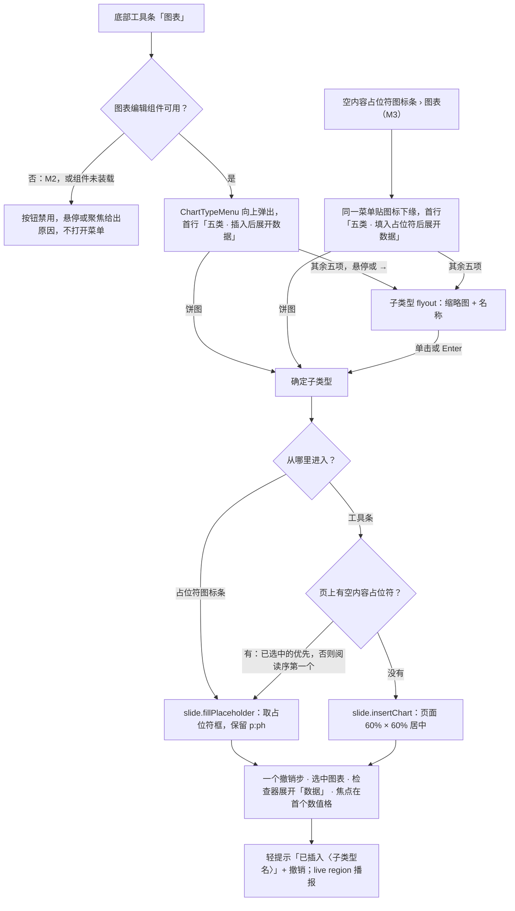
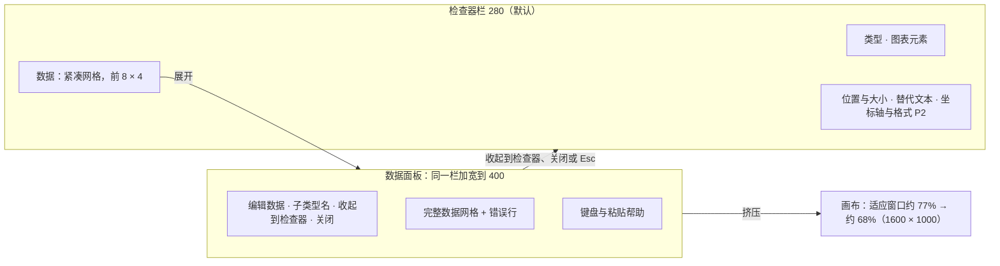
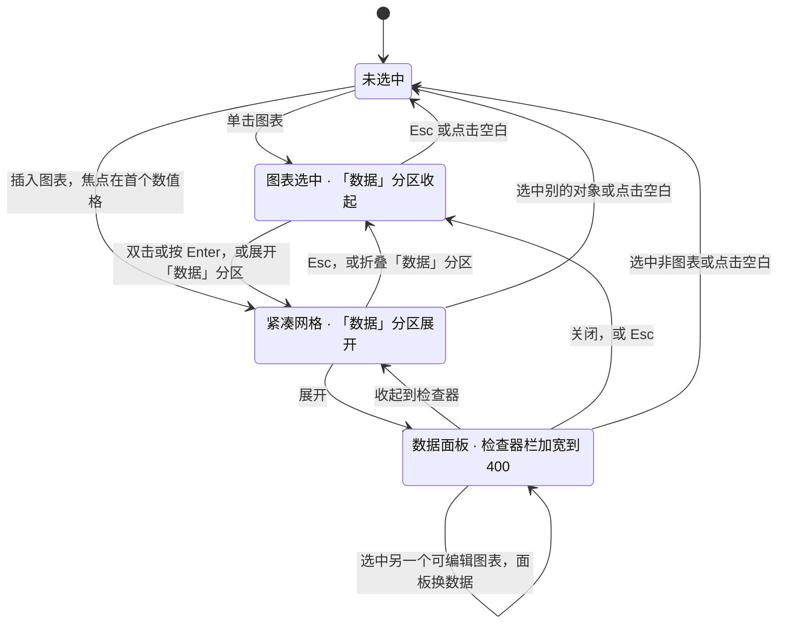
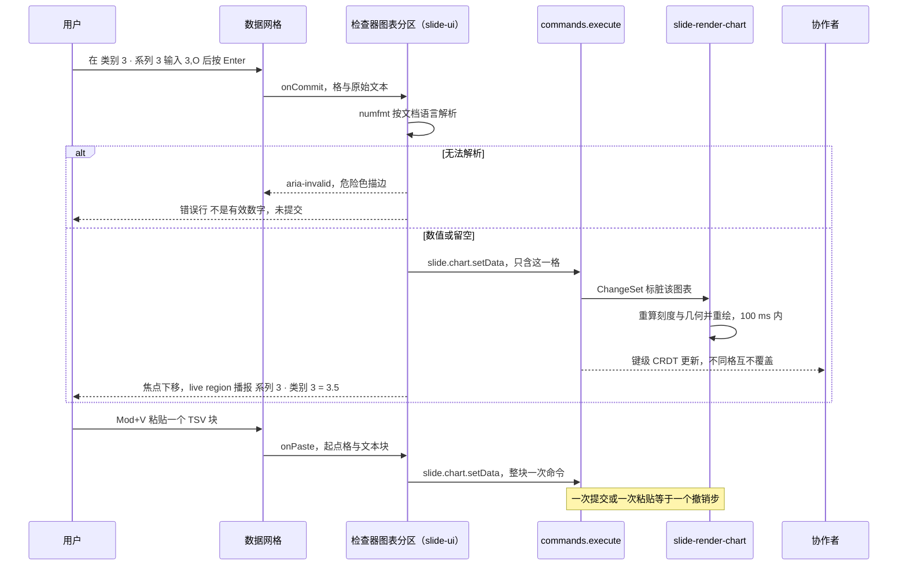
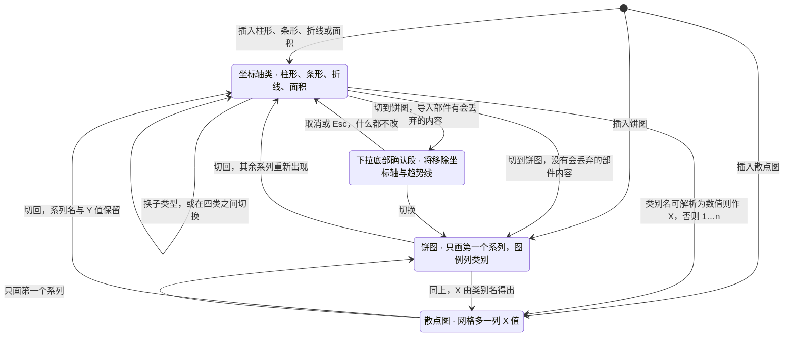

> 状态：草稿 | 负责：设计 | 更新：2026-09-30（§4.21 剩余缺口样张回写：新建，覆盖 G-63——图表 ▾ 六项菜单与子类型 flyout、示例数据、插入后自动打开数据面板、迷你工具条、数据面板与数据网格、更改类型、标题 / 图例 / 数据标签、饼图百分比标签、只读类型与 M2 禁用原因；样张经主会话抽查，最终以用户确认为准）；2026-09-30（§4.21 剩余缺口样张回写 · 整合：「编辑、增删与粘贴」的撤销粒度注明 50/18 §11 已统一）；2026-09-30（§4.21 剩余缺口样张回写 · 复核修正：如实登记样张的只读角色、P2 分区禁用实现、演示说明卡、交互时才出的 toast 与替代文本差异（「待决与取舍」第 12、16、17 条）；他人删除类别或系列改为「恢复」；插入落点与 03-30 合并为一条；帮助卡与圆角按样张 token 更正）；2026-09-30（§4.22 设计待决收口：数据面板定为检查器坞加宽到 440，入口拆为「编辑数据」直开面板、双击只展开数据分区；迷你工具条改画在屏幕覆盖层、12px；「更改类型 ▾」与插入菜单共用 `ChartTypeMenu`；类型切换确认条两种形态；只读类型改为双击时 toast；P2 分区定原因文案与 `aria-disabled`；图例补「右上」；饼图网格列出全部系列、第二列起变淡；行列右键菜单、紧凑网格截断、原工作簿提示、占位符 › 图表、M2 选中导入图表都已出样张；插入落点按用户裁决 Q1 填入空内容占位符；粘贴自动扩展、数字解析、新图表缺口、协同删除类别或系列定稿；状态清单改为 15 个演示态；待决只留推迟项）；2026-09-30（§4.22 整合：待决补「待用户确认的样张取舍」一行，检查器长度单位指向 rulings §4.22 SR-4）；2026-09-30（§4.22 复核修正：图表菜单焦点归还改为「选过类型才不归还」，三处入口未选类型关闭时回到各自触发按钮；占位符入口补下方放不下时上翻；紧凑网格系列表头补窄列规则；只读角色的输入框 `aria-disabled` + tooltip；落点补「已选中的空占位符优先」；状态清单注明饼图说明行需下滚；文首待决说明更正）；2026-10-07（design-language-v3 第 1 批：按已拍板的 chart 场景 16 个状态整篇改写——设计基准改为 v3 样张 `#/v3/editor?state=chart.*`；新增「入口与原入口去向」（入口改为工具条「图表」、占位符图标条与检查器，不设图表迷你工具条，DS-1、DS-22）；「线框：工具条『图表』菜单」（三处共用 `ChartTypeMenu`：工具条向上居中、占位符贴图标下缘、「类型」字段在检查器左侧，首行说明去掉 M3 标记）、「线框：插入后」（检查器六节：类型 / 图表元素 / 数据 / 位置与大小 / 替代文本 / 坐标轴与格式 P2；双击只展开「数据」分区）、「线框：数据面板」（检查器栏 280 → 400 整栏替换、标题行「收起到检查器」「关闭」、Esc 逐层、非法输入就地标出，DS-26；窄屏底部 Sheet 按 `narrow.compact-chart-data` 写入，DF-07 结案，DS-17）、「数据网格」（v3 token、紧凑列宽按 280 栏重算、饼图未画系列改用次要色，DS-9；只读无菜单，DS-15）、「更改图表类型」（「类型」字段即下拉，确认合为下拉底部一种）、「标题、图例与数据标签」（「图表元素」三个复选）、「只读类型」「未开放、只读角色与其它模式」（M2、评审条与查看者的只读展示，DS-15、DS-23）各节按样张改写，线框按 v3 外壳重画，删去状态栏与迷你工具条；原「状态清单」改为「状态」一节（16 个状态 + 相关情形）；「待决与取舍」复核 §4.22 各条（1、2、3、4、7、16 按 DS-22、DS-26 修订），新增「样张与既有口径的差异」11 条；依据 rulings §4.25 DS-1、DS-6、DS-9、DS-13、DS-15、DS-17、DS-21…DS-26）；2026-10-07（design-language-v3 第 1 批：「更改图表类型」与「待决与取舍」的类型切换确认合为「类型」下拉底部一种，已补登（TB-11）；「线框：工具条『图表』菜单」「插入反馈」与「状态」的菜单首行改为「插入后展开数据」「填入占位符后展开数据」，插入轻提示说明改为「示例数据已写入，已展开数据」（TB-12）；「范围与里程碑」「检查器」「只读类型」「未开放、只读角色与其它模式」「状态」补 M2 起非五类图表显示「此类型仅支持查看」说明卡（TB-13）；「位置与大小」与曾待确认的第 19 条单位按 DS-27 结案；「边界情况」补他人删除类别或系列的轻提示位置；「窄屏：底部 Sheet」补层级 `--layer-panel`（TB-2）；「画布：选中框与双击」补 `toolbar.<selectionKind>` 槽位删除（TB-29）与 M2 双击行为（TB-13）；新增「裁决对样张的改动」表；依据 rulings §4.25 DS-27、TB-2、TB-11、TB-12、TB-13、TB-29）；2026-10-08（design-language-v3 第 1 批收口：样张的菜单首行与插入轻提示已按 TB-12 改为「插入后展开数据」「填入占位符后展开数据」「示例数据已写入，已展开数据」，删去「插入反馈」与「状态」第 3 行的「样张仍写……」，「裁决对样张的改动」TB-12 行改为已改；「状态」开头：capture-screens 第 31 条已改登记 v3 路由与 16 个状态；推迟项 13e 措辞改为已与第 1 批其余样张一起拍板；依据 rulings §4.25 TB-12）；2026-10-08（design-language-v3 第 1 批评审修改：只改控件画法——检查器「类型」字段注明下拉画法（透明底加细边，rulings §4.25 DS-35，原「03-02 字段外观」的说法作废），「数据」分区的「展开」为透明底加细边的次按钮（DS-37））；2026-10-15（design-language-v3 第 2 批：「数据面板」形态补检查器被拖宽时的宽度规则 max(400, 检查器当前宽度)、开着时分隔条不可拖，rulings §4.25 TB-60） | 依赖：charter v0.2；`10-prd/07-design-coverage-and-gaps.md` G-63；PRD [02 编辑](../../10-prd/03-features/02-editing.md) ED-15、ED-15a；前端 [50/24](../../50-frontend/24-elements-tables-and-charts.md) §3–§4、[50/10](../../50-frontend/10-editor-shell-and-interaction.md) §4–§5、[50/18](../../50-frontend/18-editor-capabilities.md) §11、[50/17](../../50-frontend/17-reuse-and-dependency-catalog.md) §7、[50/21](../../50-frontend/21-elements-structure.md) §3；[ADR-0036](../../30-architecture/adr/0036-chart-rendering-and-editing.md)、[ADR-0018](../../30-architecture/adr/0018-editor-element-model-and-insert-commands.md)；playground `#/v3/editor?state=chart.*`（v3 样张；旧路由 `#/editor/chart` 随 DS-7 删除）；rulings §4.21（q-chart-route、R-d-34、R-d-35、R-d-72、R-d-74）、§4.20 FE-06（禁用而不隐藏）；rulings §4.22（Q1、SF-09…SF-13、D-11…D-21、DF-05…DF-07）、§4.25（DS-1、DS-6、DS-9、DS-13、DS-15、DS-17、DS-21…DS-27、DS-35、DS-37、TB-2、TB-11…TB-13、TB-29）

# 03-31 图表编辑

> **设计基准（2026-10-07 起，rulings §4.25 DS-21）**：以 playground v3 样张为准——路由 `#/v3/editor?state=chart.<状态 id>`（16 个状态，见「状态」；窄屏底部 Sheet 为 `narrow.compact-chart-data`），源码 `playground/src/v3/scenarios/chart/`（`ChartTypeMenu.tsx`、`inspector.tsx`、`DataPanel.tsx`、`DataGrid.tsx`、`overlays.tsx`、`store.ts`、`model.ts`），对照截图 `openspec/changes/design-language-v3/screens/batch1/chart-data-panel-{dark,light}.jpg`。外壳（左栏 240、画布与备注、底部工具条、检查器 280、轻提示落点）以 [03-02](02-editor-main.md) 为准，token 与控件以设计 [04](../04-design-system.md)、[09](../09-design-specification.md) 为准，本文只写图表。ribbon 版旧稿（`#/editor/chart`，`playground/src/routes/editor/ChartEditing.tsx`）随 DS-7 删除，其中的插入页签「图表 ▾」大按钮、图表迷你工具条、加宽到 440 的检查器坞与状态栏反馈均已作废（DS-1、DS-6、DS-22、DS-26），去向见「入口与原入口去向」。行为口径与前端 50/24 §3 一致，视觉与文案以本文为准（设计稿是文案权威）。

覆盖缺口 **G-63**（PRD ED-15a 插入图表、ED-15 图表数据编辑，均 M3 P1）。「图表」在底部工具条中的位置与插入入口总表见 [03-04](04-insert-menu.md)，本文从点开工具条「图表」写起：插入、检查器的图表分区、数据面板与数据网格、换类型、标题图例与数据标签，以及不可编辑类型、未开放和只读角色时的样子。模型、命令、渲染与协同的事实源是 [50/24](../../50-frontend/24-elements-tables-and-charts.md) 与 [ADR-0036](../../30-architecture/adr/0036-chart-rendering-and-editing.md)，本文只写界面，并在「与模型和渲染的对应」一节列出每个控件落到哪条命令、哪个字段。空内容占位符图标条的通用规格见 [03-16](16-text-editing-and-formatting.md)（G-80），渲染器未加载与 chartex 的降级占位见 [03-13](13-import-progress-and-degraded-states.md)。

---

## 范围与里程碑

| 里程碑 | 用户能做什么 | 界面表现 |
|---|---|---|
| M1 | 导入的图表按部件数据只读渲染（OF-09） | 渲染器未加载时按 03-13 画降级占位 |
| M2 | 整体选中、移动、缩放、删除、复制；改替代文本 | 工具条「图表」与占位符图标条的图表图标**禁用而不隐藏**并给原因（下表）；选中导入的五类图表时检查器只有「类型」（标 M3，只读显示类型与系列数）、「位置与大小」、「替代文本」三节（50/10 §5；状态 `m2-disabled`）；导入的非五类图表 M2 起即显示「此类型仅支持查看」说明卡（rulings §4.25 TB-13，见「只读类型」） |
| M3（P1） | 插入五类图表；编辑数据；换类型与子类型；标题、图例、数据标签 | 本文全部界面 |
| P2 | 坐标轴范围、数字格式、趋势线、误差线；图表内子元素（系列、数据点、标题、图例）单独选中与设格式 | 检查器末尾「坐标轴与格式」一行灰显 + P2 标记，不可展开 |

**可编辑的五类**：柱形 / 条形（同一类 `bar`，方向不同）、折线、饼、面积、散点（U-06、ED-15）。菜单按 PowerPoint 习惯把柱形与条形分成两项，所以是「六项、五类」。

**只读的其它类型**：气泡、雷达、股价、组合、3D、曲面、环形、带次坐标轴或缓存不全的图表，以及 chartex（瀑布、直方等）。它们可以选中、移动、缩放、复制、删除；选中时检查器显示「此类型仅支持查看」说明卡，双击或按 Enter 时弹同名轻提示，M2 起即如此（TB-13，见「只读类型」）。插入菜单与类型切换都不列这些类型：它们不是「以后开放」的条目，而是不提供插入（ED-15a），与 03-04「非目标不出现入口」一致（PRD G-63 随 §4.22 改为「其余类型不列入（ED-15a）；导入的非五类图表选中时显示『此类型仅支持查看』」）；「禁用而不隐藏」只用于有里程碑的条目（M3、P2、M4+ 都禁用显示并给原因）。

**禁用原因（样张原文）**

| 条目 | 标记 | 原因文案（工具提示） |
|---|---|---|
| 工具条「图表」（M2，或 M3 起图表编辑组件未装载） | 无（工具条按钮不挂标记） | 插入图表在 M3 提供：需要装载图表编辑组件。文稿里已有的图表照常查看、放映、移动和缩放。 |
| 空内容占位符图标条 › 图表（M2） | M3（名称旁） | 图表插入在 M3 提供：随图表编辑组件一起开放。文稿里已有的图表照常查看和放映。 |
| 检查器 › 坐标轴与格式 | P2 | 坐标轴范围、数字格式、趋势线与误差线排在后续版本（P2）；导入文件里已有的设置原样保留。 |

禁用控件一律 `aria-disabled`（仍可聚焦与悬停，工具提示可达），文字与图标退到 `--v3-text-3`（不用半透明），里程碑标记不变淡（rulings §4.20 FE-06）：

- **工具条「图表」**：读屏名「图表（〈原因〉）」；工具提示写作「图表 · 〈原因〉」，按句分三行（「图表 · 插入图表在 M3 提供：」「需要装载图表编辑组件。」「文稿里已有的图表照常查看、放映、移动和缩放。」）；点按无动作、不打开菜单。
- **占位符图标条 › 图表**：读屏名「插入图表到占位符（M3 提供）」，工具提示在图标下方、按句换行（03-16）。
- **坐标轴与格式**：不可展开的标题行，`aria-disabled`、`aria-expanded="false"`、可聚焦；标题文字与 chevron 为 `--v3-text-3`，P2 标记原色；读屏名「坐标轴与格式（P2）」；悬停或聚焦时工具提示在左侧、按句分三行。评审与查看时这一行不出现（只读展示只列属性当前值，DS-15）。
- **启用条件**：`enablement: slide.hasChartEditor`（50/10 §4），M2 与组件未装载两种情况共用第一条文案；主菜单「插入 › 图表…」与命令面板绑定同一命令、同一启用条件（禁用态样张未画，随 03-04）。

---

## 入口与原入口去向

v3 按 DS-1 把图表的入口分成「创建在工具条、属性在检查器」两处，画布上不设图表迷你工具条（DS-22）：

| 做什么 | 常驻入口 | 次入口 |
|---|---|---|
| 插入图表 | 底部工具条「图表」→ `ChartTypeMenu`（状态 `menu`） | 空内容占位符图标条 › 图表（`placeholder-chart`）；主菜单「插入 › 图表…」与命令面板（03-04、03-02，样张未画落点） |
| 编辑数据 | 检查器「数据」分区：紧凑网格，「展开」打开数据面板（`data-panel`） | 双击图表或图表聚焦时按 Enter：只展开「数据」分区、焦点到首个数值格 |
| 更改类型与子类型 | 检查器「类型」字段即下拉，打开同一个 `ChartTypeMenu`（`type-menu`） | — |
| 标题、图例、数据标签 | 检查器「图表元素」节（`options`） | — |
| 移动、缩放、删除、复制、替代文本 | 画布选中框与通用快捷键；检查器「位置与大小」「替代文本」 | 右键（03-05） |

**原入口去向**（左列均为 ribbon 版旧稿的入口，已作废）

| 原入口 | v3 落点 | 依据 |
|---|---|---|
| 插入页签「图表 ▾」大按钮（56 × 60，右上 M3 标记；所在 Ribbon 已作废） | 底部工具条「图表」（36 工具按钮，`ChartColumn` 图标，不设单键）；M2 时禁用、不挂标记 | DS-1、DS-11 |
| 迷你工具条「编辑数据」（已作废） | 「数据」分区的「展开」 | DS-22、DS-26 |
| 迷你工具条「更改类型 ▾」（已作废） | 「类型」字段的下拉 | DS-22 |
| 检查器「图表」分区的六个类别按钮与子类型缩略图（已作废） | 并入「类型」字段的下拉（同一个 `ChartTypeMenu`） | DS-22；DS-21 样张 |
| 检查器「图表」分区的标题、图例、数据标签三个开关（已作废） | 「图表元素」节的三个复选 | DS-21 样张 |
| 数据面板：检查器坞由 300 加宽到 440（已作废） | 检查器栏由 280 加宽到 400、整栏换成完整网格 | DS-26 |
| 类型切换确认条的「检查器内联」形态（已作废） | 只剩「类型」下拉底部的确认段 | DS-21 样张 |
| 状态栏里的插入、重绘与只读提示（状态栏已作废） | 轻提示与读屏 live region | DS-6 |
| 评审模式下替换 Ribbon 的只读细条「评审模式下不可编辑图表」（已作废） | 评审条替换底部工具条，检查器顶部一行权限说明、各节只读展示 | DS-15、DS-23 |

---

## 线框：工具条「图表」菜单与子类型 flyout

状态 `menu`（1600 × 1000，第 5 页「区域分布」，「标题和内容」版式的正文占位符为空；画布下部）：

```
  ┏ 正文占位符 · 悬停框（强调色）：新图表将填入这里 ━━━━━━━━━━━━━━━━━━━┓
  ┃ • 单击此处添加文本                                                 ┃
  ┃                                                                    ┃
  ┃            [▦ 表格]  [▨ 图片]  [▥ 图表]  [▶ 视频 P2]               ┃
  ┃                 单击图标插入，或把图片拖到这里                     ┃
  ┗━━━━━━━━━━━━━━━━━━━━━━━━━━━━━━━━━━━━━━━━━━━━━━━━━━━━━━━━━━━━━━━━━━━━┛
                            ┌──────────────────────────────┐
                            │ 五类 · 插入后展开数据        │ ┌──────────────────────────────────────────┐
                            │ ▥ 柱形图                  ›  │ │ 柱形图                                   │
                            │ ☰ 条形图                  ›  │ │ ┌────────┐   ┌────────┐   ┌────────┐     │
                            │ ⟋ 折线图                  ›  │ │ │▌▌▌ ▌▌▌ │   │▆▆ ▆▆ ▆▆│   │██ ██ ██│     │
                            │ ◔ 饼图                       │ │ └────────┘   └────────┘   └────────┘     │
                            │ ◭ 面积图                  ›  │ │ 簇状柱形图   堆积柱形图   百分比堆积     │
                            │ ⁘ 散点图                  ›  │ │                           柱形图         │
                            └──────────────────────────────┘ └──────────────────────────────────────────┘
                                            ↕ 距工具条外沿 8（距按钮 13）
         ╭────────────────────────────────────────────────╮
         │ [选择][文本][形状][图片][表格][图表●][评论][+] │
         ╰────────────────────────────────────────────────╯
```

（字符只是示意；菜单图标为 Lucide 的 ChartColumn、ChartBar、ChartLine、ChartPie、ChartArea、ChartScatter，缩略图是用示例数据画出的真实子类型图形；占位符外的粗框是菜单开着时的悬停框，标出新图表将填入的位置，样张为 1px 强调色线、不带文字。检查器此时显示无选中的幻灯片属性。）

### 三处入口共用 `ChartTypeMenu`

同一个组件三处使用，只换锚点、首行说明与弹出方向；首行说明不挂里程碑标记（标记只用于还没开放的入口），插入类两处写「展开数据」而不是「打开数据面板」（rulings §4.25 TB-12：「数据面板」只指加宽到 400 的面板，见「插入反馈」）。

| 入口 | 首行说明 | 位置与按下态 | 选定后 | 关闭后焦点 |
|---|---|---|---|---|
| 底部工具条「图表」（锚点 `tool-chart`） | 五类 · 插入后展开数据 | 向上、对按钮居中，距工具条外沿 8（距按钮 13）；开着时按钮为强调色底、`aria-expanded`；关闭后工具回到「选择」 | 插入（图 1） | 选过子类型：交给数据网格首个数值格；未选（Esc、再点按钮）：回到「图表」按钮；点外部关闭：不移动 |
| 空内容占位符图标条 › 图表（锚点为图表图标） | 五类 · 填入占位符后展开数据 | 贴图标下缘、左对齐，间距 6；下方放不下时翻到上方（03-16）；开着时图标为按下态、`aria-expanded`，图标条下方的提示语让位 | 填入该占位符（图 1） | 同上，未选时回到图表图标 |
| 检查器「类型」字段（锚点 `chart.type-field`） | 更改类型 · 数据与标题保留 | 在检查器左侧，上沿对齐字段，菜单右缘距检查器 8；子类型 flyout 以画布列为边界翻到菜单左侧，不盖住检查器；当前类别与子类型高亮 | 更改类型（见「更改图表类型」） | 选定或 Esc 都回到「类型」字段；点外部关闭：不移动 |

### 尺寸与外观

| 项 | 规格 |
|---|---|
| 菜单 | 非模态下拉菜单，宽 240；`--v3-panel` 实底、1px `--v3-border`、圆角 8、内边距 4、`--v3-shadow`（与 03-02 菜单面板同一套）；首行说明 12px `--v3-text-2`、`role="note"`、不可选 |
| 菜单项 | 六项，高 28、圆角 4、12px：左侧 16 图标（`--v3-text-2`）+ 名称；有子类型的五项右侧 12px `›`；饼图只有一个子类型，点击直接选定、不出 flyout；悬停与键盘高亮为 `--v3-panel-2` 底，子菜单打开时同色 |
| 子类型 flyout | 贴菜单一侧、间距 6，标题行与所属菜单项对齐；内边距 8；首行类名（12px `--v3-text-2`）；下面一行横排子类型格 |
| 子类型格 | 宽 92、圆角 6、内边距 6：72 × 48 缩略图（白底、1px `--v3-swatch-line` 内描边、圆角 4）+ 12px 名称（居中；名称区固定两行高，按词换行，如「百分比堆积 / 柱形图」「带数据标记的 / 折线图」）；悬停与键盘高亮为 `--v3-panel-2` 底 |
| 缩略图 | 去掉标题、坐标轴与文字，只留图形；系列色取文档主题 accent1–6（幻灯片内容色，亮暗界面下不变） |
| 当前项（只在「类型」字段打开时） | 当前类别的图标着强调色、名称 500 字重（饼图为当前时整项高亮）；flyout 里当前子类型格 `--v3-accent-soft` 底 + 1px 强调色内描边；都带 `aria-current` |
| 底部插槽 | 只在「类型」字段打开、选了会丢弃导入内容的子类型时出现：分隔线下的确认段（见「更改图表类型」） |

### 六项与子类型

| 菜单项 | 子类型（名称即工具提示与读屏名） | 写入 `ChartData`（50/24 §3.4） |
|---|---|---|
| 柱形图 | 簇状柱形图、堆积柱形图、百分比堆积柱形图 | `type: 'bar'`、`barDir: 'col'`，`grouping` 依次为 clustered / stacked / percentStacked |
| 条形图 | 簇状条形图、堆积条形图、百分比堆积条形图 | `type: 'bar'`、`barDir: 'bar'`，`grouping` 同上 |
| 折线图 | 折线图、带数据标记的折线图、堆积折线图 | `type: 'line'`；`marker` 为 false / true；堆积为 `grouping: 'stacked'` |
| 饼图 | 饼图（唯一子类型） | `type: 'pie'` |
| 面积图 | 面积图、堆积面积图、百分比堆积面积图 | `type: 'area'`，`grouping` 依次为 standard / stacked / percentStacked |
| 散点图 | 仅带数据标记的散点图、带平滑线和数据标记的散点图 | `type: 'scatter'`，`scatterStyle` 为 marker / smoothMarker |

### 示例数据与默认外观

| 项 | 默认（50/24 §3.3） |
|---|---|
| 外框 | 页上有空的内容占位符（`obj` 或 `chart`）时填入阅读序第一个（已选中的空占位符优先）：取该占位符框并保留 `p:ph`（`slide.fillPlaceholder`，用户裁决 2026-09-30 Q1；样张为「标题和内容」版式的正文框，X 67、Y 163、宽 826、高 312 pt）；没有空占位符时取页面 60% × 60% 居中；从占位符图标条进入时填入该占位符 |
| 数据 | 柱形、条形、折线、面积：类别 1–4 × 系列 1–3（系列 1：4.3、2.5、3.5、4.5；系列 2：2.4、4.4、1.8、2.8；系列 3：2、2、3、5）；饼：类别 1–4，系列 1：8.2、3.2、1.4、1.2；散点：点 1–3，X 0.7、1.8、2.6，Y 2.7、3.2、0.8 |
| 名称 | 「类别 {n}」「系列 {n}」「点 {n}」走 i18n 文案键，随界面语言 |
| 外观 | 标题显示「图表标题」、图例在底部、无数据标签；系列色写主题引用 accent1…accent6，第 7 个起按亮度派生（每 6 个一轮，依次叠加 `lumMod` / `lumOff`，同 PowerPoint 默认图表样式），字体取主题次要字体；空值按缺口画，导出写 `c:dispBlanksAs val="gap"`（同 PowerPoint 新建图表） |

**图 1 插入流程**



怎么读：未开放时菜单根本打不开，只给原因；开放后两条入口（工具条、占位符图标条）共用同一个六项菜单与 flyout（`ChartTypeMenu`），差别只在首行说明、弹出方向与落点：从工具条插入时，页上有空内容占位符就填进去（已选中的空占位符优先，否则阅读序第一个；菜单开着时悬停框标出这个位置），不想放进占位符可以再拖出；从占位符图标条进入时直接填入该占位符。插入与示例数据是一个撤销步，随后展开检查器「数据」分区是视图操作、不入历史（50/24 §3.3）。点菜单项即插入，不经插入工具态（不拖出绘制，03-04）。
依据：rulings §4.22 Q1（插入落点）、SF-13（三处共用 `ChartTypeMenu`）；rulings §4.25 DS-1、DS-6、TB-12；样张 `chart.menu`、`chart.placeholder-chart`、`chart.inserted`。

**插入反馈**：轻提示（画布列底部居中、工具条上方 12，03-02）标题「已插入〈子类型名〉」，说明「示例数据已写入，已展开数据」，操作「撤销」（撤销回到插入前，样张回到空占位符）；读屏 live region 播报「已插入〈子类型名〉」。插入后展开的是检查器「数据」分区（紧凑网格），不是加宽到 400 的数据面板（50/24 §3.3、50/10 §7.4）；按 rulings §4.25 TB-12，「数据面板」只指 DS-26 的 400 宽面板，所以轻提示与菜单首行都写「展开数据」（样张与 50/24 已按此改）。

---

## 线框：插入后（示例图表 + 检查器）

状态 `inserted`（默认态）：

```
←─ 240 ────────────→←─ 画布（1600 × 1000 下宽 1080） ────────────────────────→←─ 检查器 280 ─────────────────────→
┌──────────────────┬──────────────────────────────────────────────────────────┬──────────────────────────────────┐
│ [▣▾]      [▭][▦] │                                                          │ (周)(王)(李)          ▶ [分享]   │
│ 2026 年 Q2 业绩…▾│  ┌────────────────────────────────────────────────────┐  ├──────────────────────────────────┤
│ ✓ 已同步         │  │ 区域分布                                           │  │ [设计]  评论              77% ▾  │
│ [新建幻灯片 ▾][+]│  │ ▔▔                                                 │  ├──────────────────────────────────┤
│                  │  │ ■───────────────────────■────────────────────────■ │  │ 图表  4 类别 × 3 系列            │
│ 4 ┌───────────┐  │  │ │                   图表标题                     │ │  ├──────────────────────────────────┤
│   │ 营收趋势  │  │  │ │  5 ┤ ▌               ▌                ▌        │ │  │ 类型                             │
│   └───────────┘  │  │ ■    ┤ ▌▌▌    ▌▌▌     ▌▌▌     ▌▌▌                ■ │  │ [▥ 簇状柱形图               ▾]   │
│▌5 ┏━━━━━━━━━━━┓  │  │ │  0 ┴──────────────────────────────────────     │ │  ├──────────────────────────────────┤
│▌  ┃ 区域分布  ┃  │  │ │      类别 1   类别 2   类别 3   类别 4         │ │  │ 图表元素                         │
│▌  ┗━━━━━━━━━━━┛  │  │ │        ■ 系列 1  ■ 系列 2  ■ 系列 3            │ │  │ ☑ 标题                           │
│ 6 ┌───────────┐  │  │ ■───────────────────────■────────────────────────■ │  │ [图表标题                    ]   │
│   │ 下半年计划│  │  │ 2026 年 Q2 业绩汇报                             5  │  │ ☑ 图例           [底部      ▾]   │
│   └───────────┘  │  └────────────────────────────────────────────────────┘  │ ☐ 数据标签                       │
│                  │                           ════                           ├──────────────────────────────────┤
│                  │  ┌────────────────────────────────────────────────────┐  │ 数据                         ˅   │
│                  │  │ 添加演讲者备注…                                    │  │ ┌──────┬──────┬──────┬──────┬─┐  │
│                  │  │        ┌──────────────────────────────────┐        │  │ │类别  │■系列1│■系列2│■系列3│+│  │
│                  │  │        │ 已插入簇状柱形图            撤销 │        │  │ │类别 1│[ 4.3]│   2.4│     2│ │  │
│                  │  │        │ 示例数据已写入，已展开数据       │        │  │ │类别 2│   2.5│   4.4│     2│ │  │
│                  │  │        └──────────────────────────────────┘        │  │ │类别 3│   3.5│   1.8│     3│ │  │
│                  │  └────────────────────────────────────────────────────┘  │ │类别 4│   4.5│   2.8│     5│ │  │
│                  │     ╭───────────────────────────────────────────────╮    │ │+ 新增类别                   │  │
│                  │     │ [选择][文本][形状][图片][表格][图表][评论][+] │    │ └─────────────────────────────┘  │
│                  │     ╰───────────────────────────────────────────────╯    │ 行 = 类别 · 列 = 系列 [⤢ 展开]   │
│                  │                                                          ├──────────────────────────────────┤
│                  │                                                          │ 位置与大小                       │
│                  │                                                          │ [X  67 pt] [Y 163 pt]            │
│                  │                                                          │ [W 826 pt] [H 312 pt] [锁]       │
│                  │                                                          │ 图表不旋转、不翻转               │
│                  │                                                          ├──────────────────────────────────┤
│                  │                                                          │ 替代文本                     ›   │
│                  │                                                          ├──────────────────────────────────┤
│                  │                                                          │ 坐标轴与格式 [P2]（灰）      ›   │
└──────────────────┴──────────────────────────────────────────────────────────┴──────────────────────────────────┘
```

图例：`▌` 当前页；`■` 缩放手柄（8 个，无旋转手柄）；`[ 4.3]` 焦点格（2px 强调色内描边）；`[锁]` 锁定比例；`˅` / `›` 分区展开 / 收起；轻提示叠在备注区之上、工具条上方 12。

### 画布：选中框与双击

| 部件 | 规格 |
|---|---|
| 选中框 | 1px 强调色线 + 8 个缩放手柄，**没有旋转手柄**（graphicFrame 不旋转、不翻转，50/24 §3.6）；选中框与参考线都用强调色（DS-24）；拖动移动、缩放是通用变换 |
| 迷你工具条 | 不设（DS-22）：「编辑数据」在「数据」分区的「展开」，「更改类型」在「类型」字段；`ui.toolbar` 的 `toolbar.<selectionKind>` 槽位一并删除，插件针对图表的命令改走 `ui.inspectorSection` 与右键（rulings §4.25 TB-29） |
| 双击 / Enter | 双击图表（或图表聚焦时按 Enter）只展开检查器「数据」分区、焦点落到首个数值格（50/24 §3.6），结果同 `inserted`（没有轻提示）；不打开数据面板。只读类型改为弹轻提示（见「只读类型」，M2 起即如此，TB-13）；M2 时五类图表无动作 |
| 评审、查看 | 选中框只画 1px 强调色线、不画手柄；双击与 Enter 不展开「数据」分区（只读类型仍弹「此类型仅支持查看」轻提示） |

### 检查器（`selectionKind: chart`）

面板标题「图表」+ 12px `--v3-text-2` 摘要：可编辑五类为「N 类别 × M 系列」，只读类型为「〈类型名〉 · 仅支持查看」（M2 起同此，TB-13），M2 的五类图表为「导入的〈子类型名〉」。其下按顺序排列六节（`ui.inspectorSection`，样张分区 id `chart.type`、`chart.elements`、`chart.data`、`chart.position`、`chart.alt`、`chart.axes`，`order` 10…60；50/10 §5、50/24 §3.7）；M3 起节标题不挂 M3 标记。

| 节 | 内容与规格 | 默认 | 里程碑 |
|---|---|---|---|
| 类型 | 一个下拉字段（高 28，03-02 §3.5 的下拉画法：透明底加 1px 细边，悬停与打开时铺 `--v3-panel-2`，rulings §4.25 DS-35）：左侧当前类别图标（`--v3-text-2`）+ 子类型名 + ▾；点开即 `ChartTypeMenu`（见「更改图表类型」） | 常显 | M3 P1 |
| 图表元素 | 「标题」复选 + 下一行标题文字输入；「图例」复选 + 同一行右侧位置下拉（宽 104）；「数据标签」复选；饼图且数据标签勾选时，下面再缩进一行三个复选（见「标题、图例与数据标签」） | 常显 | M3 P1 |
| 数据 | 可折叠（标题行右端 chevron，`aria-expanded`）：原工作簿提示（有时，见「数据面板」）、紧凑数据网格（见「数据网格」）、网格下一行左说明右按钮——说明 12px `--v3-text-2`，平时「行 = 类别 · 列 = 系列」；按钮「展开」（次按钮：透明底加 1px 细边，rulings §4.25 DS-37；高 28，Maximize2 图标）打开数据面板。超过 8 行或 4 列时只显示前 8 × 4、截断方向不出「+」，说明行改为「共 N 类别 × M 系列 · 此处显示前 8 × 4」（窄栏里只在「·」处换行），其余在数据面板里编辑（50/24 §3.7）；饼图有多个系列时说明行再接「· 饼图只画第一个系列」 | 插入后、双击或 Enter 后展开；其余收起 | M3 P1 |
| 位置与大小 | 与形状、图片、表格共用的几何节：X、Y ┊ 宽、高 + 锁定比例按钮；没有旋转与翻转一行，节末说明「图表不旋转、不翻转」（12px `--v3-text-2`）；数值按 pt 书写，产品按设置的度量单位显示（rulings §4.25 DS-27，03-23；§4.22 SR-4 结案） | 常显 | M2 |
| 替代文本 | 可折叠：标题输入（占位「例如：各区域季度销售」）+ 描述多行输入（两行，占位「描述：图表要传达的要点」）；两者都空时 12px `--v3-warning`「缺少替代文本：读屏用户无法了解图表内容」 | 可编辑五类收起；只读类型与 M2 展开 | M2 |
| 坐标轴与格式（P2 标记） | 不可展开的标题行（轴范围、数字格式、趋势线、误差线），见「禁用原因」 | 常显 | P2 |

只读类型与 M2 只有三节，见「只读类型」与「未开放、只读角色与其它模式」；评审与查看时各节只读展示，见同一节。

---

## 线框：数据面板（展开，DS-26）

状态 `data-panel`（1600 × 1000）：

```
←─ 240 ────────────→←─ 画布 960（适应窗口约 68%） ───────────────────→←─ 数据面板 400（检查器栏加宽） ───────────→
┌──────────────────┬──────────────────────────────────────────────────┬──────────────────────────────────────────┐
│ [▣▾]      [▭][▦] │                                                  │ (周)(王)(李)                   ▶ [分享]  │
│ 2026 年 Q2 业绩…▾│  （按新数据重绘；图表始终可见）                  │ 编辑数据                        [⤡] [✕]  │
│ ✓ 已同步         │  ┌────────────────────────────────────────────┐  │ 簇状柱形图                               │
│ [新建幻灯片 ▾][+]│  │ 区域分布                                   │  ├──────────────────────────────────────────┤
│                  │  │ ▔▔                                         │  │ ┌───────┬───────┬───────┬───────┬──┐     │
│▌5 ┏━━━━━━━━━━━┓  │  │ ■───────────────────■────────────────────■ │  │ │类别   │■ 系列1│■ 系列2│■ 系列3│ +│     │
│▌  ┃ 区域分布  ┃  │  │ │              图表标题                  │ │  │ │类别 1 │    4.3│    2.4│      2│  │     │
│▌  ┗━━━━━━━━━━━┛  │  │ │  5 ┤ ▌           ▌             ▌       │ │  │ │类别 2 │    3.8│    4.4│      2│  │     │
│                  │  │ ■    ┤ ▌▌▌   ▌▌▌   ▌▌▌   ▌▌▌             ■ │  │ │类别 3 │    3.5│    1.8│[  3,O]│  │←非法│
│                  │  │ │  0 ┴──────────────────────────────     │ │  │ │类别 4 │    4.5│    2.8│      5│  │     │
│                  │  │ │     类别 1  类别 2  类别 3  类别 4     │ │  │ │+ 新增类别                        │     │
│                  │  │ │      ■ 系列 1  ■ 系列 2  ■ 系列 3      │ │  │ └──────────────────────────────────┘     │
│                  │  │ ■───────────────────■────────────────────■ │  │ (!) 类别 3 · 系列 3：「3,O」不是有效     │
│                  │  │ 2026 年 Q2 业绩汇报                     5  │  │     数字，未提交                         │
│                  │  └────────────────────────────────────────────┘  │                                          │
│                  │                       ════                       │                                          │
│                  │  ┌────────────────────────────────────────────┐  │                                          │
│                  │  │ 添加演讲者备注…                            │  │                                          │
│                  │  │                                            │  │                                          │
│                  │  └────────────────────────────────────────────┘  ├──────────────────────────────────────────┤
│                  │                                                  │ [Enter] 提交并下移  [Tab] 提交并右移     │
│                  │ ╭──────────────────────────────────────────────╮ │ [Esc] 放弃输入                           │
│                  │ │[选择][文本][形状][图片][表格][图表][评论][+] │ │ [F2] 编辑  [⇧F10] 行列菜单               │
│                  │ ╰──────────────────────────────────────────────╯ │ 可从 Excel 或表格复制整块粘贴（一次撤    │
│                  │                                                  │ 销步）；留空表示缺失值；右键类别名或     │
│                  │                                                  │ 系列名可删除、上移或下移（列为左移、     │
│                  │                                                  │ 右移）。                                 │
└──────────────────┴──────────────────────────────────────────────────┴──────────────────────────────────────────┘
```

| 部件 | 规格 |
|---|---|
| 形态（DS-26） | **临时替换检查器栏**：栏宽由 280 加宽到 400（检查器被拖宽过时取 max(400, 检查器当前宽度)，面板开着时检查器分隔条不可拖，关闭后回到原宽；2026-10-15，rulings §4.25 TB-60），整栏换成数据面板，不另开一栏、不浮在画布上（用户未采用「画布下方浮动面板」）；画布相应收窄（1600 宽视口下画布 960，约占 60%），「适应窗口」比例由约 77% 降到约 68%（03-02 的实测口径：幻灯片显示宽 ÷ 1280），图表始终可见 |
| 入口 | 只有检查器「数据」分区的「展开」（DS-22）；双击图表只展开「数据」分区，不打开本面板 |
| 顶行（高 48） | 与检查器同一行：协作者头像组 ·「放映」·「分享」，不随面板变化 |
| 标题行（高 56，下 1px 分隔） | 取代「设计 / 评论」页签行与缩放读数（面板关闭后恢复）：「编辑数据」13px 600；次行 12px `--v3-text-2` 子类型名（超长截断）；右侧两个 28 图标按钮：「收起到检查器」（Minimize2，工具提示同名）、「关闭」（X，工具提示「关闭」+ Esc） |
| 内容区 | 纵向滚动，左右 16、上下 12、间距 12；自上而下：原工作簿提示（有时）、完整数据网格、错误行或说明行、饼图说明（有时） |
| 原工作簿提示 | 导入且带内嵌工作簿的图表首次编辑数据时，面板内容区顶部与检查器「数据」分区顶部各出一条（两处同一状态，`role="status"`；状态 `workbook-notice`）：`--v3-panel-2` 底、圆角 4，Info 图标（`--v3-text-2`）+ 12px「原工作簿里数据区之外的内容（其它工作表、公式）在编辑数据后不保留。」占满一行宽（按词组换行、行首不出现「（」），「知道了」（文字按钮）另起一行靠右；首次提交数据或点「知道了」后两处都不再出（50/24 §3.10）。双击图表只展开数据分区、不经过面板，所以分区顶部也要出 |
| 错误行 | 有非法输入时取代说明行：CircleAlert 图标 + 12px `--v3-danger`「〈类别名〉 · 〈系列名〉：「〈输入〉」不是有效数字，未提交」，`role="alert"`，被非法格的 `aria-describedby` 引用 |
| 说明行 | 无错误时 12px `--v3-text-2`「行 = 类别 · 列 = 系列」 |
| 饼图说明 | 饼图有多个系列时另起一行 12px `--v3-text-2`「饼图只画第一个系列；其余系列保留在数据里，切回其它类型后重新画出。」（按分句换行） |
| 帮助区（贴底，上 1px 分隔） | 键帽行「Enter 提交并下移 · Tab 提交并右移 · Esc 放弃输入 · F2 编辑 · ⇧F10 行列菜单」；说明「可从 Excel 或表格复制整块粘贴（一次撤销步）；留空表示缺失值；右键类别名或系列名可删除、上移或下移（列为左移、右移）。」均为 12px `--v3-text-2` |
| 画布 | 图表保持选中、8 个手柄；每次提交后按新数据重绘（≤ 100 ms，ED-15） |
| 收起与关闭 | 「收起到检查器」：回到 280 的检查器，「数据」分区展开为紧凑网格；「关闭」或 Esc：回到 280 的检查器，「数据」分区收起（50/24 §3.6「关闭面板回到图表选中」）。焦点去向见下 |
| 面板开着时换选中 | 选中另一个可编辑图表：面板跟随换数据（样张只有一张图表，未演示）；选中非图表或点空白：面板收起、检查器按新选区显示（与检查器随选区切换同一规则） |
| 评审、查看 | 不出数据面板（rulings §4.25「被修订的既有口径」§4.22「角色与抽屉」一行） |

**图 2 两种形态：检查器栏 280 与数据面板 400**



怎么读：两种形态显示同一份数据、同一个网格组件，只是尺寸不同；「展开」不另开一栏，而是把检查器栏加宽、整栏换成数据面板（顶部协作行不变），代价是画布缩到约 68%、编辑数据时看不到其余属性节；比起浮在画布下方的面板，编辑时图表始终可见、不被遮挡。
依据：rulings §4.25 DS-26（「编辑数据」临时替换检查器栏，用户未采用「画布下方浮动面板」）；样张 `chart.data-panel`。

**图 3 数据面板的打开与收起**



怎么读：打开、展开、收起都是视图操作（`slide.chart.openDataEditor`，不入历史）；「收起到检查器」保留紧凑网格以便继续改数，「关闭」与 `Esc` 回到只选中图表。`Esc` 逐层生效（下节）；单元格里的输入与提交发生在「紧凑网格」与「数据面板」两个状态内部，见图 4。
依据：rulings §4.25 DS-22、DS-26；50/24 §3.6；样张 `DataPanel.tsx`、`panel-keys.ts`。

### Esc 逐层与焦点

- **数据面板开着时**按 Esc，一次只退一层：① 行列右键菜单开着 → 只关菜单；② 焦点格有未提交的输入（值改过，或是被判非法、还停在格里的文本）→ 放弃本格输入、恢复原值，焦点留在格内；③ 否则关闭数据面板（同「关闭」）。焦点在面板里、在画布上或点过空白之后都关得掉；输入法组合中的 Esc 不处理。
- **紧凑网格**（检查器「数据」分区）里：编辑中的 Esc 同 ②；未在编辑时 Esc 收起「数据」分区、回到图表选中（规格；样张未演示）。
- **焦点**：用户点「展开」打开面板时，焦点交给完整网格的首个数值格（「展开」按钮随检查器一起卸载，焦点不能掉到页面上）；「收起到检查器」后焦点回「展开」按钮，「关闭」或 Esc 后回「数据」分区标题；场景状态里一出现就打开的面板不抢焦点（截图里没有焦点环）。

### 窄屏：底部 Sheet（DS-17）

紧凑窗口（640–1024）里检查器是抽屉，加宽到 400 的数据面板放不下，改为画布底部的 Sheet（rulings §4.22 D-17；样张 `narrow.compact-chart-data`，视口 1000 × 760，随 DS-21 拍板，DF-07 结案）：

```
┌──────────────────────────────────────────────────────────────────────────────────┐
│ ┌──────────────────────────────────────┐    ┌──────────────────────────────────┐ │
│ │ [▤] [▣▾] 2026 年 Q2 业绩汇报 ▾ [▭][▦]│    │ (周)(王)(李)  34% ▾  ▶ [分享] [▥]│ │
│ └──────────────────────────────────────┘    └──────────────────────────────────┘ │
│                                                                                  │
│                     ┌──────────────────────────────────────┐                     │
│                     │ 区域分布                             │                     │
│                     │ ■──────────■─────────■               │                     │
│                     │ ■ 选中的图表（按新数据重绘）         │                     │
│                     │ ■──────────■─────────■               │                     │
│                     └──────────────────────────────────────┘                     │
│                                                                                  │
╭─────────────────────────────────────── ▬▬ ───────────────────────────────────────╮
│ 编辑数据                                                                [⤡] [✕]  │
│ 簇状柱形图                                                                       │
├──────────────────────────────────────────────────────────────────────────────────┤
│ ┌──────────┬────────────────────┬────────────────────┬────────────────────┬───┐  │
│ │类别      │              ■ 华东│              ■ 华北│              ■ 华南│ + │  │
│ │第一季度  │                 4.3│                 3.1│                 2.2│   │  │
│ │…         │                   …│                   …│                   …│   │  │
│ │+ 新增类别                                                                   │  │
│ └─────────────────────────────────────────────────────────────────────────────┘  │
│ 行 = 类别 · 列 = 系列                                                            │
└──────────────────────────────────────────────────────────────────────────────────┘
```

- Sheet 整宽、高 46vh、上沿圆角 12、1px 上边、浮层阴影，**不加遮罩**；顶部居中 40 × 4 把手；层级 `--layer-panel`（30，与紧凑抽屉同一档，rulings §4.25 TB-2，04 §2.11）。幻灯片在 Sheet 之上的区域里适应（样张约 34%），编辑时图表始终可见；底部工具条被 Sheet 盖住，Sheet 开着时让位、关了再出来。
- 标题行与桌面数据面板相同（「编辑数据」+ 子类型名 +「收起到检查器」+「关闭」Esc）；网格就是桌面的完整数据网格，下方说明行；样张的 Sheet 里没有键盘与粘贴帮助区。
- 从检查器抽屉里「数据」分区的「展开」打开：Sheet 取代抽屉里的数据区，抽屉收起；「收起到检查器」重新打开检查器抽屉、「数据」分区展开，焦点回「展开」；「关闭」或 Esc 后抽屉已收起，焦点回右上角「显示检查器」开关。Esc 逐层规则同桌面。
- 小于 640 为仅查看形态，不出任何编辑界面（03-02 窄屏形态）。

---

## 数据网格

产品实现为 @tanstack/react-table 无头表格 + shadcn Table，由 ui-react 封装成通用 `DataGrid`（50/17 §7、ADR-0036 决策 6），视觉按 v3 token。紧凑与完整两种形态是同一组件的两种尺寸。

| 项 | 紧凑（检查器「数据」分区，280 栏） | 完整（数据面板 400 / 窄屏 Sheet） |
|---|---|---|
| 行高 | 28 | 32 |
| 首列（类别） | 58：放得下 4 个汉字（如「第一季度」），更长的以省略号结尾、悬停 `title` 显示全名 | 84 |
| 散点 X 列 | 48 | 72 |
| 系列列 | 均分余宽（网格内宽约 245，3 个系列时每列约 55，「系列 1」这类默认名放得下）；更长的系列名以省略号收尾、悬停 `title` 显示全名 | 最小宽 72；超出面板宽度时容器内横向滚动 |
| 末列「+」（新增系列） | 22 | 28 |
| 显示范围 | 前 8 行 × 4 列，截断方向不出「+」列与「+ 新增类别」行 | 全部行列；超出面板高度时面板内纵向滚动 |

| 项 | 规格 |
|---|---|
| 行列 | 行 = 类别，列 = 系列；散点：首列「点」、第二列「X 值」、其后各系列的 Y 值 |
| 表头行 | `--v3-panel-2` 底；左上角「类别」（散点「点」）12px `--v3-text-2`；其余为系列名（可编辑，500 字重），8 × 8 圆角 2 的系列色块紧贴名字左侧、整体右对齐（与下方数值同一右缘），颜色即该系列在图表中的主题色（第 7 个起按亮度派生）；末列「+」（14 图标，`--v3-text-2`，悬停 `--v3-panel-3`），工具提示「新增系列」 |
| 首列 | 类别名（可编辑，左对齐），`--v3-panel-2` 底 |
| 饼图 | 网格仍列出全部系列；第二列起表头与数值降为 `--v3-text-2`、色块 40% 不透明，不降整列不透明度（保持 AA 对比度，DS-9）；这些表头的工具提示「饼图只画第一个系列；其余系列保留在数据里，切回其它类型后重新画出」（与面板说明行同一句） |
| 数值格 | 右对齐、等宽数字、数字键盘（`inputMode="decimal"`）；空值显示为空白 |
| 末行 | 整行按钮「+ 新增类别」（散点「+ 新增点」），12px `--v3-text-2`，悬停 `--v3-panel-2` 底 |
| 容器 | 1px `--v3-border`、圆角 4；格线 1px `--v3-border` |
| 只读（评审、查看） | 只读表格：不画输入框外形，没有「+」列、「+ 新增类别」与行列菜单（DS-15） |

| 格状态 | 视觉 |
|---|---|
| 默认 | 透明底 |
| 焦点 / 编辑中 | `--v3-panel` 底 + 2px 强调色内描边（插入后首个数值格即此态；系列表头整格同样） |
| 非法输入 | `--v3-danger-soft` 底 + `--v3-danger` 文字 + 2px `--v3-danger` 内描边，`aria-invalid`，不提交；说明在数据面板的错误行（紧凑网格只标格，不出错误行） |
| 缺失值 | 空白；新插入的图表按缺口画（导出写 `c:dispBlanksAs val="gap"`），导入的图表按部件原设置 |
| 行列菜单打开 | 对应的类别格或系列表头格 `--v3-accent-soft` 底 |

### 编辑、增删与粘贴

- **输入**：每格就是输入框，聚焦后直接键入；Enter 或失焦提交，Esc 恢复原值；值没有改动时失焦不算提交，不产生命令。数值按文档语言用 numfmt 严格解析（50/24 §3.6）：文档语言先取图表部件的 `c:lang`，没有时取演示文稿默认语言；千分位分组不合规的（如英语文档里的「1,5」）判非法、不提交，不静默读成 15。留空写 `null`；无法解析的不提交（样张示例「3,O」把 0 打成了字母 O）。网格说明行可以显示当前小数分隔符，样张不补。
- **新增**：点表头末列「+」在末尾追加「系列 N」（值全空）；点末行在末尾追加「类别 N」（各系列值为空；散点追加「点 N」）。新 id 与排序键由命令生成。
- **删除与移动**（状态 `grid-menu`）：在类别格或系列表头格上右键，或聚焦后按 `Shift+F10` / ContextMenu 键，打开行列菜单（与 03-05 右键菜单同一外观，最小宽 184）。首行是对象名（「类别「类别 1」」「系列「系列 2」」，散点「点「点 1」」）；行菜单为 上移 ↑ · 下移 ↓ ┊ 删除类别（散点为删除点），列菜单为 左移 ← · 右移 → ┊ 删除系列，删除项为危险色。到边或只剩一个的项留在原位不可用（`aria-disabled`、可聚焦），右侧写短原因、工具提示同文：「已是第一个 / 最后一个类别（系列）」「图表至少保留一个类别（系列）」。删除写墓碑、可撤销，轻提示「已删除类别「〈名称〉」」（系列同式）带「撤销」；移动只改排序键（50/24 §3.6）。评审与查看时网格只读，不出行列菜单（DS-15）。
- **粘贴**：从 Excel 或表格复制的 TSV 块，以焦点格为左上角整块写入，一次命令、一个撤销步。块超出现有行列时自动新增类别与系列，与粘贴合为同一条命令、同一个撤销步；超过规模上限时整块拒绝并以轻提示说明原因（`setData` 可在同一命令里建类别与系列，50/24 §3.8；同 PowerPoint 数据表）。样张不演示。
- **撤销粒度**：一次提交一个撤销步（50/24 §3.6）；格内键入是网格的本地草稿，不写模型（50/18 §11 已统一）。

| 键 | 作用 |
|---|---|
| 方向键 | 未在编辑时移动焦点格（规格；样张每格都是输入框，未演示） |
| Enter / F2 | 开始编辑；编辑中 Enter 提交并下移（表头 → 第 1 行） |
| Tab / Shift+Tab | 提交并右移 / 左移 |
| Esc | 编辑中放弃本格输入（焦点留在格内）；未在编辑时：数据面板里关闭面板，紧凑网格里收起「数据」分区（见「Esc 逐层与焦点」） |
| Mod+C / Mod+V | 复制 / 粘贴选区（选区状态机与表格共用，R-d-34） |
| Shift+F10 / ContextMenu | 焦点在类别格或系列表头格时打开行列菜单 |

**图 4 数据编辑时序：一次提交与一次粘贴**



怎么读：网格只报告「哪一格输入了什么文本」，解析与校验在图表分区完成；非法输入停在网格上、不产生命令，合法输入只写改动的那一格，所以重绘快、并发编辑不同格也不会互相覆盖（50/24 §3.9）。
依据：50/24 §3.6、§3.9；PRD ED-15（≤ 100 ms 重绘）；rulings §4.22 D-12、D-13（粘贴自动扩展、按文档语言严格解析）。

---

## 更改图表类型

状态 `type-menu`（「类型」字段打开、柱形图 flyout 展开）：

```
 画布（右部）                                                                        ┌─ 检查器 280 ───────────────────┐
                                                                                     │ 图表  4 类别 × 3 系列          │
                                                                                     ├────────────────────────────────┤
                                                                                     │ 类型                           │
                                             ┌──────────────────────────────┐        │ [▥ 簇状柱形图            ▾]    │
┌──────────────────────────────────────────┐ │ 更改类型 · 数据与标题保留    │        ├────────────────────────────────┤
│ 柱形图                                   │ │ ▥ 柱形图（强调色图标）   ›   │        │ 图表元素                       │
│ ┏━━━━━━━━┓   ┌────────┐   ┌────────┐     │ │ ☰ 条形图                 ›   │        │ ☑ 标题                         │
│ ┃▌▌▌ ▌▌▌ ┃   │▆▆ ▆▆ ▆▆│   │██ ██ ██│     │ │ ⟋ 折线图                 ›   │        │ [图表标题                 ]    │
│ ┗━━━━━━━━┛   └────────┘   └────────┘     │ │ ◔ 饼图                       │        │ ☑ 图例         [底部     ▾]    │
│ 簇状柱形图   堆积柱形图   百分比堆积     │ │ ◭ 面积图                 ›   │        │ ☐ 数据标签                     │
│ （当前）                  柱形图         │ │ ⁘ 散点图                 ›   │        ├────────────────────────────────┤
└──────────────────────────────────────────┘ └──────────────────────────────┘        │ 数据                      ›    │
                                                                                     ├────────────────────────────────┤
                                                                                     │ 位置与大小 …                   │
                                                                                     └────────────────────────────────┘
```

状态 `type-confirm`（导入的柱形图带坐标轴格式与虚线趋势线，在下拉里选「饼图」）时，菜单不关，底部出确认段：

```
  ┌──────────────────────────────┐
  │ 更改类型 · 数据与标题保留    │
  │ ▥ 柱形图（强调色图标）   ›   │
  │ …（六项同上）                │
  ├──────────────────────────────┤
  │ △ 切换为饼图                 │
  │   将移除坐标轴与趋势线       │
  │             [取消] [切换]    │
  └──────────────────────────────┘
```

- **入口**：只有检查器「类型」字段（DS-22）。字段本身就是下拉（读屏名「图表类型：〈子类型名〉」，`aria-haspopup="menu"`），点开与工具条同一个 `ChartTypeMenu`：首行「更改类型 · 数据与标题保留」，当前类别图标着强调色，flyout 里当前子类型格高亮；菜单在检查器左侧，flyout 也翻到左侧、不盖住检查器。只在五类之间切换，其它类型不出现。数据面板开着时「类型」字段不在页面上（面板替换了整栏），收起或关闭面板后再换类型。
- **操作**：在 flyout 里点子类型（或点饼图项）即切换；点当前子类型只关菜单、不产生命令。
- **反馈**：立即重绘；轻提示「已更改为〈子类型名〉」+「撤销」（撤销同时还原类型与数据换算；状态 `type-switch`）；一次切换一个撤销步（`slide.chart.setType`）；「类型」字段的图标与名称随之更新。
- **不变的**：数据、标题、图例与数据标签设置都保留（`type-switch`：簇状柱形 → 带数据标记的折线，标题与底部图例不变）。
- **会丢东西时先确认**（`type-confirm`）：导入的图表切换后会丢弃部件里的内容（坐标轴格式、趋势线、误差线、饼图分离与起始角等，见 50/24 §3.8「去掉」一列）时，菜单不关，底部分隔线下出确认段：警示图标（`--v3-warning`）+「切换为〈子类型名〉将移除坐标轴与趋势线」（放不下时只在子类型名之后换行）+ 右对齐的「取消」（次级）与「切换」（主按钮），两个按钮是菜单项（方向键可达），出现时焦点在「切换」；`Esc` 关掉整个菜单，等同取消；点「取消」只收起确认段、菜单留着。确认后执行，仍可撤销；部件内容清掉后再切不再确认。样张把原「检查器内联」与「下拉内」两种确认形态合为这一种（「类型」字段是唯一的换类型入口），见文末「样张与既有口径的差异」第 1 条。

| 切换 | 界面上看到的变化（规则见 50/24 §3.8） |
|---|---|
| 柱形、条形、折线、面积之间 | 系列、类别、标题、图例都保留；只换图形 |
| 任意 → 饼图 | 只画第一个系列，图例改列类别名；其余系列留在数据里，切回后重新出现；网格仍列出全部系列，第二列起降为次要色 |
| 饼图 → 其它 | 全部系列回到图上；坐标轴按默认新建 |
| 任意 ↔ 散点图 | 网格多出（或去掉）「X 值」列；类别名能解析为数值时作为 X，否则 X 取 1…n；类别轴改为数值轴 |

**图 5 类型切换的状态**



怎么读：五类可以任意互切，每次切换（包括确认后的那次）都是一个撤销步；只有导入的图表带着会被丢弃的部件内容时才多一步确认（样张以「切到饼图」演示），新插入的图表没有部件，直接切换。散点与其它类型之间的 X 值换算规则以 50/24 §3.8 为准。
依据：50/24 §3.8；rulings §4.22 SF-09（确认文案、按钮与焦点）；rulings §4.25 DS-22（入口改为「类型」字段的下拉）；样张 `chart.type-switch`、`chart.type-confirm`。

---

## 标题、图例与数据标签（「图表元素」节）

位于检查器「类型」节之下；三项都立即重绘。样张用复选（kit 没有开关控件），语义同开关：勾选即显示。

| 行 | 控件 | 行为 |
|---|---|---|
| 标题 | 「标题」复选；下一行文字输入（高 28，读屏名「标题文字」） | 不勾：输入不可用（`aria-disabled`，工具提示「先勾选「标题」」），图表去掉标题、绘图区上移；勾选：显示输入框里的文字，改文字即时重绘（样张逐字更新） |
| 图例 | 「图例」复选 + 同一行右侧位置下拉（宽 104：底部 / 顶部 / 左侧 / 右侧 / 右上，读屏名「图例位置」） | 不勾：下拉不可用（读屏名「图例位置（先勾选「图例」）」，工具提示同），图例移除；再勾选时回到底部。换位置时绘图区让出相应一侧；「右上」时图例在右上角纵排，绘图区右侧让出。导入的右上图例在下拉里显示为「右上」 |
| 数据标签 | 「数据标签」复选 | 勾选：显示数值——簇状柱形在柱顶上方、条形在右端外侧、堆积在段内居中白字、折线与散点在点上方；百分比堆积也显示各段原值（同 PowerPoint 默认）；饼图见下 |

状态 `options`：标题改为「各区域季度销售（百万元）」，图例在右侧（纵向排列，绘图区右缩），数据标签开，每根柱顶显示原值；「数据」分区收起。

### 饼图：百分比标签

- 数据标签勾选时，下面缩进一行出三个复选（`role="group"`，读屏名「数据标签内容」）：「百分比」（默认勾选）「类别名」「值」，对应 `dataLabels` 的 showPercent、showCategory、showValue，可多选。
- 百分比 = 扇区值 ÷ 合计，四舍五入到整数；各扇区四舍五入后合计可能是 99% 或 101%，不做修正（样张：线上直营 59%、渠道分销 23%、大客户 10%、其它 9%）。
- 标签画在扇区内约 2/3 半径处，白色 12px 半粗；类别名占一行，值与百分比在下一行、用「, 」分隔（PowerPoint 默认分隔符）。扇区太小放不下时移到外侧并加引导线，由渲染器处理（50/24 §3.5 的 bestFit 与左右避让），样张不演示：推迟（DF-06，触发条件见文末推迟项）。
- 饼图图例列的是类别名（其它类型列系列名），样张放在右侧；「类型」字段显示「饼图」，菜单里饼图项没有 flyout。
- 状态 `pie`：渠道占比数据有三个系列（本年、去年、前年），图上只画「本年」；检查器同时展开「数据」，网格第二、三列降为次要色，说明行接「· 饼图只画第一个系列」，1600 × 1000 下不用下滚即可看到。

---

## 只读类型：「此类型仅支持查看」

状态 `readonly-type`（雷达图）：

```
 画布（选中框 8 个手柄，无旋转手柄）                │ 检查器 280                       │
────────────────────────────────────────────────────┼──────────────────────────────────┤
                                                    │ 图表  雷达图 · 仅支持查看        │
 ┌──────────────────────────────────────────────┐   ├──────────────────────────────────┤
 │ 区域分布                                     │   │ (i) 此类型仅支持查看             │
 │ ▔▔                                           │   │ 雷达图不在可编辑的五类（柱形 /   │
 │ ■────────────────────■─────────────────────■ │   │ 条形、折线、饼、面积、散点）里。 │
 │ │             区域经营雷达                 │ │   │ 可以移动、缩放、复制和删除；     │
 │ │                 增长                     │ │   │ 数据与格式按原样导出。           │
 │ ■      满意度   ⬠ 雷达    毛利   ■ 华东    ■ │   │ [↗ 保真详情]                     │
 │ │             交付    客户       ■ 华南    │ │   ├──────────────────────────────────┤
 │ │                                          │ │   │ 位置与大小                       │
 │ ■────────────────────■─────────────────────■ │   │ [X  67 pt] [Y 163 pt]            │
 │                                              │   │ [W 826 pt] [H 312 pt] [锁]       │
 └──────────────────────────────────────────────┘   │ 图表不旋转、不翻转               │
                                                    ├──────────────────────────────────┤
  轻提示（双击或 Enter 后，工具条上方 12 居中）：   │ 替代文本                     ˅   │
 ┌──────────────────────────────────────────────┐   │ [区域经营雷达图              ]   │
 │ (i) 此类型仅支持查看：雷达图    查看保真详情 │   │ [华东、华南在增长、毛利、客户、] │
 │     不在可编辑的五类里；可以移动、缩放和     │   │ [交付、满意度五个维度的评分  ]   │
 │     复制，数据与格式保持原样导出。           │   │                                  │
 └──────────────────────────────────────────────┘   │                                  │
```

- **适用**：非五类（气泡、雷达、股价、组合、3D、曲面、环形）、有次坐标轴或缓存不全的图表（50/24 §3.4 的可编辑判定），样张以雷达图演示。M2 起即按本节显示（rulings §4.25 TB-13），说明卡与双击轻提示都不等到 M3；它们在 M2 也不显示五类图表那种标 M3 的「类型」节。chartex 画的是降级占位，说明见 [03-13](13-import-progress-and-degraded-states.md)，不在本节。
- **画布**：选中框 8 个缩放手柄、无旋转手柄；单纯选中不出提示。
- **双击或按 Enter**（50/24 §3.6）：弹轻提示（Info 图标，中性色），标题「此类型仅支持查看：〈类型名〉」，说明「不在可编辑的五类里；可以移动、缩放和复制，数据与格式保持原样导出。」，操作「查看保真详情」（打开保真报告的图表分组，[03-10](10-fidelity-report.md)）。同一对象 10 秒内不重复弹；轻提示区 `aria-live="polite"`。状态 `readonly-type` 直接显示这条轻提示以便截图。
- **检查器**：面板标题「图表 〈类型名〉 · 仅支持查看」；三节：说明卡（Info 图标 + 标题「此类型仅支持查看」，正文「〈类型名〉不在可编辑的五类（柱形 / 条形、折线、饼、面积、散点）里。可以移动、缩放、复制和删除；数据与格式按原样导出。」，次级按钮「↗ 保真详情」打开同一分组）、「位置与大小」、「替代文本」（默认展开）。没有「类型」「图表元素」「数据」「坐标轴与格式」。

---

## 未开放、只读角色与其它模式

- **M2 · 工具条「图表」禁用**（状态 `m2-disabled`）：按钮留在原位，图标退到 `--v3-text-3`、不挂标记；悬停或聚焦时工具提示在按钮上方展开（状态里一出现就展开，用户第一次点按或按键后收起），文案见「禁用原因」。点击无动作。
- **M2 · 选中导入的图表**（同一状态）：页面是「两栏内容」版式。左栏是导入的簇状柱形图「各区域季度销售」（X 67、Y 163、宽 401、高 312 pt），已选中：8 个缩放手柄、无旋转手柄；可移动、缩放、删除、复制，双击与 Enter 无动作。检查器标题「图表 导入的簇状柱形图」，三节：「类型」（标题挂 M3；只读一行「▥ 簇状柱形图 · 3 个系列」，下面 Info 图标 + 12px「数据编辑 M3 提供；现在可以移动、缩放、复制、删除和改替代文本」，50/10 §5）、「位置与大小」、「替代文本」（展开）。右栏是空内容占位符，图标条在 1600 × 1000 下完整显示：表格、图片可用，图表挂 M3、视频挂 P2，均禁用而不隐藏；栏太窄放不下时按 03-16 折叠为「插入 ▾」（rulings §4.22 SR-1）。导入的非五类图表在 M2 不走这一形态，而是「只读类型」的说明卡（TB-13，样张未画）。
- **评审模式**（状态 `review`，DS-23、DS-15）：评审条替换底部工具条（浏览 · 评论 · 高亮 ┊ 上一处 / 下一处评论 ┊「评审模式」+「返回编辑」）；画布无缩放手柄，空占位符不出图标条，双击不展开「数据」分区，不出数据面板。检查器默认停在「评论」页签（DS-23），「设计」页签见下图：顶部一行（锁图标）「只读 · 评审模式下不可编辑」，各节只读展示当前值、不画禁用控件——「类型」一行图标 + 子类型名；「图表元素」三行「标题 / 图例 / 数据标签」+ 当前值（关掉的写「不显示」，数据标签开时为「显示数值」）；「数据」为只读表格（没有「+」、「+ 新增类别」、行列菜单与「展开」），说明行照常；「位置与大小」两行「位置 67, 163 pt」「大小 826 × 312 pt」+「图表不旋转、不翻转」；「替代文本」两行「标题 / 描述」（空时写「未填写」）；「坐标轴与格式」不出现。样张 `review` 态直接显示「设计」页签。

```
┌──────────────────────────────────┐
│ (周)(王)(李)          ▶ [分享]   │
├──────────────────────────────────┤
│ [设计]  评论              77% ▾  │
├──────────────────────────────────┤
│ (锁) 只读 · 评审模式下不可编辑   │
├──────────────────────────────────┤
│ 图表  4 类别 × 3 系列            │
├──────────────────────────────────┤
│ 类型                             │
│ ▥ 簇状柱形图                     │
├──────────────────────────────────┤
│ 图表元素                         │
│ 标题     各区域季度销售（百万元）│
│ 图例     底部                    │
│ 数据标签 不显示                  │
├──────────────────────────────────┤
│ 数据                           ˅ │
│ ┌────────┬──────┬──────┬──────┐  │
│ │类别    │■ 华东│■ 华北│■ 华南│  │
│ │第一季度│   4.3│   3.1│   2.2│  │
│ │…       │     …│     …│     …│  │
│ └────────┴──────┴──────┴──────┘  │
│ 行 = 类别 · 列 = 系列            │
├──────────────────────────────────┤
│ 位置与大小                       │
│ 位置     67, 163 pt              │
│ 大小     826 × 312 pt            │
│ 图表不旋转、不翻转               │
├──────────────────────────────────┤
│ 替代文本                       › │
└──────────────────────────────────┘
```

- **查看者**（状态 `viewer`）：底部是浏览条（上一处 / 下一处评论 ┊「只读浏览中」），没有编辑入口；检查器所有页签顶部「只读 · 你只有查看权限」，展示同评审。样张选中饼图：「数据标签」写出组成（如「百分比」），数据表里没画出的系列同样降为次要色，说明行「行 = 类别 · 列 = 系列 · 饼图只画第一个系列」。
- **编辑模式已降权**（`readonly-degraded`，03-02）：样张未画；按 DS-15 与评审同一种只读展示，顶部一行「只读 · 需要编辑权限」，数据面板不出现（开着时收起），随实现。
- **放映与只读查看器**：只渲染，不出现本文任何编辑界面。
- **图表渲染器未加载**：图表位置画降级占位「无法显示：图表渲染器未加载」，可移动、缩放、删除（03-13）；M3 起组件装载完成后原位替换为图表。

---

## 与模型和渲染的对应

每个界面动作只经一条命令写模型；图表外观全部由渲染器从 `Chart.data`（叠加导入部件的只读解析结果）画出，界面不直接画图表。字段与命令的事实源见 50/24 §3.4、§3.8，模型字段登记在 30/04 §3.9，命令登记在 40/03 §2.6 与 30/05 §14。

| 界面动作 | 命令（Command / Operation） | 写入 `Chart.data` | 渲染与反馈 |
|---|---|---|---|
| 从工具条「图表」或占位符图标条选子类型 | 页上没有空内容占位符时 `slide.insertChart{containerId, box, chartType, variant}`；有空内容占位符（Q1）或从占位符图标条进入时走 `slide.fillPlaceholder{content: chart}` | 新建 `type`、`variant`、`categories`、`series`（示例数据）与默认标题、图例 | 同一帧按主题默认样式画出；无部件，导出时才生成图表部件与内嵌工作簿；轻提示「已插入…」 |
| 展开「数据」分区、「展开」、「收起到检查器」、「关闭」 | Operation `slide.chart.openDataEditor{shapeId, expanded?}` | 不写（视图态，不入历史） | 「数据」分区展开，或检查器栏加宽到 400 的数据面板 |
| 改数值、类别名、系列名 | `slide.chart.setData{shapeId, patch}` | 对应格的 `values[CatId]`、`categories[CatId].label`、`series[SerId].name` | 重算刻度与几何，≤ 100 ms（ED-15） |
| 新增、删除、移动类别或系列；粘贴 | `slide.chart.setData`（新 id 与排序键由命令生成；删除写墓碑） | `categories` / `series` 的键、`order`、`_deleted` | 同上；粘贴整块一次命令；删除有轻提示与「撤销」 |
| 「类型」下拉选子类型（含确认后的切换） | `slide.chart.setType{shapeId, chartType, variant}` → Mutation `slide.chart.setOptions` | `type`、`variant` | 换几何；饼只画第一个系列；轻提示「已更改为…」 |
| 「标题」复选与标题文字 | `slide.chart.setTitle{shapeId, title 或 null}` | `title` | 标题区出现 / 消失，绘图区随之调整 |
| 「图例」复选与位置 | `slide.chart.setLegend{shapeId, legend 或 null}` | `legend.position`：底部 b、顶部 t、左侧 l、右侧 r、右上 tr | 图例重排，绘图区让位 |
| 「数据标签」复选、饼图三项 | `slide.chart.setDataLabels{shapeId, dataLabels 或 null}` | `dataLabels` 的 showValue / showPercent / showCategory | 标签按类型放置 |
| 移动、缩放、删除、替代文本 | 通用 `slide.moveShapes` / `resizeShapes` / `deleteShapes`、`slide.setAltText` | 不写 `Chart.data` | 通用变换；只读类型同样可用 |

- **渲染**：`slide-render-chart` 按 ADR-0036 的路线绘制——d3-scale、d3-shape、d3-array 只负责比例尺、形状路径与数组运算，框布局、Excel 自动刻度、堆积与百分比、饼图标签避让、图例排布都按 OOXML 语义自研（50/24 §3.5）。样张里的 `ChartSvg.tsx` 只是示意这一输出（折线的空值已按缺口断开，面积与堆积的空值、雷达图标题与轴标签的间距等都是近似；导入图表的虚线趋势线只为让「将移除坐标轴与趋势线」有实物对应），字号、刻度与间距以渲染器为准：推迟（DF-05，触发条件：slide-render-chart 实现后（ADR-0036、50/24 §3.5），按 70/04 §8.1 图表语料校准，SSIM ≥ 0.80、数据墨迹 IoU ≥ 0.85，见 rulings §4.22）。
- **数据网格**：@tanstack/react-table 无头表格 + shadcn Table，由 ui-react 的 `DataGrid` 单点引入，slide-ui 的检查器「数据」分区、数据面板与窄屏 Sheet 共用（R-d-34，50/17 §7）；数值显示与输入解析共用 numfmt。
- **系列色**：写主题引用 `schemeClr accent1…accent6`，第 7 个起加 `lumMod` / `lumOff`，不写 RGB；网格表头的色块与菜单缩略图用同一组主题色，换主题后一起变。

---

## 状态

样张共 16 个状态，路由 `#/v3/editor?state=chart.<状态 id>`（亮暗加 `&theme=light|dark`），第一个 `inserted` 为默认态；除特别注明，均为 1600 × 1000 视口、第 5 页「区域分布」。里程碑一列写该状态所演示能力的里程碑；「坐标轴与格式」一行在所有可编辑状态里都以 P2 禁用出现。文档站截图登记（`docs/_tools/capture-screens.cjs` 第 31 条）已改为 v3 路由与下表 16 个状态（原登记的旧路由 `/editor/chart` 与旧状态 id 作废）。

| # | 路由（`#/v3/editor?state=`） | 标题 | 要点 | 里程碑 |
|---|---|---|---|---|
| 1 | `chart.inserted` | 插入后 · 示例图表与数据 | 簇状柱形示例图（类别 1–4 × 系列 1–3）填入空正文占位符，选中框 8 个缩放手柄、无旋转手柄；检查器展开「数据」，首个数值格为焦点格（2px 强调色内描边）；轻提示「已插入簇状柱形图」+「撤销」（撤销回到空占位符） | M3 |
| 2 | `chart.menu` | 工具条「图表」· 五类与子类型 | 工具条「图表」按下，菜单向上居中弹出、首行说明不可选，柱形图 flyout 展开（缩略图用示例数据画）；空正文占位符上的悬停框标出新图表将填入的位置（Q1）；检查器显示无选中的幻灯片属性 | M3 |
| 3 | `chart.placeholder-chart` | 占位符图标条 › 图表 | 图标条的「图表」按下，贴图标下缘弹出同一菜单，首行「五类 · 填入占位符后展开数据」（TB-12）；视频 P2 禁用而不隐藏；选定即填入此占位符 | M3 |
| 4 | `chart.data-panel` | 数据面板 · 非法输入 | 「展开」后检查器栏加宽到 400、整栏换成完整网格，画布收窄；已提交「类别 2 · 系列 1 = 3.8」并重绘；「3,O」格危险色、不提交，网格下方错误行；底部键盘与粘贴帮助 | M3 |
| 5 | `chart.grid-menu` | 数据网格 · 行列右键菜单 | 在「类别 1」格上右键（或 Shift+F10）打开行菜单：首行对象名，「上移」不可用并写「已是第一个类别」，「删除类别」危险色；该格强调色浅底 | M3 |
| 6 | `chart.compact-overflow` | 紧凑网格 · 超过 8 × 4 | 带数据标记的折线图 10 类别 × 7 系列（第 7 个系列色按亮度派生），图例在右侧；紧凑网格只显示前 8 × 4，截断方向不出「+」，说明行「共 10 类别 × 7 系列 · 此处显示前 8 × 4」 | M3 |
| 7 | `chart.workbook-notice` | 数据面板 · 原工作簿提示 | 导入且带内嵌工作簿的图表首次编辑数据，面板顶部出提示条（检查器「数据」分区同一提示、同一状态）；首次提交或「知道了」后不再出 | M3 |
| 8 | `chart.type-menu` | 类型下拉 · 当前子类型 | 「类型」字段打开同一个 `ChartTypeMenu`，菜单在检查器左侧、flyout 也在左侧不盖住检查器；首行「更改类型 · 数据与标题保留」，当前类别图标着强调色、当前子类型格高亮 | M3 |
| 9 | `chart.type-switch` | 更改类型之后 | 簇状柱形 → 带数据标记的折线，数据、标题与底部图例都保留；轻提示「已更改为带数据标记的折线图」+「撤销」 | M3 |
| 10 | `chart.type-confirm` | 类型下拉 · 会移除导入内容 | 导入的柱形图带坐标轴格式与虚线趋势线，在下拉里选「饼图」：菜单不关，底部出确认段（警示图标 + 说明 +「取消」「切换」），焦点在「切换」；Esc 关掉整个菜单等同取消 | M3 |
| 11 | `chart.options` | 标题 / 图例 / 数据标签 | 标题「各区域季度销售（百万元）」，图例在右侧纵排、绘图区右缩，数据标签开、柱顶显示原值；图例不勾时位置下拉不可用，再勾选回到底部 | M3 |
| 12 | `chart.pie` | 饼图 · 百分比标签 | 渠道占比只画第一个系列「本年」，扇区内白色百分比；数据标签下出「百分比 / 类别名 / 值」三个复选；网格第二、三列降为次要色，说明行注「饼图只画第一个系列」 | M3 |
| 13 | `chart.readonly-type` | 只读类型 · 雷达图 | 非五类可选中、移动、缩放、复制、删除，选中框 8 个手柄；检查器只有说明卡与「保真详情」、位置与大小、替代文本；双击或 Enter 的同名轻提示（状态里直接显示） | M2 起（说明卡、轻提示与通用变换都是 M2 起，TB-13） |
| 14 | `chart.m2-disabled` | M2 · 图表禁用 · 选中导入图表 | 工具条「图表」禁用而不隐藏、原因提示展开；「两栏内容」左栏导入的簇状柱形图已选中，右栏空占位符的图表图标挂 M3 禁用；检查器「类型」节挂 M3、只读显示类型与系列数并注「数据编辑 M3 提供」 | M2 |
| 15 | `chart.review` | 评审模式 · 只读 | 评审条替换底部工具条；画布无手柄；检查器顶部「只读 · 评审模式下不可编辑」，类型、图表元素、数据表、位置与大小、替代文本只读展示当前值，不画禁用控件；数据面板与「坐标轴与格式」不出现 | M3（评审模式见 03-02） |
| 16 | `chart.viewer` | 查看者 · 只读饼图 | 检查器顶部「只读 · 你只有查看权限」，各节只列当前值，数据标签写出组成（百分比），数据表里没画出的系列同样降为次要色；底部是浏览条，没有编辑入口 | M3 |

相关状态与样张未画的情形：

| 情形 | 去处 |
|---|---|
| 紧凑窗口的数据面板（底部 Sheet） | 样张 `#/v3/editor?state=narrow.compact-chart-data`（视口 1000 × 760），本文「窄屏：底部 Sheet」；窄屏形态总述见 03-02（DS-17） |
| 小于 640 的仅查看形态 | 不出编辑界面（03-02 窄屏形态） |
| 编辑模式已降权 | 样张未画，按 DS-15 只读展示（本文「未开放、只读角色与其它模式」） |
| 图表渲染器未加载、chartex | 降级占位，见 03-13 |
| 粘贴超出现有行列、规模上限拒绝、他人删除正在编辑的类别或系列、撤销插入 | 样张不演示，规格见本文「编辑、增删与粘贴」与「边界情况」 |

## 无障碍

- **画布**：图表节点在画布可访问树中 `role = 'chart'`，名称取替代文本，缺省时为「〈子类型名〉：〈标题〉」并提示补写；可访问镜像附一份视觉隐藏的数据表摘要（50/05 §11、50/24 §3.11）。样张以可聚焦按钮示意（`aria-roledescription="图表"`，名称如「簇状柱形图：图表标题」，只读类型为「雷达图：区域经营雷达（此类型仅支持查看）」），Enter 等同双击。
- **类型菜单**：三处菜单的读屏名分别为「插入图表」「插入图表到占位符」「更改图表类型」；首行说明 `role="note"`；有子类型的项是子菜单触发器（→ 打开、← 返回）；子类型格以子类型名为名；当前项 `aria-current`；确认段是 `role="group"`「确认更改图表类型」，两个按钮是菜单项。
- **检查器**：「类型」字段读屏名「图表类型：〈子类型名〉」，`aria-haspopup="menu"`、`aria-expanded`；三个复选「标题」「图例」「数据标签」，文字输入「标题文字」，位置下拉「图例位置」（不可用时「图例位置（先勾选「图例」）」），饼图三项在「数据标签内容」组里；「数据」「替代文本」分区标题是按钮、带 `aria-expanded`；只读展示时顶部权限说明可被读到。
- **数据网格**：`role="grid"`、读屏名「图表数据」，只读时 `aria-readonly`；带行列序号；每格读屏名「〈类别名〉 · 〈系列名〉」（散点 X 列为「〈点名〉 · X」），系列表头为「系列名 N」，首列格为「类别名 N」（散点「点名 N」）；非法格 `aria-invalid` 并经 `aria-describedby` 关联错误行（`role="alert"`）；提交后 live region 播报「系列 3 · 类别 3 = 3.5」（样张未接）。行列菜单可用 `Shift+F10` / ContextMenu 键打开，不可用项 `aria-disabled`、可聚焦并给原因。数据面板是 `aside`，读屏名「编辑图表数据」。
- **禁用**：入口与 P2 行用 `aria-disabled`，仍可聚焦，原因可被读到（工具条按钮与占位符图标的读屏名带原因或「M3 提供」）。
- **轻提示**：插入、更改类型、删除类别或系列与只读类型的轻提示在 `aria-live="polite"` 区域播报，不抢焦点。
- **颜色**：图表是幻灯片内容，系列色与墨色不随界面亮暗变化；界面部分（网格、面板、菜单）跟随界面主题；饼图未画出的系列用 `--v3-text-2` 而不是降低不透明度，保持 AA 对比度（DS-9）。

## 边界情况

- **协同**：他人改了图表数据时本地实时重绘；两人改同一格以后写者为准，改不同格都保留，同时新增类别或系列都保留（50/24 §3.9）。他人删除了你正在编辑的类别或系列：先退出该格编辑，轻提示「该类别（系列）已被〈姓名〉删除」，说明「恢复即可找回你的修改」，按钮「恢复该类别（系列）」，与表格的「恢复该行」同一组件（[03-30](30-table-editing.md) §7），位置同所有轻提示：画布列底部居中、工具条上方 12（03-02 §6.2；旧稿的右下位置作废）。恢复走 `core.history.restoreElement`：类别、系列删除写墓碑，恢复即清除墓碑、原 id 复活，本端已提交的修改一并回来；50/07 §12 在表格行列之后补登「图表类别 / 系列粒度」（`soft-conflict{delete-vs-edit}`，paths 指向带墓碑的 CatId / SerId）。样张不演示。
- **系列很多**：超过 6 个系列时颜色按主题色亮度派生（第 7 个起每 6 个一轮，见「示例数据与默认外观」）；紧凑网格只显示前 8 行 × 4 列；完整网格超出面板宽度时容器内横向滚动（列最小宽 72）。
- **小数与千分位**：按文档语言解析与显示（例如德语文档里「3,5」是 3.5）。文档语言先取图表部件的 `c:lang`，没有时取演示文稿默认语言；numfmt 严格解析，千分位分组不合规（如英语文档里的「1,5」）判非法、不提交，不静默读成 15；解析不了的一律标非法、不提交。
- **缺失值**：留空写 `null`。新插入的图表按缺口画，导出写 `c:dispBlanksAs val="gap"`（同 PowerPoint 新建图表）；导入的图表按部件原设置；饼图的空值扇区不画。样张的 `ChartSvg` 只有折线按缺口断开，面积与堆积仍按 0 近似，属渲染示意（见「与模型和渲染的对应」）。
- **撤销插入**：一步回到插入前，导出不残留图表部件与内嵌工作簿（ED-15a）；插入被规模上限拒绝时以轻提示说明原因，画布不变。
- **缩放画布**：检查器、数据面板与窄屏 Sheet 不随画布缩放；占位符图标条画在不缩放的屏幕覆盖层、按屏幕尺寸绘制（03-16）。
- **窄屏切换**：紧凑窗口里数据面板改为底部 Sheet（见「窄屏：底部 Sheet」）；小于 640 只读查看，不出编辑界面。

---

## 待决与取舍

第 1 批拍板（2026-10-07，rulings §4.25 DS-21…DS-27、TB-11…TB-13）后，本文没有新的待决项；§4.22 的收口结果按下表复核，原「待决与取舍」各条的去向一并更新。

**§4.22 收口各条的现状**

| 原条目 | §4.22 定稿（2026-09-30） | 2026-10-07 现状 | 正文位置 |
|---|---|---|---|
| 1 数据面板形态 | 检查器坞由 300 加宽到 440、整栏换成数据面板 | **已修订**：检查器栏由 280 加宽到 400，仍是整栏替换（DS-26；rulings §4.22 D-11 已加修订注记） | 「线框：数据面板」 |
| 2 「编辑数据」直接进展开面板 | 是；双击只展开「数据」分区 | **已修订**：迷你工具条取消，唯一入口是「数据」分区的「展开」；双击仍只展开分区（DS-22；同上 D-11） | 「入口与原入口去向」、数据面板「入口」 |
| 3 「更改类型 ▾」的下拉内容 | 与插入菜单同一个 `ChartTypeMenu`，高亮当前子类型 | **已修订**：入口改为「类型」字段的下拉，组件与高亮不变（DS-22；§4.22 SF-09「更改类型」已加修订注记） | 「更改图表类型」 |
| 4 迷你工具条随画布缩放 | 屏幕覆盖层绘制，12px | **已关闭**：图表迷你工具条取消（DS-22；§4.22 SF-01 已加修订注记，屏幕覆盖层保留给浮签、手柄与角标） | 「画布：选中框与双击」 |
| 5 图例位置「右上」 | 下拉补「右上」（`tr`） | 不变 | 「标题、图例与数据标签」 |
| 6 行列右键菜单 | 已出样张 | 不变（`grid-menu`）；评审与查看时不出菜单（DS-15） | 「编辑、增删与粘贴」 |
| 7 类型切换丢内容时的确认 | 确认条，检查器内联与下拉内两种形态 | **已修订**：合为「类型」下拉底部一种（rulings §4.25 TB-11，同样张；下表第 1 条） | 「更改图表类型」 |
| 8 只读提示的出现时机 | 双击或 `Enter` 时弹出，选中不出 | 不变（改称轻提示） | 「只读类型」 |
| 9 饼图时网格显示几列 | 列出全部系列，第二列起变淡并注明 | 不变；「变淡」改为降为 `--v3-text-2`（DS-9） | 「数据网格」 |
| 10 插入时空正文占位符的去留 | 填入阅读序第一个空内容占位符，保留 `p:ph`（Q1） | 不变 | 「示例数据与默认外观」 |
| 11 百分比堆积的数据标签 | 显示各段原值（同 PowerPoint 默认） | 不变 | 「标题、图例与数据标签」 |
| 12 P2 分区的原因文案与禁用实现 | 原因文案定稿，`aria-disabled` 可聚焦，标记原色 | 不变；禁用外观改为 `--v3-text-3`（不用半透明） | 「禁用原因」 |
| 13 样张未覆盖 | 占位符 › 图表、紧凑网格截断、原工作簿提示、M2 选中导入图表已出样张；粘贴自动扩展定稿；窄屏底部 Sheet 推迟 | 窄屏底部 Sheet 已出样张（推迟项 13e 结案） | 「窄屏：底部 Sheet」 |
| 15 PRD G-63「其余灰显」的解读 | 按 ED-15a 不列入 | 不变 | 「范围与里程碑」 |
| 16 评审、查看角色下画布未随角色关闭 | 无手柄、无迷你工具条，数据面板收起 | **已修订**：迷你工具条取消后只是不画手柄、不出数据面板；检查器只读展示当前值，评审条替换底部工具条（DS-15、DS-22、DS-23；§4.22 SF-09「角色与抽屉」已加修订注记） | 「未开放、只读角色与其它模式」 |
| 17 替代文本的字段 | 标题 + 描述 | 不变 | 「检查器」 |

**样张与既有口径的差异（以样张为准，DS-21）**

| # | 差异 | 原口径 | 样张 |
|---|---|---|---|
| 1 | 类型切换确认的形态 | rulings §4.22 SF-09：检查器内联、下拉底部两种 | 合为「类型」下拉底部一种（「类型」字段是唯一的换类型入口）；已由 rulings §4.25 TB-11 定稿，「被修订的既有口径」补登了「§4.22 SF-09 与『样张与计划的出入』的类型切换确认」一行 |
| 2 | 检查器分区 | 「图表」分区：六个类别按钮 + 子类型缩略图 + 标题 / 图例 / 数据标签三行开关；分区标题挂 M3 | 拆成「类型」（下拉字段）与「图表元素」（三个复选）两节；M3 起节标题不挂标记 |
| 3 | 饼图未画出的系列 | 50% 不透明 | `--v3-text-2` 文字 + 色块 40%（DS-9） |
| 4 | 数据面板标题区与帮助 | 标题挂 M3，副标题「〈子类型名〉 · 修改后 100 ms 内重绘」；帮助是分组卡 | 不挂标记，副标题只写子类型名；帮助区贴底、上 1px 分隔的平面区 |
| 5 | 菜单首行说明 | 「[M3] 五类 · 插入后打开数据面板」等，带 M3 标记 | 去掉标记；措辞另按 TB-12 改为「插入后展开数据」（见下方「裁决对样张的改动」） |
| 6 | 原工作簿提示条 | 信息色浅底、圆角约 11，「知道了」与文字同排 | `--v3-panel-2` 底、圆角 4、中性 Info 图标，「知道了」另起一行靠右 |
| 7 | 紧凑网格列宽 | 按 300 栏：类别列 66、「+」列 28、系列列约 52 | 按 280 栏：58、22、约 55 |
| 8 | 子类型格 | 圆角约 11，名称 11px | 圆角 6，名称 12px（界面中文 ≥ 12px） |
| 9 | 样张数值 | 正文占位符框 x 90、y 116、宽 780、高 396 pt | X 67、Y 163、宽 826、高 312 pt（v3 示例文档的版式）；M2 左栏宽 401 |
| 10 | M2 的占位符图标条 | 83% 下折叠为「插入 ▾」 | 1600 × 1000（约 77%）下完整显示 |
| 11 | 状态清单 | 15 个演示态 | 16 个状态：`drawer` 改名 `data-panel`，`type-confirm-menu` 并入 `type-confirm`，新增 `review`、`viewer`；`type-switch` 与 `readonly-type` 直接显示轻提示；`menu`、`placeholder-chart` 的检查器不再放演示说明卡，显示无选中的幻灯片属性 |

**裁决对样张的改动**（2026-10-07，rulings §4.25 总编排技术口径；按「裁决 > 样张」，正文已按裁决写，样张随 playground 迁移跟改）：

| 裁定 | 内容 | 样张现状 | 正文位置 |
|---|---|---|---|
| TB-11 | 类型切换确认只有「类型」下拉底部一种（`chart.type-confirm`） | 已是这一种，无需改 | 「更改图表类型」 |
| TB-12 | 「数据面板」只指加宽到 400 的面板；菜单首行改为「五类 · 插入后展开数据」「五类 · 填入占位符后展开数据」，插入轻提示说明改为「示例数据已写入，已展开数据」 | 已改（2026-10-07）：菜单首行与插入轻提示均为「展开数据」 | 「三处入口共用 `ChartTypeMenu`」、「插入反馈」 |
| TB-13 | 导入的非五类图表 M2 起显示「此类型仅支持查看」说明卡；五类图表在 M2 显示只读的「类型」节（标 M3） | `m2-disabled` 只画了五类；M2 的非五类未画 | 「范围与里程碑」、「只读类型」、「未开放、只读角色与其它模式」 |

**推迟项**（均见 rulings §4.22）：

| # | 事项 | 处理 | 去向 |
|---|---|---|---|
| 14 | 样张 `ChartSvg.tsx` 只是 slide-render-chart 输出的示意（字号、刻度、图例排布、面积与堆积的空值为近似） | 真实外观以 ADR-0036 的自研布局为准，按 70/04 §8.1 图表语料校准（SSIM ≥ 0.80、数据墨迹 IoU ≥ 0.85）；负责：前端渲染线 + 测试线 | 推迟（DF-05，触发条件：slide-render-chart 实现后） |
| 13e | 窄屏（640–1024）数据面板底部 Sheet 的样张 | 已出样张 `narrow.compact-chart-data`，2026-10-07 已与第 1 批其余样张一起拍板（DS-17、DS-21） | **已关闭**（DF-07 结案，2026-10-07） |
| 18 | 饼图小扇区标签外移与引导线 | 由渲染器按 50/24 §3.5 的 bestFit 与左右避让实现，样张不演示；负责：前端渲染线 | 推迟（DF-06，触发条件：slide-render-chart 实现并用 70/04 §8.1 饼图语料校准时） |

**曾待用户确认的样张取舍**（rulings §4.22「待用户确认的样张取舍」，2026-10-07 已结案）：

| # | 事项 | 现状 | 另一选择 | 去向 |
|---|---|---|---|---|
| 19 | 检查器长度单位 | v3 样张的「位置与大小」是各对象共用的一个几何节，单位只在一处定义，暂全部用 pt（图表、表格、形状同一口径）；产品按设置的度量单位显示（03-23） | 全部统一为 in 或其它单位 | **已关闭**（rulings §4.25 DS-27，§4.22 SR-4 结案）：文档与样张按 pt 书写，产品按设置的度量单位显示（中文缺省 cm、英文缺省 in，03-23） |
