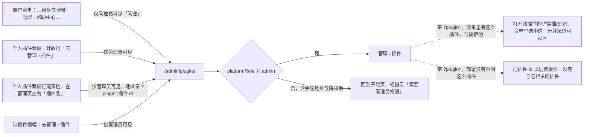
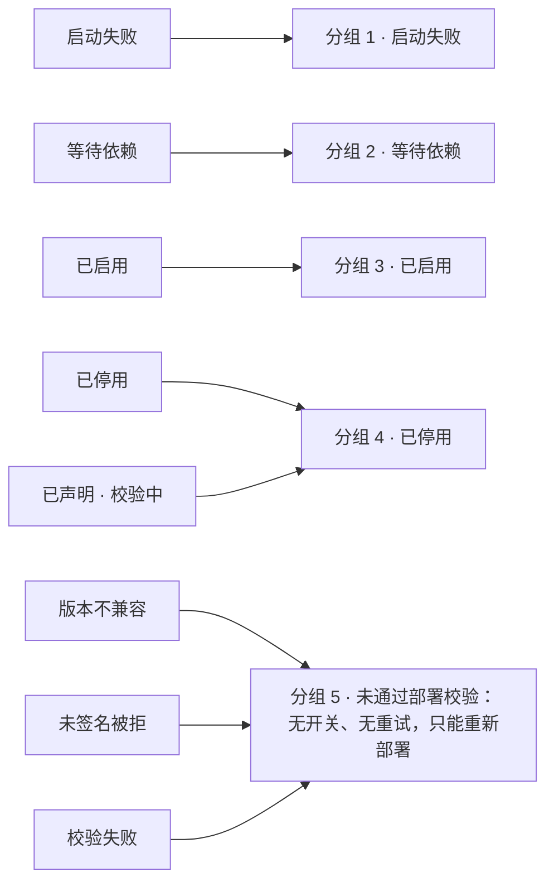
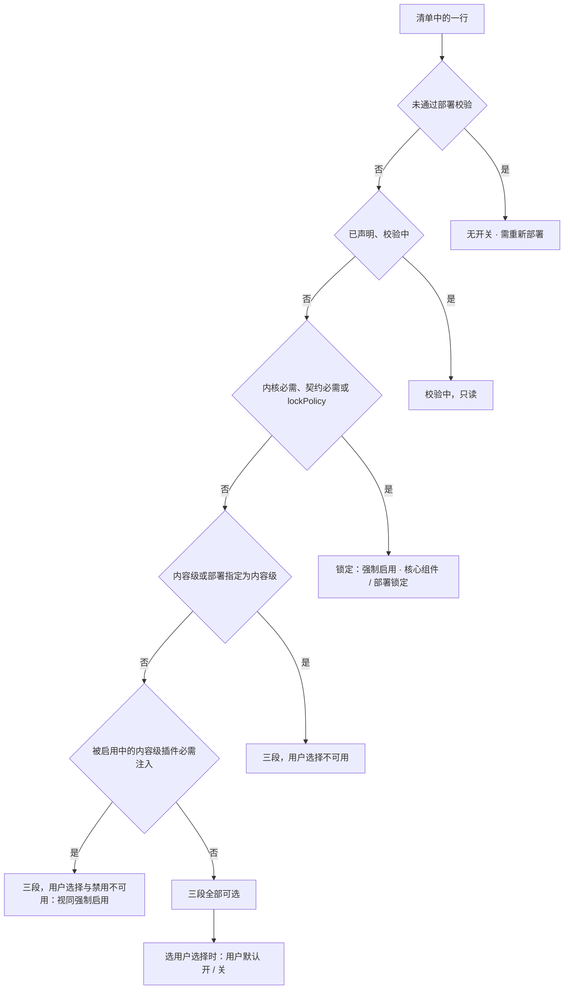
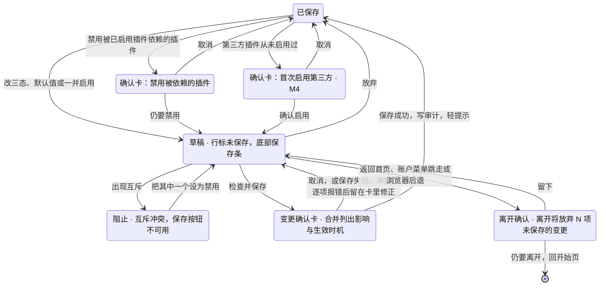

> 状态：草稿 | 负责：设计 | 更新：2026-10-01（§4.23 插件管理样张回写：新建，覆盖 G-84 管理员插件清单与详情、G-85 管理员变更确认卡——入口为账户菜单「管理」（仅平台管理员）、清单九列、八种部署级状态与状态说明弹层、策略三态与锁定、草稿 + 底部保存条 + 变更确认卡、禁用被依赖插件与首次启用第三方（M4）当下弹确认卡、依赖冲突与一并启用、互斥阻止保存、被拒插件、非生产允许未签名、详情抽屉、插件配置（M4）禁用而不隐藏、管理侧栏其余页 M4 占位、无权限处理；样张经用户确认，状态清单 11 态）；2026-10-15（design-language-v3 第 2 批：只改与第 2 批裁决冲突的几处，管理页的 v3 呈现仍随第 3 批——§1 个人插件面板里给管理员的入口改为计数行一个「去管理 › 插件」加内容级失败行与「本文档缺少的插件」行尾的深链图标，深链直接打开该插件的详情抽屉，图 1 同步（DS-56）；着色按「状态色只给图标与必要文字、正常态不着色、不单设信息色」改写：§3 被拒红条、§4.1 说明行与 24h 失败列、§4.2「已启用」「等待依赖」徽标、§4.3 分组计数、§5.4 互斥说明、§6 保存条阻止态、§7.1 依赖连带、§7.2 / §7.3 警示色块、§8.2 警示条、§9 近 24 h 失败（DS-41）；§11.1、§11.2 注明加载与出错的画法随第 3 批按 DS-53 复核；§13 管理员自己的会话收到的重新加载横幅按插件横幅的先后排在最后（DS-54）；依据 rulings §4.25 DS-41、DS-53、DS-54、DS-56、TB-67；同日再补：§1、图 1、§9 深链地址定为 `/admin/plugins?plugin=<pluginId>`——进页后打开该插件的详情抽屉、在清单里选中这一行并滚进可视区，被拒插件同样能开，部署没有声明这个插件时把 id 填进搜索框（TB-76）；§2 线框、§4.1 启动失败说明行的最近错误码改为架构 30/10 登记的 `kernel.plugin_failed`，启动与贡献由 `details.phase` 区分，原演示码不再使用（TB-77））；2026-10-22（design-language-v3 第 3 批：按已拍板样张 `admin-plugins` 整篇改写，节号不变——§1 入口：账户菜单「管理」（三处同一份条目，AS-06），普通成员直接访问时守卫送回开始页并轻提示「需要管理员权限」，原「无权限」拦截页删去（TB-101）；§2 线框按 v3 重画：开始页同一套应用壳，左栏 220 换成管理导航，顶栏 56「插件」+ 搜索 288，横幅在顶栏之下、只横跨主区（DS-92），元信息与来源说明不套卡片，表头吸顶的清单，只按桌面设计（表格最小宽 916、更窄时在主区里横向滚动，TB-119）；§3 被拒横幅去掉「只看被拒插件」、只陈述事实（DS-96），页面一打开就成立的横幅用 status（TB-119）；§4 插件 id 一律写 cordis 插件 id，必需性按 40/16 §2，`model-slide` 按核心组件锁定（TB-121），作用域改为纯文字，启动失败说明写阶段（`lastErrorPhase`，TB-119），校验失败的图标换成 FileX；§5 策略形态补「视同强制启用」（rulings §4.24 TA-6）与「已声明 · 校验中」（TB-119），草稿行改为名称前 6px 强调色圆点 +「· 未保存」、不铺底不画竖条（DS-95），补「一并启用」之后的说明（按钮 outline，TB-128）；§6 保存条改为实色胶囊；§7 两张当下确认卡为模态 md 480、初始焦点「取消」、主按钮强调色，首次启用卡加图标块与说明，变更确认卡补界面级改为禁用的追加句与保存失败、冲突、逐项报错（TB-120），新增 §7.4 有草稿时离开（DS-59）；§8.2 非生产警示改为中性底 + 警告色盾牌的横幅、与被拒横幅两条叠放（TB-119、DS-92）；§9 详情抽屉改为右侧贴边、宽 480、带遮罩的模态抽屉，不加「恢复部署默认」（DS-94、TB-119）；§10 侧栏改为应用壳左栏、不放「帮助」（TB-119）；§11 加载改为加载行、不画骨架（DS-86），加载失败改为居中的整块状态（DS-53），§11.3 删去；§14 状态清单换成 25 个样张状态与 3 个未采纳的备选（DS-63）；新增 §16 设计规格速查；依据 rulings §4.24 TA-2、TA-5、TA-6、§4.25 DS-41、DS-48、DS-53、DS-54、DS-56、DS-59、DS-63、DS-75、DS-86、DS-92、DS-94…DS-96、TB-76、TB-77、TB-101、TB-119…TB-121、TB-128；同日再补：§1、§10 账户菜单里的「帮助中心」注明配置了链接才出现（DS-89，与命令面板同一规则 TB-132）；§14.1 DS-96 的备选注明转正时不另留一态；同日再补（回写中新增的后端口径）：§5.1「已声明（校验中）」一行的条件句改为确定句——部署时校验在服务进程启动阶段、主端口开始监听之前做完，清单接口返回的部署状态实际不会是「已声明」，这一态在界面上不会出现，协议枚举保留、只读画法只作兜底（rulings §4.25 TB-119，后端 60/03 §12.3、60/15 §3.15）；§4.2 状态说明与 §14 第 7 态 `declared` 随之注明；2026-10-22 复核修正：§0 M4 占位的工具提示写法与 §9、§10 统一为「〈名称〉 · 后续版本提供」）；2026-10-23（design-language-v3 第 3 批评审修改：确认卡与详情抽屉随 rulings §4.25 DS-142 改画——§7 写明确认卡是 kit 对话框（标题栏 40、圆角 12、× 正文色，confirm 形态只改圆角），§7.1、§7.3 线框改为标题栏单独一行、说明在标题栏之下（同样张）；§9 抽屉标题行 40、× 正文色（与对话框标题栏同一画法，抽屉不加圆角），线框补标题行下的分隔；§14 写明开着对话框或抽屉的各态随之改画，§16 速查同步） | 依赖：charter v0.2 §2.3；rulings §4.20 FE-06、§4.23（三题裁决与 O-1…O-4）、§4.24 TA-2、TA-5、TA-6、TA-10、§4.25 DS-41、DS-48、DS-53、DS-54、DS-56、DS-59、DS-63、DS-75、DS-86、DS-89、DS-92、DS-94…DS-96、TB-67、TB-76、TB-77、TB-101、TB-119…TB-121、TB-128、TB-132；PRD [09 插件管理](../../10-prd/03-features/09-plugin-manager.md) PM-01…PM-16，[08 应用壳](../../10-prd/03-features/08-app-shell.md) AS-06，[06 服务端](../../10-prd/03-features/06-server-and-ops.md) SV-14；前端 [50/03](../../50-frontend/03-preset-assembly-and-plugins.md) §10、[50/02](../../50-frontend/02-app-shell-routing-and-session.md) §2；后端 [60/02](../../60-backend/02-auth-chain.md) §1、[60/03](../../60-backend/03-modules-identity-and-access.md) §12.3、[60/15](../../60-backend/15-rest-api-catalog.md) §3.15、[60/17](../../60-backend/17-deployment-and-config.md) §5；模块 [40/16](../../40-modules/16-plugin-catalog.md) §2；设计 [03-09](09-plugin-manager.md)、[03-29](29-home-start-page.md)；playground `#/v3/admin/plugins?state=admin-plugins.*`（`src/v3/scenarios/admin-plugins/`）

# 03-32 管理员插件管理（管理 › 插件）

> **设计基准（2026-10-22 起，rulings §4.25 DS-86、DS-92、DS-94…DS-96）**：以已拍板的 playground 第 3 批样张 `admin-plugins` 为准——路由 `#/v3/admin/plugins?state=admin-plugins.<状态 id>`（应用壳页面宿主；暗 / 亮另加 `&theme=dark|light`；任一状态加 `&plugin=<插件 id>` 即深链，§1），25 个状态加 3 个未采纳的备选（§14）。源码在 `playground/src/v3/scenarios/admin-plugins/`：`admin-plugins.scenario.tsx`（各状态的标题与说明）、`AdminRail.tsx`（管理导航）、`Header.tsx`（顶栏搜索）、`Banners.tsx`（被拒与非生产两条横幅）、`PluginTable.tsx`（元信息、来源说明、筛选、清单、策略控件、行下说明、加载失败）、`Overlay.tsx`（保存条、轻提示、状态说明）、`Dialogs.tsx`（变更确认卡、两张当下确认卡、离开确认）、`DetailDrawer.tsx`（详情抽屉）、`bits.tsx`（图标块、状态徽标、警示色块等小件）、`data.ts`（一次部署的 24 个声明，与第 2 批个人插件面板同一次部署，id 换成 cordis 插件 id）、`store.ts`（草稿、依赖、互斥与保存的推算）。对照截图 `openspec/changes/design-language-v3/screens/batch3/admin-plugins-<状态>-dark.jpg`。外壳（左栏、顶栏、横幅通道）是开始页同一套应用壳（[03-29](29-home-start-page.md)、09 T-07）；草稿、依赖、互斥与保存的前端口径以 [50/03](../../50-frontend/03-preset-assembly-and-plugins.md) §10 为准，接口以 [60/15](../../60-backend/15-rest-api-catalog.md) §3.15 为准。2026-10-01 的样张（路由 `#/admin/plugins`、`playground/src/routes/admin/Plugins.tsx` 与 `components/plugin-bits.tsx`、224 宽玻璃导航卡、460 宽浮起 Sheet、整行淡底的草稿行、7 行骨架、「无权限」拦截页、`docs/_tools/capture-screens.cjs` 第 32 条的 11 个演示态）与 shadcn / 材质层时期的写法一并作废；行为口径与 PRD 09 PM-01…PM-16 一致，视觉与文案以本文为准。

「管理 › 插件」是 SV-14 管理面板的第一页，M3 交付「能看能改」（O-4），面向**平台管理员**（`platformRole='admin'`）：看本部署声明了哪些插件、各自状态，为每个插件设「强制启用 / 允许用户选择 / 禁用」三态，处理依赖与互斥。插件只能经部署预置（镜像内置，或挂载目录 + 声明文件），本页**只管启停与配置，不提供上传、URL 安装或插件市场**（裁决 2）。普通用户的个人开关在 [03-09](09-plugin-manager.md)。

## 0. 范围与里程碑

| 里程碑 | 本页范围 |
|---|---|
| M3（P1） | 入口与权限、深链、清单与筛选、八种部署级状态与「状态说明」、策略三态与锁定（含视同强制启用、已声明只读）、草稿 + 保存条 + 变更确认卡（含保存失败、冲突与逐项报错）、禁用被依赖插件的确认卡、等待依赖与一并启用、互斥阻止保存、有草稿时离开的确认、详情抽屉（配置区只读占位）、加载与加载失败；审计与生效时机随「改」同时交付（PRD 09 §4） |
| M4 | 挂载目录中的第三方插件、首次启用第三方的确认卡、签名 / 审核校验与「未签名被拒」、非生产允许未签名的警示横幅、插件配置表单（PS-10）；管理侧栏其余页（用户与角色、审计日志、部署与配额，随 SV-14） |

样张把 M3 与 M4 画在同一页：M4 才有的控件留在原位、不可用、带 M4 标记，工具提示「〈名称〉 · 后续版本提供」（如「用户与角色 · 后续版本提供」「插件配置 · 后续版本提供」，§9、§10；禁用而不隐藏，rulings §4.20 FE-06；原因与第 3 批其余不可用项同一句，里程碑只在标记里写一次）。第三方插件的数据在 M3 部署里本就不存在，行与确认卡随之不出现；M3 只对镜像内置插件做清单与 hostApi 校验（PM-05）。

---

## 1. 入口与权限

- **入口只有一个**：账户菜单（开始页左栏底部用户行、文档列表、编辑器里自己的头像，三处同一份条目，AS-06）在「键盘快捷键」与「帮助中心」（集成方配置了链接才出现，rulings §4.25 DS-89）之间多一项「管理」（16px 盾牌图标，右侧弱化小字「插件」），点了直接进 `/admin/plugins`。只对平台管理员渲染，普通成员不显示、不占位（样张 `account-menu.admin`）。M3 管理面板只有「插件」一页，直接进本页，不经中转页。
- 其它跳转（都只对管理员渲染）：个人插件面板计数行右端的「去管理 › 插件」（整个面板只有这一个文字入口，03-09 §2.1）；内容级启动失败行与「本文档缺少的插件」各行行尾的深链图标「在管理页查看「〈插件名〉」」（03-09 §4.1、§6.3），进本页并直接打开该插件的详情抽屉（§9）；缺插件横幅上的「去管理 › 插件」（03-09 §6.2）。rulings §4.25 DS-56。
- **深链地址**（rulings §4.25 TB-76，登记在前端 50/02 §2）：`/admin/plugins?plugin=<pluginId>`，`pluginId` 是 cordis 插件 id（rulings §4.24 TA-5、§4.25 TB-121）。清单加载完即打开该插件的详情抽屉（§9），清单里这一行选中、滚进可视区，关闭后焦点回到这一行的「›」；被拒插件也在清单里，同样能打开（样张 `deep-link`、`detail-rejected`）；部署没有声明这个插件时不开抽屉，把 id 填进搜索框，清单区一行「没有与「〈id〉」相关的插件」，筛选只剩「全部 0」（`deep-link-absent`）。参数只在进页时读一次。守卫照常先判定平台管理员（下一条）。
- **普通成员直接访问**（rulings §4.25 TB-101，PRD PM-01，前端 50/02 §2.1）：路由守卫 `RequirePlatformAdmin` 把人送回开始页，主区底部轻提示「需要管理员权限」（中性、`role="status"`，只出一次），不渲染本页任何内容；手输带参数的地址同样如此（样张 `home.admin-denied`，同屏展开这位成员的账户菜单可核对没有「管理」）。原「非管理员访问 · 无权限」拦截页删去（§11.3），与 DS-19 删去没有对应能力的入口同理。
- 管理员被降为成员后，会话在复核周期（≤ 5 s）后失去本页访问，按上一条回开始页（PM-01）。

**图 1 入口与访问控制**



怎么读：四个入口都只对管理员渲染，普通成员看不到任何通往本页的控件；从个人插件面板行尾深链进入的地址带 `?plugin=`，清单里有这个插件（含被拒的）就直接打开它的详情抽屉，部署没有声明时把 id 填进搜索框。即使手输地址或会话中途被降权，守卫也把人送回开始页并给轻提示，不渲染拦截页。
依据：PRD 09 PM-01、PM-06；AS-06；50/02 §2；rulings §4.25 DS-56、TB-76、TB-101。

---

## 2. 线框（默认态，1600 × 1000）

```
←───── 220 ─────→←───────────────────────────────────────────────── 主区 ─────────────────────────────────────────────────→
┌────────────────┬────────────────────────────────────────────────────────────────────────────────────────────────────────┐
│ ▣ Cordex       │ 插件                                                                    [⌕ 按名称或 id 搜索          ] │  ← 顶栏 56
│                ├────────────────────────────────────────────────────────────────────────────────────────────────────────┤
│ ← 返回首页     │ ⊗ 1 个声明为强制启用的插件未通过部署校验  贴纸包（未签名被拒），没有进入任何会话                       │  ← 横幅 40，没有按钮
│                ├────────────────────────────────────────────────────────────────────────────────────────────────────────┤
│ 管理           │ 部署版本 2026.10.1 · 宿主 0.3 · 已声明 24 个 · 插件集指纹 7f3a·c91e                                    │
│ ▌插件          │ 插件由部署预置，这里只管启停。插件只能经镜像内置或挂载目录 + 声明文件                                  │
│  用户与角色 M4 │ [/etc/cordex/plugins.catalog.json] 加入本部署，界面不提供上传、URL 安装…                               │
│  审计日志 M4   │                                                                                                        │
│  部署与配额 M4 │ [全部 24|⊗启动失败 1|等待依赖 1|已启用 16|已停用 3|⊗未通过部署校验 3]                       ⓘ 状态说明 │
│                │  插件                                  作用域  必需性    策略                      部署状态  24 h 失败 │
│                │ 启动失败 1                                                                                             │
│                │ ▢ 现场投票 0.9.1 · 第三方 · Beta Labs  内容级  可选扩展  [强制启用|用户选择|禁用]  ⊗启动失败       7 › │
│                │   beta:live-poll                                                                                       │
│                │   近 24 h 有 7 个会话启动失败，最近错误码 kernel.plugin_failed（阶段：启动）；…                        │
│                │ ────────────────────────────────────────────────────────────────────────────────────────────────────── │
│                │ 等待依赖 1                                                                                             │
│                │ ▢ 品牌素材包 2.0.0 · 第三方 · ACME     内容级  可选扩展  [强制启用|用户选择|禁用]  ⧗等待依赖       0 › │
│                │   acme:brand-kit                                                                                       │
│                │   依赖的「模板库」已停用；它启用后这一行自动恢复  [一并启用「模板库」]                                 │
│                │ ────────────────────────────────────────────────────────────────────────────────────────────────────── │
│                │ 已启用 16                                                                                              │
│                │ ▢ 内核 0.3.2 · 内置                    内容级  内核必需  🔒 强制启用 · 核心组件    ✓已启用         0 › │
│                │   kernel                                                                                               │
│ (周) 周明远    │ …                                                                                                      │
└────────────────┴────────────────────────────────────────────────────────────────────────────────────────────────────────┘
```

- **布局**：开始页同一套应用壳（kit `ShellLayout`）：左栏 220（品牌行 56 · 管理导航 §10 · 底部用户行，用户行打开的是同一份账户菜单）+ 主区（顶栏 56 + 横幅通道 + 内容；内容左右内边距 32，底部留出保存条的高度）。原「左侧 224 玻璃导航卡、页面没有应用栏、主区最大宽 1152 居中」作废。
- **只按桌面设计**（rulings §4.25 TB-119）：表格最小宽 916（1280 宽的窗口放得下）；更窄时只有筛选与表格在主区里横向滚动，页头说明照常按可视宽度换行。
- 样张默认数据：24 个声明——启动失败 1、等待依赖 1、已启用 16、已停用 3、未通过部署校验 3（版本不兼容、未签名被拒、校验失败各 1）。截图：`batch3/admin-plugins-default-*.jpg`。

## 3. 页头、来源说明与被拒横幅

- **顶栏**：标题「插件」（16px 600，`h1`）；右侧搜索框「按名称或 id 搜索」（宽 288），即时过滤全部分组。原页头小字「管理」并入左栏的小标题。
- **元信息**（12px 次级文字）：「部署版本 2026.10.1 · 宿主 0.3 · 已声明 24 个 · 插件集指纹 7f3a·c91e」（指纹等宽；PRD PM-13、rulings §4.24 TA-10）。数值来自清单接口（部署版本、宿主 API 版本、指纹），清单还没到时不显示但留位，布局不跳。
- **来源说明**（常驻，两行，不套卡片）：粗体「插件由部署预置，这里只管启停。」+「插件只能经镜像内置或挂载目录 + 声明文件〔声明文件路径〕加入本部署，界面不提供上传、URL 安装或插件市场；新增、升级或移除插件请由部署方修改声明文件后重新部署。策略变更在新打开的会话中生效，已打开的会话会收到重新加载提示。」声明文件路径 `/etc/cordex/plugins.catalog.json` 是等宽小签（圆角 4、`--v3-panel` 底 + 1px 细边：落在画布底上要有边才看得出），可聚焦，工具提示「声明文件（配置键 plugins.catalogFile，只读挂载）」。界面上不存在「添加插件」。
- **被拒横幅**（PRD PM-05；rulings §4.25 DS-92、DS-96、TB-119）：有插件未通过部署校验、且声明文件给它的初始状态是强制启用时出现。位置在主区顶栏之下、只横跨主区，导航不动、标题不跳；高 40（含 1px 底边，DS-75）。危险浅底 + 危险色图标，标题与正文用主文字色（DS-41）；单行：标题「N 个声明为强制启用的插件未通过部署校验」+ 正文「〈名称〉（〈状态〉），没有进入任何会话」（多个用顿号隔开）。不可关闭。**不带按钮**：横幅只陈述事实，筛选就在下方（质量门 Q2「入口唯一」，DS-96）；原「只看被拒插件」与它的焦点交接作废。读屏 `role="status"`：页面一打开就成立的状态，不是这一刻发生的错误，不用 `alert` 抢读（TB-119，设计 09 §3.3）。原红条里的「启动日志已告警，`/readyz` 附 `pluginsRejected`；请由部署方修复后重新部署」挪进「未通过部署校验」分组的常驻说明（§4.3）。
- 初始状态为禁用的被拒插件不触发横幅，只在清单里出现；清单还没到（加载中、加载失败）时横幅不出现（数据未知）。非生产警示与被拒横幅同时成立时两条叠放，见 §8.2。

## 4. 清单：列、分组与筛选

清单是表格语义（`role=table` / `rowgroup` / `row` / `cell`，列头 `columnheader`，PM-16），不套卡片：表头吸顶（32 高、画布底、1px 下边线），行间不画线，组与组之间一条 1px 分隔（同 03-09 的 v3 列表）；行左右内缩 8、圆角 6、上下内边距 12，悬停铺浅底，打开详情的那一行铺强调色淡底（强调色只给选中，DS-35）。

### 4.1 列

| 列 | 内容 | 说明 |
|---|---|---|
| 插件 | 32px 图标块 + 名称 · 版本 · 来源（同一行，名称 12px 500，版本与来源 12px 次级文字）+ 插件 id（第二行，等宽） | 版本与来源并进名称行（同第 2 批个人插件面板的插件行；PM-06 只规定每行要有哪些内容）；版本写精确版本（一次部署一个版本，PRD PM-04）；来源写「内置」或「第三方 · 〈供应商〉」。图标块落在画布底上是 `--v3-panel` 底 + 1px 细边；被拒、已声明或策略为禁用时图标退到 `--v3-text-3`。插件 id 一律写 cordis 插件 id（rulings §4.24 TA-5、§4.25 TB-121：如 `kernel`、`store-yjs`、`render-dom`、`comments`；`model-slide`、`ooxml-pptx` 的单元名本身是 `@cordexjs/…`）。草稿行的标记见 §5.2 |
| 作用域 | 纯文字「内容级」/「界面级」（12px 次级文字） | 部署把界面级升为内容级时写「内容级 · 部署指定」，后跟一个可聚焦的说明图标，工具提示「插件声明为界面级，部署声明文件把它升为内容级：全员统一，个人不能关闭」（PM-02）。原「内容级」主色浅底徽标作废（一列一样的徽标是噪音） |
| 必需性 | 内核必需 / 契约必需·可换 / 可选·降级 / 可选扩展 | 取 40/16 §2 主表（TB-121；评论是「可选扩展」）；列宽 88，放得下「契约必需·可换」 |
| 策略 | 三段控件、锁定、视同强制、「校验中」或「无开关 · 需重新部署」（§5.1） | 允许用户选择时下方多一行「用户默认：开 ▾」 |
| 部署状态 | 八种状态之一（§4.2）：图标 + 文字 | 不只靠颜色 |
| 24 h 失败 | 近 24 h 客户端上报失败的会话数（右对齐） | 非零时加粗、主文字色（状态色只给图标，DS-41）；被拒与已声明写「—」（读屏「不适用」，PM-15） |
| 详情 | 图标按钮「›」（24），工具提示「详情」，读屏名「查看「〈名称〉」详情」 | 打开详情抽屉（§9），`aria-haspopup="dialog"`、`aria-expanded` |

**行下说明**另起紧跟的一行（跨 7 列的一个单元格，缩进与名称对齐），12px，可多条；直接写原因、不重复状态名（状态名与图标已在「部署状态」列，同第 2 批个人面板）；状态色只给图标，文字用主文字色或次级文字色（DS-41）：

- 启动失败摘要（主文字色）：「近 24 h 有 7 个会话启动失败，最近错误码 `kernel.plugin_failed`（阶段：启动）；策略不变，重试由用户在本会话进行」。阶段取后端在清单行与详情里补的 `lastErrorPhase`（即 `kernel.plugin_failed` 的 `details.phase`：`activate` 写「启动」、`contribution` 写「贡献」；rulings §4.25 TB-77、TB-119，60/15 §3.15），与个人插件面板失败详情里的「阶段」一行同一来源（03-09 §4.1）。
- 等待依赖（§5.3）、被拒原因（§8.1）、未签名（M4，警告色盾牌，§8.2）、视同强制启用（链接图标，§5.1）、互斥（危险色图标，§5.4）。
- 原因里的代码串（`core.mutation`、`slide.shapeKind`、`/readyz`、`pluginsRejected`、`lockPolicy` 等）用等宽；分句用分号，句末不加句号。

### 4.2 八种部署级状态与「状态说明」弹层

筛选行右端 ghost 按钮「状态说明」（问号圆图标）打开弹层：宽 384、锚在按钮下方右对齐，标题「部署级状态（8 种）」；五种不被拒的状态按清单的分组次序各一行（图标 + 名称 · 一句说明，名称列 88），三种被拒状态另起一段、段首写「未通过部署校验：没有开关与重试，只能由部署方修复后重新部署」。Esc 关闭、焦点回到「状态说明」；点按钮本身是切换（不当作点外面）。图标与清单、第 2 批个人插件面板同一套（DS-62：同一种状态同一种画法）：

| 状态 | 图标（只给图标着色，文字用主文字色） | 说明 |
|---|---|---|
| 启动失败 | 叉圈，危险色 | 服务端加载失败，或近 24 h 有 ≥ 5 个会话上报失败；不改变策略 |
| 等待依赖 | 沙漏，不着色（v3 不单设信息色，DS-41） | 校验通过，所依赖的插件被禁用或被拒；依赖恢复后自动启用 |
| 已启用 | 勾，不着色（正常态，DS-41） | 校验通过，策略为强制启用或允许用户选择 |
| 已停用 | 斜线圆，中性 | 校验通过，策略为禁用；任何会话都不装配 |
| 已声明 | 虚线圆，中性 | 部署启动时读到声明文件条目、校验尚未完成的瞬时状态 |
| 版本不兼容 | 八角警示，危险色 | 插件声明的宿主版本范围不含当前宿主 |
| 未签名被拒 | 盾牌叉，危险色 | 既无受信签名，也无审核记录 |
| 校验失败 | 文件叉（`FileX`），危险色 | 摘要、清单、作用域或配置与声明不符 |

原写的「校验失败 · 禁止（Ban）」与「已停用」的斜线圆同形、只差颜色，按 DS-62 换成文件叉。「已声明」只存在于部署启动时的校验过程中，清单里实际看不到（§5.1）；弹层照常列出协议的八种状态。截图：`batch3/admin-plugins-status-legend-*.jpg`。

### 4.3 分组与筛选

清单按部署状态分组，**需要处理的在前**（PM-06）。筛选是单选分段（kit `Segmented`，`role="radiogroup"`、名称「按状态筛选」）：「全部 N」+ 各组「组名 N」，计数为 0 的组不出现；启动失败与未通过部署校验两项非零时，组名前带与状态同一个危险色图标，计数本身不着色（同个人插件面板的计数行，03-09 §2.1，DS-41）。

**图 2 八种部署级状态归入五个分组**



怎么读：左列是插件的部署级状态，右列是清单里的分组，自上而下即页面上的分组顺序；三种被拒状态合并为一个分组，分组标题下常驻说明「被拒插件不进入任何会话，界面上没有开关与重试；启动日志已告警，`/readyz` 附 `pluginsRejected`；请由部署方修复后重新部署」。
依据：PRD 09 PM-05 图 3-1、PM-06；rulings §4.25 TB-119。

- 分组标题为 `h2`「〈分组名〉 N」（12px 600）；空分组连标题隐藏。
- 搜索无结果时清单区一行「没有与「〈关键词〉」相关的插件」（与快捷键面板、命令面板同一句式），筛选只剩「全部 0」。

## 5. 策略控件：三态与锁定

### 5.1 策略的形态

| 插件 | 控件 | 文案与说明 |
|---|---|---|
| 界面级、未锁定 | 三段单选「强制启用 \| 用户选择 \| 禁用」（kit 分段控件，宽 204、高 28，安静样式 DS-35；`radiogroup`，读屏名用完整策略名「允许用户选择」） | 选「用户选择」后下方出现「用户默认：开 ▾」（ghost 小按钮，12px 次级文字），下拉为单选「默认开 / 默认关」，选了即收起（`user-default-menu`） |
| 内容级（含部署指定）、未锁定 | 同一三段，「用户选择」**留在原位不可用**：`aria-disabled`、可聚焦 | 工具提示「会影响文档内容或渲染的插件按部署统一，只有强制启用与禁用两态」 |
| 视同强制启用（rulings §4.24 TA-6） | 界面级插件被启用中的内容级插件必需注入：三段里「用户选择」「禁用」留在原位不可用 | 工具提示「被内容级插件「〈名称〉」必需注入，视同强制启用」；行下另写一句「视同强制启用：内容级插件「〈名称〉」必需注入它提供的服务，「用户选择」与「禁用」不可用」（链接图标、次级文字）。依赖它的内容级插件被禁用后恢复三段全部可选（`forced-by-dependency`） |
| 内核必需、契约必需 | 锁形 +「强制启用 · 核心组件」，没有控件；可聚焦 | 工具提示与读屏名「核心组件，更换需修改部署」。幻灯片文档模型 `@cordexjs/model-slide` 同按核心组件锁定（TB-121） |
| 声明文件写了 `lockPolicy` | 锁形 +「强制启用 · 部署锁定」 | 工具提示「由部署配置锁定（声明文件 lockPolicy）」（样张为「离线缓存」） |
| 已声明（校验中，TB-119） | 灰字「校验中」，可聚焦；同被拒行一样只读，24 h 失败写「—」 | 工具提示「部署启动时读到的声明，校验尚未完成；校验通过后才能修改策略」（`declared`）。部署时校验在服务进程启动阶段、主端口开始监听之前就做完，清单接口返回的部署状态实际不会是「已声明」，这一态在界面上不会出现；协议枚举仍保留这个值，这里的只读画法只作兜底（后端 [60/03](../../60-backend/03-modules-identity-and-access.md) §12.3、60/15 §3.15，rulings §4.25 TB-119） |
| 被拒（三种） | 灰字「无开关 · 需重新部署」，可聚焦 | 工具提示「被拒插件不进入任何会话；由部署方修复后重新部署才会改变」 |

**图 3 策略控件的判定**



怎么读：自上而下依次判断，先排除被拒、校验中与锁定，剩下的按作用域决定「用户选择」能不能点；界面级插件还要看有没有被内容级插件必需注入；只有三段全部可选的界面级插件能走到默认值这一步。
依据：PRD 09 PM-02、PM-03；rulings §4.23 裁决 3、§4.24 TA-6、§4.25 TB-119、TB-121。

### 5.2 改动先进草稿（DS-95）

- 点三段或改默认值**不立即保存**：该行进入草稿——名称前一个 6px 强调色圆点（同「分享」按钮上待处理的圆点，DS-48），版本与来源之后接「· 未保存」（12px 次级文字，与「0.4.0 · 内置」同一串）；**不铺底、不画竖条**（强调色淡底只留给选中行，DS-35）。改了多少项看保存条的总数。读屏 polite 播报「『〈名称〉』改为〈策略〉，尚未保存」。改回原值即退出草稿。原「整行浅主色底 + 左侧 2px 主色竖条」作废（备选 `alt-draft-tint`，§14.1）。
- 两种改动在点击当下先弹确认卡，确认后才进草稿（§7.2、§7.3）：**禁用一个被已启用插件依赖的插件**、**首次启用第三方插件**（M4）。
- 任何草稿存在时底部出现保存条（§6）。截图：`batch3/admin-plugins-draft-*.jpg`。

### 5.3 等待依赖与「一并启用」

- 等待依赖的行下说明：「依赖的「模板库」已停用；它启用后这一行自动恢复」，后接按钮「一并启用「模板库」」（画布底上的次按钮 outline，rulings §4.25 TB-128）。点了把被依赖的插件在草稿里改为强制启用，**不弹卡**；这一行的说明随即换成「依赖的「模板库」已在草稿里改为强制启用，保存后这一行将从等待依赖恢复」，按钮消失（点的时候焦点先交给同一行策略里选中的那一项，不经过 `body`，07 §2.4；读屏 polite 播报同一件事）。部署状态列仍是保存前的「等待依赖」（草稿不改部署状态）；被依赖那一行（在「已停用」组）带草稿标记。保存后两行一起变为已启用，确认卡里列「『品牌素材包』将从等待依赖恢复」（§7.1）。样张 `deps-enabled`。
- 这就是 PRD PM-07「启用缺依赖者：需要先启用『X』，并提供一并启用」的呈现：说明与动作都在行内。

### 5.4 互斥（样张 `mutex`）

- 两个插件争用同一 Provider 座或注册同一 `slide.shapeKind` 时不能同时启用（PM-07）。样张：搜索「flow」，「流程图形状包」已启用，把「流程图专业版」在草稿里改为强制启用，两行下都写「与「〈对方〉」互斥：都注册 `slide.shapeKind`「`flowchart`」，不能同时启用；保存前请把其中一个设为禁用」（危险色图标，文字主文字色，DS-41；形状键与贡献点名等宽）。
- 此时保存条进入阻止态（§6），直到其中一个改为禁用。
- 快捷键、菜单位置等可以并存的冲突只警告、不阻止保存（PM-07、PM-11）；在详情抽屉里的呈现推迟（§15）。

## 6. 底部保存条

```
          ╭──────────────────────────────────────────────────────────────────╮
          │ 3 项未保存的变更 · 保存后新会话生效         [放弃] [检查并保存…] │
          ╰──────────────────────────────────────────────────────────────────╯
          ╭──────────────────────────────────────────────────────────────────╮
 阻止态： │ 1 项未保存的变更  ⊗ 1 处互斥冲突           [放弃] [检查并保存…]░ │
          ╰──────────────────────────────────────────────────────────────────╯
```

- 有草稿时出现在主区底部居中（离底 24）：`--v3-panel` 实底、1px 边、浮层阴影、圆角 12、高 48，同编辑器底部工具条（原玻璃胶囊作废）；`role="region"`、名称「未保存的变更」，Tab 可达。草稿清空即消失。
- 文案「N 项未保存的变更 · 保存后新会话生效」（数字加粗）+ 次按钮「放弃」（保存条是 panel 底，用 secondary）+ 主按钮「检查并保存…」。
- 「放弃」清空全部草稿，播报「已放弃未保存的变更」（焦点先交给主区，不掉到 `body`）。「检查并保存…」打开变更确认卡（§7.1）；**一次保存可含多项变更**，确认卡合并列出（PM-07）。
- **阻止态**（有互斥冲突）：中间换成危险色图标 +「N 处互斥冲突」（图标即分隔，不再加「·」；文字主文字色，DS-41），「检查并保存…」留在原位不可用（`aria-disabled`、可聚焦），工具提示「先解决互斥冲突：「A」与「B」不能同时启用，把其中一个设为禁用后再保存」。
- 保存成功的轻提示在主区底部（保存条在时让到它上方，§7.1）。

**图 4 从改动到保存**



怎么读：所有改动先落到草稿，保存只经变更确认卡一个出口；两类高风险改动在点击当下先确认，确认后同样只是进草稿、并不直接生效。互斥时保存被阻止，放弃则整批撤回；有草稿时应用内离开先确认。草稿已存在时再改其它行，同样按这张图走（图中从「已保存」出发的三条边在草稿里同样成立）。
依据：PRD 09 PM-06、PM-07、PM-08、PM-14；rulings §4.23 O-1、§4.25 DS-59、TB-120；50/03 §10.1。

## 7. 确认卡

确认卡都是 kit 对话框，标题栏 40、圆角 12、× 用正文色（2026-10-23 按 rulings §4.25 DS-142 统一；禁用被依赖与离开确认是紧凑的 confirm 形态，没有标题栏与 ×，只改圆角）；宽度按 04 §4.1a 的档位——变更确认卡与两张当下确认卡 md 480，离开确认 sm 360。说明文字每句以句号结尾（与第 1、2 批对话框同一口径）。

### 7.1 变更确认卡（样张 `change-confirm`）

```
┌──────────────────────────────────────────────────────────────┐
│ 保存 3 项插件变更？                                     [×]  │  ← 标题栏 40
├──────────────────────────────────────────────────────────────┤
│ 同一批变更一起保存：任一项失败则全部不生效。每项写入审计     │
│ （plugin.policy_changed）。                                  │
│ ▢ 模板库        禁用 → 强制启用                      内容级  │
│ ▢ 演示激光笔    允许用户选择 → 禁用                  界面级  │
│ ▢ 字数统计      用户默认 关 → 开                     界面级  │
│ 影响与生效时机                                               │
│ ▤ 内容级 1 项 · 全员统一：在新打开的文档会话中生效；已打开的 │
│   会话会在 60 秒内收到「重新加载」提示，不会被强制中断       │
│ ▭ 界面级 2 项：在新会话中生效；已为自己关闭或打开它的用户不  │
│   受默认值变化影响；改为禁用时，所有人都不再装配，个人选择   │
│   暂时失效（保留记录）                                       │
│ ↩ 「品牌素材包」将从等待依赖恢复：它依赖的「模板库」随本次   │
│   保存启用                                                   │
├──────────────────────────────────────────────────────────────┤
│                                  [取消]  [保存 3 项变更]     │
└──────────────────────────────────────────────────────────────┘
```

- 普通对话框（非警示），md 480；保存条「检查并保存…」打开，打开时焦点在首个操作，关闭后回到「检查并保存…」。列表不套卡片，每行：28 图标块 · 名称 ·「原策略 → 新策略」（新值主文字色 500）或「用户默认 关 → 开」，行尾作用域（纯文字，同清单）；箭头对读屏读作「改为」。
- 「影响与生效时机」（`h3`）按作用域各一条，16px 图标（状态色只给图标、不铺底，DS-41）+ 粗体标题 + 次级文字（PM-07）：
  - 内容级：「内容级 N 项 · 全员统一：在新打开的文档会话中生效；已打开的会话会在 60 秒内收到「重新加载」提示，不会被强制中断」；本批里有内容级插件被**停用**时追加「；停用后，用到它的文档内容保留、以占位显示」（`change-confirm-disable`）。
  - 界面级：「界面级 N 项：在新会话中生效；已为自己关闭或打开它的用户不受默认值变化影响」；本批里有界面级插件改为**强制启用**时追加「；改为强制启用时，个人选择暂时失效（保留记录）」，改为**禁用**时追加「；改为禁用时，所有人都不再装配，个人选择暂时失效（保留记录）」（与强制启用那句对称，PM-03，rulings §4.25 TB-120）。
  - 依赖连带：因本批启用而**恢复**的插件（成功色撤销箭头）「「X」将从等待依赖恢复：它依赖的「Y」随本次保存启用」；因本批禁用而**进入等待依赖**的插件（警告色三角）「「X」将进入等待依赖：它依赖的「Y」随本次保存禁用」。依赖连带按最终草稿算、只列净结果（§13）。
- 「保存 N 项变更」：整批保存，任一项失败则全部不生效（PM-07、PM-08）。**成功**（`saved`）：关闭、清空草稿，部署状态按新策略与依赖重算；主区底部轻提示（成功色图标、中性底，DS-41）「已保存 N 项插件变更」+ 说明「新会话生效；已打开的会话会在 60 秒内收到重新加载提示」，播报「已保存 N 项变更」。在线会话随后看到 03-09 §6.1 的「插件设置已更新」横幅（管理员自己的会话同样收到，§13）。
- **保存的结果写在底栏左侧，确认卡不关**（同个人插件面板「对话框里操作的结果写在底栏」，DS-56；50/03 §10.1、50/02 §8）：
  - 网络中断或 5xx（`save-failed`）：危险色图标 +「保存失败，未做任何更改」+「网络连接中断，可以再试一次」（`role="alert"`）；草稿原样保留，再点「保存 N 项变更」就是重试。
  - 冲突 412（`save-conflict`）：警告色图标 +「设置已被其他管理员更新，已重新载入」+「变更已按新的设置重算，请核对后再保存」（`role="status"`：不是这一刻的错误，草稿都在）；列表按新载入的原值重算（如 3 项 → 2 项，按钮随之「保存 2 项变更」），列表上方一行（信息图标、次级文字）「「演示激光笔」已被其他管理员改为禁用，与你的变更相同，不再列出」；背后的清单同步刷新。
  - 逐项报错 422 / 409（`save-item-errors`）：出错的那一项在列表里写原因（危险色图标、主文字色，如「部署方已把它设为部署锁定（声明文件 `lockPolicy`），不能修改」）；底栏「N 项未通过校验，整批都未生效」+「按标出的原因调整后再保存」（`role="alert"`）。
- 「取消」回到草稿，不丢改动。

### 7.2 禁用被依赖的插件（样张 `dep-conflict`）

点「禁用」的当下，若有已启用（且未被拒）的插件依赖它，先弹模态确认（rulings §4.25 TB-120：md 480；PRD PM-16 确认卡为模态，会波及别的插件，同第 1 批重置页一类）：

```
┌──────────────────────────────────────────────────────────┐
│ 禁用「图表渲染」？                                       │
│ 「数据图表增强」依赖它，禁用后该插件将进入「等待依赖」， │
│ 本部署的会话里不再装配。                                 │
│ ▢ 数据图表增强  acme:data-binding   已启用 → 等待依赖    │
│ ┌────────────────────────────────────────────────────┐   │
│ │ ⚠ 缺席后果：图表显示为占位，图表数据原样保留       │   │
│ └────────────────────────────────────────────────────┘   │
│ 确认后只进入草稿；保存后在新打开的文档会话中生效，已打开 │
│ 的会话会收到重新加载提示。                               │
│                                  [取消]  [仍要禁用]      │
└──────────────────────────────────────────────────────────┘
```

- 说明：只有一个依赖方时直接写它的名字（「「数据图表增强」依赖它，禁用后该插件将进入「等待依赖」…」，免得把「它」读成被禁用的插件自己）；多个时写「N 个插件依赖它，禁用后它们将进入「等待依赖」，本部署的会话里不再装配。」
- 列出每个将进入等待依赖的插件（28 图标块、名称、等宽 id、「已启用 → 等待依赖」）。
- 被禁用的插件在 50/03 §3 有「缺席后用户可见结果」时，以警示色块显示「缺席后果：…」（PM-07）：警告浅底 + 警告色图标，正文用主文字色（DS-41；§7.3、§9 的警示色块同此）。
- 按钮「取消」（**初始焦点**，安全项）与「仍要禁用」——主按钮用**强调色**：确认后只进草稿，还能放弃或改回，真正生效要经保存条与变更确认卡（TB-120；危险实底留给销毁类，09 §3.3；原「危险样式」作废）。Esc 等同取消；关闭后焦点回到这一行的三段控件（rulings §4.24 TA-2，PM-16）。

### 7.3 首次启用第三方插件（样张 `first-enable`，M4）

第三方插件（挂载目录来源）**从未启用过**时，从「禁用」改为启用的当下先弹模态确认（md 480，TB-120）；这是旧稿里面向用户的首次启用确认卡，现只对管理员出现（rulings §4.23「被修订的既有口径」，PM-06）。

```
┌────────────────────────────────────────────────────────────┐
│ 首次启用第三方插件「二维码形状」                      [×]  │  ← 标题栏 40
├────────────────────────────────────────────────────────────┤
│ ▢ 把链接生成为可缩放的二维码元素  [M4]                     │
│   第三方 · ACME · 1.0.0 · 签名有效 · ACME 发布公钥 3f:…    │
│ 将新增的贡献                                               │
│ slide.shapeKind ×1   core.command ×1   ui.toolbar ×1       │
│ 能力声明 · 仅展示，不做运行时限制                          │
│ network: 无   clipboard: write                             │
│ ┌────────────────────────────────────────────────────┐     │
│ │ ⚠ 同源可信、无运行时沙箱：启用即允许该插件以本应用 │     │
│ │   身份运行，可读写它能访问到的文档与界面。它已通过 │     │
│ │   部署时的签名校验。                               │     │
│ └────────────────────────────────────────────────────┘     │
│ 内容级插件：确认后进入草稿，保存后在新会话生效，全员统一。 │
├────────────────────────────────────────────────────────────┤
│                                  [取消]  [确认启用]        │
└────────────────────────────────────────────────────────────┘
```

- 标题下：28 图标块 + 一句说明（清单的 description，TB-120）+ M4 标记，再一行「来源 · 版本 · 信任来源」（签名公钥指纹或审核记录，指纹等宽，PM-05）。
- 「将新增的贡献」与「能力声明」按贡献点名与能力等宽文字逐项列出（不画胶囊；能力声明注「仅展示，不做运行时限制」，PS-13；没有能力声明写「未声明额外能力」）。贡献点用 v3 名（如 `ui.toolbar`；原示例里的 `ui.ribbonButton` 随 DS-5 作废）。
- 警示色块写明信任模型（章程 §2.3）；审核记录来源的插件把末句换成「它已通过部署时的审核记录校验。」
- 末行按作用域写生效方式（界面级写「界面级插件：确认后进入草稿，保存后在新会话生效。」）。按钮「取消」（初始焦点）与强调色主按钮「确认启用」，确认后只进草稿；关闭后焦点回到这一行的三段控件。同一插件启用过一次后，再从禁用改回启用不再弹卡。

### 7.4 有草稿时离开（样张 `leave-guard`，DS-59）

- 有草稿时点左栏「返回首页」、从账户菜单跳走或浏览器后退：弹 sm 360 紧凑确认框，标题「离开将放弃 N 项未保存的变更」、说明「这些插件策略变更还只在本页的草稿里，离开后不会保存。」；按钮「留下」（初始焦点，安全项）与「仍要离开」（危险实底：草稿会丢；回开始页）——与第 2 批 `offline-conflict.leave-confirm` 同一种写法（rulings §4.25 DS-59，前端 50/03 §10.1）。关闭后焦点回到「返回首页」。
- 刷新、关标签页只能用浏览器原生提示（`beforeunload`）。没有草稿时「返回首页」直接回开始页。

## 8. 被拒插件与非生产允许未签名

### 8.1 未通过部署校验（样张 `rejected`）

筛选切到「未通过部署校验」，分组说明常驻（§4.3）。样张三行，行下各写原因：

| 插件 | 状态 | 行下说明 |
|---|---|---|
| 旧版数据看板 `beta:old-dashboard` 0.9.0 | 版本不兼容 | 需要宿主 0.4–0.6，当前 0.3 |
| 贴纸包 `misc:sticker-pack` 0.2.0 | 未签名被拒 | 未找到有效签名或审核记录，请由部署方处理 |
| 热力图覆盖层 `acme:heatmap` 0.5.0 | 校验失败 | 作用域声明为界面级，但贡献了 `core.mutation`「`heatmap.setData`」 |

- 被拒行：图标退到 `--v3-text-3`，策略列「无开关 · 需重新部署」（可聚焦读出原因），24 h 失败「—」，没有重试；详情抽屉照常可开（看信任来源与贡献，`detail-rejected`，§9）。
- 贴纸包的声明初始状态是强制启用，因此页顶同时出现被拒横幅（§3）。
- 普通用户看不到被拒插件（PRD 09 §5 非目标）。M3 只对镜像内置插件做清单与 hostApi 校验，「未签名被拒」只在 M4 出现（PM-05）。

### 8.2 非生产部署允许未签名（样张 `unsigned-allowed`，M4）

部署配置 `plugins.allowUnsigned = true`（生产环境拒绝此开关，PM-05）时：

- 横幅通道常驻一条（与被拒横幅同一位置：主区顶栏之下、只横跨主区，DS-92；高 40，DS-75）：**中性底 + 警告色盾牌**、不可关闭、`role="status"`（rulings §4.25 TB-119；09 §3.3「不阻断、不丢数据的用中性底加状态色图标」：这是部署方有意打开的开关，管理页上没有要处理的事）。标题「非生产部署：已允许未签名插件」+ 正文「配置 `plugins.allowUnsigned = true`，生产环境会拒绝这个开关；未签名插件以「未签名」标出」。原「页面最上方、导航卡与主区之上、高 36、圆角、警告浅底」的整宽警示条作废。
- **两条叠放**（DS-92）：被拒横幅同时成立时，非生产警示在上、被拒在下，最多两条（kit `BannerStack`，同编辑器母版视图、版本预览的两条叠放例外）。样张这一态把热力图覆盖层的声明初始状态写成强制启用，所以两条都在。
- 原先「未签名被拒」的插件按声明的初始状态装配（样张贴纸包变为已启用，被拒组只剩 2 个），行下说明（警告色盾牌）「未签名：非生产部署允许（`plugins.allowUnsigned`）」；详情抽屉的信任来源用警告色盾牌。
- 其余被拒原因（版本不兼容、校验失败）不受此开关影响。

## 9. 详情抽屉（样张 `detail`，DS-94）

点行尾「›」打开**模态抽屉**：右侧贴边整高、宽 480、带遮罩（kit `Drawer`，与设置的抽屉备选同一个件）；标题行 40（插件名 13px 600 + 右侧 24 的 ×，× 用正文色）与对话框的标题栏是同一画法，2026-10-23 随 rulings §4.25 DS-142 一起改（原高 48、× 次级文字色作废；抽屉贴边，不加圆角）；打开它的那一行在遮罩后保留强调色淡底。原 460 宽、上下各留 8、圆角 24 的浮起 Sheet 作废。

```
                                        ┌────────────────────────────────────────────────┐
                                        │ 数据图表增强                          [×]      │  ← 标题行 40
                                        ├────────────────────────────────────────────────┤
                                        │ ▢  acme:data-binding                           │
                                        │    内容级 · ✓ 已启用 · 强制启用                │
                                        │ 为图表绑定外部数据源并定时刷新                 │
                                        ├────────────────────────────────────────────────┤
                                        │ 概要                                           │
                                        │ 版本 1.4.2 · 来源 挂载目录 · ACME              │
                                        │ 宿主兼容 0.3–0.4（当前 0.3）· 可选扩展         │
                                        │ 近 24 h 失败 0                                 │
                                        ├────────────────────────────────────────────────┤
                                        │ 信任来源  签名有效 · ACME 发布公钥 3f:…        │
                                        ├────────────────────────────────────────────────┤
                                        │ 依赖与冲突                                     │
                                        │ 依赖   图表渲染  注入 render.element  强制启用 │
                                        │        协同存储（Yjs） 注入 store     强制启用 │
                                        │ 被依赖 没有插件依赖它                          │
                                        │ 互斥   无                                      │
                                        ├────────────────────────────────────────────────┤
                                        │ 贡献点摘要 · 能力声明 · 最近策略变更           │
                                        ├────────────────────────────────────────────────┤
                                        │ 配置 [M4]                  仅部署级一份        │
                                        │ 数据源地址 [https://api.acme.com/v2]░          │
                                        └────────────────────────────────────────────────┘
```

抽屉只读，区块之间 1px 分隔（kit `Section`，同检查器），不套卡片。字段来源见 60/15 §3.15.1 `AdminPluginDetail`：

| 区块 | 内容 |
|---|---|
| 头部 | 标题是插件名（抽屉的读屏名即标题）；40px 图标块、插件 id（等宽）、作用域 · 部署状态 · 当前策略（锁定写「强制启用（核心组件 / 部署锁定）」；草稿值后接「· 未保存」；被拒写「无开关 · 需重新部署」，已声明写「校验中」）、描述 |
| 概要 | 版本、来源（镜像内置 / 挂载目录 · 供应商）、宿主兼容范围（附当前宿主版本）、必需性、近 24 h 失败（非零时加粗、附最近错误码与阶段，如「7 个会话 · 最近错误码 `kernel.plugin_failed`（阶段：启动）」；被拒写「—（不进入会话）」，已声明写「—（校验尚未完成）」） |
| 信任来源 | 内置「镜像内置 · 随镜像 digest 与 SBOM 受信」/ 签名公钥指纹 / 审核记录（审核人、日期、钉住的 SHA-256）；正常态图标不着色（DS-41），未签名用警告色盾牌 |
| 依赖与冲突 | 三个小列表：依赖（注入的服务与提供者，含对方当前策略）、被依赖（「禁用本插件后将进入等待依赖」）、互斥（冲突原因）；空时写「不依赖其他插件」「没有插件依赖它」「无」；有缺席后果时追加警示色块「缺席后果：…」 |
| 贡献点摘要 | v3 贡献点名，等宽逐项列出 |
| 能力声明 | 等宽逐项；未声明写「未声明额外能力」；区块标题右侧注「仅展示，不做运行时限制」 |
| 最近策略变更 | 来自审计的最近 5 条：时间、操作者（系统写「系统」）、变更；没有记录写「暂无变更记录」（PM-14） |
| 配置 `M4` | 由 Config schema 生成的字段（PM-09），标题右侧注「仅部署级一份」；M3 时**禁用而不隐藏**：字段只读、`aria-disabled`、可聚焦，工具提示「插件配置 · 后续版本提供」；机密字段标「· 机密」、值显示 `***`；底部说明「保存时校验，失败不部分生效；审计只记字段路径，不记值。」；没有配置项写「该插件没有可配置项」 |

- **只读**：策略改动在清单行里做（PM-07、质量门 Q2 入口唯一），抽屉头部的策略文字随草稿同步。**不加「恢复部署默认」**（PATCH 的 `reset` 不经界面、供运维脚本用，60/15 §3.15，rulings §4.25 TB-119）。
- **焦点**：打开时焦点落在抽屉本身（读屏先念标题）；Esc、× 或点遮罩关闭，焦点回到这一行的「›」（PM-16）。
- **深链**（`/admin/plugins?plugin=<pluginId>`，§1，TB-76）：清单加载完即打开该插件的抽屉，这一行选中并滚进可视区（`deep-link` 兼作启动失败插件的详情）；被拒插件照常打开（`detail-rejected`：头部状态「版本不兼容」、策略「无开关 · 需重新部署」，概要「宿主兼容 0.4–0.6（当前 0.3）」，顺带三种空写法）。
- 抽屉是模态、带遮罩（DS-94）：抽屉只读，开着时没有要同时操作的清单控件；无遮罩的话被盖住的正是策略与状态列（备选 `alt-drawer-nonmodal`，§14.1）。

## 10. 管理侧栏

应用壳左栏 220 不变（品牌行 56；底部用户行 = 同一份账户菜单，DS-18），首页那组主导航换成管理导航，画法同首页导航项（kit 导航按钮：28 高、圆角 6，当前项 `--v3-panel-2` 底 + 500）：

| 项 | 状态 | 说明 |
|---|---|---|
| ← 返回首页 | 可用 | 回开始页（原「返回应用」）；有草稿时先弹离开确认（§7.4） |
| 小标题「管理」 | — | 12px 600 次级文字 + 14px 盾牌图标 |
| 插件 | 当前页，`--v3-panel-2` 底、`aria-current="page"` | M3 |
| 用户与角色 | 留在原位不可用：文字与图标退到 `--v3-text-3`、`aria-disabled`、可聚焦、右侧 M4 标记 | 工具提示「用户与角色 · 后续版本提供」，点了没有反应 |
| 审计日志 | 同上 | 同上 |
| 部署与配额 | 同上 | 同上 |

- 左栏**不放「帮助」**（2026-10-01 用户确认；rulings §4.25 TB-119）：键盘快捷键在账户菜单里，帮助中心也在那里、集成方配置了链接才出现（AS-06，DS-89）。原 224 宽玻璃导航卡（`glass-strong`，圆角 16）作废。
- M3 的管理面板只有「插件」一页（PRD 09 §4：本页先于 SV-14 其余页交付）；占位项让管理员知道后续页面的位置。

## 11. 空、加载、错误与无权限

### 11.1 加载中（样张 `loading`，DS-86）

清单接口还没回来：表头照常，表头下居中一行加载行「正在加载插件清单…」（转圈 + 一句话，DS-53），表格 `aria-busy`；**不画骨架行**（原 7 行骨架作废）。加载行超过 300 ms 才出现。元信息来自同一个接口，先不显示但留位；筛选行不知道有哪些组，留位不显示（布局不跳）；被拒横幅不出（数据未知）。来源说明照常。

### 11.2 加载失败（样张 `error`，DS-53）

清单区换成居中的整块状态（kit `PanelState`）：危险色图标、标题「插件清单加载失败」、说明「管理接口暂时不可用，未做任何更改」、按钮「重试」（落在画布底上的次按钮用 outline，rulings §4.25 TB-128，同模板库、阻断页）。筛选、表头与被拒横幅都不显示（数据未知），元信息留位不显示。原「红三角空态卡」与说明里的接口路径作废。点「重试」焦点先交给主区（不掉到 `body`），超过 300 ms 出加载行，清单到了即显示。

### 11.3 无权限（删去）

原「非管理员访问 · 无权限」拦截页（演示态 `forbidden`）只为截图与评审而画、产品不实现，按 rulings §4.25 TB-101 删去：普通成员直接访问时的产品行为见 §1（回开始页 + 轻提示，样张 `home.admin-denied`）。

### 11.4 空

部署至少声明内核必需插件，清单不会为空，不设计空态；搜索无结果见 §4.3。

## 12. 无障碍（PM-16）

- 清单为表格语义（§4）；分组标题 `h2`，页标题 `h1`；行下说明在跨 7 列的单元格里，不打乱列位。
- 三段控件为单选组，每项读屏名为完整策略名（「允许用户选择」而非「用户选择」）；内容级的「用户选择」、视同强制的两段、锁定、「校验中」、被拒占位、M4 占位都可聚焦并读出原因（`aria-disabled`，不用 `disabled`，以便工具提示可达）。
- 草稿变化、放弃、一并启用、保存成功经隐藏的 `aria-live="polite"` 播报；保存失败与逐项报错写在确认卡底栏、`role="alert"`，冲突为 `role="status"`。
- 横幅一律 `role="status"`（页面打开即成立的状态）。
- 确认卡都是模态对话框：两张当下确认卡与离开确认初始焦点在安全项（「取消」/「留下」），变更确认卡在首个操作；Esc 取消；关闭后焦点回到触发控件。保存条是 `region`，可经 Tab 到达。
- 状态不只靠颜色：八种部署状态、锁定、被拒、未签名、互斥、视同强制各有图标与文字。
- 键盘可完成 PM-03、PM-07 的全部操作（改三态、改默认值、一并启用、放弃、检查并保存、确认）；焦点交接不经过 `body`（07 §2.4）。

## 13. 边界情况

- **管理员把自己正在用的界面插件设为禁用**：保存后管理员自己的已打开会话同样收到 03-09 §6.1 的重新加载横幅，不例外；与缺少插件、启动失败横幅同时成立时，它排在插件横幅的最后（rulings §4.25 DS-54，03-09 §6.5）。
- **允许用户选择 → 强制启用**：个人选择暂时失效但保留（确认卡注明，§7.1），改回后恢复；**改为禁用**同理（所有人都不再装配，个人选择暂时失效、保留记录）。
- **同批既启用被依赖者又禁用依赖者**：确认卡的依赖连带按最终草稿计算，只列净结果。
- **互斥双方都被设为禁用**：不再冲突，保存条恢复。
- **默认值只对「允许用户选择」有意义**：改成别的两态时「用户默认」一行消失、草稿里的默认值一并作废；改回允许用户选择时恢复上次保存的默认值。
- **视同强制启用**：依赖它的内容级插件被禁用（含草稿里改为禁用）后，界面级插件恢复三段全部可选。
- **保存时别的管理员先保存了**：412 后确认卡按新的原值重算，与新原值相同的项移出草稿并在列表上方说明（§7.1）。
- **第三方插件在 M3**：M3 部署没有挂载目录，清单里只有内置插件，首次启用卡、未签名相关状态与警示横幅都不会出现（§0）。
- **窗口窄于表格最小宽**：只有筛选与表格横向滚动（§2）。

## 14. 状态清单

样张路由均为 `#/v3/admin/plugins?state=admin-plugins.<状态 id>`；视口 1600 × 1000。截图 `openspec/changes/design-language-v3/screens/batch3/admin-plugins-<状态>-dark.jpg` / `-light.jpg`。2026-10-23 起对话框与抽屉按 rulings §4.25 DS-142 改画（§7、§9）：确认卡各态（`dep-conflict`、`first-enable`、`change-confirm`、`change-confirm-disable`、`save-failed`、`save-conflict`、`save-item-errors`、`leave-guard`）、详情抽屉各态（`detail`、`deep-link`、`detail-rejected`）与 §14.1 的 `alt-drawer-nonmodal` 随之改画，要点不变。

| # | 状态 id | 样张标题 | 说明 |
|---|---|---|---|
| 1 | `default` | 默认 | 24 个声明、五个分组、被拒横幅（顶栏之下）、五种策略形态里的三种首屏可见（§2–§5） |
| 2 | `loading` | 加载中 | 表头下居中加载行，元信息与筛选留位不显示（§11.1） |
| 3 | `error` | 加载失败 | 居中的整块状态 + outline「重试」（§11.2） |
| 4 | `rejected` | 未通过部署校验 | 筛选停在被拒组，三种原因（§8.1） |
| 5 | `status-legend` | 状态说明 | 八种状态的弹层，被拒三种另起一段（§4.2） |
| 6 | `forced-by-dependency` | 视同强制启用 | 「界面核心」「国际化」被「React 界面层」必需注入，三段里两段不可用（§5.1） |
| 7 | `declared` | 已声明 · 校验中 | 第三方「二维码形状」只读、策略写「校验中」；清单接口在部署时校验做完之后才开始服务，界面上实际不会出现，只是兜底画法（§5.1） |
| 8 | `user-default-menu` | 用户默认值下拉 | 「字数统计」的「用户默认：关 ▾」展开；同屏看得到部署锁定的「离线缓存」（§5.1） |
| 9 | `deps-enabled` | 一并启用之后 | 品牌素材包行下改写为「…保存后这一行将从等待依赖恢复」，保存条 1 项（§5.3） |
| 10 | `draft` | 草稿与保存条 | 三项草稿：名称前圆点 +「· 未保存」，保存条「3 项未保存的变更」（§5.2、§6） |
| 11 | `mutex` | 互斥 · 阻止保存 | 搜索「flow」，两行互斥说明，保存条阻止态（§5.4、§6） |
| 12 | `dep-conflict` | 禁用被依赖的插件 | 模态 md 480，初始焦点「取消」，强调色「仍要禁用」（§7.2） |
| 13 | `first-enable` | 首次启用第三方（M4） | 图标块与说明、贡献与能力、同源可信警示（§7.3） |
| 14 | `change-confirm` | 变更确认卡 | 三项变更与影响，含界面级改为禁用的追加句（§7.1） |
| 15 | `change-confirm-disable` | 确认卡 · 含停用与进入等待依赖 | 内容级停用的追加句与依赖连带（§7.1） |
| 16 | `saved` | 保存成功 | 部署状态重算、轻提示「已保存 3 项插件变更」（§7.1） |
| 17 | `save-failed` | 保存失败 | 底栏「保存失败，未做任何更改」，草稿保留（§7.1） |
| 18 | `save-conflict` | 保存冲突（412） | 「设置已被其他管理员更新，已重新载入」，列表重算为 2 项（§7.1） |
| 19 | `save-item-errors` | 逐项报错（422 / 409） | 出错的一项写原因，底栏「1 项未通过校验，整批都未生效」（§7.1） |
| 20 | `leave-guard` | 有草稿时离开 | sm 360「离开将放弃 3 项未保存的变更」，初始焦点「留下」（§7.4） |
| 21 | `detail` | 详情抽屉 · 数据图表增强 | 模态抽屉 480，依赖、审计与配置 M4（§9） |
| 22 | `deep-link` | 深链 · 现场投票 | `?plugin=` 打开启动失败插件的详情，这一行选中（§1、§9） |
| 23 | `deep-link-absent` | 深链 · 部署里没有的插件 | 不开抽屉，id 填进搜索框，「没有与「acme:org-chart」相关的插件」（§1、§4.3） |
| 24 | `detail-rejected` | 详情 · 被拒插件 | 版本不兼容插件的详情与三种空写法（§8.1、§9） |
| 25 | `unsigned-allowed` | 非生产允许未签名（M4） | 中性底警示横幅在上、被拒横幅在下；贴纸包以未签名装配（§8.2） |

普通成员直接访问的画面在开始页场景（`home.admin-denied`，§1）；账户菜单「管理」入口在 `account-menu.admin`。推迟、没有画的见 §15。

### 14.1 未采纳的备选（DS-63）

拍板时画给用户对照的备选留在样张里，标题前加「未采纳 · 」、说明写明由哪一条 DS 定为推荐；路由不变，实现以上表的状态为准（rulings §4.25 DS-63）。

| 备选 | 样张 id | 内容 | 结论 |
|---|---|---|---|
| 详情抽屉无遮罩 | `admin-plugins.alt-drawer-nonmodal` | kit Drawer `modal={false}`：开着也能操作清单，点外面不关、Esc 与 × 关闭；480 宽在 1600 的窗口里盖住策略、部署状态、24 h 失败与「›」几列 | 未采纳，DS-94 定为模态抽屉 480 |
| 横幅在顶栏之上 | `admin-plugins.alt-banner-top` | 应用壳页面的横幅放在主区最顶、顶栏之上（与编辑器横幅在画布列最顶一致），导航仍不动；横幅出现与消失时标题与搜索框上下跳 40 | 未采纳，DS-92 定为顶栏之下 |
| 草稿行铺淡底 | `admin-plugins.alt-draft-tint` | 03-32 原画法：草稿行整行铺强调色淡底 + 左侧 2px 强调色竖条；与选中行同一种底，草稿多时整片泛蓝 | 未采纳，DS-95 定为圆点加「· 未保存」 |
| 被拒横幅保留「只看被拒插件」 | （拍板时画在 `default`、`rejected` 里，转正时去掉，不另留一态） | 横幅带次按钮「只看被拒插件」，把筛选切到「未通过部署校验」，已在这一组时不出现 | 未采纳，DS-96 定为去掉按钮、横幅只陈述事实 |

## 15. 待决与推迟

| 项 | 状态 | 触发条件 |
|---|---|---|
| 快捷键等可并存冲突在详情抽屉里的呈现 | 推迟 | `shortcuts` 服务加载期冲突检测落地、PM-11 进入 M3 实现时补样张 |
| 插件配置表单的可编辑态（逐字段报错、机密「使用部署文件中的值」） | 推迟到 M4 | PS-10 Config schema 生成设置 UI 落地时补样张；M3 只有禁用占位（§9） |
| 管理侧栏其余三页 | 推迟到 M4 | 随 SV-14 管理面板 |

## 16. 设计规格（速查）

| 项 | 规格 | 来源 |
|---|---|---|
| 外壳 | 应用壳：左栏 220 + 顶栏 56 + 横幅通道；内容左右内边距 32、上 24，底部留出保存条高度 | kit `ShellLayout`、`admin-plugins.scenario.tsx` |
| 管理导航 | 导航项 28 高、圆角 6，当前项 `--v3-panel-2` 底 + 500；M4 项 `--v3-text-3` + M4 标记 | `AdminRail.tsx` |
| 顶栏 | 标题「插件」16px 600；搜索框宽 288 | `Header.tsx` |
| 横幅 | 高 40（DS-75），顶栏之下、只横跨主区；被拒：危险浅底 + 危险色图标、不可关闭、没有按钮；非生产：中性底 + 警告色盾牌、不可关闭；两条叠放时非生产在上；都是 `role="status"` | `Banners.tsx`、kit `Banner` / `BannerStack` |
| 元信息与来源说明 | 12px / 18 次级文字；指纹等宽；声明文件小签：圆角 4、`--v3-panel` 底 + 1px 细边、等宽 11px | `PluginTable.tsx` |
| 筛选 | kit `Segmented`（每项按内容宽）；危险组名前 12px 状态图标；右端 ghost「状态说明」 | `PluginTable.tsx` `FilterRow` |
| 表格 | 最小宽 916；列宽 插件 ≥ 240 自适应 · 作用域 120 · 必需性 88 · 策略 204 · 部署状态 80 · 24 h 失败 56 · 详情 24，列间距 16；表头 32 高吸顶；行左右内缩 8、圆角 6、上下 12；组间 1px 分隔 | `PluginTable.tsx` |
| 图标块 | 清单 32、确认卡列表 28、抽屉头部 40；画布底上 `--v3-panel` 底 + 1px 细边 | `bits.tsx` `Tile` |
| 策略控件 | 三段宽 204、高 28（安静样式分段）；「用户默认」ghost 小按钮 24 高、12px | `PluginTable.tsx` `PolicyControl` |
| 草稿标记 | 名称前 6px 强调色圆点；版本与来源后「· 未保存」12px 次级文字 | `PluginTable.tsx` |
| 保存条 | 主区底部居中、离底 24；`--v3-panel` 实底、1px 边、浮层阴影、圆角 12、高 48；「放弃」secondary、「检查并保存…」primary | `Overlay.tsx` `SaveBar` |
| 状态说明 | Popover 宽 384、锚在按钮下右对齐；名称列 88 | `Overlay.tsx` `StatusLegend` |
| 确认卡 | kit 对话框（标题栏 40、圆角 12、× 正文色，DS-142；confirm 形态没有标题栏、只改圆角）：变更确认卡、禁用被依赖、首次启用 md 480；离开确认 sm 360；警示色块：警告浅底 + 警告色图标、正文主文字色 | `Dialogs.tsx`、`bits.tsx` `WarnBlock` |
| 详情抽屉 | kit `Drawer` 右侧贴边整高、宽 480、带遮罩；标题行 40（13px 600 + 24 的 ×，× 正文色，同对话框标题栏，DS-142）；区块 kit `Section`，之间 1px 分隔 | `DetailDrawer.tsx` |
| 轻提示 | kit `Toasts`，离底 24（保存条在时 84）；成功色图标、中性底 | `Overlay.tsx` |
