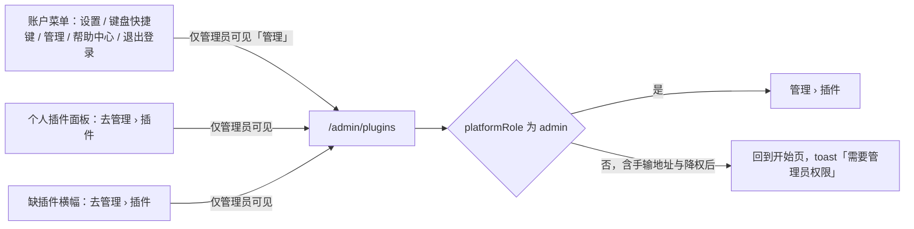
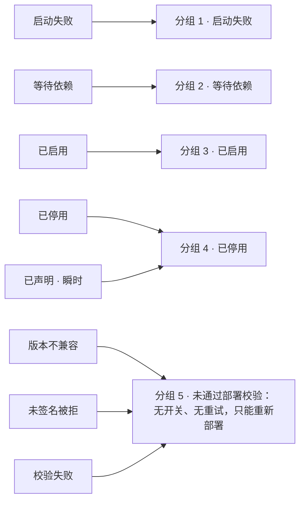
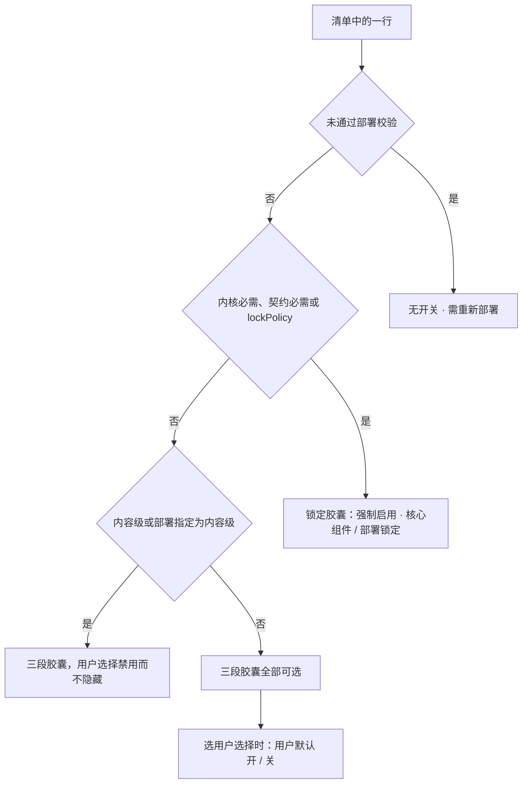
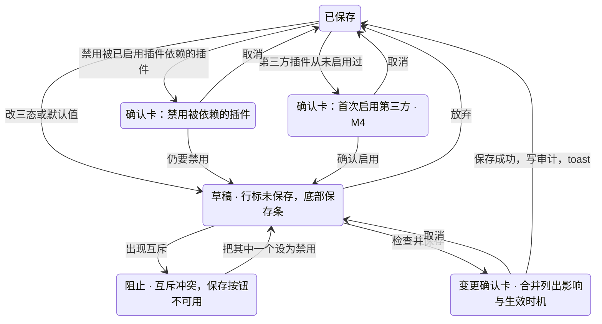

> 状态：草稿 | 负责：设计 | 更新：2026-10-01（§4.23 插件管理样张回写：新建，覆盖 G-84 管理员插件清单与详情、G-85 管理员变更确认卡——入口为账户菜单「管理」（仅平台管理员）、清单九列、八种部署级状态与状态说明弹层、策略三态与锁定、草稿 + 底部保存条 + 变更确认卡、禁用被依赖插件与首次启用第三方（M4）当下弹确认卡、依赖冲突与一并启用、互斥阻止保存、被拒插件、非生产允许未签名、详情抽屉、插件配置（M4）禁用而不隐藏、管理侧栏其余页 M4 占位、无权限处理；样张经用户确认，状态清单 11 态） | 依赖：charter v0.2 §2.3；rulings §4.23（三题裁决与 O-1…O-4）；PRD [09 插件管理](../../10-prd/03-features/09-plugin-manager.md) PM-01、PM-03…PM-09、PM-14、PM-16，[08 应用壳](../../10-prd/03-features/08-app-shell.md) AS-06，[06 服务端](../../10-prd/03-features/06-server-and-ops.md) SV-14；前端 [50/03](../../50-frontend/03-preset-assembly-and-plugins.md) §10、[50/02](../../50-frontend/02-app-shell-routing-and-session.md) §2；后端 [60/02](../../60-backend/02-auth-chain.md) §1、[60/17](../../60-backend/17-deployment-and-config.md) §5；设计 [03-09](09-plugin-manager.md)、[03-29](29-home-start-page.md)；playground `#/admin/plugins`

# 03-32 管理员插件管理（管理 › 插件）

> **设计基准（2026-09-15 起）**：组件规格以 [`09-design-specification.md`](../09-design-specification.md) v3.0（shadcn Rhea + 材质层）为准；对应 playground 路由 `#/admin/plugins`（[已发布 artifact](https://claude.ai/code/artifact/cf6e1a1a-986b-48bb-b743-5758dff419d2)，源码 `playground/src/routes/`）。本文线框为示意，以 playground 实际渲染为终稿。
>
> **样张（2026-10-01，用户已确认）**：本文各节以 playground `#/admin/plugins` 样张为准，源码 `playground/src/routes/admin/Plugins.tsx`，共用小件 `playground/src/components/plugin-bits.tsx`（插件图标块、作用域徽标、部署级状态徽标与八种状态说明），演示数据 `playground/src/lib/plugin-data.ts`（一次部署的 24 个插件声明，与个人插件面板 03-09 共用），账户菜单「管理」入口在 `playground/src/components/user-menu.tsx`。11 个演示态见文末「状态清单」（文档站截图按 `32--<状态 id>--light|dark.jpg` 登记在 `docs/_tools/capture-screens.cjs` 第 32 条，默认态 `default`）。行为口径与 PRD 09 PM-03…PM-09 一致，视觉与文案以本文为准。

「管理 › 插件」是 SV-14 管理面板的第一页，M3 交付「能看能改」（O-4），面向**平台管理员**（`platformRole='admin'`）：看本部署声明了哪些插件、各自状态，为每个插件设「强制启用 / 允许用户选择 / 禁用」三态，处理依赖与互斥。插件只能经部署预置（镜像内置，或挂载目录 + 声明文件），本页**只管启停与配置，不提供上传、URL 安装或插件市场**（裁决 2）。普通用户的个人开关在 [03-09](09-plugin-manager.md)。

## 0. 范围与里程碑

| 里程碑 | 本页范围 |
|---|---|
| M3（P1） | 入口与权限、清单与筛选、八种部署级状态、三态与锁定、草稿 + 保存条 + 变更确认卡、禁用被依赖插件的确认卡、等待依赖与一并启用、互斥阻止保存、详情抽屉（配置区只读占位）；审计与生效时机随「改」同时交付（PRD 09 §4） |
| M4 | 挂载目录中的第三方插件、首次启用第三方的确认卡、签名 / 审核校验与「未签名被拒」、非生产允许未签名的警示条、插件配置表单（PS-10）；管理侧栏其余页（用户与角色、审计日志、部署与配额，随 SV-14） |

样张把 M3 与 M4 画在同一页：M4 才有的控件都标 `M4` 里程碑标记并**禁用而不隐藏**（rulings §4.20 FE-06）；第三方插件的数据在 M3 部署里本就不存在，行与确认卡随之不出现。

---

## 1. 入口与权限

- **入口只有一个**：账户菜单（`UserMenu`，开始页侧栏底部用户行、文档列表与编辑器应用栏头像共用）在「键盘快捷键」与「帮助中心」之间多一项「管理」（盾牌图标，右侧弱化小字「插件」），点击进 `/admin/plugins`。该项**只对平台管理员渲染**，普通成员不显示、不占位（AS-06）。M3 管理面板只有「插件」一页，因此直接进本页，不经中转页。
- 其它跳转：个人插件面板里管理员可见的「去管理 › 插件」（03-09 §2.1、§4.1、§6.2、§6.3），缺插件横幅上管理员可见的同名按钮。
- **普通成员直接访问 `/admin/plugins`**：产品行为是**直接回到开始页并 toast「需要管理员权限」**（PM-01，路由守卫 `RequirePlatformAdmin`，50/02 §2），不渲染本页任何内容。样张的「非管理员访问 · 无权限」拦截页（演示态 `forbidden`，§11.3）**只为截图与评审而画**，产品不实现这一页。
- 管理员被降为成员后，会话在复核周期（≤ 5 s）后失去本页访问，按上一条回开始页（PM-01）。

**图 1 入口与访问控制**



怎么读：三个入口都只对管理员渲染，普通成员看不到任何通往本页的控件；即使手输地址或会话中途被降权，守卫也把人送回开始页并提示，不渲染拦截页。
依据：PRD 09 PM-01、PM-06；AS-06；50/02 §2。

---

## 2. 线框（默认态）

```
┌──────────────┬────────────────────────────────────────────────────────────────────┐
│ ▣ Cordex 幻灯片│ 管理                                               [🔍 按名称或 id 搜索] │
│ ← 返回应用    │ 插件                                                                │
│ 🛡 管理       │ 部署版本 2026.10.1 · 宿主 0.3 · 已声明 24 个 · 插件集指纹 7f3a·c91e  │
│ ▌🧩 插件      │ ┌────────────────────────────────────────────────────────────────┐ │
│  👥 用户与角色 M4│ │ 📦 插件由部署预置，这里只管启停          [/etc/cordex/plugins…json]│ │
│  📜 审计日志  M4│ │    插件只能经镜像内置或挂载目录 + 声明文件加入本部署……           │ │
│  ⚙ 部署与配额 M4│ └────────────────────────────────────────────────────────────────┘ │
│              │ ┌ ⊗ 1 个声明为强制启用的插件未通过部署校验，没有进入任何会话 ────┐ │
│              │ │   贴纸包（未签名被拒）。启动日志已告警，/readyz 附 pluginsRejected；│ │
│              │ │   请由部署方修复后重新部署。只看被拒插件                        │ │
│              │ └────────────────────────────────────────────────────────────────┘ │
│              │ [全部 24][启动失败 1][等待依赖 1][已启用 16][已停用 3][未通过部署校验 3] ⓘ状态说明│
│              │  插件            版本  来源        作用域  必需性  策略              部署状态 24h失败│
│              │ 启动失败 1                                                          │
│              │ ▣ 现场投票      0.9.1 第三方·Beta Labs [内容级] 可选扩展 (强制启用|用户选择|禁用) ⊗启动失败 7 ›│
│              │   beta:live-poll                                                    │
│              │   ⚠ 近 24 h 有 7 个会话启动失败，最近错误码 plugin.activate_failed；  │
│              │     策略不变，重试由用户在本会话进行                                 │
│              │ 等待依赖 1                                                          │
│              │ ▣ 品牌素材包    2.0.0 第三方·ACME [内容级] 可选扩展 (强制启用|…)  ⧗等待依赖 0 ›│
│              │   ⧗ 等待依赖：「模板库」已停用  一并启用「模板库」                  │
│              │ 已启用 16                                                           │
│              │ ▣ 内核          0.3.2 内置   [内容级] 内核必需 🔒强制启用·核心组件 ✓已启用 0 ›│
│              │ …                                                                   │
│ 王小明 ⌃⌄     │                                                                     │
└──────────────┴────────────────────────────────────────────────────────────────────┘
```

- 布局：左侧 224px 玻璃导航卡（§10），右侧主区（最大宽 1152px，居中，底部留出保存条的高度）。页面没有应用栏；返回应用走导航卡的「返回应用」（回开始页）。
- 样张默认数据：24 个声明——已启用 16、已停用 3、等待依赖 1、启动失败 1、未通过部署校验 3（版本不兼容、未签名被拒、校验失败各 1）。

## 3. 页头、来源说明与被拒红条

- **页头**：小字「管理」+ 标题「插件」（`h1`）；元信息行「部署版本 2026.10.1 · 宿主 0.3 · 已声明 24 个 · 插件集指纹 7f3a·c91e」（指纹等宽，PM-13）。右侧搜索框「按名称或 id 搜索」（宽 288px），即时过滤全部分组。
- **来源说明卡**（常驻，不可关闭）：信息色图标块 + 标题「插件由部署预置，这里只管启停」+ 说明（样张原文）「插件只能经镜像内置或挂载目录 + 声明文件加入本部署，界面不提供上传、URL 安装或插件市场；新增、升级或移除插件请由部署方修改声明文件后重新部署。策略变更在新打开的会话中生效，已打开的会话会收到重新加载提示。」右端等宽胶囊显示声明文件路径 `/etc/cordex/plugins.catalog.json`，悬停说明「声明文件（配置键 plugins.catalogFile，只读挂载）」。这张卡替代了旧稿的「添加插件」入口：界面上不存在添加动作。
- **被拒红条**：有插件未通过部署校验、且声明文件给它的初始状态是强制启用时出现（PM-05）：标题「N 个声明为强制启用的插件未通过部署校验，没有进入任何会话」，正文列出「名称（状态）」，并说明「启动日志已告警，`/readyz` 附 `pluginsRejected`；请由部署方修复后重新部署。」末尾链接「只看被拒插件」把筛选切到「未通过部署校验」。初始状态为禁用的被拒插件不触发红条，只在清单里出现。

## 4. 清单：列、分组与筛选

### 4.1 列

| 列 | 内容 | 说明 |
|---|---|---|
| 插件 | 32px 图标块 + 显示名 + 等宽 `id` | 图标缺失用默认拼图；被拒或策略为禁用时图标变淡；草稿中的行名后追加「· 未保存」 |
| 版本 | 精确版本 | 一次部署一个版本（PM-04） |
| 来源 | 「内置」或「第三方 · <供应商>」 | 来源只有镜像内置与挂载目录两种 |
| 作用域 | 徽标「内容级」（主色浅底，层叠图标）/「界面级」（中性浅底，屏幕图标） | 部署把界面级升为内容级时显示「内容级 · 部署指定」并带说明 tooltip（PM-02） |
| 必需性 | 内核必需 / 契约必需 / 可选·降级 / 可选扩展 | 取自 40/16 §2 |
| 策略 | 三态控件、锁定胶囊或「无开关 · 需重新部署」（§5） | 允许用户选择时下方多一行「用户默认：开 ▾」 |
| 部署状态 | 八种状态徽标之一（§4.2） | 图标 + 文字，不只靠颜色 |
| 24h 失败 | 近 24 h 客户端上报失败的会话数 | 非零时红色加粗；被拒插件显示「—」（PM-15） |
| 详情 | 仅图标按钮「›」，tooltip「详情」 | 打开右侧详情抽屉（§9） |

行下方按需追加说明行（缩进对齐名称，图标 + 彩色文字，可多条）：被拒原因（红）、等待依赖与「一并启用」（信息色，§5.3）、启动失败摘要（红，样张原文「近 24 h 有 7 个会话启动失败，最近错误码 `plugin.activate_failed`；策略不变，重试由用户在本会话进行」）、未签名（警示色，§8.2）、互斥（红，§5.4）。

### 4.2 八种部署级状态与「状态说明」弹层

筛选栏右端「ⓘ 状态说明」打开弹层（宽 384px），逐行列出八种徽标与说明（样张原文）：

| 状态 | 徽标图标与色 | 说明 |
|---|---|---|
| 已启用 | 勾，成功色 | 校验通过，策略为强制启用或允许用户选择 |
| 已停用 | 斜线圆，中性 | 校验通过，策略为禁用；任何会话都不装配 |
| 等待依赖 | 沙漏，信息色 | 校验通过，所依赖的插件被禁用或被拒；依赖恢复后自动启用 |
| 启动失败 | 叉，危险色 | 服务端加载失败，或近 24 h 有 ≥ 5 个会话上报失败；不改变策略 |
| 已声明 | 虚线圆，中性 | 部署启动时读到声明文件条目、校验尚未完成的瞬时状态 |
| 版本不兼容 | 文件警示，危险色 | hostApi 不覆盖当前宿主版本；只能重新部署改变 |
| 未签名被拒 | 盾牌叉，危险色 | 既无受信签名，也无审核记录；只能重新部署改变 |
| 校验失败 | 禁止，危险色 | 摘要、清单、作用域或配置与声明不符；只能重新部署改变 |

### 4.3 分组与筛选

清单按部署状态分组，**需要处理的在前**；筛选栏是单选分段（全部 + 各分组，带计数，计数为 0 的分组按钮不出现，启动失败与未通过部署校验的非零计数为红色）。

**图 2 八种部署级状态归入五个分组**



怎么读：左列是插件的部署级状态，右列是清单里的分组，自上而下即页面上的分组顺序；三种被拒状态合并为一个分组，分组标题旁常驻说明「被拒插件不进入任何会话，界面上没有开关与重试；只能由部署方修复后重新部署」。
依据：PRD 09 PM-05 图 3-1、PM-06。

- 分组标题为 `h2`「<分组名> N」；空分组连标题隐藏。
- 搜索无结果时整区显示「没有匹配『<关键词>』的插件」。
- 表格语义：`role=table` / `rowgroup` / `row` / `cell`，列头为 `columnheader`（PM-16）。

## 5. 策略控件：三态与锁定

### 5.1 五种形态

| 插件 | 控件 | 文案与说明 |
|---|---|---|
| 界面级、未锁定 | 三段单选胶囊「强制启用 \| 用户选择 \| 禁用」（高 28px，单选组语义） | 选「用户选择」后下方出现「用户默认：开 ▾」，下拉为单选「默认开 / 默认关」 |
| 内容级（含部署指定）、未锁定 | 同一三段胶囊，但「用户选择」**禁用而不隐藏**：灰字、`aria-disabled`、可聚焦 | tooltip「会影响文档内容或渲染的插件按部署统一，只有强制启用与禁用两态」；可读名称「允许用户选择（不可用：会影响文档内容或渲染的插件按部署统一）」 |
| 内核必需、契约必需 | 锁定胶囊「🔒 强制启用 · 核心组件」，无可操作控件 | 可聚焦，tooltip 与可读名称「核心组件，更换需修改部署」 |
| 声明文件写了 `lockPolicy` | 锁定胶囊「🔒 强制启用 · 部署锁定」 | tooltip「由部署配置锁定（声明文件 lockPolicy）」（样张为「离线缓存」） |
| 被拒（三种） | 灰字「无开关 · 需重新部署」，可聚焦 | tooltip「被拒插件不进入任何会话；由部署方修复后重新部署才会改变」 |

**图 3 策略控件的判定**



怎么读：自上而下依次判断，先排除被拒与锁定，剩下的按作用域决定「用户选择」是否可点；只有界面级插件能走到默认值这一步。
依据：PRD 09 PM-03、PM-02；rulings §4.23 裁决 3。

### 5.2 改动先进草稿

- 点三段胶囊或改默认值**不立即保存**：该行进入草稿——整行浅主色底、左侧 2px 主色竖条、名称后「· 未保存」，屏幕阅读器播报「『<名称>』改为<策略>，尚未保存」。改回原值即退出草稿。
- 两种改动在点击当下先弹确认卡，确认后才进草稿（§7.2、§7.3）：**禁用一个被已启用插件依赖的插件**、**首次启用第三方插件**（M4）。
- 任何草稿存在时底部出现保存条（§6）。

### 5.3 等待依赖与「一并启用」

- 等待依赖的行下方说明（样张原文）：「等待依赖：『模板库』已停用」，后接链接按钮「一并启用『模板库』」。点击把被依赖的插件在草稿里改为强制启用，保存后该行从等待依赖恢复（确认卡里会列出「将从等待依赖恢复」，§7.1）。
- 这就是 PRD PM-07「启用缺依赖者：需要先启用『X』，并提供一并启用」的呈现方式：不另弹卡，说明与动作都在行内。

### 5.4 互斥（演示态 `mutex`）

- 两个插件争用同一 Provider 座或注册同一 `slide.shapeKind` 时不能同时启用（PM-07）。样张：「流程图形状包」已启用，把「流程图专业版」在草稿里改为强制启用，两行下方都出现红色说明（样张原文）「与『流程图专业版』互斥：都注册 slide.shapeKind『flowchart』，不能同时启用；保存前请把其中一个设为禁用」。
- 此时保存条进入阻止态（§6），直到其中一个改为禁用。
- 快捷键、菜单位置等可以并存的冲突只警告、不阻止保存（PM-07、PM-11）；在详情抽屉里的呈现样张未出态，推迟到快捷键冲突检测落地时补（§15）。

## 6. 底部保存条

```
            ╭──────────────────────────────────────────────────────────╮
            │ 3 项未保存的变更  保存后新会话生效   [放弃] [检查并保存…] │
            ╰──────────────────────────────────────────────────────────╯
            ╭──────────────────────────────────────────────────────────╮
  阻止态：   │ 1 项未保存的变更  ⚠ 1 处互斥冲突     [放弃] [检查并保存…]░│
            ╰──────────────────────────────────────────────────────────╯
```

- 有草稿时出现在视口底部居中的浮动玻璃胶囊（`region`，可读名称「未保存的变更」）；草稿清空即消失。
- 「放弃」清空全部草稿，播报「已放弃未保存的变更」。「检查并保存…」打开变更确认卡（§7.1）；**一次保存可含多项变更**，确认卡合并列出（PM-07）。
- **阻止态**（有互斥冲突）：中间文案换成红色「N 处互斥冲突」，「检查并保存…」`aria-disabled`、半透明，悬停与可读描述为「先解决互斥冲突：『A』与『B』不能同时启用，把其中一个设为禁用后再保存」。

**图 4 从改动到保存**



怎么读：所有改动先落到草稿，保存只经变更确认卡一个出口；两类高风险改动在点击当下先确认，确认后同样只是进草稿、并不直接生效。互斥时保存被阻止，放弃则整批撤回。草稿已存在时再改其它行，同样按这张图走（图中从「已保存」出发的三条边在草稿里同样成立）。
依据：PRD 09 PM-06、PM-07、PM-08、PM-14；rulings §4.23 O-1。

## 7. 确认卡

### 7.1 变更确认卡（演示态 `change-confirm`）

```
┌──────────────────────────────────────────────────────────┐
│ 保存 3 项插件变更？                                   [×]│
│ 同一批变更一起保存：任一项失败则全部不生效。每项写入审计 │
│ plugin.policy_changed。                                  │
│ ┌──────────────────────────────────────────────────────┐ │
│ │ ▣ 模板库      禁用 → 强制启用                [内容级]│ │
│ │ ▣ 演示激光笔  允许用户选择 → 禁用            [界面级]│ │
│ │ ▣ 字数统计    用户默认 → 开                  [界面级]│ │
│ └──────────────────────────────────────────────────────┘ │
│ 影响与生效时机                                           │
│ 🔑 内容级 1 项 · 全员统一：在新打开的文档会话中生效；已打开│
│    的会话会在 60 秒内收到「重新加载」提示，不会被强制中断  │
│ 👥 界面级 2 项：在新会话中生效；已为自己关闭或打开它的用户 │
│    不受默认值变化影响                                    │
│ ↩ 「品牌素材包」将从等待依赖恢复：它依赖的「模板库」随本次 │
│    保存启用                                              │
│                                    [取消] [保存 3 项变更] │
└──────────────────────────────────────────────────────────┘
```

- 普通对话框（非警示），宽 512px。列表每行：图标、名称、「原策略 → 新策略」（新值加粗）或「用户默认 → 开 / 关」，行尾作用域徽标；箭头对屏幕阅读器读作「改为」。
- 「影响与生效时机」按作用域各一条（PM-07）：
  - 内容级：见线框；本批里有内容级插件被**停用**时追加「；停用后，用到该插件的文档内容保留、以占位显示」。
  - 界面级：见线框；本批里有界面级插件改为**强制启用**时追加「；改为强制启用时，个人选择暂时失效（保留记录）」。
  - 依赖连带：因本批启用而**恢复**的插件（成功色，撤销箭头图标）「『X』将从等待依赖恢复」；因本批禁用而**进入等待依赖**的插件（警示色）「『X』将进入等待依赖：它依赖的『Y』随本次保存禁用」。
- 「保存 N 项变更」：整批保存，任一项失败则全部不生效；成功后关闭、清空草稿，toast「已保存 N 项插件变更」，说明「新会话生效；已打开的会话会在 60 秒内收到重新加载提示」，并播报「已保存 N 项变更」。在线会话随后看到 03-09 §6.1 的横幅。
- 「取消」回到草稿，不丢改动。

### 7.2 禁用被依赖的插件（演示态 `dep-conflict`）

点「禁用」的当下，若有已启用（且未被拒）的插件依赖它，先弹警示对话框（`AlertDialog`，宽 448px）：

```
┌──────────────────────────────────────────────────┐
│ 禁用「图表渲染」？                                │
│ 1 个插件依赖它，禁用后它们将进入「等待依赖」，本  │
│ 部署的会话里不再装配。                            │
│ ┌──────────────────────────────────────────────┐ │
│ │ ▣ 数据图表增强 acme:data-binding  已启用 → 等待依赖│ │
│ └──────────────────────────────────────────────┘ │
│ 缺席后果：图表显示为占位，图表数据原样保留        │
│ 保存后在新打开的文档会话中生效；已打开的会话会收到│
│ 重新加载提示。                                    │
│                          [取消] [仍要禁用]        │
└──────────────────────────────────────────────────┘
```

- 列出每个将进入等待依赖的插件（图标、名称、`id`、「已启用 → 等待依赖」）。
- 被禁用的插件在 50/03 §3 有「缺席后用户可见结果」时，以警示色块显示「缺席后果：…」（PM-07）。
- 「仍要禁用」为危险样式；确认后**只进草稿**，仍须经保存条与变更确认卡保存（§6）。焦点落在首个操作，Esc 等同取消，关闭后焦点回到触发的胶囊（PM-16）。

### 7.3 首次启用第三方插件（演示态 `first-enable`，M4）

第三方插件（挂载目录来源）**从未启用过**时，从「禁用」改为启用的当下先弹确认卡；这是旧稿里面向用户的首次启用确认卡，现只对管理员出现（rulings §4.23「被修订的既有口径」，PM-06）。

```
┌──────────────────────────────────────────────────┐
│ 首次启用第三方插件「二维码形状」 [M4]             │
│ 第三方 · ACME · 1.0.0 · 签名有效 · ACME 发布公钥 …│
│ ┌ 将新增的贡献 ────────────────────────────────┐ │
│ │ slide.shapeKind ×1  core.command ×1           │ │
│ │ ui.ribbonButton ×1                            │ │
│ │ 能力声明 · 仅展示，不做运行时限制              │ │
│ │ network: 无  clipboard: write                 │ │
│ └──────────────────────────────────────────────┘ │
│ ⚠ 同源可信、无运行时沙箱：启用即允许该插件以本应用│
│   身份运行，可读写它能访问到的文档与界面。它已通过│
│   部署时的签名校验。                              │
│ 内容级插件：确认后进入草稿，保存后在新会话生效，  │
│ 全员统一。                                        │
│                            [取消] [确认启用]      │
└──────────────────────────────────────────────────┘
```

- 副标题：来源、版本、信任来源（签名公钥指纹或审核记录，PM-05）。
- 「将新增的贡献」按贡献点胶囊列出；有能力声明时列在同一卡内，注「仅展示，不做运行时限制」（PS-13）。
- 警示色块写明信任模型（章程 §2.3）；样张只画了签名来源，审核记录来源的插件把末句换成「它已通过部署时的审核记录校验」。
- 末行按作用域写生效方式；「确认启用」后只进草稿。同一插件启用过一次后，再从禁用改回启用不再弹卡。

## 8. 被拒插件与非生产允许未签名

### 8.1 未通过部署校验（演示态 `rejected`）

筛选切到「未通过部署校验」，分组说明常驻（§4.3）。样张三行，各自说明（样张原文）：

| 插件 | 状态 | 行下说明 |
|---|---|---|
| 旧版数据看板 `beta:old-dashboard` 0.9.0 | 版本不兼容 | 版本不兼容：需要宿主 0.4–0.6，当前 0.3 |
| 贴纸包 `misc:sticker-pack` 0.2.0 | 未签名被拒 | 未签名被拒：未找到有效签名或审核记录，请由部署方处理 |
| 热力图覆盖层 `acme:heatmap` 0.5.0 | 校验失败 | 校验失败：作用域声明为界面级，但贡献了 core.mutation「heatmap.setData」 |

- 被拒行：图标变淡，策略列「无开关 · 需重新部署」，24h 失败列「—」，没有重试；详情抽屉照常可开（看信任来源与贡献）。
- 贴纸包的声明初始状态是强制启用，因此页顶同时出现被拒红条（§3）。
- 普通用户看不到被拒插件（PRD 09 §5 非目标）。

### 8.2 非生产部署允许未签名（演示态 `unsigned-allowed`，M4）

部署配置 `plugins.allowUnsigned = true`（生产环境拒绝此开关，PM-05）时：

- 页面最上方、导航卡与主区之上出现整宽警示条（`role=status`，高 36px，圆角）：粗体「非生产部署：已允许未签名插件」+ 弱化说明「配置 `plugins.allowUnsigned = true`，生产环境拒绝此开关；未签名插件以『未签名』标出」。整页常驻，不可关闭。
- 原先「未签名被拒」的插件按声明的初始状态装配（样张贴纸包变为已启用），行下警示色说明「未签名：未签名 · 非生产部署允许（plugins.allowUnsigned）」；详情抽屉的信任来源用警示盾牌图标。
- 其余被拒原因（版本不兼容、校验失败）不受此开关影响。

## 9. 详情抽屉（演示态 `detail`）

点行尾「›」从右侧滑出抽屉（`Sheet`，宽 460px，上下各留 8px、圆角 24px 浮于页面之上）；被选中的行加浅强调底。抽屉内容自上而下：

```
┌──────────────────────────────────────────┐
│ ▣ 数据图表增强                        [×]│
│   acme:data-binding                      │
│ [内容级] ✓已启用 · 强制启用               │
│ 为图表绑定外部数据源并定时刷新            │
│ ┌ 概要 ────────────────────────────────┐ │
│ │ 版本 1.4.2 · 来源 挂载目录 · ACME      │ │
│ │ 宿主兼容 0.3–0.4（当前 0.3）· 可选扩展 │ │
│ │ 近 24 h 失败 0                         │ │
│ ├ 信任来源 ────────────────────────────┤ │
│ │ ✓ 签名有效 · ACME 发布公钥 SHA256:3f:… │ │
│ ├ 依赖与冲突 ──────────────────────────┤ │
│ │ 依赖   图表渲染  注入 render.element:chart  强制启用│ │
│ │        协同存储（Yjs） 注入 store        强制启用│ │
│ │ 被依赖 没有插件依赖它                  │ │
│ │ 互斥   无                              │ │
│ ├ 贡献点摘要 ──────────────────────────┤ │
│ ├ 能力声明            仅展示，不做运行时限制│ │
│ ├ 最近策略变更                  来自审计 │ │
│ │ 2026-09-28 11:05 陈敏 · 禁用 → 强制启用（首次启用第三方）│ │
│ ├ 配置 [M4]                   仅部署级一份│ │
│ │ 数据源地址 [https://api.acme.com/v2]░   │ │
│ │ 刷新间隔   [每 15 分钟]░                │ │
│ │ API 密钥 · 机密 [***]░                  │ │
│ └──────────────────────────────────────┘ │
└──────────────────────────────────────────┘
```

| 区块 | 内容 |
|---|---|
| 头部 | 40px 图标、名称、`id`、作用域徽标、部署状态徽标、当前策略（含草稿值）、描述 |
| 概要 | 版本、来源（镜像内置 / 挂载目录 · 供应商）、宿主兼容范围（附当前宿主版本）、必需性、近 24 h 失败（非零时红色，附最近错误码） |
| 信任来源 | 内置「镜像内置 · 随镜像 digest 与 SBOM 受信」/ 签名公钥指纹 / 审核记录（审核人、日期、钉住的 SHA-256）；未签名用警示图标 |
| 依赖与冲突 | 三个小列表：依赖（注入的服务与提供者，含对方当前策略）、被依赖（「禁用本插件后将进入等待依赖」）、互斥（冲突原因）；空时写「不依赖其他插件」「没有插件依赖它」「无」；有缺席后果时追加警示色块「缺席后果：…」 |
| 贡献点摘要 | 贡献点胶囊 `point ×N` |
| 能力声明 | 胶囊；未声明写「未声明额外能力」；区块标题右侧注「仅展示，不做运行时限制」 |
| 最近策略变更 | 来自审计的最近 5 条：时间、操作者（系统写「系统」）、变更；无记录写「暂无变更记录」（PM-14） |
| 配置 `M4` | 由 Config schema 生成的字段（PM-09）；M3 时**禁用而不隐藏**：输入框只读、`aria-disabled`、半透明，悬停「插件配置随 PS-10 在 M4 提供」；底部说明「插件配置随 PS-10 在 M4 提供；保存时校验，失败不部分生效，审计只记字段路径不记值。」机密字段标「· 机密」、值显示 `***`、说明「机密：只写不读，建议使用部署文件中的值」；无配置项写「该插件没有可配置项」 |

- 抽屉只读：策略改动在清单行里做，抽屉头部的策略文字随草稿同步。
- 打开时焦点落在抽屉容器，Esc 关闭，关闭后焦点回到该行的「›」。

## 10. 管理侧栏

左侧 224px 玻璃导航卡（`glass-strong`，圆角 16px），自上而下：品牌、「← 返回应用」（回开始页）、小标题「🛡 管理」、导航项、底部账户行（`UserMenu` row 形态）。

| 导航项 | 状态 | 说明 |
|---|---|---|
| 插件 | 当前页，主色浅底、`aria-current=page` | M3 |
| 用户与角色 | 禁用而不隐藏：灰字、`aria-disabled`、可聚焦、右侧 `M4` 标记 | tooltip「随 SV-14 管理面板在 M4 提供」 |
| 审计日志 | 同上 | 同上 |
| 部署与配额 | 同上 | 同上 |

M3 的管理面板只有「插件」一页（PRD 09 §4：本页先于 SV-14 其余页交付）；占位项让管理员知道后续页面的位置，点击无反应。

## 11. 空、加载、错误与无权限

### 11.1 加载中（`loading`）

页头与来源说明卡照常；筛选栏占位但不可见（保持布局不跳动）；表头照常，下方 7 行骨架（图标块 + 两行灰条、版本、来源、作用域胶囊、必需性、策略胶囊、状态胶囊、失败数），表格 `aria-busy=true`。

### 11.2 加载失败（`error`）

页头与来源说明卡照常；清单区替换为空态卡：红色三角图标、标题「插件清单加载失败」、说明「管理接口 `/api/v1/admin/plugins` 暂时不可用，未做任何更改」、按钮「重试」。筛选栏与表头不显示，被拒红条不显示（数据未知）。

### 11.3 无权限（`forbidden`，仅样张）

**产品不实现这一页**：普通成员访问 `/admin/plugins` 时直接回开始页并 toast「需要管理员权限」（§1）。样张为了截图与评审，画了拦截后的样子并同时弹出同一 toast：

- 顶部品牌 + 账户头像（成员身份，账户菜单**没有**「管理」项，可顺带核对 AS-06）。
- 空态：盾牌叉图标、标题「需要管理员权限」、说明「『管理 › 插件』只对平台管理员开放。你可以在编辑器的插件面板里开关自己的界面插件，只影响你自己。」按钮「回到开始页」（主）与「🧩 我的插件」（次，跳个人插件面板）。

### 11.4 空

部署至少声明内核必需插件，清单不会为空，不设计空态；搜索无结果见 §4.3。

## 12. 无障碍（PM-16）

- 清单为表格语义（§4.3）；分组标题 `h2`，页标题 `h1`。
- 三段胶囊为单选组，每项可读名称为完整策略名（「允许用户选择」而非「用户选择」）；内容级的「用户选择」与锁定胶囊、被拒占位、M4 占位都可聚焦并读出原因（`aria-disabled`，不用 `disabled`，以便 tooltip 可达）。
- 草稿变化、放弃、保存成功经隐藏的 `aria-live=polite` 播报。
- 三种确认卡都是模态对话框：打开时焦点在首个操作，Esc 取消，关闭后焦点回到触发控件；保存条是 `region`，可经 Tab 到达。
- 状态不只靠颜色：八种部署状态、锁定、被拒、未签名、互斥各有图标与文字。
- 键盘可完成 PM-03、PM-07 的全部操作（改三态、改默认值、一并启用、放弃、检查并保存、确认）。

## 13. 边界情况

- **管理员把自己正在用的界面插件设为禁用**：保存后管理员自己的已打开会话同样收到 03-09 §6.1 的重新加载横幅，不例外。
- **允许用户选择 → 强制启用**：个人选择暂时失效但保留（确认卡注明，§7.1），改回后恢复。
- **同批既启用被依赖者又禁用依赖者**：确认卡的依赖连带按最终草稿计算，只列净结果。
- **互斥双方都被设为禁用**：不再冲突，保存条恢复。
- **默认值只对「允许用户选择」有意义**：其余两态不显示「用户默认」行；改回允许用户选择时恢复上次保存的默认值。
- **第三方插件在 M3**：M3 部署没有挂载目录，清单里只有内置插件，首次启用卡、未签名相关状态与警示条都不会出现（§0）。

## 14. 状态清单

11 个演示态，与 `docs/_tools/capture-screens.cjs` 第 32 条、playground `stateOptions` 一一对应；截图文件名 `32--<状态 id>--light.jpg` / `--dark.jpg`（缩略图加 `.thumb`）。

| # | 状态 id | 演示态名（下拉原文） | 说明 |
|---|---|---|---|
| 1 | `default` | 默认 | 24 个声明、五个分组、被拒红条（§2、§3） |
| 2 | `detail` | 详情抽屉 · 数据图表增强 | 右侧抽屉，含依赖、审计与配置 M4（§9） |
| 3 | `change-confirm` | 变更确认卡（3 项） | 模板库启用、演示激光笔禁用、字数统计默认改开；品牌素材包将恢复（§7.1） |
| 4 | `dep-conflict` | 禁用被依赖的插件 · 冲突 | 禁用图表渲染，数据图表增强将进入等待依赖，附缺席后果（§7.2） |
| 5 | `first-enable` | 首次启用第三方插件（M4） | 二维码形状的贡献与能力声明、同源可信提示（§7.3） |
| 6 | `mutex` | 互斥 · 不能同时启用 | 搜索「flow」，两行互斥说明，保存条阻止态（§5.4、§6） |
| 7 | `rejected` | 未通过部署校验（被拒插件） | 只看被拒分组，三种被拒原因（§8.1） |
| 8 | `unsigned-allowed` | 非生产部署 · 允许未签名 | 顶部警示条、贴纸包以未签名装配（§8.2） |
| 9 | `loading` | 加载中 | 7 行骨架（§11.1） |
| 10 | `error` | 加载失败 | 空态 + 重试（§11.2） |
| 11 | `forbidden` | 非管理员访问 · 无权限 | 仅样张的拦截页 + toast；产品直接回开始页（§11.3） |

## 15. 待决与推迟

| 项 | 状态 | 触发条件 |
|---|---|---|
| 快捷键等可并存冲突在详情抽屉里的呈现 | 推迟 | `shortcuts` 服务加载期冲突检测落地、PM-11 进入 M3 实现时补样张 |
| 插件配置表单的可编辑态（逐字段报错、机密「使用部署文件中的值」） | 推迟到 M4 | PS-10 Config schema 生成设置 UI 落地时补样张；M3 只有禁用占位（§9） |
| 管理侧栏其余三页 | 推迟到 M4 | 随 SV-14 管理面板 |
