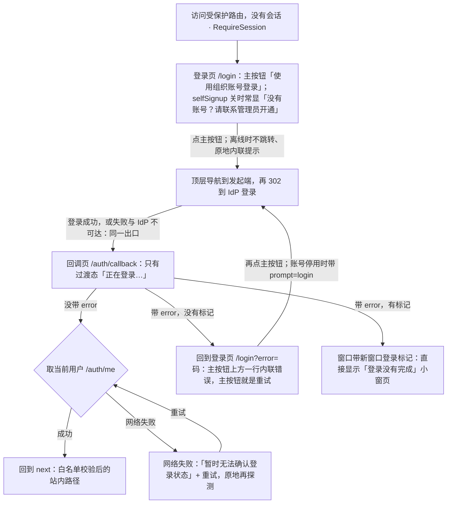
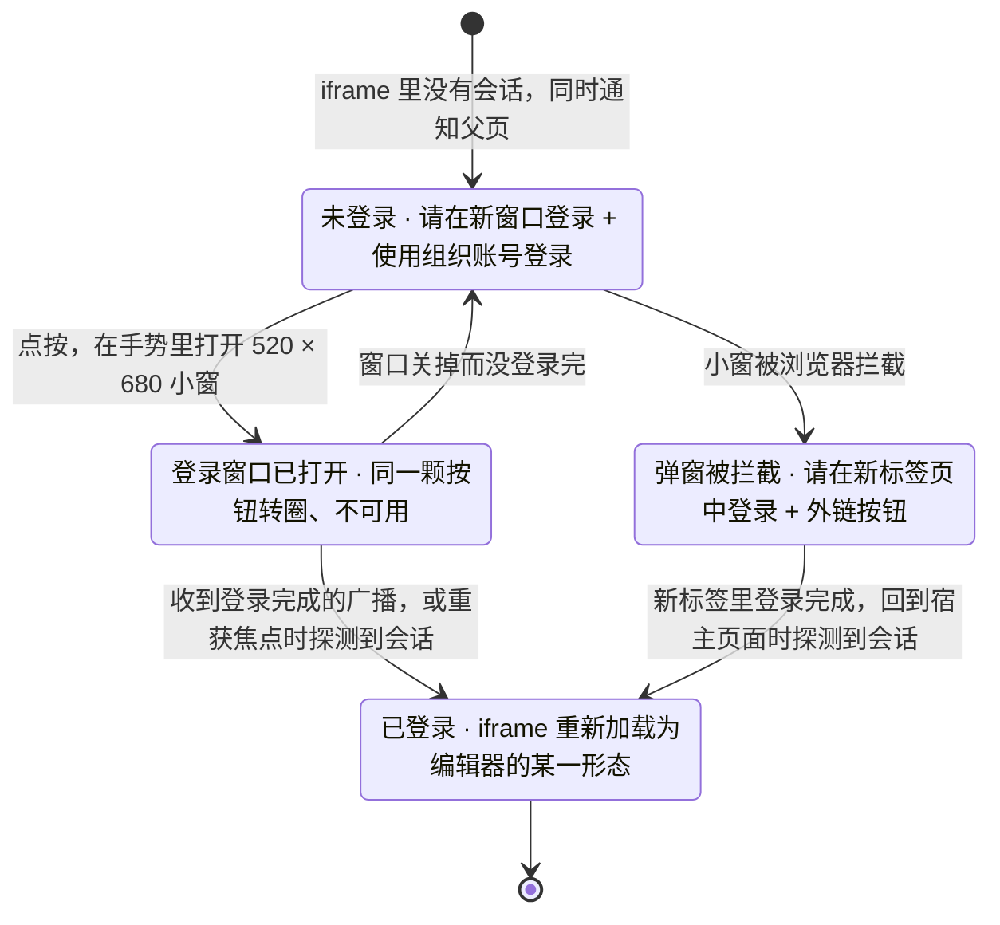

> 状态：草稿 | 负责：设计 | 更新：2026-10-22（design-language-v3 第 3 批：新建——按已拍板样张 `shell-pages` 与 `embed` 写应用壳里此前没有设计归属的页面（rulings §4.25 DS-71，PRD 07 G-66 的落点）：登录页是第 3 批唯一的新版式，与阻断页同一画法、不加卡片（DS-118），selfSignup 关时常显「没有账号？请联系管理员开通」（DS-119），登录失败回到登录页、主按钮上方一行内联错误（DS-120），发起端取不到 IdP 发现文档时也回到同一出口（DS-121），账号停用后重新发起登录带 `prompt=login`（DS-124），`/auth/config` 取失败按缺省渲染、离线时点主按钮内联提示、重试保住 `next`（TB-122）；OIDC 回调只剩过渡态与网络失败页（TB-122）；新窗口重新登录的回调页、新标签页与失败页，停用那一句补「原来页面里未同步的更改，可在离开时导出为本地副本」（DS-125）；路由兜底与错误页——找不到此页面、找不到该文档（与没有访问权限分开，DS-122；回收站里的文档按三类人写，DS-85、TB-73）、链接已失效、页面出错了、配置错误；退出登录的未同步确认（TB-122，导出对话框第二句按原因换，DS-129）；画布底上的主按钮不可用与进行中保持 kit 主按钮不可用态（DS-123），画布底上的次按钮一律 outline（TB-128）；「嵌入」一节写请在新窗口登录三态与嵌入里的打开失败（DS-73、TB-115）以及嵌入里的出口（DS-112）；页面文案由前端 50/02 搬入，50/02 改为引用本文（DS-71）；依据 rulings §4.25 DS-71、DS-73、DS-85、DS-112、DS-118…DS-125、DS-129、TB-73、TB-115、TB-122、TB-123、TB-128）；2026-10-22（design-language-v3 第 3 批回写续：§4.2 补 selfSignup 开而没配注册地址时部署拒绝启动、登录页不会出现点了没去处的「注册」（rulings §4.25 TB-143）；§4.3 内置 Casdoor 不支持 `prompt=login` 时错误行补「如需改用其他账号，请先在登录服务中退出」，后端验证支持时不出现（TB-140，原「随后端验证结果定」结案）；§7.2「找不到该文档」写明 03-13「打开失败态」表的这一行以本节为准，所有者一行改指 03-01 §6.1；§8、§9.3 嵌入里的「返回首页」与「退出登录」改为看宿主在 `cordex:init` 的 `intents` 里声明了 `navigate-back`、`sign-out` 没有（TB-145）；§12 补两条边界；同日再补：§2、§7.2 所有者一行「此文档在回收站中」改指 03-01 §6.1，「恢复」失败时主按钮上方一行内联错误、画法同登录页（rulings §4.25 TB-155）；§7.2 从未获授权的人一行补 M2 的「申请访问」留在原位不可用、写「后续版本提供」（TB-156）；§4.3、§12 内置 Casdoor 是否遵守 `prompt=login` 改为由后端 60/02 §15 AC-04 的 login-casdoor 用例在 M2 实测，不遵守才补那一句（DS-124、TB-140）；§7.4「复制诊断信息」写明以应用版本、路径、时间、错误名与消息、traceId 开头，有 host 时其后另带 Fiber 树、插件清单、最近事件与性能标记（与前端 50/15 §10 对齐）；§9.3 嵌入里又是触控设备时状态行与不可用原因以「在电脑上编辑」为准，嵌入只改写「在更大窗口中编辑」那一句（TB-159）；2026-10-22 复核修正：§7.2 三类人表「从未获授权的人」一行写明申请 M3 起才记下，M2「申请访问」不可用时阻断页的说明句不变、三个里程碑同一版式与文案（rulings §4.25 TB-156）；§9.3 写明「触控设备」只指平板、手机不论是否触控都按窗口窄写（TB-163）；状态头的回写轮次字样改为「回写续 / 同日再补」）；2026-10-23（design-language-v3 第 3 批评审修改：§7.4「复制诊断信息」去掉「导入失败页」——导入失败改在「导入」对话框里（rulings §4.25 DS-140），复制结果写在底栏左侧（TB-179）；退出登录确认框圆角随 DS-142 改为 12（§1.4 图例、§13 速查）） | 依赖：charter v0.2；rulings §4.13 S-1、§4.15 Q6、§4.20 FE-06、§4.25 DS-9、DS-19、DS-37、DS-40、DS-48、DS-50、DS-53、DS-59、DS-63、DS-71、DS-73、DS-85、DS-112、DS-118…DS-125、DS-129、TB-73、TB-115、TB-122、TB-123、TB-128、TB-140、TB-143、TB-145、TB-155、TB-156、TB-159、TB-163；PRD EM-01、EM-03、EM-12、EM-17、SV-06、AS-06、CO-05、CO-06、CO-15、NF-05、NF-07；前端 50/02 §2、§3、§4、§5、§10、§11，50/12 §9，50/15 §4.3、§10；后端 60/02 §2、§4.4、§7.4、§15，60/15 §3.1；playground `#/v3/page?state=shell-pages.*`、`#/v3/editor?state=shell-pages.*`、`#/v3/embed?state=embed.*`（`src/v3/scenarios/shell-pages/`、`src/v3/scenarios/embed/`、`src/v3/kit/BlockingPage.tsx`）

# 03-33 登录、会话与错误页

> **设计基准（2026-10-22 起，rulings §4.25 DS-71、DS-73、DS-118…DS-125）**：以已拍板的 playground 第 3 批样张为准——场景 `shell-pages`（页面宿主 `#/v3/page?state=shell-pages.<状态 id>`；找不到该文档、链接已失效与退出登录确认是编辑器路由上的状态，路由 `#/v3/editor?state=shell-pages.<状态 id>`）与场景 `embed`（`#/v3/embed?state=embed.<状态 id>`，iframe 里加载的页面是隐藏场景 `embed-frame`）；源码在 `playground/src/v3/scenarios/shell-pages/`（`shell-pages.scenario.tsx` 各状态的标题与说明，`LoginPage.tsx` 登录页，`pages.tsx` 回调页与错误页，`LogoutConfirm.tsx` 退出登录确认）、`playground/src/v3/scenarios/embed/`（`embed.scenario.tsx`、`frame.scenario.tsx`、`pages.tsx`）与 `playground/src/v3/kit/BlockingPage.tsx`（阻断页）；对照截图 `openspec/changes/design-language-v3/screens/batch3/shell-pages-<状态>-dark.jpg` / `-light.jpg`、`embed-<状态>-dark.jpg` / `-light.jpg`。编辑器外壳以 [03-02](02-editor-main.md) 为准，阻断页与第 1 批「打开失败」是同一个件（03-02 §6.2「错误（打开失败）」）。样张里的嵌入宿主外框（「宿主页面（演示容器，不代表任何真实产品）」与容器尺寸）、样张之间的跨宿主跳转、示例数据与时间只是演示手段，不是产品行为。前端 50/02 此前写的登录、回调、分享链接落地与退出确认的页面文案，一律以本文为准（DS-71）。

应用壳里此前没有设计归属的页面（rulings §4.25 DS-71；PRD 07 缺口 G-66 的落点）：登录页 `/login`、OIDC 回调与登录失败 `/auth/callback`、新窗口重新登录的回调 `/auth/popup-callback`、路由兜底与错误页（不存在的路径、文档不存在、链接已失效、应用出错、配置错误）、退出登录时的未同步确认，以及嵌入形态（`/embed`）自己的页面（§9）。新版式只有登录页一张，其余沿用已拍板的阻断页画法与居中加载行（DS-53）。

需求：PRD EM-03（鉴权与身份对接）、EM-17（参考应用的登录）、SV-06（OIDC 登录与账号）、AS-06（退出登录）、EM-01（嵌入形态 E）、EM-12（诊断信息不含文档内容）、NF-05（可及性）、NF-07（触控与手机）；PRD CO-05、CO-06（新窗口重新登录、导出本地副本）与 PRD CO-15（分享链接落地）。路由、守卫与会话状态机以前端 50/02 §2、§4、§5、§10、§11 为准，接口与错误码以后端 60/02 §2、60/15 §3.1 为准；本文只写画面、文案与交互。

---

## 1. 线框

### 1.1 登录页（桌面 1600 × 1000）

```
┌──────────────────────────────────────────────────────────────────────────┐
│                                                                          │
│                                 ┌──────┐                                 │
│                                 │ 品牌 │      ← 品牌标 32（集成方可换）  │
│                                 └──────┘                                 │
│                               登录 Cordex                                │
│              将跳转到「统一身份认证」登录，完成后自动返回                │
│                                                                          │
│                        ⓧ 登录没有完成，请重试     ← 内联错误（按需）     │
│                      ┌────────────────────────┐                          │
│                      │    使用组织账号登录    │  ← 主按钮 240 × 28       │
│                      └────────────────────────┘                          │
│                       没有账号？请联系管理员开通  ← 弱提示               │
│                                                                          │
└──────────────────────────────────────────────────────────────────────────┘
```

图例：画布底色整屏、不挂导航；居中一列，与阻断页同一画法（§1.2，DS-118），不加卡片、不放插图；`ⓧ` 内联错误只在登录失败或离线时点了主按钮之后出现（§4.3）；selfSignup 开时弱提示换成同宽次按钮「注册」（§4.2）。截图：`screens/batch3/shell-pages-login-*.jpg`、`shell-pages-login-error-retry-*.jpg`，样张 `shell-pages.login`、`login-error-retry`。

### 1.2 阻断页画法（错误页、回调页、嵌入页共用）

```
                          （32px 线性图标）
                               Cordex                ← 标题上方一行（按需）
                          标题（16px 600）
            说明（12px，次级文字色，最宽 420）
                     [ 主按钮 ]  [ 次按钮 ]           ← 主操作主按钮，其余 outline
                         弱提示（按需）
```

- 整屏、画布底色，不挂导航；居中一列（左右至少 48，下方多留 40，整体略高于正中）：32px 线性图标（次级文字色，不用危险色大图标）· 标题上方可选一行 12px 次级文字色（文档名，或回调页的产品名）· 标题 16px / 24、600（`h1`，整页区域用它作读屏名）· 说明 12px / 18、次级文字色、最宽 420 · 按需一行内联提示（§4.3）· 一行按钮（上距 24，有内联提示时 12，按钮间距 8）· 按需一行弱提示（上距 16）。kit `BlockingPage`，与第 1 批「打开失败」（03-02 §6.2）、第 2 批「访问权限已变更」「查看人数已满」（03-12 §8）是同一个件。
- **按钮**：主操作用主按钮；返回类与其余按钮一律 outline——画布底上的次按钮（rulings §4.25 TB-128）。画布底上的主按钮不可用或进行中保持 kit 主按钮的不可用态（`--v3-panel-2` 底 + 三级文字色，进行中加转圈），与第 2 批「申请访问」发送后同一画法（rulings §4.25 DS-123；未采纳的「一律 outline 不可用态」见 §3.1）。
- **产品名一行**只给回调页（`/auth/callback`、`/auth/popup-callback`）上的阻断页：刚从 IdP 跳回、或在单独的小窗与新标签里，用产品名接上「这是哪个应用」。登录页把产品名并进标题「登录 Cordex」；其余错误页不写。品牌标与产品名取部署配置的品牌（`RuntimeConfig.brand`，前端 50/02 §3），集成方可换。
- 页面不显示路径、错误码与原始错误描述；文案按「发生了什么，能做什么」两段写（设计 07 §7）。

### 1.3 手机与触控（< 640 或 `pointer: coarse`，390 × 844）

```
┌──────────────────────────────────────┐
│                                      │
│               ┌──────┐               │
│               │ 品牌 │               │
│               └──────┘               │
│             登录 Cordex              │
│  将跳转到「统一身份认证」登录，完成  │
│            后自动返回                │
│ ┌──────────────────────────────────┐ │
│ │         使用组织账号登录         │ │ ← 占满列宽（最宽 400），高 44
│ └──────────────────────────────────┘ │
│      没有账号？请联系管理员开通      │
│                                      │
└──────────────────────────────────────┘
```

同一列左右 16 边距；主按钮占满列宽（最宽 400）、高 44、圆角 8、13px（设计 04 §2.13 触控按钮；07 §2 触控目标 ≥ 44、相邻间距 ≥ 8），说明与弱提示仍 12px。同一条宽度规则也用在嵌入「请在新窗口登录」的窄容器与触控设备（§9.1，TB-122）。M3 起手机凭分享链接查看之前同样先到这里（PRD NF-07、PRD CO-15）。样张 `shell-pages.login-narrow`。

### 1.4 退出登录的未同步确认

```
┌──────────────────────────────────────────────┐
│ 退出登录将丢失 3 项未同步更改                │
│ 网络恢复后这些更改会自动同步，现在退出会丢失 │
│ 它们。                                       │
│ 可以先导出本地副本，再退出登录。             │
│                                              │
│ [导出为本地副本]          [取消] [仍要退出]  │
└──────────────────────────────────────────────┘
```

图例：小号确认框 360（kit 对话框的 confirm 形态，圆角 2026-10-23 起为 12，rulings §4.25 DS-142，画面随之改），模态；「仍要退出」是危险色主按钮，用户打开时初始焦点在「取消」（§8）。截图：`screens/batch3/shell-pages-logout-unsynced-confirm-*.jpg`，样张 `shell-pages.logout-unsynced-confirm`（背景是离线中的编辑器）。

---

## 2. 页面与入口

| 页面 | 路由（前端 50/02 §2） | 何时出现 | 本文 |
|---|---|---|---|
| 登录页 | `/login?next=` | 未登录访问受保护路由（`RequireSession` 送来）、退出登录与 RP 登出之后、回调失败（带 `?error=`） | §4 |
| OIDC 回调 | `/auth/callback?next=` | IdP 登录后经服务端回跳；启动时探测会话同一画法 | §5 |
| 新窗口重新登录回调 | `/auth/popup-callback` | 编辑器「登录已过期」横幅的「重新登录」、嵌入「请在新窗口登录」打开的小窗或新标签 | §6 |
| 找不到此页面 | `*`（`errors/NotFoundPage`） | 未登记的路径 | §7.1 |
| 找不到该文档、链接已失效 | `/documents/:id` 的打开失败态 | 文档 404；分享链接已撤销或到期、又没有直接授权 | §7.2、§7.3 |
| 页面出错了 | 根错误边界 `AppErrorBoundary` | 客户端崩溃、未被页面接住的致命错误 | §7.4 |
| 配置错误 | 启动时 `RuntimeConfig` 校验失败 | 部署配置有误 | §7.5 |
| 退出登录确认 | 账户菜单「退出登录」 | 退出时本用户还有未同步更改 | §8 |
| 嵌入里的页面 | `/embed/:id` | iframe 里没有会话、打开失败 | §9 |

不在本文的页面：编辑器打开失败的其余错误码、没有访问权限与申请访问、查看人数已满、会话中访问被撤销（[03-13](13-import-progress-and-degraded-states.md)「打开失败态」、03-02 §6.2、[03-08](08-share-permissions-dialog.md) §1.4、[03-12](12-offline-conflict-banner.md) §8）；所有者打开回收站里的文档时的「此文档在回收站中」（[03-01](01-document-list.md) §6.1，样张 `documents.trash-blocked`）；普通成员直接访问管理页（回到开始页并给轻提示「需要管理员权限」，[03-32](32-admin-plugin-management.md) §1、rulings §4.25 TB-101）。`/render` 没有界面；`/styleguide` 只在测试部署注册。

**图 2-1 登录、回调与失败的去向**



怎么读：自上而下是一次登录的往返。失败一律回到登录页的同一个位置（主按钮上方一行），不单设失败页（DS-120）；发起端取不到 IdP 发现文档时也 302 回到回调页、走同一个出口（DS-121），用户不会在顶层导航里看到接口错误页；回调页只剩过渡态与网络失败两种画面（TB-122）；新窗口重新登录的失败另见 §6.3。
依据：rulings §4.25 DS-118、DS-120、DS-121、DS-124、TB-122；前端 50/02 §4.4；后端 60/02 §2。

---

## 3. 状态

样张路由：页面宿主 `#/v3/page?state=shell-pages.<状态 id>`，表中注明「编辑器宿主」的为 `#/v3/editor?state=shell-pages.<状态 id>`；暗 / 亮另加 `&theme=dark|light`。截图视口 1600 × 1000，`login-narrow` 为 390 × 844，`popup-completing`、`popup-failed` 为 520 × 680（`window.open` 的尺寸）。嵌入的状态见 §9.4。

| 状态（样张标题） | 要点 | 样张 id | 里程碑 |
|---|---|---|---|
| 登录 · 默认 | 品牌标 32 ·「登录 Cordex」· 说明（IdP 显示名）· 主按钮「使用组织账号登录」· 弱提示「没有账号？请联系管理员开通」（selfSignup 关时常显） | `login` | M2 |
| 登录 · 开放注册 | selfSignup 开：弱提示换成同宽次按钮「注册」（outline） | `login-signup` | M2 |
| 登录 · 正在跳转 | 同一颗主按钮转圈、写「正在跳转…」、不可用（kit 主按钮不可用态，DS-123）；「注册」同时不可用 | `login-redirecting` | M2 |
| 登录 · 登录没有完成 | `/login?error=` 带 `server.auth.invalid_token`：主按钮上方危险色图标 +「登录没有完成，请重试」 | `login-error-retry` | M2 |
| 登录 · 账号已停用 | 「你的账号已停用，请联系管理员」；主按钮照常，用于换账号，重新发起时带 `prompt=login`（DS-124） | `login-error-disabled` | M2 |
| 登录 · 登录服务不可达 | 「暂时无法连接登录服务，请稍后重试」（发起端与回调同一出口，DS-121） | `login-error-idp` | M2 |
| 登录 · 网络未连接 | `/auth/config` 取失败时按缺省渲染；离线时点主按钮不跳转，主按钮上方「无法连接网络，请检查网络后重试」 | `login-offline` | M2 |
| 登录 · 手机 | 左右 16 边距，主按钮占满列宽（最宽 400）、高 44 | `login-narrow` | M2（手机凭分享链接查看 M3） |
| 回调 · 正在登录 | 居中一行加载行「正在登录…」（超过 300 ms 才出现） | `callback-signing-in` | M2 |
| 回调 · 网络失败 | 断开的云 ·「Cordex」·「暂时无法确认登录状态」·「请检查网络连接后重试」·「重试」 | `callback-network-error` | M2 |
| 新窗口 · 正在完成登录 | 520 × 680 小窗里一行「正在完成登录…」，多数时候窗口已经关了 | `popup-completing` | M2 |
| 新标签 · 已重新登录 | 弹窗被拦截、改在新标签登录后关不掉：对勾 ·「Cordex」·「已重新登录」·「可以关闭此页，回到原来的页面」，不放按钮 | `popup-done-tab` | M2 |
| 新窗口 · 登录没有完成 | 钥匙 ·「Cordex」·「登录没有完成」· 按失败码一句原因 ·「关闭此窗口」（outline） | `popup-failed` | M2 |
| 找不到此页面 | 未登记的路径：「找不到此页面」·「链接可能有误，或页面已不存在」·「返回首页」 | `not-found-route` | M1 |
| 找不到该文档 | 文档 404：问号文件图标 ·「找不到该文档」·「文档可能已被删除，或链接有误」·「返回文档列表」（编辑器宿主） | `not-found-doc` | M2 |
| 链接已失效 | 断链图标 ·「链接已失效」·「这个分享链接已被撤销或已过期」「可以向文档所有者申请访问，获得批准后即可打开」·「申请访问」「返回文档列表」（编辑器宿主） | `link-expired` | M3（PRD CO-15） |
| 页面出错了 | 警示三角 ·「页面出错了」·「重新加载」「复制诊断信息」 | `app-error` | M1 |
| 配置错误 | 扳手 ·「应用配置有误，无法启动」· 中英两段与出错的配置项，不放按钮 | `config-error` | M1 |
| 退出登录 · 有未同步更改 | 「退出登录将丢失 3 项未同步更改」·「导出为本地副本」/「取消」/「仍要退出」（编辑器宿主） | `logout-unsynced-confirm` | M2 |

样张没有单独画、行为照常的：分享链接落地的登录页（与 `login` 相同，「联系管理员」一行常显，落地不另加，DS-119）；启动时探测会话（同 `callback-signing-in`，文案「正在加载…」，§5）；`popup-failed` 的另两个失败码与新标签里的同一页（只换原因句，§6.3）；退出登录确认的其余原因（第一句按 03-12 §9 的原因表换，§8）。

### 3.1 未采纳的备选（DS-63）

拍板时画给用户对照的备选留在样张里，标题前加「未采纳 · 」，实现以上表为准。

| 样张 id | 未采纳的画法 | 定为推荐的是 |
|---|---|---|
| `alt-login-card` | 同样的内容放进居中面板卡片（宽 360，面板底 + 1px 边、圆角 8，不带阴影），按钮占满卡片内宽 | DS-118：与阻断页同一画法、不加卡片（`login`）；不为一页多造一种容器，集成方换品牌时也只核对一层底色 |
| `alt-callback-failed` | 回调页拿到 error 就地显示失败页：钥匙图标 · 产品名 ·「登录没有完成」· 按码的说明 ·「重新登录」+「返回登录页」 | DS-120：回登录页内联报错（`login-error-retry`）；主按钮就是重试，少一页、少一个做同一件事的按钮 |
| `alt-404-merged` | 404 与 403 合成一页「找不到文档，或你没有访问权限」+「申请访问」 | DS-122：单独的「找不到该文档」（`not-found-doc`）；对不存在的文档申请访问必然再得 404 |

只作文字说明、没有样张的未采纳项：「没有账号？」只在登录失败后出现（DS-119）；发起端保持 503 报错页（DS-121）；画布底上的主按钮不可用或进行中一律用 outline 不可用态，或用强调色实底加转圈（DS-123）；停用后加「改用其他账号」按钮、只补文案或不处理（DS-124）；新窗口登录失败时原页改横幅、频道加失败消息（DS-125）。

---

## 4. 登录页（`/login`）

### 4.1 版式与主按钮（DS-118，TB-122）

- 与阻断页同一画法：画布底色上居中一列，不加卡片、不放插图（§1.2）——品牌标 32（`RuntimeConfig.brand`，集成方可换）· 标题「登录 Cordex」（16px 600，`h1`；产品名取品牌、并进标题，品牌标下不单列一行产品名）· 说明「将跳转到「〈IdP 显示名〉」登录，完成后自动返回」（12px 次级文字色；IdP 显示名取 `GET /auth/config` 的显示名，样张示例「统一身份认证」；没配或取失败时写「将跳转到组织的登录服务，完成后自动返回」）· 主按钮「使用组织账号登录」· 弱提示或「注册」（§4.2）。
- 只有组织 OIDC 一种登录方式：不自绘密码表单、不选租户（rulings §4.15 Q6、§4.13 S-1）。
- **必须点一下才跳 IdP**，不自动跳转：RP 登出回到这里时 IdP 会话往往还在，自动跳会被立刻登回去（后端 60/02 §4.4）。点了以顶层导航走发起端 `GET /auth/oidc/login`（`mode=redirect`，前端 50/02 §4.4）。
- **主按钮尺寸**（TB-122）：页面级主按钮保持 28 高，不为一页另开尺寸档；桌面定宽 240；触控或 < 640 时占满列宽（最宽 400）、高 44、圆角 8（§1.3）。嵌入「请在新窗口登录」里的同一句主按钮用同一条宽度规则（§9.1）。
- 已登录的人访问 `/login` 直接回到 `next`（白名单校验后的站内路径，缺省开始页，前端 50/02 §4.4 第 5 步）。
- 不自动聚焦；页面第一个可聚焦项就是主按钮。

### 4.2 「没有账号？」与注册（DS-119）

- `auth.selfSignup` 关（部署开关，缺省关，由 `GET /auth/config` 下发）：主按钮下一行弱提示「没有账号？请联系管理员开通」（12px 次级文字色），**常显**；分享链接落地不另加，登录失败也不说「你还没有账号」——登录失败不一定是没有账号，账号停用、IdP 不可达同样会失败。
- selfSignup 开：主按钮下改为同宽次按钮「注册」（outline），点了在同一标签页顶层导航到 IdP 的注册页；不显示上一条弱提示。注册页属于 IdP（compose 可选内置 Casdoor），它的主题定制是 PRD 07 G-66 的工作项，本文不画。selfSignup 开着而没配注册地址时部署拒绝启动（启动交叉断言，退出码 78，后端 60/17；rulings §4.25 TB-143），所以登录页不会出现点了没去处的「注册」。
- `/auth/config` 取失败（网络错误、5xx）时按缺省渲染、不报错：当作 selfSignup 关、没有 IdP 显示名（TB-122，样张 `login-offline`）。

### 4.3 登录失败与内联错误（DS-120、DS-121、DS-124，TB-122）

- **只回到这里**：回调页拿到 `error` 即 replace 到 `/login?error=<码>`，登录页在主按钮上方写一行内联错误（危险色 `CircleAlert` 16 + 12px 主文字色，`role="alert"`；上距 16，与主按钮间距 12）。主按钮就是重试，不单设失败页（未采纳 `alt-callback-failed`，§3.1）。再点主按钮时错误行随之消失、按钮转为「正在跳转…」。
- 三个失败码各一句，不回显 IdP 原始错误（细分原因只进审计，后端 60/02 §2）：

| 失败码 | 何时 | 内联错误 | 样张 |
|---|---|---|---|
| `server.auth.invalid_token` | state 过期、绑定值不符、换码失败等 | 登录没有完成，请重试 | `login-error-retry` |
| `server.auth.account_disabled` | 账号已停用（不建会话） | 你的账号已停用，请联系管理员 | `login-error-disabled` |
| `server.auth.idp_unavailable` | IdP 发现文档或令牌端点不可达 | 暂时无法连接登录服务，请稍后重试 | `login-error-idp` |
| （不是失败码） | 点主按钮时浏览器报告离线 | 无法连接网络，请检查网络后重试 | `login-offline` |

- **IdP 不可达时的出口**（DS-121）：发起端取不到 IdP 发现文档时也 302 回前端，与回调失败同一出口（`redirect` 模式回 `/auth/callback?error=…`，`popup` 模式回 `/auth/popup-callback?error=…`）；用户看到的就是上表 `login-error-idp` 这一句，不会在顶层导航里看到一整页接口错误。接口行为以后端 60/02 §2、60/15 §3.1 为准。
- **账号已停用时换账号**（DS-124）：主按钮照常，用于换一个账号登录；这个失败码下主按钮发起的登录带 `prompt=login`，IdP 要求重新输入账号，不会被静默登回同一个停用账号；界面不另加按钮（发起端接受并透传这个参数的口径以后端 60/02 §2、60/15 §3.1 为准）。内置 Casdoor 是否遵守 `prompt=login`，由后端 60/02 §15 AC-04 的 login-casdoor 用例在 M2 实测（结论回写 60/02 §2）：不遵守时错误行后补一句「如需改用其他账号，请先在登录服务中退出」，整行为「你的账号已停用，请联系管理员；如需改用其他账号，请先在登录服务中退出」（与 §6.3 停用那句接后半句的写法一致）；实测遵守时不补（rulings §4.25 DS-124、TB-140）。弱提示「没有账号？请联系管理员开通」照常（两句说的是两件事）。
- **离线时点主按钮**（TB-122）：浏览器报告离线时不发起跳转（顶层导航只会落到浏览器自己的错误页），主按钮上方内联「无法连接网络，请检查网络后重试」，画法同上；焦点留在主按钮，再点时重新播报一次；网络恢复时这一行消失。连得上网而 IdP 不可达时照常走上面的统一出口。
- **重试保住 `next`**（TB-122）：后端的失败回跳只带 `?error=`，前端在发起登录前把校验过的 `next` 写进 sessionStorage（新键，登记在前端 50/02 §10.1，登出与换人时清掉），再点主按钮时带上它、回调成功后用完即删；分享链接落地的人重试后照常回到那份文档。

### 4.4 正在跳转（DS-123）

- 点了主按钮后，同一颗按钮（同一个元素，焦点留在原处）转圈、写「正在跳转…」、不可用（`aria-disabled` + `aria-busy`，防止重复点；文字已说明，不另写原因提示）；开放注册时「注册」同时不可用。
- 按钮外观保持 kit 主按钮的不可用态（`--v3-panel-2` 底 + 三级文字色）加转圈，与第 2 批「申请访问」发送后同一画法（rulings §4.25 DS-123）。已知代价：亮色画布上这块底与画布只差一档，按钮外形不明显，靠转圈与文字认出。
- 进行中的一句由常驻 polite 区播报一次「正在跳转到登录服务」。浏览器从 IdP 后退回到本页（往返缓存恢复）时按钮恢复可点。

---

## 5. OIDC 回调（`/auth/callback`）

- **只有一个过渡态**（DS-120）：画布底色上居中一行加载行「正在登录…」（kit `LoadingRow`，DS-53：超过 300 ms 才出现，多数时候一闪而过，不画骨架；加载行不写产品名）。`GET /auth/me` 返回后 replace 到 `next`（白名单，前端 50/02 §4.4 第 5 步；`next` 优先取 sessionStorage 里保住的那一个，§4.3）。样张 `callback-signing-in`。
- **带 `error` 时不在这里显示**：窗口带新窗口重新登录的标记时直接显示「登录没有完成」小窗页（§6.3，TB-122）；否则 replace 到 `/login?error=<码>`（§4.3）。
- **网络失败**（TB-122）：`GET /auth/me` 超时、离线或 502 / 503 / 504（前端 50/02 §4.2 归为网络错误，不改登录态）时原地显示阻断页——断开的云图标（同离线横幅）· 产品名「Cordex」·「暂时无法确认登录状态」·「请检查网络连接后重试」·「重试」（主按钮：原地再探测，不重走 IdP；成功后照常回到 `next`）。点「重试」先把焦点交给加载行再换状态（设计 07 §2.4；加载行可程序聚焦、读屏名「正在登录」）。样张 `callback-network-error`。
- **启动时探测会话**（`RequireSession` 尚未知道有没有会话）同一画法，文案「正在加载…」，取代前端 50/02 §2.1 原写的「渲染骨架」（DS-53）；不另出样张。
- 回调页因此只有过渡态与网络失败两种画面；测试 70/06 §7.2 把它登记为非交互页的豁免理由随之改为「只有过渡态与网络失败页」（TB-122）。

---

## 6. 新窗口重新登录（`/auth/popup-callback`）

编辑器「登录已过期」横幅的「重新登录」（[03-12](12-offline-conflict-banner.md) §6）与嵌入的「请在新窗口登录」（§9.1）在点击手势里打开一个 520 × 680 的小窗（`mode=popup`，前端 50/02 §5）；原页全程不跳转、待同步队列保留。

### 6.1 正在完成登录

- 小窗里居中一行「正在完成登录…」（超过 300 ms 才出现，多数时候窗口已经关了；加载行不写产品名）。回调页取当前用户后经 `cordex-auth` 频道通知原页（`reauth-done`，消息不带令牌与身份，前端 50/14 §8），随后关闭窗口。样张 `popup-completing`。
- 原页拿到空白窗口后、跳到登录地址前，给这个窗口的 sessionStorage 写新窗口登录的标记（新键，登记在前端 50/02 §10.1，用完即删；TB-122），供 §6.3 判断。

### 6.2 新标签里已重新登录

- 弹窗被浏览器拦截、改用「在新标签页中登录」时，登录完成后标签页关不掉（经过 IdP 几次跳转的标签页不能由脚本关闭）：对勾图标（次级文字色，阻断页的图标一律中性）· 产品名「Cordex」·「已重新登录」·「可以关闭此页，回到原来的页面」。不放按钮：关不掉，也不引导在这里另开文档，免得同一份文档开两份。
- 原页靠 `cordex-auth` 广播与重获焦点时的探测恢复（前端 50/02 §5 第 4 步）；原来的页面也可能是只读浏览或嵌入的仅查看，所以只说「回到原来的页面」、不说「继续编辑」。样张 `popup-done-tab`（新标签是完整窗口，按 1600 × 1000 截）。

### 6.3 登录没有完成（DS-125）

- 回调带了 `error`（失败同样 302 回 `/auth/popup-callback?error=<码>`，后端 60/15 §3.1）：钥匙图标 · 产品名「Cordex」·「登录没有完成」· 按失败码一句原因 ·「关闭此窗口」（outline；脚本打开的窗口关得掉）。样张 `popup-failed`（520 × 680，画的是 `server.auth.invalid_token`）。

| 失败码 | 原因句 |
|---|---|
| `server.auth.invalid_token` | 登录信息已失效，请回到原来的页面重新登录 |
| `server.auth.idp_unavailable` | 暂时无法连接登录服务，请稍后在原来的页面重新登录 |
| `server.auth.account_disabled` | 你的账号已停用，请联系管理员；原来页面里未同步的更改，可在离开时导出为本地副本 |

- **停用那一句的后半句**（rulings §4.25 DS-125）：停用后原页再也登不回来，但原页一侧不改——仍是第 2 批「登录已过期」横幅（`offline-conflict.auth-expired-pending`，03-12 §6），`cordex-auth` 频道仍只有 `reauth-done` 一种消息（前端 50/02 §5 写明失败分支不改协议）；原页未同步的更改经离开或刷新确认左下的「导出为本地副本」带走（03-12 §9），失败页把这条路说出来。
- **在新标签里**（弹窗被拦截时）关不掉：不放按钮，原因句末改为「请关闭此页，回到原来的页面重新登录」（停用那一句不变）。
- **state 失效时**：后端分不出这是新窗口登录（模式只记在登录状态里），会回 `/auth/callback?error=…`；`/auth/callback` 带 `error` 且窗口有 §6.1 的标记时直接显示本页，不再跳 `/login`，小窗里不会出现整页登录页（TB-122）。
- 窗口关掉后，原页横幅的「重新登录」恢复可点（第 2 批 `auth-expired-pending`「窗口关闭而未完成时恢复可点」）。

---

## 7. 路由兜底与错误页

### 7.1 找不到此页面

- 路由兜底 `*`：未登记的路径（如已废止的 `/d/<id>`，非测试部署里的 `/styleguide`）显示阻断页（整屏、画布底色、不挂导航）——搜索落空图标（`SearchX`）·「找不到此页面」·「链接可能有误，或页面已不存在」·「返回首页」（outline，返回类；未登录时开始页的守卫再送去登录页）。不显示路径与错误码。样张 `not-found-route`。

### 7.2 找不到该文档（DS-122、DS-85）

- 文档 404（`server.documents.not_found`）用单独的阻断页，与「没有访问权限」（403，03-13「打开失败态」、第 1 批 `main-states.open-failed-access`）分开：问号文件图标（`FileQuestionMark`）·「找不到该文档」·「文档可能已被删除，或链接有误」·「返回文档列表」（outline）。只有这一个按钮：对不存在的文档「申请访问」必然再得 404。拿不到元数据，不写文档名。
- 它是编辑器路由 `/documents/:id` 的打开失败态，画法同第 1 批 `open-failed`（不渲染左栏、检查器与工具条，03-02 §6.2）。样张 `not-found-doc`（编辑器宿主）。03-13「打开失败态」表里「找不到该文档」一行的画法与文案以本节为准。
- **谁会看到**：文档不存在、正在永久删除，或有角色的非所有者打开回收站里的文档。打开回收站里的文档按三类人分（守卫顺序与 404 口径以后端 60/02 §6、60/04 为准）：

| 打开的人 | 看到的页面 | 依据 |
|---|---|---|
| 所有者 | 「此文档在回收站中」阻断页 +「恢复」（[03-01](01-document-list.md) §6.1，样张 `documents.trash-blocked`）；「恢复」失败时主按钮上方一行内联错误，与登录页同一画法（§4.3，rulings §4.25 TB-155） | DS-85 |
| 有角色的非所有者（编辑者、评审者、查看者，或持有效链接的人） | 本页「找不到该文档」 | DS-85、DS-122 |
| 从未获授权的人 | 「你没有权限访问此文档」+「申请访问」（03-13、03-08 §1.4）；M3 起申请照常记下，不透露文档在回收站；M2 的「申请访问」留在原位、不可用，写「后续版本提供」，阻断页的说明句不变、三个里程碑同一版式与文案（03-08 §4.5） | rulings §4.25 TB-73、TB-156 |

### 7.3 链接已失效

- 分享链接已撤销或到期、又没有直接授权（403，原因为链接已到期或已撤销，后端 60/02 §7.4；前端 50/02 §11 第 5 步随之删除这个令牌）：「没有访问权限」阻断页的变体，只换图标、标题与第一句说明——断链图标（`Link2Off`）·「链接已失效」· 两句说明各占一行「这个分享链接已被撤销或已过期」「可以向文档所有者申请访问，获得批准后即可打开」·「申请访问」（主按钮，打开第 1、2 批同一个留言弹层，03-08 §4.5，DS-48）·「返回文档列表」（outline）。
- 发送后同「没有访问权限」：「申请访问」留在原位不可用（kit 主按钮不可用态，DS-123；工具提示「已发送申请，24 小时内不能重复申请」），第二句换成成功色对勾 +「已发送申请，等待文档所有者批准」（常驻，polite 播报一次）。
- 不带原因的 403 仍是「你没有权限访问此文档」（03-13）；分享链接落地的整体流程见 03-08 §6。样张 `link-expired`（编辑器宿主）。

### 7.4 页面出错了

- 根错误边界（`AppErrorBoundary`，前端 50/15 §4.3）接住客户端崩溃与未被页面接住的致命错误：替换整个应用、不挂导航——警示三角图标 ·「页面出错了」·「请重新加载；如果问题持续，请复制诊断信息并联系管理员」（同 03-02 §6.2 通用兜底的句式）·「重新加载」（主按钮）·「复制诊断信息」（outline）。
- 「复制诊断信息」点后原位变为「✓ 已复制」1.5 秒（同 03-08「复制链接」：不用轻提示，按钮定宽不跳，polite 播报一次「已复制诊断信息」）；阻断页上的「复制诊断信息」都照这一画法（嵌入里的打开失败同一颗按钮）；导入失败不是阻断页（2026-10-23 起导入全程在「导入」对话框里，rulings §4.25 DS-140），那里的「复制诊断信息」是底栏的次按钮，复制后结果写在底栏左侧「已复制诊断信息」（TB-179、DS-56，03-13）。复制的内容不含文档内容与令牌（PRD EM-12）：以应用版本、路径（不含查询与片段）、时间、错误名与消息、traceId 开头（样张示例的就是这几项）；有 host 时其后另带 Fiber 树、插件清单、最近事件与性能标记，没有 host 时只有开头这一段；条目以前端 50/15 §10 为准。
- 没有全局 500 页：接口 5xx 由各页的内联错误与重试处理（前端 50/15 §4.3）。样张 `app-error`。

### 7.5 配置错误

- 启动时 `RuntimeConfig` 校验失败（前端 50/02 §3）：静态页、零网络请求，不读偏好与语言包，所以中英两段都写（英文段 `lang="en"`），主题只跟随系统——扳手图标 ·「应用配置有误，无法启动」·「请联系部署管理员检查下面的配置项」· 英文同义一句「The app can’t start because its configuration is invalid. Contact your deployment administrator to check the item below.」· 出错的配置项（路径 + 中英原因各一句，如「生产构建不接受取值 none」「The value none is not allowed in production builds」；配置项与取值用等宽、主文字色，与次级文字色的说明分开；英文句不以小写的取值开头）。不放按钮（重新加载解决不了）。样张 `config-error`（示例：生产构建里 `auth.mode` 设成了 `none`）。

---

## 8. 退出登录的未同步确认（TB-122、DS-129）

- **何时弹**：账户菜单「退出登录」时，先尝试同步（与离开确认同一走向，03-12 §9，DS-59），仍有未同步更改（协同在途或离线队列，前端 50/02 §10.2 第 1 步）才弹这个模态确认；没有就直接退出（TB-122）。
- **画法**：同第 2 批离开确认（`offline-conflict.leave-confirm`，03-12 §9），小号 360、模态（DS-40 第三档：不可撤销的丢弃）——标题「退出登录将丢失 N 项未同步更改」· 说明两句各占一行、句末句号：第一句按原因换，与离开确认同一张表（离线 / 登录已过期 / 协同已暂停 / 未保存到服务器，03-12 §9），动词「离开」换成「退出」，离线时为「网络恢复后这些更改会自动同步，现在退出会丢失它们。」；第二句「可以先导出本地副本，再退出登录。」· 左下「导出为本地副本」（次按钮）· 右侧「取消」（安全项，用户打开时初始焦点在它上面）+ 危险色「仍要退出」。
- **导出**：「导出为本地副本」打开 03-12 §7.2 的同一个导出本地副本对话框，说明的第二句按原因换（rulings §4.25 DS-129），退出登录写「导出的副本不会自动合并回文档，恢复连接后可以对照重做。」。导出后回到编辑器、不自动退出；再点「退出登录」时仍有未同步项就再弹一次（前端 50/02 §10.2 第 1 步与图 7 随之改）。
- **仍要退出**：按前端 50/02 §10.2 第 2–4 步登出、清理本地数据、通知其他标签页，整页跳 IdP 登出后回到登录页。
- **焦点**：Esc 或「取消」关闭后焦点回自己的头像（账户菜单的触发处，03-02 §7）；导出对话框关闭后同样回头像。同一状态里主菜单「返回首页」照样先弹第 2 批的离开确认，两个确认共用一个导出对话框，从哪个确认打开，关闭后焦点就回哪个确认的触发处。
- 嵌入时不走本流程，登出交给宿主：SDK 嵌入调集成方的登出回调，iframe 嵌入在 `cordex:init` 的 `intents` 里声明了 `sign-out` 时发 `cordex:intent` 交宿主；都没有时「退出登录」留在原位、不可用（§9.3，rulings §4.25 TB-145，03-29 §2.5）。
- 样张 `logout-unsynced-confirm`（背景是离线编辑器：离线横幅、「离线 · 3 项待同步」、头像组只剩自己），只画离线一种原因。

---

## 9. 嵌入

`apps/web` 的 `/embed/:id?mode=view|edit` 放进集成方页面的 iframe（PRD EM-01 形态 E，M3 P2；rulings §4.25 DS-73 画全套）。容器里按容器宽度取编辑器的三种形态（≥ 1024 完整、640–1024 紧凑、< 640 仅查看），`mode=view` 是编辑器的查看者变体（进协同房间、计入查看者名额）；这些形态与嵌入里的出口见 03-02 §5a.4。本节写嵌入形态自己的页面：没有会话时的「请在新窗口登录」三态与嵌入里的打开失败（TB-115）。协议（`cordex:init`、`cordex:intent`、`cordex:auth-required`、`cordex:error` 等）、iframe 属性与站点约束以前端 50/12 §9 为准；样张的宿主外框只是演示容器，不进规格。

### 9.1 请在新窗口登录（三态）

```
┌────────────────────────── 容器 960 × 540 ──────────────────────────┐
│                                                                    │
│                            （钥匙 32）                             │
│                          请在新窗口登录                            │
│         嵌入的页面里打不开登录页；在新窗口登录后，这里会自动刷新   │
│                    ┌──────────────────────────┐                    │
│                    │     使用组织账号登录     │                    │
│                    └──────────────────────────┘                    │
│                                                                    │
└────────────────────────────────────────────────────────────────────┘
```

- **未登录**（`embed.auth-required`）：iframe 里没有会话时不做顶层 OIDC 跳转（IdP 通常禁止被嵌入），同时向父页发 `cordex:auth-required`（看不见）。阻断页画法：钥匙图标 ·「请在新窗口登录」· 说明「嵌入的页面里打不开登录页；在新窗口登录后，这里会自动刷新」（按词组换行，窄容器里不断在词中间）· 主按钮「使用组织账号登录」——与登录页同一句、同一宽度规则（桌面定宽 240、高 28；触控或容器 < 640 占满列宽、最宽 400、高 44，§4.1）。拿不到文档元数据，标题上方不写文档名。**不加**登录页的弱提示「没有账号？请联系管理员开通」（只在登录页常显，TB-115）。
- 点按时在手势里同步打开 520 × 680 的登录小窗（`mode=popup`，前端 50/02 §5 第 2 步）；登录完成后回调页经 `cordex-auth` 广播 `reauth-done`，iframe 重新加载为完整、紧凑或仅查看形态之一（重获焦点时也探测一次，50/02 §5 第 4 步）。
- **登录窗口已打开**（`embed.auth-popup-open`）：同一颗按钮（同一个元素，焦点留在原处）转圈、不可用（`aria-disabled` + `aria-busy`；保持 kit 主按钮不可用态，DS-123，与 `shell-pages.login-redirecting` 同一画法、同一宽度），工具提示「登录窗口已打开，完成后自动刷新」（刚点过时不当场弹出）；说明改为「请在新窗口中完成登录；登录后这里会自动刷新」，这一句由常驻 polite 区播报一次（同第 2 批 `auth-expired-pending`）。窗口关掉而没登录完时按钮恢复可点；新窗口里的回调页见 §6。
- **弹窗被拦截**（`embed.auth-blocked`）：标题改「请在新标签页中登录」，按钮换成链接「在新标签页中登录」（主按钮外观 + 外链图标，新标签打开；与第 2 批 `auth-expired-popup-blocked` 同一颗；iframe 的 sandbox 要允许弹窗并允许弹窗脱离沙箱，50/12 §9），宽度同未登录态；说明改为「浏览器拦截了登录窗口，请改在新标签页中登录；登录后回到这里会自动刷新」。新标签里登录完成后关不掉，停在「已重新登录」（§6.2）；回到宿主页面时 iframe 靠广播或重获焦点时的探测恢复。
- 三段文案与第 2 批「登录已过期」横幅（03-12 §6）是同一套措辞。

**图 9-1 嵌入里的登录提示**



怎么读：三态是同一页、同一颗按钮；只有「窗口关掉而没登录完」会回到起点，其余都以 iframe 重新加载结束。新窗口里登录失败时小窗显示 §6.3 的「登录没有完成」，iframe 仍停在「登录窗口已打开」，窗口关掉后回到起点。
依据：rulings §4.25 DS-73、DS-123、TB-115、TB-122；前端 50/02 §5、50/12 §9。

### 9.2 嵌入里的打开失败（TB-115）

- 与 03-13「打开失败态」、03-02 §6.2 同一布局与文案（文档名一行 ·「无法打开该文档」·「请稍后重试；如果问题持续，请复制诊断信息并联系管理员」）；按钮组只留「重试」（主按钮）与「复制诊断信息」（outline，点后原位变为「✓ 已复制」1.5 秒，§7.4），同时向父页发 `cordex:error`（码为协议已登记的错误码），离开交给宿主——嵌入里没有文档列表可回，不放「返回文档列表」。样张 `embed.open-failed`（容器 960 × 540）。
- 其余错误码按 03-13 的表只换图标与文案；没有访问权限（照常有「申请访问」）、查看人数已满等同一布局的阻断页在容器里复用，同样去掉「返回文档列表」。

### 9.3 嵌入里的出口（DS-112）

- 嵌入时不渲染「返回首页」（主菜单首项与其后的分隔线、仅查看形态顶部的「‹」）：iframe 里没有首页可回（rulings §4.25 DS-19：没有对应能力的入口删去）；宿主在 `cordex:init` 的 `intents` 里声明了 `navigate-back` 才出现，点了发 `cordex:intent` 交宿主（rulings §4.25 TB-145；协议以前端 50/12 §9 为准）。
- 「在更大窗口中编辑」一类的说法改写：仅查看形态的状态行只写「仅查看」；紧凑形态「视图 › 母版视图」的不可用原因写「当前区域太窄，暂不可用」；手机评论面板撰写区上方那一句写「当前区域太窄，暂不能解决评论」（[03-06](06-comments-panel.md) §9.5）。容器尺寸由宿主定，「更大窗口」用户可能照做不了。嵌入里又是触控设备（只指平板：触控、宽 ≥ 640；手机不论是否触控都按窗口窄写，rulings §4.25 TB-163）时以触控为准：状态行仍写「仅查看 · 在电脑上编辑」，不可用原因仍写「在电脑上编辑」——嵌入只改写「在更大窗口中编辑」那一句（rulings §4.25 TB-159、TB-136，03-02 §5a.4）。apps/web 自身（不在嵌入里）不变。
- **「退出登录」与这里原则不同**：嵌入里的账户与会话是真实的，登出交给宿主管理——宿主在 `intents` 里声明了 `sign-out` 时照常可用，点了发 `cordex:intent` 交宿主；没声明时留在原位、不可用，右侧写「由宿主应用管理登录」（rulings §4.20 FE-06「禁用而不隐藏」，§4.25 TB-145，PRD AS-06；画法同样张 `account-menu.embedded-logout`，那一态画的是 SDK 单人 preset 没配置登出回调，SDK 嵌入以登出回调为准，03-29 §2.5）。「返回首页」是嵌入里去不了的地方，所以不渲染；「退出登录」是能做、只是要交给宿主的事，所以留着并写明去处。集成方锁定主题时，账户菜单的主题三项同样留在原位不可用，组顶一行「由宿主应用设置」（[03-23](23-settings-panel.md)）。
- 编辑器在嵌入里的形态与出口逐项见 03-02 §5a.4。

### 9.4 状态（场景 `embed`）

样张路由 `#/v3/embed?state=embed.<状态 id>`，外框 1600 × 1000，iframe 里的页面按容器尺寸渲染。全部为 M3 P2（PRD EM-01 形态 E）。

| 状态（样张标题） | 要点 | 样张 id | 规格 |
|---|---|---|---|
| 请在新窗口登录 · 未登录（容器 960 × 540） | 钥匙 ·「请在新窗口登录」· 说明 ·「使用组织账号登录」，不加弱提示 | `auth-required` | §9.1 |
| 请在新窗口登录 · 登录窗口已打开 | 同一颗按钮转圈、不可用（kit 主按钮不可用态）；说明改「请在新窗口中完成登录…」 | `auth-popup-open` | §9.1 |
| 请在新标签页中登录 · 弹窗被拦截 | 标题与说明换成新标签的说法，按钮换成外链按钮「在新标签页中登录」 | `auth-blocked` | §9.1 |
| 嵌入里的打开失败（容器 960 × 540） | 只留「重试」「复制诊断信息」，同时发 `cordex:error` | `open-failed` | §9.2 |
| 完整形态 · 容器 1280 × 800、主菜单 | 第 0–2 批已拍板的单页视图原样；主菜单首项「文件 ▸」，没有「返回首页」 | `full`、`full-menu` | 03-02 §5a.4 |
| 紧凑形态 · 容器 900 × 600、主菜单 › 视图 | 第 1 批紧凑形态原样；「母版视图」不可用「当前区域太窄，暂不可用」 | `compact`、`compact-menu` | 03-02 §5a.4 |
| 仅查看形态 · 容器 390 × 720 | 顶部不渲染「‹」，状态行只写「仅查看」 | `view-only` | 03-02 §5a.4 |
| mode=view · 编辑器只读变体（容器 1280 × 800） | 第 1 批 `main-states.viewer` 原样，主菜单同 `full-menu` | `view-mode` | 03-02 §5a.4 |
| 形态 C · 查看器放进宿主的小容器（640 × 360） | 查看器壳挂在宿主自己的容器里（不是 iframe），没有登录、协同与「返回」 | `viewer-box` | [03-25](25-viewer-preset-shell.md) |

---

## 10. 交互与键盘

- 登录页不自动聚焦，第一个可聚焦项是主按钮；Tab 顺序为主按钮 →「注册」（开放注册时）。
- 内联错误不抢焦点，出现时播报一次；离线时再点主按钮换一个错误行节点，重新播报一次。
- 回调页的加载行不可交互；网络失败页点「重试」后焦点先交给加载行再换状态，不经过 `body`（设计 07 §2.4）。
- 阻断页的按钮组可 Tab，不困住焦点；「申请访问」的留言弹层非模态，打开时焦点进留言框，Esc 关闭、焦点回按钮（03-08 §4.5）。
- 退出登录确认是模态：Tab 在框内循环，Esc 与「取消」关闭，焦点回自己的头像（§8）。
- 嵌入「请在新窗口登录」的按钮必须在点击手势里同步打开小窗，否则会被浏览器拦截；进行中焦点留在原处。

## 11. 可及性

- 每页一个 `h1`（标题），整页区域以它为读屏名；品牌标与阻断页图标 `aria-hidden`。
- 播报：内联错误 `role="alert"`；进行中的一句（「正在跳转到登录服务」「登录窗口已打开，完成后自动刷新」）由常驻 polite 区播报一次，按钮名只换文字、不靠它播报；「已复制诊断信息」「已发送申请，等待文档所有者批准」polite 播报一次。
- 不可用的主按钮：`aria-disabled` + `aria-busy`，仍可聚焦；原因由按钮文字或工具提示给出。
- 对比度：说明、弱提示与标题上方一行是可读信息，用次级文字色（DS-9）；内联错误的正文用主文字色，只有图标用危险色。
- 触控：< 640 或 `pointer: coarse` 时主按钮高 44、占满列宽（§1.3）。
- 配置错误页的英文段带 `lang="en"`。
- 整页 axe 零严重违规（PRD NF-05）；登录页按 selfSignup 开 / 关各测一次（测试 70/06 §7.2）。

## 12. 边界情况

- 已登录访问 `/login`：直接回到 `next`（§4.1）。
- RP 登出回到登录页时 IdP 会话还在：不自动跳转，必须点一下（§4.1）。
- 浏览器从 IdP 后退回到登录页：按钮恢复可点（§4.4）。
- 登录服务不可达：发起端与回调同一出口，显示「暂时无法连接登录服务，请稍后重试」；本机断网时不发起跳转（§4.3）。
- 账号停用后要换账号：主按钮带 `prompt=login` 重新发起；内置 Casdoor 经 M2 实测不遵守这个参数时，错误行补「如需改用其他账号，请先在登录服务中退出」（§4.3，TB-140）。
- 部署开了 selfSignup 却没配注册地址：拒绝启动，登录页不会出现点了没去处的「注册」（§4.2，TB-143）。
- 新窗口登录的 state 失效：回到 `/auth/callback?error=…`，凭标记直接显示「登录没有完成」小窗页（§6.3）。
- 新窗口登录遇到账号已停用：原页横幅与协议不改，失败页写明未同步更改可在离开时导出（§6.3，DS-125）。
- 分享链接落地的未登录用户：与普通登录页相同，「联系管理员」一行常显、落地不另加（DS-119）；登录后回到那份文档（`next` 保住，§4.3）。
- 回收站里的文档：按三类人分（§7.2）。
- 嵌入里没有会话：不跳 IdP，显示「请在新窗口登录」（§9.1）。

## 13. 设计规格（速查）

| 项 | 规格 | 来源 |
|---|---|---|
| 阻断页 | 整屏画布底色、居中一列（左右至少 48、下方多留 40）；图标 32（描边 1.5，`--v3-text-2`）；标题上方一行 12px `--v3-text-2`（上距 16，其下标题上距 4）；标题 16px / 24、600（没有上方一行时上距 16）；说明 12px / 18、`--v3-text-2`、最宽 420、上距 6；内联提示上距 16；按钮行上距 24（有内联提示时 12）、间距 8；弱提示 12px / 18、`--v3-text-2`、上距 16 | `kit/BlockingPage.tsx` |
| 品牌标 | 32 × 32，取部署配置的品牌（集成方可换） | `shell-pages/LoginPage.tsx` |
| 主按钮 | 28 高，桌面定宽 240；触控或 < 640 占满列宽（最宽 400）、高 44、圆角 8、13px；不可用与进行中为 kit 主按钮不可用态（`--v3-panel-2` 底 + `--v3-text-3`），进行中加 16px 转圈 | `ui.tsx` `Button` |
| 次按钮 | outline（画布底上的次按钮，TB-128）；登录页「注册」与主按钮同宽 | `ui.tsx` `Button` |
| 内联错误 | 危险色 `CircleAlert` 16 + 12px / 18 主文字色，居中，`role="alert"` | `LoginPage.tsx` |
| 加载行 | 居中一行：转圈 + 12px `--v3-text-2`，超过 300 ms 才出现 | kit `LoadingRow` |
| 退出登录确认 | 小号确认框 360、圆角 12（DS-142）；说明两句各占一行、句末句号；左下次按钮 + 右侧安全项（初始焦点）+ 危险色主按钮 | `kit/Dialog.tsx`、`shell-pages/LogoutConfirm.tsx` |
| 新窗口 | 520 × 680（`window.open` 的尺寸） | 前端 50/02 §5 |
