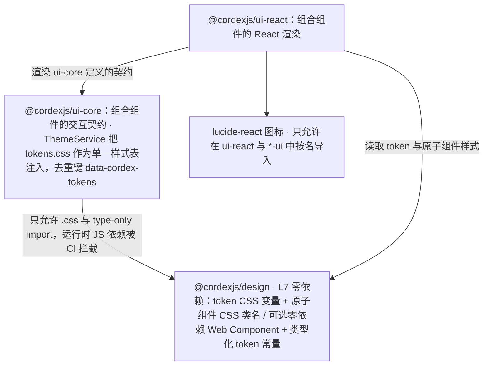
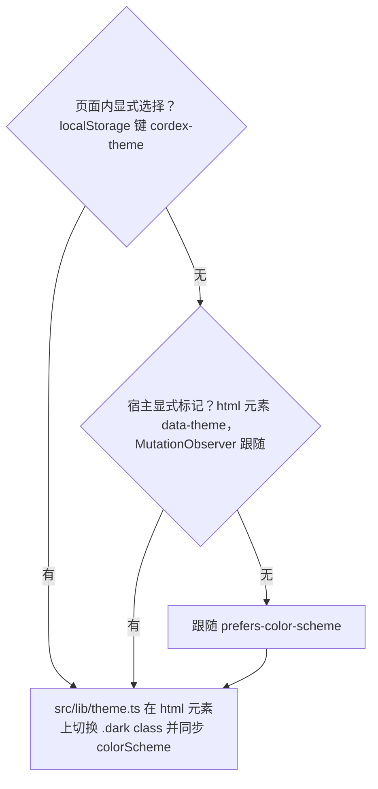
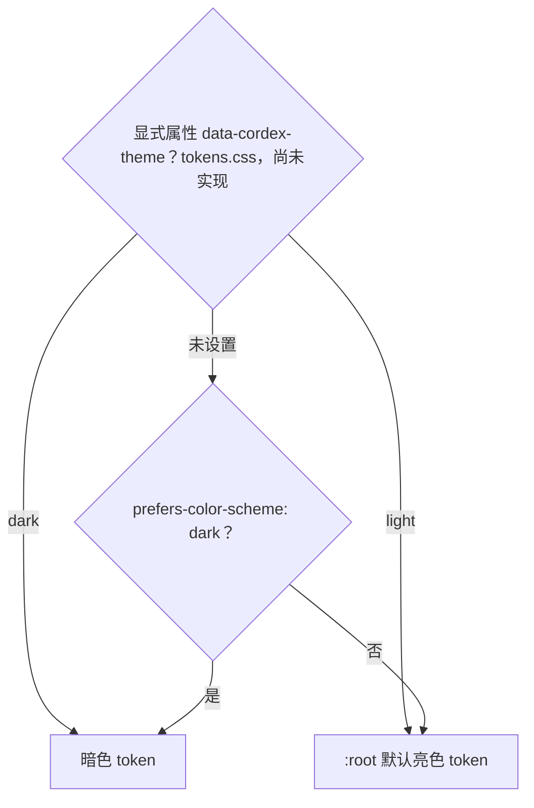

> 状态：草稿 v1.0 | 负责：设计 | 更新：2026-09-19；2026-09-24（rulings §4.15 收口：§3 与 §6 K7 行的「命名空间属性待定」按 C-21 结案表述）；2026-09-25（补图）；2026-09-25（矛盾收口，rulings §4.18）；2026-10-04（design-language-v3 第 0 批：改写为 v3 中性平面设计系统（rulings §4.25 DS-1、DS-2）——§2 token 按 `playground/src/v3/v3.css` 与 `ui.tsx` 逐项列出（表面与文字色、强调色、幻灯片内容色、间距、字号、圆角、阴影、焦点环与网格焦点例外、控件高度与面板宽度、图标），§2.6 对比度按 v3 取值重算并登记 4 项待复核，§2.13 原两档密度改为 v3 单档尺寸，§4 组件清单删 Ribbon 与状态栏、补创建工具条 / 检查器分区 / 浮动胶囊，§5 注明窄屏形态随第 1 批定稿，§8 改为 v3 token 与产品契约变量，§9 Rhea + Liquid Glass 修订记录与旧名对照标注被取代）；2026-10-04（design-language-v3 第 0 批：术语残留清理：ribbon / 状态栏 / `ui.ribbon` / `ui.statusBar` 的历史陈述改用 check-terms 认可的标记措辞（废弃、取代、作废））；2026-10-04（design-language-v3 第 0 批：复验修正——§2.5 状态色按 `v3.css` 登记两套主题的 `--v3-danger` / `-warning` / `-success`、浅底、危险实底与遮罩，取值待第 2 批拍板，旧版三档只作对照；§2.6 补状态色对比度核算与待复核 5；§8 补状态色契约名去向；§2.8 13px 行当前导航项 500、单行控件行高 1；§2.11a 首页搜索框为外侧 1px 环、ColorRow 出处改为 `editor/inspector/builtin.tsx`；§2.9、§2.13 形状弹层格子圆角 6；§2.14 下拉箭头 16px、12px 小件清单、对勾描边例外、形状图标 S18 与填充类型图标 S16 分开、LogoMark 三种中性色；§4.1「未覆盖」改为第 0 批样张未出现（第 1 批 kit 已起草）；§4.2 左栏新建幻灯片与网格内容的贡献槽位）；2026-10-04（design-language-v3 第 0 批：复验第 2 轮修正——按代码改正几处精度：§2.8 11px 只给左栏页码、尺寸标签等，缩放读数、网格页码与网格评论计数为 12px；§2.9 圆角例外补备注把手与版式缩略 2px；§2.12 注明网格页框用 `transition-shadow` 的例外；§2.14 12px 小件清单补「全部形状」行的 ▸ 与插件分组标题的 `Blocks`；§4.1 Button 补 danger 变体与不可用外观，Menu 行改为 `V3Menu` 与 kit `Menu` 两种实现及各自承载的菜单）；2026-10-05（design-language-v3 第 1 批 · DS-9 对比度达 WCAG AA（rulings §4.25 DS-9）——按 WCAG 公式逐项重算暗亮两套 token：暗色 `text-2` `#A6A6A6` → `#B0B0B0`、`text-3` 暗 `#767676` → `#858585` / 亮 `#999999` → `#8A8A8A` 且只给占位与不可用项；新增控件边界 `--v3-border-control`（暗 `#858585` / 亮 `#8A8A8A`），字段与下拉加 1px 独立边界，分段选中块、按下态、把手与滚动条改用它；新增带文字的强调色实底 `--v3-accent-solid`（两套主题 `#3A5CE6`，白字 5.44:1）；身份色 5 色只压明度到白字 ≥ 4.6:1；`danger` 暗 `#FF6B6B` → `#FF7A78` / 亮 `#D93036` → `#CC2A30`；§2.6 改为调整前后对比度表，原待复核 1–5 结案；§2.2a 空白模板卡纸面圆角改为 6px（与样张、§2.9 一致）；§2.11a 首页搜索框改为与字段同一画法；§1 第 5 条、§4.1 Field / Segmented / Button、§8 契约名、待决事项同步）；2026-10-07（design-language-v3 第 0 批余项：开头 token 来源补「全量迁移后 v3 token 并入 `src/index.css`」、旧版 `index.css` 删除的是其中的旧 token（与 80-process/02 §2 一致）；§2.4 远端光标、名签与远端选区按协作者 tone 取 `--v3-tone-*`（`--v3-collab` 只是未被引用的别名，与 03-02 §3.2 一致），§8 补 `--v3-tone-*` → `--presence-*` 一行；§4.2 网格视图一行的组件名按 40-modules/10 改为 `FloatingCapsules` + `PanelHost`（slot `grid`）+ `SlideGrid`，CommandPalette 改为 `Mod+K`（rulings §4.25 DS-11），选中迷你工具条一行改为文字条按 DS-13 取消、对象的上下文工具条去留随第 1 批；§7 对比度缺口改指 §2.6 已结案）；2026-10-07（design-language-v3 第 0 批余项 · 与 `v3.css` 对齐：§2.2 补 `--v3-handle-fill`；§2.2a、§4.1 Tooltip 与待决事项改为工具提示已 token 化（`--v3-tooltip-bg` / `-fg` / `-kbd` 定义在 `:root`），§8 待定行补这四个名）；2026-10-07（design-language-v3 第 1 批：按已拍板的第 1 批样张回写（rulings §4.25 DS-13、DS-17、DS-21…DS-26）——§1 第 7 条与 §2.10 补第 1 批浮层的阴影；新增 §2.3a 画布标记：选中框、手柄、框选、悬停、智能参考线、文件参考线、连接点、裁剪框、拖入落区与表格单元格一律用强调色，以线型、手柄形状与数值角标区分，网格线用中性色（DS-24）；§2.4 补远端对象选区与文本选区的画法（第 1 批多人在场）；§2.5 kit 件改为第 1 批已拍板、状态色取值仍随第 2 批；§2.9 补第 1 批件的圆角与圆形清单（Q4 扫描）；§2.11 轻提示层级按样张降到常驻外壳之下（工具条的弹层盖住提示），抽屉、画布浮动面板与底部面板的刻度登记为待决；§2.11a 焦点环与选中、参考线同用强调色，网格例外含仅查看形态的幻灯片列表，补纸面件、分隔条与不可用项；§2.12 动效按第 1 批实况改写、时长取值随实现复核；§2.13 面板可拖（左栏 160–420、检查器 240–720、备注 64–320，03-20）、图表数据面板 400（DS-26）、触控 44 档与紧凑抽屉；§2.14 去掉工具条「选择」的 ▾、小图标清单按第 1 批改写；§4.1 补第 1 批 kit 件（弹层、菜单、右键菜单、对话框、画布浮动面板与提示条、轻提示、横幅、占位符图标条、表格网格、检查器控件、纸面作用域、分隔条、画布标记件）与通用行为契约（焦点进入与归还、Esc 逐层、不可用项不隐藏且可聚焦并写原因、漫游焦点网格、锚定）；§4.2 对象的上下文工具条全部取消并写明原命令的去处（DS-13、DS-22、DS-26），右键菜单、主菜单、创建工具条与评审条（DS-23）、在场头像、同步状态、通知与横幅按样张定稿；§5 写入紧凑与仅查看两种窄屏形态的系统级规则（DS-17，细节在 03-02）；待决事项与 §8 逐条结案或改写依据）；2026-10-07（design-language-v3 第 1 批 · 第二步：按 rulings §4.25 DS-27…DS-30、TB 技术口径与第一步上报的跨线影响回写——§2.11 层级改用 `--layer-*` 契约名书写，按 TB-2 新增 `--layer-panel` 30（紧凑形态的抽屉、画布浮动面板、仅查看形态的底部面板与图表数据 Sheet），轻提示 `--layer-toast` 15 在常驻外壳之下，§9 对照行同步；§2.13 检查器拖宽改为 240–480（TB-25），尺寸按文档记在本机（TB-24），分隔条命中区按 WCAG 2.5.8 核对；§2.3a 补表格 M3 的插入手柄与分隔线拖动柄（20px 强调色方块、2px 白环、无阴影）、`SizeTag` 含中文时 20 / 12px、`CanvasTag` 用途与单元格按键提示签只作演示（TB-9），§2.9、§2.14 同步；§4.1a `_kit` 即产品 `/styleguide` 的样张（TB-3）、弹层下方放不下时翻到上方（TB-10）、画布浮动面板与轻提示的层级、母版视图里横幅可两条（TB-14）、「位置与大小」长度单位按 DS-27；§4.1b 同一原因的说明行含缩略图右键（TB-22）、形状库整库一个 Tab 停靠点（TB-5）；§4.2 评审条的固定项由外壳内置、`reviewBar` 只承载条目（TB-1），母版视图「帮助」多「关于母版继承」（TB-15），右键对象菜单槽位与节标题菜单不开放贡献（TB-29、TB-23），横幅例外（TB-14），评论钉视觉已定稿，`toolbar.<selectionKind>` 删除（TB-29），文字快捷键补删除线 / 上标 / 下标（DS-29）、「超链接…」改名「链接…」（TB-6）；§5 细节改指 03-02 §5a，仅查看形态的评论 M3 起可发表与回复（DS-28），母版视图缩到 < 640 时退出（TB-16），抽屉、底部面板与数据 Sheet 的层级；待决事项的拖宽范围、层级、度量单位三条结案）；2026-10-08（design-language-v3 第 1 批收口：按 rulings §4.25 DS-28、DS-31、TB-1 括注的更正与 TB-31…TB-52 回写——§2.2、§2.6 表格网格未选格的边界改用 `--v3-border-control` 并补核算行，例外 2 写明格子不适用色块例外（TB-35）；§2.13 面板尺寸的本机键与登出清除（TB-41）；§4.1a `/styleguide` 只在测试环境挂出（TB-50），表格网格未选格的边界（TB-35），字号与段前、段后、固定行距始终为 pt（TB-33），新增「快速样式」行（形状检查器「填充」节上方一行主题样式缩略图，点开 42 格样式库弹层，DS-31）；§4.1b 文本编辑中日期和时间、符号弹层关闭后焦点回插入符（TB-52），评审模式下缩略图右键的说明行（TB-51），漫游网格清单补快速样式库；§4.2 创建工具条的「选择」由 slide-ui 贡献（TB-38，评审条行原写「同创建工具条的『选择』」改正），插件条目多时的暂行收纳（TB-31），主菜单「帮助」的壳意图 `help-center` 与开发者面板（TB-39、TB-40）；§5 仅查看形态的评论分手机与平板（DS-28、TB-49），母版视图入口按完整形态判定，紧凑形态写「需要 ≥ 1024 宽度」、仅查看形态按快捷键时提示「在更大窗口中编辑」（TB-44，03-26 §1.1）；待决事项补快速样式与幻灯片大小的入口（DS-31），平板评论与 pt 口径同步）；2026-10-08（design-language-v3 第 1 批评审修改：按 rulings §4.25 DS-34…DS-37、TB-55…TB-58 回写安静控件与快速样式——§1 第 5 条改为字段、下拉、分段与按钮靠底色、标签与当前值识别、边界不再要求 3:1（DS-35 修订 DS-9），第 6 条强调色范围补「按下的开关」（DS-36）；§2.1 补控件画法一行；§2.2 分隔线暗色 `#3D3D3D` → `#444444`，`--v3-border-control` 收窄为复选框、单选圈、插入表格网格、头像外圈、把手、滚动条与虚线落区，新增「控件语义 token」表（`--v3-field-*`、`--v3-select-*`、`--v3-seg-*`、`--v3-toggle-on`、`--v3-on-*`、`--v3-btn-*`、`--v3-search-*`、`--v3-hover-line`、`--v3-qs-*`）；§2.3 强调色补按下的开关；§2.6 改写口径、写明 WCAG 1.4.11 的理解与非颜色线索，新增安静样式核算表，例外 1 作废、例外 4 与原待复核 4 加修订注记；§2.7、§2.9、§2.13 分段选中块贴边（TB-55）；§2.8 页签未选 400；§2.11a 字段行；§2.14 选中与按下的图标描边 2；§4.1 IconButton on、Button 次按钮（DS-37）、Field、Select、Segmented、ToggleStrip（DS-36），新增 Tabs 行；§4.1a 对话框与横幅的次按钮、检查器控件、快速样式行改为样式库在节内原位展开且缩略去衬底（DS-34、TB-56）；§4.1b 第 3 条补原位样式库的 Esc、第 5 条漫游网格清单；待决事项补安静控件结案与 TB-58 后续复核，快速样式一条改写；§8 补控件语义 token 行）；2026-10-15（design-language-v3 第 2 批：按已拍板的第 2 批样张与 rulings §4.25 DS-38…DS-63 回写——§2.4 身份色 12 色定稿（DS-42：新增 7 色的取值与对比度、哈希顺序即 12 色编号、同一场里撞色顺延，第 13 位起的序号角标画法随第 3 批），补中性评论钉；§2.5 状态色与浅底按方案 B 定稿、删去「随第 2 批拍板」（DS-41：三种状态色与浅底不改，横幅浅底上不可用或进行中的按钮文字用 `text-2`，不阻断的插件横幅与「已恢复」为中性底加状态色图标），补同步状态行（DS-61）与缩略图警示角标（DS-51）的着色；§2.6 新增第 2 批核算（浅底上的按钮文字与细边、身份色 12 色），原待复核 3、5 的结案说明同步；§2.9 补第 2 批的圆角与开关的圆形；§2.10 补第 2 批浮层；§2.12 补第 2 批的动效例外（列表折叠行的箭头旋转、页级提示条与定位高亮的淡出）；§2.13 补整栏面板（版本历史、保真报告 280，插件整页面板 400，DS-38）、个人插件面板对话框 640 × 720 与分享对话框；§2.14 小件清单补列表折叠行的箭头；§4.1 Select 补列表行内变体，节标题后的计数统一为 12px `text-2`（DS-62），「未覆盖」行改为开关与加载行已出现、骨架行不再使用（DS-53）；新增 §4.1c 第 2 批共享件（列表折叠行 FoldRow、加载行 LoadingRow、面板整块状态 PanelState、开关 Switch、整栏面板 InspectorTakeover、降级对象的纸面占位、「分享」按钮的待处理圆点、页级提示条），§4.1a 横幅、轻提示、提示条、对话框与画布标记件按第 2 批改写（DS-39、DS-41、DS-51…DS-53、DS-60）；§4.1b 焦点归还补实现要点（07 §2.4）、Esc 逐层补对话框里的行内确认与联想；§4.2 第 2 批组合组件按样张定稿，「更多」与检查器插件分区的收纳按 DS-49 定稿，同步状态与横幅按 DS-54、DS-58、DS-61；§5 仅查看形态的评论（DS-46）、横幅与顶部条（DS-60）；§8 危险实底、其悬停与遮罩的契约名定为 `--destructive-solid` / `--destructive-solid-hover` / `--scrim`（DS-41），身份色 12 色的契约名与哈希顺序（DS-42）；待决事项逐条结案或改写，横幅高度是否统一推迟到第 3 批（DS-62）；同日再补，按回写中的裁决 rulings §4.25 DS-64 与技术口径 TB-59…TB-61、TB-67——§2.13 检查器与整栏面板的宽度改为列表与报告类沿用检查器当前宽度（缺省 280）、编辑与整页类宽 max(400, 检查器当前宽度)，分隔条在两类面板开着时可否拖动、关闭后回到原宽（TB-60）；§4.1 Select 的列表行内变体补尺寸 88 × 28 与不可用时 `aria-disabled`、仍可聚焦，「开关、加载、骨架」一行与 §4.1c 加载行注明 DS-53 只覆盖第 2 批画面（TB-67）；§4.1c 整栏面板补宽度规则与插件整页面板的打开方式（TB-59、TB-60）；§4.2 检查器一行写明检查器页签只由内置包贡献、第三方 `ui.panel{slot:'inspector'}` 只作整栏面板，由分区条目的 `expandPanel` 或命令打开（TB-59），右键菜单一行补评论钉菜单由 slide-ui 直接渲染、不开放贡献（TB-61），版本历史、插件、保真报告与图表数据各行的「280 / 400」同步，降级对象一行补评审、只读浏览与降权下照常出右键菜单（DS-64）；待决事项补加载画法的覆盖范围（TB-67）；同日再补，按 rulings §4.25 TB-80——§2.5 用法表后注明样张未画的三条文档状态横幅（「发现新版本」、换纪元后的两条、「文档已达元素上限，只读打开」）不在表内，待决事项「横幅高度」一条补这三条横幅的底色、图标与能否关闭随第 3 批横幅样张一起拍板；同日再补，按 rulings §4.25 TB-88——§2.12 第 2 批动效例外补一处：有恢复的评论撰写框时用户又发起新评论，临时钉同样脉冲一次，画法与减少动效规则同点钉定位）；2026-10-22（design-language-v3 第 3 批：按已拍板的第 3 批样张与 rulings §4.25 DS-71…DS-136、TB-101…TB-129 回写——§2.2 拖动把手维持现值（DS-135），新增备注区底色与其上占位字色两个 token（DS-134），TB-58 留下的五项结案（DS-74、DS-133…DS-136）；§2.2a 放映舞台定稿：舞台不随界面亮暗，三个舞台 token；§2.4 第 13 位起的序号角标定稿（DS-132）、头像一律身份色首字（TB-123）、跟随中的头像外圈与画布列外框用对方身份色（DS-106）；§2.5 用法表补「发现新版本」、换纪元与元素上限三条文档状态横幅（DS-126…DS-128）与应用壳页面、管理页的横幅（DS-92、TB-119）；§2.6 新增第 3 批核算（备注区凹陷底与占位字、把手、序号角标、跟随外圈、画布底上不可用的主按钮）；§2.9 圆角、§2.10 阴影补第 3 批件；§2.11 层级补快捷键面板、紧凑形态的插件 Sheet 与导航抽屉、模态抽屉、命令面板不加遮罩（DS-87、DS-94、DS-115、DS-117、DS-130）；§2.12 动效补放映控制条、跟随条与导出轻提示的显隐（DS-100、DS-106、DS-107）；§2.13 只留单档尺寸、删去密度（DS-76），视图切换改分段（DS-133），整栏面板在紧凑形态的落位（DS-130），补页面级主按钮（TB-122）与第 3 批的面板、对话框尺寸（DS-83、DS-84、DS-87、DS-93、DS-94、DS-113、DS-115、DS-117、DS-131），备注区凹陷底（DS-134）；§2.14 图标补外链与断开的链（DS-89、DS-136）；§4.1 视图切换改分段（DS-133）、画布底上的次按钮一律 outline 与主按钮的不可用态（TB-128、DS-123）、菜单的外链条目（DS-89）、头像的序号角标与跟随按钮（DS-106、DS-132）、加载行覆盖到应用壳（DS-86）；§4.1a Dialog、FloatingPanel、Toast、Banner 按第 3 批改写（DS-75、DS-92、DS-93、DS-100、DS-101、DS-113、DS-115、TB-119、TB-120）；§4.1b 漫游网格补文档卡片网格（TB-107）；新增 §4.1d 第 3 批共享件（应用壳外壳、文档卡片、阻断页、模态抽屉、搜索框下拉、跟随条、序号角标、命令面板、放映控制条）；§4.2 左栏、主菜单与文档菜单（DS-78、DS-82、DS-89、DS-104、DS-105、DS-112、DS-133）、命令面板不加遮罩（DS-117）、头像组（DS-106、DS-132、TB-124）、同步状态与横幅（DS-75、DS-92、DS-126…DS-128）定稿，补应用壳的组合组件；§5 紧凑形态的抽屉从横幅下沿开始与整栏面板落位（DS-130）、平板评论面板按方向落位（DS-131）、触控与嵌入的状态行（TB-125、DS-112），补应用壳页面、嵌入与查看器的窄屏（DS-87、DS-111）；§8 补第 3 批新 token；待决事项按第 3 批逐条结案）；2026-10-22（同日再补，按回写中的裁决 rulings §4.25 DS-137 与技术口径 TB-130、TB-131、TB-132、TB-136、TB-137、TB-138、TB-145、TB-151——§2.2a 放映舞台的暗色作用域写全：跟随条与结束页同取暗色 token，作用域即舞台上的 `data-v3-theme="dark"`；§2.13 紧凑形态的左栏与检查器抽屉从横幅下沿开始（DS-130）、页面级主按钮的不可用态（DS-123）、网格 / 列表是开始页与文档列表共用的本机偏好（TB-131）；§4.1 Menu 的外链条目补命令面板「帮助中心」与母版视图「关于母版继承」（TB-132）；§4.1a 个人资料对话框的内容（TB-137）；§4.1c「分享」按钮 M2 不可用（DS-137）、页级占位在渲染层画（TB-151）；§4.1d 搜索框下拉的键盘与手机形态（TB-130）；§4.2 主菜单与文档菜单（TB-132、TB-138、TB-145）、命令面板的锚定与「帮助中心」（TB-132）、账户菜单（TB-137、TB-145）、分享（DS-137）；§5 紧凑形态的插件 Sheet 写全，触控设备上母版视图的原因写「在电脑上编辑」（TB-136））；2026-10-22（同日再补，按回写中的技术口径 rulings §4.25 TB-153…TB-156、TB-159、TB-161、TB-162——§2.11 层级表的模态一档补手机上的模态底部面板，§2.13 快捷键面板的手机形态为贴底、带遮罩的底部面板、平板照常浮动（TB-118、TB-154）；§4.1a Toast 补回收站卡片「恢复」失败的轻提示（TB-155）；§4.1c「分享」按钮 M2 的工具提示「分享 · 后续版本提供」与不渲染的条件（TB-161）；§4.1d 阻断页补「恢复」失败的内联错误（TB-155）与 M2「申请访问」不可用（TB-156）；§4.2 命令面板补壳意图（TB-162），账户菜单补触控形态不写键位提示（TB-154，「⌘,」同理），分享补 TB-161、TB-156；§5 紧凑规则 5 与仅查看规则 2 原「嵌入里一律写」改为嵌入只改写「在更大窗口中编辑」一句、嵌入又是触控设备时以「在电脑上编辑」为准（TB-159），应用壳页面的顶部提示按宽度与触控分两句（TB-153）；2026-10-22 复核修正：§4.1c 加载行一行原写「管理员插件清单与开始页的加载随第 3 批统一」，与 §4.1 同表已定的 DS-86 不一致，改为已覆盖开始页、文档列表与管理清单；§5 表、仅查看规则 2、紧凑规则 5 与「应用壳页面、嵌入与查看器」一段写明「触控设备」只指平板、手机按窗口窄写（TB-163）；§4.2 账户菜单的键位提示按 TB-164 写；§2.13「首页」「文档卡片网格与列表」、§4.2 应用壳页面与 §5 应用壳一段补平板的左栏与列数按窗口宽度（TB-165）；§4.1d 阻断页与 §4.2 分享补阻断页说明句不变（TB-156）；§4.2 文档菜单降权一句补 DS-139；§8 两行第 3 批 token 的契约名「待定」改写为随全量迁移定名（DS-7）；§2.2 `--v3-panel` 一行删去「备注区」（DS-134 后备注区是 `--v3-notes-fill`）；§2.11a 删去括注里的内部评审轮次；§2.13「首页」「文档卡片网格与列表」、§4.2 应用壳页面与 §5 应用壳一段补平板保留列表头的切换与开始页「最近」的排序、搜索框随左栏不写 ⌘K（TB-170）；§4.1d 搜索框下拉原写手机与触控形态的搜索框都在主区提示行之下，与 TB-170 不符，改为只有手机在主区、平板随左栏；§4.1d 文档卡片与搜索框下拉补第二行缺最近编辑者或还没有快照时的写法（TB-171）；§4.1a 横幅一行原写「仅查看形态（< 640）里按钮换到文案下方」，与 §5 仅查看规则 2 一并按 TB-172 改为手机与平板的横幅都在最顶上、按钮只在一行放不下时才换行；§2.13「文档卡片网格与列表」与 §4.1d 文档卡片补列表形态的编辑者与时间两列取法同第二行（TB-171）；§4.1a 横幅一行、§5 仅查看规则 2 与待决事项「横幅高度」补统一高 40 指非触控形态、触控形态的按钮与 × 照常 44 而横幅随之撑高（TB-172），规则 2 原写「文案放不下一行时按钮才换到文案下方」，按 TB-172 改为按钮只在一行放不下时才换行；§4.1a 横幅一行、§5 仅查看规则 2 与待决事项「横幅高度」补一行放得下时上下内边距仍是 5、共高 55，应用壳页面的横幅在触控形态同此（TB-172））；2026-10-23（design-language-v3 第 3 批评审修改：按 rulings §4.25 DS-140…DS-143、TB-179…TB-183 回写——§2.2 `--v3-border-control` 的用途与表下说明补导入的落区例外：导入对话框的落区静止时用与分隔线同档的 `--v3-border`，拖入悬停与开始页、文档列表主区的拖入落区同为强调色虚线加 `--v3-accent-soft` 淡底（DS-141、TB-180），§2.6 使用规则与 §8 `--border-control` 一行同步；§2.6 新增评审修改的核算（静止虚线、拖入悬停淡底上的文字、关闭 × 的正文色、文件类型图标）；§2.9 对话框由 8 改为 12（DS-142），补导入落区 4 与主区拖入落区 8；§2.10、§2.11 补手机上导入的底部面板（TB-181）；§2.13 新增导入对话框 560 × 406（TB-179、DS-142）；§2.14 图标家族只为文件类型图标开例外——Tabler Icons 的 `file-type-*` 与通用 `file`，20px、描边 1.5、只作装饰，插件格式回退通用字形、不回退 `Puzzle`（DS-143、TB-182）；§4.1 Button outline 的例子去掉导入失败页（DS-140）；§4.1a Dialog 标题栏 40、圆角 12、× 用正文色，宽度档补导入专用 560（DS-142、TB-179），导入对话框的取消与遮罩（TB-179、TB-180）；§4.1b 焦点归还补「焦点已落在页面里可用的元素上就不再移动」；§4.1d 应用壳外壳的「导入 .pptx」打开导入对话框，阻断页的用途去掉导入过渡页与失败页（DS-140 取代 DS-97），模态抽屉的标题行随对话框改为 40，新增导入对话框、模态底部面板、主区拖入落区与文件类型图标四行；§4.2 应用壳页面补导入对话框；§4.1d「导入对话框」行补产品落点（apps/web `pages/import/ImportPage.tsx`，宽度档在 ui-react `DialogHost`，40-modules/11 §4.4、40-modules/10 §5.3））；2026-11-04（design-language-v3 母版视图改版：§2.2 删去 `--v3-scope-on` 一行（编辑范围取消），§8 契约变量同删；§2.2a 纸面标注同走 `PaperScope`；§2.3a 占位符标注归入中性色、新增「占位符标注（母版视图）」一行（缩略图细线框只有横排的上边线、竖排的右边线在框外），提示签补 M2 锁签；§2.14 登记母版视图图标 `PanelsTopLeft`、「占位符 ▾」的 ▾ 与占位符类型图标；§4.1 Tabs 删去范围单选半句、加载一行取消母版视图的豁免；§4.1a Popover 补「主题颜色与字体」盖检查器栏的例外，Banner 行写上下文条的组成并指向 03-26 §6.3，检查器控件补 `InspectorNotice` 的导航动作与覆盖标记不用 `Tag`；§4.1b Esc 逐层补母版视图的三级；§4.1c PanelState 取消母版视图加载失败的豁免；§4.2、§5 的母版横幅改为上下文条；rulings §4.25 DS-145…DS-149、DS-151、DS-152、DS-154…DS-156、TB-186、TB-188…TB-191、TB-193、TB-195；需求编号、优先级与里程碑不变） | 依赖：charter v0.2（D10 修订）、rulings §4.25 DS-1…DS-9、DS-13、DS-17、DS-21…DS-31、DS-34…DS-64、TB-1…TB-3、TB-5、TB-6、TB-9、TB-10、TB-14…TB-16、TB-22…TB-25、TB-29、TB-31、TB-33、TB-35、TB-38…TB-41、TB-44、TB-49…TB-52、TB-55…TB-61、TB-66、TB-67、TB-80、TB-88、DS-71…DS-137、DS-139…DS-143、TB-101…TB-165、TB-170…TB-172、TB-179…TB-183、DS-145…DS-149、DS-151、DS-152、DS-154…DS-156、TB-186、TB-188…TB-191、TB-193、TB-195、§4.22 SF-01（已被 DS-13、DS-22 修订）、SR-3 / SR-4（已结案，TB-10、DS-27）、§4.11 C-21 / C-22、09-design-specification v4.0、80-process/01 §4；可执行取值源 `playground/src/v3/v3.css`、`src/v3/ui.tsx` 与 `src/v3/kit/`
>
> v1.0（2026-10-04）：现行设计语言改为 **v3 中性平面**（rulings §4.25 DS-2，样张拍板）。2026-09-16 起的 shadcn Rhea + Liquid Glass 方向（设计 11、09 v3.x、本文 v0.4–v0.5）已被取代：材质层、背景光斑、Ribbon 高度、分组卡三层配色与旧色板全部作废，摘要见 §9，逐条记录在 git 历史（本文 v0.5）。

# 04 设计系统（Design System）

本文档定义 `@cordexjs/design`（L7，零依赖，见架构 §5.2）导出的 token 体系与原子组件清单，以及 `@cordexjs/ui-core` / `@cordexjs/ui-react` 之上组合而成的复合组件清单。**现行设计语言是 v3 中性平面**（rulings §4.25 DS-1、DS-2，2026-10-04 拍板）：灰阶分层级、品牌蓝只做强调；面板贴边、1px 分隔；去掉渐变背景、光晕与毛玻璃，只有浮层带阴影；缩略图、模板与最近文档用真实渲染。

token 的取值以代码为准，本文只展示与解释（80-process/02 §2「一个事实一个归属」）。迁移期间 v3 的可执行定义是 `playground/src/v3/v3.css`（颜色、阴影、焦点环）与 `src/v3/ui.tsx`（控件尺寸、圆角、字号），全量迁移后 v3 token 并入 `src/index.css`；旧版 `src/index.css` 里的旧 token 只服务尚未迁移的 ribbon 版界面，随旧版一起删除（DS-7）。对外契约的命名规则不变：shadcn 主题变量 + Cordex 扩展裸名变量，`--cordex-*` 前缀已作废（rulings §4.11 C-22）；样张里的 `--v3-*` 前缀只是与旧版并存时的作用域名，契约名见 §8。

---

## 1. 设计原则（对 token 体系的约束）

1. **token 化优先**：任何在两个以上组件中出现的视觉数值（颜色、间距、圆角、阴影、层级、时长）必须来自 token，禁止组件内魔法数字。
2. **零依赖**：`@cordexjs/design` 不依赖 React/cordis/任何框架；仅导出 CSS（token + 原子组件类名/极少量无框架 Web Component 或纯 CSS 类）与类型化的 token 常量（供 JS 侧读取，如图表插件取色）。架构 02 §4.18 的依赖规则机械保证这一点：`ui-core` 对 `@cordexjs/design` 只允许 `.css` 与 type-only import（depcruise 规则 `ui-core-no-react` 的姊妹规则），任何运行时 JS 依赖都会被 CI 拦截。
3. **语义先于数值**：组件只引用语义 token（样张为 `--v3-text`、`--v3-panel` 等，契约名见 §8），不得直接写十六进制。幻灯片内容的颜色是文档数据，单独一组（§2.2a），不与界面 token 混用。
4. **暗色不是反色**：暗色主题的语义 token 单独指定数值，不是对亮色简单取反或降低透明度。
5. **不牺牲对比度换取美观**：语义配对满足 §2.6 的基线（WCAG AA）：可读文字 ≥ 4.5:1；识别控件或状态所必需的图形 ≥ 3:1——复选框、单选圈、插入表格网格、焦点环、画布上的选中框与手柄、协作者身份色与自己头像的外圈。字段、下拉、分段与按钮按安静样式画：靠底色、标签与当前值识别，边界不再要求 3:1，选中与按下另有字重、图标描边等非颜色线索（rulings §4.25 DS-35 修订 DS-9 的「输入框加 1px 独立边界」；原「控件边界与状态 ≥ 3:1」作废，WCAG 1.4.11 的理解见 §2.6），与 07-accessibility-and-i18n.md 一致；v3 样张原不达标的各项已按 DS-9 调整 token 结案（§2.6），新增或改动取值时须附核算，不得因"已拍板"而略过。
6. **中性为底，强调色只做强调**（DS-2）：表面与文字只用灰阶；同屏的有彩色只有强调色、幻灯片内容本身、协作者身份色，以及对应状态出现时的状态色（设计质量门 Q3，80-process/01 §4）。强调色只给主操作、当前工具、选中对象与按下的开关（B / I / U / S 等多选开关按下时的强调色淡底，rulings §4.25 DS-36；原「只给主操作、当前工具与选中对象」由 DS-36 补充）。
7. **平面，只有浮层带阴影**（DS-2）：不用渐变背景、光晕与毛玻璃（`backdrop-filter`）；面板贴边、靠 1px 分隔线分区，不悬浮、不叠卡；阴影只给浮层——底部工具条、浮动胶囊、菜单与弹层、对话框、轻提示、画布浮动面板，以及盖在画布上的抽屉与底部面板（Q5，清单见 §2.10）。

**设计系统相关包的依赖方向**



怎么读：箭头从依赖方指向被依赖方；design 位于最底层且不依赖任何框架，ui-core 对它只能引用 CSS 与类型，这条边由架构 02 §4.18 的 depcruise 规则机械保证；ui-react 对 design 的依赖取自章程 §5.2 依赖上限。

---

## 2. Token 体系

### 2.1 取值来源、作用域与主题开关

| 项 | v3 样张约定（`src/v3/v3.css`） |
|---|---|
| 作用域 | 界面 token 只定义在 v3 根节点 `.v3-root` 上，幻灯片内容 token 只定义在 `.v3-slide` 上，因此与旧版页面互不影响；浮层（菜单、子菜单）挂进 v3 根节点内渲染以继承 token |
| 主题 | `data-v3-theme="dark"`（缺省）/ `"light"`，由 URL 参数 `theme` 写入；缺省暗色只为样张评审，产品的主题解析顺序见 §3 |
| 强调色 | `data-v3-accent="blue"`（缺省）/ `"violet"` / `"coral"`；后两者是拍板时的对照备选，DS-2 未采纳，产品只发布品牌蓝（§2.3） |
| 与 shadcn 的桥接 | `.v3-root` 内令 `--border: var(--v3-border)`、`--ring: var(--v3-accent)`，套在 v3 内的 shadcn 组件默认边框与焦点环随之跟随 |
| 控件画法 | 安静样式（rulings §4.25 DS-35…DS-37，2026-10-08 定为缺省，也是唯一画法）：组件只引用 §2.2 的控件语义 token，不直接写 `--v3-border-control`；拍板前样张用 URL 参数 `controls` 对照两种画法，DS-35 后删除该参数与原画法 |
| 调色板原语 | 不再单列（原 gray / accent 九档等作废）：v3 直接以语义 token 取值，灰阶档位即 §2.2 各行 |

### 2.2 颜色 —— 表面、文字、边框

| token | 暗（默认） | 亮 | 用途 |
|---|---|---|---|
| `--v3-canvas` | `#1E1E1E` | `#F5F5F5` | 应用底色：编辑器画布区、网格视图、首页主区；`.v3-root` 的背景 |
| `--v3-panel` | `#2C2C2C` | `#FFFFFF` | 面板：左栏、检查器、首页导航；浮层（工具条、浮动胶囊、菜单、弹层）的底；分段的选中块（下表 `--v3-seg-on`）。备注区 2026-10-22 起改为凹陷底 `--v3-notes-fill`（下表，rulings §4.25 DS-134），不再用面板底 |
| `--v3-panel-2` | `#383838` | `#F2F2F2` | 面板上的二级表面：输入底、分段与切换条的槽、悬停底（下拉、次按钮、菜单项、图标按钮）、按下的图标按钮与选中页签的底（下表）；下拉与次按钮静止时透明（rulings §4.25 DS-35、DS-37；原「字段与下拉底、次要按钮底」作废） |
| `--v3-panel-3` | `#434343` | `#E8E8E8` | `panel-2` 之上的悬停：动作条（A⁺ A⁻、缩进）、表格与图表数据网格里小按钮的悬停，滑块槽与进度条的轨道；输入、下拉与次按钮的悬停自 DS-35 起不再用它（原「字段悬停、次要按钮悬停、下拉展开」作废） |
| `--v3-border` | `#444444`（原 `#3D3D3D`，DS-35） | `#E5E5E5` | 1px 分隔线与边框：面板贴边线、节分隔、浮层描边、缩略图与封面外框、角标边；下拉、次按钮、分段选中块与输入悬停的细边与它同档（经下表的控件语义 token 引用，DS-35、DS-37）。它对面板不到 3:1，做分区与提示，不是识别控件的唯一线索（§2.6） |
| `--v3-border-control` | `#858585` | `#8A8A8A` | 「边框就是控件本身」的图形与身份标记（DS-9 新增，DS-35 收窄）：勾选框与单选圈的外框、滑块圆钮描边、插入表格网格未选格的 1px 内描边（rulings §4.25 TB-35）、自己头像的外圈、虚线落区（图片的上传占位、页眉页脚的位置示意；导入的落区例外，见下文控件语义 token 表后的「导入的落区」一段，rulings §4.25 DS-141）、分隔条悬停与拖动时的 2px 线，备注把手与滚动条滑块取它的值；对 canvas / panel / panel-2 均 ≥ 3:1（§2.6）。原「字段与下拉触发器的 1px 独立边界（`FIELD_FRAME`）、分段与切换条选中块及按下态图标按钮的 1px 内描边」由 DS-35 修订为安静样式（下表） |
| `--v3-text` | `#F2F2F2` | `#1A1A1A` | 主文字、激活态图标；网格视图的键盘焦点框（§2.11a） |
| `--v3-text-2` | `#B0B0B0`（原 `#A6A6A6`，DS-9） | `#666666` | 次要文字：未激活图标、说明、同步状态、页码、元信息、字段内短标签与单位（X / Y / W / H、旋转、cm）、菜单提示与快捷键、分组标题、计数、空态文字——**凡承载可读信息的灰字都用这一级**；在 canvas / panel / panel-2 / panel-3 上均 ≥ 4.5:1 |
| `--v3-text-3` | `#858585`（原 `#767676`，DS-9） | `#8A8A8A`（原 `#999999`，DS-9） | 三级文字：**只给占位符与不可用项**（DS-9）；在 canvas / panel / panel-2 上 ≥ 3:1（07 §8 底线），不到 4.5:1，不承载可读信息（§2.6） |
| `--v3-handle` | = `--v3-border-control`（原 `#4A4A4A`） | = `--v3-border-control`（原 `#D4D4D4`） | 备注区上方的拖动把手（可拖的控件，按控件边界取值）；左栏底部面板与 Sheet 的把手同一个 token。2026-10-22 维持现值、不改淡（rulings §4.25 DS-135：把手是控件本身，静止时要 ≥ 3:1，未采纳的「淡一档 `--v3-hover-line`」只换来一点安静） |
| `--v3-notes-fill` | `#151515` | `#EBEBEB` | 备注区的凹陷底（2026-10-22，rulings §4.25 DS-134）：去掉描边，铺一块比画布深一档的底（与画布暗亮都是 1.09:1），读作嵌进画布的输入区；悬停出与分隔线同档的细边（同输入，DS-35）。不能直接套输入的 `panel-2`：亮色 `#F2F2F2` 与画布只有 1.02、框看不见，暗色 `#383838` 比画布亮、看起来是浮起 |
| `--v3-notes-placeholder` | = `--v3-text-3` | = `--v3-text-2` | 备注区里的占位字「添加演讲者备注…」：暗色仍是 `text-3`（在凹陷底上 4.94:1）；亮色 `text-3` 只有 2.89:1、低于占位的 3:1 底线，提到 `text-2`（4.81:1）——沿用 DS-41 方案 B「浅底上不足 3:1 时提到 `text-2`」的先例，是「`text-3` 只给占位与不可用项」下唯一的例外（DS-134，§2.6「第 3 批的核算」） |
| `--v3-handle-fill` | `#FFFFFF` | `#FFFFFF` | 画布上选中手柄与连接点的填充（`kit/canvas.tsx`、选择与吸附场景）：画在白纸面上，暗亮同为白色，描边用强调色 |
| `--v3-card-hover` | = `--v3-panel-2` | = `--v3-panel` | 画布底上的卡片悬停（首页最近文档）；亮色画布与 `panel-2` 几乎同色，故改用白底 |
| `--v3-swatch-line` | `rgba(255,255,255,.22)` | `rgba(0,0,0,.14)` | 色块、主题缩略与快速样式缩略的 1px 内描边（色块与样式缩略的颜色本身是内容，这条线只提示轮廓，§2.6 例外 2；快速样式缩略按 rulings §4.25 TB-56 改用它） |
| `--v3-scroll` | = `--v3-border-control`（原 `#4A4A4A`） | = `--v3-border-control`（原 `#CFCFCF`） | 细滚动条滑块（`scrollbar-width: thin`，轨道透明） |

层级读法：暗色下 canvas → panel → panel-2 → panel-3 逐级变亮；亮色下 panel 最白、canvas 略灰，panel-2 / panel-3 是白面板上的浅灰。同一层内的分区一律用 1px `--v3-border`，不用底色差拼层。控件按安静样式画（DS-35）：输入靠 `panel-2` 淡底，下拉与次按钮靠一道与分隔线同档的细边，分段靠槽与选中块，识别另靠标签、图标与当前值；选中与按下另有字重与图标描边的非颜色线索（§2.6）。`--v3-border-control` 只留给「边框就是控件本身」的图形与身份标记（上表）。原「控件的边界与选中态用 `--v3-border-control`，不靠底色差」由 DS-35 修订。

**控件语义 token**（2026-10-08，rulings §4.25 DS-35…DS-37、TB-55、TB-56；样张 `v3.css`，组件只引用这一组，不直接写 `--v3-border-control`）：下表即安静样式的取值；拍板前它们是 URL 参数 `controls=quiet` 的取值，DS-35 后定为缺省，token 名不变。取值写成 `var(...)` 的随主题自动换算，括注是算出的近似色。

| token | 暗（默认） | 亮 | 用于 |
|---|---|---|---|
| `--v3-field-fill` / `--v3-field-fill-hover` | = `panel-2` `#383838` / 同左（悬停不换底） | `#F2F2F2` / 同左 | 数字与文本输入（`ui.tsx` `FIELD_FRAME`：X / Y / W / H、字号、段前与段后、不透明度、颜色值行、文本框、查找框、缩放比例框；行距是下拉，见 `--v3-select-*`）只铺淡底（DS-35）；原悬停换成 `panel-3` 作废 |
| `--v3-field-line` / `--v3-field-line-hover` | `transparent` / = `border` `#444444` | `transparent` / `#E5E5E5` | 输入静止不描边，悬停出一道细边（`.v3-field:hover` 把前者换成后者）；聚焦与校验错误由组件把这条线换成强调色 / `danger`，与原来相同 |
| `--v3-field-fill-off` / `--v3-field-line-off` | `color-mix(in srgb, panel-2 50%, panel)` ≈ `#323232` / `transparent` | ≈ `#F8F8F8` / `transparent` | 不可用的输入：底再降一档、不描边，文字 `text-3`（原「边界退到 `border`」作废） |
| `--v3-field-split` / `--v3-field-split-h` / `--v3-field-split-edge` | = `panel` / `100%` / = `panel` | 同左 | 字段内部的切口：颜色行「色值 \| 不透明度」之间、字号「20 \| ▾」的 ▾ 左侧，1px 面板色、通高（同 Figma；原 16px 高的 `border` 竖线作废） |
| `--v3-select-fill` / `--v3-select-fill-hover` | `transparent` / = `panel-2` | 同左 | 下拉与选择触发器（`ui.tsx` `SELECT_FRAME`：`SelectTrigger` / `MenuField` 的版式、字体、列表样式、切换、对齐参照等；文本颜色与高亮触发器、形状「操作」行）：透明底，悬停与打开时铺 `panel-2`；主题卡同一画法（透明底 + 1px `border`） |
| `--v3-select-line` / `--v3-select-line-off` | = `border` `#444444` / = `panel-2` `#383838` | `#E5E5E5` / `#F2F2F2` | 下拉的 1px 细边，与分隔线同档；不可用时降为 `panel-2`，文字与 ▾ 退到 `text-3` |
| `--v3-seg-track` / `--v3-seg-track-line` | = `panel-2` / `transparent` | 同左 | 分段控件、切换条与动作条的槽：只铺淡底、不描边 |
| `--v3-seg-on` / `--v3-seg-on-line` | = `panel` `#2C2C2C`（原 `#4D4D4D`）/ = `border`（原 = `--v3-border-control`） | `#FFFFFF`（不变）/ `#E5E5E5`（原 = `--v3-border-control`） | 分段的选中块与表格边框预设的当前项：面板色加细边（同 Figma 的对齐、填充类型分段），选中项另有字重 500、图标描边 2（`.v3-on-cue`）；整组不可用的切换条，按下项退回这一画法 |
| `--v3-seg-pad` / `--v3-seg-gap` / `--v3-seg-on-radius` | `0` / `0` / `4px`（原 `2px` / `2px` / `3px`） | 同左 | `Segmented` 槽的内边距、项间距与选中块圆角：选中块贴边、撑满槽高，外框仍 28px（TB-55）；切换条（B / I / U / S）与动作条不读这三个值，仍为 2px 内边距与间距、按下项圆角 3，相邻的按下项不连成一块 |
| `--v3-toggle-on` / `--v3-toggle-on-line` | `color-mix(in srgb, accent 40%, panel-2)` ≈ `#465388` / `transparent` | `color-mix(in srgb, accent 22%, panel-2)` ≈ `#CAD1EF` / `transparent` | 多选开关的按下项（B / I / U / S、上下标、水平 / 垂直翻转、查找的 Aa 与 ab）：强调色淡底、不描边，图标描边 2（DS-36，同 Figma；原与分段选中块同值） |
| `--v3-on-fill` / `--v3-on-line` | = `panel-2` / `transparent`（原 = `--v3-border-control`） | 同左 | 按钮按下（`IconButton` on：锁定比例、当前视图）与「设计 / 评论」页签选中：只铺淡底、不描边；按下的图标描边 2、选中页签字重 500（未选 400），与悬停（同为 `panel-2` 底，描边 1.5、字重不变）区分 |
| `--v3-btn-fill` / `--v3-btn-fill-hover` | `transparent` / = `panel-2` | 同左 | 次按钮（`Button` secondary，以及左栏「+」等同款按钮）：透明底，悬停与打开时铺 `panel-2`（DS-37；原 `panel-2` 底、悬停 `panel-3` 作废） |
| `--v3-btn-line` / `--v3-btn-line-off` | = `border` / = `panel-2` | `#E5E5E5` / `#F2F2F2` | 次按钮的 1px 细边，与分隔线同档；不可用时降为 `panel-2`、文字 `text-3` |
| `--v3-search-fill` / `--v3-search-fill-hover` / `--v3-search-line` | `transparent` / = `panel-2` / = `border` | 同左 | 首页搜索框：透明底加细边（与同为 `panel-2` 底的当前导航项区分），悬停铺 `panel-2`，聚焦换成强调色 |
| `--v3-hover-line` | `color-mix(in srgb, text-3 50%, border)` ≈ `#656565` | ≈ `#B8B8B8` | 网格项（色块、样式 / 版式 / 主题缩略、网格视图的幻灯片框）的 1px 悬停环（原 = `--v3-border-control`） |
| `--v3-qs-matte` / `--v3-qs-inset` / `--v3-qs-radius` / `--v3-qs-line` | `transparent` / `0` / `4px` / = `--v3-swatch-line` | 同左 | 快速样式缩略：去掉「背景 1」白衬底，形状铺满格子，外圈用色块内线（TB-56；原 3px 衬底、内块圆角 3 与 1px `border` 外圈作废） |

复选框、单选圈、滑块圆钮、插入表格网格、自己头像的外圈、把手、滚动条与虚线落区不进这一组，直接用 `--v3-border-control`；焦点环与文字对比度不变。可以为空的字段本次不加框内标识，只改控件的边界与底色（rulings §4.25 TB-57）。DS-35 这次只改右侧面板的控件（次按钮按 DS-37 全局改），左栏视图切换改分段、备注区凹陷底、拖动把手取值、锁定比例未锁时的图标、暗色珊瑚强调色下当前工具图标的对比度不在本次范围，列入后续批次复核（TB-58，见文末待决事项）。这五项 2026-10-16 至 10-22 逐项定了（rulings §4.25 DS-74、DS-133…DS-136）：暗色珊瑚强调色一项随珊瑚未采用结案；左栏与网格胶囊的「单页 / 网格」切换改为分段控件同一画法（§4.1 Segmented 行）；备注区改凹陷底（上表 `--v3-notes-*`）；把手维持 `--v3-border-control`；锁定比例未锁时用断开的链（§2.14）。

**导入的落区**（2026-10-23，rulings §4.25 DS-141、TB-180）是上段「虚线落区直接用 `--v3-border-control`」的例外：导入对话框里的虚线落区静止时用与分隔线同档的 `--v3-border`（同 Figma 的 Import 对话框），落区靠正中的粗体一行、说明与「从电脑选择文件…」识别，这道线不是识别控件的唯一线索，理由同 DS-35（WCAG 1.4.11 不要求它到 3:1）；拖入悬停时与开始页、文档列表主区的拖入落区（kit `DropOverlay`）同一画法：1px 强调色虚线加 `--v3-accent-soft` 淡底，强调色只表达「松开就会接住」，淡底都叠在 `panel` 上（主区落区先垫一层 `panel`：直接叠在画布底上时亮色说明行不到 4.5:1，§2.6「第 3 批评审修改的核算」）。DS-141 由此修订「虚线落区（上传占位）用控件边界色」一条在导入落区上的适用；未采纳的备选「落区虚线用控件边界色」留在样张 `import.alt-dialog-dash-control`。

### 2.2a 幻灯片内容色与纸面（与主题无关）

| token / 规则 | 值 | 用途 |
|---|---|---|
| `.v3-slide` 下的 `--s-ink` / `--s-body` / `--s-mute` | `#141B2D` / `#4B566B` / `#8A93A6` | 样张示例文稿的标题、正文、弱化文字 |
| `--s-line` / `--s-card` | `#E6E9F0` / `#F4F6FB` | 示例文稿的分隔线与卡片底 |
| `--s-brand` / `--s-brand-soft` / `--s-brand-mid` / `--s-note` | `#3A5CE6` / `#E8EDFD` / `#AFC0F8` / `#EEF2FF` | 示例文稿的品牌色系；`--s-note` 是第 2 页要点卡的底，刻意与任何强调色（选中色）都不同，保证选中框看得见 |
| 纸面 | 白 `#FFFFFF`；幻灯片与缩略图圆角 4px，空白模板卡圆角 6px（与模板、文档封面同档，§2.9） | 幻灯片、缩略图、空白模板卡的纸面 |
| `.v3-paper` | 把 `--v3-text` / `-2` / `-3` 重设为亮色取值 `#1A1A1A` / `#666666` / `#8A8A8A` | 白纸面上叠的界面文字（空白模板卡的「+ 空白演示文稿」）：不论界面主题都用亮色文字（白底上 `text-2` 5.74:1、`text-3` 3.45:1），避免暗色 `#B0B0B0` 落在白底上只有 2.16:1。纸面上的整块界面件（占位符图标条、上传占位里的按钮）用 kit `PaperScope` 整套换成亮色 token；母版视图的纸面标注（占位符类型名、M2 锁签、内容占位符的图标条）同走 `PaperScope`，两套界面主题同一外观（rulings §4.25 DS-148、TB-188） |

`--s-*` 是样张示例文稿的主题色，写成变量只为样张内复用；产品里幻灯片内容的颜色来自文档主题（`model-slide`），不属于 `@cordexjs/design`，也不随界面主题与强调色变化。放映舞台（2026-10-22 随第 3 批定稿，样张 `present`）：舞台不随界面亮暗——舞台这一块另开一个 v3 作用域 `data-v3-theme="dark"`（kit `StageScope`，`kit/stage.tsx`；做法同纸面的 `PaperScope`，强调色跟随界面），舞台与压在舞台上的界面件——控制条、「更多」菜单、跳页提示条、跟随条与结束页——一律取暗色的界面 token，所以暗亮两套截图相同；舞台另有三个 token，定义在 `v3.css` 的 `.v3-root`、两套主题同值：`--v3-stage` `#0A0A0A`（舞台底与幻灯片四周的留边，沿用旧版 `--stage` 的值）、`--v3-stage-black` `#000000`（黑屏与末页之后的结束页）、`--v3-stage-white` `#FFFFFF`（白屏）；放映控制条与编辑器底部工具条同一外观（实色、1px 边、浮层阴影，不加模糊，§4.1d）。原 `--stage-chrome`（半透明加模糊）、`--stage-foreground` 由暗色作用域里的界面 token 取代（03-screens/11 §9）。组件内禁止裸写十六进制色值。工具提示经 Portal 挂到 `body`、在 `.v3-root` 作用域之外，它的三个 token 定义在 `v3.css` 末尾的 `:root`（只有 v3 引用，不影响旧页面）：`--v3-tooltip-bg` `#111111`、`--v3-tooltip-fg` `#FFFFFF`、`--v3-tooltip-kbd` `rgba(255,255,255,.55)`，暗亮相同；`ui.tsx` `Tip` 引用它们。

### 2.3 强调色

| token | 取值 | 用途 |
|---|---|---|
| `--v3-a-light` / `--v3-a-dark` | `#3A5CE6` / `#5B7CFF`（品牌蓝，DS-2 拍板） | 两套主题各自的强调色，由主题挑选为 `--v3-accent` |
| `--v3-accent` | 暗 `#5B7CFF` / 亮 `#3A5CE6` | 线、环与只放图标的强调色底：工具条当前工具底、勾选框与单选圈的选中底、选中框与手柄描边、智能参考线与文件参考线、框选与悬停框、连接点、当前页描边、焦点环、字段聚焦内描边、网格视图当前页页码（画布标记逐项见 §2.3a） |
| `--v3-accent-solid` | `var(--v3-a-light)`：两套主题都是 `#3A5CE6`（DS-9 新增） | **带文字的强调色实底**：主操作按钮（「分享」「新建演示文稿」，`Button` primary）、画布尺寸标签。暗色 `#5B7CFF` 上白字只有 3.63:1，实底取亮色那一档后白字 5.44:1；线、环、选中框仍用 `--v3-accent`（深底上要更亮的那一档） |
| `--v3-accent-solid-hover` | `color-mix(in srgb, var(--v3-accent-solid) 88%, black)` ≈ `#3351CA` | 主操作按钮的悬停（白字 6.62:1） |
| `--v3-accent-fg` | `#FFFFFF` | 强调色上的文字与图标，一律白：文字只放在 `--v3-accent-solid` 上（≥ 4.5:1），`--v3-accent` 底上只放图标（暗 3.63:1，图形 ≥ 3:1） |
| `--v3-accent-hover` | `color-mix(in srgb, var(--v3-accent) 88%, black)`，暗 ≈ `#506DE0` / 亮 ≈ `#3351CA` | 当前工具与勾选框的悬停（暗色白图标 4.56:1） |
| `--v3-accent-soft` | `color-mix(in srgb, var(--v3-accent) 16%, transparent)` | 左栏当前页整行底、框选底、形状库当前插入工具的格子底；第 2 批：列表里的选中行与当前项（评论选中的线程、版本历史选中的版本、保真报告与快捷键冲突的当前项，左右内缩 8、圆角 6，同左栏当前页） |
| `--v3-sel` | `color-mix(in srgb, var(--v3-accent) 28%, transparent)` | 文本编辑态的文字选区底、查找的当前命中底、表格单元格选区与表格网格的高亮格 |

强调色只给四类对象：主操作、当前工具、选中（当前页、选中对象、聚焦字段，以及画布上的选中框、参考线与手柄，§2.3a），以及按下的开关——B / I / U / S、上下标、翻转、查找的 Aa 与 ab 按下时的强调色淡底 `--v3-toggle-on`（暗 40%、亮 22% 调入 `panel-2`，§2.2 控件语义 token；rulings §4.25 DS-36，原「三类对象」由此补充）；第 2 批另有一处：主操作「分享」按钮上表示有待处理访问申请的圆点用强调色、不用状态色（DS-48，§4.1c）；不做装饰、不做分区、不给品牌标（左栏与首页的品牌方标用 `--v3-text` 中性色）。拍板对照用的备选强调色（violet、coral）DS-2 未采纳、产品不发布，不做核算。强调色不与状态色、协作者身份色复用色相，避免"这是选中还是状态"的混淆（原 §2.1 规则保留）。

### 2.3a 画布标记：选中、参考线与手柄（rulings §4.25 DS-24）

选中框、智能参考线与焦点环统一用强调色（DS-24，取代 03-17 原定的品红参考线）：v3 界面上的彩色只有强调色一种，不同标记靠**线型、手柄形状与数值角标**区分。不用强调色的只有三类：协作者的远端光标与选区用身份色（§2.4，表示身份，不是选中）；网格线、提示签与母版视图的占位符标注用中性色；状态色只在对应状态出现（§2.5）。画法以 `kit/canvas.tsx` 与第 1 批场景（selection、shape-library、image-editing、table、text-edit、view-zoom）为准。

| 标记 | 画法 | 用在哪里 |
|---|---|---|
| 选中框 | 1px 强调色实线；缩放手柄为 8px 方块（`--v3-handle-fill` 白底、1px 强调色边、圆角 1），四角或四角加四边中点，按对象类型（03-15、03-17）；框下方 8px 处尺寸角标 | 单选对象；只读、文本或单元格编辑中、拖动中不画手柄（文本编辑态只留 1px 强调色框 + 插入符） |
| 旋转手柄、线条端点 | 框上方 16px 处的 10px 圆点（白底、1px 强调色边）+ 12px 强调色连线；线条只有两端的 10px 圆形端点，没有旋转手柄 | 形状、图片；线条 |
| 调整手柄 | 8px 菱形：强调色实心、1px 白边，只出现在有调整值的形状上；原黄色作废（只留一种彩色，靠形状区分） | 形状（03-15） |
| 多选包围盒 | 外扩 3px 的 1px 强调色**虚线**框 + 8 个缩放手柄（不画旋转手柄）；每个所选对象另描 1px 实线框 | 多选（03-17） |
| 虚线选中框 | 1px 强调色虚线；组合编辑中，组合外围为强调色 50% 的虚线 | 占位符、组合内的子对象、组合编辑 |
| 悬停、预选与命中 | 1px 强调色实线、无手柄；查找的当前命中另加 `--v3-sel` 底 | 指针掠过、框选中的预选、查找命中（03-21） |
| 框选 | 1px 强调色虚线 + `--v3-accent-soft` 底 | 空白处拖出（03-17） |
| 拖出预览 | 起点圆点、1.5px 强调色虚线框、按真实几何的半透明预览、下方尺寸角标 | 插入工具态（03-15） |
| 智能参考线 | 1px 强调色：与**页面**中心或边缘对齐用**实线**，与**其他对象**对齐用**虚线**；**等间距**在间距线中点放数值角标（如「29」）；拖动中选中框不画手柄，角标换成位置（「X 352 · Y 182」） | 拖动与缩放时的吸附（03-17，阈值为屏幕上 4px） |
| 文件参考线 | 1px 强调色虚线 | 主菜单「视图 › 网格与参考线 › 显示参考线」（03-20） |
| 网格 | 中性细线，画在纸面上、与界面主题无关（`--v3-text-3` 18% 不透明、每 4 格加深到 36%，线距等于所选网格间距，缺省 12 pt；画法以 03-20 §5 为准，样张为 kit `SlideGrid`），不用强调色 | 「显示网格」（03-17、03-20） |
| 占位符标注（母版视图） | 1px 线，按屏幕像素画、从角点起画：本版式的占位符虚线 4 / 3，继承自母版的页脚、日期、页码点线 1 / 2，线色纸面 `--s-mute` 70%；类型名 12/16、纸面次级字色（`PaperScope` 的 `text-2`），同一画面只用一种落位，放不下的不写（落位规则以 03-screens/26 §4.2 为准）；选中时恢复尺寸角标，选中项不写自己的类型名。窗格与版式画廊的缩略图另画一种 1px 实线框（`--s-mute` 45%；横排的上边线、竖排的右边线画在框外、与框隔开半个像素，其余边在框内；细则以 03-screens/26 §7 为准），不是这一层（rulings §4.25 DS-148、DS-149、TB-188、TB-189、TB-191） | 母版视图画布（03-screens/26 §4.2）；不进缩略图、放映与导出 |
| 连接点与端点 | 悬停形状时出现 8px 圆点（白底、1px 强调色边）；正在吸附的点为强调色实心 + 2px 强调色外圈（隔 2px 白）；已连接的端点为强调色实心 + 2px 白边 | 连接符（03-17） |
| 锁定对象 | 四角手柄换成 16px 锁形方块（白底、强调色边与锁形图标），拖动无效 | 原文件锁定的对象（03-17） |
| 裁剪框 | 1px 强调色框 + 白色 45% 三分线；8 个裁剪手柄为 3px 强调色的 L 形与短条、外描白边；框外遮罩 `--v3-scrim` | 裁剪模式（03-18） |
| 拖入落区 | 2px 强调色实线 + 6% 强调色底，画在纸面上 | 把图片拖进空占位符（03-16） |
| 表格单元格 | 编辑中：2px 强调色内描边 + 插入符；选区：所选格 `--v3-sel` 覆盖 + 外沿 2px 强调色；落在强调色实底的格（如标题行）上时改为 2px 白 + 2px 压暗强调色的双层环，插入符改白；M3 的悬停插入手柄「+」与分隔线拖动柄「↔」同为 20px 强调色方块（圆角 4、白色图标、2px 白环、不带阴影），未停留的「+」为 45% 不透明；插入位置画 2px 强调色虚线，调列宽 / 行高时原位置留 2px 强调色 35% 实线、新位置画 2px 强调色虚线 | 表格（03-30 §5.1、§5.2） |
| 尺寸与数值角标（`SizeTag`） | 18px 高、圆角 4、`--v3-accent-solid` 底、11px 白字 `tabular-nums`（带文字的强调色实底，§2.3）；内容含中文时 20px 高、12px（§2.8，如调列宽的「第 1 列 216 → 252 pt · 右侧列等量收窄」） | 尺寸「264 × 176」、间距、角度、拖动中的位置、调列宽 / 行高的读数 |
| 提示签（`CanvasTag`） | 中性：24px 高、圆角 4、`panel` 底 + 1px 边 + 浮层阴影、12px `text-2`，按键用键帽 | 键盘提示（如占位符图标条聚焦时，03-16）、模式与吸附提示（「吸附已临时关闭 · 松开 Alt 恢复」「组合编辑中」，03-17）、拖入说明、一次性内联提示（§4.1a）；母版视图 M2 的锁签「版式编辑将在后续版本提供」（锁形 12 + 文字，放在 `PaperScope` 里，落位以 03-screens/26 §4.2 为准，放不下就不画，rulings §4.25 DS-156、TB-190）；表格单元格编辑时的按键提示签只是样张的演示说明，产品不画（rulings §4.25 TB-9） |

以上标记一律按屏幕尺寸绘制（不随画布缩放变小），只在编辑时出现，不进缩略图、放映与导出；所在的覆盖层见 09 §3「画布覆盖层」与 rulings §4.22 SF-01（2026-10-07 按 DS-13、DS-22 修订）。手柄视觉 8px，命中区须扩到 24px（样张未实现，§2.14）。

### 2.4 协作者身份色（Presence）

2026-10-15 随第 2 批（协作族）定稿为 12 色（rulings §4.25 DS-42）。

| 项 | v3 |
|---|---|
| 头像底色（12 色 `--v3-tone-*`，低饱和，两套主题同值） | 已定 5 色：slate `#657692`、sand `#8C704D`、sage `#487F6E`、clay `#986960`、mist `#6D7682`（DS-9：原 `#6B7C99` / `#A68A66` / `#5E9684` / `#A8786E` / `#7E8794` 保持 OKLCH 色相与彩度、只压明度，白字由 3.25–4.22 提到 4.60–4.64:1）；新增 7 色（DS-42）：olive `#79774B`、iris `#796F97`、lake `#457E81`、rose `#956879`、denim `#4C7B91`、plum `#8A6B8C`、moss `#607C59`——与已定 5 色同一口径：OKLCH 彩度约 0.06、只用明度把白字压到 4.60–4.64:1，色相补在 5 色之间的空档，离强调色与状态色的色相与已定 5 色相当或更远；白色首字 12px，16px 小头像只显示底色（中文首字放不下，名字走 `aria-label`）；头像一律身份色底 + 首字，`avatar_url` 只存不显示（rulings §4.25 TB-123） |
| 取色与编号 | 按用户 id 稳定哈希取色（PRD CO-03；样张 `kit/tone.ts` 为 FNV-1a 32 位后对 12 取模），**哈希顺序就是 12 色的编号顺序**：slate · sand · sage · clay · mist · olive · iris · lake · rose · denim · plum · moss，即产品契约 `--presence-1…12`（§8）；顺序里相邻两色 OKLab ΔE ≥ 8。同一场里撞色时顺延到下一个未占用的颜色（同一账号的多个会话取同一色），因此顺延不会落到相近色上；第 13 位起复用颜色并在头像上挂序号角标（2026-10-22 定稿，rulings §4.25 DS-132，见下面「序号角标」行）。分配规则见 05-collaboration-ux.md §2 |
| 序号角标（DS-132，样张 `presence-scale`） | 同一场里没有空色可顺延时（第 13 位起），复用颜色的头像挂一枚圆形数字角标，写这个人在同色里的序号（2、3…），同色第一位不画：`panel` 底 + 1px `--v3-border` 细边、11px 数字 500 `tabular-nums`、两位数时按内容加宽；24px 头像配 14、20px 头像配 12（TB-124）。头像组里头像叠放、右下角正落在与右邻两圆的交界处，所以角标挂在这枚头像看得见的那一段的底部中线上、向下多出 7（不压首字、碰不到同色邻居）；在线列表里头像不叠放，角标在右下。一个头像只有一种角标：同一账号的会话数不上头像，写在在线列表那一行「N 个窗口」；画布上的名签不加序号，同色两人靠名签里的名字区分。角标 `aria-hidden`，序号写进头像的读屏名「〈姓名〉，同色第 N 位」 |
| 跟随（DS-106） | 跟随某位协作者时，头像组里对方头像的外圈换成 2px 对方身份色（与头像之间留 1px 面板色、叠到相邻头像之上），画布列四周画 2px 同色外框（同 Figma 的跟随画法）；放映里不画外框，只有跟随条（§4.1d）。身份色只标「谁」，不表示状态 |
| 远端光标、名签与远端选区 | 按该协作者的 tone 取 `--v3-tone-*`，与其头像底色同一色（「头像什么色，光标就什么色」；缺省 sage `#487F6E`；`v3.css` 里的 `--v3-collab` 只是 sage 的别名，组件未引用，不是单一取色 token，与 03-screens/02 §3.2 一致）；光标白描边 1px，名签 20px 高、圆角 4、12px 白字（4.60–4.64:1），光标静止一段时间后收起名签；远端对象选区为身份色 1.5px 实线框、不画手柄（手柄只属于本地操作者），名签贴在左上角外侧；远端文本选区为身份色 25% 底 + 2px 同色插入符（第 1 批 main-states 多人在场，`kit/canvas.tsx`）；身份色对暗 canvas ≥ 3.59、亮 canvas ≥ 4.22、白纸面 ≥ 4.60:1 |
| 叠放描边 | 1px，取头像所在表面的颜色（画布底用 `--v3-canvas`，面板与胶囊上用 `--v3-panel`），不用固定白色——暗色下白圈会是整块面板里最亮的线 |
| 评论钉 | 24px、白色首字、左下尖角、2px 白描边，底色取作者的身份色（§4.1a 画布标记件）；选中的钉在白描边外再加一圈强调色（03-06）。导入的批注与过密时合并的聚合钉不是协作者、不占身份色：用中性钉 `--v3-pin-neutral` `#111111`（暗亮同值，白字 18.88:1），导入批注的作者头像同为中性底（rulings §4.25 DS-43） |

身份色专用于头像、远端光标与名签、远端选区与评论钉，以及跟随中的头像外圈与画布列外框（2026-10-22，DS-106），不得用于其他界面语义（避免被误读为状态色）。PRD CO-03 的「按用户 id 稳定哈希分配 12 色板」与分配规则见 05-collaboration-ux.md §2。12 色按 DS-9 同一口径逐一核算（§2.6「第 2 批的核算」）：白字 4.60–4.64:1，对暗 canvas 3.59–3.62、亮 canvas 4.22–4.25、白纸面 4.60–4.64、暗色面板 3.00–3.03:1；原「12 色随第 2 批定稿」已于 2026-10-15 结案（DS-42）。旧版饱和 12 色（`#8B5CF6` `#DB2777` `#D9480F` `#B45309` `#0E8A7A` `#0B7FBF` `#C026D3` `#64748B` `#7C3AED` `#BE185D` `#C2410C` `#0F766E`）只作核算记录，不再用于新界面。

### 2.5 状态色（语义色）

常态不用状态色：「已同步」用 `--v3-text-2` 文字加对勾图标，不着色；运行中的插件、完全保真的报告同样不着色；状态色只在对应状态出现（Q3），只给图标与必要的文字（菜单危险项、字段错误），浅底上的正文用 `--v3-text`。取值与用法 2026-10-15 随第 2 批定稿（rulings §4.25 DS-41，方案 B）：三种状态色与各自的浅底都不改，即下表的 `v3.css` 现值（DS-9 已先把 `danger` 两套取值加深，使菜单危险项在 `panel-2` 高亮底上也达到文字线）；原「取值仍待第 2 批拍板」作废。第 1 批已拍板的 kit 件（横幅、轻提示、菜单危险项、字段错误、危险按钮、对话框遮罩、裁剪遮罩、上传失败占位框，§4.1a）按这些 token 着色；「同步中」「重连中」「保存中」等信息类状态不单设颜色，用 `--v3-text-2` 文字加图标。

| token | 暗（默认） | 亮 | 用途（只在对应状态出现） |
|---|---|---|---|
| `--v3-danger` | `#FF7A78`（原 `#FF6B6B`，DS-9） | `#CC2A30`（原 `#D93036`，DS-9） | 错误与危险操作的文字与图标：菜单危险项（高亮时落在 `panel-2` 上）、字段错误文字与 1px 错误内描边、错误横幅与 Toast 的图标 |
| `--v3-warning` | `#F0B347` | `#A15F00` | 警告的文字与图标：警告横幅与 Toast 的图标 |
| `--v3-success` | `#4CC38A` | `#1A7F45` | 成功的文字与图标：成功 Toast 的图标 |
| `--v3-danger-soft` / `--v3-warning-soft` / `--v3-success-soft` | `color-mix(in srgb, <状态色> 14% / 16% / 14%, var(--v3-panel))`，≈ `#4A3737` / `#4B4230` / `#304139` | 同一算法，≈ `#F8E1E2` / `#FDF1DC` / `#DFEDE5`；亮色警告浅底改用亮琥珀 `#F5A524` 16% 调出（`#A15F00` 直接调浅会发灰） | 横幅与提示的不透明浅底；其上的文字用 `--v3-text`，状态色只给图标 |
| `--v3-danger-solid` / `--v3-danger-hover` | `#D93036` / `color-mix(in srgb, var(--v3-danger-solid) 88%, black)` ≈ `#BF2A30` | 同左（两套主题同值） | 危险操作的实底按钮（白字）及其悬停；契约名 `--destructive-solid` / `--destructive-solid-hover`（DS-41，§8） |
| `--v3-scrim` | `rgba(0,0,0,.5)` | `rgba(0,0,0,.24)` | 对话框下的遮罩、裁剪框外的遮罩；契约名 `--scrim`（DS-41） |

> **规则（v3，DS-9 后）**：状态色**文字**可放在 `--v3-canvas`、`--v3-panel`、`--v3-panel-2` 上（三色两套主题均 ≥ 4.5:1，§2.6）；各自浅底（`-soft`）上只放状态色**图标**（≥ 3:1），文字改用 `--v3-text`——方案 B 不在浅底上写状态色文字（DS-41）。状态色不与强调色、协作者身份色复用色相（§2.3）。旧版 `src/index.css` 的 `--success` / `--warning` / `--destructive` / `--info` 三档取值（default / subtle / emphasis，如亮色 danger `#D92D20`、success `#1E9E5A`）只服务尚未迁移的旧版界面，随旧版删除（DS-7），不再用于新界面；记录见 git 历史（本文 v0.5）。

**用法**（2026-10-15，rulings §4.25 DS-41、DS-51、DS-58、DS-59、DS-61）：

| 情形 | 画法 | 例 |
|---|---|---|
| 阻断或需要人工处理的状态 | 对应状态色的浅底 + 状态色图标，正文 `--v3-text` | 警告浅底：离线、登录已过期、未保存到服务器（发起方）；危险浅底：权限降级、登录账号已变更、隔离态（协同已暂停）、文档已被删除、有更改过大无法同步（03-12）；第 1 批的上传失败占位、图表数据表的无效单元格；第 3 批（2026-10-22）：「发现新版本，刷新后继续」（警告浅底 + 刷新图标、不可关闭，DS-126）、换纪元时有未提交的更改（危险浅底 + 圆圈感叹号，同「更改过大」，DS-127）、开始页与文档列表的离线横幅（同编辑器，DS-92）、管理页的被拒横幅（危险浅底、不可关闭，03-32） |
| 不阻断、不丢数据的提示 | 中性底（横幅为 `--v3-panel`）+ 状态色图标，文案与按钮不随底色变 | 缺少插件（警告色拼图）、插件启动失败（危险色图标）、「已恢复」与「已导出本地副本」（成功色对勾）——第 1 批 4 个插件横幅由浅底改为中性底（DS-41）；「插件设置已更新」本来就是中性底；第 3 批：管理页的非生产警示（警告色盾牌、不可关闭，rulings §4.25 TB-119）、查看器 ⓘ 卡里缺插件的一行（警告色拼图，DS-110） |
| 要用户回头看、但不是错误 | 中性底 + 中性图标（`--v3-text-2`） | 离线超过 24 小时后的「已恢复」（`Info`，「较长时间离线（超过 24 小时），合并后请检查」，DS-59）；编辑者名额已满（锁形，DS-58）；打开后有保真差异的轻提示与页级提示条（`Info`；整页无法解析时才用危险色图标，DS-51）；第 3 批：换纪元后没有未提交更改的「文档已替换为导入的文件 / 文档已由管理员重建」（`Info`、可关闭、不自动消失，DS-127）、「文档已达元素上限，只读打开」（锁形、可关闭、没有按钮，DS-128） |
| 浅底横幅上不可用或进行中的按钮 | 文字用 `--v3-text-2`（≥ 4.5:1，§2.6「第 2 批的核算」），细边与透明底不变；由横幅组件统一处理（样张 kit `Banner`） | 断网时的「立即重连」、导出中的「正在导出…」、登录窗口打开中的「重新登录」 |
| 中性底横幅、对话框与检查器里的不可用项 | 照旧 `--v3-text-3`（§2.6 例外 4） | 中性底横幅上与浅底横幅上的不可用按钮因此深浅不同，是方案 B 的代价 |
| 浅底横幅上可用的次按钮 | 维持现画法：细边（与分隔线同档）压在浅底上几乎看不出（约 1.0–1.1:1），按钮靠文字、位置与悬停底识别（同 Figma 通知里的文字按钮），不另加边线或底色 | 离线「立即重连」、降权「导出为本地副本」 |
| 同步状态行（03-02 §3.1，DS-61） | 还带着待同步计数（「N 项待同步 / 未同步 / 未保存」）的用警告色图标；转为只读、文档已不存在、只说明服务器状态的，以及重连中与打开、加载、同步这类进度提示，用中性图标 | 警告：离线、登录已过期、协同已暂停、未保存到服务器，第 3 批的「需要刷新 · N 项未同步」（DS-126，没有未同步项时只写「需要刷新」、中性）；中性：只读 · 权限已变更、只读 · 名额已满、只读 · 登录账号已变更、文档已被删除、服务器保存延迟，第 3 批的「只读 · 文档已达元素上限」（锁形，DS-128）。嵌入式单人保存的「已在本地保存」（警告色）与「保存失败 · 重试」（危险色）按 03-19，不在此列 |
| 缩略图警示角标（DS-51） | 按这一页最严重一条的级别着色：以占位显示为警告浅底 + 警告色三角；整页无法解析为危险浅底 + 危险色 `FileWarning`（与保真报告条目、页级提示条同一个图标）；角标读屏名分别为「N 处内容以占位显示」「N 处内容无法解析」 | 第 1 批缺插件画面的角标是警告色；保真样张第 8 页是危险色 |

状态色只给图标与必要的文字，正常态不着色；同一屏的状态色只在对应状态出现（Q3）。第 1 批离线横幅（单页与网格）与降权横幅照旧用浅底，不随本表改变。原推迟的「发现新版本」、换纪元后的两条与「文档已达元素上限，只读打开」三条文档状态横幅已于 2026-10-22 随第 3 批拍板（rulings §4.25 DS-126…DS-128，样张 `doc-banners`；原推迟依据 TB-80），并入上表；横幅高度统一为 40（DS-75，§4.1a Banner 行）。

### 2.6 对比度（v3 取值，与 07-accessibility-and-i18n.md 对齐）

**口径**：WCAG 2.2 相对亮度公式逐项核算，比值向下截断到两位小数（不把 4.496 写成 4.50，与 v1.0 表的四舍五入值可能差 0.01）；`color-mix` 与半透明的派生色先在所在表面上合成再算。基线（WCAG AA）：可读文字 ≥ 4.5:1（v3 界面字号最大 16px，没有可按「大字 ≥ 3:1」放宽的文字）；识别控件或状态所必需的图形 ≥ 3:1（WCAG 1.4.11）——复选框与单选圈的外框、插入表格网格的格子边界、焦点环、勾选与当前工具的强调色底、画布上的选中框与手柄、协作者身份色与自己头像的外圈、把手与滚动条；占位与不可用项 ≥ 3:1（07 §8 底线）。字段、下拉、分段与按钮的边界不计入基线（下段，rulings §4.25 DS-35 修订 DS-9；原「控件边界、选中等状态与图形 ≥ 3:1」里的控件边界一项作废）。

**WCAG 1.4.11 的理解（DS-35）**：1.4.11 要求的是「识别控件及其状态所必需的视觉信息」对相邻颜色 ≥ 3:1，并不要求控件有可见边界；只有边界是识别控件的唯一线索时（空的复选框、单选圈、表格网格的空格），它才是必需信息，必须 ≥ 3:1（W3C 对 1.4.11 的理解文档「Boundaries」一节）。检查器里的字段、下拉、分段与次按钮都有可见的标签、当前值、图标或按钮文字，所在位置（节标题之下、框内标签右侧）也表明它们可以操作，边界只是提示：输入铺 `panel-2` 淡底，下拉与次按钮一道与分隔线同档的细边，都不到 3:1，也不需要到。状态另有不靠颜色的线索（WCAG 1.4.1）：分段选中项、按下的开关与按下的图标按钮字重 500 或图标描边 2（`.v3-on-cue`），页签选中 500、未选 400；悬停只换底色或字色、不加粗，悬停与按下分得开。淡底与细边保留「哪里能点」的区域感（W3C 同节对认知障碍用户的建议），不做成完全无框。

**DS-9 调整前后**（2026-10-05，rulings §4.25 DS-9）：「调整前」为 v1.0（2026-10-04）登记的取值，「调整后」为 DS-9 后的 `v3.css`；**粗体**为改动项，✗ 为低于该表基线。字段与选中块两行已被 DS-35 修订（2026-10-08），现行画法的核算见下文「安静样式的核算」。

**可读文字（≥ 4.5:1）**

| 配对 | 用在哪里 | 调整前 暗 / 亮 | 调整后 暗 / 亮 |
|---|---|---|---|
| `text` / canvas · panel · panel-2 · panel-3 | 主文字 | 14.89 · 12.47 · 10.47 · 8.83 / 15.96 · 17.40 · 15.54 · 14.20 | 不变 |
| `text-2` / canvas · panel · panel-2 | 次要文字、字段短标签、菜单提示 | 6.84 · 5.73 · 4.81 / 5.26 · 5.74 · 5.12 | **7.68 · 6.43 · 5.40** / 不变 |
| `text-2` / panel-3 | `panel-3` 悬停底上的标签与图标（动作条、表格与数据网格里的小按钮；原「悬停字段里的标签」随 DS-35 失去对象：输入悬停不再换成 panel-3） | 4.06 ✗ / 4.68 | **4.56** / 4.68 |
| `text-2` / accent-soft | 左栏当前页行里的图标与标记 | 4.68 / 4.57 | 5.25 / 4.57 |
| `text-3` 的可读用法 | 字段短标签、菜单提示与快捷键、分组标题、评论时间、计数、空态文字 | 2.58–3.67 ✗ / 2.54–2.84 ✗ | **改用 `text-2`**（上两行）；`text-3` 只留给占位与不可用项 |
| 白字 / 带文字的强调色实底 | 「分享」「新建演示文稿」、画布尺寸标签 | `accent` 3.63 ✗ / 5.44 | **`accent-solid` 5.44** / 5.44；悬停 6.62 / 6.62 |
| 白字 / 身份色 5 色 | 头像首字、远端光标名签（12px） | 3.25–4.22 ✗（两套同值） | **4.60–4.64** |
| `accent` 文字 / canvas | 网格当前页页码 | 4.58 / 4.99 | 不变 |
| `danger` / canvas · panel · panel-2 | 菜单危险项（高亮在 panel-2）、字段错误文字 | 6.00 · 5.03 · 4.22 ✗ / 4.35 ✗ · 4.74 · 4.23 ✗ | **6.59 · 5.52 · 4.63** / **4.88 · 5.32 · 4.75** |
| `warning` / canvas · panel · panel-2 | 警告文字 | 8.92 · 7.47 · 6.27 / 4.63 · 5.05 · 4.51 | 不变 |
| `success` / canvas · panel · panel-2 | 成功文字 | 7.52 · 6.30 · 5.29 / 4.62 · 5.04 · 4.50 | 不变 |
| `text` / 状态浅底（`-soft`） | 横幅、提示正文 | ≥ 8.84 / ≥ 14.13 | ≥ 8.84 / ≥ 13.97 |
| 白字 / `danger-solid` · 悬停 | 危险主按钮 | 4.74 · 5.85 | 不变 |
| 白字 / 工具提示 `#111111`（快捷键 55% 白） | 工具提示 | 18.88（6.22） | 不变 |
| `.v3-paper` 的 `text-2` / 白纸面 | 空白模板卡 | 5.74 | 不变 |

**控件边界、状态与图形（≥ 3:1，WCAG 1.4.11；前两行 2026-10-08 起被 DS-35 修订、不再计入）**

| 配对 | 用在哪里 | 调整前 暗 / 亮 | 调整后 暗 / 亮 |
|---|---|---|---|
| 字段边界 / 外侧表面 | 输入框、下拉、颜色行、首页搜索框 | 无独立边界，只靠 `panel-2` 底：1.19 / 1.11 ✗ | **1px `border-control`**：对 panel 3.78 / 3.45、对 canvas 4.51 / 3.16；对字段底 panel-2 3.17 / 3.08（DS-35 修订为安静样式，见下文） |
| 选中块 / 分段槽 | 分段控件、切换条、按下态图标按钮 | 只靠底色：1.38 / 1.11 ✗（亮色描边 `#E0E0E0` 1.17） | **1px `seg-on-line`**：3.17 / 3.08（DS-35 修订为面板色加细边与非颜色线索，见下文） |
| 表格网格未选格的边界 / 弹层底 panel · 格底 panel-2 | 插入表格网格（工具条「表格」、占位符的表格图标，§4.1a） | 第 1 批样张为 1px `border` 内描边：对 panel 1.28 / 1.25、对格底 1.07 / 1.12 ✗ | **1px `border-control` 内描边**（2026-10-08，rulings §4.25 TB-35，底色不变、样张跟改）：对 panel 3.78 / 3.45、对格底 3.17 / 3.08 |
| 把手 / canvas | 备注区拖动把手 | 1.88 / 1.35 ✗ | **4.51 / 3.16** |
| 滚动条滑块 / panel · canvas | 细滚动条 | 1.57 · 1.88 / 1.55 · 1.42 ✗ | **3.78 · 4.51 / 3.45 · 3.16** |
| `accent` / canvas · panel · panel-2 | 焦点环、当前页描边、当前工具底、勾选框底 | 4.58 · 3.83 · 3.22 / 4.99 · 5.44 · 4.86 | 不变 |
| `accent` / 白纸面 | 画布选中框与手柄 | 3.63 / 5.44 | 不变 |
| 白图标 / `accent` · 悬停 | 当前工具、勾选框的对勾（只放图标） | 3.63 · 4.56 / 5.44 · 6.62 | 不变 |
| `accent` 图标 / accent-soft | 形状库当前插入工具 | 3.13 / 4.34 | 不变 |
| `text` / canvas | 网格键盘焦点框 | 14.89 / 15.96 | 不变 |
| 身份色 / 暗 canvas · 亮 canvas · 白纸面 | 远端光标与选区 | 3.94–5.11 · 2.98 ✗–3.87 · 3.25–4.22 | **3.59–3.62 · 4.22–4.25 · 4.60–4.64** |
| `danger` / panel | 字段错误内描边 | 5.03 / 4.74 | 5.52 / 5.32 |
| 状态色图标 / 各自浅底 | 横幅、Toast 图标 | danger 4.08 / 3.85；warning 5.30 / 4.52；success 4.88 / 4.17 | danger 4.38 / 4.27；其余不变 |

**占位与不可用项（≥ 3:1，07 §8 底线）**

| 配对 | 调整前 暗 / 亮 | 调整后 暗 / 亮 |
|---|---|---|
| `text-3` / canvas · panel · panel-2 | 3.67 · 3.07 · 2.58 ✗ / 2.61 ✗ · 2.84 ✗ · 2.54 ✗ | **4.51 · 3.78 · 3.17 / 3.16 · 3.45 · 3.08** |
| `.v3-paper` 的 `text-3` / 白纸面 | 2.84 ✗ | **3.45** |

参考（不计入基线）：`border` / panel · canvas 现为 1.43 · 1.71 / 1.25 · 1.15（暗色按 DS-35 由 `#3D3D3D` 调到 `#444444`，原 1.28 · 1.53），做分区，也是下拉、次按钮与分段选中块的细边；`panel-2` 输入底 / panel 为 1.19 / 1.11。DS-9 时字段边界改由 `border-control` 承担，2026-10-08 起按 DS-35 改为安静样式（下表）。

**安静样式的核算**（2026-10-08，rulings §4.25 DS-35…DS-37；「计入」的配对守本节基线，「参考」的配对按上文「WCAG 1.4.11 的理解」不计）

| 配对 | 用在哪里 | 暗 / 亮 | 计入或参考 |
|---|---|---|---|
| 输入淡底 `panel-2` / panel | 数字与文本输入、颜色值行（静止） | 1.19 / 1.11 | 参考：识别靠框内标签与当前值 |
| 悬停细边 `border` / 输入底 panel-2 · 外侧 panel | 输入悬停 | 1.20 · 1.43 / 1.12 · 1.25 | 参考：瞬时提示 |
| 细边 `border` / panel | 下拉、次按钮、主题卡、首页搜索框；分段选中块的细边 | 1.43 / 1.25 | 参考：识别靠当前值、▾ 与按钮文字 |
| 分段选中块 panel / 槽 panel-2 | 分段的选中项 | 1.19 / 1.11 | 参考：选中另有字重 500、图标描边 2 |
| 开关淡底 `toggle-on` / 槽 panel-2 · panel | 按下的开关 | 1.59 · 1.89 / 1.35 · 1.51 | 参考：按下另有图标描边 2 |
| 按下与选中的底 `panel-2` / panel | 按下的图标按钮（锁定比例、当前视图）、选中的「设计 / 评论」页签 | 1.19 / 1.11 | 参考：按下的图标描边 2、选中页签字重 500 |
| `text` / `text-2` | 分段与页签选中项 / 未选项的文字 | 1.93 / 3.03 | 参考：选中另有选中块与字重；亮色 `text-2` 不能再加深，否则跌破 3:1（`v3.css` 注释） |
| 网格项悬停环 `hover-line` / panel | 色块、样式 / 版式 / 主题缩略、网格视图幻灯片框的悬停 | 2.37 / 1.99 | 参考：瞬时提示；选中仍为 2px 强调色外圈（≥ 3:1） |
| `text` 图标 / 开关淡底 | 按下的开关里的图标 | 6.56 / 11.49 | 计入（图形 ≥ 3:1） |
| `text` 图标 / panel-2 | 按下的图标按钮 | 10.47 / 15.54 | 计入 |
| `accent` 内描边 / 输入底 panel-2 | 聚焦的输入（与原来相同） | 3.22 / 4.86 | 计入（焦点可见） |
| `text-3` / 不可用输入底 `field-fill-off` | 不可用输入里的文字 | 3.47 / 3.26 | 计入（07 §8 底线） |
| `text-3` / panel | 不可用的下拉与次按钮（透明底）的文字 | 3.78 / 3.45 | 计入 |
| `text-2` / 分段选中块 panel | 整组不可用的分段与切换条的选中项 | 6.43 / 5.74 | 计入（原 `seg-on` `#4D4D4D` 上暗色 3.89） |
| `border-control` / panel · canvas | 勾选框、单选圈、滑块圆钮、自己头像的外圈（DS-35 后保留） | 3.78 · 4.51 / 3.45 · 3.16 | 计入 |

**第 2 批的核算**（2026-10-15，rulings §4.25 DS-41、DS-42；同一口径，向下截断两位）

| 配对 | 用在哪里 | 暗 / 亮 | 计入或参考 |
|---|---|---|---|
| `text-2` / 警告浅底 · 危险浅底 | 浅底横幅上不可用或进行中的按钮文字（方案 B，§2.5） | 4.56 · 5.11 / 5.13 · 4.60 | 计入（文字 ≥ 4.5）；原用 `text-3` 时只有 2.68 · 3.00 / 3.08 · 2.77，暗色警告浅底与亮色危险浅底低于不可用项 3:1 |
| `text-3` / panel | 中性底横幅、对话框与检查器里的不可用项（不变） | 3.78 / 3.45 | 计入（07 §8 底线） |
| 细边 `border` / 警告浅底 · 危险浅底 | 浅底横幅上可用的次按钮 | 1.01 · 1.13 / 1.12 · 1.01 | 参考：按钮靠文字、位置与悬停底识别，DS-41 维持现画法 |
| `text` / 状态浅底；状态色图标 / 各自浅底 | 横幅正文与图标 | 同 DS-9 表（正文 ≥ 8.84 / ≥ 13.97；图标 ≥ 4.17） | 计入 |
| 白字 / 身份色 12 色 | 头像首字、远端光标名签、评论钉首字 | 4.60–4.64（两套同值） | 计入（文字 ≥ 4.5） |
| 身份色 12 色 / 暗 canvas · 亮 canvas · 白纸面 · 暗 panel | 远端光标与选区、评论钉、头像 | 3.59–3.62 · 4.22–4.25 · 4.60–4.64 · 3.00–3.03 | 计入（图形 ≥ 3:1） |
| 白字 / 中性评论钉 `--v3-pin-neutral` | 导入批注的钉、聚合钉的数量 | 18.88 | 计入 |

**第 3 批的核算**（2026-10-22，rulings §4.25 DS-106、DS-123、DS-132、DS-134、DS-135；同一口径，向下截断两位）

| 配对 | 用在哪里 | 暗 / 亮 | 计入或参考 |
|---|---|---|---|
| 备注区凹陷底 `--v3-notes-fill` / canvas | 备注区的范围 | 1.09 / 1.09 | 参考：与输入同类，识别靠位置、占位字与悬停细边 |
| 占位字 `--v3-notes-placeholder` / 备注区凹陷底 | 「添加演讲者备注…」 | `text-3` 4.94 / `text-2` 4.81（亮色若用 `text-3` 只有 2.89 ✗） | 计入（占位 ≥ 3:1，07 §8 底线；亮色按 DS-134 提到 `text-2`） |
| 悬停细边 `border` / 备注区凹陷底 | 备注区悬停 | 1.87 / 1.05 | 参考：瞬时提示（同输入悬停） |
| 把手 `--v3-handle` / canvas | 备注区拖动把手（维持现值，DS-135） | 4.51 / 3.16 | 计入（图形 ≥ 3:1） |
| 序号角标数字 `text` / panel | 头像上的序号角标（DS-132） | 12.47 / 17.40 | 计入 |
| 身份色外圈 / panel | 跟随中的头像外圈（DS-106） | 3.00–3.03 / 4.60–4.64 | 计入（图形 ≥ 3:1） |
| 主按钮不可用底 `panel-2` / canvas | 画布底上不可用或进行中的主按钮（DS-123：保持 kit 不可用态） | 1.42 / 1.02 | 参考：亮色下按钮形状几乎看不出，识别靠文字与位置；这是用户未采用「画布底一律 outline 不可用态」的代价 |
| `text-3` / panel-2 | 同上，按钮上的文字 | 3.17 / 3.08 | 计入（不可用项 ≥ 3:1） |

**第 3 批评审修改的核算**（2026-10-23，rulings §4.25 DS-141…DS-143、TB-180、TB-182；同一口径，向下截断两位；半透明淡底按渲染出的 8 位色值合成后再算）

| 配对 | 用在哪里 | 暗 / 亮 | 计入或参考 |
|---|---|---|---|
| 静止虚线 `border` / panel | 导入对话框的落区（静止，DS-141） | 1.43 / 1.25 | 参考：落区靠正中的粗体一行、说明与「从电脑选择文件…」识别，理由同 DS-35；未采纳的 `border-control` 为 3.78 / 3.45 |
| 说明行 `text-2` / 拖入悬停淡底（`panel` 上叠 `--v3-accent-soft`，≈ `#34394E` / `#DFE5FB`） | 导入对话框与主区落区拖入悬停时的说明「只支持 .pptx，单个文件最大 200 MB」（TB-180） | 5.25 / 4.57 | 计入（文字 ≥ 4.5）；淡底直接叠在画布底上时亮色只有 4.24 ✗，所以主区落区先垫一层 `panel`，与对话框里的拖入悬停同色 |
| `text` / 同上淡底 | 「松开以导入」 | 10.18 / 13.87 | 计入 |
| 强调色虚线 `accent` / 同上淡底 | 拖入悬停的落区边 | 3.13 / 4.34 | 参考（同时 ≥ 3:1）：「松开就会接住」另由正中换成「松开以导入」表达 |
| 关闭 × `text` / panel · 悬停 panel-2 | 对话框标题栏与模态抽屉标题行的关闭（DS-142） | 12.47 · 10.47 / 17.40 · 15.54 | 计入（图形 ≥ 3:1）；原用 `text-2` 时为 6.43 · 5.40 / 5.74 · 5.12 |
| 文件类型图标 `text-2` / panel；不可用 `text-3` / panel | 导出对话框的格式行、导入上传行、「导出本地副本」（DS-143、TB-182） | 6.43 / 5.74；3.78 / 3.45 | 参考：图标只作装饰（`aria-hidden`），格式另有文字名称；不可用的行照样守 07 §8 的 3:1 底线 |

**使用规则**（DS-9；2026-10-08 按 DS-35…DS-37 修订）

- 可读信息只用 `text` / `text-2`；`text-3` 只给占位符与不可用项（唯一的例外：亮色备注区的占位字用 `text-2`，`--v3-notes-placeholder`，DS-134）。占位符只作补充提示：字段名称另有可见标签或读屏名（`aria-label`），必要的格式说明不只写在占位符里；表示当前值的文字（如混合值「多个值」）不是占位，用 `text-2`。
- 输入（数字与文本、颜色值行、文本框）用 `ui.tsx` 的 `FIELD_FRAME`：只铺 `panel-2` 淡底、不描边，悬停出一道与分隔线同档的细边，聚焦换成强调色内描边、校验错误换成 `danger`，不可用时底再降一档（`field-fill-off`）、不描边；下拉与选择触发器用 `SELECT_FRAME`：透明底加 1px 与分隔线同档的细边，悬停与打开铺 `panel-2`，不可用时细边降为 `panel-2`；首页搜索框与下拉同一画法（`--v3-search-*`）。原「字段（输入框、下拉触发器、颜色行、首页搜索框）统一用 `FIELD_FRAME`：`panel-2` 底 + 1px `border-control` 内描边，悬停只换底色，不可用退到 `border`」由 DS-35 修订。
- 选中与按下不只靠底色深浅（WCAG 1.4.1）：分段选中块用面板色加细边、贴边（TB-55），选中项字重 500、图标描边 2；按下的开关用强调色淡底（DS-36），图标描边 2；按钮按下（`IconButton` on）与「设计 / 评论」页签选中只铺 `panel-2`、不描边，按下的图标描边 2、选中页签字重 500（未选 400）；首页导航当前项另有字重 500。原「分段、切换条、按下态图标按钮与检查器页签的选中块加 1px `seg-on-line` 内描边」作废。
- 次按钮（`Button` secondary）为透明底加与分隔线同档的细边（DS-37），主按钮仍是 `accent-solid` 实底；带文字的强调色实底用 `accent-solid`（主按钮、尺寸标签），`accent` 底上只放图标。勾选框、单选圈与滑块圆钮的外框、插入表格网格未选格的内描边（rulings §4.25 TB-35）、自己头像的外圈、把手、滚动条与虚线落区用 `border-control`（与 `text-3` 同值，但语义是「边框就是控件本身」的图形与身份标记）；导入的落区例外：静止时用 `border`，拖入悬停用强调色虚线加淡底（DS-141、TB-180，§2.2）。

**例外**（核算过、有意不改）：

1. **悬停是瞬时态**（2026-10-08 作废，DS-35）：原指字段悬停时底色换成 panel-3、`border-control` 边界对字段底降到 2.68 / 2.81、占位文字同为 2.68 / 2.81；安静样式下输入悬停不换底色（占位文字仍在 `panel-2` 上，3.17 / 3.08），只出一道细边，本条失去对象，保留编号供引用。
2. **色块**：色块的颜色本身是内容；白色色块在亮色白面板上靠 `swatch-line` 提示轮廓，只有 1.38:1。色块行另有选中外圈（强调色 ≥ 3:1）、工具提示与颜色行的色值，不为此把每个色块都加一圈深灰。快速样式缩略去掉衬底后外圈同用 `swatch-line`（TB-56），缩略的颜色也是内容，同属本条，当前样式另有 2px 强调色外圈。表格网格的格子与色块同为 3px 圆角（§2.9），但格子不是内容、是控件，不适用本条：未选格的边界按 TB-35 用 `border-control`（上表）。
3. **白纸面 / 亮色画布 1.09:1**：纸面是文档内容、不是控件；单页靠亮色的 `--v3-slide-shadow`、网格页靠 1px 线与页码定位，选中与键盘焦点各有 ≥ 3:1 的描边与焦点框。
4. **不可用项**：WCAG 1.4.3 / 1.4.11 本可豁免，v3 仍守 07 §8 的 3:1 底线：整组不可用的分段与切换条，选中块（面板色）上的 `text-2` 为 6.43 / 5.74:1（DS-35 前 `#4D4D4D` 选中块上暗色为 3.89:1）；不可用输入的底降为 `field-fill-off`，其上 `text-3` 为 3.47 / 3.26:1；不可用下拉与次按钮的细边降为 `panel-2`（DS-35、DS-37；原「不可用下拉的外框退到 `border`」作废），勾选框与单选圈的外框仍退到 `border`。警告、危险浅底横幅上的不可用或进行中的按钮不在本条：`text-3` 在浅底上低于 3:1，文字改用 `text-2`（rulings §4.25 DS-41，上文「第 2 批的核算」）。

**原待复核 1–5 的结案**（DS-9，2026-10-05；保留编号供引用）：

1. **`text-3` 承载可读信息** → 可读用法改用 `text-2`，`text-3` 只给占位与不可用项并加深到 ≥ 3:1（即原文第一种做法）；暗色 `text-2` 同时提亮到 `#B0B0B0`，使悬停底 panel-3 上的标签也达 4.5:1。
2. **暗色强调色上的白字** → 新增 `accent-solid`，带文字的强调色实底两套主题都取 `#3A5CE6`（白字 5.44:1）；`accent` 底只放图标。
3. **身份色上的白字** → 5 色保持色相与彩度、只压明度，白字 4.60–4.64:1；12 色已于 2026-10-15 按同一口径定稿并核算（rulings §4.25 DS-42，§2.4、上文「第 2 批的核算」）。
4. **字段无独立边界** → 加 1px `border-control`（≥ 3:1）；原文「静止态加 1px `--v3-border` 边」不采用（`border` 只有 1.25–1.53:1，不够控件边界）。（2026-10-08 被 rulings §4.25 DS-35 修订：输入改为只铺淡底、不描边，悬停出细边；控件边界不再要求 3:1，理由见上文「WCAG 1.4.11 的理解」。）
5. **状态色的文字线** → `danger` 加深后三色在 canvas / panel / panel-2 上都 ≥ 4.5:1（§2.5 规则随之放宽）；各自浅底上仍只放图标（danger 4.38 / 4.27、亮色 success 4.17 不到文字线）。第 2 批按方案 B 定稿：浅底上不写状态色文字，三种状态色与浅底都不改（rulings §4.25 DS-41）。

任何 token 取值变更必须附核算结果（07 §8），按本节口径计算。

### 2.7 间距（Spacing）

4px 基准，用 Tailwind 4pt 间距阶（不再单列 `--cordex-space-*` 变量）。v3 的固定节奏：

| 位置 | 取值 |
|---|---|
| 面板内左右 | 16（左栏顶部、检查器顶部与节） |
| 检查器节 | 上下 12；节标题到内容 8；节内行距 8；两列字段间距 8；节与节之间 1px 分隔线 |
| 控件组内 | 4（工具条按钮、视图切换、胶囊内各项、左栏缩略图行间）；分段（`Segmented`）槽的内边距与项间距 0、选中块贴边（rulings §4.25 TB-55，原 2）；切换条（B / I / U / S、翻转）与动作条仍为 2，相邻的按下项不连成一块 |
| 单页画布 | 幻灯片四周左右 ≥ 48、上 40、下 24；单页视图画布区底部再留 72 给工具条 |
| 网格视图 | 左右 48、上 88（避开浮动胶囊）、下 112（避开工具条）；列距 32、行距 40 |
| 浮动件定位 | 工具条距画布底 16；胶囊距画布上、左、右各 12；形状弹层在工具条上方 8 |
| 首页主区 | 左右 32、上 24、下 32；区块间 32；卡片内边距 8（网格以负外边距抵消，封面左缘与标题对齐） |

### 2.8 字号与行高

`.v3-root` 根字号 12px、行高 18px。字号只有四档，层级靠字重与 `text` / `text-2` 两级颜色，不靠更多字号：

| 字号 | 行高 | 字重 | 用途 |
|---|---|---|---|
| 11px | 16px 或 1 | 400 | **仅**纯数字与西文：左栏页码、尺寸标签（如「264 × 176」）、单字母字段标签（X / Y / W / H）、快捷键提示、左栏评论计数、头像组「+N」、「全部形状」行的数量（缩放读数、网格页码与网格评论计数用 12px） |
| 12px | 18px（根默认）、16px，或 1（单行控件：按钮、菜单项、字段、页签、同步状态行） | 400；按钮 500；页签选中 500、未选 400，分段选中项 500（选中的非颜色线索，rulings §4.25 DS-35；原「页签 500」不分选中与否）；节标题 600 | 界面默认：字段、菜单项、按钮、页签、节标题、说明、评论正文、工具提示、远端光标名签、缩放读数、网格页码与网格评论计数 |
| 13px | 16px（面板标题）、20px（首页区块标题、文档卡标题），或 1（单行控件：文档标题、首页导航项、品牌字标「Cordex」、账户行姓名） | 面板标题、文档标题、首页区块标题与品牌字标 600；文档卡标题 500；首页导航项 400，当前项 500 | 面板标题（选中对象名）、左栏与胶囊的文档标题、首页导航与区块标题 |
| 16px | 24px | 600 | 首页页面标题 |

- **中文 ≥ 12px**（Q7）：含中文（含全角标点）的文本最小 12px，11px 只给纯数字与西文；样张以 `hasCjk()` 判定字段标签与菜单提示该用哪一档。docs-sync 的机械扫描：21 个视图、603 个含中文文本节点，最小 12px。
- 字族不变：`'Geist Variable'` 优先 → `-apple-system, BlinkMacSystemFont, 'Segoe UI'` → `'PingFang SC', 'Microsoft YaHei'`（Geist 经 `@fontsource-variable/geist` 自托管、不外链，用户 2026-09-16 Q6 裁决）；字段数值、页码、读数一律 `tabular-nums`；等宽字族 `ui-monospace, "SFMono-Regular", Menlo, Consolas, monospace`。
- 以上是**编辑器 chrome** 的字号，不用于**文档内容**：幻灯片内文字的字号来自 `model-slide` 的文本样式（pt）；样张的幻灯片渲染用容器单位 `cqw` 缩放，同一组件在 190px 缩略图与 980px 画布上长得一样，衬线封面用 `.v3-serif`（`Georgia, "Songti SC", "STSong", "Noto Serif CJK SC", serif`）。

### 2.9 圆角

| 档 | 用于 |
|---|---|
| 4px | 字段、下拉触发器、分段槽与分段选中块（贴边后与槽同圆角，rulings §4.25 TB-55）、菜单项、24px 图标按钮、幻灯片纸面与缩略图框、评论计数角标、尺寸标签、远端光标名签、主题卡；第 1 批：小标记（`Tag`）与键帽、画布提示签、勾选框、色块选择与背景快捷色块的方块、版式与表格样式缩略图框、快速样式缩略（去衬底后形状铺满格子，TB-56）、表格的插入手柄与拖动柄（20px 方块，§2.3a）；2026-10-23：导入对话框里的虚线落区（嵌在圆角 12 的框里，同 Figma，rulings §4.25 DS-141） |
| 6px | 28px 按钮（图标与文字）、页签、首页导航项与搜索框、左栏缩略图行、模板与文档封面、工具提示、形状弹层格子、形状库格子；第 2 批：列表里的选中行与内缩行（评论选中线程的强调色淡底、版本列表的行与折叠行、保真报告与快捷键冲突的当前项：左右内缩 8、圆角 6，与左栏当前页同一画法） |
| 8px | 36px 工具条按钮、菜单与下拉面板、形状弹层、备注区（凹陷底后圆角不变，DS-134）、首页文档卡的悬停底；第 1 批：弹层（`Popover`）、轻提示、画布浮动面板（缺省档）、画布浮条、占位符图标条按钮、44px 触控按钮（对话框 2026-10-23 起改为 12，见下一行）；第 3 批：命令面板、快捷键面板、文档列表的列表行（悬停底）、触控形态的页面级主按钮（44 高）；2026-10-23：开始页与文档列表主区的拖入落区（`DropOverlay`，页面级大块、与卡片同档，rulings §4.25 TB-180） |
| 12px | 底部工具条、网格视图浮动胶囊；第 1 批：画布提示条、横条式画布浮动面板、紧凑形态的两个胶囊、仅查看形态的底部浮动条、底部面板（Sheet）与图表数据 Sheet 的上沿；第 3 批：放映控制条、跟随条（提示条档）、管理页的底部保存条、查看器窄屏的底部浮动条、紧凑形态的插件整页面板 Sheet 与手机上偏好设置、导入底部面板的上沿（kit `BottomSheet`）、平板竖屏评论面板的上沿；2026-10-23：对话框（default 与 confirm 两种变体，同 Figma，rulings §4.25 DS-142；原 8） |
| 例外 | 切换条与动作条的按下项 3px（= 槽 4px − 内边距 2，同心；分段选中块原同此，TB-55 贴边后改为 4px）；色块与表格网格的格子 3px；备注把手、底部面板把手、版式缩略（32 × 18）、滑块槽与进度条 2px；选中手柄 1px；圆形（`rounded-full`）只用于头像与评论钉（含聚合钉）、色点与圆点（含「分享」按钮的待处理圆点）、单选圈、旋转手柄与线条端点、连接点、滑块圆钮与视频播放钮（Q4，第 1 批全量扫描），以及第 2 批的开关（`Switch`，个人插件面板）：轨道 28 × 16 两端半圆、圆钮正圆——是控件部件，同滑块圆钮，不是药丸按钮；第 3 批的头像序号角标（圆形，两位数时按内容加宽，DS-132）；抽屉（含管理员插件详情的模态抽屉，DS-94）、横幅、检查器整栏面板与平板横屏的评论侧栏贴边，不加圆角 |

不用药丸按钮（`rounded-full` 的按钮、分段、输入框），不用卡片套卡片（Q4）。

### 2.10 阴影（Elevation）

| token | 暗 | 亮 | 用于 |
|---|---|---|---|
| `--v3-shadow` | `0 4px 16px rgba(0,0,0,.4)` | `0 4px 16px rgba(0,0,0,.12)` | **只给浮层**：底部工具条、网格视图浮动胶囊、菜单与子菜单、形状弹层；第 1 批：弹层、对话框、轻提示、画布浮动面板与提示条、画布上的提示签、角标与浮条、紧凑形态的胶囊与抽屉（抽屉贴边，但盖在画布上）、仅查看形态的底部浮动条与底部面板、图表数据 Sheet；第 2 批：评论的浮动撰写框、钉的悬停卡与聚合钉列表、页级提示条、非模态确认卡与申请访问的留言弹层（都是弹层或画布浮层）；第 3 批：命令面板、快捷键面板（画布浮动面板）、模态抽屉（管理员插件详情，贴边但盖在页面上）、开始页与文档列表紧凑形态的导航抽屉、搜索框下拉、卡片「⋯」菜单与帮助菜单、管理页的底部保存条、放映控制条、跟随条与跳页提示条、查看器的底部浮动条与底部面板、手机上偏好设置与导入的底部面板（kit `BottomSheet`，导入 2026-10-23，rulings §4.25 TB-181）、紧凑形态的插件整页面板 Sheet。横幅在文档流里，检查器整栏面板就是检查器本身，平板的评论面板由版面排出（竖屏贴底、横屏侧栏，DS-131），都不带阴影 |
| `--v3-slide-shadow` | `none` | `0 0 0 1px rgba(0,0,0,.04), 0 1px 3px rgba(0,0,0,.08)` | 单页画布上的幻灯片纸面：暗色不加（白纸在深底上已足够分离），亮色只加极轻的边与影 |

面板、卡片、字段、按钮一律无阴影。浮层在两套主题下都同时带 1px `--v3-border` 描边，暗色下阴影几乎不可见时由描边表达边缘；工具提示为深色实底、不加阴影。

### 2.11 z-index 尺度

统一层级 token，禁止组件自行硬编码数字。下表刻度即契约，契约名是 Cordex 扩展裸名 `--layer-*`（rulings §4.11 C-22；早期记号 `--cordex-z-*` 只作记录，后缀相同，对照见 §9）；样张以 Tailwind `z-10` / `z-[15]` / `z-20` / `z-30` / `z-50` 近似：

```
0    --layer-canvas            画布内容本身
10   --layer-canvas-overlay    选中框与手柄、参考线、占位符图标条、远端光标/选区、评论锚点（render.overlay 贡献，见设计 06）
15   --layer-toast             轻提示：画布列底部、工具条上方 12；在常驻外壳之下，工具条弹出的弹层可以盖住它（2026-10-07 由 300 调到此档，rulings §4.25 TB-2）
20   --layer-chrome            左栏、检查器（含整栏面板：版本历史、保真报告、图表数据面板与插件整页面板）、底部工具条（含评审条、浏览条）、网格视图与紧凑形态的浮动胶囊、仅查看形态的顶部条与底部翻页条（常驻外壳）
30   --layer-panel             紧凑形态的抽屉、画布浮动面板（查找和替换、快捷键面板）、仅查看形态的底部面板、紧凑形态的图表数据 Sheet 与插件整页面板 Sheet、开始页与文档列表紧凑形态的导航抽屉（2026-10-07 新增，TB-2；第 3 批补，DS-87、DS-115、DS-130）
100  --layer-dropdown          下拉菜单、形状弹层
110  --layer-popover           弹出框（颜色选择器、@提及建议）
120  --layer-sticky            吸顶元素（v3 的横幅在画布列的文档流里、不吸顶，不用这一档）
400  --layer-modal-backdrop    对话框、模态抽屉与模态底部面板的遮罩
410  --layer-modal             对话框本体、模态抽屉（管理员插件详情，DS-94）、手机（< 640）上偏好设置、快捷键面板与导入的模态底部面板（TB-118、TB-154、TB-181）
500  --layer-command-palette   命令面板（须盖过对话框；不加遮罩，DS-117）
600  --layer-tooltip           工具提示（最高层，任何上下文都必须可读）
```

读法：`--layer-panel` 盖住常驻外壳（工具条与胶囊），从抽屉、底部面板或画布浮动面板里打开的菜单与弹层仍在它之上（`--layer-dropdown` 起），所以排在 chrome 20 与 dropdown 100 之间；轻提示排在常驻外壳之下——工具条弹出的形状弹层与提示叠在同一片区域时弹层在上，提示不挡用户刚打开的弹层（rulings §4.25 TB-2）。桌面形态的图表数据面板是检查器栏本身加宽（DS-26），仍在 chrome 层；紧凑形态改为画布底部 Sheet 后才用 `--layer-panel`（§5）。横幅在画布列的文档流里，不占层级，也不用 `--layer-sticky`（这一档只留给吸顶元素）；应用壳页面的横幅在主区顶栏之下，同样在文档流里（rulings §4.25 DS-92）；编辑器紧凑形态的非模态抽屉从横幅下沿开始，不盖横幅（DS-130），带遮罩的模态抽屉照旧整高。命令面板不加遮罩，是临时的选择层，按菜单的规则（DS-117）。样张对应：`z-10` 画布标记 · `z-[15]` 轻提示 · `z-20` 常驻外壳 · `z-30` 抽屉、底部面板、画布浮动面板与数据 Sheet · `z-50` 菜单、弹层与对话框。

### 2.11a 焦点环

| 场景 | 规则 | 出处 |
|---|---|---|
| 通用 | `:focus-visible` → `outline: 2px solid var(--v3-accent)`，`outline-offset: 1px`；只在键盘焦点时出现。焦点由程序转交（如切换视图后）且最近一次操作是鼠标时，按钮不显示焦点环、工具提示也不弹 | `v3.css` `@layer base`；`ui.tsx` `Tip` |
| 字段（输入框、颜色行、首页搜索框） | 输入静止不描边、悬停出一道与分隔线同档的细边，首页搜索框为透明底加细边（rulings §4.25 DS-35，§2.2 控件语义 token；原「静止时 1px `--v3-border-control` 内描边」（DS-9）作废）；容器 `focus-within` 时这条内描边换成 1px 强调色（`ring-1 ring-inset`），不再叠外环，聚焦画法与 DS-9 时相同。下拉触发器是按钮，聚焦按「通用」行画 2px 强调色外环 | `ui.tsx` `FIELD_FRAME`、`Field`；`editor/inspector/builtin.tsx` `ColorRow`；`Home.tsx`（03-screens/29 §2.1） |
| **例外：网格视图里的幻灯片** | 2px **中性色** `--v3-text`（暗近白、亮近黑），偏移 4px，画在幻灯片框上、跟随 4px 圆角，页码区不画框。原因：当前页已占用 2px 强调色描边，焦点框再用强调色时，亮色下焦点页会被误读为第二个选中页；改用中性色后两者一眼可分。仅查看形态的幻灯片列表（底部面板里的两列缩略图）是同一画法 | `GridView.tsx`、`scenarios/narrow/viewer.tsx`；变更 `design-language-v3` docs-sync「设计取舍②」 |
| 纸面上的界面件 | 占位符图标条的按钮：2px 强调色、偏移 2px；颜色取**界面**当前主题的强调色（`PaperScope` 记在 `--paper-accent`），不随纸面的亮色 token 变 | `kit/PlaceholderBar.tsx`、`kit/paper.tsx` |
| 分隔条 | 竖分隔条聚焦时那条 2px 线换成强调色；备注把手为 2px 强调色外环 | `editor/resize.tsx` |
| 不可用项 | 仍可聚焦（§4.1b），聚焦时照常画焦点环或字段的强调色内描边，不因不可用而省略 | `kit/controls.tsx`、`ui.tsx` |

「焦点环用强调色」是通则，与画布上的选中框、参考线同一种颜色（DS-24，§2.3a）；网格视图（含仅查看形态的幻灯片列表）是唯一例外，用的是中性色、不是第二种彩色。键盘焦点的转移规则见 07 §2.2。

### 2.12 动效

| token | 值 | 用途 |
|---|---|---|
| `--cordex-motion-duration-instant` | 80ms | hover 态切换 |
| `--cordex-motion-duration-fast` | 120ms | 按钮按下、菜单项高亮 |
| `--cordex-motion-duration-base` | 180ms | 菜单/面板展开收起、横幅进出 |
| `--cordex-motion-duration-slow` | 240ms | 对话框、命令面板 |
| `--cordex-motion-duration-slower` | 320ms | 缩略图重排、页面切换预览 |
| `--cordex-motion-ease-standard` | `cubic-bezier(.2,0,0,1)` | 默认曲线 |
| `--cordex-motion-ease-decelerate` | `cubic-bezier(0,0,0,1)` | 进入（展开/淡入） |
| `--cordex-motion-ease-accelerate` | `cubic-bezier(.3,0,1,1)` | 退出（收起/淡出） |
| `--cordex-motion-ease-spring` | `cubic-bezier(.34,1.56,.64,1)` | 少量强调动效（新协作者头像出现），克制使用 |

v3 样张自己的组件只用颜色过渡（`transition-colors`，Tailwind 默认 150ms）。第 1 批全量样张里的例外只有四类：描边与外圈用 `transition-shadow`（网格页框与焦点框、色块与样式缩略图的选中外圈、自己头像的外圈）；折叠分区与左栏节标题的 ▾ 旋转用 `transition-transform`；表格插入手柄的悬停用 `transition-opacity`；加载转圈用 `motion-safe:animate-spin`（减少动效时不转）。菜单、弹层、对话框、抽屉、底部面板与视图切换都不加进出、位移或缩放动画；工具提示沿用 shadcn Tooltip 自带的淡入与轻微缩放。第 2 批（2026-10-15，rulings §4.25 DS-38…DS-62）新增的例外：列表折叠行（`FoldRow`，§4.1c）的 12px 箭头展开时转 90°（`transition-transform`，减少动效时不转场）——是「不做位移动画」的例外，只有旋转；页级提示条显示约 5 秒后 300ms 淡出（悬停或聚焦时停住，减少动效时到点直接隐藏，DS-51）；保真报告「定位」的 2px 外框停 1 秒后 0.6 秒内淡出（减少动效时到点直接消失）；点评论钉定位时，选中线程的强调色描边淡出一次、钉的外圈脉冲一次（只在 `motion-safe` 下，减少动效时不画脉冲）；有恢复的评论撰写框时用户又发起新评论，焦点进那个撰写框、临时钉同样脉冲一次（同一画法与减少动效规则，rulings §4.25 TB-88）；分享对话框里移除成员后该行 240ms 淡出、刚邀请的成员行短暂铺一层 `panel-2` 底；评论回复的操作按钮在悬停或聚焦时淡入（`transition-opacity`）。检查器整栏面板的开合同样不加动画。上表时长保留为契约：第 1 批样张没有用到这些时长，取值随实现复核（前端 50/09 动效行）。第 3 批（2026-10-22）补的例外：放映的控制条与指针在鼠标静止 3 秒后一起 200ms 淡出，指针停在控制条上、「更多」展开或键盘焦点在控制条里时不隐藏（rulings §4.25 DS-107）；跟随中的跟随条随控制条一起淡出，自由浏览与失去连接时常驻（DS-106）；导出完成的轻提示约 5 秒后收起，悬停或焦点在里面时停住（DS-100）；减少动效时以上都直接切换。现名为 `--duration-*` / `--ease-*`（后缀不变，§9 对照表）。`prefers-reduced-motion: reduce` 时，所有 duration token 由 `@cordexjs/design` 在根节点统一降为 `1ms`（而非组件各自判断），细则见 07-accessibility-and-i18n.md §5。

### 2.13 控件尺寸与面板宽度（v3 单档）

v3 只有一档尺寸（"紧凑控件"，DS-2），样张以 `ui.tsx` 常量与 Tailwind 类实现：

| 名称 | 取值 | 用于 |
|---|---|---|
| 控件高 | 28px | 文字按钮、字段、下拉、分段槽、菜单项、检查器页签、首页导航项与搜索框 |
| 小图标按钮 | 24px（圆角 4） | 首页「网格 / 列表」切换、主题卡「调整主题」（左栏顶部的视图切换 2026-10-22 改为分段，见「分段选中块」行，rulings §4.25 DS-133） |
| 图标按钮 | 28px（圆角 6） | 检查器内的图标按钮（对齐、放映、锁定比例）、左栏「新建幻灯片」旁的「+」、开始页紧凑形态顶栏的「显示导航」（网格胶囊的视图切换 2026-10-22 改为分段，DS-133） |
| 工具条按钮 | 36px（圆角 8） | 底部工具条各工具；放映控制条的按钮同一档（图标 20） |
| 触控按钮 | 44px（圆角 8，图标 20） | 仅查看形态（< 640 或 `pointer: coarse`）的翻页、页码、评论、更多与底部面板的关闭；第 3 批：手机与触控上开始页的「显示导航 / 收起导航」、导航项、帮助与用户行，手机放映的控制条，查看器窄屏的底部浮动条（DS-87、DS-111）；相邻间距 ≥ 8（§5） |
| 页面级主按钮（第 3 批） | 28px，桌面定宽 240；触控或 < 640 时 44 高、占满列宽（最宽 400）、圆角 8、13px；不可用与进行中保持 kit 主按钮的不可用态（`panel-2` 底 + `text-3`，进行中加转圈、宽度不变，rulings §4.25 DS-123） | 登录页「使用组织账号登录」与嵌入「请在新窗口登录」的同一句主按钮（rulings §4.25 TB-122）；不为单页另开尺寸档（DS-76） |
| 形状弹层格子 | 36px（圆角 6） | 形状弹层 4 × 3 网格的每一格（03-screens/02 §3.4） |
| 分段选中块 | 28px，撑满槽高（槽内边距与项间距 0，外框仍 28，rulings §4.25 TB-55；原 24px = 槽 28 减上下各 2）；切换条与动作条的按下项仍为 24px | 分段控件；切换条（B / I / U / S、翻转）、动作条；第 3 批：左栏顶部与网格左上胶囊的「单页 / 网格」切换同一画法，两项各 28 × 28、贴边，左栏顶行由 52 宽变为 56（DS-133） |
| 浮动胶囊 | 高 48 | 网格视图左上「文档」、右上「协作与分享」；紧凑形态的两个胶囊是同一组件 |
| 头像 | 24（协作者、账户行）/ 20（评论、在线列表、跟随条）/ 16（首页文档卡的共享者） | 序号角标 24 配 14、20 配 12（DS-132，§2.4） |

| 区域 | 尺寸 |
|---|---|
| 左栏 | 宽 240（缺省），可拖 160–420；贴左边，右侧 1px 分隔；只在单页视图出现；紧凑形态为宽 240 的左侧抽屉（不可拖，从横幅下沿开始，rulings §4.25 DS-130，§5） |
| 检查器 | 宽 280（缺省），可拖 240–480（PRD ED-12，rulings §4.25 TB-25；样张 `PANEL_LIMITS` 原上限 720 随之改为 480）；贴右边，左侧 1px 分隔；顶部协作行高 48、页签行高 44、面板标题高 40（后两者下方各一条分隔线）；只在单页视图出现；图表数据面板展开时整栏宽 max(400, 检查器当前宽度)、换成完整数据网格（DS-26、TB-60）；紧凑形态为宽 280 的右侧抽屉（从横幅下沿开始，DS-130） |
| 检查器整栏面板（rulings §4.25 DS-38、TB-60） | 检查器整栏换成一个面板，协作行不动，「设计 / 评论」页签行换成面板标题行（标题 13px 600、可带一行 12px 说明：有说明时标题行高 56，否则 44；右侧为面板自己的按钮、可选的「收起到检查器」与「关闭」Esc）。列表与报告类**就是检查器当前的宽度（缺省 280）、不加宽**，打开与关闭时画布不跳动，开着时检查器左缘的分隔条照常可拖、拖的就是检查器宽度：版本历史、保真报告；编辑与整页类**宽 max(400, 检查器当前宽度)**，开着时分隔条不可拖，关闭后回到检查器原宽：图表数据面板（DS-26）、插件整页面板（设置型插件缺省留在检查器插件分区，点分区的「展开」后才进整栏）。各处原写的「宽 280」统一读作「沿用检查器宽度（缺省 280）」（TB-60）；原「版本历史打开时检查器临时加宽到 560」作废。紧凑形态（640–1024）里版本历史、保真报告进右侧检查器抽屉的整栏（宽 280 不变），插件整页面板与图表数据面板改为画布底部 Sheet（2026-10-22，rulings §4.25 DS-130，§5） |
| 个人插件面板（对话框，DS-38、DS-56） | 居中对话框 640（`Dialog` lg）；各状态固定高 720（视口不够时取视口高减 64，与内容无关），加载、出错与各状态同高、数据到了框体不跳，列表在框内滚动；插件行高 54、行距 55，行与行之间不画分隔线，组与组之间一条贴边的 1px 分隔（03-09） |
| 分享对话框（03-08） | 480（`Dialog` md），顶部锚定（距顶 max(64px, 12vh)、只向下伸展），加载完成、出错、访问申请、人多时的搜索框与收紧确认多出的一行都只让对话框向下伸展，标题与邀请框不动 |
| 备注区 | 高 120（缺省），可拖 64–320；圆角 8，凹陷底 `--v3-notes-fill`、静止不描边、悬停出与分隔线同档的细边（2026-10-22，rulings §4.25 DS-134；原 `panel` 底 + 1px 边作废），上方把手 40 × 4 兼作横向分隔条（取值不变，DS-135） |
| 分隔条 | 左栏右缘、检查器左缘各一条竖分隔条：命中宽 7（按 WCAG 2.5.8 的间距例外核对，07 §2），静止时不可见（面板的 1px 分隔线就是它），悬停或拖动时显出 2px `--v3-border-control` 中性线，指针为左右箭头；只在桌面形态。检查器整栏面板开着时：版本历史、保真报告照常可拖；图表数据面板与插件整页面板开着时检查器的分隔条不可拖、键盘也不能调整（07 §1.2），关闭后回到原宽（rulings §4.25 TB-60） |
| 底部工具条 | 内边距 4、按钮间距 4、圆角 12，水平居中 |
| 网格 | 最宽 1440、水平居中；列数按画布可用宽：≥ 1180 三列、≥ 760 两列、其余一列（1440 与 1600 视口均为三列） |
| 首页 | 导航宽 220（品牌行高 56）；顶栏高 56，下方 1px 分隔；开始页、文档列表、模板库与管理页同一外壳（§4.1d）；紧凑形态（640–1024）导航收成左侧抽屉（宽 220、整高、不加遮罩），< 640 或触控的导航项、帮助与用户行 44 高、间距 8（DS-87）；平板的导航按窗口宽度取，≥ 1024 常驻、640–1024 收成抽屉（rulings §4.25 TB-165），搜索框随导航、触控高 44、不写 ⌘K，手机的搜索框在主区提示行之下（TB-170） |
| 文档卡片网格与列表（第 3 批，DS-83、DS-84） | 网格四列（紧凑形态三列、手机单列；平板按窗口宽度取四列或三列，TB-165），卡片同首页「最近」；列表行 120 封面 · 标题 · 编辑者 96 · 时间 132 · 头像 44（编辑者与时间取法同卡片第二行，缺最近编辑者时编辑者一列空着，rulings §4.25 TB-171），行内边距 8、圆角 8，不画列名行；网格 / 列表是本机的视图偏好，开始页「最近」与文档列表共用一份（rulings §4.25 TB-131，存储键以前端 50/02 §10.1 为准）；切换与开始页「最近」的排序菜单在平板上照桌面与紧凑保留，只有手机（< 640）不放（TB-170） |
| 偏好设置对话框（DS-113） | 480（`Dialog` md），水平居中、顶部锚定在 max(64px, 12vh)、只向下伸展，最高到视口底留 32（视口 1000 高时顶 120、最高 848），超出时正文滚动、标题与说明固定；行的控件列宽 200；手机（< 640）为贴底的底部面板，上沿离视口顶 24、最宽 560（rulings §4.25 TB-118） |
| 导入对话框（2026-10-23，rulings §4.25 DS-140、TB-179） | 560（kit `Dialog` 导入专用一档 `size="import"`）× 固定高 406（= 1 + 标题栏 40 + 正文上下各 24 + 落区 316 + 1，DS-142 把标题栏改为 40 之后的值；TB-179 原写的 414 是标题栏 48 时的高；标杆 Figma 的 Import 对话框 560 × 404，差在它的外框边是 0.5px）：视口居中，选文件、拖入、上传、解析与失败各阶段外框不变、只换框里的内容（换阶段时框体不跳）；正文内边距左右 32、上下 24，落区 494 × 316，有底栏的阶段（上传、解析、失败）收到 494 × 263；视口窄于 592 时宽度收到视口减 32、矮于 470 时高度收到视口减 64，内容比正文高时正文滚动（200% 缩放不丢内容）；手机（< 640）为贴底的底部面板（kit `BottomSheet`，同偏好设置的手机形态，TB-181），平板照常是这个对话框 |
| 快捷键面板（DS-115） | 画布浮动面板宽 360：画布列右上，与查找和替换同一位置、同一时刻只开一个；上沿让开横幅 12，下沿与备注框底边对齐（离画布列底 72），列表在面板里滚动；网格视图与紧凑形态里让到右上胶囊下方（48 + 12）；开始页上浮在主区右上（顶栏之下 12、右缘对齐顶栏的内容边、离底 24）；开始页与文档列表在手机（< 640）上改为贴底的底部面板，与偏好设置的手机形态同一画法（上沿离视口顶 24、最宽 560、带遮罩，TB-118），平板（触控、≥ 640）照常是这块浮动面板；编辑器的仅查看形态没有它的入口（rulings §4.25 TB-154，03-screens/24 §1.5） |
| 命令面板（DS-117） | 宽 480、水平居中、顶部锚定（距顶 max(64px, 12vh)）；搜索框 28；结果行 28，第三方命令另起一行「来自〈插件〉」时 44 |
| 管理员插件详情抽屉（DS-94） | 模态抽屉 480，右侧贴边整高，最宽不超过视口 − 32 |
| 模板预览对话框（DS-93） | 640（`Dialog` lg），顶部锚定 |
| 平板评论面板（DS-131） | 竖屏与当前页同宽、贴底补满（≥ 40dvh，不足时备注卡才让位）；横屏右侧整高侧栏宽 360 |

面板尺寸（03-20 §6「面板尺寸与记忆」，DS-21 拍板）：三条分隔条可拖，也可键盘调整（每次 8，⇧ 32；Home / End 到最小 / 最大；Enter 或双击回到缺省值，07 §1.2）；范围为左栏 160–420、检查器 240–480（TB-25）、备注 64–320；尺寸按文档记在本机（rulings §4.25 TB-24；本机键 `cordex.layout.{rememberKey}`、apps/web 传文档 id，登出与换人时清除，TB-41，键空间以前端 50/02 §10.1 为准），本机存储不可用时只在本次会话生效，集成方可关闭记忆（PRD ED-22「可禁用」）；画布在剩余宽度里适应。v3 只有这一档尺寸（rulings §4.25 DS-76，2026-10-16）：原「舒适 / 紧凑」两档密度与 `data-cordex-density`、`ThemeState.density`、上下文键 `density` 一并删去，偏好设置里没有「密度」一行；要更大的界面用浏览器缩放（PRD NF-05：200% 缩放不丢功能）。插件贡献的控件一律按本表高度，不得自定高度。

（原 Ribbon 高度「页签行 36 + 内容区 91」与舒适档 32 / 40px 随 Ribbon 一并作废。）

### 2.14 图标规范

| 规则 | 内容 |
|---|---|
| 图标家族 | **单一家族：Lucide 线性**（`lucide-react`，ISC；09 S-05）；不混用第二套图标，不用 emoji / Unicode 符号充当图标，不用彩色方块等异质图示。**唯一的例外是文件类型图标**（2026-10-23，rulings §4.25 DS-143、TB-182）：Lucide 没有带扩展名字样的文件图标，所以导出对话框的格式行、导入对话框上传与解析阶段的文件名一行、「导出本地副本」对话框（03-screens/12 §7.2）的 .pptx 一行取 Tabler Icons（`@tabler/icons` 3.49.0，MIT）的 `file-type-ppt`、`file-type-png`、`file-type-svg`、`file-type-pdf` 原件；插件提供的格式没有专属图标时用 Tabler 的通用 `file` 字形；「导出本地副本」的 .json 一行用 lucide `FileBraces`。Tabler outline 与 Lucide 同为 24 网格、`currentColor` 描边、圆端点与圆拐角，按本节的 1.5 渲染；其余图标不放开。未采纳的 Bootstrap Icons 与 Phosphor 留在样张 `export.alt-icons-*`（DS-63）；评审时画过的彩色文件图标授权不明，原件与状态都不保留（TB-183） |
| 尺寸与描边 | 通用 16px（含主菜单触发器、文档菜单、缩放读数、新建幻灯片、首页排序与下拉触发器的 ▾）、工具条与形状弹层 20px（按钮仍为 36px；仅查看形态的 44px 触控按钮同为 20px），描边 1.5（样张常量 `ICON` / `ICON_LG`；原「沿用 lucide 默认 2、是否统一 1.5 待 M1」由 v3 定为 1.5）。第 1 批场景里的小件：12px——子菜单的 ▸、形状弹层「全部形状」行的 ▸、菜单对勾、勾选框对勾、折叠分区与左栏节标题的 ▾、同步状态与说明行的小图标、隐藏页标记、网格与底部面板的评论计数、主菜单「插入」插件分组标题的 `Blocks`、裁剪浮条「完成」后的 ↵；第 2 批：列表折叠行前置的 ▸（`ChevronRight`、描边 1.5、展开转 90°，仅查看形态的触控尺寸为 16，§4.1c）、版本列表末尾「加载更早版本」的 `History`、插件归属标识 `Blocks`（统一 12px，rulings §4.25 DS-56）；第 3 批（2026-10-22）：帮助菜单与账户菜单「帮助中心」等外链条目右侧的 `ExternalLink`（与第 2 批「在新标签页中登录」同一个，读屏名带「在新标签页打开」，rulings §4.25 DS-89）；14px——图片「缺少替代文本」的画布角标；第 2 批：加载行的转圈（描边 1.75，`LoadingRow`）、对象说明里「保真详情 / 查看详情」次按钮的外链图标；第 3 批：「在新标签页中登录」链接按钮的外链图标、语言切换中的转圈；20px——面板整块状态的图标（`PanelState`）；2026-10-23：文件类型图标（kit `FileTypeIcon`，上一行的例外，DS-143）——导出对话框格式行里放在单选圈与名称之间（RadioRow 的图标插槽），颜色随所在行：可用 `text-2`、不可用 `text-3`，选中由单选圈表达、图标不变色；20 是为了图上的「PPT」等字样可辨（16px 时字高只剩约 4px），「导出本地副本」的 `FileBraces` 同为 20；10px——左栏缩略图的评论计数、锁定对象手柄里的锁形；例外描边：菜单对勾 2、勾选框对勾 2.25、同步状态对勾与说明行小图标 1.75（小尺寸下加粗以保持可辨）；分段选中项、按下的开关与按下的图标按钮的图标描边 2（`.v3-on-cue`，选中与按下的非颜色线索，悬停不加粗；rulings §4.25 DS-35），表格边框预设的选中项把实线由 1.5 加到 2、淡虚线由 1 加到 1.5（`data-v3-edge`）。原工具条「选择」的 ▾ 已去掉（没有第二种选择类工具，平移走空格 + 拖动）。检查器「位置与大小」的锁定比例按钮：未锁时是断开的链 `Unlink2`，锁定时是相连的链 `Link2` + 按下态，图形本身说明状态，读屏名「锁定比例」+ `aria-pressed` 不变（2026-10-22，rulings §4.25 DS-136，03-03；原两种状态同一个 `Link2`、只靠按下态区分作废）。放映控制条的「黑屏」是描边矩形里填舞台黑（`--v3-stage-black`），读作「画面变黑」。母版视图（2026-11-03 母版视图改版拍板）：母版视图图标一律 `PanelsTopLeft`，16px——上下文条（母版视图的模式横幅）、检查器「编辑版式」、背景分段的「跟随母版」与命令面板的「母版视图」，一处定义；不用 `LayoutTemplate`（它是「更换版式…」的图标，rulings §4.25 TB-186）；工具条「占位符 ▾」的 ▾ 为 12px；「占位符 ▾」菜单项的类型图标是自绘的虚线框变体（见下一行，DS-152）。新增小件须在此登记。`stroke: currentColor`，不得内嵌固定色值 |
| 自绘图标 | 形状弹层图标按 18 格绘制、放大到 20px 显示（`S18`），viewBox 内描边取 1.35，渲染后即 1.5；填充类型图标（无 / 纯色 / 渐变）按 16 格绘制、16px 显示（`S16`），描边 1.5；均为圆角端点（`shape-icons.tsx`）；母版视图「占位符 ▾」菜单的占位符类型图标：16px 虚线方框（圆角 2、虚线 2 / 2、描边 1.5）里叠一个 8px 的 Lucide 类型图形（描边 2），把「图片占位符」与静态图片分开（rulings §4.25 DS-152）；品牌方标 `LogoMark` 用三种中性色填充——底 `--v3-text`、内框 `--v3-panel`、两条横线 `--v3-text` 与 `--v3-text-2`，不用强调色 |
| 交付形态 | 直接从 `lucide-react` 按名导入（tree-shaking，单点引入规则见章程 §5.3-4，仅 `ui-react` 与 `*-ui`）；插件图标提交 Lucide 图标名或同规范（24 网格、`currentColor` 描边）的 SVG 组件，缺失时回退 `Puzzle`。文件类型图标不走这一条（TB-182）：Tabler 的几个 SVG 原件复制进 ui-react 的图标件、写明出处与许可证（MIT 随附版权与许可声明），不为它们新增运行时依赖，来源、版本与许可证登记在前端 50/17；按格式的扩展名取图，没有专属图标的格式（插件贡献的格式）画通用 `file` 字形、不回退 `Puzzle`——这一格表示文件类型，插件归属由行右侧的归属标识表达 |
| 可访问性 | 装饰性图标（旁有可见文字）`aria-hidden="true"`；仅图标的控件必须有 `aria-label`（不能只靠 tooltip）；按下/展开态用 `aria-pressed`/`aria-expanded`。文件类型图标只作装饰（`aria-hidden`），读屏名由旁边的文字给：图上字样是「PPT」，格式名照旧写「PowerPoint（.pptx）」（DS-143） |
| Tooltip | 深色实底 `--v3-tooltip-bg`（`#111111`）、圆角 6、12px `--v3-tooltip-fg` 白字，快捷键提示 11px、`--v3-tooltip-kbd`（55% 白）；悬停 400ms 后出现（全局 `TooltipProvider delayDuration={400}`），**键盘 `:focus-visible` 时立即出现**；tooltip 不替代 `aria-label` |
| 命中区 | 24 / 28 / 36px 按钮本身即命中区，均 ≥ 24×24；画布选中手柄视觉 8px，命中区须扩到 24px（样张未实现）；表格 M3 的插入手柄与拖动柄视觉 20px，命中区同样扩到 24px（样张未扩，07 §2）；触控场景 ≥ 44×44、相邻目标间距 ≥ 8px（§5、07 §2）：仅查看形态用 44px 触控按钮，24px 的评论钉把点按区向外扩到 44（钉本身大小不变） |

---

## 3. 主题应用规则（亮/暗）

**v3 样张约定（2026-10-04）**：主题写在 v3 根节点的 `data-v3-theme` 上（URL 参数 `theme`），与旧版并存期间不读 `.dark` class，两套页面互不干扰。全量迁移后（DS-7）v3 token 进入下述契约：`.dark` class、`data-cordex-theme` 与宿主 `data-theme` 三种选择器长期等价（rulings §4.11 C-21），组件只读语义 token、不感知走的是哪一种。

**旧版路由的可执行约定（playground，2026-09-18 v0.5 补记）**：`src/index.css` 以 `@custom-variant dark (&:is(.dark *))` 声明暗色变体，暗色 token 写在 `.dark { … }` 块（亮色在 `:root`）；`src/lib/theme.ts` 在 `<html>` 上切换 `.dark` class 并同步 `style.colorScheme`，解析顺序：页面内显式选择（`localStorage` 键 `cordex-theme` = light / dark）> 宿主显式标记（`<html data-theme="light|dark">`，artifact 查看器等嵌入宿主盖章，`MutationObserver` 跟随宿主切换）> `prefers-color-scheme`；`initTheme()` 在应用启动时应用一次，多个 `ThemeToggle` 实例共享同一 store。`data-cordex-theme` 属性方案**目前仅作规划记录**，未在任何可执行产物中实现；三种选择器的等价已由 C-21 结案，写成明文契约（含 `prefers-color-scheme` 兜底）。

**产品运行时的规划约定（架构 02 §4.18；`data-cordex-theme` 尚未实现，见上）**：`@cordexjs/design` 生成的 `tokens.css` 用 `data-cordex-theme` 属性，不是通用的 `data-theme`——`cordex` 前缀是刻意的命名空间隔离，避免 SDK 被嵌入到已有自己 `data-theme` 约定的宿主页面（多 host 场景）时发生属性冲突（K7 的"零依赖"延伸到"零侵入"）。规则细化：

- `:root` 定义完整亮色 token（默认值，无需媒体查询即可用）。
- `@media (prefers-color-scheme: dark)` 内用 `:root:not([data-cordex-theme="light"])` 覆盖暗色 token（跟随系统，但允许用户显式选亮色覆盖系统）。
- `:root[data-cordex-theme="dark"]` 再显式覆盖一次相同的暗色 token（用户显式选暗色，不依赖系统媒体查询）。
- `body` 显式设置画布底色与主文字色（契约名见 §8），不依赖宿主页面背景。
- 三处主题竞态（用户显式选择 vs 系统跟随）的优先级：`[data-cordex-theme]` 显式属性 > `prefers-color-scheme` 媒体查询 > `:root` 默认亮色。
- 组件不得读取 `prefers-color-scheme` 或 `[data-cordex-theme]` 做逻辑分支；只读语义 token，主题切换对组件透明。
- **多 host 去重**：`ThemeService`（`ui-core/services/theme.service.ts`）负责把 `tokens.css` 作为单一 `<style>` 注入宿主页面，注入前检查去重键 `data-cordex-tokens`（已存在则跳过），保证同一宿主页面内多个 `@cordexjs/design` 消费方不会重复注入同一份 token 表。
- **高对比主题**：`@cordexjs/design/tokens/themes/high-contrast.ts` 作为第三套主题文件（架构 02 §4.17），对应 PRD NF-05 的 `forced-colors` 支持（P1）。**时机已裁决（2026-09-19，rulings §4.12 U-08）**：M1–M2 只加 `@media (forced-colors: active)` 系统色兜底，不产第三套取值；正式第三套 token 延后到 M3 P1，具体数值列入本目录 README 待决事项。

**主题解析顺序：旧版路由现行约定**



怎么读：菱形自上而下即优先级，这是旧版路由已实现的解析顺序；v3 样张路由只读 URL 参数 `theme`，不经过这条链。

**主题解析顺序：产品运行时规划**



怎么读：显式属性优先于系统媒体查询，再回落到 `:root` 默认亮色；按 rulings §4.11 C-21，`.dark`、`data-cordex-theme` 与宿主 `data-theme` 三种选择器长期等价，组件只读语义 token、不感知走的是哪一条。

---

## 4. 组件清单

### 4.1 原子组件（`@cordexjs/design` 提供样式契约，交互行为来自 Radix）

| 组件 | v3 样张（`src/v3/ui.tsx`） | 变体 / 尺寸 | 状态 | 说明 |
|---|---|---|---|---|
| IconButton | `IconButton` | ghost / on（按下：只铺 `panel-2`（`--v3-on-fill`）、不描边，图标描边加粗到 2，与 ghost 悬停（同为 `panel-2` 底、描边 1.5）区分，rulings §4.25 DS-35；原「`panel-2` 底 + 1px `seg-on-line` 内描边」（DS-9）作废；用它的按下态：锁定比例、放映的「黑屏」、查看器的「备注」，左栏与网格胶囊的视图切换 2026-10-22 改为分段，DS-133）/ accent（强调色底白图标，只放图标）；24 / 28 / 36，触控 44（仅查看形态，图标 20） | 静止 `text-2` → 悬停 `panel-2` 底 + `text` → 激活 → 自己的弹层开着时为按下态（`panel-2` 底 + `text`）→ 不可用 `text-3`（`aria-disabled`、仍可聚焦，工具提示「名称 · 原因」） | 必须 `aria-label`，自带工具提示（可带快捷键）；开关类用 `aria-pressed`；作菜单触发器时不带工具提示（§4.1b） |
| Button | `Button` | secondary（次按钮：透明底 + 1px 与分隔线同档的细边 `--v3-btn-line`，用于对话框「取消」、横幅按钮、左栏「新建幻灯片 ▾」与「+」、检查器里的「替换」「裁剪」等，rulings §4.25 DS-37；原「面板上，`panel-2` 底」作废）/ outline（画布底上的次按钮一律用它，`panel` 底 + 1px 边，亮色画布上才看得出：开始页与文档列表顶栏的「导入 .pptx」、各页的「重试」、回收站卡片的「恢复」、模板库与阻断页（打开中、打开失败、登录页的「注册」、错误页）的次按钮、上传失败占位，rulings §4.25 TB-128；导入失败 2026-10-23 起在导入对话框里，「重试」是正文里的 secondary，DS-140）/ primary（`--v3-accent-solid` 底白字，DS-9）/ ghost / danger（`--v3-danger-solid` 底白字，悬停 `--v3-danger-hover`）；高 28、圆角 6、12px 500 | 悬停：secondary、outline、ghost 铺 `panel-2`，primary `accent-solid-hover`，danger `danger-hover`（原 secondary 悬停 `panel-3` 作废）；不可用（`aria-disabled`，仍可聚焦）：secondary 细边降为 `panel-2`、文字 `text-3`，outline 保留细边、文字 `text-3`，primary 与 danger 退成 `panel-2` 底 + `text-3`——画布底上的主按钮同样如此，进行中另加转圈、宽度不变（如登录页「正在跳转…」、嵌入「请在新窗口登录」的登录窗口已打开、开始页离线时的「新建演示文稿」；rulings §4.25 DS-123，用户未采用「画布底一律 outline 不可用态」，第 2 批「已发送申请」同此） | 实心 primary 只给主操作（编辑器「分享」、首页「新建演示文稿」），主按钮仍是强调色实底（DS-37）；danger 只在确认危险操作（删除、放弃更改）时用 |
| Tabs 页签 | 检查器「设计 / 评论」（`editor/Inspector.tsx`，`role="tablist"`） | 28px、圆角 6、12px；选中只铺 `panel-2`（`--v3-on-fill`）、不描边、字重 500，未选透明底、`text-2`、字重 400（DS-35；原选中块 1px `seg-on-line` 内描边作废） | `aria-selected`；悬停只换字色；不可用 `text-3`、仍可聚焦并写原因 | 只此一套：不用下划线页签，不用胶囊分段（09 §2） |
| Field | `Field` | 外框 `FIELD_FRAME`：只铺 `panel-2` 淡底、不描边（rulings §4.25 DS-35；原「`panel-2` 底 + 1px `border-control` 独立边界」（DS-9）作废）；框内左侧短标签 `text-2`（单字母 11px、中文 12px）+ 数值 `tabular-nums`；颜色值行与字号的「输入 \| ▾」之间是 1px 面板色的通高切口 | 静止 `panel-2` → 悬停出一道与分隔线同档的细边、底色不变（原悬停换成 `panel-3` 作废）→ 聚焦时这条线换成强调色 → 校验错误换成 `danger` → 不可用时底降为 `field-fill-off`、不描边、文字 `text-3` | 无阴影；标签不替代 `aria-label`；可以为空的字段不另加框内标识（TB-57） |
| Select | `SelectTrigger` + `MenuField`（外框 `SELECT_FRAME`） | 28px，透明底加 1px 与分隔线同档的细边（DS-35；原「外框同 Field（`FIELD_FRAME`）」作废），右侧 ▾，可带前导缩略（版式、色块、列表图标）；版式、字体、列表样式、切换、对齐参照与文本颜色、高亮触发器、形状「操作」行同一画法，主题卡亦然 | 悬停与展开时铺 `panel-2`（原展开 `panel-3` 作废）；不可用时文字与 ▾ 退到 `text-3`、细边降为 `panel-2`（原「边界退到 `border`」作废） | 弹出单选菜单，选中项左侧对勾列；与输入的区别一眼可见：输入是淡底无框，下拉是透明底细边。**列表行内变体**（2026-10-15，第 2 批）：列表里每行都有一个下拉时（分享对话框成员行的角色「可编辑 ⌄」，宽 88、高 28），触发器平时无框无底、文字 `text` 右对齐到行尾，悬停、键盘聚焦与展开时才铺 `panel-2`，一列二十多个框不再排成一列；不可用（如离线）时文字与 ⌄ 退到 `text-3`、悬停不铺底，`aria-disabled`、仍可聚焦并写原因。同一对话框里的邀请行、访问申请行与链接行仍是带细边的 Select（03-08 §4.2） |
| Segmented | `Segmented` | 槽只铺 `panel-2`、不描边，28px；选中块用面板色加细边（`seg-on` / `seg-on-line`）、贴边撑满槽高（槽内边距与项间距 0，外框仍 28px，TB-55），选中项字重 500、图标描边 2（DS-35；原「选中块 `seg-on` 24px + 1px `seg-on-line`（= `border-control`）内描边」（DS-9）作废）；选项为图标或短文字，各带工具提示，可挂 M3 / P2 小标记 | `aria-pressed`（或 `radiogroup` 下的 `aria-checked`、分段式页签的 `aria-selected`）；整组或单项可不可用：选中块保留、文字 `text-2`，其余 `text-3`，仍可聚焦并写原因 | 2–4 项互斥（背景 / 填充类型、对齐、描边、阴影样式）；第 3 批：左栏顶部与网格左上胶囊的「单页 / 网格」切换（2026-10-22，rulings §4.25 DS-133；按钮、读屏名「视图」组、工具提示与切换后的焦点交接不变）、偏好设置的主题与模板库的来源分段 |
| ToggleStrip | `ToggleStrip` | 与分段同一槽（只铺 `panel-2`），但保留 2px 内边距与项间距，相邻的按下项不连成一块（TB-55）；每项独立开关，按下项 24px、圆角 3、强调色淡底（`--v3-toggle-on`）、不描边、图标描边 2（rulings §4.25 DS-36；原与分段选中块同一画法） | `aria-pressed`；不可用同 Segmented：按下项退回中性的选中块（面板色加细边）、文字 `text-2`，不保留强调色 | B / I / U / S、上下标、水平 / 垂直翻转；查找面板的「区分大小写」「全字匹配」（Aa、ab）同一按下画法（03-screens/21） |
| Menu / MenuItem | `V3Menu`（`ui.tsx`）与 kit `Menu` / `MenuItems`（`kit/Menu.tsx`），都基于 Radix DropdownMenu、共用 `MENU_CONTENT` / `MENU_ITEM` 样式 | 面板 `panel` 底 + 1px 边 + 阴影、圆角 8、内边距 4、最小宽 168；菜单项 28px、圆角 4、12px；分隔线 1px；分组小标题 24 高、12px `text-2`；常驻说明行 12px `text-2`、可换行、最宽 280 | 高亮 `panel-2`；不可用退到 `text-3`（不用半透明），留在原位、仍可聚焦，右侧写原因（代替快捷键）；危险项用 `--v3-danger` 文字、放在末尾 | 挂在 v3 根节点内以继承 token；同一面板有一项带图标，其余项也留出 16px 图标列；单选 / 勾选项带对勾列；右侧依次是说明或不可用原因（`text-2`）、快捷键（11px，含中文时 12px）、子菜单 ▸；子菜单第一项与父项对齐（`alignOffset −5`）。`V3Menu`（平铺条目）支撑文档菜单、下拉字段（`MenuField`）、首页排序与母版视图「新建版式 ▾」；kit `Menu` 支撑主菜单、缩放、账户菜单、工具条「图片 ▾」与「更多」，以及各场景锚定打开的菜单（§4.1a）；第 3 批：开始页的帮助菜单、文档卡片「⋯」菜单与放映「更多」（取舞台的暗色 token）。**外链条目**（2026-10-22，rulings §4.25 DS-89）：右侧 12px `ExternalLink`、新标签页打开，读屏名带「在新标签页打开」；只在集成方配置了链接时出现、没配置时不占位（帮助菜单的指南条目、账户菜单与编辑器主菜单「帮助 › 帮助中心」；命令面板的「帮助中心」与母版视图「帮助 › 关于母版继承」同一规则，rulings §4.25 TB-132） |
| Tooltip | `Tip`（shadcn Tooltip，`data-slot="v3-tooltip"`） | 见 §2.14 | — | 改 `data-slot` 是为绕开旧版全局毛玻璃规则 |
| Swatch | `Swatch` | 16px、圆角 3、1px 内描边 | — | 文档颜色（静态类名，不随主题） |
| Avatar | `Avatar`；一组人叠放用 `AvatarStack`（第 2 批） | 24 / 20 / 16；低饱和身份色（12 色，§2.4）+ 首字，一律不显示图片（TB-123）；导入批注的作者为中性底；第 3 批可带序号角标（`badge`，DS-132）与读屏名（`label`） | 头像组里他人的头像是「跟随」按钮（`aria-pressed`），跟随中外圈换成对方身份色（DS-106，§2.4） | 圆形是 Q4 允许的例外；叠放描边见 §2.4 |
| Section / PanelTitle / Cols | `Section`、`PanelTitle`、`Cols` | 节：左右 16、上下 12、标题 12px 600、节间 1px 分隔；节标题后的计数 12px `text-2`、字重 400（如「有权限的用户 3」「已解决 1」，第 2 批统一，rulings §4.25 DS-62）；插件贡献的节标题后带 12px 归属标识；面板标题：高 40、13px 600、下方分隔；两列网格间距 8 | — | 检查器骨架，见 09 §3 |
| 开关、加载、骨架 | 开关 `Switch` 与加载行 `LoadingRow` 随第 2 批出现（§4.1c）；骨架行 `Skeleton` 不用 | — | — | 检查器里的开关类属性仍一律用勾选框（`CheckRow`），`Switch` 只用于个人插件面板的个人启停（03-09）；加载用 `LoaderCircle` 加 `motion-safe:animate-spin`：列表与面板的加载一律是加载行「转圈 + 一句文字」，不画灰色骨架行（rulings §4.25 DS-53，质量门 Q8：骨架行容易被读成内容）——2026-10-22 起同样覆盖开始页、文档列表与管理员插件清单（DS-86；原推迟依据 TB-67，README D15）：超过 300 ms 才出现，翻页时在列表末尾追加一行加载行、不整页替换，03-32 原 7 行骨架作废；没有封面的新文档画白纸面 + 居中图标，也不是骨架；第 1 批打开文档时的版式骨架（真实的母版装饰与虚线占位框，不是灰条，03-02）维持已拍板画法、不在此列；母版视图的加载 2026-11-03 起同此（窗格一行加载行、画布中央转圈，rulings §4.25 DS-154；原「母版视图加载时的窗格占位块不在此列」作废） |

#### 4.1a 第 1 批共享件（`src/v3/kit/`，rulings §4.25 DS-21 拍板）

以下组件随第 1 批（编辑器族 + 窄屏）样张拍板，是 `@cordexjs/ui-react` 对应组件的种子；用法示例见 `src/v3/scenarios/_kit.scenario.tsx`（`#/v3/editor?state=_kit.<状态>`）。这组 `_kit` 状态同时是产品 `/styleguide`（组件全状态页，a11y 与 csp-strict 门禁的对象，70/06 §7.2）的样张：`/styleguide` 的内容按 v3 kit，旧版 `/styleguide` 样张随 DS-7 删除（rulings §4.25 TB-3）；产品里 apps/web 只在测试环境（`CORDEX_WEB_ENV=test`）挂出 `/styleguide`，与生产包、生产 CSP 同一份（TB-50，路由登记见前端 50/02 §2）。外观只用 §2 的 token；行为契约里没写的键盘与读屏细节以 07 §1.2、§1.2b、§2.3、§3 为准。

| 组件 | 样张 | 外观 | 行为契约 |
|---|---|---|---|
| Popover 弹层 | `kit/Popover.tsx`（`Popover`、`PopoverTitle`、`POPOVER_SURFACE`） | `panel` 底 + 1px 边 + 浮层阴影、圆角 8、缺省内边距 4（面板式内容自定宽与内边距）；分组小标题 12px 600 | 锚定已有元素：工具条按钮上 → 向上居中、离工具条外沿 8；检查器里 → 贴检查器左缘向左展开、与控件顶端对齐（不盖住检查器），例外是「主题颜色与字体」：盖在检查器栏上——顶端在页签行下沿、宽同检查器、铺到窗口下沿（rulings §4.25 DS-155、TB-193，03-screens/28 §2）；左栏里 → 贴左栏右缘向右；其余 → 下方左对齐，下方放不下时翻到上方（如占位符图标条打开的表格网格，rulings §4.25 TB-10）；离视口边缘 ≥ 8。开着时锚点显示按下态。点外面、Esc 或层内的「关闭 / 取消 / 完成」关闭；Esc 可先做层内的事（如「先清空搜索、再按才关」）。无可见标题时必须给可读名称 |
| Menu 菜单（kit） | `kit/Menu.tsx`（`Menu`、`MenuItems`） | 见 §4.1 Menu 行 | 条目：普通项（图标、快捷键、右侧说明、M3 / P2 小标记、危险）、勾选项、单选组、子菜单（条目或自定义面板，如图表子类型的缩略图网格）、分隔线、分组小标题、常驻说明行、自定义行；锚定打开（挂在已有元素上）或普通下拉（自带触发器）；可静态展开某个子菜单。单选项缺省选了不收起（账户菜单换主题）；选值的下拉选了即收起（第 2 批：分享的角色、链接权限与有效期，评论的排序）；对话框里的下拉排在对话框之上、焦点进菜单 |
| ContextMenu 右键菜单 | `kit/ContextMenu.tsx` | 同菜单 | 从落点向右下展开，放不下时翻转；在同一目标上再右键，按新落点重开；焦点在缩略图、图表数据网格的类别格等对象上时 ⇧F10 / 菜单键同样打开。条目顺序：剪贴板一组在前，危险项（删除）单独一组、排在插件分组之前，插件项在最末的「插件」分组并注明来源（设计 06 §4，09 §3.4）；评审等只读情形下条目留在原位不可用，同一原因写在菜单顶部一行（§4.1b） |
| Dialog 对话框 | `kit/Dialog.tsx` | 居中；宽 sm 360 / md 480（缺省）/ lg 640，另有导入对话框专用的一档 import 560（rulings §4.25 TB-179，§2.13），最高为视口减 64；`panel` 底 + 1px 边 + 浮层阴影、圆角 12，遮罩 `--v3-scrim`。default：标题栏 40（含下方 1px 分隔线；标题 13px 600、左内边距 16；右上 24px × 按钮、右内边距 8，× 的字形 16、描边 1.5、用正文色 `--v3-text`，悬停铺 `panel-2`、同图标按钮，提示 Esc）、正文内边距 16、底栏（左侧附加项，右侧次 / 主按钮，次在左；次按钮透明底加细边、主按钮强调色实底，rulings §4.25 DS-37），三段之间 1px 分隔；confirm：紧凑、无分隔线与 ×，主按钮可为 danger，圆角同为 12。标题栏、圆角与 × 于 2026-10-23 按 Figma 统一（rulings §4.25 DS-142，原标题栏 48、右内边距 12、圆角 8、× 用 `text-2`；按 Figma Import 对话框截图量取，标题字左缘与 × 字形右缘到外框都约 16），第 1–3 批全部对话框随之改；按钮仍是 28 单档（DS-76），主操作仍是品牌蓝（DS-2） | 模态（WAI-ARIA APG）：遮罩后的界面不可达，内容带 `aria-modal="true"`；Esc、点遮罩、×、「取消」关闭；主次按钮点后缺省关闭；不可用的主按钮 `aria-disabled`、可聚焦，工具提示复述原因（如校验错误）。初始焦点与归还见 §4.1b；第 2 批补两项可选（2026-10-15）：初始焦点可指定为对话框本身（如个人插件面板不自动聚焦第一个开关）或底栏的次 / 主按钮（危险确认先落在「取消」「留下」这类安全项，rulings §4.25 DS-40、DS-59）；内容会增减的对话框可顶部锚定（距顶 max(64px, 12vh)、只向下伸展，如分享，§2.13）。对话框打开时遮罩盖住画布上的轻提示，对话框里操作的结果写在对话框自己的底栏或正文里，不发轻提示（DS-56）。第 3 批（2026-10-22）：偏好设置（md 480，顶部锚定、最高到视口底留 32，打开时焦点落在对话框本身，DS-113）、模板预览（lg 640、顶部锚定，DS-93）、导出（md 480、顶部锚定）、个人资料（M3，md 480：头像身份色首字只读 · 显示名可改 1–128 字 · 邮箱只读，底栏「取消」「保存」，保存失败写在底栏，rulings §4.25 TB-137，03-screens/29 §2.5）、管理页的两张当下确认卡（md 480，初始焦点「取消」，确认后只进草稿，主按钮用强调色、不用危险色，TB-120）与永久删除文档（confirm，危险主按钮「永久删除」、初始焦点「取消」，DS-85）；导出生成中「取消」、Esc 与 × 等同于取消导出（标题栏 × 的读屏名与工具提示「取消导出 Esc」），点遮罩不关闭，免得误点丢掉这次导出（DS-101）。2026-10-23：导入（`size="import"`、居中，rulings §4.25 DS-140）——上传与解析中「取消」、Esc 与 × 是同一个动作：中止并关闭、留在原页，× 的读屏名与工具提示「取消导入 Esc」，点遮罩不关闭；失败后底栏只有「关闭」，「重试」是正文里的次按钮，「复制诊断信息」的结果写在底栏左侧（TB-179、TB-180，DS-53、DS-56，03-screens/13） |
| FloatingPanel 画布浮动面板 | `kit/FloatingPanel.tsx`（`FloatingPanel`） | `panel` 底 + 1px 边 + 浮层阴影，圆角 8（横条式 12）；相对画布列定位：右上（缺省）/ 左上 / 上中 / 右下 / 左下，距边 12，顶部让开横幅，底部让开工具条 | 非模态、不挡左右栏，停在画布上的面板（查找替换等）；`role="dialog"`（或 region / toolbar）+ 可读名称；层级 `--layer-panel`（§2.11）。第 3 批：快捷键面板同一个件（宽 360，与查找和替换同一位置、同一时刻只开一个，开着时画布照常可点、可试键，rulings §4.25 DS-115，§2.13） |
| CanvasHint 画布提示条 | 同上（`CanvasHint`、`HintDivider`） | 画布顶部居中，高 36、圆角 12、浮层阴影，12px `text-2`（要强调的词用 `text`），按键用键帽，分组之间竖分隔；不换行；让开横幅 | 模式与操作提示（插入工具态、数字跳页、裁剪等），取代原状态栏的模式提示（DS-6）；`role="status"` + `aria-live="polite"`，不抢焦点。一出现就要可靠播报一次的提示条（第 2 批的页级提示条，§4.1c）在出现后的两帧里先把内容挡在无障碍树外、再放进来（`announce="next-frame"`，外观从第一帧起不变，07 §3） |
| Toast 轻提示 | `kit/Toast.tsx`（`Toasts` 容器 + `Toast`） | 画布列底部居中、工具条上方 12；高 40（带第二行说明时随内容）、`panel` 底 + 1px 边 + 浮层阴影、圆角 8、12px；左侧图标按语气：中性无图标、info 为 `text-2` 的 `Info`、成功 / 警告 / 错误用对应状态色；动作是文字按钮（第一个推荐项 `text`、其余 `text-2`），可选 ×；多条自下而上叠放，新的在下 | 层级 `--layer-toast`：在工具条等常驻外壳之下，工具条的弹层盖住提示（§2.11，rulings §4.25 TB-2）；每条轻提示自己是一个播报区（`role="status"`，错误为 `alert`），出现后的两帧里先把内容挡在无障碍树外、再放进来，同一句只播报一次；容器不是播报区（原「容器 `aria-live="polite"`」作废：嵌套的播报区会让部分读屏念两遍，07 §3）；不抢焦点，动作与 × 可 Tab 到达；点动作或 × 后收起，焦点交给画布、不掉到 `body`。图标按语气：中性说明（如打开后的保真差异提示）用 `text-2` 的 `Info`，不借状态色（§2.5）。第 3 批（2026-10-22）：应用壳页面没有底部工具条，轻提示离主区底 24；导出完成「已导出「X.pptx」」中性、无图标，约 5 秒收起（悬停或焦点在里面时停住），文件名过长时中间省略、保留扩展名，服务端格式多一个文字按钮「下载」（rulings §4.25 DS-100）；回收站卡片上的「恢复」失败：错误语气「无法恢复「〈名〉」」+ 文字按钮「重试」，与永久删除失败同一画法（TB-155） |
| Banner 横幅 | `kit/Banner.tsx`；两条叠放用 `BannerStack`（第 2 批） | 画布列顶部、左右栏之间的一条，统一高 40（含 1px 底边；带按钮的上下内边距 5、按钮 28 垂直居中，多行时照常撑高，rulings §4.25 DS-75，原「至少 40 高、是否统一推迟到第 3 批」结案；高 40 指桌面与紧凑这两种非触控形态，触控形态（手机与平板）的按钮与 × 照常 44、横幅随之撑高，一行放得下时上下内边距仍是 5、共高 55（44 + 10 + 1px 底边），应用壳页面的横幅在触控形态同此，TB-172）、底部 1px 分隔；应用壳页面（开始页、文档列表、模板库、管理页）的横幅在主区顶栏之下、只横跨主区，导航不动、标题不跳，最多两条叠放（DS-92）；阻断或需要人工处理的为对应浅底（`-soft`），不阻断的提示（缺少插件、插件启动失败、「已恢复」等）为 `panel` 底加状态色图标（DS-41，§2.5）；状态色只给图标；浅底上不可用或进行中的按钮文字由组件统一改用 `text-2`（DS-41）；粗体短标题 + 说明 + 右侧按钮（次按钮画法：透明底加细边，rulings §4.25 DS-37；原写 outline）+ 可选 ×；文字不截断、放不下就换行；仅查看形态（手机与平板）里横幅在最顶上，按钮只在一行放不下时才换到文案下方独占一行，触控高 44，× 扩到 44（DS-60、rulings §4.25 TB-172） | 同一时刻只放一条，按 03-12 的优先级取最高者（合并规则见 03-screens/02 §6.2「横幅通道」）；例外是模式横幅：母版视图的上下文条（rulings §4.25 TB-14；组成是图标 +「母版视图」┊ 对象段 ┊ 说明段 +「关闭母版视图」，DS-145，画法以 03-screens/26 §6.3 为准）与版本预览的预览横幅（DS-39）常驻在上，其余横幅在它下方另占一条，最多两条；占文档流——单页与网格视图都把下面的内容（含网格的两个胶囊）整体下移，并把自身（叠放时为两条的总）高度告诉画布顶部的浮动件让开；`role="status"`（错误为 `alert`；不阻断的插件横幅即使用危险色图标也是 `status`；页面一打开就成立的状态横幅——如管理页的被拒、非生产警示——用 `status`，会话中发生的错误才用 `alert`，rulings §4.25 TB-119，09 §3.3）；已经播报过、之后随用户自己的操作改了内容的横幅（如「重新登录」进行中）不再作为播报区，进行中的一句由常驻的 polite 区播报一次（同一件事只走一条读屏通道，07 §3）；处理前不可关闭的六类与插件横幅的先后见 03-12、设计 06 §3（DS-54、DS-58）；× 的可读名称可按场景改（「关闭提示」「稍后再说」），收起后焦点交给画布。面板与对话框里的状态说明（离线、只读）用检查器说明行 `InspectorNotice`，横幅只在横幅通道 |
| PlaceholderIconBar 占位符图标条 | `kit/PlaceholderBar.tsx`（放在 `PaperScope` 里） | 纸面上不加容器：一排 64px 方形按钮（只有一个图标时 72）、圆角 8、图标 24 / 28 + 12px 名称；纸面恒为白，界面件取亮色 token；窄占位符放不下时折叠为「插入 ▾」 | 往空占位符插入内容的画布入口（检查器不设插入按钮组，DS-14）；`role="toolbar"`，整条一个 Tab 位，←/→、Home / End；未到里程碑的项禁用而不隐藏（`aria-disabled`、可聚焦、名称旁挂 M3 / P2，原因在工具提示里按句分行并附在读屏名后）；表格项弹出与工具条同一个 `TableGridPicker`；不进缩略图、放映与导出 |
| TableGridPicker 表格网格 | `kit/TableGridPicker.tsx`（放在 Popover 里，内边距 8） | 16px 格、间距 4、8 行 × 10 列（网格宽 196）；高亮格为 `--v3-sel` + 1px 强调色内描边；未选格为 `panel-2` 底 + 1px `--v3-border-control` 内描边（对弹层底与格底都 ≥ 3:1，WCAG 1.4.11，§2.6；第 1 批样张的 1px `--v3-border` 不到 1.3:1，按 rulings §4.25 TB-35 改，样张跟改）；标题行右侧读数「R 行 × C 列」（指针移出复位为「移入选择尺寸」）；分隔线下「插入表格…」 | 工具条「表格」与占位符的表格图标共用（rulings §4.22 Q2）；`role="grid"`、整组一个 Tab 位，方向键移动高亮角，Home / End 到行首行尾，Enter / Space 插入，读数经 `aria-live` 播报；选定尺寸或点「插入表格…」时先收起弹层 |
| 检查器控件 | `kit/controls.tsx`；只读行 `StaticRow`（`editor/inspector/parts.tsx`）；「位置与大小」`GeometrySection`（`editor/inspector/geometry.tsx`） | 输入类一律 `FIELD_FRAME`（28 高、只铺 `panel-2` 淡底、不描边，悬停出与分隔线同档的细边，rulings §4.25 DS-35；原「`panel-2` 底 + 1px `border-control`」作废），点开选择的触发器（颜色与高亮触发器、「操作」行等）用 `SELECT_FRAME`（透明底加细边，§4.1 Select 行）；框内标签与单位 `text-2`（单字母 11px、中文 12px）。`NumberField` / `TextField` / `TextArea`（可带字数「n/max」）；`ColorField`（色块按钮 · 色值 · 不透明度，色值与不透明度之间是 1px 面板色的通高切口）与 `ColorChip`；`SwatchPicker`（分组色块，方块最大 20、圆角 4、间距 6，选中 2px 强调色外圈、隔 2px 面板底，悬停 1px `--v3-hover-line` 环）；`Slider`（4px 槽、已选段 `text-2`、12px 白色圆钮 + `border-control` 描边，无阴影）与 `SliderField`；`Checkbox` / `CheckRow`（16px、圆角 4，未勾为 1px `border-control` 外框，勾上为强调色底白勾）；`RadioRow` / `RadioDot`（16px 圆点，选中为强调色实心 + 白点）；`Progress`（4px，`panel-3` 槽 + `text-2` 已完成段，进度不是选中、不用强调色）；`FoldSection`（可折叠分区，标题行整行可点、右侧 ▾）、`PropRow`（左标签 + 右控件）、`InspectorNotice`（面板顶部说明行，`Info` 图标 + 12px `text-2`；可带一个导航动作，放在下一行右对齐：ghost 文字按钮，高 24、左右 8、12px 主文字色 + 12px ›，如「在母版中编辑」「转到版式」，rulings §4.25 DS-146、DS-147）、`EmptyNote`（空态说明）；`Tag`（M3 / P2 / 当前 / 导入等小标记，1px 边、圆角 4；母版视图的覆盖标记不用 `Tag`，是不带边框的次级文字，DS-151，03-screens/26 §5）、`Kbd`、`KeyCap`；`StaticRow`（只读的一行：左侧 64px `text-2` 标签列 + 当前值，不画字段外形） | 混合值显示「多个值」（是当前值、不是占位，用 `text-2`），在里面输入即统一应用；可以为空的字段不另加框内标识（rulings §4.25 TB-57）；校验错误：1px `danger` 内描边 + 下方一行说明，`aria-invalid` + `aria-describedby`；不可用：文字 `text-3`，输入的底降为 `field-fill-off`、不描边，下拉的细边降为 `panel-2`，勾选框与单选圈的外框退到 `border`（原「边界退到 `border`」只余后者，DS-35），仍可聚焦（聚焦照常画强调色线），原因在工具提示并附在读屏名后；只读（评审、只读角色、降权，DS-15）不用不可用控件，整节换成 `StaticRow`，顶部 `InspectorNotice` 说明权限。`GeometrySection` 是所有对象共用的「位置与大小」一节（X / Y ┊ W / H + 锁定比例 ┊ 旋转 + 翻转）；长度数值在文档与样张里按 pt 书写，产品按设置的度量单位显示（中文默认 cm、英文默认 in，03-23），rulings §4.25 DS-27，§4.22 SR-4 结案；字号与段前、段后、固定行距始终为 pt、不随度量单位换算（TB-33） |
| 快速样式行与样式库（形状检查器，rulings §4.25 DS-31、DS-34） | 样张 `main-states.quick-styles`、`main-states.quick-styles-gallery`（2026-10-08 补，第 1 批评审时按 DS-34 改为原位展开）；`editor/inspector/builtin.tsx` `QuickStyleSection`；组件登记在 40-modules/10（`ShapeStyleSection`） | 形状检查器「填充」节上方的「快速样式」节：一行 6 个主题样式缩略（形状当前样式所在的强度行，当前样式 2px 强调色外圈、隔 2px 面板底）+ ▾，整行是一个按钮。点开后 42 格样式库在本节里、缩略行下方**原位展开**，下方各节随之下移，不遮挡画布（DS-34 修订 DS-31：原为贴检查器左缘向左展开的样式库弹层，会盖住靠右的选中对象，不再采用）；展开时节标题右侧出现 24px「收起样式库」按钮（`ChevronUp`），缩略行右端的 ▾ 让位。样式库 7 列（主题色槽：文字 1、强调色 1–6）× 6 行（样式强度）共 42 格（PRD ED-06 M2 P1，前端 50/18 FMT-07），按检查器内容宽等分、间距 6、比例 10 : 7；格子上方一行读数写悬停或聚焦那一格的样式名（移出后回到当前样式名），下方一行「取自主题「〈主题名〉」，换主题后跟着变」。每格是按该样式与当前主题真实渲染的示意形状（09 S-13）：缩略去掉「背景 1」白衬底、形状铺满格子，圆角 4，外圈用 `--v3-swatch-line`（TB-56；原为 3px 衬底 + 1px `--v3-border` 外框）；「中等 / 强烈效果」的投影在缩略行里看不出，在样式库的大格里仍可辨。形状当前所用的样式加 2px 强调色外圈、隔 2px 面板底，悬停 1px `--v3-hover-line` 环（与 `SwatchPicker`、表格样式库同一写法） | 缩略行整行一个 Tab 位，点按或 `Enter` / `Space` / `↓` 展开样式库，焦点落在当前样式（没有时落在第一格）；已展开时在缩略行上按 `↓` 把焦点移进样式库。样式库整组一个 Tab 位、方向键漫游（§4.1b 第 5 条），`Enter` / `Space` 或点按即应用（一次应用是一个撤销步，`slide.setShapeStyle`，前端 50/18 FMT-07），样式库保持展开、焦点留在该格，便于连续比较（与颜色选择、主题画廊同一口径，03-16、03-28）。「收起样式库」、再点缩略行或 `Esc` 收起，焦点回到缩略行；样式库是检查器里的内容、不是浮层，点到别处不收起（原「点外面收起时焦点留在点的地方」随弹层不再适用）。只读（DS-15）只写当前样式名；不可用时缩略行留在原位并写原因。键盘与读屏见 07 §1.2b |
| PaperScope 纸面作用域 | `kit/paper.tsx` | 纸面上的界面件（占位符图标条、上传占位框里的按钮与进度条）整套换成亮色 token，背景透明；强调色跟随界面，并记下界面强调色供纸面上的选中框与焦点环用 | 与 `.v3-paper`（只换文字色，§2.2a）的区别：这里表面、描边、文字一并换 |
| PanelResizer 分隔条 | `editor/resize.tsx` | 见 §2.13「分隔条」 | `role="separator"`、可聚焦、带 `aria-valuenow / min / max` 与可读名称（「幻灯片列表宽度」「检查器宽度」「备注高度」）；拖动或键盘调整，双击或 Enter 回到缺省；只在桌面形态出现 |
| 画布标记件 | `kit/canvas.tsx`：`SelectionBox`、`Marquee`、`HoverBox`、`Guide`、`SizeTag`、`CanvasTag`、`FloatingBar` + `BarDivider`、`HitArea`、`RemoteCursor`、`PresenceTag`、`RemoteSelection`、`RemoteTextSelection`、`CommentPin` | 画法见 §2.3a（选中与参考线）、§2.4（远端协作者与评论钉）；`FloatingBar` 为 28px 按钮、圆角 8 的浮条，**只用作裁剪模式的出口**（框下方「取消 Esc / 完成 ↵」，03-18），不是对象的上下文工具条（§4.2）。第 2 批（03-06）：选中的钉在白描边外加一圈强调色；导入的批注与过密时合并的聚合钉用中性钉（聚合钉写数量）；悬停或键盘聚焦钉时旁边一张 240 宽的小卡（作者 · 时间 · 正文前两行 · 回复数，不可交互、不抢焦点）；评论工具的浮动撰写框（288 宽，弹层画法）出在落点旁的临时钉边上 | 画在幻灯片上、按屏幕尺寸绘制；除评论钉与点选区域（`HitArea`）外不接收指针；点浮条与浮层不触发画布的「点空白取消选中」；评论钉是 24px 身份色按钮（白色首字、左下尖角），编辑模式照常显示（只有放映与母版视图不显示，rulings §4.25 DS-43），评审模式下画布上只有它可点，仅查看形态点按区外扩到 44 |

#### 4.1b 通用行为契约（第 1 批 kit 统一实现）

1. **焦点进入**：用户（键盘或指针）打开的弹层把焦点移进第一个可聚焦项（表格网格即当前高亮角）；对话框落在正文第一个可操作的控件，没有正文时落在底栏第一个按钮——次按钮「取消」排在主按钮之前，所以危险操作确认先落在「取消」；键盘打开的形状弹层落在第一格，鼠标打开时焦点留在「形状」按钮上；紧凑形态的抽屉把焦点交给抽屉同一角的「收起…」开关（开与关在同一处）；仅查看形态的底部面板落在面板本身（读屏先读面板名）。Tab / ⇧Tab 在弹层与对话框内循环。（样张约定：场景状态里一出现就打开的浮层不抢焦点，截图才干净；产品里浮层都由用户打开，不适用。）
2. **焦点归还**：用 Esc 或层内按钮关闭后，焦点回到触发处——锚定的菜单与弹层回锚点，右键菜单回被右键的对象，对话框回打开前的焦点元素；触发处不可聚焦时交给其中第一个可操作的控件，已卸载时交给画布；焦点永远不掉到 `body`，也不在 `body` 上停一帧——交还在浮层内容卸载的同一个任务里完成（第 2 批补的实现要点，07 §2.4）。点外面关闭时焦点留在用户点的可聚焦处；同一次按压落在不可聚焦处时，不再把焦点移到 `body`。选了某项后焦点已被新打开的对话框、弹层或整栏面板接走时不抢回；同理，关闭时焦点已落在页面里可用的元素上（不是 `body`，也不是画布、主区这类兜底落点）就不再移动——对话框、抽屉或底部面板随整页卸载、新页面已落好焦点时，组件库随后补做的那次交还不把焦点抢到画布（2026-10-23 第 3 批评审修改，kit `focusSettledElsewhere`，07 §2.4）。会让触发元素卸载的操作（版本历史的「返回当前版本」、命名表单的保存 / 取消、「重试」、纸面占位上的「加载」）先把焦点交给等效位置，再改状态（07 §2.4）。例外：文本编辑中从工具条「更多」打开的日期和时间、符号弹层关闭后，焦点回到文本插入符、好接着输入（rulings §4.25 TB-52；样张未画，随实现）。
3. **Esc 逐层、不越级**：一次只退一层——最上层的菜单、弹层、对话框先关；再轮到紧凑形态的抽屉与仅查看形态的底部面板；再轮到图表数据面板（格内有未提交的输入时先放弃输入、焦点留在格内）；再轮到裁剪、插入工具这类模式；最后才是画布的逐级链（文本编辑 → 组合内子对象 → 整个组合 → 取消选择 → 退出母版视图；母版视图另有拖动取消并回弹、工具态回到「选择」与「焦点在窗格先交给画布」三级，逐级以 03-screens/26 §1.1 为准，rulings §4.25 TB-195）。检查器里原位展开的快速样式库不是浮层，但同样只退一层：焦点在样式库或缩略行上时 `Esc` 只收起它、焦点回缩略行，不越级取消画布选中（rulings §4.25 DS-34）。焦点停在带工具提示的控件上时，同一下 Esc 收起提示并关闭所在浮层，不必按两次；IME 组合中的 Esc 先交给输入法（07 §4）。第 2 批补（rulings §4.25 DS-40、DS-44）：对话框里的行内确认与邀请联想是对话框内的一层，Esc 先退它们、不越级关掉对话框；评论的浮动撰写框先关，再退评论工具（撰写框里写了内容时 Esc 不关，要点「取消」）；检查器整栏面板里有自己的层（版本历史的命名表单、预览中的版本）时先退这一层，最后才关面板。
4. **不可用项不隐藏**（rulings §4.20 FE-06）：留在原位、`aria-disabled`、仍可聚焦，方向键可达；外观退到 `text-3`（不用半透明），点了无效、不关闭所在浮层；原因写在菜单项右侧，或写在工具提示「名称 · 原因」里，并附在读屏名「名称（原因）」后。一组共用同一原因时（评审模式的右键、表格 M2 的结构项；缩略图右键在只读与降权时同此，rulings §4.25 TB-22；评审模式下缩略图右键的说明行写「评审模式下不可用」，与主菜单同一口径，TB-51），面板顶部放一行常驻说明（03-05 §2.3），组内各项不再逐项写原因，`aria-describedby` 指向它。只读（DS-15）与不可用是两回事：只读不画控件，只列当前值。
5. **漫游焦点网格**：成组的同类选项整组只占一个 Tab 位，方向键在组内移动、Home / End 到首尾，Enter / Space 选定——样张已接的有形状弹层的 4 × 3、表格网格、占位符图标条、版式画廊与形状快速样式库（在检查器节内原位展开，rulings §4.25 DS-34；原写「DS-31，样张未画」，2026-10-08 已补）；形状库（「全部形状」）同属这一模式、整库只占一个 Tab 位（rulings §4.25 TB-5），样张已接方向键、每格仍各占一个 Tab 位，随实现改；网格视图的幻灯片已接方向键、每页仍各占一个 Tab 位；色块选择、表格样式库、主题画廊等尚未接上，逐组见 07 §1.2b。第 3 批（2026-10-22）：文档卡片网格（开始页「最近」、文档列表、回收站）与模板库的模板网格同属这一模式——整个网格一个 Tab 停靠点，方向键 / Home / End 在卡片间移动，Enter 打开，⇧F10 / 菜单键开「⋯」菜单，「⋯」不进 Tab 顺序（rulings §4.25 TB-107）。
6. **锚定与按下态**：浮层按锚点挂在已有元素上（工具条按钮、检查器控件、左栏按钮、缩略图），开着时触发器显示按下态（与触发器自己打开时同一外观），浮层挂进编辑器根节点以继承 token；点浮层内部不触发画布的「点空白取消选中」。
7. **触发器与工具提示**：菜单触发器不带工具提示（工具条「更多」、主菜单、文档菜单、缩放读数、自己的头像），读屏名取按钮的 `aria-label` 或可见文字；按钮自己的弹层开着时，它的工具提示压住不弹；键盘聚焦时工具提示立即出现，程序转交焦点且最近一次操作是鼠标时不弹（§2.11a）。

#### 4.1c 第 2 批共享件（2026-10-15，rulings §4.25 DS-38…DS-62）

以下件随第 2 批（协作族：评论、版本历史、分享、插件、保真报告、离线与冲突）样张拍板，并入 `src/v3/kit/` 与编辑器底座，用法与参数见 `src/v3/scenarios/README.md` §3a、§3b。拍板的原则是同一种状态只留一种画法（DS-62）：评论、版本历史、分享、插件与保真报告各自做过的局部画法统一成下表一份。外观只用 §2 的 token，键盘与读屏以 07 为准。

| 组件 | 样张 | 外观 | 行为契约 |
|---|---|---|---|
| FoldRow 列表折叠行 | `kit/controls.tsx` `FoldRow` | 高 32；12px `ChevronRight` 在文字前（描边 1.5），展开时转 90°（减少动效时不转场，§2.12）；文字 12px `text-2`，箭头与文字间距 6；箭头左缘距面板内缘 16、与列表正文对齐；悬停铺 `panel-2`、文字转 `text`，悬停底的形状随所在列表的行：通栏行（评论列表）或左右内缩 8、圆角 6 的行（版本列表）；离线缓存时置灰（`text-3`、不铺悬停底）；仅查看形态为触控尺寸（高 44、13px、箭头 16，没有悬停底） | 整行一个按钮、带 `aria-expanded`；置灰时 `aria-disabled`、点了无效。用它的：评论「已解决 N」（含手机评论面板）、版本历史的月份行、自动版本组行与「最近删除」。它与检查器的可折叠分区（`FoldSection`：节标题整行可点、右侧 ▾，§4.1a）是两种件：分区是检查器的节，折叠行是列表里的一行。列表末尾「加载更早版本」这类「再取一页」的行不是折叠行（没有 `aria-expanded`），用同一种安静行画法：前面一个 12px 图标与折叠行的箭头同一列、文字 12px 常规字重 `text-2`，悬停转 `text` |
| LoadingRow 加载行 | `kit/controls.tsx` `LoadingRow` | 转圈 14（描边 1.75，只在 `motion-safe` 下转）+ 一句话，12px `text-2`；列表里左对齐、行高 32（版本历史「当前版本」之下、分享「有权限的用户」一节里）；整栏或整块还没有任何内容时居中、上下 40（评论页签、插件列表） | `role="status"`；作为程序转交焦点的落点时可聚焦（`tabIndex −1`、不进 Tab 顺序）并带读屏名（如「正在加载成员与链接设置」）。列表与面板的加载只有这一种画法，不画灰色骨架行（rulings §4.25 DS-53，质量门 Q8）；2026-10-22 起同样覆盖开始页、文档列表与管理员插件清单（DS-86；原推迟依据 TB-67）：超过 300 ms 才出现，翻页时在列表末尾追加一行；评论加载时筛选与排序随整栏一起不可用 |
| PanelState 面板整块状态 | `kit/controls.tsx` `PanelState` | 居中、上下 48：图标 20（危险色 `CircleAlert`、中性 `text-2` 或成功色）· 标题 13px 600 · 说明 12px `text-2` · 操作（次按钮，一般是「重试」）· 可选的补充说明 | 面板或对话框的内容区整块换成一句话的状态都用它：加载失败（版本历史、插件列表：「〈对象〉加载失败」+ 原因 +「重试」）、面板不可用（插件整页面板的宿主插件启动失败）、没有差异（完全保真）；错误态 `role="alert"`。只有一句说明的空列表用 `EmptyNote`。分享对话框例外：保留内联错误行，邀请一节仍可用，链接一节写「暂时无法设置」（DS-53）。母版视图的加载失败同一规则：画布整块状态 + 次按钮「重试」，全页只此一处（rulings §4.25 DS-154；原「第 1 批母版视图的加载失败维持主按钮、不在此列」作废） |
| Switch 开关 | `kit/controls.tsx` `Switch` | 安静样式：轨道 28 × 16；关 = 槽色淡底（`--v3-seg-track`）+ 1px 与分隔线同档的细边 + `text-2` 圆钮；开 = 强调色底 + 白色圆钮（按下的开关属强调色的用途，DS-36）；状态由圆钮位置与颜色一起表达；不可用时开着的轨道退成 `text-3`、关着的圆钮退到 `text-3` | `role="switch"` + `aria-checked`，读屏名写清作用范围（如「演示激光笔，个人设置，只影响你」）；不可用时 `aria-disabled`、仍可聚焦，工具提示写原因。只用于个人插件面板的个人启停（03-09，DS-56），检查器里的开关类属性仍用勾选框 |
| InspectorTakeover 检查器整栏面板 | `kit/InspectorTakeover.tsx` | 尺寸见 §2.13（版本历史、保真报告沿用检查器宽度、缺省 280，插件整页面板、图表数据面板宽 max(400, 检查器当前宽度)，DS-38、TB-60）；协作行原样不动，页签行换成标题行：标题 · 可选说明 · 面板自己的按钮 · 可选的「收起到检查器」（`Minimize2`）·「关闭」（×，Esc）；内容区纵向滚动，可带底部固定区（上方 1px 分隔） | 用户打开时焦点移进内容区第一个可聚焦项，或面板指定的落点（版本历史为选中的版本、加载失败时为「重试」）；「关闭」/ Esc 先交出焦点、再收起，焦点交回打开它的地方（文档菜单的文件名、主菜单按钮、检查器里的「保真详情」等），不经过 `body`；面板开着时点画布上的评论钉，先收起面板、再切到「评论」页签，焦点留在钉上。插件整页面板从同一插件检查器分区右下的「展开」打开（宿主按分区条目的 `expandPanel` 统一画出这个按钮，插件不必自绘），命令或快捷键打开走 Operation `ui.openPanel{id}`；面板跟着触发它的选中对象，选中别的对象即收起（rulings §4.25 TB-59）。第 1 批的图表数据面板同用这一外框 |
| DegradedPlaceholder 降级对象的纸面占位 | `editor/inspector/degraded.tsx` `DegradedPlaceholder` | 保真占位与缺插件占位同一画法（rulings §4.25 DS-52）：虚线框 + 类型图标 + 一行标题 + 一行原因，「内容已保留」并进原因行（如「插件已停用，内容已保留」）；画在纸面上、尺寸随幻灯片按比例缩放（缩略图与画布同一份渲染，虚线在缩略图里至少 1px），颜色取纸面的中性色，状态色不进纸面 | 原缺插件占位的「名称 / 原因 / 内容已保留」三行作废，第 1 批 3 个缺插件画面随之改为两行。选中、右键与检查器见 §4.2「降级对象」行。整页的页级占位同一画法（kit `PagePlaceholder`，2026-10-22 第 3 批）：保真「此页内容无法解析」与放映单页渲染失败「此页内容暂时无法显示」都在渲染层的纸面内画（页级回退），与元素级占位、服务端缩略图一致，母版页脚照常（rulings §4.25 TB-151，03-screens/13、11） |
| 「分享」按钮的待处理圆点 | 编辑器底座 `ShareButton`（检查器顶行与网格右上胶囊同一个） | 有待处理的访问申请时，「分享」（主按钮）右上角一个 8px 强调色圆点，外加 2px 面板色外圈把它与按钮分开；不用红色（质量门 Q3：状态色留给失败、离线、冲突这类风险）；只有所有者看到，申请清零即消失，按钮不可用时不带——分享在 M3 开放，M2 的「分享」按钮留在原位、不可用（`aria-disabled`、仍可聚焦），工具提示写「分享 · 后续版本提供」、读屏名「分享（后续版本提供）」（rulings §4.25 DS-137、TB-161，FE-06）；宿主既没给分享回调、也没标「后续版本提供」时不渲染这颗按钮（TB-161） | 圆点 `aria-hidden`；按钮的读屏名与工具提示写成「分享（N 个待处理的访问申请）」；条数与分享对话框顶部「访问申请 N」一节同一份（rulings §4.25 DS-48）。代价：圆点与按钮同为强调色、只靠外圈分开，亮色下不显眼 |
| 页级提示条 | kit `CanvasHint`（`announce="next-frame"`）+ 停留规则 | 画布顶部居中的浮动胶囊（提示条档：`panel` 底、1px 边、圆角 12、高 36、浮层阴影），不推挤画布；左侧图标中性（`Info`，`text-2`），整页无法解析时用危险色；右侧是文字按钮「查看详情」（外部内容为「全部加载」），之间一道竖分隔；不设 × | 本会话里每页第一次进入时出现，约 5 秒后淡出，悬停或焦点在上面时停住、移开后重新计时，焦点在上面时不淡出；报告开着时不出；选中降级对象时让位（由检查器的对象说明来讲），取消选中后不再补出（rulings §4.25 DS-51）；出现时播报一次（§4.1a CanvasHint 行） |

二次确认的三档形态（非模态确认卡、行内确认、模态确认框）的选用与画法见 09 §3.3（rulings §4.25 DS-40）；整栏面板、对话框与弹层的选用见 09 §3.4。

#### 4.1d 第 3 批共享件（2026-10-22，rulings §4.25 DS-71…DS-136）

以下件随第 3 批（应用壳族：文档列表、开始页、模板库、管理页、导入导出、放映、查看器、嵌入、设置、快捷键、命令面板、登录与错误页）样张拍板；样张转正时（2026-10-22）除放映控制条外都已并入底座——`src/v3/kit/` 与 `ui.tsx`，同批并入的还有页导航提示条 `PageJumpHint` / `PageJumpInput`（编辑器数字跳页与放映跳页同一个件）、页级占位 `PagePlaceholder`（§4.1c）、舞台作用域 `StageScope`（§2.2a）与文档库的公共件（列表头、网格 / 列表切换、卡片网格的键盘，`kit/library.tsx`）；放映控制条仍在场景目录里（宿主与新共享件的接口见 `src/v3/scenarios/README.md` §3e）。2026-10-23 第 3 批评审修改（rulings §4.25 DS-140…DS-143）又并入三个件——导入对话框的底座接口、模态底部面板、文件类型图标——并改了主区拖入落区的画法（表末四行）；同时对话框与模态抽屉的标题行按 Figma 统一（DS-142，§4.1a Dialog 行、本表 Drawer 行）。本表写件的规格，文件位置以样张为准；外观只用 §2 的 token，键盘与读屏以 07 为准。

| 组件 | 样张 | 外观 | 行为契约 |
|---|---|---|---|
| ShellLayout 应用壳外壳 | `kit/ShellLayout.tsx`（`ShellLayout`、`ShellRail`） | 左栏 220（品牌行 56 · 搜索框 · 主导航「首页 / 最近 / 我的文档 / 与我共享 / 回收站」· 底部「帮助」与用户行）+ 顶栏 56（标题 16px 600 · 右侧动作，缺省「导入 .pptx」outline +「新建演示文稿」primary；「导入 .pptx」打开叠在原页上的导入对话框，`aria-haspopup="dialog"`，2026-10-23，rulings §4.25 DS-140）+ 横幅通道（顶栏之下、只横跨主区）+ 主区；紧凑形态左栏收成左侧抽屉（顶栏左端「显示导航」，抽屉就是左栏本身：宽 220、整高、不加遮罩、带浮层阴影） | 左栏即筛选，当前项 `aria-current`（DS-79）；开始页作用域 `Mod+K` 聚焦搜索框，`Mod+,` 与 `Mod+/` 同样由外壳按 `KeyboardEvent.code` 接住（前端 50/02 §2.1）；浮层关闭后焦点兜底落在主区、不掉到 `body`；导航抽屉 `role="region"`「导航」，开与关在同一处（「显示导航 / 收起导航」），顶栏的开关被抽屉盖住时 inert（DS-87）；横幅位置 DS-92；管理页的左栏换成「← 返回首页 · 管理」导航、不放「帮助」（03-32） |
| DocumentCard 文档卡片 | `kit/DocumentCard.tsx` | 16:9 真实封面（圆角 6 + 1px 边；没有封面时白纸面 + 居中 Presentation 图标，与真实封面同尺寸、不画骨架）· 标题 13px 500（固定的标题后 12px 图钉；评审者与查看者带「可评论」「仅查看」徽标）· 第二行「编辑者 · 相对时间」12px `text-2`（缺最近编辑者——系统作业建的文档——时只写相对时间；最近编辑者与内容更新时间都缺——还没有快照——时按创建时间写、不写编辑者；不拿所有者顶替，rulings §4.25 TB-171）· 右下共享头像（我拥有的共享文档叠 2 位协作者，别人共享给我的是一枚所有者头像，DS-83）；悬停整卡铺 `--v3-card-hover`、封面右上出现「⋯」；列表视图同一个件（§2.13，编辑者与时间两列取法同第二行）；回收站卡片封面 60%、第二行写剩余天数（M2 写移入时间）、右下常驻「恢复」（outline），不铺悬停底 | 卡片是链接（`<a href>`，读屏念「链接」），浏览器原生的新标签页打开与复制链接地址照常（TB-108）；「⋯」是与链接并列的按钮、不进 Tab 顺序（焦点在卡片上时露出、指针照常可点）；网格整组一个 Tab 停靠点，方向键 / Home / End 漫游、Enter 打开、⇧F10 / 菜单键开「⋯」菜单（TB-107，07 §1.2b）；「⋯」菜单开始页「最近」、文档列表与回收站同一份、按视图与角色增减，「移到回收站」单独最后一组、危险色（DS-81），评审者与查看者没有「创建副本」（DS-82）；回收站卡片可聚焦但 Enter 不打开，菜单首项是「恢复」（DS-85） |
| BlockingPage 阻断页 | `kit/BlockingPage.tsx`（由第 1 批打开失败页提升） | 画布底色上居中一列，不加卡片：图标 32（`text-2`，不用状态色大图标）· 可选的上下文一行（文档名；回调页写产品名）· 标题 16px 600 · 说明 12px `text-2`（最宽 420、按词组换行、句末不加句号）· 可选的内联错误（主按钮上方，危险色 `CircleAlert` 16 + 主文字色）· 按钮行 · 可选的弱提示（12px `text-2`） | 编辑器打开失败、登录页、OIDC 回调与新窗口登录回调、路由兜底与错误页、嵌入里的阻断页同一画法（DS-71、DS-118，03-33、09 T-08；导入过渡页与失败页 2026-10-23 起由 DS-140 取代，导入改为叠在原页上的对话框，失败在框里原位显示，见本表「导入对话框」行）；不渲染残缺的左栏、检查器与工具条；由用户操作换到这一页时焦点落在按钮行的第一颗，直接打开时不抢焦点；「复制诊断信息」点后原位变为「已复制」1.5 秒、按钮定宽不跳，polite 播报一次；内联错误另用于「此文档在回收站中」的「恢复」失败（「无法恢复「〈名〉」，请稍后重试」，`role="alert"`，按钮恢复可用，rulings §4.25 TB-155，同登录失败 DS-120）；「没有访问权限」与会话中访问被撤销的阻断页上的「申请访问」M3 起可用，M2 留在原位、不可用、写「后续版本提供」，阻断页的说明句不变、三个里程碑同一版式与文案（TB-156，同 DS-137） |
| Drawer 模态抽屉 | `kit/Drawer.tsx` | 右侧贴边整高、宽 480（最宽视口 − 32），`panel` 底 + 1px 左边线 + 浮层阴影，遮罩 `--v3-scrim`；标题行 40（13px 600、左内边距 16；右侧 24px ×、右内边距 8，× 用正文色、悬停铺 `panel-2`）——与对话框的标题栏同一画法，2026-10-23 随 rulings §4.25 DS-142 一起改（原 48、右内边距 12、× 用 `text-2`），抽屉贴边、不加圆角（§2.9）；区块之间 1px 分隔、不套卡片 | 管理员插件详情（DS-94）：模态，焦点圈定，Esc / × / 点遮罩关闭，焦点回打开它的那一行「›」；打开它的那一行在遮罩后保留强调色淡底；无遮罩的变体（`modal={false}`）未采纳 |
| 搜索框下拉 | kit `ShellSearch`（`kit/ShellLayout.tsx`），样张 `documents.search-dropdown`（DS-80） | 锚在左栏搜索框下方的弹层（弹层画法，宽 340、左对齐）：前 5 条即时结果（48 宽小封面 · 标题 · 编辑者与时间，取法同文档卡片第二行，TB-171）+ 末行「查看全部结果」；没有命中时一行「没有匹配「…」的文档」；不写数量；手机与触控形态同用这个下拉，结果行高 44（rulings §4.25 TB-130）；搜索框触控高 44、不写 ⌘K，手机上在主区提示行之下，平板上随左栏（常驻或在抽屉里，TB-170） | 输入即出；「查看全部结果」进搜索结果页（`/documents?filter=all&q=`），在结果页里改搜索词时下拉照常弹出，↵ 或「查看全部结果」按新词刷新结果页；键盘与读屏按组合框——焦点留在搜索框，↓ / ↑ 移动当前项（`aria-activedescendant`），↵ 打开（还没移动时等于「查看全部结果」），Esc 先收起、再按清空，点外面收起（TB-130，07 §1.2、§3） |
| FollowBar 跟随条 | kit `FollowBar` / `FollowFrame`（`kit/Follow.tsx`），样张 `present.editor-following`、`present.following`（DS-106） | `CanvasHint` 提示条档（36 高、圆角 12、`panel` 底、1px 边、浮层阴影）：对方头像 20 ·「正在跟随 〈姓名〉」┊ ghost 文字按钮「停止跟随」；放映里另有「已停止跟随 〈姓名〉 ┊ 返回同步」与「与主讲人失去连接，正在显示最后同步的页面」（中性 `Info`、没有按钮）两态 | `role="status"`；编辑器里同一时刻画布顶部只放一条提示（模式提示出现时跟随条让位）；放映里跟随中随控制条显隐，自由浏览与失去连接时常驻（§2.12）；编辑器与放映两处按钮统一「停止跟随」（TB-113）；停止后焦点交给画布 |
| 序号角标 | `ui.tsx` `AvatarBadge`，`Avatar` 的 `seq` / `seqAt` 直接画它（DS-132），样张 `presence-scale` | 见 §2.4「序号角标」行 | 角标 `aria-hidden`，序号写进头像的读屏名「〈姓名〉，同色第 N 位」 |
| CommandPalette 命令面板 | kit `CommandPalette`（`kit/CommandPalette.tsx`），样张 `command-palette`（DS-117、TB-106、TB-117） | 宽 480、顶部锚定（距顶 max(64px, 12vh)）、`panel` 底 + 1px 边 + 圆角 8 + 浮层阴影，不加遮罩；顶部搜索框是 kit 淡底字段（28 高、16 放大镜、占位「搜索命令」，不加清除按钮，下方 1px 分隔）；结果行 28：图标 16 · 标题 12px · 分类 12px `text-2`（左缘对齐成一列）· 快捷键 11px，第三方命令另起一行「来自〈插件〉」（行高 44）；当前项铺 `panel-2`，不用强调色 | 层级 `--layer-command-palette`、盖过对话框，焦点圈定在面板里，打开时焦点在搜索框；↑ / ↓ 换当前项、↵ 执行（先关面板、交回焦点再执行）、Esc / 点外面 / 再按 ⌘K 关闭；还没输入时列产品固定的「常用」（不记个人使用，清单以前端 50/10 §10.1 为准）；不可用的命令留在原位置灰、右侧写原因，↵ 只播报原因、面板不关 |
| 放映控制条 | 样张 `scenarios/present/stage.tsx`（DS-107、DS-108） | 与底部工具条同一外观（`panel` 实底、1px 边、圆角 12、内边距 4、浮层阴影），按钮 36、图标 20，一律取舞台的暗色 token；手机上按钮 44、间距 8；「黑屏」按下态用强调色淡底 | 鼠标移动时在舞台底部居中浮现，静止 3 秒与指针一起隐藏（§2.12）；`Tab` 进入时照常浮现、焦点在里面时不隐藏；`role="toolbar"`「放映控制」 |
| 导入对话框（2026-10-23，rulings §4.25 DS-140、DS-141、TB-179…TB-182） | 底座接口 `kit/importDialog.tsx`（`registerImportDialog` 登记、`ImportDialogLayer` 挂在应用壳四个页面宿主上、`useImportDialogState` 开关与阶段、`useOpenImportDialog` 两个入口）；对话框本身是样张 `scenarios/import/dialog.tsx`，产品里是 apps/web 的路由件 `pages/import/ImportPage.tsx`（文件名沿用，40-modules/11 §4.4），导入专用的宽度档落在 ui-react 的 `DialogHost`（40-modules/10 §5.3 `OverlayHosts.tsx`） | kit `Dialog` 导入专用一档（560 × 固定高 406，§2.13），标题「导入」；正文是一块填满的虚线落区（1px 虚线、圆角 4；静止 `--v3-border`，拖入悬停强调色虚线加 `--v3-accent-soft`，§2.2），正中三段：粗体一行 13px 600 · 说明 12px `text-2` · 主按钮「从电脑选择文件…」（与说明相距 24），不放图标、底栏与「返回文档列表」；上传与解析：落区收到 494 × 263 并留着，正中是与导出对话框「生成中」同一版式的一组——文件名一行（20px 文件类型图标 · 文件名 · 大小）· 阶段文案与百分比 · 进度条（解析换成加载行、不写百分比），底栏「取消」；失败：整块状态（`PanelState`），底栏只有「关闭」（不是有效的演示文稿另有「复制诊断信息」）；手机为 kit `BottomSheet`；逐态的画面与文案见 03-screens/13「导入对话框」 | 开始页与文档列表顶栏的「导入 .pptx」从选文件打开，主区拖入落区松开直接打开上传态；地址 `/import` 叠在来路之上、浏览器后退等于关闭（TB-179，前端 50/02 §2）；焦点：用户打开时落在「从电脑选择文件…」，拖入松开时落在「取消」，关闭后回到顶栏「导入 .pptx」；上传与解析中 ×、Esc 与「取消」中止并关闭（§4.1a Dialog 行）；只有选文件阶段接收拖入，一次拖多个文件不接收，所有阶段都拦下拖放的浏览器缺省行为（TB-180）；换阶段由框里常驻的 polite 播报区念一次，失败由整块状态的 `role="alert"` 念出（07 §3） |
| BottomSheet 模态底部面板（2026-10-23 由偏好设置的场景件并入底座） | `kit/BottomSheet.tsx` | 手机（< 640）上贴底：上圆角 12、1px 上边、`panel` 底、浮层阴影，顶部把手 40 × 4；标题行 48（标题 13px 600 + 右侧 44 的关闭，触控画法——与对话框 40 高的标题栏不是同一画法，DS-142 不改它）；最宽 560、水平居中，上沿离视口顶至少 24，内容比这高时正文在面板里滚动、标题与说明固定 | 偏好设置（TB-118）与导入（TB-181）的手机形态；模态：遮罩 `--v3-scrim`、焦点圈定、`aria-modal`；打开时焦点落在面板本身（读屏先念标题与说明）；Esc、关闭、点遮罩关闭，导入的上传与解析中点遮罩不关（TB-180）；关闭后焦点回到打开前的元素，那里已不在时回到指定锚点，再没有交给主区 |
| DropOverlay 主区拖入落区 | `kit/DropOverlay.tsx`（第 3 批转正时由文档列表场景并入） | 把文件拖进开始页或文档列表的主区时，顶栏以下整块换成落区：画布底上内缩 16 的框，1px 强调色虚线 + 淡底（先垫一层 `panel` 再叠 `--v3-accent-soft`，与导入对话框里的拖入悬停同色）、圆角 8，正中 32px `FileUp` ·「松开以导入」13px 600 ·「只支持 .pptx，单个文件最大 200 MB」12px `text-2`（2026-10-23，rulings §4.25 TB-180、DS-141，取代原中性的 `--v3-border-control` 虚线） | `role="status"`；松开即在原页上打开导入对话框的上传态、焦点落在「取消」，不在列表里生成占位卡（rulings §4.18 UX-14）；拖出窗口或 `Esc` 恢复原样；导入对话框开着时不出现（由对话框自己处理拖放）；浏览器在拖动中拿不到文件名，落区不写文件名，拖的不是 .pptx 时照样显示、松开后在对话框里报「不支持的文件格式」 |
| FileTypeIcon 文件类型图标（2026-10-23，rulings §4.25 DS-143、TB-182） | `kit/FileTypeIcon.tsx`（Tabler 原件逐字照抄，文件头写出处、版本与许可证） | 20px、描边 1.5、`currentColor`（§2.14 的例外）；`pptx` / `png` / `svg` / `pdf` 四种有专属图标，其余类型（插件贡献的格式）画通用 `file` 字形 | `aria-hidden`，读屏名由旁边的文字给；颜色由所在的行给（可用 `text-2`、不可用 `text-3`），选中不变色；用在导出对话框的格式行、导入对话框上传与解析阶段的文件名前、「导出本地副本」的 .pptx 一行 |

### 4.2 组合组件（`@cordexjs/ui-core` 定义交互契约，`@cordexjs/ui-react` 提供 React 渲染）

贡献点 id 与总数以 40-modules/16 §4 为准（80-process/02 §2）；下表只写组件与贡献点的对应。

| 组件 | 对应贡献点 | 说明 |
|---|---|---|
| 左栏 LeftRail（主菜单 · 视图切换 · 文档菜单与同步状态 · 新建幻灯片 · 缩略图列表） | 顶部（主菜单、视图切换、文档菜单、同步状态）内置；新建幻灯片为 `ui.panel`（slot `rail.header`），缩略图列表为 `ui.panel`（slot `rail`），槽位以前端 50/09 §6.1 为准 | 见 09 §3、03-screens/02、03-screens/14：「新建幻灯片 ▾」打开版式画廊（与检查器「版式」同一组件），「+」按当前页的版式新建（⌘M）；缩略图右键见本表 ContextMenu 行；可拖宽（§2.13）；紧凑形态原样作为左侧抽屉（§5）；第 3 批：视图切换改为分段画法（DS-133），评审者与查看者的文件名只显示、不是菜单触发器（DS-82） |
| 创建工具条 CreationToolbar（选择、文本、形状、图片、表格、图表、评论、更多） | `ui.toolbar`（slot `create` / `create.more`）：创建类入口，插件按钮进「更多」（rulings §4.25 DS-5）；插件不超过 3 个、且每个不超过 3 条时每个插件一组平铺、排在内置项之后，否则改成「插件 · N」小标题、每个插件一行、条目进子菜单，主菜单「插入」同一规则（2026-10-15 按 DS-49 定稿，取代 TB-31 的暂行规则，设计 06 §2.6）；「选择」是 slide-ui 按 DocumentType 贡献的内置条目（40-modules/10 §3，TB-38） | 底部浮动，两种视图常驻，主行条目固定、不随窗口宽度增减；「选择」不带 ▾；「形状」弹出 4 × 3 常用形状，底部「全部形状 72 ›」在原位换成完整形状库；「图片 ▾」菜单、「表格」网格、「图表」类型菜单与「更多」菜单都向上展开，开着时按钮按下，关闭后回到「选择」；「评论」是例外：发表后工具保持按下、可以接着落下一条，没有撰写框时按 Esc 或 V 回到「选择」（rulings §4.25 DS-44，03-06）；不可用的工具留在原位写原因；网格视图里选创建工具先打开选中页（09 §3.2） |
| 评审条 ReviewToolbar / 浏览条 ViewerToolbar | `ui.toolbar`（slot `reviewBar`）：只承载评论、高亮与上一处 / 下一处评论等条目；「浏览」、模式标识「评审模式」、「返回编辑」与浏览条的「只读浏览中」由外壳内置（rulings §4.25 TB-1）；外壳只渲染这几项固定项，创建工具条的「选择」仍由 slide-ui 贡献（TB-1 括注 2026-10-08 更正，TB-38；原写「同创建工具条的『选择』」作废） | **评审条替换底部创建工具条**（DS-23）：浏览 · 评论 · 高亮 ┊ 上一处 / 下一处评论 ┊「评审模式」标识，有编辑权限时另有「返回编辑」；查看者为浏览条（上一处 / 下一处评论 +「只读浏览中」）；一个条目都没有时（M2 未装评论包），工具条位置只放一句只读提示（`role="status"`，不是工具条）；进入评审在主菜单「视图 › 模式」 |
| 检查器 Inspector / 检查器分区 InspectorSection / 整栏面板 | 「设计」页签由 `ui.inspectorSection` 分区组成（新增贡献点，按选中对象类型挂分区，DS-5）；同一选中对象的插件分区超过 2 个时全部默认折叠为一行，展开状态按分区记在本机（2026-10-15 按 DS-49 定稿，取代 TB-31 的暂行规则，设计 06 §2.12）；「评论」页签与插件整页面板走 `ui.panel`（slot `inspector`）：检查器页签只由内置包贡献（当前只有「评论」），第三方插件的条目只作整栏面板、不以 `order` 区分，由同一插件分区条目的可选字段 `expandPanel` 指向它（宿主在分区右下画「展开」），命令打开走 Operation `ui.openPanel{id}`（rulings §4.25 TB-59，字段定义以前端 50/09 §6.1 为准，设计 06 §2.2、§2.12） | 只管当前选中对象的属性，随选中切换（DS-1）；评审、只读角色与降权时只读展示当前值（DS-15：`StaticRow` + 顶部说明行，§4.1a）；整栏面板（§4.1c `InspectorTakeover`，DS-38）：图表「编辑数据」与插件整页面板把整栏换成面板、宽 max(400, 检查器当前宽度)，版本历史与保真报告沿用检查器宽度（TB-60，§2.13），标题行有「收起到检查器」（如有）与「关闭」（DS-26）；顶行「分享」带访问申请的待处理圆点（§4.1c）；可拖宽（§2.13）；紧凑形态原样作为右侧抽屉（§5） |
| 网格视图：浮动胶囊 FloatingCapsules / 网格槽宿主 PanelHost（slot `grid`）/ 幻灯片网格 SlideGrid | 胶囊内置（ui-react `FloatingCapsules`）；幻灯片网格是 `ui.panel`（slot `grid`）贡献，由 ui-react `PanelHost` 渲染、slide-ui `SlideGrid` 提供（组件与文件名以 40-modules/10 §3a、§5 为准） | 左上「文档」、右上「协作与分享」两个胶囊 + 全部幻灯片的网格（DS-4）；紧凑形态的单页视图用同一对胶囊（DS-17，§5） |
| 主菜单 MainMenu / 文档菜单 DocMenu | 菜单项读取 `ui.command`（呈现）+ `core.command`（能力位门控） | 其余命令的承载处之一（DS-1）。主菜单条目是统一的一份（`kit/mainMenu.tsx`）：返回首页 ┊ 文件 · 编辑 · 视图 · 插入 · 排列 ┊ 插件… ┊ 帮助，子菜单逐项见 03-screens/02 §2.3；母版视图中「帮助」多一项「关于母版继承」（PRD ML-01，rulings §4.25 TB-15），与「帮助中心」同为外链条目、只在集成方配置了对应链接时出现（TB-132）；「帮助中心」与「关于母版继承」走壳意图 `help-center`，与其余应用级菜单项同一管线（TB-39）；开发者面板在「帮助」最后一组（分隔线之后），只在开发构建或 `features.developerMenu` 打开时出现（TB-40）；评审、浏览与降权时，改文档的命令留在原位不可用并写原因，「插入」「排列」整组不可用（§4.1b）。第 3 批（2026-10-22）：嵌入时不渲染「返回首页」与其后的分隔线，宿主在 `cordex:init` 的 `intents` 里声明了 `navigate-back` 时才出现（DS-112、TB-145）；「文件 › 导出…」⇧⌘E（DS-78），没有编辑权限时留在原位不可用——查看者「只有查看权限」，评审者与编辑中被降权的「需要编辑权限」，⇧⌘E 无效（DS-105）；不设「打印…」（DS-104）；「帮助 › 帮助中心」按集成方配置出现、带外链图标（DS-89）。文档菜单随权限：能编辑 = 重命名 · 创建副本 ┊ 版本历史，编辑中被降权时三项都留在原位不可用、写「需要编辑权限」（与「文件 › 导出…」同一规则，TB-138；「创建副本」一项按 DS-139，第 1 批「降权时创建副本照常」作废）；评审者与查看者没有文档菜单（DS-82，原「只有『创建副本』」作废） |
| ContextMenu | `ui.contextMenu` | v3 形态已定稿（03-screens/05）：外观同下拉菜单，规则见 §4.1a 与 §4.1b；形状、文本、画布空白处、缩略图、组合、图片、媒体、连接符各有条目表，缩略图右键在单页左栏与网格里是同一份；插件针对所选对象的命令走这里的对象菜单槽位（TB-29）；左栏节标题的右键菜单由 slide-ui 直接渲染、不开放贡献（rulings §4.25 TB-23）；评论钉的右键菜单（解决 · 复制链接 ┊ 删除讨论串…）同样由 slide-ui `CommentPins` 直接渲染、不走 `ui.contextMenu`、不开放插件贡献，查看者没有这份菜单，在钉上右键不拦截浏览器菜单（TB-61，03-screens/05 §2.5） |
| CommandPalette | 读取 `ui.command` + `core.command` | `Mod+K`（PRD ED-30；2026-10-05 由 `Mod+Shift+P` 改，rulings §4.25 DS-11），见设计 06 §2.5。2026-10-22 随第 3 批定稿（rulings §4.25 DS-117、TB-106、TB-117，样张 `command-palette`，§4.1d）：**按菜单的规则、不加遮罩**——是临时的选择层，背后照常可见；层级盖过对话框（`--layer-command-palette`），宽 480、顶部锚定在 max(64px, 12vh)、焦点圈定（§2.13、§4.1d）；入口是 `Mod+K` 与主菜单「帮助 › 命令面板… ⌘K」；「常用」是产品固定的一组命令（清单以前端 50/10 §10.1 为准）；「帮助中心」只在集成方配置了链接时出现（TB-132）；打开外壳界面的意图（导出…、版本历史、保真报告、插件…、帮助中心）也能在面板里执行：外壳为每个意图注册一个无参命令、配一条 `ui.command`，不为它们另开贡献点（rulings §4.25 TB-162，设计 06 §2.5；「适应窗口」「100%」两条同为无参命令，TB-149）；「阅读顺序…」打开偏好设置并把焦点放在「无障碍 › 阅读顺序」上（DS-116）。原「外观随实现按 §4.1 菜单与 §4.1a 对话框的规则」两可的写法作废 |
| CanvasOverlayLayer | `render.overlay` | 屏幕坐标覆盖层（不随缩放）：选中框与手柄、尺寸与数值角标、智能参考线、框选与悬停框、提示签与提示条、占位符图标条、裁剪框与其出口浮条、远端光标与选区、评论钉；画法见 §2.3a。不再承载任何迷你工具条（rulings §4.22 SF-01，2026-10-07 修订） |
| ThemeOverride | `ui.theme` | 插件 / 主题贡献的 token 覆盖集，见设计 06 §2.11 |
| PresenceStack | 内置 | 协作者头像组，在线人数并入其中（DS-6）；自己的头像排第一个、与他人隔开并带常驻外圈，是打开账户菜单的按钮（DS-18）；超过 5 人折叠为「+N」按钮，点开在线列表（03-screens/02、05-collaboration-ux.md §1a）。第 3 批（2026-10-22）：他人的头像是「跟随 〈姓名〉」按钮（`aria-pressed`），跟随中外圈换成对方身份色（DS-106，§2.4）；同色第 13 位起挂序号角标（DS-132）；在线列表最窄 256、按内容加宽，同一账号多个窗口写在我那一行「N 个窗口」（DS-132、TB-124） |
| SyncStatus | 内置 | 文件名下方的同步状态（DS-6）：已同步、保存中、同步中、重连中、离线 · N 项待同步、只读 · 权限已变更等；第 2 批补齐（rulings §4.25 DS-61）：「未保存到服务器 N 项」（发起方）、「服务器保存延迟」（其余协作者，悬停或聚焦看说明）、「登录已过期 · N 项待同步」「协同已暂停 · N 项未同步」「只读 · 名额已满」「只读 · 登录账号已变更」「文档已被删除」，第 3 批再补「需要刷新 · N 项未同步」（DS-126）与「只读 · 文档已达元素上限」（DS-128），取色见 §2.5；网格视图中缺省的「已同步」不显示，非缺省状态以紧凑形态跟在左上胶囊的文件名后；仅查看形态里同步异常时顶部条的状态行换成同步状态（DS-60，§5）；会话状态见 05-collaboration-ux.md §7 |
| Notification / Banner | `ui.notification`；横幅内置 | 状态只走通知与横幅（DS-6），外观与行为见 §4.1a（kit `Toast`、`Banner`）；离线、降权、插件异常、母版视图（上下文条）、版本预览等按需出横幅，同一时刻一条；模式横幅（母版视图 TB-14、版本预览 DS-39）常驻在上，其余横幅在它下方另占一条，最多两条；处理前不可关闭的由四类加到六类（权限降级、访问权限已变更、隔离态、登录已过期，再加文档已被删除、有更改过大无法同步），其中访问权限已变更改为整个工作区的阻断页（DS-50、DS-58，03-12）；插件横幅同一时刻只放一条，按「缺少插件 > 启动失败 > 设置已更新」（DS-54，设计 06 §3）。第 3 批（2026-10-22）：横幅统一高 40（DS-75）；「发现新版本」「文档已替换为导入的文件 / 文档已由管理员重建」「文档已达元素上限，只读打开」三条的底色、图标与能否关闭按 §2.5（DS-126…DS-128）；应用壳页面的横幅在顶栏之下（DS-92） |
| 评论：CommentsPanel（检查器「评论」页签）/ CommentThread / CommentPin / 浮动撰写框 | 内置（`@cordexjs/comments` 与 slide-ui，PRD CO-04） | 2026-10-15 按第 2 批样张定稿（rulings §4.25 DS-43…DS-46，03-screens/06）：页签顶部分段筛选「全部 / 当前页 / 未解决 / @我」（缺省「当前页」）+ 排序，「已脱离锚点 N」作临时筛选；未解决在前、已解决收在列表末尾的折叠行「已解决 N」；钉与列表都不编号，选中的线程铺强调色淡底（左右内缩 8、圆角 6）、钉加外圈；@提及与作者名同为中等字重 500、链接加下划线，都不用强调色；面板里不常驻撰写框，新评论的常驻入口只有工具条「评论」，撰写框浮在画布落点旁；编辑模式照常显示评论钉 |
| 版本历史：整栏面板 / 版本行 / 预览横幅 | 内置 | 2026-10-15 按第 2 批样张定稿（DS-38、DS-39、DS-40、DS-57，03-screens/07）：检查器整栏面板，沿用检查器宽度（缺省 280，TB-60）；按天分组、同一天相邻两条及以上的自动版本收成「N 个自动版本」折叠行（「恢复前」的自动版本单列），按月折叠；命名在面板顶部原位展开；预览时左栏与画布换成所选版本、工具条收起，预览横幅带唯一的「恢复此版本 / 返回当前版本」；恢复用锚在按钮下的非模态确认卡 |
| 分享：ShareDialog / 成员行 / 访问申请 | 内置（参考应用，PRD CO-15） | M3 开放；M2 的「分享」按钮与卡片菜单「分享…」留在原位、不可用，写「后续版本提供」（rulings §4.25 DS-137；按钮的工具提示「分享 · 后续版本提供」，宿主既没给分享回调、也没标「后续版本提供」时不渲染，TB-161）；阻断页的「申请访问」同此、阻断页的说明句不变（TB-156）。2026-10-15 按第 2 批样张定稿（DS-40、DS-47、DS-48，03-screens/08）：对话框 480、顶部锚定、没有底栏（权限即时生效，唯一的主按钮是「邀请」）；成员行的角色用 Select 的列表行内变体，「移除」在角色下拉末项、选了在行内确认；链接区不显示地址，只留「权限下拉 + 复制链接」一行，有效期只在链接授予角色时出现；所有者端顶部「访问申请 N」一节；非所有者打开的是只读的「谁能访问…」 |
| 插件：个人插件面板 / 插件行 / 插件整页面板 | 内置 | 2026-10-15 按第 2 批样张定稿（DS-38、DS-49、DS-54…DS-56，03-screens/09）：个人插件面板为居中对话框 640 × 720，反馈写在底栏，开关为 `Switch`；插件整页面板为整栏面板（宽 max(400, 检查器当前宽度)，TB-60），从分区的「展开」或命令打开（TB-59），评审与只读时就地只读展示、不加蒙版；归属标识统一 12px |
| 保真报告：整栏面板 / 报告条目 / 页级提示条 | 内置 | 2026-10-15 按第 2 批样张定稿（DS-38、DS-51，03-screens/10、13）：报告为检查器整栏面板，沿用检查器宽度（缺省 280，TB-60），按类型分组、同类合并计数，「定位」跳页并以 2px 外框短暂高亮、不改选中；常驻入口只有主菜单「文件 › 保真报告」；打开后有差异时一次中性轻提示，页级提示条见 §4.1c |
| 降级对象（无法显示的对象、缺插件元素） | 内置（前端 50/10 的同一种降级选中类型） | 2026-10-15 定稿（DS-52）：两种对象共用一种选中类型与一套检查器分区——最上是对象说明（中性 `Info` 图标、标题、一句原因与「保真详情 / 查看详情」次按钮，与第 1 批图表「此类型仅支持查看」同一画法，不用警告色），然后是位置与大小（不旋转、不翻转），最后是对象自己的节；右键按「能摆放」口径（剪切 · 复制 · 粘贴 · 原位复制 ┊ 排列 · 组合 ┊ 编辑替代文本 · 添加评论 ┊ 查看保真详情 / 查看详情 ┊ 删除）；评审、只读浏览与降权下照常出这份菜单：编辑类命令留在原位不可用、菜单顶部一行写原因，「复制」、有评论权限时的「添加评论」与「查看保真详情 / 查看详情」照常可用（rulings §4.25 DS-64、§4.22 D-10）；缺插件占位不能改大小（只画 1px 选中框与尺寸角标），保真占位可以缩放；纸面占位见 §4.1c |
| 应用壳页面：开始页 / 文档列表 / 模板库 / 管理页 | apps/web（参考应用）；外壳为 §4.1d `ShellLayout` | 2026-10-22 按第 3 批样张定稿（03-screens/29、01、32，09 T-03、T-07）：左栏即筛选（DS-79）、搜索框下拉（DS-80）、同一个文档卡片与菜单（DS-81…DS-85）、加载行（DS-86）、窄屏抽屉与手机不新建（DS-87；平板的左栏与列数按窗口宽度，TB-165，列表头的切换与排序照桌面保留，TB-170）、空态不放按钮（DS-88）、帮助菜单只列已配置项（DS-89）、模板库只做来源分段与预览（DS-93、TB-110）、管理页的模态详情抽屉与草稿圆点（DS-94、DS-95）；2026-10-23：顶栏「导入 .pptx」与主区拖入落区打开叠在原页上的「导入」对话框，`/import` 叠在来路之上（rulings §4.25 DS-140、TB-179、TB-180，§4.1d） |
| 账户菜单 AccountMenu | 内置（开始页、文档列表与编辑器同一份条目） | 条目见 01 §1（DS-89…DS-91）：主题三项单选、选了不关（DS-90）；「个人资料…」M3 起出现（DS-91），打开个人资料对话框（§4.1a Dialog 行，TB-137）；「帮助中心」是外链条目（§4.1 Menu 行）；触控形态（手机与平板）的菜单项一律不写键位提示——「键盘快捷键」不写「⌘/」，「偏好设置…」不写「⌘,」，快捷键面板里的键位照常列出（rulings §4.25 TB-154、TB-164，03-screens/29 §2.5）；嵌入里宿主没在 `cordex:init` 的 `intents` 里声明 `sign-out` 时「退出登录」留在原位不可用、写「由宿主应用管理登录」（rulings §4.25 TB-145、§4.20 FE-06） |
| 放映舞台 / 控制条 / 跟随条 | 内置（slide-ui 放映） | 见 09 T-05 与 §4.1d（DS-106…DS-109、TB-102…TB-104、TB-111） |
| 查看器壳 | `preset-slide-viewer`（不依赖 ui-react 的完整依赖树，01 §8） | 见 09 T-04（DS-110、DS-111、TB-114） |
| 偏好设置 / 快捷键面板 | 内置 | 见 09 T-06、§2.13 与 §4.1a（DS-113…DS-116） |
| 登录、会话与错误页 | apps/web | 阻断页画法（§4.1d），见 03-33 与 09 T-08（DS-71、DS-118…DS-125） |
| ~~RibbonTabBar / RibbonGroup / RibbonButton~~ | ~~`ui.ribbon`~~ | **删除**（DS-5）：由 `ui.toolbar`（创建类）、`ui.inspectorSection`（格式类）与 `ui.command`（其余）取代 |
| ~~StatusBarItem~~ | ~~`ui.statusBar`~~ | **删除**（DS-6）：由 `ui.notification` 与横幅取代；连同 DS-5 贡献点总数 27 → 26 |
| ~~对象的上下文工具条：宿主 ToolbarHost / 内容 MiniToolbar（文字、图片、表格、图表等）~~ | ~~`ui.toolbar` 的上下文 slot（`toolbar.<selectionKind>`）~~ | **全部取消**（文字 DS-13，表格、图表 DS-22，图片与其余对象在第 1 批样张里同样没有）：格式只在检查器，其余命令在右键、主菜单、命令面板与快捷键，满足入口唯一（Q2）。槽位 `toolbar.<selectionKind>` 没有了宿主，一并删除：插件针对所选对象的命令改走 `ui.inspectorSection`（按选中类型挂检查器分区）与 `ui.contextMenu` 的对象菜单槽位，`ui.toolbar` 只留 `create`、`create.more`、`reviewBar`，贡献点总数不变（rulings §4.25 TB-29）。原有命令的去处见下表 |

**原上下文工具条上的命令去了哪里**（依据：rulings §4.25 DS-13、DS-22、DS-26；样张 text-edit、image-editing、table、chart 场景）

| 对象 | 原条上的命令 | v3 去处 |
|---|---|---|
| 文字（DS-13） | 字体、字号、粗体 / 斜体 / 下划线 / 删除线、颜色、对齐、列表 | 检查器「文本」各分区（字体 · 段落 · 颜色 · 列表 · 文本框，03-screens/16），表格单元格与图表里的文字同样；粗体、斜体、下划线、删除线、上标、下标保留快捷键（PRD ED-16；删除线 `Mod+Shift+X`、上标 `Mod+Shift+=`、下标 `Mod+=` 只在文本编辑时生效，rulings §4.25 DS-29）；链接走右键「链接…」、主菜单「插入 › 链接…」与 `Mod+Shift+K`（命令名统一为「链接…」、对话框标题「插入链接」，TB-6） |
| 图片 | 裁剪、替换、替代文本 | 检查器「图片」分区（替换 · 裁剪 · 重置 · 压缩）与「替代文本」分区；右键「裁剪」「替换图片…」「重置图片」「编辑替代文本…」；双击图片进入裁剪。裁剪模式里框下方的「取消 Esc / 完成 ↵」浮条是这个模式唯一的出口，属于模式提示，不是对象的上下文工具条（03-screens/18） |
| 表格（DS-22） | 单元格文字格式、填充、边框、插删行列、合并拆分 | 字符格式在检查器「文本」，填充、边框、边距与对齐在「单元格」；插删行列、合并拆分、删除表格走右键与命令面板；M3 起画布另有悬停「+」插入手柄（03-screens/30） |
| 图表（DS-22、DS-26） | 编辑数据、更改类型 | 「编辑数据」并入检查器「数据」分区的「展开」：整栏换成完整数据网格、宽 max(400, 检查器当前宽度)（TB-60；紧凑形态改为画布底部 Sheet，§5）；双击图表或聚焦时按 Enter 只展开「数据」分区；「更改类型」是检查器「类型」字段的下拉，打开与工具条「图表」同一个类型菜单（03-screens/31） |
| 降级元素与其余对象 | — | 同一取舍，没有上下文工具条：说明与后续动作在检查器对应分区（前端 50/10 §5） |

---

## 5. 响应式与断点

断点口径与 01-information-architecture.md §6、PRD NF-07 一致：1024 / 640px（rulings §4.10 Q19 统一，playground `useBreakpoint()` 返回 desktop / compact / narrow，与前端 50/09 的 `detectBreakpoint` 同源）。紧凑与仅查看两种形态已随第 1 批出样张并拍板（rulings §4.25 DS-17、DS-21；样张 `#/v3/editor?state=narrow.<状态>`）。本节只写系统级规则，线框、尺寸、交互与 13 个状态见 03-screens/02 §5a（紧凑 §5a.1、仅查看 §5a.2、状态 §5a.3）。

| 断点 | 范围 | 形态 |
|---|---|---|
| 桌面 | ≥ 1024px | v3 完整结构：左栏 · 画布 · 检查器（面板可拖，§2.13），底部工具条常驻；网格视图两侧收为浮动胶囊，列数随画布宽自适应 |
| 紧凑 | 640–1024px | **两侧收为胶囊，按需展开抽屉**：编辑能力不减，只改两侧面板的呈现 |
| 仅查看 | < 640px 或 `pointer: coarse` | **查看形态**：文档内容只读——逐页浏览、页码与翻页、查看评论（M3 起手机（< 640）上可在这里发表与回复，解决仍在更大窗口中进行，rulings §4.25 DS-28，第 2 批样张已拍板，DS-46；平板（`pointer: coarse` 且 ≥ 640）按 PRD NF-07 仍为只读评审，TB-49、DS-46），明确提示在更大窗口中编辑（触控设备（平板）提示在电脑上编辑，rulings §4.25 TB-125、TB-136；手机不论是否触控都按窗口窄写，TB-163）；不承诺完整编辑 UI（NF-07） |

**紧凑形态的规则**

1. 左栏与检查器默认收起为左上「文档」、右上「协作与分享」两个浮动胶囊——与网格视图同一组件与外观（DS-4），切到网格时位置不跳。两枚面板开关在窗口的两个外角：左胶囊最左是「显示幻灯片列表」，右胶囊最右是「显示检查器」。
2. 抽屉就是桌面的左栏、检查器本身（宽 240 / 280，不可拖），不另做组件变体；贴边、从横幅下沿开始（没有横幅时整高；横幅里放着模式的唯一出口与数据风险提示，抽屉不能盖住它，2026-10-22，rulings §4.25 DS-130）、1px 分隔，盖在画布上，所以带浮层阴影，层级 `--layer-panel`（§2.11）。只有编辑器紧凑形态的非模态抽屉这样；带遮罩的模态抽屉照旧整高，开始页的导航抽屉也不改。展开时同侧胶囊让位，「收起…」开关在抽屉的同一角——开与关在同一处。
3. 同一时刻只展开一个抽屉。抽屉盖住的部分不算可用区：幻灯片、备注与工具条在未遮挡的区域里居中与适应，选中对象不被挡住。Esc 或同一角的开关收起（Esc 逐层，§4.1b）。
4. 画布左右留白由 48 收到 24，上方给胶囊让出位置；底部工具条八项不变（主行条目固定，640 宽也放得下）。
5. 功能件的收纳：母版视图不提供入口——不是完整形态（`breakpoint != 'desktop'` 或 `platform == 'mobile'`）即不可进入（rulings §4.25 TB-44）：紧凑形态里主菜单「视图 › 母版视图」不可用并写「在更大窗口中编辑」；仅查看形态（< 640 或触控设备）没有主菜单，外接键盘按 `Mod+Alt+M` 时的提示与该形态的状态说明同一口径——窄窗口「在更大窗口中编辑」，触控设备（平板）「在电脑上编辑」（rulings §4.25 TB-136、TB-125；「触控设备」只指平板，手机不论是否触控都按窗口窄写，TB-163）；嵌入里把「在更大窗口中编辑」改写为「当前区域太窄，暂不可用」（DS-112），嵌入又是触控设备时以「在电脑上编辑」为准（TB-159；原「嵌入里一律写」作废）（原因文案以 03-screens/26 §1.1 为准；原「需要 ≥ 1024 宽度」作废）；已在母版视图里缩窄到紧凑形态时不强制退出，窗格与检查器同样收成抽屉，上下文条里的「关闭母版视图」照常可用（03-screens/26 §6.6）；再缩到 < 640 进入仅查看形态时退出母版视图（rulings §4.25 TB-16）。图表数据面板放不下加宽到 400 的检查器栏，改为画布底部 Sheet：高 46vh、整宽、上沿圆角 12、顶部居中 40 × 4 把手、不加遮罩，层级 `--layer-panel`，幻灯片在 Sheet 之上的区域里适应，工具条让位（rulings §4.22 D-17）。查找面板收窄为 320，替换收进「更多」（03-screens/21 §6）。检查器整栏面板（2026-10-22，rulings §4.25 DS-130）：版本历史、保真报告进右侧检查器抽屉的整栏，宽 280 不变——面板的「关闭」与抽屉的「收起检查器」各管各的，面板开着时「单页 / 网格」不可用、写「关闭版本历史后可用」；插件整页面板改为画布底部 Sheet，与图表数据面板同一做法（高 46vh、整宽、上沿圆角 12、顶部把手、不加遮罩，Sheet 取代抽屉里的插件分区、抽屉随之收起，备注区不显示，03-screens/09 §10.2），幻灯片在 Sheet 之上的区域里适应、选中的元素始终可见；紧凑形态的检查器抽屉不加宽（未采纳的备选是全进 400 抽屉）。

**仅查看形态的规则**

1. 同一个编辑器，权限、模式与撤销栈都不变；编辑类贡献（工具条创建项、检查器、左栏）全部经 `when` 收起，不在组件里写断点分支（设计 06 §5）。
2. 顶部条贴边、下方 1px 分隔：返回首页 · 文档标题与一行状态「仅查看 · 在更大窗口中编辑」· 更多（平板（触控、≥ 640）因为是触控才只读，状态行写「仅查看 · 在电脑上编辑」，rulings §4.25 TB-125；手机（< 640）不论是否触控都写「在更大窗口中编辑」，TB-163；嵌入时不渲染「返回首页」——宿主在 `cordex:init` 的 `intents` 里声明 `navigate-back` 时才出现，TB-145——状态行只写「仅查看」，DS-112；嵌入又是触控设备时以「在电脑上编辑」为准，状态行仍是「仅查看 · 在电脑上编辑」，TB-159）。离线等同步异常时，这一行换成与左栏同一个同步状态（如「离线 · 3 项待同步」，警告色图标），在线时不变（rulings §4.25 DS-60，改 03-02 §5a.2）。横幅放在最顶上、顶部条排在它下面，手机与平板都是；按钮只在一行放不下时才换到文案下方独占一行；按钮与 × 照常触控高 44、横幅随之撑高，一行放得下时上下内边距仍是 5、共高 55（44 + 10 + 1px 底边），§4.1a 的统一高 40 指非触控形态；应用壳页面的横幅在触控形态同此（DS-60、rulings §4.25 TB-172，§4.1a Banner 行）。
3. 当前页全宽（左右 16；横屏或矮窗口按可用高度收窄，整页留在顶部条与底部浮动条之间），下方是只读的演讲者备注。左右轻扫翻页（页面被双指放大时不翻页，让给平移），外接键盘 ← → / PageUp PageDown / Home End 同样翻页。
4. 底部浮动条与编辑器工具条同一外观：上一页 · 页码「N / M」（点开幻灯片列表）· 下一页 ┊ 评论；按钮用 44px 触控档，间距 8。
5. 两侧内容收为底部面板（Sheet：上沿圆角 12、不加遮罩、最宽 560，层级 `--layer-panel`），同一时刻只开一个，打开时底部浮动条让位：评论（画布上同时标出评论钉；M3 起手机（< 640）上有评论权限的角色可在这里发表与回复——面板底部常驻撰写区：44px 文本框 +「发送」，↵ 换行、只用「发送」提交，上方一行写「解决评论请在更大窗口中进行」，DS-28、DS-46，03-screens/06；平板维持只读评审，底部写「平板上只能查看评论」，TB-49、DS-46；平板的评论面板按方向落位——竖屏与当前页上下排开、与当前页同宽、贴底补满（有空间时保留备注卡，不带浮层阴影与把手），横屏是右侧整高侧栏宽 360，「最宽 560」只对其余底部面板，2026-10-22，rulings §4.25 DS-131；第 1 批仅查看形态的评论面板随之换成手机画法）、幻灯片列表（两列真实缩略图，点一页跳过去并收起）、更多（只有查看类命令：从当前页放映、从头放映、适应窗口、显示演讲者备注，行高 48）。

**跨断点切换**：按真实视口选形态；跨断点时打开中的抽屉与底部面板关闭，面板宽度的记忆值保留，回到桌面形态时恢复。

**应用壳页面、嵌入与查看器**（2026-10-22，rulings §4.25 DS-87、DS-111、DS-112）：开始页与文档列表用同一判据——紧凑形态导航收成左侧抽屉（就是左栏本身、不加遮罩），手机与触控不渲染「从模板开始」与「新建 / 导入」、顶部一行提示（< 640 写「在更大窗口中新建或导入演示文稿」，平板（触控、≥ 640）写「在电脑上新建或导入演示文稿」，rulings §4.25 TB-153），导航项、帮助与用户行 44 高、间距 8；平板的左栏与卡片列数按窗口宽度取，同桌面与紧凑（≥ 1024 左栏常驻、四列，640–1024 抽屉、三列），其余照触控形态：不提供新建与导入、命中区 44、卡片「⋯」常显（TB-165）；网格 / 列表切换与开始页「最近」的排序菜单在平板上同样照桌面与紧凑保留、只有手机（< 640）不放，平板的搜索框随左栏、触控高 44、不写 ⌘K（TB-170）；快捷键面板在手机（< 640）上是贴底的底部面板、平板上照常浮动（TB-154，§2.13）；嵌入（`/embed`）按容器宽度取编辑器的三种形态，只是不渲染交给宿主的出口，「在更大窗口中编辑」一类的不可用原因改写为「当前区域太窄，暂不可用」，嵌入又是触控设备（平板）时以「在电脑上编辑」为准、嵌入里的手机照窗口窄改写（TB-159、TB-163，03-screens/02 §5a、03-33 §9）；查看器只有窄屏（< 640，与仅查看形态同一画法）与桌面两种形态（09 T-04）。

不变的原则：断点变化通过区域显隐与布局网格实现，不新建组件变体（Univer 教训 A7：移动端是变化点而非整包复刻）——紧凑形态的胶囊与抽屉直接复用网格胶囊与桌面面板；窄屏 / 触控下主要控件 ≥ 44×44、相邻间距 ≥ 8px，**减少控件而不是缩小控件**（2026-09-15 评审：原型早期在 ≤640px 把按钮缩到 26px 是反例）。早期的「Ribbon 分组收窄、Sheet 浮层」与「Ribbon 收为 48px 查看态工具条」两种窄屏描述随 Ribbon 一并作废。

---

## 6. 与 Univer 教训的对应

| 教训 | 本文档的落实 |
|---|---|
| K7（design 零依赖、单一 `<style>` 注入 + CSS 变量） | `@cordexjs/design` 仅导出 token + 原子组件类，无运行时依赖；主题通过根节点单点覆盖；`.dark` class、命名空间属性 `data-cordex-theme` 与宿主 `data-theme` 三种选择器按 rulings §4.11 C-21 **长期等价**，已写成明文契约（含 `prefers-color-scheme` 兜底，见 §3、架构 02 §4.18、ADR-0017） |
| K7 附加修补（Univer 缺失非颜色 token，报告标记为 D 级缺陷） | 本文档 §2.7–§2.14 显式定义间距 / 字号 / 圆角 / 阴影 / z-index / 焦点环 / 动效 / 控件尺寸 / 图标，与颜色同等地位 |
| A5（渲染契约混入产品特定类型） | z-index/覆盖层 token 只描述层级与坐标层，不描述"幻灯片""形状"等垂直概念 |
| A14（`ComponentType<T> = any`） | 组件清单按贡献点分类并给出状态，供类型治理条线据此收紧 props 类型（非本文档职责，交架构/类型治理落实） |

---

## 7. 与 ui-ux-pro-max 设计系统基线的比对（2026-09-15，历史）

> 本节是 2026-09-15 的比对记录，表中「本文档已裁决」列是当时的 token。v3 下仍成立的结论：强调色不与状态色、协作者色复用色相（v3 亮色强调色仍为 `#3A5CE6`）；Swiss / 极简风格判定；Pre-Delivery Checklist。已不成立的：两档密度、母版视图默认紧凑档、阴影四档等，以本文 §2 为准。

本轮设计（高保真设计稿 + 母版视图）按用户要求以 `ui-ux-pro-max` skill 驱动，第一步运行：

```
python3 search.py "collaborative presentation editor productivity tool professional minimal" \
  --design-system -p "Cordex Slides" --variance 3 --motion 3 --density 8
```

（`--variance 3` 偏向克制/居中；`--motion 3` 偏向轻量微交互；`--density 8` 偏向仪表盘级密集布局——三个拨杆按本产品"桌面优先、信息密集、专业工具"的定位选取。）以下逐项核对基线建议与当时已裁决的决策，裁决不因基线建议而改变，仅记录比对结论：

| 基线建议 | 当时已裁决 | 处置 | 理由 |
|---|---|---|---|
| 主色 `#0D9488`（青绿）、强调色 `#EA580C`（橙） | accent `#3A5CE6`（蓝靛，2026-09-16 起；原 #4A54E1） | **保留已裁决值，不采纳** | accent 不得与语义色/协作者色复用色相；青绿/橙与 `success`(`#1E9E5A`)、`warning`(`#B76E00`) 的色相过近，会引入"这是强调还是状态"的歧义 |
| 字体 Plus Jakarta Sans（标题/正文） | 原（2026-09-15）为系统字体栈；2026-09-16 Q6 起为 `'Geist Variable'` 优先 + 系统字体回退（§2.8） | **保留已裁决值，不采纳** | Geist 自托管后外链许可顾虑消除，但仍不引入第二套字体（09 S-05） |
| 风格 "Minimalism & Swiss Style"（clean/spacious/grid-based/high-contrast） | 本文档整体风格 | **确认一致，视为验证** | 与 v3 中性平面同向 |
| `--density 8` → 紧凑间距刻度 | 当时为舒适/紧凑两档（v3 改为单档，§2.13） | **当时确认一致** | 已不适用 |
| `--motion 3` → scroll-reveal 类淡入位移 | §2.12 动效 token | **不适用，不采纳** | 面向营销落地页的滚动揭示动画，编辑器 chrome 没有这类场景 |
| 图表类型建议（Gauge/Bullet/Waffle） | 不适用 | **不适用** | 图表是文档内容，不是编辑器界面本身的数据展示 |
| Pre-Delivery Checklist（无 emoji 图标、hover 过渡 150–300ms、对比度 ≥4.5:1、focus 可见、reduced-motion、断点 375/768/1024/1440） | §2.14、§2.6、07 §2/§5、§5 | **确认已满足，视为验证** | 唯一差异是断点数值（本产品桌面优先，用 1024/640），差异原因见 §5 与 01 §6；v3 样张原有的对比度缺口已按 rulings §4.25 DS-9 调整 token 结案（§2.6） |

**补充 `--domain` 检索**的命令与命中规则见各 `03-screens/*.md` 文末"应用的 UX 规则"小节与本目录 README §8；结论是 react 组合模式的实现提示被采纳（检查器 Tab 组、缩略图列表的选中态用共享 Context），颜色/字体/风格类建议因与架构约束（零依赖字体、色相分离）冲突而不采纳。

---

## 待决事项

- **v3 对比度**：原待复核 1–5 已由 DS-9（2026-10-05，用户裁决）调整 token 结案（§2.6）；控件边界 2026-10-08 按 DS-35 改为安静样式、不再要求 3:1（§2.6「WCAG 1.4.11 的理解」与安静样式的核算）；身份色 12 色与状态色浅底已于 2026-10-15 结案（rulings §4.25 DS-41、DS-42）：12 色按同一口径核算达标，浅底上不写状态色文字，浅底横幅上不可用或进行中的按钮文字改用 `text-2`（§2.6「第 2 批的核算」）。
- **控件画法**（§2.2、§2.6、§4.1）：已结案（2026-10-08，rulings §4.25 DS-35…DS-37、TB-55…TB-57，第 1 批评审意见：用户对照 Figma 指出检查器按钮边框、背景色过于突兀）——安静样式定为缺省：输入只铺淡底、悬停出细边，下拉与次按钮透明底加与分隔线同档的细边，分段选中块面板色加细边并贴边，开关按下用强调色淡底，按钮按下与页签选中只铺淡底，选中与按下另有字重与图标描边线索；复选框、单选圈、插入表格网格、焦点环与自己头像的外圈仍 ≥ 3:1；可以为空的字段本次不加框内标识。TB-58 留下的五项已于 2026-10-16 至 10-22 结案（rulings §4.25 DS-74、DS-133…DS-136）：暗色珊瑚强调色一项随珊瑚未采用结案；视图切换改分段、备注区改凹陷底（新增 `--v3-notes-*`，亮色占位字提到 `text-2`）、把手维持现值、锁定比例未锁时用断开的链。
- **产品契约变量名**（§8）：v3 token 中 shadcn 无一一对应者的契约名。第 1 批样张没有定名（样张仍用 `--v3-*` 作用域名，第 1 批新增的件也没有引入新的界面 token；2026-10-08 按 DS-35…DS-37 新增的控件语义 token（§2.2）同样未定名）；第 2 批定了三个：危险实底 `--destructive-solid`、其悬停 `--destructive-solid-hover`、遮罩 `--scrim`（2026-10-15，rulings §4.25 DS-41），身份色按哈希顺序对应 `--presence-1…12`（DS-42）；第 2 批新增的中性评论钉 `--v3-pin-neutral` 未定名；第 3 批新增的备注区两个 token（`--v3-notes-fill`、`--v3-notes-placeholder`）与放映舞台三个 token（`--v3-stage`、`-black`、`-white`）未定名（其中 `--v3-stage` 沿用旧版 `--stage`）。其余改为随全量迁移（三批之后 v3 token 并入 `src/index.css`，DS-7）定稿，与前端 50/09 的 token 表同步。
- **工具提示底色 token 化**（§2.2a）：已结案（2026-10-07）——`v3.css` 在 `:root` 定义 `--v3-tooltip-bg` / `-fg` / `-kbd`，`ui.tsx` `Tip` 引用；契约名随 §8 待定行定稿。
- **左栏与检查器能否拖宽**（§2.13）：已结案（03-20 §6「面板尺寸与记忆」，DS-21）——左栏 160–420、检查器 240–480（按 PRD ED-12，rulings §4.25 TB-25；样张的上限 720 随之改为 480）、备注 64–320，可拖、可键盘调整，按文档记在本机（TB-24）。
- **对象的上下文工具条去留**（§4.2）：已结案——全部取消（文字 DS-13，表格、图表 DS-22，图片与其余对象第 1 批样张同样没有），原命令的去处见 §4.2。
- **选中框与参考线的颜色**（§2.3a）：已结案（DS-24）——统一用强调色，以线型与数值角标区分；03-17 原定的品红参考线作废。
- **紧凑与仅查看形态**（§5）：已结案（DS-17、DS-21），系统级规则见 §5，细节见 03-screens/02 §5a；仅查看形态里手机（< 640）的评论 M3 起可发表与回复（DS-28），平板仍为只读评审（TB-49），2026-10-15 随第 2 批样张拍板（DS-46）。随第 3 批窄屏复核的三项已于 2026-10-22 结案：紧凑形态里整栏面板的落位与非模态抽屉从横幅下沿开始（DS-130）、平板评论面板按方向落位（DS-131）、第 13 位起的序号角标（DS-132）。
- **形状快速样式与幻灯片大小的入口**（§4.1a）：已定（rulings §4.25 DS-31；样式库的位置 2026-10-08 由 DS-34 修订）——快速样式在形状检查器「填充」节上方（一行主题样式缩略图，点开后 42 格样式库在本节里原位展开；原「点开为 42 格样式库弹层」作废），幻灯片大小在主菜单「文件 › 幻灯片大小…」（P2 前留在原位、不可用并标 P2，09 §3.1）；两处的样张状态已补（`main-states.quick-styles`、`main-states.quick-styles-gallery`、`main-states.file-menu`），第 1 批评审时快速样式按 DS-34 改为原位展开、缩略去衬底（TB-56）。
- **第 1 批 kit 件的外观与行为**（§4.1a、§4.1b）：已结案（DS-21）；状态色取值 2026-10-15 随第 2 批结案（DS-41），第 2 批共享件见 §4.1c（DS-38…DS-62）。
- **加载画法的覆盖范围**（§4.1「开关、加载、骨架」行、§4.1c 加载行）：已结案（2026-10-22，rulings §4.25 DS-86）——开始页、文档列表与管理员插件清单同样用加载行，超过 300 ms 才出现，翻页时末尾追加一行，不画骨架（原推迟依据 TB-67，README D15）。
- **横幅高度**（§4.1a Banner 行）：已结案（2026-10-16，rulings §4.25 DS-75）——统一为 40（含 1px 底边），带按钮的上下内边距 5、按钮 28 垂直居中，多行时照常撑高，第 1、2 批带按钮的横幅各矮 1px、逐像素基线按有意改动重存；原推迟的三条文档状态横幅（「发现新版本」、换纪元后的两条、「文档已达元素上限，只读打开」）的底色、图标与能否关闭 2026-10-22 按 DS-126…DS-128 定稿（§2.5）；统一高 40 指桌面与紧凑这两种非触控形态，触控形态的按钮与 × 照常 44、横幅随之撑高，一行放得下时共高 55，应用壳页面的横幅同此（rulings §4.25 TB-172）。
- **动效时长**（§2.12）：第 1 批样张只用颜色、描边、旋转与透明度过渡，没有用到契约时长；取值改为随实现复核（前端 50/09 动效行）；放映控制条与跟随条的显隐 2026-10-22 定稿（§2.12，DS-106、DS-107）。
- **轻提示与「抽屉 / 浮动面板」的层级**（§2.11）：已结案（rulings §4.25 TB-2）——新增 `--layer-panel` = 30（chrome 20 与 dropdown 100 之间），给紧凑形态的抽屉、画布浮动面板、仅查看形态的底部面板与图表数据 Sheet；轻提示 `--layer-toast` = 15，在常驻外壳之下。前端 50/09 的 token 表与 40-modules/10 的 `layer.ts` 刻度随之改。
- **密度两档的去留与属性名 `data-cordex-density`**（§2.13）：已结案（2026-10-16，rulings §4.25 DS-76）——只留单档，`data-cordex-density` 不再需要（README D6、D10 结案）。
- **第 3 批共享件**（§4.1d）：已结案（2026-10-22，rulings §4.25 DS-79…DS-136）；样张转正时搜索框下拉、跟随条、序号角标与命令面板已并入底座，只有放映控制条还在场景目录里。
- **协作者 12 色的 v3 取值**（§2.4）与 **状态色取值拍板**（§2.5）：已结案（2026-10-15，rulings §4.25 DS-41、DS-42）——身份色采用暂定的 7 色、与已定 5 色合为 12 色，哈希顺序即编号；状态色与浅底按方案 B 不改，不阻断的插件横幅改中性底加状态色图标。
- **度量单位与语言环境的映射**：已结案（rulings §4.25 DS-27，§4.22 SR-4 结案）——文档与样张的数值按 pt 书写，产品按设置的度量单位显示（中文默认 cm、英文默认 in，03-23），字号与段前、段后、固定行距始终为 pt（TB-33）；网格间距三档 6 / 12 / 18 pt、缺省 12 pt。
- 高对比主题（`themes/high-contrast.ts`）的具体 token 数值本文档未定义（P1），需要在无障碍验收标准（NF-05 `forced-colors`）明确后由设计条线补齐并回写本文件 §2/§3。

---

## 8. v3 token 与产品契约变量

命名规则不变（rulings §4.11 C-22）：能对上 shadcn 主题变量的沿用 shadcn 名，对不上的用 Cordex 扩展裸名；不带 `--v3-`、`--cordex-` 前缀。`--v3-` 前缀在旧版删除（DS-7）后去掉。

| 样张名 | 契约名 | 状态 |
|---|---|---|
| `--v3-border` | `--border` | 样张已桥接 |
| `--v3-border-control` | `--border-control`（沿用旧版 Cordex 扩展名，rulings §4.10 Q21 的 ≥ 3:1 要求随 DS-9 重新生效；2026-10-08 起只用于复选框、单选圈、滑块圆钮、插入表格网格、自己头像的外圈、把手、滚动条与虚线落区，字段、下拉与选中块不再引用，rulings §4.25 DS-35；导入的落区静止时改用 `--border`、拖入悬停用强调色，DS-141） | 建议（DS-9） |
| `--v3-accent` | `--ring`（焦点环）；当前工具、选中与勾选框的强调色契约名待定 | `--ring` 样张已桥接 |
| `--v3-accent-solid` / `--v3-accent-solid-hover` | `--primary`（主操作底）/ 悬停待定 | 建议（DS-9：主操作底由 `--v3-accent` 改为它） |
| `--v3-accent-fg` | `--primary-foreground` | 建议 |
| `--v3-canvas` | `--canvas`（沿用现有 Cordex 扩展名） | 建议 |
| `--v3-panel` | `--background`、`--card`、`--popover` | 建议 |
| `--v3-text` / `--v3-text-2` | `--foreground` / `--muted-foreground` | 建议 |
| `--v3-danger` / `--v3-warning` / `--v3-success` | `--destructive` / `--warning` / `--success`（Cordex 扩展名沿用旧版） | 建议；取值 2026-10-15 定稿（DS-41，§2.5） |
| `--v3-danger-soft` / `--v3-warning-soft` / `--v3-success-soft` | `--destructive-muted` / `--warning-muted` / `--success-muted`（沿用 `-muted` 后缀） | 建议；取值 2026-10-15 定稿（DS-41） |
| `--v3-danger-solid` / `--v3-danger-hover` / `--v3-scrim` | `--destructive-solid` / `--destructive-solid-hover` / `--scrim`（v3 的 `--destructive` 是文字色，实底另起一名） | 已定（2026-10-15，rulings §4.25 DS-41） |
| `--v3-tone-*`（身份色 12 色：头像、远端光标、名签、远端选区与评论钉共用，§2.4） | `--presence-1…12`，按哈希顺序依次为 slate、sand、sage、clay、mist、olive、iris、lake、rose、denim、plum、moss（沿用旧版 Cordex 扩展名） | 已定（2026-10-15，DS-42）；`--v3-collab` 只是 sage 的别名、组件未引用，不另设契约名 |
| `--v3-pin-neutral`（中性评论钉：导入的批注与聚合钉，§2.4） | 待定 | 第 2 批新增；随全量迁移（DS-7）定稿 |
| `--v3-notes-fill` / `--v3-notes-placeholder`（备注区的凹陷底与其上的占位字，§2.2） | 未定名（随全量迁移定，DS-7） | 2026-10-22 第 3 批新增（rulings §4.25 DS-134），已在 `v3.css`；随全量迁移（DS-7）定稿 |
| `--v3-stage` / `--v3-stage-black` / `--v3-stage-white`（放映舞台，§2.2a） | `--stage`（沿用旧版 Cordex 扩展名）/ 其余未定名（随全量迁移定，DS-7） | 2026-10-22 第 3 批定取值（放映样张），已在 `v3.css` 的 `.v3-root`（两套主题同值），舞台的暗色作用域是 kit `StageScope`；原 `--stage-chrome`、`--stage-foreground` 由暗色作用域里的界面 token 取代 |
| `--v3-panel-2`、`--v3-panel-3`、`--v3-text-3`、`--v3-handle`、`--v3-card-hover`、`--v3-swatch-line`、`--v3-scroll`、`--v3-accent-hover`、`--v3-accent-soft`、`--v3-sel`、`--v3-shadow`、`--v3-slide-shadow`、`--v3-handle-fill`、`--v3-tooltip-bg` / `-fg` / `-kbd` | 待定（`handle`、`scroll` 取 `--v3-border-control` 的值，契约里可直接引用 `--border-control`） | 第 1 批样张未定名；随全量迁移（DS-7）定稿 |
| 控件语义 token（§2.2，2026-10-08）：`--v3-field-*`、`--v3-select-*`、`--v3-seg-*`（含 `seg-on`、`seg-on-line`、`seg-track`、`seg-pad` 等）、`--v3-toggle-on` / `-on-line`、`--v3-on-fill` / `-on-line`、`--v3-btn-*`、`--v3-search-*`、`--v3-hover-line`、`--v3-qs-*` | 待定（多数取 `panel` / `panel-2`、`--border` 与强调色的派生值，契约里可直接引用对应契约名；`seg-on-line` 自 DS-35 起取 `--v3-border`，原取 `--v3-border-control`） | rulings §4.25 DS-35…DS-37 新增；随全量迁移（DS-7）定稿 |
| 控件尺寸（§2.13） | `--control-h-*`、`--row-h`（原 §9「待实现」名） | 取值改为 v3 单档，第 1 批补触控 44 档（§2.13）；名称沿用，取值随全量迁移写入 |
| `--v3-banner-h`（横幅把自身高度写给画布列，顶部浮动件据此让开）、`--paper-accent`（纸面作用域记下界面的强调色） | 不进契约：组件在运行时写入的变量，不是设计 token | — |
| `--glass-*`、`--canvas-glow`、`@utility glass` / `glass-strong` / `glass-float` | — | **作废**（DS-2），旧版删除时一并移除（DS-7） |

`@cordexjs/design` 交付契约变量；`ui-react` 的组件只读契约名。插件 `ui.theme` 覆盖（06 §2.11）在契约名定稿前不得引用 `--v3-*` 样张名。

## 9. 历史：Rhea + Liquid Glass 修订与旧名对照（已被 rulings §4.25 DS-2 取代）

2026-09-15 起组件层复用 shadcn（Nova，规范 09 v2.0），2026-09-16 起改为 Rhea + Liquid Glass 材质层（rulings §4.8、设计 11、09 v3.x），2026-09-18 v0.5 按 playground `src/index.css` 回写色板与对比度。以上方向已被 DS-2 取代，下列内容全部作废：材质层（`--glass-*` 三档、`glass` / `glass-strong` / `glass-float` 工具类、浮层 `data-slot` 自动玻璃化及其退化与性能规则）、`--canvas-glow` 背景光斑、冷蓝灰画布 `#EEF1F8` / `#101523`、暗色主色 `#6B93FF` 与暗色焦点环 `#7DA2FF`、Ribbon 高度节奏（页签行 36 + 内容区 91）、检查器分组卡三层配色（`.cordex-well` / `.cordex-group`）、两档密度。旧版路由在迁移完成前仍按 `src/index.css` 渲染，只供对比。逐条修订记录与旧 token 表见 git 历史（本文 v0.5，2026-09-25）与设计 10、11。

**（历史）`--cordex-*` 旧名 → Rhea 时期契约名**（2026-09-25，rulings §4.18 UX-12；依据 C-22 与 `40-modules/10` G-10）：较早的设计文档仍写 `--cordex-*` 记号，按下表读；v3 下的契约名去向见 §8，`--glass-shadow`、`--canvas-glow` 两项作废。

| 旧名（已作废） | Rhea 时期契约名 | 状态 |
|---|---|---|
| `--cordex-color-bg-canvas` | `--canvas`（叠 `--canvas-glow`） | 已落地（旧版） |
| `--cordex-color-bg-surface` / `-bg-surface-raised` | `--background` / `--card`、`--popover` | 已落地（旧版） |
| `--cordex-color-bg-inset` / `-bg-field` / `-bg-secondary` / `-bg-hover` | `--muted` / `--input` / `--secondary` / `--accent` | 已落地（旧版） |
| `--cordex-color-border-subtle` / `-border-control` / `-border-focus` | `--border` / `--border-control` / `--ring` | 已落地（旧版） |
| `--cordex-color-text-primary` / `-text-tertiary` | `--foreground` / `--muted-foreground` | 已落地（旧版） |
| `--cordex-color-accent-default` | `--primary`（前景 `--primary-foreground`） | 已落地（旧版） |
| `--cordex-color-success-*` / `-warning-*` / `-info-*` | `--success` / `--warning` / `--info`（各含 `-foreground`、`-muted`） | 已落地（旧版） |
| `--cordex-color-danger-*` | `--destructive` | 已落地（旧版） |
| `--cordex-color-focus-ring` | `--ring` | 已落地（旧版） |
| `--cordex-color-presence-1…12` | `--presence-1…12` | 已落地（旧版） |
| `--cordex-font-size-2xs` | `--text-2xs` | 已落地（旧版） |
| `--cordex-radius-*` / `--cordex-shadow-*` | `--radius`（派生 `--radius-sm…4xl`）/ `--glass-shadow` | 已落地（旧版）；v3 圆角与阴影见 §2.9、§2.10 |
| `--cordex-z-*`（§2.11） | `--layer-*`，后缀不变（如 `--layer-canvas-overlay`、`--layer-modal`）；刻度以 §2.11 为准——2026-10-07 起 toast 由 300 调到 15、新增 `--layer-panel` 30（rulings §4.25 TB-2，`panel` 一档没有旧名），其余 0 / 10 / 20 / 100 / 110 / 120 / 400 / 410 / 500 / 600 不变 | 待实现 |
| `--cordex-motion-duration-*` / `--cordex-motion-ease-*`（§2.12） | `--duration-*` / `--ease-*`，后缀不变（如 `--duration-base`、`--ease-decelerate`） | 待实现 |
| `--cordex-control-height-sm/md/lg`、`--cordex-row-height`（§2.13） | `--control-h-sm/md/lg`、`--row-h` | 待实现（取值见 §2.13） |
| `--cordex-space-*`、其余 `--cordex-font-size-*` / `-line-height-*` | 不再单列变量，用 Tailwind 4pt 间距阶与字阶 | — |
