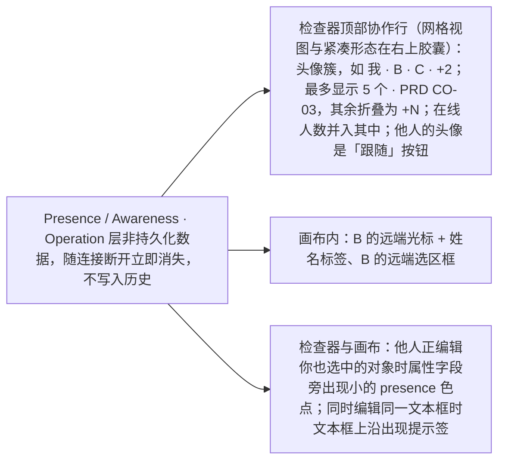
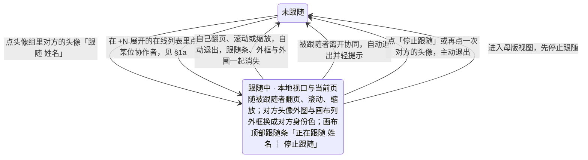
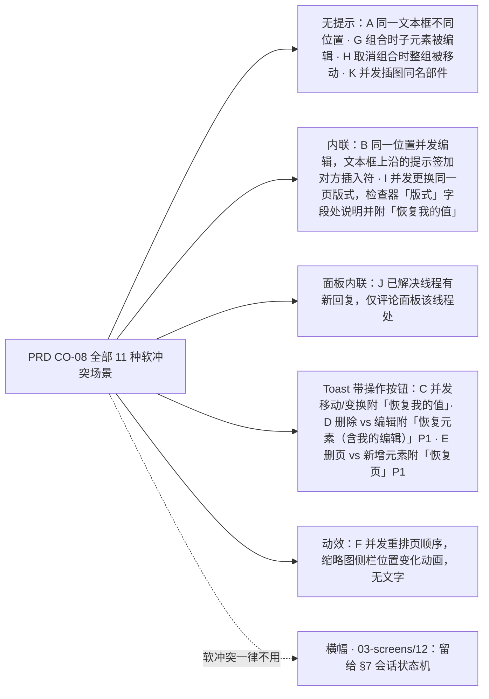
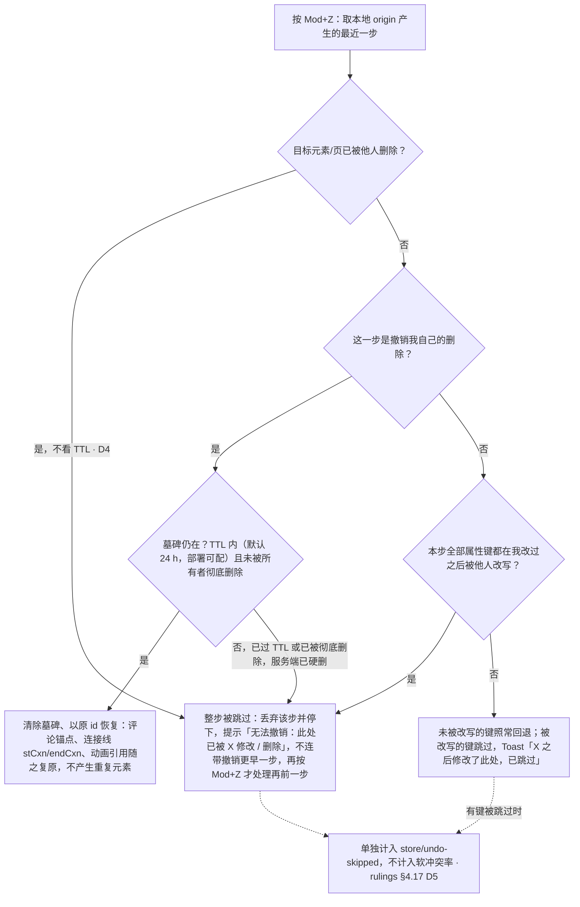
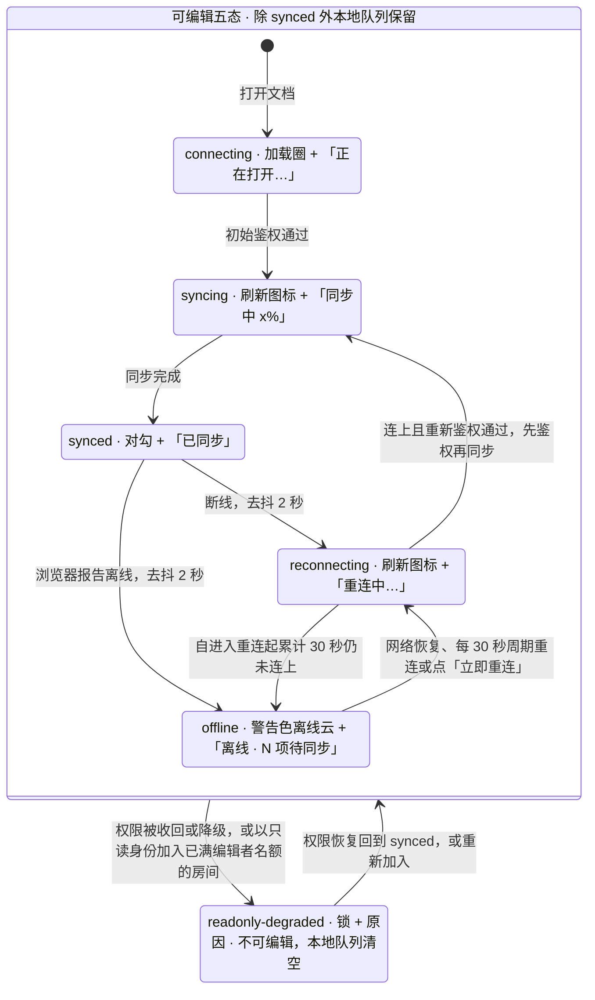
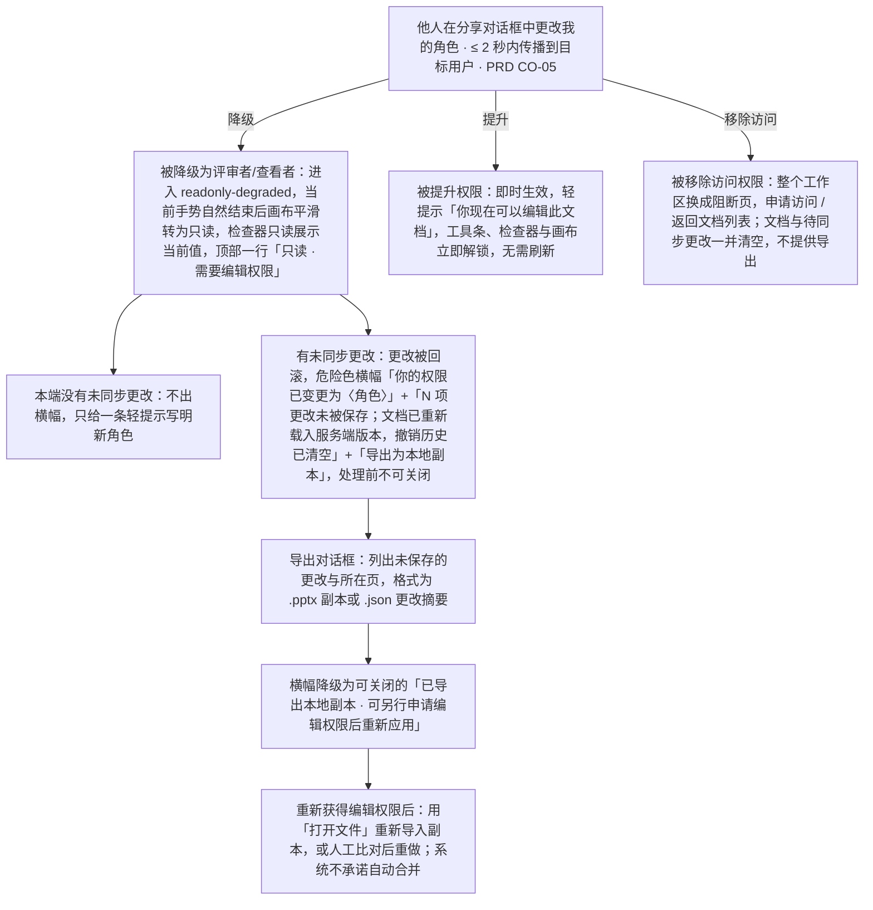

> 状态：草稿 | 负责：设计 | 更新：2026-09-15；2026-09-24（rulings §4.15：Q3 协同撤销语义——跳过他人后写并提示、整步被跳过即停、「恢复我的值」、软删除墓碑以原 id 恢复；Q5 名额按用户计、所有者保席）；2026-09-24（复核修正，rulings §4.17）；2026-09-25（补图）；2026-09-25（矛盾收口，rulings §4.18）；2026-09-25（§4.19）；2026-09-26（§4.20：TX-01+BE-10 版本恢复的撤销改指 ADR-0038）；2026-10-04（design-language-v3 第 0 批：§1 在场呈现图与说明按 v3 改为三处（头像簇在检查器顶部协作行、网格视图在右上胶囊，在线人数并入头像簇），§1a 头像簇位置同步；§7 同步指示改为文件名旁的同步状态行（原状态栏与 `ui.statusBar` 规则随 rulings §4.25 DS-6 废弃）；§8 权限提升时解锁工具条、检查器与画布）；2026-10-04（design-language-v3 第 0 批：复验修正——原「状态胶囊」改称文件名旁的同步状态行（rulings §4.25 DS-6），带作废标记的历史陈述统一措辞）；2026-10-04（design-language-v3 第 0 批：复验第 2 轮修正——§7 同步状态各态的 v3 视觉由「第 2 批」改为「第 1 批补齐」，以归属文档 03-02 §3.1 为准；§8 被降权时检查器改为控件留在原位、`aria-disabled` + 提示并加顶部说明（与 03-02 §6.2 一致），图 1 与权限变更图的旧称「检查器坞」改为「检查器」）；2026-10-05（design-language-v3 第 0 批修正：§7 服务端存储降级期的「横幅与胶囊规格」改为横幅见 03-12、同步状态行见 03-02 §3.1（原「状态胶囊」作废，DS-6）；§8 被降权时检查器按 rulings §4.25 DS-15 改为只读展示当前值、不显示禁用控件，与 03-02 §6.2 一致）；2026-10-07（design-language-v3 第 1 批：§7 同步状态行各态按 03-02 §3.1 定稿——状态表与会话六态图的绿点 / 黄点 / 红点改为对勾「已同步」、加载圈「正在打开…」、刷新「同步中 x%」「重连中…」、警告色离线云「离线 · N 项待同步」、锁「只读 · 权限已变更」，表后「随第 1 批补齐」改为定稿表述；§6 撤销被跳过的提示按 rulings §4.25 TB-26 写明按钮（「恢复我的值」/「恢复元素」，M3，PRD CO-09，前端 50/04 §6.3）；§1、§1a 头像簇位置补紧凑形态的右上胶囊（DS-17））；2026-10-08（design-language-v3 第 1 批收口：§8「权限变更的三种反馈路径」图的降级节点按 rulings §4.25 DS-15 改为检查器只读展示当前值，与正文和 03-02 §6.2 一致）；2026-10-15（design-language-v3 第 2 批：按已拍板的第 2 批样张与 rulings §4.25 DS-38…DS-63 回写——§1 同时编辑同一文本框的提示签与同时更换版式的字段处说明（DS-60）；§2 身份色 12 色定稿、哈希顺序即编号、同一场里撞色顺延，第 13 位起的序号角标画法随第 3 批（DS-42）；§5 场景 B、C、I、J 的呈现按样张，图同步（DS-60）；§6 彻底删除元素的入口与确认（DS-40、DS-57）；§7 同步状态行补齐各态文案与着色（DS-61），「已恢复」与长时间离线的画法（DS-41、DS-59），处理前不可关闭的横幅加到六类（DS-58），服务器保存延迟的提示与应用内离开、刷新拦截（DS-59）；§8 降权横幅正文、导出对话框与「已导出本地副本」、降权但没有未同步更改、名额已满、访问被撤销改为阻断页，图同步（DS-50、DS-58）；新增 §10 评论（DS-43…DS-46、DS-53）、§11 版本历史（DS-38、DS-39、DS-40、DS-57）、§12 分享与访问申请（DS-40、DS-47、DS-48）；同日再补，按回写中的裁决 rulings §4.25 DS-65…DS-68 与技术口径 TB-60…TB-66、TB-68、TB-69、TB-71、TB-73、TB-74——§7 同步状态行表补「文档正忙」（中性锁形），补未画样张的几类横幅归入 03-12 的「权限 / 文档状态」档、「发现新版本」与「插件设置已更新」合并、「部分更改未保存」走轻提示与界面状态的里程碑口径（TB-66）；§8 图中降权横幅补标题，换账号重新登录后的横幅只有「导出为本地副本」（TB-69）；§10 入口补 ↵ 落钉的前提（TB-62），评论钉的右键菜单不开放插件贡献（TB-61），新增「换页时的草稿」（DS-65）；§11 落位改为沿用检查器当前宽度（TB-60），补面板开着时被降权（TB-63）、说明不超过 200 字（TB-64）与 API 直接建的空文档（TB-74）；§12 补非所有者看到的链接与复制（TB-65）、链接到期等同收紧（DS-66）、令牌可重取（TB-71）、访问申请的 Webhook 事件（DS-67）、申请被拒不告知（DS-68）、「分享」圆点的数据来源（TB-68）与回收站里的文档照常收申请（TB-73）；同日再补，按回写中的裁决 rulings §4.25 DS-69、DS-70 与技术口径 TB-79、TB-80、TB-84、TB-86——§7 样张未画的「发现新版本」、换纪元后的两条与「文档已达元素上限，只读打开」三条横幅的底色、图标与能否关闭随第 3 批横幅样张拍板（TB-80）；§10「换页时的草稿」补进入网格视图、切到评审模式与换页同样处理（TB-84），恢复的撰写框不抢焦点、评论工具按不按下不因恢复而改变、收起时焦点先交给画布（TB-79）；§11 新增「最早那一条」按文档来源写（导入、新建空白、从模板新建、创建副本，DS-70），空态改指这一条；§12 非所有者「复制链接」复制到的与所有者相同——链接授予角色时是分享链接、仅邀请时是文档地址，令牌随成员列表给出、不含有效期与链接 id（DS-69、TB-86），原「非所有者拿不到令牌、一律复制文档地址」作废；同日再补，按回写中的技术口径 rulings §4.25 TB-87、TB-88、TB-90、TB-92——§10「换页时的草稿」补草稿按页存、不按模式存，切到评审模式或从评审返回编辑后仍停在同一页的单页画布时撰写框当场原样恢复（TB-87）；新增「恢复之后」一条：有恢复的撰写框时用户又明确发起新评论（工具条「评论」上按 ↵、有选中对象时按 C、右键「添加评论」、开着评论工具点画布别处）不另开撰写框，焦点直接进恢复的那个、光标在末尾，临时钉脉冲一次（TB-88）；草稿留着期间锚点对象已删恢复为同一页的页级锚点（框顶「评论 · 整页」）、文本范围解析不到退为元素锚点、整页已删草稿随页丢弃且不提示（TB-92）；§11「最早那一条」补源文档未命名的副本写「创建自『未命名演示文稿』的副本」（TB-90），本节不写月份行摘要与读屏名，类别名「导入版本 / 初始版本」以 03-07 §4.1、§6 为准；同日再补：§10「换页时的草稿」的「只有关闭文档才丢弃」后注明整页被删除时草稿随页丢弃（TB-92）；§12「链接」补令牌取不到时的「复制链接」——留在原位不可用，提示「暂时无法取得分享链接，请稍后重试」，所有者与非所有者同一处理，不复制文档地址（rulings §4.25 TB-91））；同日再补：§1a 在场规模表「评论图钉」改称「评论钉」（DS-43）；2026-10-22（design-language-v3 第 3 批：按已拍板的第 3 批样张与 rulings §4.25 DS-106、DS-112、DS-126…DS-132、TB-113、TB-123…TB-125 回写——§1 头像组里他人的头像是「跟随」按钮、头像一律身份色首字（DS-106、TB-123），图同步；§1a 头像簇不再用角标显示会话数、在线列表最窄 256 按内容加宽、同一账号写「N 个窗口」（DS-132、TB-124）；§2 第 13 位起的序号角标画法定稿（下沿中线与右下，DS-132，原「B²」示例作废）；§4 跟随模式按样张改写：头像即跟随按钮、外圈与画布列外框用对方身份色、跟随条「停止跟随」（DS-106、TB-113），先跟随再放映与放映里的自由浏览、失去连接（DS-106），状态图同步；§7 同步状态行表补「需要刷新」「只读 · 文档已达元素上限」，三条文档状态横幅的底色、图标与能否关闭定稿（DS-126…DS-128），横幅的补充规则补「已导出本地副本」第二句按原因换（DS-129）；§9 多会话统一称「窗口」（TB-124、DS-132）；§10 平板评论面板按方向落位（DS-131、TB-125）与嵌入里的一句（DS-112））；2026-10-22（同日再补，按回写中的裁决 rulings §4.25 DS-137 与技术口径 TB-138、TB-139、TB-146——§7「横幅的补充规则」：导出对话框说明的第二句与「已导出本地副本」的正文按 03-12 §7.2 的表写全，离线与退出登录确认只在对话框里写、导出后不出这条提示，表里没点名的原因用中性句（DS-129、TB-139）；「文档已达元素上限」正文里的两个数随协同握手给出（TB-146）；§8 被降权时文档菜单「重命名」「创建副本」「版本历史」不可用（TB-138）；§12 分享在 M3 开放，M2 的「分享」与卡片「分享…」留在原位不可用（DS-137））；2026-10-22（同日再补，按回写中的技术口径 rulings §4.25 TB-156、TB-159、TB-161——§8 被移除访问权限的阻断页与 §12「访问申请」：M2 的「申请访问」留在原位不可用、写「后续版本提供」（TB-156）；§10 嵌入里的平板仍以「在电脑上编辑」为准（TB-159）；§12 引言补「分享」按钮 M2 的工具提示与不渲染的条件（TB-161）；2026-10-22 复核修正：§8 降权时文档菜单三项一句补「创建副本」的用户裁决 DS-139；§8 被移除访问权限与 §12 引言补阻断页说明句不变（TB-156））；2026-11-04（design-language-v3 母版视图改版：§4 跟随状态图补「进入母版视图，先停止跟随」一条退出，怎么读同步；§4 补母版视图里头像与在线列表的「跟随」不可用、外观不变（读屏名加原因，在线列表底部的说明随之改写）；rulings §4.25 DS-157、DS-167、DS-177、TB-203；需求编号、优先级与里程碑不变） | 依赖：charter v0.1；rulings §4.15 Q3 / Q5、§4.18、§4.19、§4.25 DS-6、DS-15、DS-17、DS-38…DS-70、TB-26、TB-60…TB-66、TB-68、TB-69、TB-71、TB-73、TB-74、TB-79、TB-80、TB-84、TB-86…TB-88、TB-90…TB-92、DS-106、DS-112、DS-126…DS-132、DS-137、DS-139、DS-157、DS-167、DS-177、TB-113、TB-123…TB-125、TB-138、TB-139、TB-146、TB-156、TB-159、TB-161、TB-203；playground 第 3 批场景 `present`、`presence-scale`、`doc-banners`、`narrow-review`

# 05 协同 UX（Collaboration UX）

本文档细化 presence、远端光标/选区、跟随模式、软冲突可视化、评论（§10）、版本历史（§11）、分享与访问申请（§12）、离线态与重连、权限变化反馈的交互规则。界面的线框、状态与文案归各界面文档（评论 03-screens/06、版本历史 07、分享 08、离线与冲突横幅 12），本文只写跨界面的协同规则。底层一致性保证（CRDT 单一事实源）见章程 D5 与架构 06；本文档只定义这些保证在界面上的表达方式。

---

## 1. Presence 总览

**Presence 的三处呈现**



怎么读：左侧是同一份 presence 数据，箭头指向它在界面上的三个呈现位置；三处都不写入文档与历史。原状态栏的「N 人在线」随 rulings §4.25 DS-6 废弃，在线人数并入头像簇。两人的插入点落在同一文本框里时，文本框上沿外侧出现中性提示签「● 某某也在编辑此文本框」（色点是对方的身份色）并画出对方的插入符——是 presence 的延伸、预防性的提示，不加锁，断线即消失（rulings §4.25 DS-60，§5 场景 B）。头像簇里他人的头像是「跟随 〈姓名〉」按钮，点了进入跟随（§4，rulings §4.25 DS-106）；头像一律是身份色底加首字，不显示头像图片（TB-123）。

Presence 是"操作/Operation"层的非持久化数据（章程 §4），随连接断开立即消失，不写入历史。房间容量上限为 ≤ 20 编辑者 + ≤ 50 查看者（PRD CO-01）；超出编辑者名额的新加入者以只读身份加入并收到提示（见 03-screens/12 的 `readonly-degraded` 分支之一：容量已满）。**名额按用户计**（rulings §4.15 Q5）：同一账号的多个标签页/设备只占 1 个名额（presence 仍按会话显示，见 §9）；评审者（commenter）计入查看者名额；文档所有者**不占编辑者名额、始终保有一席**（房间已满 20 编辑者时所有者仍可以编辑身份进入）。名额数字为部署配置默认值，可调。面向"1 人讲、200 人看"的大规模只读广播是 P2/M4+ 范围（PRD CO-14），只读订阅者不占编辑者名额，本文档不在此展开其专属 UI，留待该里程碑另行设计。

## 1a. 在场规模与折叠规则（房间上限 20 编辑者，PRD CO-01/CO-03）

房间上限 ≤ 20 编辑者意味着 presence 的呈现必须为"接近上限时仍然可用、不沦为视觉噪音"设计，分两处分别定义折叠规则：

**头像簇（检查器顶部协作行，网格视图与紧凑形态在右上胶囊，§1）**：头像簇与"+N"计数**按用户**折叠（同一账号的多个会话合并为一个头像，与名额口径一致，rulings §4.15 Q5；会话数不上头像——一个头像只有一种角标，即同色序号，§2——写在在线列表我那一行「N 个窗口」，rulings §4.25 DS-132、TB-124；原「角标显示会话数」作废）；超过 5 个用户（PRD CO-03）即折叠为 "+N"；`+N` 为可交互元素（不只是文字），点击展开在线列表弹层（贴头像组左缘向下，最窄 256、按内容加宽，DS-132）：标题「N 人在线」，自己在最上（不可点），其余逐行头像 + 姓名 + 角色 + 所在页，按"最近有编辑活动优先"排序（而非加入顺序，让"谁在动东西"更容易被找到）；列表项支持点击直接进入跟随模式（§4），不需要先关闭弹层再去画布找人。

**画布远端光标/选区（`render.overlay`，§3）**：这是密度更敏感的场景（20 人同时编辑时画布上可能同时有接近 20 组光标+选区框），采用分级折叠而非头像簇的"数字折叠"，因为画布上的空间位置本身有信息量（不能简单归并成一个数字）：

| 同屏远端选区/光标数 | 呈现策略 |
|---|---|
| ≤ 8 | 全部完整呈现：色环选区框 + 光标 + hover/移动时的姓名标签 |
| 9–20 | 仅最近 5 秒内有活动（移动/输入）的协作者保持完整呈现（含姓名标签常驻短暂显示）；其余"静止"协作者的选区框保留但姓名标签默认隐藏（hover 才显示），光标降低不透明度至 60% |
| 位置高度重叠（多个远端选区/光标落在屏幕同一小范围内） | 不强行错开真实位置（会失真），改为在该位置叠加一个小的聚合徽标"+3"，hover/点击展开为逐个列出，与评论钉过密时的聚合钉同一手法（见 03-screens/06，rulings §4.25 DS-43 统一称「评论钉」） |

此规则与设计 06 §2.8 记录的性能预算（"同屏 ≥ 20 个远端选区仍需保持 ≥ 55 fps"）是同一约束的两个角度：性能预算是工程可行性下限，本节的折叠规则是即使性能达标、也需要的可读性设计——20 组同等视觉权重的光标同屏本身就是不可读的，与帧率无关。

## 2. 协作者颜色分配

- 调色板：`--presence-1` … `--presence-12`（设计 04 §2.4；原记号 `--cordex-color-presence-*` 已作废，C-22），12 色循环（PRD CO-03 明确要求 12 色板）。2026-10-15 定稿（rulings §4.25 DS-42）：已定 5 色之外新增 7 色，与已定 5 色同一口径（低饱和，白字 ≥ 4.60:1，对暗、亮两套画布与白纸面都 ≥ 3:1），取值与核算见设计 04 §2.4、§2.6。
- 分配算法：`index = hash(userId) mod 12`，**哈希顺序就是 12 色的编号顺序**（slate · sand · sage · clay · mist · olive · iris · lake · rose · denim · plum · moss，对应 `--presence-1…12`）；同一场里撞色时顺延到下一个未占用的颜色——顺序里相邻两色差得足够远（OKLab ΔE ≥ 8），顺延不会落到相近色上；同一账号的多个会话取同一色。保证同屏可辨识度优先于"同一用户颜色永远不变"。
- 颜色在一次会话内对同一用户保持稳定（不因翻页/切换面板重新计算），刷新页面后允许重新计算（不做跨会话强一致持久化，降低实现复杂度）。
- 第 13 位及以上协作者复用颜色（同一场里已没有空色可顺延时取自己的哈希色），头像上挂一枚序号角标，写这个人在同色里的序号（2、3…，同色第一位不画）以区分；由于房间容量上限为 20 编辑者（§1），这种复用在实践中很少发生。2026-10-22 按第 3 批样张定稿（rulings §4.25 DS-132，样张 `presence-scale`；取值与画法见设计 04 §2.4）：头像组里头像叠放，角标挂在这枚头像看得见的那一段的底部中线、向下多出 7，不压首字、碰不到同色邻居；在线列表里头像不叠放，角标在右下；24px 头像配 14、20px 配 12（TB-124）；读屏名「〈姓名〉，同色第 N 位」；画布上的远端光标与名签不加序号，同色两人靠名签里的名字区分。原「B²」式的写法作废。
- 头像一律身份色底 + 首字（PRD CO-03、AS-06）：`avatar_url` 只存不显示（rulings §4.25 TB-123）。
- Presence 色**不得**挪作他用（不用于表示只读/编辑/错误等语义），避免与语义色系统冲突（设计 04 §2.4）。头像、远端光标与名签、远端选区与评论钉共用这一色；导入的批注与过密时的聚合钉不是协作者，用中性钉、不占身份色（§10）。
- 集成方也可以直接提供协作者的显示颜色（PRD CO-03："由集成方提供或按用户 id 稳定哈希分配 12 色板"）；此时上述哈希算法作为**默认回退**，不强制覆盖集成方指定的颜色。

## 3. 远端光标与选区

| 元素 | 视觉 |
|---|---|
| 远端光标 | 小箭头/文本插入符 + 紧贴其旁的姓名标签（含协作者色底色、白色文字），仅在光标短暂静止或移动时短暂显示标签，持续显示光标图形本身 |
| 远端选区（对象） | 该协作者颜色的实线描边框，四角不显示可拖拽手柄（区别于"我"的选区，手柄仅属于本地操作者） |
| 远端选区（文本范围） | 该协作者颜色的低透明度高亮背景 |

远端光标/选区渲染在 `render.overlay` 层（`--layer-canvas-overlay`；原记号 `--cordex-z-canvas-overlay` 已作废，见设计 04 §9 对照表），`pointer-events: none`，不拦截本地用户的画布交互。放映模式不显示远端光标/选区（见 03-screens/11）。

## 4. 跟随模式（Follow Mode）

**跟随模式状态**



怎么读：进入有两条入口，退出的四条箭头任一触发即退出；整个状态只存在于跟随者本地，被跟随者不感知。

2026-10-22 按第 3 批样张定稿（rulings §4.25 DS-106、TB-113，样张 `present.editor-following`；PRD CO-03，M3）：检查器协作行（网格视图与紧凑形态在右上胶囊，同一组头像）里他人的头像是按钮「跟随 〈姓名〉」（`aria-pressed`），点按进入跟随、再点停止，点另一位即改为跟随他；跟随中这枚头像外圈 2px 换成对方身份色（外圈与头像之间留 1px 面板色），画布列四周画 2px 同色外框，画布顶部居中是跟随条——头像 ·「正在跟随 〈姓名〉」┊「停止跟随」（设计 04 §4.1d）。编辑器与放映两处按钮统一叫「停止跟随」（TB-113；原「退出」作废，它在放映里与控制条的「退出放映」撞名）。同一时刻画布顶部只放一条提示，插入工具这类模式提示出现时跟随条让位；停止后焦点交给画布；对方的光标照常显示，画布上的评论钉照常。

母版视图里（2026-11-03 母版视图改版拍板，rulings §4.25 DS-157、DS-167、DS-177、TB-203）：跟随中进入母版视图时先停止跟随；母版视图里头像组与「+N」在线列表各行的「跟随」留在原位、不可用，写「母版视图下不可用」——外观不变（头像身份色不变灰、只去掉悬停外圈，在线列表的行只去掉悬停底色），不可用由读屏名在原来的后面加的「（母版视图下不可用）」、工具提示与 `aria-disabled` 表达，点了不跟随；在线列表底部的说明随之改写「母版视图下不能跟随协作者」（03-screens/26 §1.1、§9）。

跟随模式是单向的（跟随者的操作不广播式打断被跟随者），且不限制跟随者本身继续编辑——跟随只同步"看什么"，不同步"选中/编辑什么"。**被跟随者不会收到任何"有人在跟随我"的提示**（PRD CO-03 明确"被跟随者不感知"）：这是刻意的隐私设计，跟随是观察者单方面的视角同步，不应给被观察者造成被监视的压力或社交负担。

**放映里的跟随**（DS-106，03-screens/11）：观众先在编辑器里跟随主讲人，再进放映（F5、⇧F5 或「放映」都一样），即从对方当前页开始并保持跟随；主讲人一侧没有任何变化，协议不改（未采纳「主讲人广播正在放映、在场的人收到邀请」，它要在 awareness 加字段、偏离「被跟随者不感知」）。舞台顶部是同一个跟随条，跟随中随控制条一起显隐（鼠标静止时一起淡出，画面干净）；观众自己翻页或点「停止跟随」转为自由浏览，跟随条换成「已停止跟随 〈姓名〉 ┊ 返回同步」并常驻，点「返回同步」跳到主讲人当前页、重新跟随；与主讲人失去连接时写「与主讲人失去连接，正在显示最后同步的页面」，常驻、没有按钮，连接恢复后回到跟随。失去连接这一态是放映的特例：编辑器里对方离开即退出跟随（上图）。放映里不画画布列外框、不显示远端光标。

## 5. 软冲突可视化（总规则 + 场景速查）

CRDT 保证不存在需要人工合并的硬冲突（章程 §4、D5），但仍需把"状态被他人改变"清晰地反馈给用户，参见 02-user-flows.md F4 的完整流程描述。设计取舍原则：

- **优先原地/内联提示**，仅当当前操作对象整体消失（被删除）时才追加一条 Toast。
- **不使用阻断式对话框**：软冲突不应打断心流，用户可以选择立即处理或忽略继续。
- **让远端意图可预见**：远端选区/光标本身就是最好的"预警"——在冲突真正发生前，用户已经能看到"有人正在动这个对象"。

下表把 PRD CO-08 定义的全部 11 种软冲突场景（字母编号与 02-user-flows.md F4 一致）逐行映射到**呈现形态**——每行一个明确的 toast / 横幅 / 内联 / 动效 / 无提示分类，不存在"看情况"的模糊地带：

| 场景 | 呈现形态 | 具体呈现位置 |
|---|---|---|
| A 同一文本框不同位置并发编辑 | 无提示 | — |
| B 同一文本框同一位置并发编辑 | **内联**（预防性，非事后） | 文本框上沿外侧的中性提示签「● 某某也在编辑此文本框」（色点为对方身份色）+ 对方的插入符；presence 的延伸而非事后通知，不加锁、不阻止输入，断线即消失（rulings §4.25 DS-60） |
| C 同一形状被并发移动/变换 | **Toast**（带操作按钮） | Toast「某某移动了该形状」（左侧对方头像、可关闭）附「恢复我的值」按钮：新事务，把该形状的位置/变换写回我的值（覆盖对方后写，可再撤销）；原"撤销"按钮作废（rulings §4.15 Q3，§6） |
| D 对象被删除同时其文本被编辑 | **Toast**（带操作按钮，P1） | Toast 附"恢复元素（含我的编辑）"入口：清除墓碑、**以原 id 恢复**，我的编辑保留（软删除，§6）；墓碑过 TTL 后入口失效 |
| E 页被删除同时该页被新增元素 | **Toast**（带操作按钮，P1） | 同 D，附"恢复页"（原 id，原位置） |
| F 并发重排页顺序 | **动效**（无文字） | 缩略图侧栏位置变化动画，不产生 Toast/横幅/文字内联 |
| G 组合元素时子元素被并发编辑 | 无提示 | — |
| H 取消组合时并发移动整组 | 无提示 | — |
| I 并发更换同一页版式 | **内联** | 检查器「版式」字段本身：字段外圈换成对方的身份色，节末写「某某同时把这一页改成了「〈版式〉」，你选的「〈版式〉」没有生效」+「恢复我的值」（同 C，新事务）；不弹轻提示，与第 1 批「远端覆盖正在输入的字段」同一画法（rulings §4.25 DS-60） |
| J 解决评论线程同时有新回复 | **面板内联** | 仅评论面板内该线程处写明「解决之后又有新回复」，线程收起时摘要行右侧写「有新回复」，不产生全局 Toast/横幅（§10） |
| K 并发插入图片产生同名部件 | 无提示 | — |

**CO-08 场景按呈现形态归类**



怎么读：每个场景只落在一种呈现形态里，没有"看情况"的分支；虚线表示横幅通道刻意不给软冲突使用。

**横幅**（03-screens/12）不出现在上表中——横幅是本文档 §7 会话状态机专用的稀缺资源（连接/权限类问题），CO-08 的软冲突场景全部用 Toast/内联/动效表达，不占用横幅这一更高优先级的通道，这是两套机制刻意的分工（见 03-screens/12"横幅使用准则"）。

对应画布消失 / 自动跳转 / 字段级内联"应用远端值或保留我的输入"等具体交互规格见 02-user-flows.md F4 与 03-screens/03。

## 6. 撤销/重做与协同的关系

本地撤销栈只回退"本地 origin"产生的 Mutation，不影响他人提交的变更。撤销语义**不跟随 CRDT 库默认行为**，而是写进 DocumentStore 的中性契约（rulings §4.15 Q3；ADR-0020「协同撤销语义」；store-memory 同语义），本文档只描述用户可见结果。用户体感规则：

- **撤销不覆盖他人（跳过并提示）**：一步撤销中，凡是"我改过、之后又被他人改写"的同一属性键，撤销时**跳过**该键，本步其余键照常回退；同时给出非阻断提示"<X> 之后修改了此处，已跳过"（Toast，可关闭，不打断输入；带「恢复我的值」按钮，见下文「提示上的按钮」）。未被他人改写的属性照常回退——细粒度到键，而非整体回退到某个历史快照。
- **整步被跳过即停**：若这一步的全部变更都被跳过（所有键都已被他人改写，或目标已被他人删除），这次 `Mod+Z` **丢弃该步并停下**，提示"无法撤销：此处已被 <X> 修改 / 删除"，**不会连带撤销更早的一步**（避免用户在没察觉的情况下撤掉更早的操作）；再按一次 `Mod+Z` 才处理再前一步。
- **被他人删除即跳过，不看 TTL**（rulings §4.17 D4）：撤销的目标元素/页已被他人删除时，无论墓碑是否仍在 TTL 内，一律跳过并提示"无法撤销：此处已被 <X> 删除"——撤销**永不复活他人删除的元素**；要找回只能由删除方撤销自己的删除，或由我显式点"恢复元素（含我的编辑）"（新事务）。撤销被跳过单独计入 `store/undo-skipped`，不计入软冲突率（rulings §4.17 D5）。
- **提示上的按钮**（rulings §4.25 TB-26；M3，PRD CO-09）：撤销被跳过的轻提示保留恢复按钮——「〈X〉之后修改了此处，已跳过」与「无法撤销：此处已被〈X〉修改」配「恢复我的值」，「无法撤销：此处已被〈X〉删除」配「恢复元素」，「无法撤销：该内容已被彻底删除」不带按钮；两者都是新事务、可再撤销，带按钮的提示停留 5 s、悬停暂停计时；按钮的启用条件与错误以前端 50/04 §6.3 为准，呈现见 03-screens/19 §4.2（样张未画，随实现）。
- **想要"改回我的值"用显式命令**：CO-08 prop-lww 提示条（场景 C、I）上的按钮是「恢复我的值」，不是"撤销"——它发起一个**新事务**把属性写回我的值，会覆盖对方的后写，可审计，也可以再被撤销（见 §5 表、02-user-flows F4）。
- **删除是软删除（墓碑），恢复复用原 id**：删除在存储层落为墓碑标记，元素 id 保持稳定；删除方撤销删除、以及被删方点「恢复元素（含我的编辑）」，都是**清除墓碑、以原 id 恢复**——评论锚点、连接线（`stCxn`/`endCxn`）、动画引用随之复原，不产生重复元素。墓碑在 TTL（默认 24 h，部署可配）后由服务端硬删除，此后不可再恢复，删除方撤销该步按"整步被跳过"处理（TTL 只影响删除方撤销自己的删除与"恢复元素"入口；他人的撤销遇到被删目标一律跳过，与 TTL 无关，见上条）；「永久删除文档」（文档级擦除）与下条的「彻底删除元素」不等 TTL。（原"不强行复用原 id、以新 id 重新创建"的写法作废。）
- **彻底删除元素（M3，仅所有者，rulings §4.18 CO-07）**：术语拆开——文档级的回收站永久删除称「永久删除文档」，元素级称「彻底删除元素」，界面不再出现不分层级的"立即彻底删除"。彻底删除元素**只对已删除（墓碑态）的元素开放、只能由文档所有者发起**，入口是版本历史面板的「最近删除」分组（03-screens/07：所有者的列表顶部、缺省收起，每行一个中性次按钮「彻底删除」，危险色只给确认框的主按钮），每次都要经模态确认对话框、初始焦点在「取消」（rulings §4.25 DS-40、DS-57）；服务端立即硬删并写审计，状态统一为「墓碑 → 已硬删除」。它**只清当前文档状态**：历史版本（自动快照、命名版本）与更新记录按保留期仍含该内容，引用的图片原件按 30 天无引用回收，确认对话框必须明示"历史版本仍含该内容，要连历史清除请永久删除文档"。之后删除方再撤销该步，按"整步被跳过"处理（与墓碑 TTL 到期同一路径），提示"无法撤销：该内容已被彻底删除"。
- 版本恢复（CO-07 / U-07）作为普通事务，同样适用以上规则；撤销一次恢复的细则（范围、「他人后写」判据、恢复时删掉的元素以原 id 复活）以 [ADR-0038 `version-restore-undo`](../30-architecture/adr/0038-version-restore-undo.md) 为准（提议，M2 出口评审前定稿；未定稿则版本恢复不开工，rulings §4.20 TX-01+BE-10），版本面板里「撤销此次恢复」入口的界面随 ADR 定稿后在 03-screens/07 出稿。

**协同下一次撤销的判定**



怎么读：图按「一步只涉及一个目标元素」画出；菱形是判定，任何一条路径都不会复活他人删除的元素，也不会越过被跳过的一步去撤销更早的操作；虚线表示跳过行为的埋点去向（跳过次数与整步跳过次数）。想把属性改回我的值，不走这张图，而是点提示条上的「恢复我的值」发起新事务。
依据：本文 §6；rulings §4.15 Q3、§4.17 D4 / D5、§4.18 CO-07

## 7. 会话状态机（连接状态指示）

PRD `03-collaboration.md` §3"状态与提示一览（供设计 05 承接）"给出了权威的六态状态机，本节直接采用（取代此前版本的示意状态机），并补充"是否可编辑"与"是否有本地队列"两个维度，供文件名旁的同步状态行与横幅共同实现：

```
 状态                同步状态行（03-02 §3.1）                可编辑  本地队列  触发/备注
 ──────────────────  ──────────────────────────────────────  ──────  ────────  ─────────────────────
 connecting          加载圈 +「正在打开…」                   是      是        初始鉴权（打开文档时）；重连时的 connecting 呈现为 reconnecting
 syncing             刷新图标 +「同步中 x%」                 是      是        初始同步与重连后的同步（确定态进度）
 synced              对勾 +「已同步」                        是      否        稳态；协作者头像在检查器顶行头像组
 reconnecting        刷新图标 +「重连中…」                   是      是        指数退避重连中（1s→2s→4s…上限30s，±20%抖动）
 offline             离线云（警告色）+「离线 · N 项待同步」  是      是        自进入重连起累计 30 秒仍未连上，或浏览器报告离线（立即）；
                                                                               离线期间每 30 秒（±20%）自动重连，浏览器离线时暂停
 readonly-degraded   锁 + 原因（如「只读 · 权限已变更」）    否      清空      权限降级 / 房间容量已满
```

状态转移（按架构 06 §5.1：每次重连都先鉴权、再同步）：`connecting → syncing → synced` 是打开文档的首次同步路径；断线后 `synced →（去抖 2 秒）→ reconnecting →（连上且鉴权通过）→ syncing → synced`；`reconnecting` 自进入起累计 30 秒仍未连上即 `offline`，浏览器报告离线（`navigator.onLine=false`）时立即 `offline`（去抖 2 秒），令牌刷新的网络失败共用同一计时（rulings §4.18 UX-03）；`offline` 不停止重试——每 30 秒（±20% 抖动）自动重连一次，浏览器报告离线期间暂停，收到 `online` 事件或用户点「立即重连」立即重连，回到 `reconnecting`（rulings §4.18 CO-03）。任意状态都可能被推入 `readonly-degraded`（权限被收回/降级、或以只读身份加入已满编辑者名额的房间），权限恢复后回到 `synced`，也可重新加入。对外事件载荷是 M-05 的 SyncState 六态：`reconnecting` = `connecting` 且 `reconnectAttempt > 0`，`readonly-degraded` = `synced` + 角色降级标志（架构 06 §18.3）。

**服务端存储降级期**（rulings §4.18 CO-08、§4.19 INC-09）：Postgres 写失败期间，更新经门禁后照常广播、协作不中断，会话仍为 `synced`；但发起方的本地待确认项要到收到 `ack{tier:'db'}` 才清除。服务端经 `CONTROL.room` 的 `persist: 'degraded' | 'ok'` 显式通知；客户端判据为 `room.persist==='degraded'` ∨ 在途含仅获 spill 确认的项 ∨ 最老在途 ≥ `unsavedWarnAfterMs`（默认 15 秒）。提示按受众分级：本端有未获 db 确认项的**发起方**显示横幅「未保存到服务器 N 项」；**其余协作者**只在文件名旁的同步状态行显示弱提示「服务器保存延迟」（他们看到的他人修改在此期间可能尚未保存）；原「只用状态栏色点、不出横幅」作废；发起方的横幅是警告浅底、可关闭，关闭后同步状态行保留警告色的「未保存到服务器 N 项」，直到全部获 db 确认、`room.persist` 回到 `ok`（横幅不再出现，不另弹「已恢复」）；其余协作者的「服务器保存延迟」为中性图标，悬停或聚焦看说明「服务器存储暂时不可用，你看到的他人修改可能尚未保存」；重连中、离线时由连接横幅承载「N 项待同步」，不叠加「未保存到服务器」（rulings §4.25 DS-61；横幅规格见 03-screens/12，同步状态行见 03-screens/02 §3.1，原「状态胶囊」随状态栏作废，DS-6）。此时在应用内离开或刷新，同样先走下文的离开与刷新拦截。

**里程碑**（rulings §4.19 D-M2-CONTENT）：协同后端自 M2 起交付，参考应用经协同网关打开文档，M2 呈现 `connecting`、`syncing`、`synced` 与基础重连（`reconnecting`），以及 PG 故障期的分级提示（发起方横幅「未保存到服务器 N 项」、其余会话同步状态行「服务器保存延迟」）；`offline`（30 秒判据、周期重连）、`readonly-degraded`、协作者头像与在场属于 M3 多人协同体验层（PRD `05-milestones-and-scope.md` §0.3）。

**会话六态状态机**



怎么读：每个状态框里写的是它在文件名旁同步状态行上的图标与文字（03-screens/02 §3.1）；外框内五态都可编辑，connecting → syncing → synced 是打开文档的首次同步路径；断线后的每次重连都经 syncing 回到 synced（先鉴权再同步，不会从「重连中」直接跳回「已同步」）；离线后按 30 秒周期自动重连，浏览器报告离线期间暂停。从外框任一状态都可能被推入 readonly-degraded，这是唯一会清空本地未同步编辑的状态。重连退避参数见上表，横幅何时出现见 03-screens/12 的横幅状态图。
依据：架构 06 §5.1、§18.3；PRD CO-01 / §3；rulings §4.18 UX-01、UX-03、CO-03

文件名旁的同步状态行常驻显示对应指示（图标 + 简短文案，任何宽度下常驻、不收起；取代原状态栏指示与 `ui.statusBar` 的"协同/同步状态项永不收入溢出"规则，rulings §4.25 DS-6）。各态的图标与文案已于 2026-10-07 随 design-language-v3 第 1 批定稿、2026-10-15 随第 2 批补齐（下表），以 03-screens/02 §3.1 为准；网格视图与紧凑形态里缺省的「已同步」不显示，非缺省状态跟在左上胶囊的文件名后（03-screens/02 §5.1、§5a）；仅查看形态里同步异常时顶部条的状态行换成同步状态（rulings §4.25 DS-60）。仅当状态进入 `reconnecting`/`offline`/`readonly-degraded`、从这些状态恢复的瞬间，或本端作为发起方出现「未保存到服务器 N 项」，或出现下表里需要人工处理的情形时，才额外出现顶部横幅（见 03-screens/12，横幅使用准则见该文件）。

**同步状态行的文案与着色**（2026-10-15，rulings §4.25 DS-61；第 1 批已定的各态不变）：

| 情形 | 同步状态行 | 图标 | 横幅 |
|---|---|---|---|
| 离线 | 「离线 · N 项待同步」 | 警告色 | 离线横幅（警告浅底，文案「更改已保存在本地，将在重新连接后同步」不改，DS-59） |
| 本端有未获 db 确认的更改（发起方） | 「未保存到服务器 N 项」 | 警告色 | 警告浅底、可关闭 |
| 服务器存储降级，本端没有未确认的更改（其余协作者） | 「服务器保存延迟」（悬停看说明） | 中性 | 不出 |
| 登录已过期 | 「登录已过期 · N 项待同步」 | 警告色 | 警告浅底，处理前不可关闭；期间写命令被拒，字段留在原位不可用，检查器顶部一行写原因（DS-58） |
| 协同已暂停（隔离态） | 「协同已暂停 · N 项未同步」 | 警告色 | 危险浅底，始终不可关闭，只能刷新退出；写命令同样被拒 |
| 权限降级（仍有读权限） | 「只读 · 权限已变更」 | 中性 | 本端有未同步更改时为危险浅底的降权横幅（§8）；没有时不出横幅、只给轻提示 |
| 编辑者名额已满 | 「只读 · 名额已满」 | 中性 | 中性底、可关闭，带「重试以编辑身份加入」，不自动提升（DS-58） |
| 重新登录的账号与原会话不同 | 「只读 · 登录账号已变更」 | 中性 | 按权限降级处理：危险浅底，更改移入导出区，导出前不可关闭 |
| 文档已被删除 | 「文档已被删除」 | 中性 | 危险浅底，导出前不可关闭（DS-58） |
| 文档锁定（覆盖导入或迁移期间） | 「文档正忙」 | 中性（锁形） | 锁定期间转只读、停止发送（前端 50/07 §8.1）；锁定窗口里有更改被拒时出「文档正忙」横幅，归「权限 / 文档状态」档（TB-66，03-screens/12 §2.2） |
| 发现新版本（协同以 4426 / 4427 关闭） | 「需要刷新 · N 项未同步」（没有未同步项时只写「需要刷新」） | 警告色（没有未同步项时中性） | 警告浅底 + 刷新图标、不可关闭、唯一按钮「刷新」；会话已关闭、不再重连，写命令被拒（2026-10-22，rulings §4.25 DS-126） |
| 文档已达元素上限，只读打开 | 「只读 · 文档已达元素上限」 | 中性（锁形） | 中性底 + 锁形、可关闭、没有按钮；正文写数字与出路，关掉后由这一行继续说明（DS-128） |

口径：还带着待同步计数（「N 项待同步 / 未同步 / 未保存」）的用警告色图标——更改还在队列里、没送到服务器；转为只读或文档已不存在时，有更改的已移入导出区、由横幅提醒导出，状态行只说明身份，用中性图标；重连中与打开、加载、同步这类进度提示照旧中性。嵌入式单人保存的状态（「已在本地保存」「保存失败 · 重试」）按 03-screens/19，不在此表。

**横幅的补充规则**（rulings §4.25 DS-41、DS-58、DS-59）：处理前不可关闭的横幅由权限降级、访问权限已变更、隔离态、登录已过期四类加到六类，另加「文档已被删除」「有更改过大无法同步」；其中访问权限已变更改为整个工作区的阻断页（§8）；需要导出的三类（权限降级、文档已被删除、更改过大）导出后降级为可关闭的「已导出本地副本」。导出对话框说明的第二句与「已导出本地副本」的正文按打开它的原因换（2026-10-22，rulings §4.25 DS-129，03-screens/12 §7.2 的表）：降权与换账号写「获得编辑权限后可以对照重做」「可另行申请编辑权限后重新应用」，换纪元与更改过大写「可以对照重做」，文档已被删除写「可以另存为新文档」，离线时的离开确认与退出登录确认写「恢复连接后可以对照重做」（只在对话框里——从确认框打开、导出后回到原处，不出「已导出本地副本」）；表里没点名的原因（登录已过期、协同已暂停、未保存到服务器时的离开或刷新，以及「文档正忙」等）用不提权限的中性句「导出的副本不会自动合并回文档，可以对照重做。」（TB-139）。第 3 批另有「发现新版本」（始终不可关闭，只能刷新）与换纪元时有未提交的更改（导出前不可关闭，同「更改过大」）两条处理前不可关闭的横幅（DS-126、DS-127，见下段）。重连并同步完成后横幅换成「已恢复协同并同步完成」：中性底加成功色对勾，3 秒后自动收起，也可以手动关闭；离线超过 24 小时后重连时，这一条追加「较长时间离线（超过 24 小时），合并后请检查」与可点的受影响页码（超过 3 页时只列前 3 页，其余写「等 N 页」，N 是受影响页总数），图标换成中性信息图标、不自动收起（P1，DS-59）。

第 2 批样张未画的几类横幅（rulings §4.25 TB-66）：「发现新版本」、换纪元后的「文档已替换为导入的文件 / 文档已由管理员重建」、「文档已达元素上限，只读打开」与「文档正忙」都归 03-screens/12 横幅通道的「权限 / 文档状态」档（03-12 §2.2）；「发现新版本」与「插件设置已更新」同时成立时按 PRD 07 G-87 合并、以版本漂移为准；连接污染时的「部分更改未保存」走轻提示、不占横幅；「文档正忙」时同步状态行用中性锁形图标（上表）。其中三条的底色、图标与能否关闭 2026-10-22 随第 3 批拍板（rulings §4.25 DS-126…DS-128，样张 `doc-banners`；原推迟依据 TB-80，README D15 结案）：

- **发现新版本，刷新后继续**：警告浅底 + 刷新图标、不可关闭、唯一按钮「刷新」——不处理就不能继续编辑，还可能丢掉未同步的更改，与「登录已过期」同一档。协同以 4426 / 4427 关闭时会话不再重连，编辑器转为暂时不能编辑（工具与字段留在原位不可用，检查器顶部「暂不可编辑 · 发现新版本，刷新后恢复」，同上表的同步状态行），点「刷新」时有未同步更改先弹刷新确认（下文的离开与刷新拦截）；惰性代码块重试仍失败时会话还在、其余照常编辑，只有惰性元素保持占位，点「刷新」先同步（DS-126）。
- **换纪元**（4428：覆盖导入提交或运维重建）：编辑器丢弃本地状态、重新载入，撤销历史清空、评论锚点重算。没有未提交更改时是中性底 + 信息图标，标题「文档已替换为导入的文件」（本会话收到过导入锁定）或「文档已由管理员重建」，正文「文档已重新载入，撤销历史已清空」，可关闭、**不自动消失**——内容整份换了、撤销没了，要让用户确实看到（前端 50/07 §9 原「没有未提交更改时 3 秒后自动消失」作废）；有未提交更改时与「有更改过大无法同步」同一画法：危险浅底 + 圆圈感叹号，正文追加「；N 项更改未提交」+「导出为本地副本」，导出前不可关闭（DS-127）。
- **文档已达元素上限，只读打开**（部署调低了元素天花板，以只读加入，与编辑者名额已满分开）：与「编辑者名额已满」同一档——中性底 + 锁形、可关闭、没有按钮（元素数降到天花板以下之前结果不变，不给「重试」，出路只有管理员）；正文写数字与出路「元素数量超过本部署的上限（N / M）；如需编辑，请联系管理员」（N 是文档的元素数、M 是本部署的上限，随协同握手的只读结果一起给出，与服务端准入判定同口径、含墓碑，rulings §4.25 TB-146）；编辑器只读展示（DS-15），只读会话照常有在场信息（DS-128）。

界面状态标注的里程碑以 PRD 需求为准：「文档已被删除」「有更改过大无法同步」两条横幅跟 PRD CO-06 为 M3；前端 50/07 §16 写的里程碑指协议层的关闭与停止重连随网关交付。

`readonly-degraded` 下本地未同步的更改会被清空并提示（见 §8），这与其余四态"本地队列保留、恢复后自动同步"的行为不同，是唯一会丢失本地未同步编辑的状态，UI 必须在这一刻给出明确说明与可能的补救（导出本地副本）。

M2–M3 范围内（协同后端自 M2 起，rulings §4.19 D-M2-CONTENT），会话内队列在页面刷新后丢失（PRD CO-06），因此 `offline`/`reconnecting` 状态下或仍有未获服务器确认的更改时离开或刷新页面会丢更改。2026-10-15 定稿（rulings §4.25 DS-59）：应用内的离开与刷新——主菜单「返回首页」、隔离态「刷新」、插件设置「重新加载」、发现新版本「刷新」——先尝试同步（≤ 5 秒），仍有未同步项时弹应用内确认框（「离开将丢失 N 项未同步更改」/「刷新将丢失 N 项未同步更改」，左下「导出为本地副本」，初始焦点在安全项：离开为「留下」、刷新为「取消」，主按钮为危险色）；浏览器刷新与关闭标签页只能触发浏览器原生提示，文案不能定制。离线横幅维持第 1 批文案「更改已保存在本地，将在重新连接后同步」，写明「关闭或刷新会丢失」的文案在 M4 启用本地持久化前再定。跨刷新持久化是 M4 P2 范围，章程 v0.2 §5.2 已新增对应的包 `@cordexjs/collab-offline-idb`（IndexedDB 实现，命名已定），届时上述拦截应移除或改写为"更改已在本地持久化"一类的确定性文案。离线超过 24 小时后重连的提示见上文「横幅的补充规则」（P1）。

## 8. 权限变化即时反馈

- 场景：正在编辑的用户被降级为评审者/查看者（他人在分享对话框中更改其角色）。
- 传播时限：PRD CO-05 要求权限变更在 ≤ 2 秒内传播到目标用户。
- 表现：目标用户客户端进入 `readonly-degraded`（§7），画布在下一次交互前完成向只读态的平滑过渡（不强行打断正在进行中的拖拽等操作，允许当前手势自然结束后再锁定），检查器与评审、只读浏览统一为只读展示当前值（只列属性与当前值、不显示禁用控件，rulings §4.25 DS-15），面板顶部一行「只读 · 需要编辑权限」；创建工具留在原位、不可用并提示「需要编辑权限」（03-screens/02 §6.2）；文档菜单的「重命名」「创建副本」「版本历史」与主菜单「文件 › 导出…」同样留在原位、不可用，写「需要编辑权限」（rulings §4.25 DS-105、TB-138；「创建副本」一项按 DS-139，第 1 批「降权时创建副本照常」作废）。
- **未同步的本地更改会被回滚**（这是 `readonly-degraded` 与离线/重连四态最大的行为差异，见 §7）：危险色横幅「你的权限已变更为「〈新角色〉」」+「N 项更改未被保存；文档已重新载入服务端版本，撤销历史已清空」+「导出为本地副本」，处理前不可关闭，不静默丢弃用户的工作成果（2026-10-15 按 rulings §4.25 DS-58 改写正文后半句：文档重新载入后撤销历史已清空，要告诉用户；原「导出后可另行申请编辑权限再重新应用」的意思移到导出对话框与「已导出本地副本」提示里，第 1 批 3 个降权画面随之改）。补救流程（03-screens/12 的 `readonly-degraded` 横幅承载入口点）：
  1. 用户点横幅上的「导出为本地副本」，打开导出对话框：列出未被保存的更改（命令名 + 所在页，点某项切到该页对照），格式可选演示文稿副本 .pptx（缺省，即回滚前的文档状态）或更改摘要 .json（供人工比对）；
  2. 导出完成后横幅从「需要操作」降级为可关闭的中性提示（成功色对勾）「已导出本地副本 · 可另行申请编辑权限后重新应用」；
  3. 用户若之后重新获得编辑权限，可通过"打开文件"重新导入这份本地副本、或人工比对后把需要的更改重新做一遍——**系统不承诺自动把导出的更改重新应用（合并）回文档**，这是一次性的"数据不丢失"保障，不是"自动恢复编辑会话"，两者不应混淆，避免过度承诺一个不存在的自动合并能力。
- 降权但本端没有未同步的更改：没有要导出的东西，不出横幅，只给一条轻提示写明新角色（「你的权限已变更为「可评审」」，与被提权的提示对称）；同步状态行「只读 · 权限已变更」、检查器顶部说明与不可用的工具照常（DS-58）。
- 反向（被提升权限）：同样即时生效，轻提示「你现在可以编辑此文档」，工具条、检查器与画布交互立即解锁，无需刷新页面；已进入「未同步更改」区的内容不自动重放。
- 编辑者名额已满（以只读身份加入，§1）：没有丢失任何东西，用中性底横幅「编辑者名额已满（上限 N 人）」+「重试以编辑身份加入」（重新判定名额），不自动提升；横幅可关闭，关闭后同步状态行仍写「只读 · 名额已满」，画布写入与评论创建都收回（DS-58）。
- 重新登录回来的账号与原会话不同：不重放队列，按权限降级处理——与降权同一条危险色横幅，动作只有「导出为本地副本」，更改移入「未同步更改」区可导出、导出前不可关闭，导出后降级为「已导出本地副本」，同步状态行「只读 · 登录账号已变更」，防止以他人身份提交更改（rulings §4.18 UX-02、§4.25 TB-69，03-screens/12）。
- 被移除访问权限（不再能访问文档，降为无任何角色）：比降级更严重——**整个工作区换成阻断页**，与「打开失败 · 没有访问权限」同一布局：「申请访问」（主操作，打开留言弹层，§12；M2 留在原位、不可用，写「后续版本提供」，阻断页的说明句不变，rulings §4.25 TB-156）·「返回文档列表」；内存里的文档与待同步更改一并清空，撤销后不再向该用户留存文档内容，所以既不在编辑器上留横幅，也**不提供**「导出为本地副本」——文档已不在该用户可读范围内，安全优先（PRD CO-05，前端 50/07 §8.1；rulings §4.25 DS-50；原「访问权限已变更」阻断横幅作废，留在样张里标「未采纳」，DS-63）；仍有读权限的降级才走上面的导出补救。
- 权限判定不依赖 UI 本地状态（PRD CO-05："权限判定不依赖 UI 状态"）：即使客户端 UI 因故未能及时锁定，服务端网关仍会拒绝越权的写操作，UI 的锁定是体验优化而非唯一防线，这一点不需要设计侧额外处理，但解释了为什么"被拒绝的操作"这一边界情况（构造消息绕过客户端）不会在 UI 层出现对应状态——服务端直接断开该会话并记录审计。

**权限变更的三种反馈路径**



怎么读：从同一个权限变更事件分出三条路径；降级路径再按本端有没有未同步更改分成两支，只有有更改的一支需要补救，补救只保证数据不丢失，不是自动恢复编辑会话；移除访问不再是横幅，而是阻断页。服务端网关始终拒绝越权写入，UI 锁定只是体验优化。
依据：本文 §8；PRD CO-05；rulings §4.25 DS-15、DS-50、DS-58

## 9. 多标签页/多会话作为特殊协作者

同一账户在多个窗口（标签页或另一台设备）打开同一文档时——同一账号的多个会话统一称「窗口」（2026-10-22，rulings §4.25 TB-124）——每个会话在**画布**上作为独立的远端光标/选区参与 presence（见 01-information-architecture.md §7），身份色同自己的头像，避免"我自己另一个窗口的光标是谁"的困惑，名签写「〈姓名〉（你 · 窗口 2）」，与在线列表里的「（你）」一致（原「(我·标签2)」作废）；但在**头像簇与名额**上按用户合并——同一账号只占 1 个头像、1 个房间名额（rulings §4.15 Q5，§1/§1a）；窗口数不上头像，写在在线列表我那一行「2 个窗口」，读屏名同写（DS-132，样张 `presence-scale.multi-session`；原「头像角标显示会话数」作废）。

## 10. 评论（2026-10-15，rulings §4.25 DS-43…DS-46、DS-53）

评论是文档状态的一部分（ADR-0031）：随文档一起打开、离线时照常发表与回复，冲突按 CRDT 收敛（场景 J，§5）。界面、状态与文案以 03-screens/06 为准，流程见 02-user-flows.md F7；本节写跨界面的规则。

- **入口唯一**（DS-45，质量门 Q2）：新评论的常驻入口只有底部工具条「评论」（`C`）——点对象落元素锚点，点空白处（或键盘 ↵）落页级锚点；右键 / ⇧F10 的「添加评论 C」是不常驻的第二入口，与按 C 相同；检查器「评论」页签里不常驻撰写框。编辑文字时对选中的文字发起评论落文本范围锚点，是工具的例外：撰写时工具仍是「选择」，发表或取消后回到文字编辑（DS-44）。↵ 只在评论工具开着、或焦点在工具条「评论」上时落钉；没开评论工具时选中对象按 C 落钉，按 ↵ 仍是进入文字编辑（rulings §4.25 TB-62）。
- **撰写**（DS-44）：撰写框浮在画布落点旁的临时钉边上，写明锚点，不切检查器页签（01 §2.3：点评论钉是唯一允许自动切换页签的操作）。桌面 ↵ 发送、⇧↵ 换行；手机 ↵ 换行、只用「发送」提交。发表后评论工具保持按下，可以接着落下一条（同 Figma 评论模式，是插入工具「用后回到选择」的例外），没有撰写框时按 Esc 或 V 回到「选择」。已解决的线程要先「重新打开」才能回复。
- **换页时的草稿**（rulings §4.25 DS-65、TB-79、TB-84、TB-87）：写了内容的撰写框遇到换页，撰写框随旧页收起，草稿按页留在内存；回到那一页时临时钉与撰写框原样恢复（已写的内容与 @ 提及都在）。进入网格视图、切到评审模式与换页同样处理：撰写框随单页（或原模式）收起，回到单页的那一页时原样恢复（TB-84）。草稿按页存、不按模式存（评审条也有「评论」工具）：切到评审模式、或从评审返回编辑之后仍停在同一页的单页画布时，撰写框当场原样恢复（TB-87）。恢复的撰写框不抢焦点——它不是用户此刻打开的：焦点留在换页的地方（左栏缩略图、翻页键或评审条「上一处 / 下一处」），点临时钉或在钉上按 ↵ / Tab 进撰写框；评论工具按不按下也不因恢复而改变，在别的页按 V 回到「选择」，回来时仍是「选择」（TB-79）。撰写框随旧页收起时焦点若在框里，先交给画布再收起，不经过 `body`（07 §2.3）。只有关闭文档才丢弃（整页被删除时草稿随页丢弃，见下条，TB-92），不跨会话保存，也不同步给别人；没写内容的撰写框换页即收起、不留草稿。
- **恢复之后**（rulings §4.25 TB-88、TB-92）：同一时刻只有一个撰写框。有恢复的撰写框时，用户又明确发起新评论（工具条「评论」上按 ↵、有选中对象时按 C、右键「添加评论」、开着评论工具点画布别处），不另开撰写框，写了内容的也不被挪到新落点：焦点直接进恢复的那个撰写框、光标在末尾，临时钉脉冲一次——这一次是用户自己要写评论，焦点照常进文本框（TB-88，07 §2.3）。草稿留着期间锚点不在了：锚点对象已被删除 → 回到那一页时恢复为同一页的页级锚点，框顶写「评论 · 整页」，内容与 @ 提及不丢；文本范围解析不到、元素还在 → 退为元素锚点（与线程的退化同一口径，前端 50/08 §6）；整页已被删除 → 草稿随页丢弃，不另提示（TB-92）。
- **@提及**：撰写框里输入 @ 弹出候选，只列人：在场的排在最前，其余按最近协作；不另标角色。离线时候选只来自本地的在场缓存，底部写「离线时无法搜索其他用户」；没有用户目录回调时 @ 作为普通字符插入。
- **列表与筛选**（DS-43）：分段筛选「全部 / 当前页 / 未解决 / @我」，缺省「当前页」，与画布上的钉一一对应；「已脱离锚点 N」作临时筛选。未解决在前，已解决收在列表末尾的折叠行「已解决 N」。钉与列表都不编号；选中的线程铺强调色淡底（左右内缩 8、圆角 6），画布上那枚钉加外圈。@提及与作者名同为中等字重（500）、链接加下划线，都不用强调色（质量门 Q3）。左栏角标只数未解决的评论，工具提示写「N 条未解决 · 另有 M 条已解决」。
- **评论钉**：编辑模式照常显示（只有放映与母版视图不显示，DS-43；50/08 已是这一行为）；钉的底色是作者的身份色（§2），导入的批注与过密时的聚合钉用中性钉。悬停或聚焦钉出一张不可交互的小卡（作者、时间、正文前两行、回复数）；点钉定位线程。钉的右键菜单（解决 · 复制链接 ┊ 删除讨论串…）由 slide-ui 直接渲染、不开放插件贡献；查看者没有这份菜单，在钉上右键不拦截浏览器菜单（rulings §4.25 TB-61）。
- **导入的批注**：作者名取自原文件，头像与钉都是中性色、不占身份色；每条线程标「来自原文件」、不能回复与解决，底部各一个「导入为可编辑评论」（P1）。
- **权限**：评审者（`commenter`）及以上可发表与回复，评审者只能解决自己发起的线程；查看者只读。删除自己的评论或回复可在 5 秒内撤销；整条讨论串只有文档所有者能删，发起人只能删自己的评论与回复，删除整条讨论串走模态确认、删除后无法恢复（rulings §4.25 DS-40）。
- **手机与平板**（DS-46）：手机（< 640）的仅查看形态里，评论底部面板可以发表与回复（M3，DS-28），解决在更大窗口中进行；平板（触控、≥ 640）维持只读评审（PRD NF-07）。平板的评论面板按方向落位（2026-10-22，rulings §4.25 DS-131）：竖屏与当前页上下排开、贴底补满（有空间时保留备注卡，评审时备注是读幻灯片的上下文），横屏是右侧整高侧栏宽 360；状态行写「仅查看 · 在电脑上编辑」（TB-125）。嵌入里手机评论面板上方那句改为「当前区域太窄，暂不能解决评论」（DS-112，只在嵌入时）；嵌入只改写「在更大窗口中…」一类的说法，嵌入里的平板仍以「在电脑上编辑」为准（rulings §4.25 TB-159）。
- **加载**（DS-53）：评论随文档一起打开，没有独立拉取，所以不设面板级的加载失败；加载中页签里居中一行「正在加载评论…」，筛选与排序随整栏一起不可用；单条线程的锚点无法解析时只影响这一条，内容仍可读。

## 11. 版本历史（2026-10-15，rulings §4.25 DS-38、DS-39、DS-40、DS-57）

版本历史是服务端快照，浏览与预览只影响自己的视图、不广播；只有「恢复」会产生新版本并影响协作者。界面、状态与文案以 03-screens/07 为准，流程见 02-user-flows.md F8。

- **落位**（DS-38）：文档菜单「版本历史」打开检查器整栏面板，宽度就是检查器当前的宽度（缺省 280）、不加宽，开着时检查器左缘的分隔条照常可拖（rulings §4.25 TB-60），画布始终可见、不跳动；协作行与在场头像照常。原「版本历史打开时检查器临时加宽到 560」作废。面板开着时被降权、失去 `history.read`：面板随即关闭、回到当前版本，焦点交回文件名（TB-63）。
- **预览**（DS-39）：点某个版本，画布与左栏换成这个版本的只读内容（左栏不提供新建），底部工具条收起；预览横幅是模式横幅、常驻在上，带唯一的「恢复此版本 / 返回当前版本」；离线等横幅在它下方另占一条，最多两条（与母版视图同一例外）。原「左栏不换、所选版本的页用缩略图迷你条切换」作废。
- **恢复**（DS-40）：「恢复此版本」打开锚在按钮下的非模态确认卡，有协作者正在编辑时写明「他们的画布会自动更新」、不阻止操作；恢复前服务端先把当前内容存成标「恢复前」的自动版本（找回点），再以所选版本写入一个新版本——找回走版本历史、不靠本会话的撤销，所以不用模态框。恢复在协同房间内以一个新事务写回，不加锁、协作者不断连；协作者的画布随之更新，并收到带恢复者头像的轻提示（「李雷已将文档恢复到『提案定稿』」），发起方不重复提示。撤销一次恢复的细则仍以 ADR-0038 为准（§6）。
- **列表与收组**（DS-57）：按天分组；同一天里相邻两条及以上的自动版本收成「N 个自动版本」，只有一条时单列，标「恢复前」的自动版本也单列、不并进相邻的组（让恢复留下的找回点一眼看得到）；按月折叠，30 天以前每天只留最后一个并标「当日最后版本」；命名版本用加粗名称区分，不用符号标记。
- **命名**（DS-57）：在面板顶部原位展开，名称 ≤ 30 字、说明可选且 ≤ 200 字（服务端建快照时校验，前端到上限后不再接收输入、接近上限时才显示计数，rulings §4.25 TB-64），保存前先把本端未落库的更改送出；命名需要 `doc.manage`（只有所有者）。达到每份文档 200 个的上限时表单留着、名称不丢，错误走轻提示。不做「以此版本创建副本」（PRD、03-07 与后端都没有这项能力）。
- **最近删除**（DS-40、DS-57）：所有者的列表顶部一个缺省收起的折叠行，列的是保留期内被删除的元素、不是版本；「彻底删除」是中性次按钮，确认走模态框（§6）。
- **最早那一条**（rulings §4.25 DS-70）：用户可见的建文档路径（导入、新建空白、从模板新建、创建副本）都先写一个导入快照（TB-74），文档最早的这一条按来源写——导入「导入自『文件名.pptx』」，新建空白「新建演示文稿」，从模板新建「从模板『〈模板名〉』新建」，创建副本「创建自『〈原文档名〉』的副本」，源文档未命名时写「创建自『未命名演示文稿』的副本」（rulings §4.25 TB-90）；来源与显示名由服务端记在这条导入快照的元数据里（字段以后端 60/15 §3.8 为准），前端按来源取文案。
- **离线、加载与空态**（DS-53）：离线时面板只显示本地最新内容或内存里的缓存（置灰），命名、恢复与彻底删除不可用；加载用「转圈 + 一句文字」，加载失败时面板整块换成居中的状态与「重试」；空态显示上面那条最早的快照加一句说明；经 API 直接建的空文档在首次压缩前只有「当前版本」一行与同一句说明（rulings §4.25 TB-74）。

## 12. 分享与访问申请（2026-10-15，rulings §4.25 DS-40、DS-47、DS-48）

分享设置即时生效，在线的目标用户 ≤ 2 秒收到（PRD CO-05，§8）。界面、状态与文案以 03-screens/08 为准，流程见 02-user-flows.md F11；参考应用范围（PRD CO-15），M3 开放：M2 的「分享」按钮与卡片菜单「分享…」留在原位、不可用，写「后续版本提供」（rulings §4.25 DS-137，§4.20 FE-06；「分享」按钮的工具提示写「分享 · 后续版本提供」，宿主既没给分享回调、也没标「后续版本提供」时不渲染「分享」，TB-161）；阻断页上的「申请访问」同样 M3 起可用，M2 留在原位、不可用、写「后续版本提供」，阻断页的说明句不变（TB-156）。

- **谁能改**：只有所有者能更改分享设置。非所有者点「分享」打开只读的「谁能访问…」——顶部一行「只读 · 只有所有者可以更改分享设置」，成员只列姓名与角色、不显示邮箱，链接只读一行加「复制链接」（DS-48）。链接一行只写当前有效链接的角色，下面的说明行与所有者看到的相同，只是不写有效期与到期日，已撤销的不列（rulings §4.25 TB-65）。非所有者的「复制链接」复制到的与所有者相同（同 Figma，rulings §4.25 DS-69）：链接授予角色时是凭链接访问的分享链接，效果与说明行一致；「仅邀请」时是文档地址（样张 `share.no-permission-link`、`share.no-permission`）。服务端对非所有者只给姓名与角色、不给邮箱；链接授予角色时在同一份成员列表里另给当前有效链接的令牌，不给有效期与链接 id，分享链接接口仍只给所有者，前端只发成员列表这一次请求（TB-86，后端 60/15 §3.4、§3.5）；所有者改回「仅邀请」时这枚令牌照样作废（DS-47）。原「非所有者拿不到令牌、一律复制文档地址」随 DS-69 作废。文档列表里的协作者摘要不随之放宽（rulings §4.24 TA-10）。
- **成员**：邀请即直接写入权限（没有待接受的邀请，rulings §4.17 D1），角色缺省「可评审」；角色变更即时生效；「移除」在该成员的角色下拉末项，选了在行内确认，不另开模态（DS-40）。
- **链接**（DS-47）：链接区不显示地址，只留「权限下拉 + 复制链接」一行；链接只能授予「可查看」或「可评审」，打开链接需要先登录；有效期（永久 / 7 天 / 30 天）只在链接授予角色时出现。放宽直接生效；改回「仅邀请的用户可访问」即撤销——换新令牌、旧链接永久失效、再放宽时生成新链接，行内确认写明这一点。有效期到了等同收紧（rulings §4.25 DS-66）：所有者再打开对话框时，链接权限下拉已回到「仅邀请的用户可访问」，说明行在含义后补一句「原链接已于〈日期〉到期」，再放宽时同样生成新链接（样张状态 `share.link-expired`）。令牌加密存储、可以重取：链接仍有效时每次复制都是同一条，改链接角色时令牌不变（TB-71）。链接授予角色、却取不到令牌时（服务端解密失败只省略令牌），「复制链接」留在原位不可用，提示「暂时无法取得分享链接，请稍后重试」，所有者与非所有者同一处理，不复制文档地址（rulings §4.25 TB-91，03-screens/08 §4.3）。凭链接进入的人的角色按「直接授权与仍有效的链接角色取高者」重算，收紧后在线会话 1 秒内降权或失去访问（§8）。
- **访问申请**（DS-48；M3 起，M2 的「申请访问」不可用，TB-156）：申请人在阻断页（打开时就没有权限，或会话中访问被撤销）点「申请访问」打开留言弹层（可选留言 ≤ 200 字），发送后页上写「已发送申请，等待文档所有者批准」，24 小时内不能重复申请；不再另出轻提示。文档在回收站里时照常记下申请，所有者恢复文档后可见（rulings §4.25 TB-73）。所有者端：「分享」按钮带强调色小圆点（读屏名带「N 个待处理的访问申请」，不用红色），对话框顶部「访问申请 N」一节，选角色后「批准」（等同按人邀请）或「拒绝」。PRD 原写的「待处理申请 N」统一为「访问申请 N」。
- **通知所有者**（rulings §4.25 DS-67）：编辑器与 SDK 不直接通知所有者；M3 起服务端记下申请时发出访问申请的 Webhook 事件，与评论事件同一套签名、重试与死信（PRD SV-15），载荷带文档、申请与申请人的标识、申请时间与是否附留言，不含留言正文；集成方据此通知所有者（PRD 07 G-56「通知由集成方发送」保留；事件名与载荷以后端 60/07 §4.2、§5.1 为准）。「分享」上的圆点不做实时推送：所有者打开编辑器时随文档详情取一次待处理数，打开分享对话框时以申请列表为准并回写，本端批准或拒绝后直接减一（TB-68）；新申请的及时提醒靠上面的 Webhook。
- **被拒**（rulings §4.25 DS-68）：不告知申请人——申请人再打开文档时看到的阻断页与第一次相同，满 24 小时后可以再申请；不提供查询本人申请状态的入口。
- **离线与加载**（DS-53）：离线时对话框顶部一行说明、各控件留在原位不可用，成员列表是离线前的缓存；加载失败时保留内联错误行，邀请一节仍可用，链接一节写「暂时无法设置」。

---

## 与章程/教训的对应

| 依据 | 落实 |
|---|---|
| 章程 D5（单一事实源） | §5、§6 的所有交互规则均建立在"不存在需要人工合并的硬冲突"这一前提上 |
| 架构 06（CRDT 映射、awareness） | Presence/远端光标数据来源，本文档只定义呈现 |
| 章程 §4 Presence/Awareness 定义 | §1–§4 |
