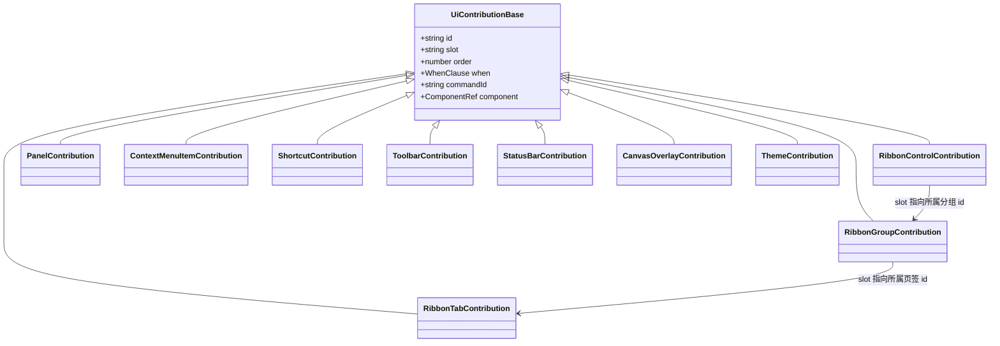
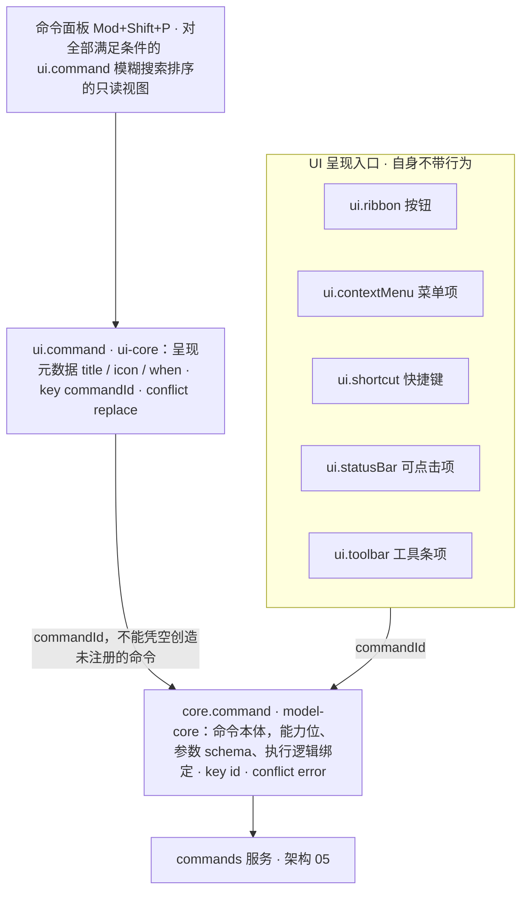
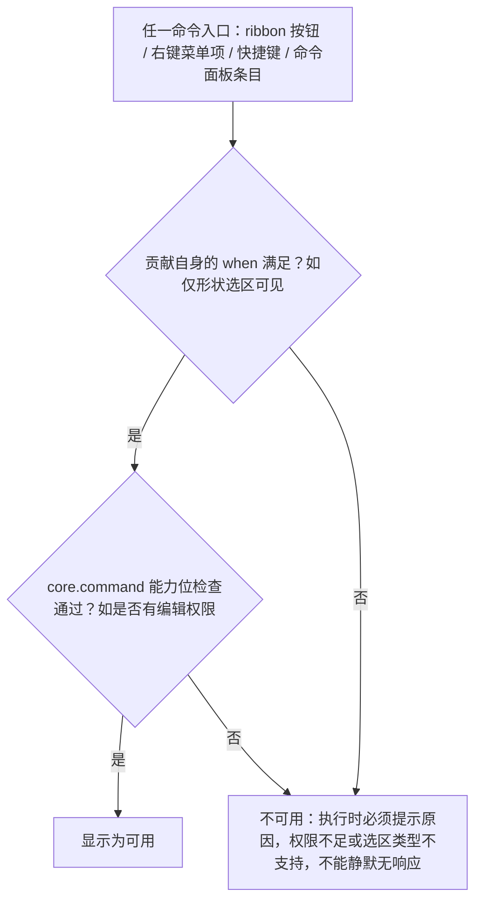
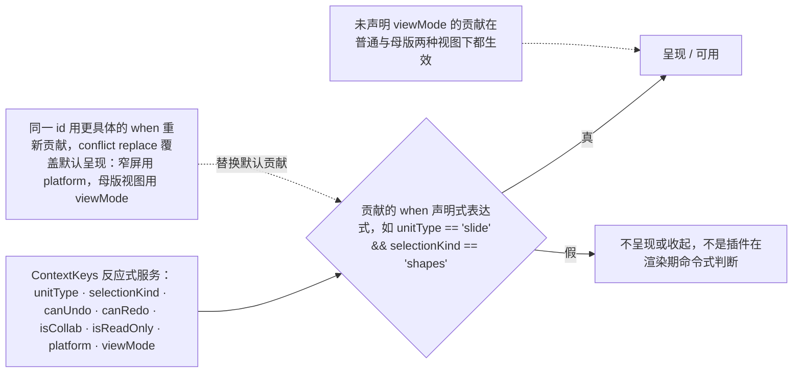

> 状态：草稿 | 负责：设计 | 更新：2026-09-18；2026-09-25（补图）；2026-09-25（矛盾收口，rulings §4.18）；2026-09-26（§4.20：FE-15 `selectionKind` 不另增 placeholder，改指前缀键 `slide.placeholderSelected`）；2026-09-30（§4.21 剩余缺口样张回写 · 复核修正：§2.6 图表迷你工具条的槽位示例改为 `toolbar.chart`，与 03-03、03-31 一致） | 依赖：charter v0.1（已核对 v0.2，D10 shadcn Rhea + Lucide）；09 v3.0 S-05 / T-02；PRD ML-01；rulings §4.7 / §4.8 / §4.10
> **2026-09-18 修订说明**：§2.1 图标家族改为 Lucide 线性（随 shadcn Rhea，原 Phosphor 家族作废；`@cordexjs/design/icons` 仍可作为包装层）；§2.10a 按"母版视图是同一个编辑器"改写（只在页签集合最左插入「母版」并隐藏「设计」，其余页签照常；检查器仅禁用评论；`viewMode` 条件由贡献自行声明、未声明者两种视图都生效；`selectionKind` 不收窄）。

# 06 扩展性 UX（插件如何贡献 UI）

本文档面向两类读者：架构条线（把槽位规范转成类型约束，落到 `30-architecture/03-kernel-and-plugin-model.md` 与 `09-plugin-type-contracts.md`）与插件开发者（作为插件 UI 开发指南的一部分）。所有贡献点 id 遵循章程 §5.5 的命名模式 `<域>.<名>`。

本文档**不做架构设计**：下文的接口草案是"签名级草案"（章程 §9.2.3 允许），用于把 UX 需求转达为可检查的形状，最终类型定义与运行时校验由架构/类型治理条线确定。

---

## 1. 总原则

1. **命令是唯一的行为入口**：ribbon 按钮、上下文菜单项、快捷键、状态栏动作项、命令面板条目都不自带行为，它们只是"某个 `command id` 的 UI 呈现"。这延续章程 K1/D4 命令三分法的哲学——UI 层不应有第二套行为注册机制。
2. **命令注册与呈现分离，但只需一次声明可发现性**：命令本体（能力位、参数 schema）由 `core.command` 注册一次；`ui.command` 只补充命令面板/菜单所需的呈现元数据（标题、图标）。ribbon 按钮、右键菜单项、快捷键都只需引用同一个 `commandId`，无需重复声明标题文案，这延续了命令三分法哲学在 UI 层的自然延伸（详见 §2.5；本节对应架构 03 §3.6 的贡献点总表已确认此拆分）。
3. **槽位是有限资源**：ribbon、上下文菜单、状态栏的可见空间有限，槽位规范里都有"何时必须新建分组/何时必须收进溢出"的机械规则，不能全靠人工约束（呼应 lessons A16：约束必须可执行，不能只是文档）。
4. **失败是常态，必须可见但不致命**：任何贡献点的宿主插件处于 `FAILED`/`PENDING` 状态时，UI 必须优雅降级（见 §3），不能空白、不能崩溃整个 chrome（呼应 A11）。
5. **第三方贡献可辨识**：非内置（未随 `preset-slide` 默认加载）的贡献必须带归属标识（见 §4），用户任何时候都能分清"这是编辑器自带的，还是某个插件加的"。

---

## 2. 贡献点槽位规范

架构 03 §3.2/§3.6（`30-architecture/03-kernel-and-plugin-model.md`，`ui-core/ui.contribution.ts`）已把全部 `ui.*` 贡献点的共享形状与总表定稿，本节在此基础上补充视觉约束，字段命名与架构保持一致（不再使用早期草案中的 `placement`/`visibleWhen`/`command` 等自造字段名）：

```ts
// 架构 03 §3.2/§3.6 确认的共享形状，设计侧在此基础上补充视觉约束
interface UiContributionBase {
  id: string                    // "<pluginId>.<localId>"，全局唯一
  slot: string                  // 归属位置；具体含义按贡献点不同而不同，见各小节
  order?: number                 // 排序；默认 100，内置贡献建议 < 100
  when?: WhenClause               // 声明式可见性/可用性判断，见 §2.10
  commandId?: string              // 指向 core.command 注册的命令 id，见 §2.5
  component?: ComponentRef        // 具体渲染内容的占位引用，由绑定层（ui-react）具体化
}
```

`conflict` 策略（架构 03 §3.2）：全部 `ui.*` 贡献点为 `conflict: 'replace'`——同一 `id` 的后来贡献覆盖先前贡献，专门用于**主题覆盖**与**移动端/窄屏变体覆盖**（见 §2.10、§5）；与之相对，`core.*` 贡献点（如 `core.command`）为 `conflict: 'error'`——命令的"身份"必须唯一，但命令的"呈现"允许被覆盖。这一区分是本节槽位规范的基础：设计侧据此明确"什么可以被插件/主题覆盖，什么不能"。

**UI 贡献点的共享形状与派生**



怎么读：空心三角箭头表示「在共享形状上扩展字段」，各子类型新增的字段见下文各小节的签名草案；实线箭头是 Ribbon 三级结构靠 `slot` 字段表达的归属。全部 `ui.*` 贡献点 `conflict: 'replace'`，与 `core.command` 的 `conflict: 'error'` 相对。

### 2.1 `ui.ribbon` —— 页签 / 分组 / 按钮

三级结构：Tab（页签）→ Group（分组）→ Control（按钮/下拉/颜色选择器等），三者共用 `ui.ribbon` 这一个贡献点（架构注释："ui.ribbon（tab/group/item）"），通过 `slot` 字段表达层级归属：

```ts
// 草案：字段名对齐架构 03 §3.2 的共享形状；tab/group/item 的判别方式
// （是否需要独立 kind 字段）由架构 03 后续版本定稿，此处给出 UX 视角的示意
interface RibbonTabContribution extends UiContributionBase {
  slot: 'ribbon'                 // 固定值，表示这是一个页签级贡献
  title: I18nKey
}
interface RibbonGroupContribution extends UiContributionBase {
  slot: string                   // 指向所属 RibbonTabContribution 的 id
  title: I18nKey
  extensible?: boolean            // 是否允许其他插件把 Control 插入本组；默认 false
}
interface RibbonControlContribution extends UiContributionBase {
  slot: string                   // 指向所属 RibbonGroupContribution 的 id
  commandId: string                // 必填：指向 core.command 注册的命令
  size?: 'large' | 'small'        // large: 20px 图标+双行（图标在上、标签在下）；small: 16px 图标+单行内联
}
```

视觉约束：

| 项 | 规则 |
|---|---|
| 图标尺寸与家族 | large 20×20；small 16×16；单色 SVG（**Lucide 线性家族**，描边 2、圆角端点，随 shadcn Rhea 统一，09 S-05；2026-09-15 起原 Phosphor 家族作废），继承 `currentColor`，不得内嵌固定色值；**禁止 emoji/Unicode 符号充当图标**；`@cordexjs/design/icons` 仍可作为包装层（按名引用 / sprite 构建脚本），但家族只能是 Lucide，不混用第二套；插件图标必须遵循同一规范（设计 04 §2.14），缺失或不合规时回退默认拼图图标（Lucide `Puzzle`） |
| 可读名称 | 仅图标按钮必须提供 `label` 作为 `aria-label`（`showLabel:false` 只隐藏视觉文字，不省略可读名称）；tooltip 在 hover 与 `:focus-visible` 下均出现 |
| 命中区 | 按钮命中区 ≥ 24×24；触控/窄屏 ≥ 44×44（由 `--control-h-*` 与断点重映射保证，插件不得自定义尺寸；原记号 `--cordex-control-height-*` 已作废） |
| 标签长度 | large 按钮 ≤ 8 个中文字符（或 16 个英文字符），超出省略号 + 完整文本进 tooltip；**注意**：伪本地化测试允许英文等语言比中文基准长至 1.5 倍（PRD NF-06），标签容器不得假设固定字符宽度，必须做省略号截断而非裁切 |
| 分组数量 | 单个页签可见分组 ≤ 6，第 7 个及以后自动收入"更多"溢出分组（不是隐藏，是可发现的收纳） |
| 分组内按钮 | `extensible: false` 的分组，第三方不得插入；第三方新增能力必须新建分组，新分组默认排在该页签末尾（`order` 未指定时取该页签当前最大 order + 10） |
| 禁用态 | 40% 不透明度 + `cursor: not-allowed`，不隐藏（隐藏会让用户以为功能消失，见 §3 例外情况）；用户仍尝试操作时需说明原因（权限不足/选区类型不支持），呼应 ED-30 对命令面板的同一要求 |
| 加载态 | 图标替换为 `Spinner`（`@cordexjs/design` 原子组件），标签不变，控件禁用 |
| 密度联动 | 控件高度按设计 04 §2.13 的 Ribbon 高度规格与 `--control-h-*`（原记号 `--cordex-ribbon-height` 已作废），不得自定义；紧凑密度下仍须满足 WCAG 2.5.8 的 24×24 CSS px 最小命中区（PRD NF-05），设计 04 的 IconButton 规格已满足此下限 |

排序：同级按 `order` 升序，`order` 相同按插件声明顺序，仍相同按 `id` 字典序。约定内置贡献 `order < 100`，第三方建议 `order ≥ 100`，避免抢占默认视觉顺位（约定非强制校验，属于插件开发礼仪，写入插件开发文档）。稳定性：Stable @M4（PRD PS-02），M2 起可用。

### 2.2 `ui.panel` —— 检查器坞面板 / 次级浮动面板

两种承载位置，通过 `slot` 表达：

- **主检查器槽位**（`slot: 'inspector'`）：01-information-architecture.md 定义的检查器坞，同一时刻只显示一个面板（属性/评论/版本历史/插件面板互斥）。
- **次级浮动面板**（`slot: 'floating'`）：不进入检查器坞的互斥队列，以独立浮层出现（如某插件需要常驻悬浮的迷你面板），必须可拖动、可关闭、默认不抢占检查器坞焦点。

```ts
interface PanelContribution extends UiContributionBase {
  slot: 'inspector' | 'floating'
  title: I18nKey
  icon: IconRef
  defaultOpen?: boolean            // 默认 false；仅内置面板可设为 true
}
```

视觉约束：面板标题 ≤ 10 个中文字符（同样需容忍英文≈1.5倍长度）；面板内部分区遵循设计 04 的间距 token；插件面板必须在标题栏右侧带归属标识（§4）；面板整体只读态（评审模式/权限不足）由宿主统一加一层禁用蒙版，插件不需要自行处理只读逻辑（降低插件开发者负担，也保证一致性）。

失败态：宿主插件 `FAILED` 时，若该面板正处于打开状态，面板内容区替换为"该面板不可用"+ 错误摘要 +"重试"（不是整段消失，避免用户以为自己点错了）；若未打开，检查器坞 Tab 条中该面板的入口自动隐藏。稳定性：Stable @M4，M2 起可用。

### 2.3 `ui.contextMenu` —— 右键菜单项

```ts
interface ContextMenuItemContribution extends UiContributionBase {
  slot: ContextMenuTarget          // 'canvas-empty' | 'shape' | 'text-selection' | 'thumbnail' | 'comment-pin' | ...
  commandId: string
  group?: string                    // 菜单内分组，用分隔线区分；未指定归入 'default'
}
```

视觉约束：图标 16×16；标签 ≤ 14 个中文字符；快捷键提示右对齐（若该命令有 `ui.shortcut` 绑定，自动读取显示，不需插件重复声明文案）。

分组与排序规则：内置命令按语义分组（剪贴板 / 变换 / 排列 / 更多），第三方贡献**默认**统一归入菜单末尾的"插件"分组（一条分隔线 + 归属标签），除非插件显式声明 `group` 且该 `group` 标记为可扩展（与 ribbon 的 `extensible` 同源逻辑）。这样保证右键菜单前几项永远是可预期的核心操作，不被插件顺序打乱。

边界规则：若某个上下文（如某种插件自定义元素）没有任何命令匹配，**不拦截**浏览器原生右键菜单（比直接弹出一个空菜单更合理）。菜单超出视口边缘时自动翻转方向（下→上、右→左）。多选时只显示所有选中对象命令交集。稳定性：Stable @M4，M2 起可用。

### 2.4 `ui.shortcut` —— 快捷键

```ts
interface ShortcutContribution extends UiContributionBase {
  chord: string                    // 如 "mod+shift+p"，'mod' 由平台解析为 Ctrl/Cmd（架构 03 ui-core/input/keyboard.ts 负责规范化）
  commandId: string
}
```

规则：同一 `chord` + 重叠 `when` 的两个贡献视为冲突，加载期由 `ShortcutsService.conflicts()` 报告（不是运行时静默覆盖）；平台保留键（如浏览器 Ctrl+W）不可绑定，冲突时贡献进入不生效但可见的"冲突"状态，插件管理器可查看（见 03-screens/09）。快捷键不单独出现在 UI 上，而是作为 ribbon 按钮 tooltip、菜单项右侧提示、命令面板条目的"附加显示"，遵循"命令是唯一入口"的总原则。稳定性：Stable @M4，M2 起可用。

**产品已锁定的关键快捷键**（PRD ED-29/ED-30，设计侧据此校对交互说明，本文档其余章节与 01-information-architecture.md 已按此更正）：命令面板 `Mod+Shift+P`（不是常见的 `Mod+K`）；幻灯片重排 `Mod+Shift+↑/↓`；对象移动用方向键；缩放用 `Shift+Alt+方向键`（P1，M2 前以属性面板数值输入为等价，见 07-accessibility-and-i18n.md §1.2 的拖拽键盘等价表）。

### 2.5 命令的两层模型：`core.command` 与 `ui.command`

架构 03 §3.6 把"命令"拆成两个贡献点，设计侧的槽位规范据此拆分，不再像早期草案那样合并成一个：

| 贡献点 | 定义包 | 内容 | key | conflict | 消费方 |
|---|---|---|---|---|---|
| `core.command` | model-core | 命令**本体**：能力位（权限）、参数 schema、执行逻辑绑定 | `id` | error | `commands` 服务 |
| `ui.command` | ui-core | 命令**呈现元数据**：`{ commandId; title; icon; when }` | `commandId` | replace | `ui`（命令面板/菜单） |

- `core.command` 决定"这个命令存不存在、谁能执行它"，是架构 05（命令与历史）的职责，设计侧不定义其 schema。
- `ui.command` 只决定"这个命令在命令面板/菜单里长什么样、要不要出现"；`conflict: 'replace'` 意味着后来的贡献可以覆盖同一 `commandId` 的呈现文案/图标（用于本地化覆盖或产品定制），但不能凭空创造一个 `core.command` 未注册的命令。
- ribbon 按钮、右键菜单项、快捷键的 `commandId` 字段都指向 `core.command` 注册的 id；它们各自可以有自己的 `when` 做上下文相关的显示/禁用判断（如"仅形状选区可见"），这与 `core.command` 的能力位检查（如"是否有编辑权限"）是两层独立但都会生效的门控——**两者都满足才显示为可用**。

**设计决策（延续前版）**：不存在独立的"命令面板项"贡献点。命令面板（`Mod+Shift+P` 呼出，ED-30）是对全部满足条件的 `ui.command` 贡献做模糊搜索排序后的只读视图。执行当前不可用的命令时必须提示原因（权限不足 / 选区类型不支持），不能静默无响应（ED-30 验收标准）。这避免了"同一个命令要在两处分别注册元数据"的重复劳动，也是命令三分法哲学在 UI 层的自然延伸。

**命令的两层模型**



怎么读：所有入口只持有 `commandId`，行为只存在于 `core.command`；`ui.command` 只补命令面板 / 菜单所需的呈现元数据，可被覆盖但不能新增命令。

**命令入口的可用性门控**



怎么读：两个菱形是两层独立但都会生效的门控，必须同时满足才显示为可用（ED-30）。

命令面板条目视觉：图标 16×16 + 标题 + 右侧分类标签（弱化色）+ 快捷键提示；第三方命令标题下方附一行 12px 弱化文字"来自 <插件名>"。稳定性：`core.command` Stable @M4（M2 起可用）；`ui.command` Beta @M4（M2 起可用，呈现层字段仍可能变化）。

### 2.6 `ui.toolbar` —— 浮动 / 上下文工具栏

架构 03 §3.6 确认的独立贡献点，用于不属于 Ribbon 常驻区、只在特定上下文短暂出现的工具条——例如画布内文本编辑态浮现的迷你格式工具条（见 03-screens/02"正在编辑文本"状态）、选中图片/图表时贴边出现的快速操作条。

```ts
interface ToolbarContribution extends UiContributionBase {
  slot: string                     // 上下文锚点，如 'text-editing' | 'image-selected' | 'toolbar.chart'（原 'chart-selected'，按前端 50/10 §5 的 toolbar.<selectionKind> 命名）
  commandId: string
}
```

视觉约束：贴合锚点定位（对象上方/下方，视视口边缘自动翻转），图标 16×16，最多显示 6 个直接可见项，其余收入"更多"；不得遮挡当前编辑对象本体。稳定性：Beta @M4，M2 起可用（字段可能变化）。

### 2.7 `ui.statusBar` —— 状态栏项

（注：本节 id 大小写的演变——产品条线 PS-02 草案曾写作 `ui.statusBar`；架构 03 §3.6 v0.1 一度定稿为全小写 `ui.statusbar`；**章程 v0.2 §5.5"统一的服务名、事件名与贡献点 id"最终裁定为 camelCase `ui.statusBar`**，与同一列表中的 `core.documentType`、`core.permissionPolicy`、`ui.contextMenu` 等其余多词 id 的大小写约定保持一致，本文件此前一度跟随架构 03 v0.1 改为小写，现按章程 v0.2 这一更高权威的定稿改回。此前版本本节标注"草案待架构确认"，现已由章程 v0.2 §5.5 正式收录，不再是设计侧的提案。）

```ts
interface StatusBarContribution extends UiContributionBase {
  slot: 'start' | 'center' | 'end'   // start: 页码/缩放等文档态；center: 保留；end: 协同/同步/插件状态
  render?: 'text' | 'icon' | 'icon-text'
  commandId?: string                  // 可点击项绑定命令；纯展示项省略
}
```

视觉约束：单项宽度按内容自适应，图标 16×16（统一 16 网格，2026-09-15 由 14×14 改正）；文字 ≤ 6 个中文字符（超出用 tooltip 展示完整信息，如同步进度百分比）；`end` 区域项超过可用宽度时，低优先级项（`order` 大者）优先收入"…"溢出，**协同/同步状态项永不收入溢出**（引用 PRD CO §3 的会话状态指示，必须常驻可见，见 05-collaboration-ux.md §7）。稳定性：Beta @M4，M2 起可用。

### 2.8 `render.overlay` —— 画布覆盖层

（注：此前版本记录"产品 PS-02 已确认、架构 03 §3.6 v0.1 总表未列出"的同步差异；**章程 v0.2 §5.5 的贡献点 id 定稿列表已正式收录 `render.overlay`**（与 `render.scene`/`render.target`/`render.element` 同属 `render.*` 族），差异已解决，不再是待协调事项。）

其定义与章程 §5.2 `engine-render` 职责描述中的"命中测试与覆盖层契约"一致，产品 PS-02 的用途描述（"注册覆盖层（选区/参考线/presence 类）"）与本节的槽位规范保持一致。

```ts
interface CanvasOverlayContribution extends UiContributionBase {
  slot: 'below-selection' | 'above-selection'  // 映射设计 04 的 --layer-canvas-overlay 内部子层级
  hitTestable?: boolean            // 是否参与画布命中测试；默认 false（纯展示层，如远端光标）
}
```

用途示例（含内置能力，均通过此贡献点实现，"自食其粮"）：远端光标与选区、评论锚点标记、选中手柄、插件自定义的画布标注（如批注工具、测量参考线）。视觉约束：覆盖层元素不得拦截未声明 `hitTestable: true` 的指针事件（默认 `pointer-events: none`，避免插件覆盖层意外遮挡画布交互）；颜色使用 `--presence-*` 或语义变量，不得引入覆盖层专属调色板。性能预算：同屏 ≥ 20 个远端选区仍需保持 ≥ 55 fps（PRD CO-03），密度过高时允许降级简化非活跃协作者的视觉权重（具体阈值与实现策略由架构 07 决定）。

### 2.9 `ui.dialog` / `ui.notification`

架构 03 §3.6 已确认的两个贡献点（此前版本标注为"简要/草案"，现已确认，不再是设计侧的提案）：

| id | 用途 | 视觉约束摘要 | 稳定性 |
|---|---|---|---|
| `ui.dialog` | 注册可被命令打开的对话框内容 | 必须使用 `DialogShell`（设计 04 §4.1），标题 ≤ 16 字，操作按钮靠右，主操作用 `accent`，销毁性操作用 `danger` | Beta @M4，M2 起可用 |
| `ui.notification` | 注册 toast/通知内容模板 | 必须使用 `ToastShell`；单条 toast 显示 ≤ 2 行正文；`aria-live` 语义见 07 | Beta @M4，M2 起可用 |

两者均由 `UiService` 的 `openDialog`/`notify` 方法触发（架构 03，Operation 域，不入历史）。

### 2.10 `when` 声明式判断与 `ContextKeys`

架构 03 确认存在一个反应式的 `ContextKeys` 服务（`unitType`、`selectionKind`、`canUndo`、`canRedo`、`isCollab`、`isReadOnly`、`platform` 等键），全部 `ui.*` 贡献点的 `when` 字段都是针对这些键求值的声明式表达式（如 `unitType == 'slide' && selectionKind == 'shapes'`），而不是插件在渲染期做命令式判断。这回应了 §1 总原则第 3 条与 lessons A15（不能靠时序/命令式判断掩盖依赖关系）。窄屏/移动端变体正是通过 `when` 引用 `platform` 键实现（见 §5），不需要额外的贡献点类型。

**when 求值与同 id 覆盖**



怎么读：所有 `ui.*` 贡献的显隐都由 ContextKeys 对 `when` 求值决定；虚线表示变体机制——不新增贡献点类型，而是用同一 id、更具体的条件覆盖默认呈现（§2.10a、§5）。

### 2.11 `ui.theme` —— 主题/token 覆盖集

章程 v0.2 §5.5 确认的贡献点，与产品 PS-02（"设计 token 覆盖集"，Beta @M4）一致。这是插件（或宿主/集成方）向 `@cordexjs/design` 的 token 体系贡献一整套覆盖值的机制——例如一个"品牌主题"插件可以把 `--primary` / `--primary-foreground` 换成集成方的品牌色，而不需要 fork 整个 `@cordexjs/design` 包。覆盖集是插件的对外契约，变量名一律用 shadcn 变量 + Cordex 扩展裸名变量（设计 04 开头与 §9 对照表，rulings C-22 / §4.18 UX-12）；`--cordex-*` 前缀已作废，出现即被拒绝。

```ts
// 草案：字段名对齐 §2 的共享形状
interface ThemeContribution extends UiContributionBase {
  slot: string                     // 主题名，作为 `data-cordex-theme` 的可选取值之一（内置只有 'light'/'dark'）
  isDark?: boolean                  // 该主题应按暗色语义处理（影响初始对比度校验、阴影→边框降级等派生规则，见设计 04 §2.10/§3）
  tokens: Partial<Record<ThemeVarName, string>>   // 覆盖值，键必须落在下方白名单内（现名，见设计 04 §9 对照表）
}
```

**允许覆盖的变量（白名单，设计 04 §2.2–§2.5 的语义颜色）**：`--primary` / `--primary-foreground`；`--background` / `--foreground`、`--card` / `--card-foreground`、`--popover` / `--popover-foreground`；`--secondary`、`--muted`、`--accent`（各含 `-foreground`）；`--destructive`；`--success` / `--warning` / `--info`（各含 `-foreground`、`-muted`）；`--border`、`--input`、`--border-control`；`--canvas`。这些是"品牌/氛围"相关的语义色，覆盖它们不会破坏布局或可用性判断逻辑；白名单之外的变量一律不可覆盖。

**禁止覆盖的 token 范围**（结构性 token，覆盖会破坏跨组件一致性或无障碍保证）：

| 类别 | 原因 |
|---|---|
| 间距（Tailwind 4pt 阶，不设变量）与 `--control-h-*` / `--row-h`（密度） | 覆盖会导致所有组件的内外边距或控件高度同时错位，布局体系依赖其数值稳定 |
| `--radius`（及派生 `--radius-*`）/ `--glass-*`（含 `--glass-shadow`） | 可作为"整体替换一套预设"处理（如内置的 high-contrast 主题），但不对插件单独开放逐个覆盖，避免视觉体系割裂 |
| `--layer-*`（层级） | 覆盖会破坏浮层堆叠顺序这一系统级契约（见设计 04 §2.11），绝对禁止 |
| `--duration-*` / `--ease-*`（动效） | 覆盖会与 `prefers-reduced-motion` 的统一降级机制（07-accessibility-and-i18n.md §5）冲突，绝对禁止 |
| `--presence-*`（协作者在场色） | 覆盖会破坏"协作者颜色全局唯一辨识"的假设（05-collaboration-ux.md §2），绝对禁止 |
| `--ring`（焦点环） | 覆盖需要重新过对比度门禁（WCAG 2.4.11），不对插件开放，仅内置主题可改 |

**校验要求**：任何 `ui.theme` 贡献的颜色覆盖都必须通过设计 04 §2.6 的对比度基线（架构 02 §4.17 `@cordexjs/design/__tests__` 已包含 token 快照与对比度校验），加载期未通过校验的主题贡献应被拒绝并诊断（呼应 §3 的失败可见原则），而不是静默应用一个不合规的主题。

### 2.10a 母版视图下的贡献点（`viewMode` context key，2026-09-15 新增、2026-09-18 按 09 T-02 / PRD ML-01 改写，来源 `03-screens/26-master-view-and-editing.md`）

母版视图（ML-01/ML-03，见 03-screens/26）是**同一个编辑器实例**内的另一种视图模式，不是专用模式：与评审模式"整体替换 Ribbon 为精简工具条"（§5、01-information-architecture.md §5.1）不同，母版视图**只在页签集合最左插入「母版」页签并隐藏「设计」页签，其余页签（开始 / 插入 / 切换 / 视图 / 插件）照常**；检查器仅禁用「评论」Tab，属性 / 历史 / 插件照常。机制上 `ContextKeys` 服务新增一个 `viewMode` 键（取值 `'normal' | 'master'`），全部 `ui.*` 贡献的 `when` 字句可以引用它，例如：

```
when: "viewMode == 'master'"      // 仅母版视图下出现（如某插件想在母版页签追加一个品牌合规检查按钮）
when: "viewMode == 'normal'"      // 仅普通视图下出现（只对"页"有意义的贡献：页级评论钉、切换效果预览等）
（不声明 viewMode）                 // 两种视图下都生效——默认
```

- 宿主内置的差异（「母版」页签插入、「设计」页签隐藏、检查器「评论」Tab 禁用、缩略图窗格内容切换）通过这一 `when` 机制 + `conflict:'replace'` 语义实现，不新增贡献点类型（呼应 §5 已有的"同一 id、不同 `when` 条件下差异化呈现"原则，本节只是把该原则应用到 `platform` 键之外的第二个维度）。内置「设计」页签声明 `when: "viewMode == 'normal'"`，内置「母版」页签声明 `when: "viewMode == 'master'"`（`order` 最小，置首），其余内置页签与检查器 Tab 不声明。
- **`viewMode` 条件由贡献自行声明**：插件若想为母版视图贡献专属 UI（如统一给某类占位符打企业规范水印），只需在既有的 `ui.ribbon`/`ui.panel` 贡献上追加 `when: "viewMode == 'master'"`；若某贡献只对"页"有意义（依赖页级评论、页级切换效果等），应显式声明 `when: "viewMode == 'normal'"`。**未声明 `viewMode` 条件的贡献在两种视图下都生效**（母版视图是同一个编辑器，插件的字体 / 形状 / 图片类命令在母版与版式上同样成立；不再把"仅普通视图"作为隐含默认）。
- **`selectionKind` 不收窄**：母版 / 版式画布上可以插入并选中形状、图片、文本框等普通元素（与 PowerPoint 一致），因此 `selectionKind` 在母版视图下的取值范围与普通视图相同（`'shapes' | 'text' | 'image' | … | 'none'`），不另增取值；需要区分占位符的贡献用 slide-ui 登记的前缀上下文键 `slide.placeholderSelected` 精确判断（`50-frontend/09` §6.3 键清单，rulings §4.20 FE-15）；插件不得假设母版视图下只有占位符可选。

---

## 3. 插件失败时的 UI 降级表达

| 场景 | 表现 |
|---|---|
| 页签的**唯一**贡献插件失败，页签因此没有任何分组 | 整个页签不渲染（不留空页签） |
| 页签内部分分组失败 | 该页签仍渲染，仅缺失的分组不显示 |
| 已打开的面板所属插件失败 | 面板内容区替换为错误态卡片（图标 + "该面板不可用" + 错误摘要 + 重试/禁用插件 入口） |
| 未打开的面板所属插件失败 | 检查器坞 Tab 条目自动隐藏 |
| 状态栏项所属插件失败 | 该项以 `--duration-fast` 淡出移除，不保留空位 |
| 画布覆盖层所属插件失败 | 该覆盖层内容停止渲染，不影响其他覆盖层与画布本体 |
| 任意数量插件失败 | 全局状态栏"插件"图标切换为 warning 语义色 + 失败数角标；点击进入插件管理器并预筛选"启动失败" |

以上均对应章程 A11（Fiber `apply` 异常被内核捕获为 `FAILED`，不传播到兄弟插件）在 UI 层的具体呈现；渲染热路径的逐元素错误隔离另见架构 07。

---

## 4. 第三方插件 UI 的归属标识

- **视觉规则**：非随 `preset-slide`/`preset-slide-collab` 默认加载的贡献，一律带归属标识；内置贡献不带标识（减少视觉噪音）。
- **标识形态**：
  - Ribbon 分组标题右侧：16px 小图标（插件自带图标或默认拼图图标；统一 16 网格，不使用 12px 缩图）。
  - 面板标题栏右侧：同上图标 + hover 显示"由 <插件名> 提供"。
  - 右键菜单/命令面板：独立分组或条目下方弱化小字"来自 <插件名>"。
  - 状态栏：图标本身即插件图标，无需额外文字（空间有限）。
- **信任模型提示**：首次启用第三方插件时（见 03-screens/09 插件管理器），必须展示其声明的贡献点清单（"该插件将新增：2 个 ribbon 按钮、1 个面板"），呼应章程 §2.3"同源可信、非运行时沙箱"的模型——用户需要在启用前看到影响范围，而不是依赖沙箱来兜底。
- **命名层次提醒**（章程 v0.2 §5.5"第三方前缀规则"）：本节讨论的归属标识针对的是插件**贡献的条目**（其 `id` 遵循 `<pluginId>.<localId>` 模式，如设计 06 §2.1 所述）；这与"第三方插件若要定义一个全新的贡献点类型"（而不仅是向既有的 `ui.ribbon`/`ui.panel` 等点贡献条目）是两个不同层次的命名规则——后者要求贡献点 id 本身的域名段带 vendor 前缀（如 `acme:analytics.dashboardWidget`），因为 `core`/`render`/`layout`/`ui`/`collab`/`format`/`unit`/`store`/`command`/`permission`/`i18n`/`perf`/`slide`/`doc`/`sheet` 是第一方保留域。绝大多数第三方插件只做前者（向既有点贡献条目），不需要关心后者。

---

## 5. 与窄屏/响应式的关系

槽位规范本身不因断点改变（同一套贡献点、同一套 id），改变的只是**呈现密度与可见性**，机制已由架构 03 确认：`ContextKeys` 服务包含一个 `platform` 键，`ui.*` 贡献的 `when` 字句可以写 `platform == 'mobile'` 之类的条件（见 §2.10）；同一 `id` 在不同 `platform` 条件下的差异化呈现，也可以借助 `conflict: 'replace'` 语义——用更具体的 `when` 条件重新贡献同一 `id` 来覆盖默认呈现（架构 03 §3.2 明确"仅 `ui.*` 允许替换，用于主题/移动端覆盖"）。插件不需要为窄屏单独贡献一整套 UI（呼应 lessons A7：变化点而非整包复刻）；`size: 'large' | 'small'` 等既有字段足以覆盖大多数窄屏折叠场景。

断点口径与 PRD NF-07、01-information-architecture.md §6 对齐（此前版本使用的 1280/768px 断点已按产品线口径更正）：

| 断点 | 宽度 | UI 完整度 |
|---|---|---|
| 桌面 | ≥ 1024px | 完整 UI |
| 紧凑 | 640–1024px | 紧凑 UI（Ribbon 收窄、检查器坞抽屉化） |
| 仅查看 | < 640px | 产品范围内仅承诺查看/评论体验（PRD NF-07 屏幕矩阵），编辑类贡献（ribbon 编辑分组、多数 `ui.toolbar`）通过 `when` 收起，只保留评审/查看相关贡献 |

若某贡献点确有窄屏下完全不同的呈现需求（如画布覆盖层在触屏下的手柄尺寸），由该贡献点自身的 `component` 内部判断视口，不新增贡献点类型。

---

## 6. 开发态调试：贡献槽位高亮

设计要求编辑器提供一个仅开发/调试可见的显示模式：把当前页面上所有已解析的贡献点槽位（无论是否有内容）用虚线描边 + 槽位 id 标签标出，帮助插件开发者确认自己的贡献落在了正确的槽位、正确的位置。此模式在低保真原型中以一个全局开关体现（见 `prototype/index.html`），正式产品中建议作为 `ui-core` 的一个内置调试命令（如"切换贡献槽位高亮"），不需要单独的贡献点。

---

## 待决事项

- ~~`ui.statusBar`/`render.overlay`/`ui.dialog`/`ui.notification`/`ui.theme` 的 id 是否成立、大小写如何~~：已由**章程 v0.2 §5.5**（下游最高权威）正式定稿全部为 camelCase，且 `render.overlay` 已确认收录，此前记录的"产品↔架构 v0.1 草稿同步差异"已解决，不再是待决事项。
- `ui.ribbon` 的 tab/group/control 三级如何用统一的 `{id, slot, order, when}` 形状精确表达（是否需要额外的 `kind` 判别字段区分三级）：本文件 §2.1 给出的是 UX 视角的示意，需架构 03 后续版本定稿具体字段，设计侧不擅自定型。
- `WhenClause` 表达式语法的完整文法（除比较与逻辑组合外是否支持函数调用、数组匹配等）：架构 03 已给出 `unitType == 'slide' && selectionKind == 'shapes'` 的示例语法，完整文法由架构/类型治理确定；设计侧仅依赖"存在一种可对 `ContextKeys` 求值的声明式机制"这一保证。
- `ui.theme` 贡献的加载期校验失败时的具体用户提示文案与插件管理器呈现方式（本文件 §2.11 只定义了"应拒绝并诊断"的原则，未给出线框）：留待下一轮补充 03-screens/09 的对应状态，或并入插件管理器现有的"启动失败"分组处理。
