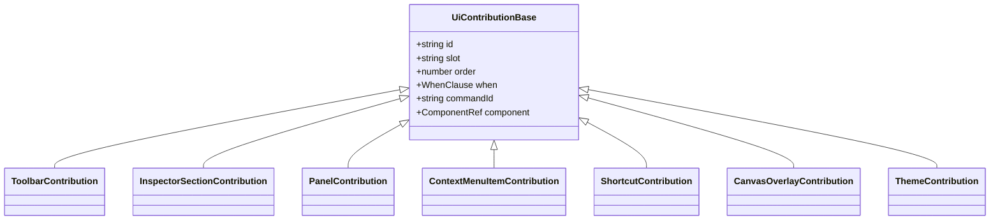
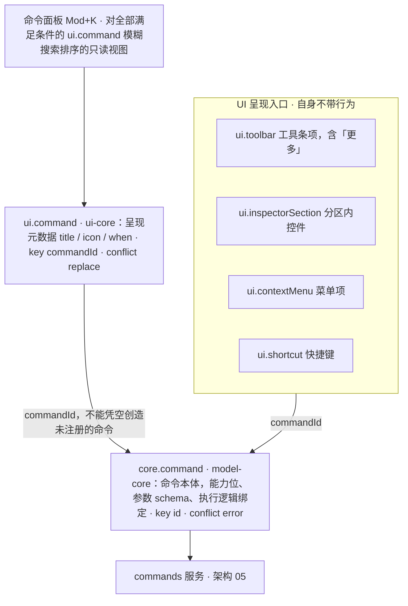
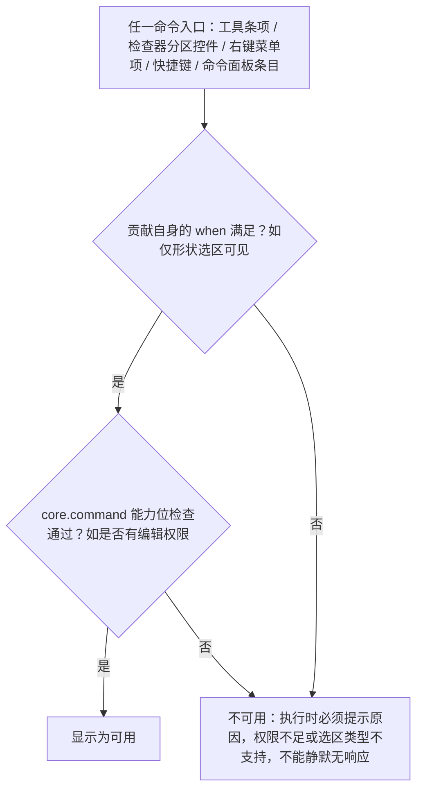
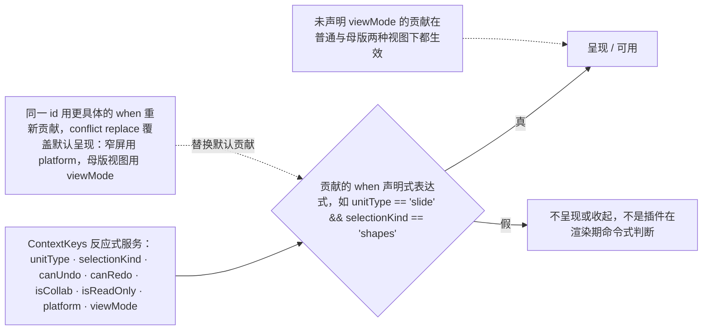
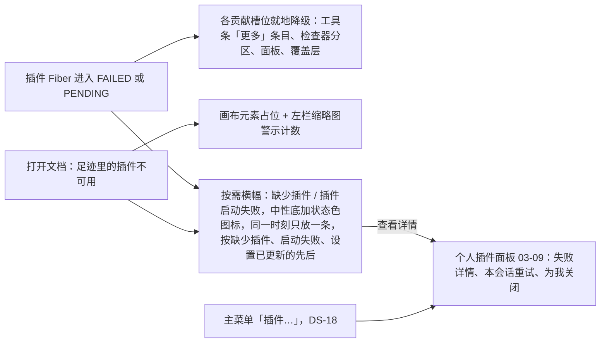

> 状态：草稿 | 负责：设计 | 更新：2026-09-18；2026-09-25（补图）；2026-09-25（矛盾收口，rulings §4.18）；2026-09-26（§4.20：FE-15 `selectionKind` 不另增 placeholder，改指前缀键 `slide.placeholderSelected`）；2026-09-30（§4.21 剩余缺口样张回写 · 复核修正：§2.6 图表迷你工具条的槽位示例改为 `toolbar.chart`，与 03-03、03-31 一致）；2026-10-01（§4.23 插件管理样张回写：§3 降级表「已打开的面板」行的「禁用插件」改为「为我关闭」或「请联系管理员」，「任意数量插件失败」行改为状态栏插件入口「N 个插件启动失败」并打开个人插件面板 03-09（失败行置顶，不再「预筛选」），新增「本文档缺少插件」行；§2.4 冲突「插件管理器可查看」改指个人插件面板；§4 信任模型提示改为只向管理员展示（03-32 §7.3）；待决 `ui.theme` 校验失败一条结案）；2026-10-04（design-language-v3 第 0 批：按 rulings §4.25 DS-5、DS-6 删除 `ui.ribbon` 与 `ui.statusBar`、新增 `ui.inspectorSection`（§2.12），贡献点总数 27 → 26——§2.1、§2.7 改为删除说明与去向表，原 ribbon 控件规则中的通用部分移到 §2.1 作为全部按钮型贡献的约束；§2.6 `ui.toolbar` 扩充为底部创建工具条（插件只进「更多」）与上下文工具条；§1、§2、§2.2、§2.4、§2.5、§2.10a、§3 降级表与图 3-1、§4 归属标识、§5、待决事项同步，插件异常改走按需横幅）；2026-10-04（design-language-v3 第 0 批：术语残留清理：ribbon / 状态栏 / `ui.ribbon` / `ui.statusBar` 的历史陈述改用 check-terms 认可的标记措辞（废弃、取代、作废））；2026-10-04（design-language-v3 第 0 批：复验修正——§2.6 主行八项注明「评论」随评论包出现、「更多」为垂直束贡献的 menu 条目，槽位改为已由 50/09 §6.1 定稿；§2.11 禁止覆盖表去掉 `--glass-*`（DS-2），改为浮层阴影；§2.12 `ui.inspectorSection` 草案改为引用 50/09 §6.1 的唯一定义（`title?`、`placement?: 'top' / 'body'`，面板标题由选区桥接器给出），只读规则改指 50/10 §5）；2026-10-04（design-language-v3 第 0 批：复验第 2 轮修正——「待决事项」第 3 条结案（`create` / `create.more` 与 `inspector.<selectionKind>` 已由 50/09 §6.1 定稿，与 §2.6、§2.12 一致），只留插件整页面板一项；§2.7「插件贡献的状态项」不再指向检查器分区，改为通知或命令（+ 对话框），检查器分区只放选中对象的属性（DS-1、DS-5、DS-6）；§2.12「只读」拆成评审 / 只读浏览的只读展示与编辑模式降权的 `aria-disabled` 两种形态（与 03-02 §6.2、50/10 §5 一致））；2026-10-05（design-language-v3 第 0 批修正：按 rulings §4.25 写入外壳类裁决——§2.6 文本编辑态的迷你格式条取消、`toolbar.text-editing` 槽位示例删去，文字格式走 `ui.inspectorSection`（DS-13）；§2.12 新增「只放属性」：空内容占位符不设「插入到占位符」按钮组（DS-14），「只读」改为评审与只读角色（含降权）统一只读展示当前值、取消表格与图表的禁用例外（DS-15，取代上一条的两种形态），无选中态分区改为「版式 / 主题 / 背景」（DS-20）；图 3-1 主菜单插件入口改为「插件…」（DS-18）；§5 紧凑与仅查看形态随第 1 批出样张（DS-17））；2026-10-05（design-language-v3 第 0 批修正：§2.1 排序约定注明工具条「更多」与检查器分区上第三方 `order ≥ 100` 且必带 `owner` 是规范（50/09 §6.1），其余按钮型贡献仍为约定；§2.2 内置槽位补 `rail.header`、`grid`，全集以 50/09 §6.1 为准）；2026-10-05（design-language-v3 第 0 批修正：快捷键值按 rulings §4.25 DS-11 同步——§2.4 关键快捷键与 §2.5 正文、图中的命令面板由 `Mod+Shift+P` 改为 `Mod+K`，超链接改为 `Mod+Shift+K`）；2026-10-07（design-language-v3 第 1 批：按已拍板样张与 rulings §4.25 TB-1、TB-14、TB-23、TB-29 定稿——§2.6 改为「底部创建工具条与评审条」：`ui.toolbar` 只剩 `create`、`create.more`、`reviewBar` 三个槽位，对象上下文槽位 `toolbar.<selectionKind>` 删除并写明插件命令改走 `ui.inspectorSection` 与右键对象菜单（TB-29，贡献点总数不变）、「更多」内置项按 03-04 改写，评审条 / 浏览条形态按 DS-23、固定项由外壳内置（TB-1）；§2.3 槽位改指 50/09 §6.1、补对象菜单与节标题右键不开放（TB-23）；§2.7 母版视图状态改为母版视图横幅；§2.8 覆盖层承载清单改指 09 §3 与 04 §2.3a、颜色按 DS-24；§2.10a 母版视图的工具条「占位符」、检查器按 `editTargetKind` 挂载、横幅外壳内置（DS-21、TB-14）；§2.12 分区清单与只读形态定稿；§4「更多」的插件分组标题按 03-04 §4.3；§5 断点表紧凑与仅查看改指 03-02 §5a（DS-17、DS-28）；待决事项新增插件条目很多时的收纳方式）；2026-10-08（design-language-v3 第 1 批收口：按 rulings §4.25 TB-31、TB-38、TB-40、TB-49 与前端 50/09 §6.1——§2.2 内置槽位补横幅置顶位 `banner`；§2.3 主菜单槽位补顶层单项 `mainMenu`（只收内置）；§2.4 和弦示例去掉旧命令面板键、链接命令改称「链接…」（TB-6）；§2.6 评审条固定项与创建工具条「选择」的归属分开写（TB-38），§2.6、§2.12 与待决事项的「条目很多时」改为随第 2 批出样张并拍板（TB-31）；§2.12 形状分区补快速样式与替代文本（DS-31、TB-32）；§5 仅查看形态的评论分手机与平板（TB-49）；§6 补开发者面板入口（TB-40））；2026-10-08（design-language-v3 第 1 批评审修改：按 rulings §4.25 DS-34…DS-37 同步——§2.1 按钮型贡献的控件规则补「画法」一行：检查器分区里的控件用宿主控件、按安静样式画，插件不另加描边、底色或阴影（DS-35…DS-37）；§2.9 `ui.dialog` 的次操作为次按钮（透明底加细边，DS-37）；§2.11 白名单注明覆盖 `--border` 会同时改变下拉、次按钮与分段选中块的细边，`--border-control` 只管复选框、单选圈、插入表格网格、头像外圈、把手与滚动条（DS-35）；§2.12 快速样式样张已补、样式库在节内原位展开（DS-34），「一个分区一个节」补画法约束）；2026-10-15（design-language-v3 第 2 批：按已拍板的第 2 批样张与 rulings §4.25 DS-38…DS-63 回写——§2.2 插件整页面板定为检查器整栏面板 400、从插件分区的「展开」进入、不作检查器第三个页签（DS-38），评审与只读时就地只读展示、不加禁用蒙版（DS-56，改本节原写法），标题行写「第三方插件 · 供应商」；§2.6 与 §2.12 插件条目与插件分区很多时的收纳定稿（DS-49），设置型插件缺省留在检查器插件分区；§2.7 插件健康度的横幅先后（DS-54）；§2.9 对话框里的反馈写在底栏（DS-56）；§3 降级表：插件横幅改中性底加状态色图标（DS-41）、单个失败写插件名（DS-55）、横幅先后与重现（DS-54）、缺插件占位两行字与不能改大小（DS-52）、面板失败用整块状态（DS-53），图 3-1 同步；§4 归属标识统一 12px（DS-56）、「更多」的「插件 · N」分组；§5 紧凑形态的整栏面板随第 3 批、手机评论样张已出（DS-38、DS-46）；待决事项两条结案；同日再补，按回写中的裁决 rulings §4.25 DS-64 与技术口径 TB-59…TB-61、TB-70——§2.2 主检查器槽位改为检查器页签只由内置包贡献（当前只有「评论」）、第三方 `ui.panel{slot:'inspector'}` 条目只作整栏面板，宽度改为 max(400, 检查器当前宽度)、开着时分隔条不可拖（TB-60），入口为同一插件分区条目的 `expandPanel` 与 Operation `ui.openPanel{id}`（TB-59）；§2.3 登记评论钉的右键菜单由 slide-ui `CommentPins` 直接渲染、不走 `ui.contextMenu`（TB-61）；§2.12 首段末句、签名草案补 `expandPanel`、「整页内容」与「分区很多时」（本机键，TB-70）同步；§3 缺少插件一行补评审、只读浏览与降权下照常出右键菜单（DS-64）；§4 整页面板的归属标识去掉「页签」；待决事项同步；同日再补，按 rulings §4.25 TB-78——§3 降级表「任意数量插件失败」一行写明个人插件面板里失败行的排序：启动失败 → 版本不兼容 → 等待依赖，「我的界面插件」与「本部署统一启用」两组同此）；2026-10-22（design-language-v3 第 3 批：按 rulings §4.25 DS-76、DS-110、DS-112、DS-115、DS-117、DS-130、DS-131、TB-105、TB-106、TB-116、TB-117 回写——§2.1 控件尺寸只有单档、删去「密度联动」（DS-76）；§2.2 与 §5 紧凑形态里插件整页面板改为画布底部 Sheet、非模态抽屉从横幅下沿开始（DS-130），§5 补平板评论面板与嵌入（DS-131、DS-112）；§2.4 快捷键面板里插件各一组（TB-105、TB-116）；§2.5 命令面板的外观、「常用」与不可用命令（DS-117、TB-106、TB-117）；§2.11 禁止覆盖表的「密度」改为控件尺寸（DS-76）；§3 补查看器里缺插件的说明放进 ⓘ 卡、仅查看形态的缺插件横幅不放「查看详情」（DS-110））；2026-10-22（同日再补，按回写中的技术口径 rulings §4.25 TB-132、TB-150——§2.2 紧凑形态的插件 Sheet 写全：顶部把手、抽屉随之收起、不显示备注区（DS-130，同 03-09 §10.2）；§2.5 命令面板的「帮助中心」只在集成方配置了链接时出现（TB-132）；§5 嵌入不新增上下文键，嵌入口径的不可用原因由 ui-core 读宿主配置给出（TB-150））；2026-10-22（同日再补，按回写中的技术口径 rulings §4.25 TB-159、TB-162——§2.5 打开外壳界面的意图（导出…、版本历史、保真报告、插件…、帮助中心）各注册一个无参命令、配一条 `ui.command` 进命令面板，不另开贡献点（TB-162，同 TB-149）；§5 嵌入口径只改写「在更大窗口中编辑」一句，嵌入又是触控设备时以「在电脑上编辑」为准（TB-159）；2026-10-22 复核修正：§5 嵌入一句写明触控设备指平板、嵌入里的手机照窗口窄改写（TB-163）；§2.4 补触控形态的菜单项不写键位提示（TB-164））；2026-10-23（design-language-v3 第 3 批评审修改：按 rulings §4.25 DS-142、DS-143、TB-182 回写——§2.1 图标家族一行写明导出格式行的文件类型图标不是插件图标，插件贡献的格式没有专属图标时画通用文件字形、不回退 `Puzzle`（DS-143、TB-182）；§2.9 `ui.dialog` 的外观随宿主对话框：标题栏 40、圆角 12、× 用正文色（DS-142））；2026-11-04（design-language-v3 母版视图改版：§2.2 槽位 `canvas.top` 保留、说明改为画布区的顶层（只收内置，当前只有母版视图多选版式时的网格），置顶位的母版横幅改称上下文条；§2.7 映射表的母版视图状态改为上下文条；§2.10a 引言、工具条一条改为「占位符 ▾」第 2 位与 `group` 竖分隔，新增画布区的顶层一条，横幅一条改为上下文条；§2.6 第 1 条末句同改（母版视图里主行没有「评论」，「占位符 ▾」排第 2 位）；rulings §4.25 DS-145、DS-152、DS-153、TB-206、TB-210；需求编号、优先级与里程碑不变） | 依赖：charter v0.1（已核对 v0.2，D10 shadcn Rhea + Lucide）；09 v3.0 S-05 / T-02；PRD ML-01；rulings §4.7 / §4.8 / §4.10 / §4.25 DS-1、DS-5、DS-6、DS-13…DS-15、DS-17、DS-18、DS-20…DS-25、DS-28、DS-31、DS-34…DS-37、DS-38、DS-41、DS-46、DS-49、DS-52…DS-56、DS-64、DS-76、DS-110、DS-112、DS-115、DS-117、DS-130、DS-131、DS-142、DS-143、DS-145、DS-152、DS-153、TB-1、TB-6、TB-14、TB-23、TB-29、TB-31、TB-32、TB-38、TB-40、TB-49、TB-59…TB-61、TB-70、TB-78、TB-105、TB-106、TB-116、TB-117、TB-132、TB-149、TB-150、TB-159、TB-162…TB-164、TB-182、TB-206、TB-210；playground `src/v3/`（第 2 批场景 `plugins`；第 3 批 `command-palette`、`shortcuts`、`viewer`、`narrow-review`、`export`）
> **2026-09-18 修订说明**：§2.1 图标家族改为 Lucide 线性（随 shadcn Rhea，原 Phosphor 家族作废；`@cordexjs/design/icons` 仍可作为包装层）；§2.10a 按"母版视图是同一个编辑器"改写（只在页签集合最左插入「母版」并隐藏「设计」，其余页签照常；检查器仅禁用评论；`viewMode` 条件由贡献自行声明、未声明者两种视图都生效；`selectionKind` 不收窄）。

# 06 扩展性 UX（插件如何贡献 UI）

本文档面向两类读者：架构条线（把槽位规范转成类型约束，落到 `30-architecture/03-kernel-and-plugin-model.md` 与 `09-plugin-type-contracts.md`）与插件开发者（作为插件 UI 开发指南的一部分）。所有贡献点 id 遵循章程 §5.5 的命名模式 `<域>.<名>`。

本文档**不做架构设计**：下文的接口草案是"签名级草案"（章程 §9.2.3 允许），用于把 UX 需求转达为可检查的形状，最终类型定义与运行时校验由架构/类型治理条线确定。

---

## 1. 总原则

1. **命令是唯一的行为入口**：工具条按钮、检查器分区控件、上下文菜单项、快捷键、命令面板条目都不自带行为，它们只是"某个 `command id` 的 UI 呈现"。这延续章程 K1/D4 命令三分法的哲学——UI 层不应有第二套行为注册机制。
2. **命令注册与呈现分离，但只需一次声明可发现性**：命令本体（能力位、参数 schema）由 `core.command` 注册一次；`ui.command` 只补充命令面板/菜单所需的呈现元数据（标题、图标）。工具条按钮、检查器分区控件、右键菜单项、快捷键都只需引用同一个 `commandId`，无需重复声明标题文案，这延续了命令三分法哲学在 UI 层的自然延伸（详见 §2.5；本节对应架构 03 §3.6 的贡献点总表已确认此拆分）。
3. **槽位是有限资源**：底部工具条（主行固定为内置八项，插件只进「更多」）、检查器分区、上下文菜单的可见空间有限，槽位规范里都有"插件放在哪里 / 何时必须收进溢出"的机械规则，不能全靠人工约束（呼应 lessons A16：约束必须可执行，不能只是文档）。
4. **失败是常态，必须可见但不致命**：任何贡献点的宿主插件处于 `FAILED`/`PENDING` 状态时，UI 必须优雅降级（见 §3），不能空白、不能崩溃整个 chrome（呼应 A11）。
5. **第三方贡献可辨识**：非内置（未随 `preset-slide` 默认加载）的贡献必须带归属标识（见 §4），用户任何时候都能分清"这是编辑器自带的，还是某个插件加的"。

---

## 2. 贡献点槽位规范

架构 03 §3.2/§3.6（`30-architecture/03-kernel-and-plugin-model.md`，`ui-core/ui.contribution.ts`）已把全部 `ui.*` 贡献点的共享形状与总表定稿，本节在此基础上补充视觉约束，字段命名与架构保持一致（不再使用早期草案中的 `placement`/`visibleWhen`/`command` 等自造字段名）：

```ts
// 架构 03 §3.2/§3.6 确认的共享形状，设计侧在此基础上补充视觉约束
interface UiContributionBase {
  id: string                    // "<pluginId>.<localId>"，全局唯一
  slot: string                  // 归属位置；具体含义按贡献点不同而不同，见各小节
  order?: number                 // 排序；默认 100，内置贡献建议 < 100
  when?: WhenClause               // 声明式可见性/可用性判断，见 §2.10
  commandId?: string              // 指向 core.command 注册的命令 id，见 §2.5
  component?: ComponentRef        // 具体渲染内容的占位引用，由绑定层（ui-react）具体化
}
```

`conflict` 策略（架构 03 §3.2）：全部 `ui.*` 贡献点为 `conflict: 'replace'`——同一 `id` 的后来贡献覆盖先前贡献，专门用于**主题覆盖**与**移动端/窄屏变体覆盖**（见 §2.10、§5）；与之相对，`core.*` 贡献点（如 `core.command`）为 `conflict: 'error'`——命令的"身份"必须唯一，但命令的"呈现"允许被覆盖。这一区分是本节槽位规范的基础：设计侧据此明确"什么可以被插件/主题覆盖，什么不能"。

**2026-10-04 起**（rulings §4.25 DS-5、DS-6，变更 `design-language-v3`）：编辑器废弃 ribbon 与状态栏，`ui.ribbon` 与 `ui.statusBar` 两个贡献点删除，新增 `ui.inspectorSection`，贡献点总数 27 → 26。§2.1、§2.7 保留为删除说明与去向表，新增贡献点见 §2.12；三类入口的分工是——创建类走 `ui.toolbar`（§2.6，插件按钮进底部工具条「更多」），格式类走 `ui.inspectorSection`（按选中对象类型挂检查器分区），其余命令走 `ui.command`（§2.5：命令面板、菜单、右键）。

**UI 贡献点的共享形状与派生**



怎么读：空心三角箭头表示「在共享形状上扩展字段」，各子类型新增的字段见下文各小节的签名草案（`ui.dialog`、`ui.notification` 无新增字段，未画）；2026-10-04 起 Ribbon 三级与状态栏项两类派生已废弃（DS-5、DS-6），新增检查器分区。全部 `ui.*` 贡献点 `conflict: 'replace'`，与 `core.command` 的 `conflict: 'error'` 相对。

### 2.1 `ui.ribbon`（2026-10-04 删除，由 `ui.toolbar` / `ui.inspectorSection` 取代，rulings §4.25 DS-5）

v3 编辑器废弃 ribbon（DS-1），`ui.ribbon` 贡献点随之删除。原页签（Tab）→ 分组（Group）→ 控件（Control）三级贡献按命令性质拆到三处（DS-5）：

| 原 `ui.ribbon` 内容（已作废） | v3 去向 | 贡献点 |
|---|---|---|
| 创建类控件：「插入」页签各组，插件的「插入 / 新建 X」按钮 | 底部工具条：内置工具在主行，插件按钮一律进工具条「更多」 | `ui.toolbar`（§2.6） |
| 格式类分组：字体、段落、填充、描边、主题、背景等 | 检查器中按选中对象类型挂载的分区 | `ui.inspectorSection`（§2.12） |
| 其余命令：剪贴板、排列、查找替换、视图、母版视图等 | 主菜单、右键、命令面板与快捷键 | `ui.command`（§2.5）、`ui.contextMenu`（§2.3）、`ui.shortcut`（§2.4） |
| 插件页签 | 不再有页签，插件按上面三类拆分贡献 | — |

原本节的页签 / 分组数量上限、`extensible` 分组、`size: 'large' \| 'small'` 等 ribbon 专属规则一并作废。下列控件规则不依附 ribbon，自本节起适用于全部按钮型贡献（工具条项、检查器分区内的控件、菜单项）：

| 项 | 规则 |
|---|---|
| 图标尺寸与家族 | **Lucide 线性家族**，描边 1.5、圆角端点（v3，`playground/src/v3/ui.tsx`）；检查器与菜单 16×16，底部工具条 20×20；单色 SVG 继承 `currentColor`，不得内嵌固定色值；**禁止 emoji/Unicode 符号充当图标**；`@cordexjs/design/icons` 仍可作为包装层，但家族只能是 Lucide；插件图标遵循同一规范（设计 04 §2.14），缺失或不合规时回退默认拼图图标（Lucide `Puzzle`）。导出对话框格式行的文件类型图标不是插件图标，也不经这条规则：宿主按格式取图（Tabler 文件类型图标，只有 pptx、png、svg、pdf 有专属图标，设计 04 §2.14 唯一的家族例外），插件贡献的格式（`core.format`）没有专属图标时画通用文件字形、不回退 `Puzzle`，插件归属照常由行右侧的归属标识表达（2026-10-23，rulings §4.25 DS-143、TB-182） |
| 可读名称 | 仅图标按钮必须提供 `label` 作为 `aria-label`；工具提示在 hover 与 `:focus-visible` 下均出现，命令有快捷键时附在名称后 |
| 命中区 | ≥ 24×24（v3 控件为 24 / 28 / 36 三档）；触控/窄屏 ≥ 44×44（由 `--control-h-*` 与断点重映射保证，插件不得自定义尺寸） |
| 标签长度 | 菜单项与分区标题的上限见 §2.3、§2.12；伪本地化测试允许英文等语言比中文基准长至 1.5 倍（PRD NF-06），标签容器不得假设固定字符宽度，必须做省略号截断而非裁切 |
| 禁用态 | 文字与图标退到弱化文字色（v3 `--v3-text-3`，不用半透明）+ `cursor: not-allowed`，不隐藏（隐藏会让用户以为功能消失，见 §3 例外情况）；用户仍尝试操作时需说明原因（权限不足/选区类型不支持），与 ED-30 对命令面板的要求一致 |
| 加载态 | 图标替换为 `Spinner`（`@cordexjs/design` 原子组件），标签不变，控件禁用 |
| 控件尺寸 | 控件高度按设计 04 §2.13 的单档尺寸（`--control-h-*`），不得自定义；v3 只有一档（rulings §4.25 DS-76，原「舒适 / 紧凑」两档与密度联动作废），仍须满足 WCAG 2.5.8 的 24×24 CSS px 最小命中区（PRD NF-05） |
| 画法 | 检查器分区与对话框里的控件一律用宿主提供的控件（字段、下拉、分段、切换条、颜色行、按钮），画法随宿主的安静样式：输入只铺淡底、下拉与次按钮透明底加与分隔线同档的细边、分段选中块面板色加细边、开关按下用强调色淡底（rulings §4.25 DS-35…DS-37，设计 04 §2.2「控件语义 token」、§4.1）；插件不得为控件另加描边、底色或阴影，也不得直接引用 `--border-control` 画字段边界 |

排序约定沿用：同级按 `order` 升序，`order` 相同按插件声明顺序，仍相同按 `id` 字典序；内置贡献 `order < 100`，第三方 `order ≥ 100`，避免抢占默认视觉顺位。工具条「更多」（`create.more`）与检查器分区（`ui.inspectorSection`）上这是规范：第三方条目 `order ≥ 100` 且必带 `owner`，壳据此排在内置项之后并显示归属（50/09 §6.1，测试见 50/09 V20）；其余按钮型贡献仍是约定、不强制校验，写入插件开发文档。

### 2.2 `ui.panel` —— 检查器页签与整栏面板 / 次级浮动面板

两种承载位置，通过 `slot` 表达：

- **主检查器槽位**（`slot: 'inspector'`）：内置包的检查器页签与第三方插件的整栏面板。v3 检查器只有「设计 / 评论」两页签（01-information-architecture.md §2.3）；**检查器页签只由内置包贡献**（当前只有「评论」，由评论包与 slide-ui 内置），第三方插件在这个槽位上的条目一律只作整栏面板，不以 `order` 区分（rulings §4.25 TB-59）。**插件整页面板呈现为检查器整栏面板**（2026-10-15 按第 2 批定稿，DS-38）：整栏换成面板（同图表「编辑数据」的先例，DS-26），宽 max(400, 检查器当前宽度)，开着时检查器左缘的分隔条不可拖，关闭后回到检查器原宽（TB-60）；协作行不动，「设计 / 评论」页签行换成面板标题行（插件名 + 归属说明「第三方插件 · 〈供应商〉」+「收起到检查器」+「关闭」Esc）。入口是同一插件在检查器里的分区（§2.12）右下的「展开」：分区条目的可选字段 `expandPanel` 写上本插件 `ui.panel{slot:'inspector'}` 条目的 id，宿主据此在分区右下统一画出「展开」，插件不必自绘；命令或快捷键打开走 Operation `ui.openPanel{id}`（TB-59）；面板跟着触发它的选中对象，选中别的对象即收起；不作检查器第三个页签（备选「面板作第三个页签」未采纳，DS-63）。设置型插件（如样张的「现场投票」）缺省只用检查器分区，点「展开」后才进整栏；整页内容真正需要宽度时（数据网格、长表单）才用整栏面板。字段定义以前端 50/09 §6.1 为准，架构 30/03 §3.6 只注引用。紧凑形态（640–1024）里插件整页面板改为画布底部 Sheet（高 46vh、整宽、上沿圆角 12、顶部把手、不加遮罩，同图表数据面板；2026-10-22，rulings §4.25 DS-130，03-screens/09 §10.2、03-screens/02 §5a.1）：加宽到 400 的整栏放不进 280 的抽屉，Sheet 取代抽屉里的插件分区、抽屉随之收起，标题行与内容同桌面，幻灯片在 Sheet 之上的区域里适应、选中的元素始终可见、备注区不显示，「收起到检查器」回到抽屉里的分区；**节级的格式内容不走本槽位**，改走 `ui.inspectorSection`（§2.12，DS-5；取代 14 §1 C-05「检查器分区 = `ui.panel{slot:'inspector'}`」的口径）。
- **次级浮动面板**（`slot: 'floating'`）：不进入检查器的页签互斥，以独立浮层出现（如某插件需要常驻悬浮的迷你面板），必须可拖动、可关闭、默认不抢占检查器焦点。
- 其余槽位（左栏缩略图窗格 `rail`、左栏顶部的「新建幻灯片」`rail.header`、网格视图 `grid`、备注 `notes`、画布区的顶层 `canvas.top`（叠在画布之上、随画布区大小，当前只有母版视图多选版式时的网格，rulings §4.25 TB-206；原「画布上方范围条」随编辑范围取消而作废）、横幅通道的置顶位 `banner`——只收内置、第三方条目记诊断并丢弃，当前只有 slide-ui 的母版视图上下文条（母版视图的模式横幅），常驻在上、不参与 03-12 的让位，其余横幅在它下方另占一条，rulings §4.25 TB-14）为内置使用，槽位全集以 50/09 §6.1 为准，见 01 §2.2 与 40/10。

```ts
interface PanelContribution extends UiContributionBase {
  slot: 'inspector' | 'floating'
  title: I18nKey
  icon: IconRef
  defaultOpen?: boolean            // 默认 false；仅内置面板可设为 true
}
```

视觉约束：面板标题 ≤ 10 个中文字符（同样需容忍英文≈1.5倍长度）；面板内部分区遵循设计 04 的间距 token；插件面板的标题行写归属说明「第三方插件 · 〈供应商〉」，归属标识统一 12px（§4，DS-56）。面板内容只放这个插件真正要整页展示的东西，不重复画布上已经画出的结果（样张「现场投票」的面板只有问题、参与方式、状态三节，结果只在画布上的投票元素里画一份）。**只读**（2026-10-15 按 rulings §4.25 DS-56 改写，与 DS-15 的「只读就地展示」一致）：评审模式、只读角色与降权时面板顶部一行权限说明（如「只读 · 评审模式下不可编辑」），各项只列当前值，写操作（如「结束投票」）不出现，不加禁用蒙版；画布上该插件元素的选中只画 1px 强调色框，不画手柄与尺寸角标。由宿主统一转换，插件不需要自行处理只读逻辑。原「面板整体只读态由宿主统一加一层禁用蒙版」作废。

失败态：宿主插件 `FAILED` 时，若该面板正处于打开状态，面板内容区换成居中的整块状态（设计 04 §4.1c `PanelState`）：「该面板不可用」+ 错误摘要 +「重试」，内容级插件另写「如持续失败，请联系管理员」（不是整段消失，避免用户以为自己点错了）；画布上该插件的元素同时降级为占位（§3）；若未打开，入口（该插件检查器分区的「展开」）随分区一起不显示（§3）。稳定性：Stable @M4，M2 起可用。

### 2.3 `ui.contextMenu` —— 右键菜单项

```ts
interface ContextMenuItemContribution extends UiContributionBase {
  slot: ContextMenuTarget          // 槽位全集以前端 50/09 §6.1 为准：右键目标 'canvas'（画布对象与空白处，按 selectionKind 过滤）、
                                   //   'thumbnail'、'masterThumbnail'、'layoutThumbnail'；主菜单顶层单项 'mainMenu'（只收内置，当前只有「插件…」）、
                                   //   子菜单 'mainMenu.<顶层项>'、'docMenu'、'userMenu'
  commandId: string
  group?: string                    // 菜单内分组，用分隔线区分；未指定归入 'default'
}
```

视觉约束：图标 16×16；标签 ≤ 14 个中文字符；快捷键提示右对齐（若该命令有 `ui.shortcut` 绑定，自动读取显示，不需插件重复声明文案）。

分组与排序规则：内置命令按语义分组（剪贴板 / 变换 / 排列 / 更多），第三方贡献**默认**统一归入菜单末尾的"插件"分组（一条分隔线 + 归属标签），除非插件显式声明 `group` 且该 `group` 标记为可扩展（原 ribbon 分组的 `extensible` 同源逻辑，ribbon 已于 2026-10-04 废弃）。这样保证右键菜单前几项永远是可预期的核心操作，不被插件顺序打乱。

对象菜单（2026-10-07，rulings §4.25 TB-29）：原想放进对象上下文工具条的插件命令走 `canvas` 槽位，用 `when` 按 `selectionKind`（与 `selectionCount`、前缀键）限定只在相关对象上出现，按上段规则归入菜单末尾的「插件」分组（对象上下文工具条的删除见 §2.6）。左栏节标题的右键菜单由 slide-ui 直接渲染、不开放贡献，M3 做节的增删改时再定是否开放槽位（TB-23）。评论钉的右键菜单（解决 · 复制链接 ┊ 删除讨论串…，03-screens/05 §3）同样由 slide-ui `CommentPins` 直接渲染，不走 `ui.contextMenu`、不开放插件贡献，槽位全集里没有评论钉；查看者没有这份菜单，在钉上右键不拦截浏览器原生菜单（rulings §4.25 TB-61，03-screens/05 §2.5）。

边界规则：若某个上下文（如某种插件自定义元素）没有任何命令匹配，**不拦截**浏览器原生右键菜单（比直接弹出一个空菜单更合理）。菜单超出视口边缘时自动翻转方向（下→上、右→左）。多选时只显示所有选中对象命令交集。稳定性：Stable @M4，M2 起可用。

### 2.4 `ui.shortcut` —— 快捷键

```ts
interface ShortcutContribution extends UiContributionBase {
  chord: string                    // 如 "mod+alt+m"（母版视图），'mod' 由平台解析为 Ctrl/Cmd（架构 03 ui-core/input/keyboard.ts 负责规范化）
  commandId: string
}
```

规则：同一 `chord` + 重叠 `when` 的两个贡献视为冲突，加载期由 `ShortcutsService.conflicts()` 报告（不是运行时静默覆盖）；平台保留键（如浏览器 Ctrl+W）不可绑定，冲突时贡献进入不生效但可见的"冲突"状态，可从快捷键面板冲突条目进入个人插件面板查看，可由用户关闭的一方提供「为我关闭」（见 03-screens/09 §4.4、03-screens/24）。快捷键不单独出现在 UI 上，而是作为工具条与检查器控件的工具提示、菜单项右侧提示、命令面板条目的"附加显示"，遵循"命令是唯一入口"的总原则；触控形态（手机与平板）的菜单项一律不写键位提示，快捷键面板里照常列出（rulings §4.25 TB-164）。快捷键面板（只读速查，03-screens/24）在内置各组之后为每个插件列一组，组标题是 12px 归属图标 + 插件名与来源；冲突的两侧都写明，「在插件中查看」打开个人插件面板的冲突态（2026-10-22，rulings §4.25 TB-105、TB-116）。稳定性：Stable @M4，M2 起可用。

**产品已锁定的关键快捷键**（PRD ED-29/ED-30，设计侧据此校对交互说明，本文档其余章节与 01-information-architecture.md 已按此更正）：命令面板 `Mod+K`（2026-10-05 由 `Mod+Shift+P` 改，rulings §4.25 DS-11；DS-1 / DS-5 写的「⌘K」即这一入口；链接命令（ED-19，命令名统一为「链接…」，rulings §4.25 TB-6）随之改为 `Mod+Shift+K`）；幻灯片重排 `Mod+Shift+↑/↓`；对象移动用方向键；缩放用 `Shift+Alt+方向键`（P1，M2 前以属性面板数值输入为等价，见 07-accessibility-and-i18n.md §1.2 的拖拽键盘等价表）。

### 2.5 命令的两层模型：`core.command` 与 `ui.command`

架构 03 §3.6 把"命令"拆成两个贡献点，设计侧的槽位规范据此拆分，不再像早期草案那样合并成一个：

| 贡献点 | 定义包 | 内容 | key | conflict | 消费方 |
|---|---|---|---|---|---|
| `core.command` | model-core | 命令**本体**：能力位（权限）、参数 schema、执行逻辑绑定 | `id` | error | `commands` 服务 |
| `ui.command` | ui-core | 命令**呈现元数据**：`{ commandId; title; icon; when }` | `commandId` | replace | `ui`（命令面板/菜单） |

- `core.command` 决定"这个命令存不存在、谁能执行它"，是架构 05（命令与历史）的职责，设计侧不定义其 schema。
- `ui.command` 只决定"这个命令在命令面板/菜单里长什么样、要不要出现"；`conflict: 'replace'` 意味着后来的贡献可以覆盖同一 `commandId` 的呈现文案/图标（用于本地化覆盖或产品定制），但不能凭空创造一个 `core.command` 未注册的命令。
- 工具条按钮、检查器分区内的控件、右键菜单项、快捷键的 `commandId` 字段都指向 `core.command` 注册的 id；它们各自可以有自己的 `when` 做上下文相关的显示/禁用判断（如"仅形状选区可见"），这与 `core.command` 的能力位检查（如"是否有编辑权限"）是两层独立但都会生效的门控——**两者都满足才显示为可用**。

**设计决策（延续前版）**：不存在独立的"命令面板项"贡献点。命令面板（`Mod+K` 呼出，ED-30）是对全部满足条件的 `ui.command` 贡献做模糊搜索排序后的只读视图。执行当前不可用的命令时必须提示原因（权限不足 / 选区类型不支持），不能静默无响应（ED-30 验收标准）。这避免了"同一个命令要在两处分别注册元数据"的重复劳动，也是命令三分法哲学在 UI 层的自然延伸。

**命令的两层模型**



怎么读：所有入口只持有 `commandId`，行为只存在于 `core.command`；`ui.command` 只补命令面板 / 菜单所需的呈现元数据，可被覆盖但不能新增命令。

**命令入口的可用性门控**



怎么读：两个菱形是两层独立但都会生效的门控，必须同时满足才显示为可用（ED-30）。

命令面板条目视觉：图标 16×16 + 标题 + 右侧分类标签（弱化色）+ 快捷键提示；第三方命令标题下方附一行 12px 弱化文字"来自 <插件名>"。2026-10-22 随第 3 批定稿（rulings §4.25 DS-117、TB-106、TB-117，样张 `command-palette`，设计 04 §4.1d）：面板按菜单的规则、不加遮罩，层级盖过对话框；还没输入时列「常用」——产品固定的一组命令，不记个人使用，插件命令不进这一组；「帮助中心」与主菜单的同名条目同一规则，只在集成方配置了链接时出现，新标签页打开、带外链图标（rulings §4.25 TB-132，DS-89）；不可用的命令留在原位置灰、右侧写原因（代替分类与快捷键），↵ 只播报原因、面板不关。打开外壳界面的意图（导出…、版本历史、保真报告、插件…、帮助中心）也照这一模型进面板，不为它们另开贡献点：外壳为每个要进面板的意图注册一个无参命令（Operation）并配一条 `ui.command`，帮助中心仍只在配置了链接时注册（rulings §4.25 TB-162、TB-132）；「适应窗口」「100%」两条同为 slide-ui 注册的无参命令（TB-149）；命令 id 以架构 30/05 与 40-modules 的登记为准。稳定性：`core.command` Stable @M4（M2 起可用）；`ui.command` Beta @M4（M2 起可用，呈现层字段仍可能变化）。

### 2.6 `ui.toolbar` —— 底部创建工具条与评审条（2026-10-04 按 rulings §4.25 DS-1、DS-5 扩充；2026-10-07 按 TB-1、TB-29 定稿）

架构 03 §3.6 确认的独立贡献点。v3 起承担两类呈现，槽位只有 `create`、`create.more`、`reviewBar` 三个（rulings §4.25 TB-29），贡献点总数不变（26）：

1. **底部创建工具条**（DS-1、DS-5）：编辑器底部居中常驻的浮动工具条**只管创建**（03-screens/02 §3.4）。主行固定为内置八项——选择、文本、形状、图片、表格、图表、评论、更多（「评论」随评论包出现，未装时主行只剩 7 项，03-screens/02 §3.4；「更多」本身也是垂直束贡献的一项 `kind:'menu'` 条目，前端 50/09 §6.1）——第三方**不能**进主行；插件的创建类入口（原 ribbon「插入」类按钮已废弃）一律进「更多」菜单，排在内置的「文本」组、「插图」组与「链接…」之后（03-04 §4.2–§4.3），以分隔线隔开并带归属标识（§4）。网格视图里创建项作用于选中页：点了先打开该页再放置（03-screens/02 §5.3）。母版视图里主行没有「评论」，「占位符 ▾」排在「选择」之后第 2 位、后接竖分隔（rulings §4.25 DS-152、TB-210，§2.10a）。
2. **评审条 / 浏览条**（`reviewBar`，DS-23，2026-10-07 定稿）：评审模式与只读浏览时整条替换底部创建工具条，同一位置、同一外观（03-screens/02 §6.2）。评审条为 浏览 · 评论 · 高亮 ┊ 上一处 / 下一处评论 ┊「评审模式」标识 + 有编辑权限时的「返回编辑」；浏览条为 上一处 / 下一处评论 ┊「只读浏览中」。其中「浏览」、模式标识「评审模式」「返回编辑」与浏览条的「只读浏览中」由外壳内置，**`reviewBar` 只承载评论、高亮与上一处 / 下一处等条目**（rulings §4.25 TB-1；创建工具条的「选择」与此不同，仍是 slide-ui 按 DocumentType 参数化贡献的内置条目，TB-38，40/10 §3；slide-ui 的四个条目与各自的 `when` 见前端 50/10 §3.2）。内置项只和这些条目一起出现；条目全部不可见时（如未装评论包）整条换成一句只读提示「评审模式 · 只读」（`role="status"`，不是工具条）。

**对象的上下文工具条已全部取消**（2026-10-07 定稿）：文字（DS-13）、图片（03-18 §1.4）、表格与图表（DS-22）都不设画布上的上下文工具条或迷你工具条，原槽位 `toolbar.<selectionKind>`（含 `toolbar.text-editing`、`toolbar.table`、`toolbar.table-cell`、`toolbar.chart`）没有宿主，按 rulings §4.25 TB-29 删除。插件针对所选对象的命令改走两处：属性与格式类控件走 `ui.inspectorSection`，按选中类型挂检查器分区（如 `inspector.table`、`inspector.table-cell`、`inspector.chart`，§2.12）；动作类命令走 `ui.contextMenu` 的对象菜单槽位（右键 `canvas`，用 `when` 按 `selectionKind` 限定，§2.3），并照常经 `ui.command` 出现在命令面板与主菜单（§2.5）。内置对象原条上命令的去处见设计 04 §4.2。

```ts
interface ToolbarContribution extends UiContributionBase {
  slot: 'create' | 'create.more' | 'reviewBar'
                 // 'create'：底部工具条主行，仅内置（第三方条目诊断并丢弃，提示改用 'create.more'）
                 // 'create.more'：底部工具条「更多」菜单，插件创建类入口的唯一位置
                 // 'reviewBar'：评审条 / 浏览条的条目（评论、高亮、上一处 / 下一处评论）；固定项由外壳内置（TB-1）
                 // 原 'toolbar.<selectionKind>'（含 'toolbar.text-editing'、'toolbar.chart' 等）已删除（DS-13、DS-22、TB-29）
  commandId: string
}
```

`create` / `create.more` 已由前端 50/09 §6.1 定稿（40/10 §3 登记），条目字段以 50/09 §6.1 为准；`reviewBar` 条目的行为见前端 50/10 §3.2。

视觉约束：
- **底部创建工具条**：按钮 36×36（圆角 8）、图标 20×20、条圆角 12、实色面板底 + 1px 边 + 浮层阴影（只有浮层带阴影，DS-2）；激活项为强调色底白图标；「更多」菜单项的规则同右键菜单项（§2.3：图标 16×16、标签 ≤ 14 个中文字符、快捷键提示右对齐）。
- **评审条 / 浏览条**：与创建工具条同一外观；上一处 / 下一处是两枚 36px 箭头夹着 12px「N 条评论」计数，模式标识 12px 弱化文字，「返回编辑」为次级按钮；评审条里的单字母键只有浏览 V 与评论 C（03-screens/02 §6.2）。
- 原「上下文工具条」的视觉约束（贴合锚点定位、最多 6 个直接可见项）随槽位删除一并作废。
- **条目很多时**（2026-10-15 按第 2 批样张定稿，rulings §4.25 DS-49，取代 TB-31 的暂行规则）：插件不超过 3 个、且每个不超过 3 条时，每个插件一组平铺（分组标题「〈插件名〉 · 第三方」+ 条目，§4），按 §2.1 的排序规则排在内置项之后；否则插件区改成「插件 · N」小标题，每个插件一行「〈插件名〉 ▸」（行首插件图标），条目进子菜单，子菜单顶部仍是归属标题。主菜单「插入」末尾的插件分组用同一规则。内置项的位置和长短不随插件数量变化。未采纳的备选「全部收进一个『插件 ▸』子菜单」留在样张里标「未采纳」（DS-63）。

稳定性：Beta @M4，M2 起可用（字段可能变化）。

### 2.7 `ui.statusBar`（2026-10-04 删除，由 `ui.notification` 与横幅取代，rulings §4.25 DS-6）

v3 取消底部状态栏，`ui.statusBar` 贡献点删除，状态只走 `ui.notification`（§2.9）与横幅；用户未采用推荐的「更名为 `ui.statusIndicator`」。连同 §2.1，贡献点总数 27 → 26。（id 大小写的历史：架构 03 §3.6 v0.1 曾用全小写 `ui.statusbar`，已作废；章程 v0.2 §5.5 定为 camelCase `ui.statusBar`。）原状态栏各项的去向：

| 原状态栏项（已作废） | v3 去向 |
|---|---|
| 页码「第 N/M 页」 | 左栏缩略图与网格视图的页码 |
| 「已选中 N 个对象」 | 检查器面板标题（选中对象的名称） |
| 缩放 | 检查器页签行右端（网格视图在右上胶囊） |
| 同步 / 协同状态 | 文件名旁的同步状态行（05 §7 六态） |
| 在线人数 | 检查器顶行协作者头像组（超过 5 人折叠为「+N」） |
| 插件健康度 | 按需横幅：缺少插件、插件启动失败、插件设置已更新，同一时刻只放一条，按「缺少插件 > 启动失败 > 设置已更新」取第一条没关过的（rulings §4.25 DS-54，§3；03-screens/02 §6.2） |
| 母版视图状态（编辑版式 · 〈名〉 · 未保存改动 · 影响 N 页） | 画布列顶部的上下文条（母版视图的模式横幅，2026-11-02 母版视图改版拍板，rulings §4.25 DS-145）：「母版视图」┊ 对象（版式或母版名与继承来源）┊ 影响页数或「未保存改动 · 影响 N 页」+「关闭母版视图」（2026-10-07 第 1 批定稿，DS-21；03-screens/02 §2.4、03-screens/26 §6.3）；横幅由外壳内置、不走贡献（§2.10a） |
| 插件贡献的状态项 | 一次性的变化走 `ui.notification`（§2.9）；需要按需查看的统计（如字数）做成命令（`ui.command`，可配 `ui.dialog`）；检查器分区只放当前选中对象的属性（§2.12，DS-1、DS-5），不承载状态；不再有常驻状态位 |

原「协同/同步状态项永不收入溢出」的要求改由文件名旁的同步状态行承担：任何宽度下常驻、不被截断隐藏（05 §7）。

### 2.8 `render.overlay` —— 画布覆盖层

（注：此前版本记录"产品 PS-02 已确认、架构 03 §3.6 v0.1 总表未列出"的同步差异；**章程 v0.2 §5.5 的贡献点 id 定稿列表已正式收录 `render.overlay`**（与 `render.scene`/`render.target`/`render.element` 同属 `render.*` 族），差异已解决，不再是待协调事项。）

其定义与章程 §5.2 `engine-render` 职责描述中的"命中测试与覆盖层契约"一致，产品 PS-02 的用途描述（"注册覆盖层（选区/参考线/presence 类）"）与本节的槽位规范保持一致。

```ts
interface CanvasOverlayContribution extends UiContributionBase {
  slot: 'below-selection' | 'above-selection'  // 映射设计 04 的 --layer-canvas-overlay 内部子层级
  hitTestable?: boolean            // 是否参与画布命中测试；默认 false（纯展示层，如远端光标）
}
```

用途示例（含内置能力，均通过此贡献点实现，"自食其粮"）：内置承载的标记以设计 09 §3「画布覆盖层」行为准（选中框与各种手柄、尺寸与数值角标、参考线、画布浮签与提示条、占位符图标条、裁剪框与其出口浮条、远端光标与选区、评论钉等），画法见 04 §2.3a；覆盖层不再承载任何迷你工具条（DS-13、DS-22，2026-10-07 定稿）；插件可贡献自定义的画布标注（如批注工具、测量参考线）。视觉约束：覆盖层元素不得拦截未声明 `hitTestable: true` 的指针事件（默认 `pointer-events: none`，避免插件覆盖层意外遮挡画布交互）；颜色只用强调色（选中、参考线一类，靠线型与数值角标区分，rulings §4.25 DS-24）、中性色、`--presence-*`（远端协作者）与语义变量，不得引入覆盖层专属调色板（04 §2.3a）。性能预算：同屏 ≥ 20 个远端选区仍需保持 ≥ 55 fps（PRD CO-03），密度过高时允许降级简化非活跃协作者的视觉权重（具体阈值与实现策略由架构 07 决定）。

### 2.9 `ui.dialog` / `ui.notification`

架构 03 §3.6 已确认的两个贡献点（此前版本标注为"简要/草案"，现已确认，不再是设计侧的提案）：

| id | 用途 | 视觉约束摘要 | 稳定性 |
|---|---|---|---|
| `ui.dialog` | 注册可被命令打开的对话框内容 | 必须使用 `DialogShell`（设计 04 §4.1），外观随宿主对话框（标题栏 40、圆角 12、关闭 × 用正文色，2026-10-23 按 rulings §4.25 DS-142 统一，设计 04 §4.1a），插件不另画标题栏；标题 ≤ 16 字，操作按钮靠右，主操作用 `accent`（强调色实底），次操作用次按钮（透明底加细边，rulings §4.25 DS-37），销毁性操作用 `danger`；遮罩会盖住画布上的轻提示，对话框里操作的结果写在对话框底栏或正文里，不发 `ui.notification`（rulings §4.25 DS-56，个人插件面板同此） | Beta @M4，M2 起可用 |
| `ui.notification` | 注册 toast/通知内容模板 | 必须使用 `ToastShell`；单条 toast 显示 ≤ 2 行正文；`aria-live` 语义见 07 | Beta @M4，M2 起可用 |

两者均由 `UiService` 的 `openDialog`/`notify` 方法触发（架构 03，Operation 域，不入历史）。

### 2.10 `when` 声明式判断与 `ContextKeys`

架构 03 确认存在一个反应式的 `ContextKeys` 服务（`unitType`、`selectionKind`、`canUndo`、`canRedo`、`isCollab`、`isReadOnly`、`platform` 等键），全部 `ui.*` 贡献点的 `when` 字段都是针对这些键求值的声明式表达式（如 `unitType == 'slide' && selectionKind == 'shapes'`），而不是插件在渲染期做命令式判断。这回应了 §1 总原则第 3 条与 lessons A15（不能靠时序/命令式判断掩盖依赖关系）。窄屏/移动端变体正是通过 `when` 引用 `platform` 键实现（见 §5），不需要额外的贡献点类型。

**when 求值与同 id 覆盖**



怎么读：所有 `ui.*` 贡献的显隐都由 ContextKeys 对 `when` 求值决定；虚线表示变体机制——不新增贡献点类型，而是用同一 id、更具体的条件覆盖默认呈现（§2.10a、§5）。

### 2.11 `ui.theme` —— 主题/token 覆盖集

章程 v0.2 §5.5 确认的贡献点，与产品 PS-02（"设计 token 覆盖集"，Beta @M4）一致。这是插件（或宿主/集成方）向 `@cordexjs/design` 的 token 体系贡献一整套覆盖值的机制——例如一个"品牌主题"插件可以把 `--primary` / `--primary-foreground` 换成集成方的品牌色，而不需要 fork 整个 `@cordexjs/design` 包。覆盖集是插件的对外契约，变量名一律用 shadcn 变量 + Cordex 扩展裸名变量（设计 04 开头与 §9 对照表，rulings C-22 / §4.18 UX-12）；`--cordex-*` 前缀已作废，出现即被拒绝。

```ts
// 草案：字段名对齐 §2 的共享形状
interface ThemeContribution extends UiContributionBase {
  slot: string                     // 主题名，作为 `data-cordex-theme` 的可选取值之一（内置只有 'light'/'dark'）
  isDark?: boolean                  // 该主题应按暗色语义处理（影响初始对比度校验、阴影→边框降级等派生规则，见设计 04 §2.10/§3）
  tokens: Partial<Record<ThemeVarName, string>>   // 覆盖值，键必须落在下方白名单内（现名，见设计 04 §9 对照表）
}
```

**允许覆盖的变量（白名单，设计 04 §2.2–§2.5 的语义颜色）**：`--primary` / `--primary-foreground`；`--background` / `--foreground`、`--card` / `--card-foreground`、`--popover` / `--popover-foreground`；`--secondary`、`--muted`、`--accent`（各含 `-foreground`）；`--destructive`；`--success` / `--warning` / `--info`（各含 `-foreground`、`-muted`）；`--border`、`--input`、`--border-control`；`--canvas`。这些是"品牌/氛围"相关的语义色，覆盖它们不会破坏布局或可用性判断逻辑；白名单之外的变量一律不可覆盖。按安静样式（rulings §4.25 DS-35、DS-37），下拉、次按钮与分段选中块的细边与分隔线同档，覆盖 `--border` 会一并改变它们；`--border-control` 只管复选框、单选圈、插入表格网格、自己头像的外圈、把手与滚动条这类「边框就是控件本身」的图形，覆盖后仍须对相邻底色 ≥ 3:1（设计 04 §2.2、§2.6）。

**禁止覆盖的 token 范围**（结构性 token，覆盖会破坏跨组件一致性或无障碍保证）：

| 类别 | 原因 |
|---|---|
| 间距（Tailwind 4pt 阶，不设变量）与 `--control-h-*` / `--row-h`（控件尺寸，v3 单档，rulings §4.25 DS-76） | 覆盖会导致所有组件的内外边距或控件高度同时错位，布局体系依赖其数值稳定 |
| `--radius`（及派生 `--radius-*`）与浮层阴影（契约名见设计 04 §8；原 `--glass-*` / `--glass-shadow` 材质变量随 rulings §4.25 DS-2 作废） | 可作为"整体替换一套预设"处理（如内置的 high-contrast 主题），但不对插件单独开放逐个覆盖，避免视觉体系割裂 |
| `--layer-*`（层级） | 覆盖会破坏浮层堆叠顺序这一系统级契约（见设计 04 §2.11），绝对禁止 |
| `--duration-*` / `--ease-*`（动效） | 覆盖会与 `prefers-reduced-motion` 的统一降级机制（07-accessibility-and-i18n.md §5）冲突，绝对禁止 |
| `--presence-*`（协作者在场色） | 覆盖会破坏"协作者颜色全局唯一辨识"的假设（05-collaboration-ux.md §2），绝对禁止 |
| `--ring`（焦点环） | 覆盖需要重新过对比度门禁（WCAG 2.4.11），不对插件开放，仅内置主题可改 |

**校验要求**：任何 `ui.theme` 贡献的颜色覆盖都必须通过设计 04 §2.6 的对比度基线（架构 02 §4.17 `@cordexjs/design/__tests__` 已包含 token 快照与对比度校验），加载期未通过校验的主题贡献应被拒绝并诊断（呼应 §3 的失败可见原则），而不是静默应用一个不合规的主题。

### 2.10a 母版视图下的贡献点（`viewMode` context key，2026-09-15 新增、2026-09-18 按 09 T-02 / PRD ML-01 改写、2026-10-04 按 rulings §4.25 DS-5 废弃 ribbon 页签写法、2026-10-07 按 DS-21 定稿，来源 `03-screens/26-master-view-and-editing.md`）

母版视图（ML-01/ML-03，见 03-screens/26）是**同一个编辑器实例**内的另一种视图模式，不是专用模式：左栏切为母版缩略图窗格、画布渲染所选母版或版式、画布列顶部常驻上下文条（母版视图的模式横幅）、检查器仅禁用「评论」页签，其余区域照常；原 Ribbon「母版」页签的命令按 DS-5 拆到底部工具条（插入类：「占位符 ▾」）、检查器分区（主题、背景、占位符属性）、左栏「新建版式 ▾」、窗格右键与 `ui.command`（其余），2026-10-07 第 1 批定稿（DS-21，逐项去向见 03-26 §1.2；2026-10-04 起「插入『母版』页签、隐藏『设计』页签」的写法随 ribbon 删除而作废）。机制上 `ContextKeys` 服务新增一个 `viewMode` 键（取值 `'normal' | 'master'`），全部 `ui.*` 贡献的 `when` 字句可以引用它，例如：

```
when: "viewMode == 'master'"      // 仅母版视图下出现（如某插件想在母版视图的检查器追加一个品牌合规检查分区）
when: "viewMode == 'normal'"      // 仅普通视图下出现（只对"页"有意义的贡献：页级评论钉、切换效果预览等）
（不声明 viewMode）                 // 两种视图下都生效——默认
```

- **与贡献有关的四处差异**（2026-10-07 定稿，2026-11-03 母版视图改版补画布区的顶层；母版视图与普通视图的全部差异见 03-26 §1）：
  - **工具条**：主行的「评论」不出现；「占位符 ▾」排在「选择」之后第 2 位、后接竖分隔（插入占位符，母版视图专属的创建工具，rulings §4.25 DS-152、TB-210，03-26 §4.3）——两者都是 `ui.toolbar{slot:'create'}` 的内置条目，「占位符 ▾」带 `when: viewMode == 'master'`，「评论」带 `viewMode != 'master'`；竖分隔由条目的可选字段 `group` 表达，只用于内置条目（字段语义以前端 50/09 §6.1 为准）；第三方仍不进主行。
  - **检查器**：版式、母版与占位符属性的分区按编辑目标 `editTargetKind`（`slide` / `layout` / `master`，前端 50/11 §1）与前缀键 `slide.placeholderSelected`、`slide.multiSelectLayouts` 挂载（`ui.inspectorSection`，03-26 §5）；插件为母版视图追加分区时同样用 `when` 声明。
  - **画布区的顶层**：多选版式时画布按网格视图的画法排出所选版式（rulings §4.25 DS-153），由 slide-ui 挂在 `ui.panel{slot:'canvas.top'}` 的内置条目承载，第三方不能进这一槽（TB-206，条目 id 与 `when` 以 40/10 为准）。
  - **横幅**：上下文条（母版视图的模式横幅：「母版视图」┊ 对象 ┊ 影响页数 +「关闭母版视图」，画法以 03-26 §6.3 为准，DS-145）由外壳内置、不是贡献点；其中的「关闭母版视图」是唯一的常驻退出入口（DS-21），第三方不能替换或隐藏；其余横幅（含插件横幅）排在它下方另占一条（rulings §4.25 TB-14）。
- 宿主内置的差异（检查器「评论」页签禁用、左栏窗格内容切换、母版专属的检查器分区与命令）通过这一 `when` 机制 + `conflict:'replace'` 语义实现，不新增贡献点类型（呼应 §5 已有的"同一 id、不同 `when` 条件下差异化呈现"原则，本节只是把该原则应用到 `platform` 键之外的第二个维度）。左栏的两种窗格是 `ui.panel{slot:'rail'}` 的两个条目，分别声明 `when: "viewMode != 'master'"` 与 `when: "viewMode == 'master'"`（40/10 §3）；原内置「设计」「母版」两个 Ribbon 页签的 `when` 声明随 `ui.ribbon` 删除而作废。
- **`viewMode` 条件由贡献自行声明**：插件若想为母版视图贡献专属 UI（如统一给某类占位符打企业规范水印），只需在既有的 `ui.toolbar` / `ui.inspectorSection` / `ui.panel` 贡献上追加 `when: "viewMode == 'master'"`；若某贡献只对"页"有意义（依赖页级评论、页级切换效果等），应显式声明 `when: "viewMode == 'normal'"`。**未声明 `viewMode` 条件的贡献在两种视图下都生效**（母版视图是同一个编辑器，插件的字体 / 形状 / 图片类命令在母版与版式上同样成立；不再把"仅普通视图"作为隐含默认）。
- **`selectionKind` 不收窄**：母版 / 版式画布上可以插入并选中形状、图片、文本框等普通元素（与 PowerPoint 一致），因此 `selectionKind` 在母版视图下的取值范围与普通视图相同（`'shapes' | 'text' | 'image' | … | 'none'`），不另增取值；需要区分占位符的贡献用 slide-ui 登记的前缀上下文键 `slide.placeholderSelected` 精确判断（`50-frontend/09` §6.3 键清单，rulings §4.20 FE-15）；插件不得假设母版视图下只有占位符可选。

### 2.12 `ui.inspectorSection` —— 检查器分区（2026-10-04 新增，rulings §4.25 DS-5）

v3 检查器只管当前选中对象的属性（DS-1）：「设计」页签的内容是按选中对象类型挂载的一组**分区**（节），2026-10-07 第 1 批定稿（03-screens/02 §4）：无选中时「版式 / 主题 / 背景 / 放映」（第 0 批样张的「背景」「页面颜色」两节按 rulings §4.25 DS-20 合并为「背景」；「放映」节含「放映时跳过此页」，DS-25）、选中形状时的对齐行与「位置与大小 / 快速样式 / 填充 / 描边 / 阴影 / 不透明度 / 操作 / 替代文本」（快速样式在「填充」节上方，rulings §4.25 DS-31，样张已补，点开后样式库在本节里原位展开、下方各节下移，DS-34；替代文本在「操作」之后，TB-32，样张未画）、编辑文字时的「字体 / 段落 / 颜色 / 列表 / 文本框」；图片、表格、图表、空内容占位符等其余选中态的分区见 03-02 §4.5 所列各界面。格式类入口一律以分区贡献，取代原 ribbon 的格式分组；检查器分区原按 14 §1 C-05 复用 `ui.panel{slot:'inspector'}`，自 DS-5 起改走本贡献点。`ui.panel{slot:'inspector'}` 只承载内置包的检查器页签（当前只有「评论」）与第三方插件的整页面板：第三方整页面板渲染为检查器整栏面板（宽 max(400, 检查器当前宽度)），由插件分区的「展开」或命令进入，不作页签（rulings §4.25 DS-38、TB-59、TB-60，§2.2；架构 30/03 §3.6 注记同此）。

```ts
// 摘要：条目字段的唯一定义在前端 50/09 §6.1，本段只写设计约束
interface InspectorSectionContribution extends UiContributionBase {
  slot: string              // 'inspector.<selectionKind>'：按选中对象类型挂载，取值同 ContextKeys 的 selectionKind
                            // （无选中 'inspector.none'、选中形状 'inspector.shapes'、编辑文字 'inspector.text'…，取值全集见 50/09 §6.3）
  title?: I18nKey           // 节标题（12px 600），≤ 8 个中文字符；可省略（如形状的对齐行只有一排按钮）
  placement?: 'top' | 'body'  // 'top' 画在面板标题上方（如形状的对齐行），缺省 'body'
  expandPanel?: string      // 同一插件的 ui.panel{slot:'inspector'} 条目 id；有它时宿主在分区右下画「展开」，打开整栏面板（rulings §4.25 TB-59）
  component: ComponentRef   // 节内容：只用检查器控件（28px 字段、下拉、分段、切换条、颜色行）
}
```

`inspector.<selectionKind>` 槽位与上列字段已由 50/09 §6.1 定稿（`expandPanel` 2026-10-15 按 TB-59 补，定义同样归 50/09 §6.1）。面板标题（「幻灯片 N」「矩形」「文本」）不是分区条目，由垂直束的选区桥接器随 `selectionKind` 给出（50/09 §7）。

规则：

- **一个分区一个节**：节左右 16、上下 12，节标题 12px 600，节与节之间 1px 分隔（03-screens/02 §3.5）；插件不得自绘节外框、不得改控件尺寸与画法（安静样式，§2.1「画法」行）。
- **排序**：内置分区 `order < 100`；第三方 `order ≥ 100`，排在同一选中类型的内置分区之后；同一 `slot` 下按 `order`、插件声明顺序、`id` 字典序。
- **适用范围**：多个异类对象只显示交集分区、类型专属分区隐藏（03-screens/02 §4.5）；插件分区需要更细的判断时用 `when`（如 `selectionCount`、`slide.placeholderSelected`）声明。
- **归属**：第三方分区标题右侧 12px 插件图标（`Blocks`，归属标识统一 12px，rulings §4.25 DS-56），hover 显示「由 <插件名> 提供」，读屏名「标题（由「插件名」提供）」（§4）。
- **只放属性**：分区只放当前选中对象的属性，不放插入类命令——空内容占位符（`inspector.placeholder-empty`）只放占位符属性，不设「插入到占位符」按钮组，往占位符里插入内容走画布上占位符的图标条（可键盘与读屏操作）与底部工具条（rulings §4.25 DS-14）；文字格式只在文本分区，不另设画布文字迷你工具条（DS-13，§2.6）。
- **只读**：评审模式与只读角色下（只读浏览、编辑模式被降权 `readonly-degraded`）统一为只读展示当前值（rulings §4.25 DS-15）——不显示禁用控件，只列属性与当前值，面板顶部一行说明权限（如「只读 · 评审模式下不可编辑」「只读 · 需要编辑权限」）；表格与图表分区同样如此（原「两种情形都按禁用控件处理」的例外随 DS-15 取消；只读形态已于第 1 批定稿，见 03-30 §9 与 03-31「未开放、只读角色与其它模式」）。由宿主统一转换，插件不自行处理只读逻辑。
- **失败**：所属插件 `FAILED` 时该分区不显示，其余分区照常（§3）。
- **母版视图**：同一机制，用 `viewMode` 与编辑目标 `editTargetKind` 区分（§2.10a）。
- **分区很多时**：内容区纵向滚动（03-screens/02 §3.5）。同一选中对象的插件分区不超过 2 个时照常展开；超过 2 个时全部默认折叠为一行（标题 + 归属 + ▸，点标题行展开），展开状态按分区记在本机（本机键 `cordex.inspector.pluginSections`，设备级、登出与换人保留，键空间以前端 50/02 §10.1 为准，rulings §4.25 TB-70）；内置分区的位置与长短不随插件数量变化，插件分区也不会被误当成内置属性（2026-10-15 按第 2 批样张定稿，rulings §4.25 DS-49，取代 TB-31 的暂行规则；备选「插件分区全部展开」未采纳）。
- **整页内容**（DS-38）：分区里放设置与一行状态汇总，不重复画布上已经画出的结果；要整页展示的内容，在分区条目上用 `expandPanel` 指向本插件的整栏面板，宿主在分区右下统一画出「展开」（插件不必自绘），点了打开该插件的整栏面板（§2.2）；命令或快捷键打开走 Operation `ui.openPanel{id}`；面板跟着触发它的选中对象，选中别的对象即收起（rulings §4.25 TB-59）。

稳定性：Beta @M4，M2 起可用（字段可能变化）。

---

## 3. 插件失败时的 UI 降级表达

| 场景 | 表现 |
|---|---|
| 工具条「更多」中的插件条目所属插件失败 | 该条目不显示（不留空位）；「更多」照常列出内置项与其他插件条目 |
| 检查器分区（`ui.inspectorSection`）所属插件失败 | 该分区不显示，其余分区照常（不留空节） |
| 已打开的面板所属插件失败 | 面板内容区换成居中的整块状态（设计 04 §4.1c `PanelState`，rulings §4.25 DS-53）：图标 +「该面板不可用」+ 错误摘要 +「重试」；插件是允许用户选择的界面级插件时另有「为我关闭」，否则写「如持续失败，请联系管理员」，与个人插件面板 [03-09](03-screens/09-plugin-manager.md) 的失败行同口径；画布上该插件的元素同时降级为占位（「〈插件名〉」+「插件启动失败，内容已保留」两行） |
| 未打开的面板所属插件失败 | 入口（该插件检查器分区的「展开」）随分区一起不显示 |
| 画布覆盖层所属插件失败 | 该覆盖层内容停止渲染，不影响其他覆盖层与画布本体 |
| 任意数量插件失败 | 按需横幅，中性底 + 危险色图标（不阻断、不丢数据，rulings §4.25 DS-41；`role="status"`、不抢焦点），排在横幅通道末档「其他」（03-screens/02 §6.2）：只有一个失败时标题「插件「〈插件名〉」未能启动」、说明行只写「暂时不可用，其余功能照常」；多个时标题「N 个插件启动失败」、说明行列出插件名（DS-55，PRD PM-12 与 03-02 §6.2 统一）。「查看详情」打开个人插件面板（居中对话框 640，rulings §4.25 DS-38；[03-09](03-screens/09-plugin-manager.md)），失败行排在各组最前：启动失败 → 版本不兼容 → 等待依赖，「我的界面插件」与「本部署统一启用」两组都这样排（rulings §4.25 TB-78）。横幅关掉后，本会话里只在有新插件进入失败时再出现一次、只写新失败的插件，之前的仍在个人插件面板里（DS-54）。原状态栏插件入口随 DS-6 废弃 |
| 打开的文档缺少插件（足迹比对，PRD 09 PM-12） | 一次性「缺少插件」横幅（中性底 + 警告色拼图图标，每个文档每会话一次，rulings §4.25 DS-41）；相关元素以占位显示——虚线框 + 图标 + 一行插件名 + 一行「原因，内容已保留」，与保真占位同一画法（DS-52）；占位可选中、移动、删除，不能改大小（不画缩放手柄，只留 1px 选中框与尺寸角标，W / H 下写原因）、不能编辑内部；检查器最上是对象说明（中性图标、标题、一句原因与「查看详情」），右键按「能摆放」口径、末组「查看详情」——评审、只读浏览与降权下照常出这份菜单：编辑类命令留在原位不可用、菜单顶部一行写原因，「复制」、有评论权限时的「添加评论」与「查看详情」照常可用（rulings §4.25 DS-64、§4.22 D-10）；横幅与检查器各有一个「查看详情」、去处相同（个人插件面板，「本文档缺少的插件」分组置顶），两处都留。无失败、无缺插件时界面上不显示任何插件状态（原状态栏常驻的「插件正常」随状态栏废弃，DS-6） |
| 仅查看形态与查看器里的缺插件元素（2026-10-22） | 纸面上照常是缺插件占位（同上一行，DS-52）。仅查看形态（< 640 或触控）没有个人插件面板，缺插件横幅不放「查看详情」，只留 ×，正文只写「N 处内容以占位显示，内容已保留」（样张 `narrow-review.narrow-plugin-banner`，03-09）；查看器（`preset-slide-viewer`）没有横幅通道，PRD PM-12 的「一行说明」放进 ⓘ 保真摘要卡最前一行「N 处内容需要插件「〈插件名〉」，以占位显示」（警告色拼图图标，与编辑器缺插件横幅同一个图标），不加横幅、不占画布，没有插件面板入口（rulings §4.25 DS-110，03-screens/25；未采纳的备选「工具条下的缺插件细条」留在样张里） |
| 多类插件横幅同时成立 | 同一时刻只放一条，按「缺少插件 > 启动失败 > 设置已更新」取第一条没关过的，本会话里关过的不再出现（rulings §4.25 DS-54，前端 50/10 §11 规则 10 由此定稿）；离线等更高优先级的横幅在场时插件横幅让位，让位期间不算已展示（03-screens/12） |

以上均对应章程 A11（Fiber `apply` 异常被内核捕获为 `FAILED`，不传播到兄弟插件）在 UI 层的具体呈现；渲染热路径的逐元素错误隔离另见架构 07。

**图 3-1 插件失败与缺插件在界面上的汇合点**



怎么读：左侧两种来源（运行时失败、打开文档时缺插件）各自先在原位降级，再汇到同一条横幅通道里的按需横幅；横幅的「查看详情」与主菜单「插件…」都通往同一个个人插件面板，在那里看详情、重试或为自己关闭界面插件。2026-10-04 起状态栏插件入口已废弃（DS-6）。
依据：本节降级表；PRD 09 PM-10、PM-12；[03-09](03-screens/09-plugin-manager.md)；rulings §4.25 DS-6、DS-18、DS-41、DS-54、DS-55。

---

## 4. 第三方插件 UI 的归属标识

- **视觉规则**：非随 `preset-slide`/`preset-slide-collab` 默认加载的贡献，一律带归属标识；内置贡献不带标识（减少视觉噪音）。
- **标识形态**：
  - 底部工具条「更多」菜单：插件条目排在内置项之后，前面一条分隔线与一行分组标题（12px 插件图标 `Blocks` +「〈插件名〉 · 第三方」，不可选，读屏名「〈插件名〉（第三方）」），其下是该插件的条目（03-04 §4.3，2026-10-07 第 1 批定稿；原「条目右侧 16px 小图标」的写法作废）；插件多时改为「插件 · N」小标题下每个插件一行、条目进子菜单，子菜单顶部仍是这行归属标题（rulings §4.25 DS-49，§2.6）。
  - 检查器分区（`ui.inspectorSection`）：分区标题右侧同上图标（12px）+ hover 显示"由 <插件名> 提供"。
  - 整页面板（检查器整栏面板，§2.2）：标题行写「第三方插件 · 〈供应商〉」；标题行这类分区以外的地方用同一个 12px 归属标识（`Attribution`）。第三方插件不贡献检查器页签（rulings §4.25 TB-59），所以页签上不会出现归属标识。归属标识的尺寸统一为 12px（rulings §4.25 DS-56）。
  - 右键菜单/命令面板：独立分组或条目下方弱化小字"来自 <插件名>"。
  - 原 Ribbon 分组标题与状态栏两处标识随 `ui.ribbon`、`ui.statusBar` 删除而作废（rulings §4.25 DS-5、DS-6）。
- **信任模型提示**：**管理员**首次启用第三方插件时（见 [03-32](03-screens/32-admin-plugin-management.md) §7.3，M4），必须展示其声明的贡献点清单与能力声明（"将新增的贡献：slide.shapeKind ×1、core.command ×1…"），并写明「同源可信、无运行时沙箱：启用即允许该插件以本应用身份运行」，呼应章程 §2.3"同源可信、非运行时沙箱"的模型——在启用前看到影响范围，而不是依赖沙箱来兜底。2026-10-01 起普通用户不再看到这张卡（rulings §4.23「被修订的既有口径」）：插件只经部署预置，启用第三方是管理员的决定。
- **命名层次提醒**（章程 v0.2 §5.5"第三方前缀规则"）：本节讨论的归属标识针对的是插件**贡献的条目**（其 `id` 遵循 `<pluginId>.<localId>` 模式，如设计 06 §2 共享形状所述）；这与"第三方插件若要定义一个全新的贡献点类型"（而不仅是向既有的 `ui.toolbar`/`ui.inspectorSection`/`ui.panel` 等点贡献条目）是两个不同层次的命名规则——后者要求贡献点 id 本身的域名段带 vendor 前缀（如 `acme:analytics.dashboardWidget`），因为 `core`/`render`/`layout`/`ui`/`collab`/`format`/`unit`/`store`/`command`/`permission`/`i18n`/`perf`/`slide`/`doc`/`sheet` 是第一方保留域。绝大多数第三方插件只做前者（向既有点贡献条目），不需要关心后者。

---

## 5. 与窄屏/响应式的关系

槽位规范本身不因断点改变（同一套贡献点、同一套 id），改变的只是**呈现密度与可见性**，机制已由架构 03 确认：`ContextKeys` 服务包含一个 `platform` 键，`ui.*` 贡献的 `when` 字句可以写 `platform == 'mobile'` 之类的条件（见 §2.10）；同一 `id` 在不同 `platform` 条件下的差异化呈现，也可以借助 `conflict: 'replace'` 语义——用更具体的 `when` 条件重新贡献同一 `id` 来覆盖默认呈现（架构 03 §3.2 明确"仅 `ui.*` 允许替换，用于主题/移动端覆盖"）。插件不需要为窄屏单独贡献一整套 UI（呼应 lessons A7：变化点而非整包复刻）；`when` 引用 `platform` 已足以覆盖大多数窄屏折叠场景（原 ribbon 的 `size: 'large' | 'small'` 字段随 `ui.ribbon` 删除而作废）。

断点口径与 PRD NF-07、01-information-architecture.md §6 对齐（此前版本使用的 1280/768px 断点已按产品线口径更正）：

| 断点 | 宽度 | UI 完整度 |
|---|---|---|
| 桌面 | ≥ 1024px | 完整 UI |
| 紧凑 | 640–1024px | 紧凑 UI：左栏与检查器收为左上、右上两个胶囊，按需展开为抽屉（从横幅下沿开始，同一时刻一个），底部工具条八项不变；2026-10-07 第 1 批定稿（rulings §4.25 DS-17、DS-21），形态与状态见 03-screens/02 §5a.1；整栏面板 2026-10-22 定稿（DS-130）：版本历史、保真报告进检查器抽屉，插件整页面板改为画布底部 Sheet（§2.2） |
| 仅查看 | < 640px 或 `pointer: coarse` | 产品范围内仅承诺查看/评论体验（PRD NF-07 屏幕矩阵）：编辑类贡献（底部工具条的创建项、检查器分区）通过 `when` 收起，只保留查看与评论相关的贡献（底部翻页条、评论 / 幻灯片列表 / 更多三种底部面板）；评论在手机（< 640）上 M3 起可发表与回复、解决在更大窗口中进行（rulings §4.25 DS-28，第 2 批样张已拍板，DS-46），平板（触控、≥ 640）仍为只读评审（TB-49、DS-46），评论面板竖屏在当前页下方、横屏右侧侧栏（DS-131）；2026-10-07 第 1 批定稿，形态与状态见 03-screens/02 §5a.2。嵌入（`/embed`）按容器宽度取这三种形态，只是不渲染交给宿主的出口（DS-112），贡献的显隐规则不变：嵌入与否不是新的上下文键——ui-react 把嵌入标记写进 ui-core 的只读宿主配置，不可用原因按嵌入口径（「当前区域太窄，暂不可用」）由 ui-core 读配置给出，贡献的 `when` 不必判断嵌入（rulings §4.25 TB-150）；嵌入口径只改写「在更大窗口中编辑」这一句，嵌入又是触控设备（平板）时以「在电脑上编辑」为准，嵌入里的手机照窗口窄改写（TB-159、TB-163） |

若某贡献点确有窄屏下完全不同的呈现需求（如画布覆盖层在触屏下的手柄尺寸），由该贡献点自身的 `component` 内部判断视口，不新增贡献点类型。

---

## 6. 开发态调试：贡献槽位高亮

设计要求编辑器提供一个仅开发/调试可见的显示模式：把当前页面上所有已解析的贡献点槽位（无论是否有内容）用虚线描边 + 槽位 id 标签标出，帮助插件开发者确认自己的贡献落在了正确的槽位、正确的位置。此模式在低保真原型中以一个全局开关体现（见 `prototype/index.html`），正式产品中建议作为 `ui-core` 的一个内置调试命令（如"切换贡献槽位高亮"），不需要单独的贡献点。开发者面板（PRD PS-09）的入口在主菜单「帮助」最后一组（分隔线之后），只在开发构建或 `features.developerMenu` 打开时出现（rulings §4.25 TB-40，03-screens/02 §2.3）。

---

## 待决事项

- ~~`ui.statusBar`/`render.overlay`/`ui.dialog`/`ui.notification`/`ui.theme` 的 id 是否成立、大小写如何~~：已由**章程 v0.2 §5.5**（下游最高权威）正式定稿全部为 camelCase，且 `render.overlay` 已确认收录，此前记录的"产品↔架构 v0.1 草稿同步差异"已解决，不再是待决事项（其中 `ui.statusBar` 已于 2026-10-04 作废，rulings §4.25 DS-6）。
- ~~`ui.ribbon` 的 tab/group/control 三级如何用统一的 `{id, slot, order, when}` 形状精确表达（是否需要额外的 `kind` 判别字段区分三级）~~：2026-10-04 结案——`ui.ribbon` 作废删除（rulings §4.25 DS-5），无需定型。
- ~~`ui.toolbar` 创建类槽位（`create` / `create.more`，§2.6）与 `ui.inspectorSection` 的槽位形式（`inspector.<selectionKind>`，§2.12）是签名级草案，由 40/10、50/09 在 design-language-v3 回写中定稿~~：2026-10-04 结案——槽位与条目字段已由前端 50/09 §6.1 定稿、40/10 §3 登记（§2.6、§2.12）。仍待决的插件整页面板呈现已于 2026-10-15 结案：检查器整栏面板，宽 max(400, 检查器当前宽度)，从插件分区「展开」（分区条目字段 `expandPanel`）或命令 `ui.openPanel{id}` 进入，不作检查器页签（rulings §4.25 DS-38、TB-59、TB-60，§2.2）。
- ~~**插件条目很多时的收纳方式**（2026-10-07 登记；2026-10-08 按 rulings §4.25 TB-31 定节奏）~~：2026-10-15 结案（rulings §4.25 DS-49）——「更多」与主菜单「插入」在插件不超过 3 个、且每个不超过 3 条时平铺，否则改成「插件 · N」小标题、每个插件一行、条目进子菜单；检查器插件分区超过 2 个时全部默认折叠，展开状态按分区记在本机（§2.6、§2.12）。
- `WhenClause` 表达式语法的完整文法（除比较与逻辑组合外是否支持函数调用、数组匹配等）：架构 03 已给出 `unitType == 'slide' && selectionKind == 'shapes'` 的示例语法，完整文法由架构/类型治理确定；设计侧仅依赖"存在一种可对 `ContextKeys` 求值的声明式机制"这一保证。
- ~~`ui.theme` 贡献的加载期校验失败时的具体用户提示文案与插件管理器呈现方式~~：2026-10-01 结案——按启动失败处理，在个人插件面板对应行显示「启动失败：<校验失败原因>」，不另设状态（[03-09](03-screens/09-plugin-manager.md) §9）。
