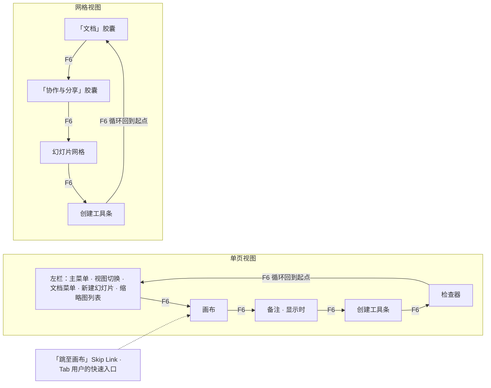
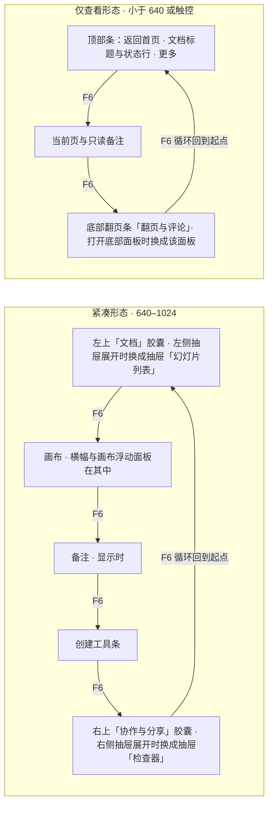
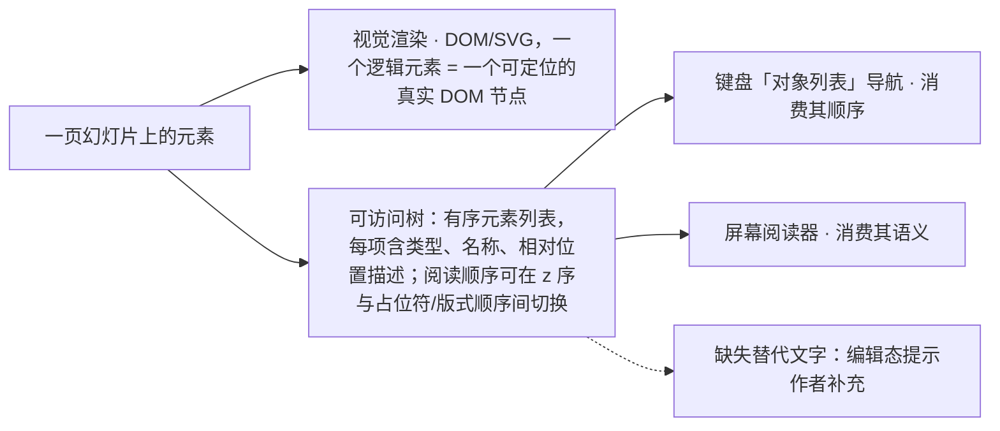
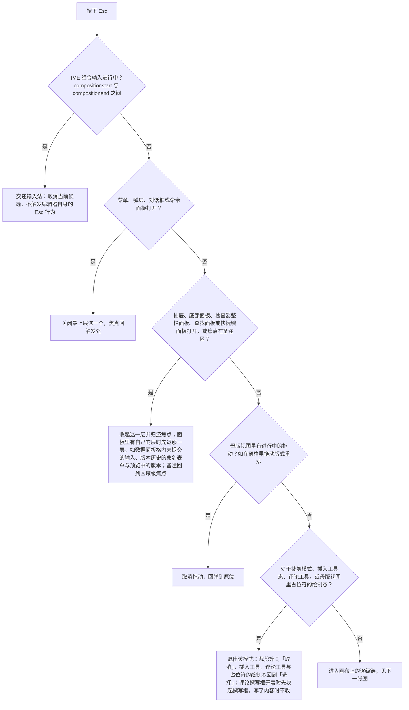
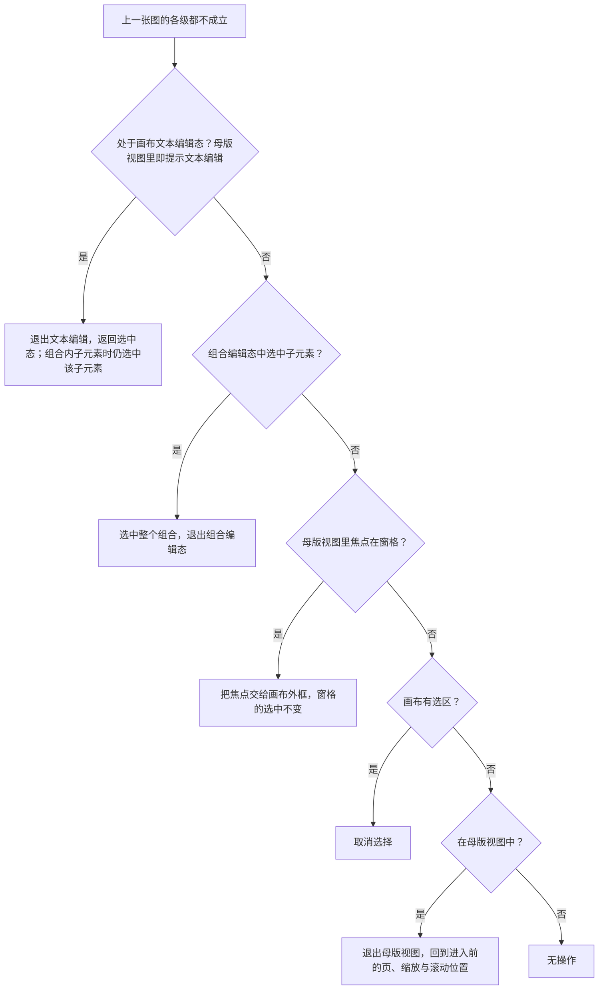

> 状态：草稿 | 负责：设计 | 更新：2026-09-15；2026-09-24（rulings §4.15 Q4：章程引用改 §6.2、注明虚拟化下 Ctrl+F 限制、IME 对齐归因改为隐藏 textarea）；2026-09-25（补图）；2026-09-25（矛盾收口，rulings §4.18）；2026-09-25（§4.19）；2026-09-26（§4.21 整合：§1.2a 键盘等价补插入工具、调整手柄、线条端点、连接符连接四行与曲线绘制例外（与 50/16 §6.3 同步））；2026-09-30（§4.22 复核修正：§1.2a 表格行高 / 列宽的数值输入由 M2 更正为 M3，与 50/24 §2.7、设计 03-30 §6.1 一致）；2026-10-04（design-language-v3 第 0 批：§1.1 F6 区域循环按 v3 结构改为单页「左栏 → 画布 → 备注 → 创建工具条 → 检查器」、网格「文档胶囊 → 协作与分享胶囊 → 幻灯片网格 → 创建工具条」，去掉 Ribbon 与状态栏；§1.2 区域内导航补左栏、幻灯片网格、创建工具条、浮动胶囊；§1.2a 键盘等价里的「属性面板」改为检查器对应分区（插入走创建工具条，推不出的分区注明随第 1 批定稿）；§1.3 注明命令面板仍为 `Mod+Shift+P` 与单字母工具键的生效条件；§2 补 §2.1 焦点环（含网格焦点例外）与 §2.2 视图切换的键盘焦点转移；§3 Ribbon 行改为创建工具条，补视图切换、浮动胶囊、网格、缩放读数、同步状态；§6 RTL 与 §8 对比度按 v3 改写）；2026-10-04（design-language-v3 第 0 批：术语残留清理：ribbon / 状态栏 / `ui.ribbon` / `ui.statusBar` 的历史陈述改用 check-terms 认可的标记措辞（废弃、取代、作废））；2026-10-04（design-language-v3 第 0 批：复验修正——缩放读数示例改为实测口径「缩放 77%」（03-02 §3.5））；2026-10-05（design-language-v3 第 0 批修正：§3 头像组读屏名按样张补在线人数「正在协作的人：N 人」（N 含自己与折叠的 +N），补「+N」按钮读屏名；自己的头像按样张为账户菜单按钮「账户：姓名（你）」（DS-18））；2026-10-05（design-language-v3 第 0 批修正：按 rulings §4.25 写入外壳类裁决——§1.2 新增「空内容占位符图标条」行：检查器不设「插入到占位符」按钮组后，图标条须键盘与读屏可操作（DS-14）；「检查器分区」行补文字格式只在文本分区、文本编辑态另有快捷键（DS-13），评审与只读角色下只读展示当前值（DS-15）；§2 命中区的迷你工具条改为文字迷你工具条已取消（DS-13）；§3 新增「账户入口（编辑器）」行：自己的头像打开账户菜单（DS-18））；2026-10-05（design-language-v3 第 0 批修正：§8 两条对比度规则按 rulings §4.25 DS-9 改写——`text-3` 只给占位与不可用项、可读灰字用 `text-2`、带文字的强调色实底用 `accent-solid`、字段加 1px 控件边界，删去复述的旧取值与「待复核，随第 1 批处理」（设计 04 §2.6 已结案），取值与核算只引用 04 §2.6）；2026-10-07（design-language-v3 第 0 批余项：§8 三条对比度规则按设计 04 §2.6 新表（rulings §4.25 DS-9）同步——协作者身份色改为对暗亮两套画布与白纸面都 ≥ 3:1、其上白字 ≥ 4.5:1；3:1 底线写明同时适用于占位符与不可用项，并列出 04 §2.6 的两条相关例外；使用规则补 `--v3-accent` 底上只放图标、状态色文字只放在 canvas / panel / panel-2 上；§2.1 网格焦点框对比度按 04 §2.6 的截断口径写作 ≥ 14.89:1）；2026-10-07（design-language-v3 第 1 批：按已拍板的第 1 批样张回写键盘与读屏约定（rulings §4.25 DS-13、DS-17、DS-21…DS-26）——§1.1 补紧凑与仅查看两种形态的区域顺序、样张已实现「跳至画布」而 F6 循环随实现；§1.2 区域内导航按样张改写（版式画廊、缩略图与网格的方向键与 ⇧F10、占位符图标条的到达路径与提示签、创建工具条与形状弹层的键盘修正、评审条、检查器折叠分区与只读行、紧凑抽屉、仅查看形态的翻页 / 轻扫 / 底部面板、菜单不可用项、图表数据网格、分隔条），新增 §1.2b 选项网格的方向键漫游（逐组注明样张已接与随实现）；§1.2a 裁剪、行高列宽、调整手柄、连接符的等价路径按第 1 批分区改写；§1.3 补评审条的工具单键与按 S 展开形状弹层；§2 命中区按迷你工具条全部取消（DS-13、DS-22）重写；§2.1 焦点环与选中框、参考线同用强调色（DS-24）并补纸面件、分隔条与不可用项；§2.2 补形状弹层的焦点归还（已实现）与紧凑抽屉；新增 §2.3 浮层的焦点进入、Tab 与归还；§3 补工具条弹出类型、评审条、检查器只读与错误、账户菜单文案、轻提示 / 横幅 / 提示条的播报角色、占位符图标条、表格网格、画布标记、仅查看形态与分隔条的读屏名；§4 Esc 分流图补抽屉、底部面板、数据面板与模式两级；§5 补加载转圈；§6 补紧凑抽屉的镜像；§8 补画布标记的对比与非颜色区分（DS-24））；2026-10-07（design-language-v3 第 1 批 · 第二步：按 rulings §4.25 DS-27…DS-29、TB 技术口径与第一步上报的跨线影响回写——§1.1 改正仅查看形态的区域顺序（打开底部面板时翻页条让位、面板占其位置），新增「窄屏两种形态的 F6 区域顺序」图；§1.2 创建工具条行改正为键盘在格子上按 Enter 直接插到视口中心（03-15 §3.4）、形状库整库一个 Tab 停靠点（TB-5），检查器分区行补删除线 / 上标 / 下标快捷键，仅查看形态补 M3 起评论撰写与回复的键盘要求（DS-28，有评论权限的角色才有撰写框），新增「查找和替换面板」行（评审、只读浏览与降权下无替换行，TB-28），分隔条行补检查器 240–480（TB-25）；§1.2a 补裁剪「取消」语义（TB-4）、幻灯片重排的右键「移动 ▸」路径、连接符「连接」节起点 / 终点下拉（TB-21），新增分隔条一行；§1.2b 形状库行按 TB-5 与 03-15 §2.4 改写；§1.3「超链接…」改名「链接…」（TB-6），新增文本编辑态的删除线 / 上标 / 下标快捷键与 `Mod+=` 按作用域分派、粘贴为纯文本 P2（DS-29、TB-19）；§2 命中区补表格拖动柄；§2.2 补键盘插入后的焦点与查找面板关闭；§3 创建工具条补形状库语义（03-15 §2.3、§2.4），检查器数值字段的读屏值带单位（DS-27），同步状态补保存态（03-19 §6.1），账户菜单条目按 AS-06（DS-18 补注），仅查看形态补评论撰写的读屏要求（DS-28），新增「查找和替换面板」行；§9 写明组件级 a11y 门禁的对象仍是产品 `/styleguide`、`_kit` 为其样张（TB-3））；2026-10-08（design-language-v3 第 1 批收口：按 rulings §4.25 DS-28、DS-31、TB-31…TB-52 与第二步上报的跨线影响回写——§1.2 左栏缩略图的 `Enter` 改为在当前页之后新建同版式页（PRD ED-11、03-14 §3.1；原「进入重命名（若支持）」作废），检查器分区行指向快速样式，仅查看形态的评论撰写只在手机（< 640）、平板仍为只读评审（DS-28、TB-49）；§1.2b 新增形状快速样式的缩略行与 42 格样式库：整组一个 Tab 位、方向键漫游、Enter 应用且样式库保持打开、Esc 收起回缩略行（DS-31）；§2.3 文本编辑中日期和时间、符号弹层关闭后焦点回插入符（TB-52）；§3 对象的替代文本改指检查器「替代文本」节与右键「编辑替代文本…」、形状同有此节（TB-32、TB-18），数值字段的字号与段前、段后、固定行距始终读 pt（TB-33），仅查看形态的评论撰写分手机与平板（TB-49），可访问树的阅读顺序 M2 只经命令面板切换（TB-42）；§9 `/styleguide` 只在测试环境挂出（TB-50））；2026-10-08（design-language-v3 第 1 批评审修改：按 rulings §4.25 DS-34…DS-37、TB-55 回写——§1.2 检查器分区行补选中与按下的非颜色线索，快速样式改为在节内原位展开（DS-34）；§1.2b 快速样式行改为原位展开的键盘与读屏：`↓` 进入样式库、「收起样式库」、`Tab` 顺序、点到别处不收起；§2.1 字段行按安静样式改写（DS-35）；§8 控件边界不再要求 3:1、写明 WCAG 1.4.11 的理解与字重、图标描边这类非颜色线索，开关按下用强调色淡底（DS-36），复选框、单选圈、插入表格网格、焦点环与自己头像的外圈仍 ≥ 3:1，04 §2.6 原例外 1 失去对象，不可用输入与下拉、次按钮的画法同步（DS-35、DS-37））；2026-10-15（design-language-v3 第 2 批：按已拍板的第 2 批样张与 rulings §4.25 DS-38…DS-63 回写——§1.2 评论筛选改为分段控件，新增评论（键盘新建、撰写框、@ 候选、钉与线程）、检查器整栏面板（版本历史、保真报告、插件整页面板）、分享对话框与个人插件面板四行，仅查看形态的手机评论撰写区定稿（DS-43…DS-46、DS-38、DS-48、DS-56）；§1.3 评论工具发表后保持按下（DS-44）；§2.3 浮层表补非模态确认卡与留言弹层、行内确认、评论撰写框、整栏面板、个人插件面板（DS-38、DS-40）；新增 §2.4 焦点不经过 body 的实现要点；§3 轻提示与页级提示条的播报改为每条自己是播报区、出现两帧后才放进无障碍树（原「容器 aria-live=polite」作废），横幅的读屏通道；左栏角标的读屏名带未解决数与警示级别（DS-51、DS-62），补「分享」按钮、列表折叠行与加载行、开关、评论、版本历史与分享对话框的语义；§4 Esc 分流图补整栏面板与评论工具；§5 补第 2 批的动效与减少动效；§7 补对话框说明句末加句号（DS-62）；§8 身份色 12 色与浅底横幅上不可用按钮的文字（DS-41、DS-42）；同日再补，按 rulings §4.25 TB-60、TB-62、TB-67 与别组报来的读屏口径——§1.2 评论一行的键盘新建按 TB-62 改写（↵ 只在评论工具开着或焦点在工具条「评论」上时落钉，没开工具时选中对象按 ↵ 仍是进入文字编辑），分隔条一行补整栏面板开着时检查器宽度可否调整（TB-60）；§3 左栏缩略图的读屏名改为带未解决与已解决计数（DS-62，03-06 §5.4）；「版本历史时间轴」一行改为「版本列表」，补版本行的读屏名写法（DS-39、DS-57，03-07 §6）；分享对话框一行补邀请框的 combobox 语义与下拉的读屏名（DS-48，03-08 §5）；画布内容可访问树的阅读顺序入口改为第 2 批未涉及、并入第 3 批待定（TB-67）；同日再补，按 rulings §4.25 TB-79、TB-84——§2.3 浮层表的评论撰写框一行与表下新增一条例外：写了内容的撰写框随换页、进网格视图或切到评审模式收起后回到那一页时恢复，但不抢焦点（焦点留在换页的地方，点临时钉或在钉上按 Tab 进撰写框），评论工具按不按下不因恢复而改变，收起时焦点若在框里先交给画布；样张约定一条注明这一例外；§1.2 评论一行与 §2.4 第 3 条同步；同日再补，按 rulings §4.25 TB-87…TB-90、TB-92——§2.3 浮层表的评论撰写框一行补有恢复的撰写框时用户又发起新评论不另开、焦点进恢复的那个（TB-88），表下「例外」一条补草稿按页存、不按模式存，切到评审模式或从评审返回编辑后仍停在同一页时当场恢复、同样不抢焦点（TB-87），草稿留着期间锚点不在了时换锚点再恢复、整页已删则草稿随页丢弃（TB-92），新增「用户再次发起评论时照常进框」一条（工具条「评论」上按 Enter、有选中对象时按 C、右键「添加评论」、开着评论工具点画布别处：焦点进恢复的那个撰写框、光标在末尾，临时钉脉冲一次，TB-88），「样张约定」一条的指代随之改；核对 TB-79 例外已写；§1.2 评论一行同步 TB-87、TB-88；§5 减少动效时这一次临时钉的脉冲同样不画（TB-88，04 §2.12）；§3 仅查看形态一行：底部翻页条「评论」的计数取本页未解决数，读作「评论（本页 N 条未解决）」，没有未解决的读作「评论（本页没有未解决的评论）」，幻灯片列表每页读作「第 N 页：〈标题〉，M 条未解决评论」（TB-89，原「评论（本页 N 条）」「评论（本页没有评论）」「M 条评论」作废）；「版本列表」一行补读屏名「标题，类别，作者，时间」与最早那一条的类别名：导入来的「导入版本」，新建空白、从模板新建、创建副本「初始版本」（TB-90，03-07 §6））；2026-10-22（design-language-v3 第 3 批：按已拍板的第 3 批样张与 rulings §4.25 DS-71…DS-136、TB-101…TB-129 回写——§1.1 补应用壳页面、放映与查看器的区域；§1.2 左栏顶部的视图切换改分段、评审者与查看者的文件名不进 Tab 顺序（DS-133、DS-82），新增应用壳页面的左栏与顶栏、搜索框下拉、快捷键面板、命令面板、偏好设置、管理员插件详情抽屉、放映、跟随、阻断页与登录页、查看器窄屏各行（DS-80、DS-87、DS-94、DS-106…DS-108、DS-111、DS-113、DS-115、DS-117、DS-118、TB-104、TB-111），菜单行补外链条目与主题三项单选（DS-89、DS-90）；§1.2b 补「文档卡片网格」一行（TB-107、TB-108）；§2.2 补导出完成后的焦点（DS-100）；§2.3 浮层表补卡片「⋯」菜单、搜索框下拉、快捷键面板、命令面板、偏好设置、模态抽屉与导出对话框（DS-80、DS-81、DS-94、DS-100、DS-101、DS-113、DS-115、DS-117）；§3 账户入口按 DS-89…DS-91 定稿并扩到应用壳页面，补头像的跟随按钮与序号角标（DS-106、DS-132）、横幅的 status 与 alert 分工（TB-119）、触控与嵌入的状态行（TB-125、DS-112），新增文档卡片、阻断页与登录页、放映舞台、查看器、快捷键面板各行，命令面板一行按样张改写（DS-117），可访问树的阅读顺序入口定稿（DS-116）；§4 Esc 分流图补快捷键面板，另起一段写放映与应用壳页面的 Esc；§5 补放映控制条、跟随条与导出轻提示的显隐（DS-100、DS-106、DS-107）；§6 补应用壳导航的镜像（DS-87）；§7 补检索词用「」、列表与搜索不写数量、阻断页说明不加句号、多会话称「窗口」（DS-80、TB-124）；§8 补备注区亮色占位字提到 text-2（DS-134）、把手维持 3:1（DS-135）与画布底上不可用的主按钮（DS-123））；2026-10-22（同日再补，按回写中的裁决 rulings §4.25 DS-137 与技术口径 TB-130、TB-137、TB-145——§1.2「搜索框下拉」行补结果页里改词与手机、触控形态（TB-130），「仅查看形态」行的「返回首页」按 `navigate-back`（TB-145）；§3 新增「搜索框下拉」一行（组合框与 `listbox` 的语义，TB-130），「分享」按钮 M2 不可用时的读屏名（DS-137），账户入口补个人资料对话框（TB-137）与嵌入里「退出登录」的可用条件（TB-145））；2026-10-22（同日再补，按回写中的技术口径 rulings §4.25 TB-154…TB-156、TB-161——§1.2「快捷键面板」行与 §2.3 焦点表补手机形态为带遮罩、焦点圈定的底部面板，平板照常是非模态浮动面板（TB-154），「阻断页与登录页」行补 M2「申请访问」不可用时的工具提示与读屏说明（TB-156）；§3「分享」按钮补 M2 的工具提示（TB-161），「阻断页、登录页与错误页」行补「恢复」失败的内联错误（TB-155）；另按 DS-76 把 §2 命中区一条引的「紧凑密度亦然」改为 PRD NF-05 现行的单档写法；2026-10-22 复核修正：§3「轻提示 / 横幅 / 状态消息」一行原写「嵌入里只写『仅查看』」，与 TB-159 不符，改为嵌入里窗口窄时只写「仅查看」、嵌入里的平板仍是「仅查看 · 在电脑上编辑」，并写明「触控设备」只指平板（TB-163）；§1.2「阻断页与登录页」行补阻断页说明句不变（TB-156）；§1.2「阻断页与登录页」行补导入页的例外：落区里的「选择文件…」也可聚焦，由用户操作进导入页时焦点落在它、不落在按钮行第一颗（03-13「入口与流程」、样张 `import.drop-page`）；§3「文档卡片」行的读屏名原只写标题、徽标与固定，按样张 `DocumentCard` 与 03-01 §4.2 补第二行「编辑者 X，时间」，与「搜索框下拉」行一并补缺最近编辑者时不带「编辑者 X」（TB-171）；§3「文档卡片」「搜索框下拉」两行补还没有快照时时间取建档时间 `createdAt`，两处读屏名一致（TB-171）；§1.1 窄屏一段补仅查看形态（手机与平板）里横幅在最顶上、`Tab` 先经过横幅再到顶部条（TB-172））；2026-10-23（design-language-v3 第 3 批评审修改：按 rulings §4.25 DS-140…DS-143、TB-179…TB-182 回写——§1.1 导入不再是整屏阻断页，是叠在原页上的模态对话框（DS-140 取代 DS-97、DS-98）；§1.2「阻断页与登录页」行去掉导入页的例外，新增「导入对话框」行（打开、拖入松开、上传与解析中的焦点与 Esc，手机底部面板，TB-179…TB-181）；§1.2a 文件拖放导入补 .pptx 的非拖拽等价路径；§2.3 浮层表补导入对话框，对话框一行补焦点已落好时不再移动；§2.4 第 1 条补「焦点已落在页面里可用的元素上就不再移动」（kit `focusSettledElsewhere`）；§3 新增「导入对话框」一行（常驻播报区、上传进度、「取消导入」、文件类型图标只作装饰，DS-143、TB-182）；§4 应用壳一段补导入对话框上传与解析中的 Esc；§8 补导入落区的安静虚线与拖入悬停淡底的对比（DS-141、TB-180）；§1.2、§2.3「导入对话框」行补直接打开 `/import` 时焦点落在对话框本身，页面上没有「导入 .pptx」时（手机与平板）关闭后回到「显示导航」、左栏常驻的平板落在主区（与前端 50/16 §7 一致））；2026-11-04（design-language-v3 母版视图改版：§1.2 新增「母版窗格」行（含 `Backspace` 删除与 `Shift+↑/↓` 扩展多选，键位以 03-26 §3、§9 为准），「跟随」行补母版视图里头像与在线列表的行不可用；§1.2a 新增母版窗格里的版式重排（依据 03-26 §3、PRD ML-03）与插入占位符两行；§3 新增「母版视图」行（上下文条的播报与分句、窗格行（含有人在场时）与占位符点选区的读屏名、标注与 M2 锁签对读屏隐藏，以 03-26 §9 为准）；§1.2、§1.2a、§3 补窗格键盘重排后的播报「已移到第 N 个版式」（以 03-26 §9 为准）；§4 Esc 的分流按 TB-195 补母版视图的三级——拖动取消并回弹、占位符的绘制态回到「选择」、焦点在窗格先交给画布，图超过规模上限拆成两张；rulings §4.25 DS-145、DS-148、DS-150、DS-156、DS-157、DS-166、DS-177、TB-194…TB-196、TB-199、TB-202；需求编号、优先级与里程碑不变）；2026-11-05（prd-v3-current：§3「其他 P0 要求」的 200% 缩放按 PRD NF-05 写为功能可达、除画布外不需要双向滚动，并指向其验收口径与已知限制（rulings §4.26 PV-24）；界面与行为不变） | 依赖：charter v0.1、04-design-system v1.0、09-design-specification v4.0、rulings §4.25 DS-1…DS-6、DS-13…DS-15、DS-17、DS-18、DS-21…DS-29、DS-31、DS-34…DS-63、DS-65、TB-3…TB-6、TB-18、TB-19、TB-21、TB-25、TB-28、TB-32、TB-33、TB-42、TB-49、TB-50、TB-52、TB-55、TB-60、TB-62、TB-67、TB-79、TB-84、TB-87…TB-90、TB-92、DS-71…DS-137、DS-140…DS-143、TB-101…TB-130、TB-137、TB-145、TB-154…TB-156、TB-159、TB-161、TB-163、TB-171、TB-179…TB-182、DS-145、DS-148、DS-150、DS-156、DS-157、DS-166、DS-177、TB-194…TB-196、TB-199、TB-202；playground 第 3 批场景 `documents`、`home`、`account-menu`、`templates`、`admin-plugins`、`import`、`export`、`present`、`viewer`、`settings`、`shortcuts`、`command-palette`、`shell-pages`、`embed`、`presence-scale`、`quiet-leftovers`

# 07 可访问性与国际化（Accessibility & i18n）

架构基线选择 DOM/SVG 渲染而非 Canvas（章程 §6.2；ADR-0021 已接受，rulings §4.15 Q4 定为 DOM/SVG 单实现）本身就是可访问性的关键前提：每个幻灯片元素是真实 DOM 节点，可被屏幕阅读器直接感知、可被浏览器原生文字搜索（Ctrl+F；注意缩略图栏与画布对长文档做虚拟化，未挂载的页搜不到，全文查找以 03-screens/21 查找替换为准）、可被系统级缩放/高对比度模式正确处理、可被翻译类浏览器扩展处理。本文档把这一架构优势转化为具体的交互与语义规则，验收口径对齐 PRD `04-non-functional-requirements.md` **NF-05（WCAG 2.2 AA）**与 **NF-06（国际化与本地化）**——本文档定 UX 规则，NF-05/06 定验收标准与里程碑，两者不重复但需一致；本文档标注的 WCAG 条款编号均为 2.2 版本。

---

## 1. 键盘导航模型

### 1.1 焦点区域（Landmark 级，`F6` 循环移动）

**F6 区域循环顺序（v3）**

怎么读：两个分组是同一编辑器的两种视图（09 §3），实线是各自 `F6` 的前进顺序（`Shift+F6` 反向；部分浏览器会截获 `F6` 聚焦地址栏，因此同时注册 `Ctrl+F6` / `Ctrl+Shift+F6` 作为备用键，与 Office 网页版一致，`50-frontend/16` §6.1），末尾循环回到起点；备注隐藏时跳过；虚线是跳转链接，`Tab` 用于区域内外的精细遍历。
依据：PRD ED-29（F6 循环主要区域）；rulings §4.25 DS-1、DS-4、DS-6；样张 `src/v3/Editor.tsx`、`editor/GridView.tsx` 的区域 DOM 顺序。

循环键直接采用 PRD `03-features/02-editing.md` ED-29 的验收口径：**`F6`/`Shift+F6` 循环切换主要区域**（备用键 `Ctrl+F6` / `Ctrl+Shift+F6` 行为相同）（不是 `Tab`——`Tab` 在区域内部/之间都按 DOM 自然顺序移动，用于精细遍历；`F6` 是"跳到下一大块"的粗粒度移动，这是许多复杂桌面级 Web 应用——如 IDE——的通行做法，避免用户为切换区域而反复按 `Tab` 穿过整条工具条与检查器）。区域清单按 v3 结构改写：ED-29 原文列举的 ribbon 与状态栏随 DS-1、DS-6 废弃；**循环顺序 = 各区域在 DOM 中的顺序**，使 `F6` 与 `Tab` 的先后一致（WCAG 2.4.3）。单页视图：左栏 → 画布 → 备注（显示时）→ 创建工具条 → 检查器；网格视图：「文档」胶囊 → 「协作与分享」胶囊 → 幻灯片网格 → 创建工具条。每个区域是一个 ARIA landmark 或等价语义（左栏与检查器为 `complementary`，须各有可读名称以便区分；画布区为 `main`；工具条为 `toolbar`；胶囊为带名称的 `group`），额外提供"跳至画布"跳转链接（Skip Link）作为 `Tab` 用户的快速入口。无键盘陷阱（WCAG 2.1.2）：任何浮层必须有可达的关闭路径。

**窄屏两种形态的区域**（rulings §4.25 DS-17，设计 04 §5、03-screens/02 §5a）：紧凑形态沿用桌面的 DOM 顺序——左上「文档」胶囊（左侧抽屉展开时换成抽屉 `region`「幻灯片列表」，胶囊让位）→ 画布 → 备注 → 创建工具条 → 右上「协作与分享」胶囊（右侧抽屉展开时换成抽屉 `region`「检查器」，胶囊让位），即左上胶囊排在画布之前、右上胶囊排在工具条之后，`F6` 按这一顺序循环；仅查看形态只有三块：顶部条 → 当前页与只读备注 → 底部翻页条（`toolbar`「翻页与评论」）；打开底部面板（非模态 `dialog`）时翻页条让位，面板占它的位置。横幅属于画布区（`main`）的开头，`Tab` 先经过横幅上的按钮，再到画布；仅查看形态（手机与平板）里横幅在最顶上，`Tab` 同样先经过横幅、再到顶部条（rulings §4.25 DS-60、TB-172，样张 `offline-conflict.narrow-offline`）；查找面板这类画布浮动面板同样在画布区里（§1.2）。

**窄屏两种形态的 F6 区域顺序**

怎么读：两个分组是窄屏下的两种形态，实线是各自 `F6` 的前进顺序（`Shift+F6` 反向，备用键同上图），末尾循环回到起点；节点里的「换成」是同一个区域位上的替换——抽屉与同侧胶囊共用一个区域位（抽屉展开时胶囊让位），底部面板与翻页条共用一个区域位（面板打开时翻页条让位），不另增区域，与桌面「按模式替换、不增删位置」一致（前端 50/16 §6.1）。备注隐藏时跳过；紧凑形态的网格视图与桌面网格相同（上图）。
依据：rulings §4.25 DS-17、DS-21；03-screens/02 §5a.1、§5a.2；样张 `scenarios/narrow/compact.tsx`、`scenarios/narrow/viewer.tsx` 的区域 DOM 顺序。

样张现状：区域的 DOM 顺序与「跳至画布」已按本节实现（页面第一个可聚焦元素，只在聚焦时出现，跳到画布）；`F6` / `Ctrl+F6` 的区域循环样张未实现，随实现（前端 50/16 §6.1）。

**应用壳页面、放映与查看器的区域**（2026-10-22，第 3 批样张）：开始页、文档列表、模板库与管理页是两块——左栏（`aside` 里的 `nav`「主导航」，品牌、搜索框、导航项、帮助与用户行）与 `main`（顶栏 `header`、横幅与内容），`F6` 在两块之间移动，`Tab` 按 DOM 顺序；紧凑形态的左栏收成抽屉 `region`「导航」（rulings §4.25 DS-87）。登录与错误页是整屏的单列阻断页，只有一块（DS-71）；导入是叠在开始页、文档列表上的模态对话框「导入」（2026-10-23，rulings §4.25 DS-140，整屏的导入页与导入过渡页由它取代），不另成一块，键盘见 §1.2「导入对话框」行。放映舞台是 `role="application"`（「放映：〈文档名〉」）——方向键与空格交给放映，控制条（`toolbar`「放映控制」）在 `Tab` 进入时浮现（§1.2「放映」行）。查看器（`preset-slide-viewer`）桌面形态为顶部条 + 画布，窄屏为当前页 + 底部浮动条，与仅查看形态同一顺序（DS-111）。

### 1.2 区域内部导航（Roving Tabindex，遵循 WAI-ARIA APG 的 Toolbar/Grid/Menu 模式）

| 区域 | 内部导航 |
|---|---|
| 左栏顶部（主菜单、视图切换、文档菜单、新建幻灯片） | 按 DOM 顺序 `Tab`；视图切换两个按钮 `Enter`/`Space` 激活，切换后的焦点去向见 §2.2（2026-10-22 起视图切换按分段控件画，按钮、读屏名与焦点交接不变，rulings §4.25 DS-133）；评审者与查看者的文件名只显示、不是按钮、不进 `Tab` 顺序，读屏照常读到（DS-82）；「新建幻灯片 ▾」打开版式画廊（选项网格，§1.2b：方向键按卡片的实际位置移动、可跨母版分组，选中跟随焦点，`Enter` 新建，`Esc` 先清空搜索、再按才关闭，焦点回「新建幻灯片 ▾」），旁边的「+」按当前页的版式直接新建（`Mod+M`） |
| 左栏缩略图列表 | `↑`/`↓` 在幻灯片间移动并同步画布焦点，`Mod+Shift+↑/↓` 移动顺序（PRD ED-29；`Mod` 为 Ctrl/Cmd，取代早期版本误用的 `Alt+Shift`），`Enter` 在当前页之后新建一页、版式同当前页（当前页是「标题幻灯片」时改用「标题和内容」，新页成为当前页；PRD ED-11、03-screens/14 §3.1；原写「`Enter` 进入重命名（若支持）」与 ED-11 冲突，作废）；`Shift+F10` / 菜单键在焦点页上打开缩略图菜单（样张已接）。样张现状：每页各占一个 `Tab` 位、未接 `↑`/`↓`，随实现按本行 |
| 母版窗格（母版视图的左栏，2026-11-03 母版视图改版，rulings §4.25 DS-150、DS-166、TB-195、TB-196） | `role="listbox"`（「母版与版式」），整个窗格一个 `Tab` 停靠点、选中跟随焦点：`↑`/`↓`/`Home`/`End` 在母版行与版式行之间移动并选中；`Enter` 把焦点交给画布外框，`Esc` 同样先把焦点交给画布外框、下一次才按母版视图的 Esc 逐级（§4）；`Shift+F10` / 菜单键在当前行原位打开右键菜单；焦点在窗格时 `Mod+D` 复制所选版式（TB-196）；`Delete` / `Backspace` 删除所选（被引用时先确认）；`Shift+↑/↓` 在同一母版内扩展多选；`Mod+Shift+↑/↓` 在本母版内上移 / 下移，移动后播报「已移到第 N 个版式」（§1.2a；原句以 03-screens/26 §9 为准）；双击名称或右键「重命名」在行内改名，`Enter` 提交、`Esc` 取消（DS-150）。进入母版视图后焦点落在窗格里选中的那一行（DS-166）。键位与读屏名以设计 03-26 §3、§9 为准 |
| 幻灯片网格（网格视图） | `←`/`→` 前后一页、`↑`/`↓` 上下一行（按网格实际列数）、`Home`/`End` 第一页 / 最后一页——只移动焦点、不改当前页；空格选中，`Enter` 或双击打开该页（回单页视图并定位）；`Shift+F10` / 菜单键打开缩略图菜单；焦点页自动滚到胶囊与工具条之间（§2.2）。样张已接这些键，`Tab` / `Shift+Tab` 也逐页移动（每页一个 Tab 位） |
| 画布 | `Tab`（或专用快捷键）在对象间按 z 序循环选中；`方向键` 微调选中对象位置（1px，`Shift+方向键` 10px）；`Enter` 进入文本编辑，`Esc` 退出编辑返回选中态；提供可访问的"对象列表"作为画布空间导航的替代路径（面向依赖屏幕阅读器、难以依赖视觉相对位置操作的用户，详见 §3 画布内容可访问树）。样张现状：画布上本行的键位未接，随实现（前端 50/16 §6.2） |
| 空内容占位符图标条（画布上） | 检查器不设「插入到占位符」按钮组，往占位符插入内容只走这条图标条与创建工具条（rulings §4.25 DS-14），所以图标条必须键盘与读屏可操作：`role="toolbar"`（「插入内容到占位符」），整条一个 `Tab` 停靠点，`←`/`→` 循环移动、`Home`/`End` 到两端，`Enter`/`Space` 插入；每项带可读名称（如「插入表格到占位符」），未到里程碑的项 `aria-disabled`、可聚焦，读屏名附里程碑（「插入图表到占位符（M3 提供）」），焦点停上去时原因提示自动展开；聚焦时占位符下方的画布提示签写「← → 在图标间移动 · Enter 插入 · Esc 回到占位符」；窄占位符折叠为「插入 ▾」时 `Enter`/`Space`/`↓` 打开同一组条目的菜单。到达路径按前端 50/16 §6.2：画布内 `Tab` 选中空内容占位符后再按 `Tab`（样张 `kit/PlaceholderBar.tsx` 已接图标条内的键位，画布内的到达路径随实现） |
| 创建工具条 | 方向键在工具间移动（roving tabindex，单一 Tab 停靠点），`Enter`/`Space` 激活——样张未接，每个按钮各占一个 `Tab` 位，随实现按本行。「形状」用 `Enter`/`Space` 打开时焦点进 4 × 3 的第一格（鼠标打开时焦点留在按钮上），格子整组一个 `Tab` 位、方向键漫游（§1.2b）；格子上按 `Enter`/`Space` 不经插入工具态，按默认尺寸插到视口中心并选中、弹层收起（插入工具态的键盘等价，03-screens/15 §3.4；样张里键盘激活格子与指针点按一样只选定工具，产品按 03-15）；指针点格子则弹层收起、「形状」保持按下进入插入工具态、焦点回到「形状」；「全部形状」把弹层原位换成形状库并把焦点移进去（形状库整库同样只占一个 `Tab` 停靠点、方向键漫游，rulings §4.25 TB-5，§1.2b）；`Esc` 关闭并回「形状」（样张 2026-10-07 已接）。「图片 ▾」「更多」是菜单，「图表」是类型菜单（`→` 打开子类型），「表格」是网格弹层（`TableGridPicker`，§1.2b）；都向上弹出，`Esc` 关闭并回到触发按钮 |
| 评审条 / 浏览条 | 与创建工具条同一套键位：浏览（`V`）· 评论（`C`）· 高亮 ┊ 上一处 / 下一处评论 ┊「返回编辑」（有编辑权限时，DS-23）；浏览条只有上一处 / 下一处评论；一个条目都没有时只剩一句只读提示（`role="status"` 的文字，没有可聚焦项） |
| 检查器页签 / 评论筛选 | 页签：`role="tablist"` + `role="tab"`（`aria-selected`、`aria-controls`）+ `role="tabpanel"`；`←`/`→`/`Home`/`End` 在页签间移动（roving tabindex），页签必须是 `button`，不得用 `span`/`div`。评论筛选（2026-10-15，rulings §4.25 DS-43）是分段控件（「筛选评论」：全部 / 当前页 / 未解决 / @我，各项 `aria-pressed`），排序是带 `aria-haspopup="menu"` 的图标按钮、单选菜单选了即收起；临时筛选「已脱离锚点 N」是 `aria-pressed` 按钮。样张现状：页签已是 `role="tab"` 的按钮，未接方向键，随实现 |
| 检查器分区 | `Tab` 顺序遍历字段；分段控件与切换条的每一项是带 `aria-pressed` 的按钮（单选组为 `radio`），选中与按下的状态从 `aria-pressed` / `aria-checked` / `aria-selected` 读出，视觉上除底色外另有字重 500、图标描边 2 这类非颜色线索（WCAG 1.4.1；按下的开关另用强调色淡底，rulings §4.25 DS-35、DS-36，设计 04 §2.6）；分区缺省不折叠（节标题是 `h3`），少数默认收起的分区（如表格样式、行高与列宽、图表的替代文本）的标题是 `h3` 里带 `aria-expanded` 的按钮。文字格式只在「文本」分区（DS-13；表格、图表同样不设迷你工具条，DS-22），键盘用户在文本编辑态另可用粗体、斜体、下划线、删除线、上标、下标的快捷键（ED-16，§1.3）。形状检查器「填充」节上方的快速样式与在节内原位展开的样式库按选项网格漫游（§1.2b，rulings §4.25 DS-31、DS-34）。不可用的字段仍可聚焦，读屏名后附原因；校验错误的字段 `aria-invalid`，经 `aria-describedby` 读出下方错误行。评审模式、只读角色与降权时分区只读展示当前值：不渲染表单控件，每行是纯文本「标签 当前值」（`StaticRow`），读屏按阅读顺序读出，面板顶部一行权限说明（`role="note"`，DS-15） |
| 浮动胶囊（网格视图、紧凑形态） | 组内按 DOM 顺序 `Tab`；紧凑形态外角的「显示幻灯片列表」「显示检查器」开关带 `aria-expanded` |
| 评论（画布评论钉、浮动撰写框与「评论」页签，rulings §4.25 DS-43…DS-45） | 新建：焦点在工具条「评论」上按 `Enter`（或工具已开、焦点在画布上按 `Enter`）在当前页放页级临时钉并打开撰写框；有选中对象时按 `C` 落元素锚点，评论工具开着时按 `Enter` 同样落元素锚点——`Enter` 只在评论工具开着、或焦点在工具条「评论」上时落钉，没开评论工具时选中对象按 `Enter` 仍是进入文本编辑（本表「画布」行，rulings §4.25 TB-62）；画布上 `Shift+F10` / 菜单键（或幻灯片空白处右键）的菜单里有「添加评论 C」（PRD ED-29）。撰写框：焦点进文本框，桌面 `Enter` 发送、`Shift+Enter` 换行（IME 组合中的 `Enter` 交给输入法，§4）；输入 @ 弹出候选，`↑`/`↓` 选择、`Enter` 插入、`Esc` 只取消候选，焦点一直留在文本框（`aria-activedescendant`）；没写内容时 `Esc` 收起撰写框、写了内容时 `Esc` 不关（要点「取消」）；因 `Esc` /「取消」关闭时焦点回到来源（「评论」按钮、画布或被右键的对象），发送后交给画布；发表后评论工具保持按下，没有撰写框时 `Esc` 或 `V` 回到「选择」（§1.3）。写了内容的撰写框遇到换页、进网格视图或切到评审模式时随之收起、草稿按页保留，回到单页的那一页时原样恢复（切到评审模式、或从评审返回编辑之后仍停在同一页时当场恢复，TB-87），但不抢焦点：焦点留在换页的地方（左栏缩略图、翻页键或评审条「上一处 / 下一处」），点临时钉或在钉上按 `Enter` / `Tab` 进撰写框，评论工具按不按下也不因恢复而改变（§2.3，rulings §4.25 DS-65、TB-79、TB-84）；有恢复的撰写框时再按上面的键（「评论」上按 `Enter`、工具开着时在画布上按 `Enter`、有选中对象时按 `C`）或右键「添加评论」，不另开撰写框，焦点直接进恢复的那个、光标在末尾（§2.3，TB-88）。评论钉是按钮：`Enter` 定位线程（检查器自动切到「评论」，焦点留在钉上），`Shift+F10` / 菜单键打开钉的菜单（贴在钉右侧、关闭后焦点回钉）；聚合钉打开的列表里选一条，焦点交给展开后的那一枚钉。线程里：编辑自己的评论时焦点进编辑框、光标在末尾，保存或取消后回到这一条的「⋯」；删除自己的回复后焦点交给这条线程的作者行 |
| 检查器整栏面板（版本历史、保真报告、插件整页面板，rulings §4.25 DS-38） | 用户打开时焦点移进面板（版本历史落在选中的版本，加载失败时落在「重试」；其余落在第一个可聚焦项）；版本历史的列表用 `↑`/`↓` 在行之间移动、`Enter`/`Space` 预览所选版本，折叠行（「N 个自动版本」、月份、「最近删除」）是带 `aria-expanded` 的按钮；`Esc` 逐层：先收起命名表单 → 再回到当前版本 → 最后关闭面板（焦点交回文件名）；保真报告与插件整页面板 `Esc` /「关闭」后焦点交回打开它的控件（主菜单按钮、检查器里的「保真详情」、页级提示条的「查看详情」等）。面板开着时点画布上的评论钉，先收起面板、再切到「评论」，焦点留在钉上 |
| 分享对话框（03-screens/08，rulings §4.25 DS-40、DS-48） | 模态对话框，顶部锚定，焦点进邀请框；邀请联想 `↑`/`↓` 选择、`Enter` 选定，`Esc` 先收起联想、不关对话框；成员行的角色下拉是菜单（单选，选了即收起），「移除」在末项。行内确认（移除成员、收紧链接）打开时焦点落在「取消」，确认句经组的 `aria-describedby` 一起读出，`Esc` 等同「取消」、不关对话框，关闭后焦点回到触发它的下拉；访问申请批准或拒绝后焦点交给下一条，没有了交给新加入的成员或邀请框；加载失败点「重试」后焦点交给加载行（读屏名「正在加载成员与链接设置」），加载完成后交给邀请框；× / `Esc` 关闭后焦点回到「分享」 |
| 个人插件面板（对话框 640，rulings §4.25 DS-38、DS-56） | 用户打开时焦点落在对话框本身（读屏先念标题与说明，不自动聚焦第一个开关）；`Tab` 依次经过各行的开关、「展开」与「重试」；开关是 `role="switch"`；操作结果写在对话框底栏并播报一次（遮罩会盖住画布轻提示）；从快捷键面板的冲突条目进入时，冲突说明行吸顶、列表自动滚到冲突那一行；关闭后焦点回到主菜单按钮（从缺插件元素的右键菜单打开时回到那个占位） |
| 抽屉（紧凑形态） | 抽屉是 `region`（「幻灯片列表」「检查器」），里面就是桌面的左栏 / 检查器，按上面各行导航；用户展开时焦点交给抽屉同一角的「收起…」开关，收起后交回胶囊上的「显示…」开关；`Esc` 或「收起…」收起（上面还有菜单、弹层等打开时 `Esc` 先关它们，§4）；同一时刻只开一个，跨断点时自动关闭 |
| 仅查看形态 | 顶部条：返回首页（嵌入时不渲染，宿主在 `cordex:init` 的 `intents` 里声明 `navigate-back` 时才出现，rulings §4.25 DS-112、TB-145）· 文档标题与状态行 · 更多；底部浮动条 `role="toolbar"`（「翻页与评论」）里的 44px 按钮按 DOM 顺序 `Tab`；外接键盘 `←` / `PageUp` 上一页、`→` / `PageDown` 下一页、`Home` / `End` 首末页（幻灯片列表或「更多」打开时不翻页；焦点在输入框里或带修饰键时不处理）；左右轻扫与「上一页 / 下一页」按钮等价，页面被双指放大时轻扫不翻页（让给平移）；页码按钮打开幻灯片列表。底部面板是非模态 `dialog`（「评论」「幻灯片」「更多」），用户打开时焦点落在面板本身，`Esc` 或面板的「关闭…」收起并把焦点还给打开它的按钮；幻灯片列表与「更多」点面板外即收起，评论面板不收（边看幻灯片边读评论）。M3 起手机（< 640）上的评论面板可以发表与回复（rulings §4.25 DS-28，2026-10-15 第 2 批样张已拍板，DS-46；有评论权限的角色才有撰写区，查看者照常只读，PRD CO-04；解决仍在更大窗口中进行；平板（`pointer: coarse` 且 ≥ 640）按 PRD NF-07 仍为只读评审、没有撰写区，TB-49）：面板底部常驻撰写区（44px 文本框 +「发送」），按 DOM 顺序 `Tab` 可达；手机上 `Enter` 换行、只用「发送」提交（与桌面不同，03-screens/06），输入法组合中的 `Enter` 交给输入法（§4）；点某条的「回复」时撰写区上方出现「回复 〈名字〉 ×」，焦点进文本框；面板里框中有字时 `Esc` 不关面板；焦点在这些框里时翻页键放行给文字输入（同上「焦点在输入框里不处理」）；读屏要求见 §3「仅查看形态」行 |
| 备注 | 标准文本区域行为；`Esc` 离开编辑回到区域级焦点（不退出整个区域） |
| 菜单 / 下拉 / 右键菜单 | 标准 Menu 模式：`↑`/`↓` 移动，`→` 进子菜单，`←` 返回，`Esc` 关闭并归还焦点（§2.3）；不可用项留在原位、方向键可达，读屏经 `aria-describedby` 读出原因（一组共用原因时指向面板顶部的说明行）；勾选与单选项分别为 `menuitemcheckbox` / `menuitemradio`——账户菜单的主题三项「浅色 / 深色 / 跟随系统」是单选、选了不关（rulings §4.25 DS-90）；外链条目（帮助菜单与账户菜单的「帮助中心」等）读屏名带「在新标签页打开」（DS-89）；右键菜单另可在焦点对象上按 `Shift+F10` / 菜单键打开（样张：缩略图、图表数据网格的类别格与系列表头；第 3 批：文档卡片的「⋯」菜单，TB-107）；开始页左栏的「帮助」与用户行打开的菜单向上展开 |
| 图表数据网格（数据面板与检查器「数据」分区） | 每格是真实输入框：`Enter` 提交并下移、`Tab` 提交并右移；`Esc` 先放弃本格未提交的输入（焦点留在格内），格里没有未提交输入时再按 `Esc` 关闭数据面板；非法输入 `aria-invalid`、不提交，错误行在网格下方；类别格与系列表头的行列菜单用右键或 `Shift+F10`；只读时是普通表格（03-screens/31） |
| 查找和替换面板（画布浮动面板） | `Mod+F` 打开查找，替换键（Windows / Linux `Ctrl+H`、macOS `⇧⌘H`）打开并展开替换行，主菜单「编辑」与命令面板等价；面板在画布区（`main`）里，是非模态 `dialog`（「查找和替换」），不困住焦点；打开时焦点进查找框并全选原查询词，面板已开着时再按同一快捷键回到查找框；`Tab` 顺序为展开替换 `›` → 查找框 → 区分大小写 → 全字匹配 → 上一个 → 下一个 → 关闭 →（展开时）替换框 →「替换」→「全部替换」；查找框里 `Enter` 下一个、`Shift+Enter` 上一个；`Esc`（焦点在面板里，或不在别的输入框里时）或「关闭」收起面板，焦点交回画布、保留选区（§2.2）。评审模式、只读浏览与降权时不显示替换行与展开按钮，替换键只打开查找（rulings §4.25 TB-28）；紧凑形态宽 320，区分大小写、全字匹配与「替换…」收进「⋯ 更多」（03-screens/21 §2、§4、§6） |
| 分隔条（桌面形态） | `role="separator"`、可聚焦、带 `aria-valuenow` / `aria-valuemin` / `aria-valuemax` 与名称（「幻灯片列表宽度」「检查器宽度」「备注高度」）；左栏与检查器用 `←`/`→`、备注用 `↑`/`↓`，每次 8（`Shift` 32），`Home`/`End` 到最小 / 最大（检查器 240–480，rulings §4.25 TB-25），`Enter` 回到缺省（双击同）（03-screens/20 §6）。检查器整栏面板开着时：版本历史、保真报告照常可调，调的就是检查器宽度；图表数据面板与插件整页面板开着时检查器的分隔条不可调，按「不可用项不隐藏」留在 `Tab` 顺序里、`aria-disabled`，方向键无效（设计 04 §4.1b 第 4 条），关闭面板后回到原宽（rulings §4.25 TB-60，设计 04 §2.13） |
| 应用壳页面的左栏与顶栏（开始页、文档列表、模板库、管理页；第 3 批，rulings §4.25 DS-79、DS-87） | 按 DOM 顺序 `Tab`：品牌 → 搜索框（开始页作用域 `Mod+K` 聚焦，`aria-keyshortcuts`）→ 主导航（当前项 `aria-current`；模板库里「首页」是上级导航项，读作 `aria-current="true"`、不念成「当前页面」）→「帮助」→ 用户行 → 顶栏动作 → 内容（文档卡片网格见 §1.2b）；开始页上 `Mod+,`、`Mod+/` 同样可用；紧凑形态顶栏左端的「显示导航」开关（`aria-expanded`、`aria-controls`）展开导航抽屉 `region`「导航」，焦点交给同一位置的「收起导航」，`Esc`、点它或点导航项收起后交回开关（先交焦点再卸载，不经过 `body`）；顶栏开关被抽屉盖住时 inert（WCAG 2.4.11）；手机与触控上导航项、帮助与用户行 44 高、间距 8；拖入 .pptx 时 `Esc` 取消落区 |
| 搜索框下拉（rulings §4.25 DS-80） | 搜索框是组合框（`role="combobox"`、`aria-expanded`、`aria-controls`、`aria-activedescendant`），下拉是 `listbox`：输入即出前 5 条结果与「查看全部结果」；`↓`/`↑` 在它们之间移动、焦点留在搜索框，`Enter` 打开当前项（文档进编辑器，「查看全部结果」进结果页；还没移动过时 `Enter` 等于「查看全部结果」，03-screens/01 §5），`Esc` 先收起下拉、再按清空搜索词，点外面收起；IME 组合中的 `Enter` 与 `Esc` 交给输入法（§4）；没有命中时 polite 播报一次「没有匹配「…」的文档」。在搜索结果页里改搜索词时下拉照常弹出，`Enter` 或「查看全部结果」按新词刷新结果页；手机与触控形态同用这个下拉，搜索框与结果行都是 44 高（rulings §4.25 TB-130）。读屏语义见 §3「搜索框下拉」行 |
| 快捷键面板（画布浮动面板，rulings §4.25 DS-115） | 非模态 `dialog`（「键盘快捷键」），不困住焦点：用户打开时焦点进搜索框；分组标题吸顶，列表在面板里滚动；`Esc`——焦点在搜索框且有搜索词时先清空、再按一次关闭，焦点在 × 或「在插件中查看」上一下就关，输入法组合中不响应；再按 `Mod+/` 收起；关闭后焦点回打开它的地方（主菜单按钮、画布，开始页上回到菜单的触发处）；开着时画布照常可点、可试键；开始页与文档列表在手机（< 640）上改为贴底的底部面板，与偏好设置的手机形态一样带遮罩、焦点圈定（手机上没有可以对照试键的画布），Esc / 关闭 / 点遮罩关闭，关闭后焦点回到打开前的元素、不掉到 `body`；平板（触控、≥ 640）照常是上面这块非模态浮动面板（rulings §4.25 TB-154、TB-118，03-screens/24 §1.5） |
| 命令面板（rulings §4.25 DS-117、TB-106） | `Mod+K` 或主菜单「帮助 › 命令面板… ⌘K」打开，焦点在搜索框、圈定在面板里；`↑`/`↓` 换当前项（焦点留在搜索框，`aria-activedescendant`），`Enter` 执行——先关面板、焦点交回打开前的元素再执行，打开别的界面的命令由那个界面接走焦点；`Esc`、点外面或再按 `Mod+K` 关闭；不可用的命令可停上去，`Enter` 只播报「〈命令〉：〈原因〉」、面板不关；IME 组合中的 `Enter` 交给输入法（§1.3）；「阅读顺序…」打开偏好设置、焦点落在「无障碍 › 阅读顺序」上（DS-116） |
| 偏好设置（居中对话框，rulings §4.25 DS-113） | 模态 `dialog`「偏好设置」；用户打开时焦点落在对话框本身（读屏先念标题与说明，不自动聚焦第一个分段，免得方向键误改主题）；分段、下拉与复选框按各自的模式，复选框行的说明经 `aria-describedby` 读出；改了即生效；× / `Esc` / 点遮罩关闭，焦点回打开它的头像或用户行；手机上是贴底的模态底部面板，同一规则（TB-118） |
| 管理员插件详情抽屉（模态抽屉 480，rulings §4.25 DS-94） | 点行尾「›」打开，焦点在抽屉本身、圈定在抽屉里；`Esc` / × / 点遮罩关闭，焦点回到这一行的「›」；从深链 `?plugin=` 进入时关闭后同样回到那一行 |
| 放映（rulings §4.25 DS-107、DS-108、TB-104、TB-111） | 舞台 `role="application"`，方向键与空格交给放映：`→` / 空格 / `PageDown` 下一页、`←` / `PageUp` 上一页、`Home` / `End`，数字 + `Enter` 跳页（舞台顶部出跳页提示条，`Backspace` 删一位，约 3 秒无输入清空；可以跳到隐藏页并显示它），`B` 黑屏、`W` 白屏（再按或按翻页键只恢复当前页），`Esc` 退出（全屏下第一次 `Esc` 由浏览器消费、直接退出）；放映中 `F5` / `Shift+F5` 被吞掉、不刷新；鼠标单击是下一页，触控单击只显隐控制条、左右轻扫翻页；`Tab` 进入控制条（`toolbar`「放映控制」）时它照常浮现、焦点在里面时不隐藏；「更多」用户打开时焦点进第一项，`Esc` 或 `Tab` 收起并交回「更多」；退出后焦点回编辑器的「放映」按钮 |
| 跟随（rulings §4.25 DS-106） | 头像组里他人的头像是 `aria-pressed` 按钮「跟随 〈姓名〉」，`Enter` / `Space` 进入或停止跟随（母版视图里留在原位、`aria-disabled`，读屏名「跟随 〈姓名〉（母版视图下不可用）」，点了不跟随，rulings §4.25 DS-157、DS-177）；在线列表里的一行同样可以进入跟随（母版视图里同样留在原位、`aria-disabled`，读屏名在原来的后面加「（母版视图下不可用）」，03-screens/26 §9）；跟随条里的「停止跟随」是普通按钮，停止后焦点交给画布（先交焦点再卸载跟随条，§2.4 第 3 条） |
| 导入对话框（2026-10-23，rulings §4.25 DS-140、TB-179…TB-181） | 模态 `dialog`「导入」，焦点圈定在框里、遮罩后不可达。开始页与文档列表顶栏的「导入 .pptx」（`aria-haspopup="dialog"`）打开时焦点落在「从电脑选择文件…」，`Tab` / `Shift+Tab` 只在 × 与这颗按钮之间；`Esc`、×、点遮罩关闭，焦点回到「导入 .pptx」。把文件拖进主区落区松开时直接打开上传态，焦点落在底栏「取消」。上传与解析中 `Tab` 只在 ×（读屏名「取消导入」）与「取消」之间，`Esc`、× 与「取消」都是中止导入并关闭，点遮罩不关。换阶段时焦点所在的按钮卸载或换字，焦点交给框里的等效按钮——「取消」原位换成「关闭」时焦点留在它上面，「重试」后回到上传中、焦点落在「取消」——不经过 `body`（§2.4 第 3 条）。直接打开 `/import` 时焦点落在对话框本身。手机（< 640）是模态底部面板，打开时焦点落在面板本身；页面上没有「导入 .pptx」时（手机与平板）关闭后回到顶栏「显示导航」，左栏常驻的平板落在主区（§2.3「导入对话框」行）。拖放的非拖拽等价见 §1.2a，读屏见 §3「导入对话框」行，画面见 03-screens/13 |
| 阻断页与登录页（rulings §4.25 DS-71、DS-118…DS-120） | 整屏单列，只有按钮行（与弱提示里的链接）可聚焦；登录页不自动聚焦，页面第一个可聚焦项就是主按钮；由用户操作换到阻断页时焦点落在按钮行的第一颗，直接打开时不抢焦点（整屏的导入页与导入过渡页 2026-10-23 起由 DS-140 取代，导入见上一行「导入对话框」）；「重试」这类会让按钮卸载的操作先把焦点交给加载行（可程序聚焦）再换状态（§2.4 第 3 条）；M2 的「申请访问」留在原位、`aria-disabled`、仍可聚焦，工具提示与读屏说明「申请访问 · 后续版本提供」，点了不弹留言弹层，阻断页的标题与说明句照常读出、不随里程碑变（rulings §4.25 TB-156，与 §3 DS-137 的「分享」按钮同一规则，03-screens/08 §4.5） |
| 查看器窄屏（< 640，rulings §4.25 DS-111） | 与仅查看形态同一套（上面「仅查看形态」行）：底部浮动条按 DOM 顺序 `Tab`，左右轻扫与外接键盘 `←` / `→` 翻页；「更多」、幻灯片与保真摘要是底部面板，用户打开时焦点落在面板本身，`Esc` 或「关闭」收起并把焦点还给打开它的按钮；宿主开了缩略图条时页码是按钮 |

### 1.2a 拖拽操作的键盘等价（WCAG 2.5.7，PRD ED-29 全键盘编辑的核心验收项）

每一个鼠标拖拽交互都必须有键盘或表单输入的等价路径，不能是"仅鼠标可达"的孤岛功能：

| 拖拽交互 | 键盘 / 表单等价 | 状态 |
|---|---|---|
| 移动对象 | 方向键（1px 步进，`Shift+方向键` 10px） | M2，Stable |
| 缩放对象（拖拽选中手柄） | `Shift+Alt+方向键` | P1；M2 前以检查器「位置与大小」一节的 W / H 数值输入为等价（09 §3） |
| 裁剪图片 | 裁剪模式下检查器只留「裁剪」一节的数值（上 / 下 / 左 / 右，03-screens/18）；`Esc` 取消、`Enter` 完成（框下方浮条「取消 Esc / 完成 ↵」的键盘等价；取消回到进入裁剪前的状态，完成算一个撤销步，rulings §4.25 TB-4） | M2，无独立快捷键，表单输入即等价 |
| 调整表格行高/列宽 | 选中单元格时检查器的「行高与列宽」一节（03-screens/30） | M3（随表格结构编辑，q-table-depth；M2 下检查器控件 `aria-disabled`，tooltip「M3 提供」） |
| 幻灯片重排（拖拽缩略图） | `Mod+Shift+↑/↓`；或在缩略图上右键 / `Shift+F10` 打开菜单选「移动 ▸」（上移一页 · 下移一页 ┊ 移到开头 · 移到末尾，03-screens/14、03-screens/05）；移动后播报新位置（§3） | M2，Stable |
| 母版窗格里的版式重排（拖拽，母版视图，M3） | `Mod+Shift+↑/↓` 在本母版内上移 / 下移一位，到边界不动；跨母版不能重排（拖到别的母版时禁止并回弹，同一规则）；与拖拽产生同一条可撤销命令（03-screens/26 §3，PRD ML-03）；移动后播报它在所属母版里的新位置「已移到第 N 个版式」（§3；以 03-screens/26 §9 为准） | M3 |
| 左栏缩略图拖拽排序（见 §1.2） | 同上 | M2 |
| 文件拖放导入（插入图片等） | 创建工具条「图片」打开的文件选择对话框是等价路径，不是"拖拽的键盘版"而是提供完全独立、同样完整的非拖拽路径；把 .pptx 拖进开始页、文档列表的主区或导入对话框的落区（2026-10-23，rulings §4.25 DS-140、TB-180）：顶栏「导入 .pptx」打开的导入对话框里的「从电脑选择文件…」是同样完整的非拖拽路径 | M2 |
| 调整面板宽度与备注高度（拖分隔条，03-screens/20 §6） | 分隔条可聚焦，方向键每次 8（`Shift` 32）、`Home` / `End` 到最小 / 最大、`Enter` 回缺省（§1.2「分隔条」行） | M2 |
| 插入工具（单击放置 / 拖出绘制，2026-09-26） | 焦点在创建工具条的工具按钮或形状弹层格子上按 `Enter`，按默认尺寸插到视口中心 | M2 |
| 插入占位符（母版视图，在画布上拖出占位符） | 焦点在「占位符 ▾」菜单的某一类型上按 `Enter`（`Space` 同），按该类型的默认尺寸插到视口中心并选中、焦点交给画布，连续插入依次错位——与上一行插入工具的规则相同；同类上限、不可用与原因不变（rulings §4.25 TB-202，03-screens/26 §4.3） | M3 |
| 调整手柄（菱形，2026-09-26；v3 为强调色实心白边，原黄色作废，DS-24） | 检查器形状分区的调整值输入（第 1 批样张未画，随实现，与手柄同批） | M2 P1，与手柄同批 |
| 线条端点（2026-09-26） | 检查器「位置与大小」一节的四个数值加翻转（v3 把「位置」「尺寸」合为一节） | M2 |
| 连接符连接（2026-09-26） | 检查器「连接」节的起点、终点做成下拉，各选「形状 · 连接点」，另有「未连接」即断开，与拖动端点产生相同的命令（rulings §4.25 TB-21，03-screens/17 §8）：第 1 批样张的「连接」节只画了只读的起点 / 终点，下拉随实现；缺了它即 ED-29 不通过 | M2 P1 |
| **例外**：曲线、任意多边形、自由曲线的绘制（2026-09-26，P2） | 属 WCAG 2.5.7「拖动对功能必不可少」的例外；替代路径是从预设形状开始，再用调整值与数值输入修改 | P2 |

以上任一等价路径缺失都视为 ED-29 验收未通过；命中区尺寸另受 WCAG 2.5.8 约束（见 §2）。

### 1.2b 选项网格的方向键漫游（第 1 批）

成组的同类选项按 WAI-ARIA APG 的 Grid / Listbox / Toolbar 模式：整组只占一个 `Tab` 位（roving tabindex），方向键在组内移动，`Home` / `End` 到首尾，`Enter` / `Space` 选定；键盘打开的弹层把焦点放进第一格（或当前选中项），鼠标打开时焦点留在触发按钮（设计 04 §4.1b）。不可用的格子同样可以停留并读出原因。

| 组 | 角色 | 键位 | 样张 |
|---|---|---|---|
| 形状弹层 4 × 3（工具条「形状」） | `menu` + `menuitem` | `←`/`→` 逐格、首尾回绕；`↑`/`↓` 跨行（4 列），越过首行或末行时回绕到同一列的另一端；`Home`/`End` 第一 / 最后一格；`Tab` 移到「全部形状」 | 已接（2026-10-07 修正） |
| 表格网格 `TableGridPicker` | `grid` + `gridcell`（`aria-selected`） | 方向键移动高亮角，`Home`/`End` 到本行第 1 / 第 10 列，`Enter`/`Space` 插入；读数「R 行 × C 列」经 `aria-live` 播报 | 已接 |
| 占位符图标条 | `toolbar` | `←`/`→` 循环，`Home`/`End` 两端（§1.2） | 已接 |
| 版式画廊（新建幻灯片、更换版式） | `listbox` + `option` | 方向键按卡片实际位置移动（跨分组），选中跟随焦点；`Enter` 或双击执行主按钮；已被删除的卡片跳过 | 已接 |
| 形状库（「全部形状」） | `dialog`（「形状库」）里按类的 `group`，格子是按钮 | 整库只占一个 `Tab` 停靠点（rulings §4.25 TB-5）；左右连续移动、行尾接下一行行首并跨类；上下按行移动并保持列位，落到较短的行时取该行最后一格；P2 格同样可停；`Enter` / `Space` 插到视口中心，`Esc` 关闭并回「形状」（03-screens/15 §2.4） | 方向键已接；每格仍各占一个 `Tab` 位（样张），随实现改为整库一个 |
| 色块选择（文字颜色主题色 10 × 6、背景快捷色块等） | 按钮组（`aria-pressed`） | 方向键在色板内移动、`Enter` 选择、`Esc` 关闭（03-screens/16） | 未接，随实现 |
| 形状快速样式（形状检查器「填充」节上方的缩略行与在节内原位展开的样式库，rulings §4.25 DS-31、DS-34） | 缩略行是一个按钮（`aria-haspopup="listbox"` + `aria-expanded`，读屏名带当前样式名，如「快速样式：〈样式名〉」，不可用时附原因）；样式库是 `listbox`（「形状样式」）+ `option`，`aria-selected` 标形状当前所用的样式，每格的可读名称是样式名，`aria-describedby` 指向格子上方的读数行（`aria-live="polite"`，读出悬停或聚焦那一格的样式名）；展开时节标题右侧的「收起样式库」是普通按钮 | 缩略行整行一个 `Tab` 停靠点，`Enter` / `Space` / `↓` 展开样式库，焦点落在当前样式（没有时落在第一格）；已展开时在缩略行上按 `↓` 把焦点移进样式库。样式库在缩略行下方原位展开、下方各节下移（DS-34：原为贴检查器左缘的弹层），不是浮层、不困住焦点：`Tab` 顺序为「收起样式库」→ 缩略行 → 样式库 → 下一节。样式库 7 列 × 6 行共 42 格、整组一个 `Tab` 位：`←`/`→` 逐格、行尾接下一行行首，`↑`/`↓` 跨行并保持列位，`Home` / `End` 第一 / 最后一格（方向键不冒泡，不会微移画布上的形状）；`Enter` / `Space` 应用该样式（一次应用是一个撤销步），样式库保持展开、焦点留在该格，便于连续比较（与颜色选择、主题画廊同一口径）；`Esc`、「收起样式库」或再点缩略行收起，焦点回到缩略行，`Esc` 不越级取消画布选中；点到别处不收起（设计 04 §4.1a、§4.1b 第 3 条） | 样张 `main-states.quick-styles`、`main-states.quick-styles-gallery` 已按本行实现（2026-10-08 补；第 1 批评审时按 DS-34 由弹层改为原位展开，键盘与读屏约定不变） |
| 表格样式库、主题画廊与变体、插入图标与符号网格 | `group` / `radiogroup` / `listbox` | 同一规则：方向键漫游、`Enter` 选定（图标网格 `Space` 勾选、`Enter` 插入，03-screens/15） | 未接（每格各占一个 `Tab` 位），随实现 |
| 幻灯片网格（网格视图） | 有序列表里的按钮 | 见 §1.2 | 方向键已接，`Tab` 仍逐页 |
| 文档卡片网格（开始页「最近」、文档列表、回收站、模板库；2026-10-22，rulings §4.25 TB-107、TB-108） | 列表（`ul` / `li`）里的链接：卡片是 `<a href>`，读屏念「链接」，浏览器原生的新标签页打开与复制链接地址照常；回收站卡片不是链接，是可聚焦的 `group`；「⋯」是与链接并列的按钮（`aria-haspopup="menu"`） | 整个网格一个 `Tab` 停靠点（落在上次停的那张，第一次是第一张），再按 `Tab` 离开网格；`←`/`→` 前后一张、`↑`/`↓` 上下一行（按实际列数），`Home`/`End` 第一张 / 最后一张；`Enter` 打开（回收站卡片不打开）；`Shift+F10` / 菜单键开「⋯」菜单（锚在「⋯」下、右对齐，关闭后焦点回卡片），回收站卡片的菜单首项是「恢复」；「⋯」与回收站的「恢复」不进 `Tab` 顺序（焦点在卡片上时露出，指针照常可点）；列表视图同一套键位；滚动翻页追加的卡片接着进漫游；内联重命名时方向键在输入框里移动光标、不漫游，结束后焦点回这张卡片；模板库的网格每组各一个停靠点，`Enter` 打开预览 | 样张 `documents.recent`、`home.m2-default`、`templates.default` 已按本行接上 |

### 1.3 全局快捷键与 IME 冲突规避

全局快捷键（命令面板为 `Mod+K`，PRD ED-30；2026-10-05 由 `Mod+Shift+P` 改，rulings §4.25 DS-11）在文本编辑态、IME 组合输入进行中（`compositionstart`–`compositionend` 之间）不得抢先拦截按键，避免打断中文/日文/韩文等输入法的候选选择；命令面板的 `Enter` 确认逻辑必须显式排除 IME 组合态的 `Enter`（用于候选确认）。执行当前不可用的命令时必须提示原因（权限不足/选区类型不支持），不能静默无响应（PRD ED-30）。

v3 补充（2026-10-04；2026-10-05 按 rulings §4.25 DS-11 定稿）：DS-1、DS-5 原文的「⌘K」即命令面板（`Mod+K`，ED-30），链接（命令名统一为「链接…」，rulings §4.25 TB-6）改为 `Mod+Shift+K`（ED-19）。单字母工具键（选择 V、文本 T、形状 S、评论 C，其余工具不设单键）已登记 ED-16：只在焦点位于画布或工具条、且不在文本编辑态与 IME 组合态时生效，任何输入框、备注与评论撰写框内一律放行给文字输入；菜单、弹层与对话框里也不触发。评审条只响应 `V`（浏览）与 `C`（评论），查看者没有工具键；不可用的工具按了无效。评论工具是「用后回到选择」的例外（rulings §4.25 DS-44）：发表或取消后工具仍按下，下一次点画布接着落钉；没有撰写框时按 `Esc` 或 `V` 回到「选择」。单页里按 `S` 同时展开常用形状弹层——它是键盘打开的，焦点应同样进第一格（§1.2b；样张目前焦点留在原处，随实现）。

文本编辑态的格式快捷键（2026-10-07 按 rulings §4.25 DS-29 登记 ED-16）：删除线 `Mod+Shift+X`、上标 `Mod+Shift+=`、下标 `Mod+=` 只在文本编辑时生效；同一组按键按焦点作用域分派（前端 50/16 §6.4）——文本编辑中 `Mod+=` 执行下标，画布上（不在文本编辑态）仍为放大，所以文本编辑中要用键盘缩放，先按 `Esc` 回到选中态，或用 `Mod+滚轮` 与缩放菜单。粘贴为纯文本 `Mod+Shift+V` 为 P2，随「粘贴选项」上线；上线前右键与主菜单里的对应项留在原位、不可用并标 P2（TB-19）。这些组合键在输入法组合中同样交还输入法（本节首段）。

## 2. 焦点管理

- 所有可交互元素在 `:focus-visible` 时显示焦点环（v3 规则见 §2.1；原记号 `--cordex-color-focus-ring` 已作废，设计 04 §9），键盘用户始终可见，鼠标点击不触发（使用 `:focus-visible` 而非 `:focus`）；对比度 ≥ 3:1（WCAG 2.4.7/2.4.11），浮层不得遮挡当前焦点元素。
- **命中区尺寸**（WCAG 2.5.8）：可点击目标 ≥ 24×24 CSS px，v3 只有单档紧凑尺寸，**这一档同样适用**（PRD NF-05；原「紧凑密度亦然」随 rulings §4.25 DS-76 取代）；`pointer: coarse` 或 < 640px 时主要控件 ≥ 44×44 且相邻目标间距 ≥ 8px（窄屏减少控件而非缩小控件，见设计 04 §5）。v3 的按钮 24 / 28 / 36px（设计 04 §2.13）均满足桌面下限；自定义可点击元素单独核对：画布选中手柄视觉 8px 但命中区扩展到 24px（样张未实现）；评论钉 24px，仅查看形态把点按区外扩到 44（钉的大小不变）；占位符图标条按钮 64 / 72px；表格 M3 的插入手柄「+」与分隔线拖动柄视觉 20px，命中区须扩到 24px（样张未扩，设计 04 §2.14）；分隔条命中宽 7px，须按 WCAG 2.5.8 的间距例外核对（命中区两侧各 12px 内没有其他目标），不满足就加宽命中区；仅查看形态的触控按钮 44px、间距 8。画布上的迷你工具条已全部取消（文字 DS-13，表格、图表 DS-22），不再是核对对象。
- **Tooltip 与可读名称**：tooltip 在 `:focus-visible` 时也要出现（不只 hover），且 tooltip 不替代 `aria-label`（设计 04 §2.14）。
- 对话框与命令面板打开时建立焦点陷阱（Tab 循环限制在浮层内，遮罩后的界面不可达）；弹层里 Tab 同样在层内循环，但点外面即关闭；菜单内用方向键；画布浮动面板、抽屉与底部面板是非模态的，不陷阱。关闭时焦点精确归还到触发元素（不归还到 `body` 或丢失焦点），逐类规则见 §2.3。
- 路由切换（应用壳 → 编辑器）后焦点移至新页面的主标题或主要交互起点，不遗留在已卸载的元素上。
- 异步内容替换（如骨架屏变为真实内容）不得静默转移焦点，若原焦点元素被替换，焦点应移至替换后对应位置的等效元素。

### 2.1 焦点环（v3，取值见设计 04 §2.11a）

| 场景 | 规则 |
|---|---|
| 通则 | 2px 强调色实线、偏移 1px（`--v3-accent`，契约名 `--ring`）；强调色对相邻底色 ≥ 3.22:1（设计 04 §2.6） |
| 字段 | 输入框、颜色行、搜索框在容器上显示 1px 强调色内描边（`focus-within`），不叠外环；安静样式下输入静止不描边、搜索框静止为与分隔线同档的细边（rulings §4.25 DS-35），聚焦画法不变；下拉触发器是按钮，按通则画 2px 外环 |
| **例外：网格视图里的幻灯片** | 2px **中性色** `--v3-text`（暗近白、亮近黑），偏移 4px，画在幻灯片框上、跟随 4px 圆角，页码区不画框；对比度 ≥ 14.89:1（暗 14.89 / 亮 15.96，设计 04 §2.6）。原因：当前页已有 2px 强调色描边，焦点框若也用强调色，亮色下焦点页会被误读为第二个选中页 |
| 程序转交的焦点 | 焦点照常转交；最近一次操作是鼠标时不显示焦点环、不弹工具提示，最近一次操作是键盘时两者照常出现（`:focus-visible` 语义） |
| 纸面上的界面件 | 占位符图标条的按钮：2px 强调色、偏移 2px，颜色取界面当前主题的强调色（纸面上的界面件换成亮色 token，强调色不随之变） |
| 分隔条 | 竖分隔条聚焦时那条 2px 线换成强调色，备注把手为 2px 强调色外环 |
| 不可用项 | 仍可聚焦，聚焦时照常画焦点环或字段的强调色内描边 |
| 仅查看形态的幻灯片列表 | 与网格视图同一例外：2px 中性色、偏移 4px，当前页另有 2px 强调色环 |

焦点环用强调色是通则，与画布上的选中框、手柄、参考线同一种颜色（rulings §4.25 DS-24）——v3 界面只有这一种彩色，靠线型区分；网格视图（含仅查看形态的幻灯片列表）是唯一例外，用的是中性色。新增例外须过设计质量门（80-process/01 §4）。

### 2.2 视图切换与键盘焦点转移（v3，样张已实现）

切换入口所在的区域会随视图卸载时，焦点不能掉到 `body`，一律交给新视图里同一组「单页 / 网格」切换按钮上的当前视图按钮，再按一次即可切回（09 §3.2）：

| 触发 | 焦点去向 |
|---|---|
| 左栏顶部「网格」、单页里主菜单「视图 › 网格视图」 | 网格左上「文档」胶囊里的「网格」按钮 |
| 胶囊「单页」、网格里主菜单「视图 › 单页视图」、在某页上按 `Enter` 或双击 | 左栏顶部的「单页」按钮（`Enter` / 双击同时定位到该页） |
| 网格里在底部工具条选创建工具 | 留在工具条该按钮上（工具条两种视图常驻、不卸载；同时打开选中页并带入该工具） |
| 键盘在网格里移动焦点 | 浏览器把焦点页滚到胶囊下方、工具条上方：网格的 `scroll-padding` 上 88 / 下 112，与内边距同值，满足「焦点不被遮挡」（WCAG 2.4.11） |
| 菜单（主菜单、文档菜单、缩放、账户菜单、工具条「图片 ▾」与「更多」）关闭 | 回到触发按钮（`Esc` 关闭；锚定打开的菜单回锚点，§2.3） |
| 形状弹层（工具条「形状」）关闭 | `Esc` 关闭或用指针选定一个形状后，焦点回到「形状」按钮；点外部关闭时焦点留在点的地方（样张 2026-10-07 已补）；键盘在格子上按 `Enter` 插到视口中心后，新对象在画布上选中、焦点交给画布（03-screens/15 §3.4，前端 50/10 §7.4 插入后选中） |
| 查找和替换面板关闭 | `Esc` 或「关闭」：焦点交回画布，保留当前画布选区，命中高亮随之消失（03-screens/21 §2） |
| 紧凑形态：胶囊上的「显示幻灯片列表」「显示检查器」 | 抽屉同一角的「收起…」开关；收起后回到胶囊上的「显示…」开关（开与关在同一处） |
| 跨断点切换（窗口缩窄或放宽） | 打开中的抽屉与底部面板关闭；焦点若在被收起的区域内，移到画布（前端 50/16 §7） |
| 导出完成（2026-10-22，rulings §4.25 DS-100） | 文件就绪即关闭对话框，焦点回到打开前的位置（从主菜单打开的回主菜单按钮，按 ⇧⌘E 打开的回画布）；完成的轻提示不抢焦点 |

### 2.3 浮层的焦点：进入、Tab 与归还（第 1 批 kit 统一实现）

依据：rulings §4.25 DS-21；设计 04 §4.1a、§4.1b；样张 `kit/Popover.tsx`、`kit/Dialog.tsx`、`kit/Menu.tsx`、`kit/ContextMenu.tsx`、`kit/layer.ts`。

| 浮层 | 打开时焦点 | Tab | 关闭方式 | 关闭后焦点 |
|---|---|---|---|---|
| 菜单、子菜单、右键菜单 | 菜单里（方向键选项） | — | `Esc`、点外面、选定 | 触发按钮；锚定打开的回锚点，右键菜单回被右键的对象（画布上的对象交给画布）；选定后焦点已被新打开的对话框或弹层接走时不抢回 |
| 弹层（Popover） | 第一个可聚焦项；网格类落在当前高亮角或第一格 | 层内循环 | `Esc`、点外面、层内的「关闭 / 取消 / 完成」、选定 | 锚点（不可聚焦时交给其中第一个控件）；点外面关闭时焦点留在点的地方；文本编辑中从工具条「更多」打开的日期和时间、符号弹层关闭后回到文本插入符（rulings §4.25 TB-52，样张未画） |
| 对话框 | 正文第一个可操作的控件；没有正文时落在底栏第一个按钮，危险确认因此先落在「取消」 | 框内循环，遮罩后不可达 | `Esc`、点遮罩、×、「取消」、主次按钮 | 打开前的焦点元素；已卸载时交给指定锚点，再没有交给画布；焦点那时已落在页面里可用的元素上就不再移动（§2.4 第 1 条） |
| 画布浮动面板（查找和替换） | `Mod+F` / 替换键打开时落在查找框并全选 | 不陷阱 | `Esc`（焦点在面板里，或不在别的输入框里时）、× | 画布 |
| 紧凑形态的抽屉 | 抽屉同一角的「收起…」开关 | 不陷阱 | `Esc`、「收起…」、跨断点 | 胶囊上的「显示…」开关 |
| 仅查看形态的底部面板 | 面板本身（读屏先读面板名） | 不陷阱 | `Esc`、「关闭…」；幻灯片列表与「更多」点面板外 | 打开它的按钮 |
| 图表数据面板 | 网格的第一个数值格 | 网格内 `Tab` 提交并右移 | `Esc`（格内没有未提交输入时）、「关闭」、「收起到检查器」 | 检查器「数据」分区的标题或「展开」按钮；紧凑形态里检查器抽屉没开时交给「显示检查器」 |
| 非模态确认卡、留言弹层（第 2 批，DS-40、DS-48） | 第一个可聚焦项（确认卡是「取消」；留言弹层是留言框） | 层内循环 | `Esc`、点外面、「取消」、主按钮 | 触发按钮（「恢复此版本」「申请访问」）；留言发送后按钮留在原位不可用、焦点留在它上面 |
| 行内确认（第 2 批，DS-40） | 「取消」（确认句经组的 `aria-describedby` 读出） | 随所在对话框 | `Esc`（等同「取消」，不关对话框）、「取消」、危险主按钮 | 触发它的下拉（角色下拉、「链接权限」） |
| 评论的浮动撰写框（第 2 批，DS-44） | 文本框；换页（或进网格视图、切到评审模式）回来恢复的撰写框不抢焦点（见表下例外）；有恢复的撰写框时用户又发起新评论，不另开，焦点进恢复的那个文本框、光标在末尾（TB-88） | 不陷阱 | 没写内容时 `Esc` 或点外面；写了内容时只有「取消」；`Enter` /「发送」；写了内容的随换页收起、回到那一页时恢复（DS-65） | 取消回到来源（「评论」按钮、画布或被右键的对象）；发送后交给画布；随旧页收起时焦点若在框里，先交给画布 |
| 检查器整栏面板（第 2 批，DS-38） | 面板指定的落点或第一个可聚焦项 | 不陷阱（非模态） | `Esc`（面板里的层先退）、「关闭」 | 打开它的控件（文件名、主菜单按钮、「保真详情」、提示条的「查看详情」），先交出焦点再收起 |
| 个人插件面板（对话框，第 2 批） | 对话框本身 | 框内循环 | `Esc`、点遮罩、× | 主菜单按钮；从缺插件元素的右键打开时回到那个占位 |
| 轻提示、横幅 | 不抢焦点 | 动作与 × 可 `Tab` 到达 | 点动作或 ×；横幅随状态消失 | 画布（不掉到 `body`；应用壳页面是主区） |
| 卡片「⋯」菜单（第 3 批，DS-81、TB-107） | 菜单第一项 | — | `Esc`、点外面、选定 | 这张卡片（选了「分享…」由对话框接走焦点，关闭后再回卡片，TB-109） |
| 搜索框下拉（第 3 批，DS-80） | 焦点留在搜索框（`aria-activedescendant`） | — | `Esc`、点外面、打开一项 | 搜索框 |
| 快捷键面板（第 3 批，DS-115） | 搜索框 | 不陷阱（非模态）；手机（< 640）的底部面板带遮罩、圈定在面板里（TB-154） | `Esc`（有搜索词时先清空）、×、再按 `Mod+/`；手机底部面板另可点遮罩 | 打开它的地方（主菜单按钮、画布，开始页上是菜单的触发处）；那里已不在时回到顶栏的「显示导航」 |
| 命令面板（第 3 批，DS-117） | 搜索框 | 圈定在面板里（不加遮罩） | `Esc`、点外面、再按 `Mod+K`、`Enter` 执行 | 打开前的焦点元素；执行的命令打开别的界面时由那个界面接走 |
| 偏好设置对话框（第 3 批，DS-113） | 对话框本身 | 框内循环 | `Esc`、点遮罩、× | 打开它的头像或用户行；从命令面板「阅读顺序…」打开时焦点落在「阅读顺序」下拉上 |
| 模态抽屉（管理员插件详情，第 3 批，DS-94） | 抽屉本身 | 圈定在抽屉里 | `Esc`、点遮罩、× | 这一行的「›」 |
| 导出对话框（第 3 批，DS-100、DS-101） | 第一个格式 | 框内循环 | 选项页 `Esc` / × /「取消」关闭；生成中 `Esc`、× 与「取消」等同取消导出、回到选项；完成即关闭 | 取消导出后落在「导出」；关闭与完成后回到打开前的位置（§2.2） |
| 导入对话框（2026-10-23，DS-140、TB-179…TB-181） | 用户点「导入 .pptx」打开时为「从电脑选择文件…」；主区拖入松开时为底栏「取消」；直接打开 `/import`（书签、新标签页）时为对话框本身（读屏先念标题「导入」、不画焦点环）；手机底部面板为面板本身 | 框内循环，遮罩后不可达 | 选文件阶段 `Esc`、点遮罩、×；失败阶段另有底栏「关闭」；上传与解析中 `Esc`、×、「取消」中止导入并关闭，点遮罩不关 | 顶栏「导入 .pptx」；页面上没有这颗按钮时（手机与平板不放导入入口，DS-87）回到顶栏「显示导航」，左栏常驻的平板落在主区；导入成功后进编辑器，焦点由编辑器接走 |

- **一下 Esc 关一层**：焦点停在带工具提示的控件上时，键盘聚焦会自动弹出提示；同一下 `Esc` 收起提示并关闭所在的弹层或对话框，不必按两次。层级顺序见 §4。
- **焦点永远不掉到 `body`**：触发处不可聚焦时交给其中第一个可操作的控件，已卸载时交给画布（画布容器可程序聚焦、不进 `Tab` 顺序）。
- **例外：恢复的评论撰写框不抢焦点**（rulings §4.25 TB-79、TB-84、TB-87）：写了内容的撰写框随换页、进网格视图或切到评审模式收起后，回到单页的那一页时原样恢复（DS-65）；草稿按页存、不按模式存，切到评审模式、或从评审返回编辑之后仍停在同一页的单页画布时当场恢复，同样不抢焦点、焦点留在切换后所在的地方（TB-87）。这个撰写框不是用户此刻打开的，所以不按上表把焦点移进去——焦点留在换页的地方（左栏缩略图、翻页键或评审条「上一处 / 下一处」），撰写框照常能用指针与键盘到达（点撰写框或临时钉，或在临时钉上按 `Enter` / `Tab`，焦点进文本框、光标在末尾），评论工具按不按下也不因恢复而改变。撰写框随旧页收起时焦点若还在框里（键盘翻页、评审条跳转），先把焦点交给画布再收起，不经过 `body`（§2.4 第 3 条）；焦点在用户点的缩略图上时不动。草稿留着期间锚点不在了，撰写框按 05 §10 换了锚点再恢复（对象已删为页级「评论 · 整页」，文本范围解析不到为元素锚点），焦点规则不变；整页已被删除时草稿随页丢弃，没有可恢复的撰写框（TB-92）。
- **用户再次发起评论时照常进框**（rulings §4.25 TB-88）：上一条只管恢复的那一刻。有恢复的撰写框时，用户又明确发起新评论——工具条「评论」上按 `Enter`、有选中对象时按 `C`、右键「添加评论」、开着评论工具点画布别处（键盘上是工具开着时在画布上按 `Enter`）——这一次是用户自己要写评论，上表「打开时焦点」的「文本框」照常适用：不另开撰写框（同一时刻只有一个，写了内容的不被挪到新落点），焦点直接进恢复的那个撰写框、光标在末尾，临时钉脉冲一次（减少动态效果时不播，§5）。
- 样张约定：场景状态里一出现就打开的浮层不抢焦点（截图干净）；产品里浮层都由用户打开，不适用这一条——唯一的例外是上面恢复的评论撰写框（「例外：恢复的评论撰写框不抢焦点」一条），它在产品里同样不抢焦点。

### 2.4 焦点不经过 `body`：实现要点（第 2 批，2026-10-15）

§2 与 §2.3 的「焦点永远不掉到 `body`」在第 2 批样张里逐帧采样后补了三条实现要点（前端 50/16 §7 同步写一处）。依据：rulings §4.25 DS-38…DS-62 拍板的样张；样张 `kit/layer.ts`。

1. **在内容卸载的同一个任务里交还焦点**：浮层（菜单、弹层、对话框、右键菜单）关闭时，不要等组件库在下一个任务里归还焦点——那中间焦点会在 `body` 上停一到两帧，读屏可能先念一遍页面；在内容卸载的同一个任务末尾就把焦点交给触发处（规则同 §2.3 的「关闭后焦点」列）。焦点已经被新打开的面板或对话框接走时不抢回；从菜单打开整栏面板时，条目卸载的那一刻就由面板接住，不先绕回触发按钮。同理，组件库在下一个任务补做的那次交还，遇到焦点已落在页面里可用的元素上（不是 `body`，也不是画布、主区这类兜底落点）就不再移动：对话框、抽屉或底部面板随整页卸载、新页面已落好焦点时，不能把焦点抢到画布（2026-10-23 第 3 批评审修改由导入对话框发现，样张 kit `focusSettledElsewhere`，kit 对话框、抽屉与底部面板都用它；落在兜底落点上的照旧交还）。
2. **指针点外面关闭时，同一次按压不把焦点移到 `body`**：焦点交回触发处之后，同一次按压里落在不可聚焦处（页面空白、对话框遮罩）的 `mousedown` 不再把焦点移到 `body`；点到别的控件或可聚焦的区域照常聚焦它。
3. **会让触发元素卸载的操作，先交焦点、再改状态**：版本历史的「返回当前版本」、命名表单的保存与取消、「重试」、纸面占位上的「加载」等，点了之后按钮本身会随状态消失——先把焦点交给等效的位置（如「当前版本」一行、加载行、画布），再改状态；整栏面板「关闭」同理，先交出焦点、再收起。评论撰写框随换页收起也是这一类：焦点若在框里，在框从 DOM 移除之前先交给画布（rulings §4.25 TB-79，§2.3）。

## 3. 屏幕阅读器语义

| 元素 | 语义要求 |
|---|---|
| 幻灯片对象（形状/文本/图片） | 真实 DOM 节点，`role` 与内容类型对应（文本为可读文本节点，图片有 `alt`/替代文本，取自检查器「替代文本」节，右键「编辑替代文本…」打开同一节，见 03-screens/05、03-screens/18 §5.4；形状同样有「替代文本」节，rulings §4.25 TB-32、TB-18），对象具备可读的"名称"（用户可自定义，默认按类型+序号生成） |
| 创建工具条 | `role="toolbar"` + `aria-label="创建工具"`（PRD NF-05）；工具按钮用 `aria-pressed` 表示当前工具；会弹出东西的工具带 `aria-haspopup` 与 `aria-expanded`——「形状」「图片」「图表」「更多」弹出菜单（形状弹层 `role="menu"`、格子 `role="menuitem"` 且各有 `aria-label`），「表格」弹出网格（`aria-haspopup="dialog"`）；「全部形状」（`aria-haspopup="dialog"`）在原位换成的形状库是 `role="dialog"`（「形状库」），每类一个 `role="group"`（`aria-label` 为类名），格子是按钮、`aria-label` 为中文名，当前插入工具 `aria-pressed`，P2 格 `aria-disabled` 并读作「曲线（P2，暂不可用）」（03-screens/15 §2.3、§2.4）；不可用的工具读作「名称（原因）」；网格视图里工具提示改为「在第 N 页添加…」，说明会打开哪一页；评审条为 `toolbar`「评审工具」、浏览条为「浏览工具」，只有一句只读提示时是 `role="status"`；所有仅图标按钮必须有可读名称（`aria-label`），不能只靠 tooltip |
| 视图切换 / 浮动胶囊 / 抽屉 | 视图切换 `role="group"` + `aria-label="视图"`，两个按钮 `aria-pressed`；网格视图与紧凑形态的两个胶囊 `role="group"`，`aria-label` 分别为「文档」「协作与分享」；紧凑形态外角的开关读作「显示幻灯片列表」「显示检查器」（抽屉里同一处为「收起…」），带 `aria-expanded`；抽屉为 `region`（「幻灯片列表」「检查器」） |
| 左栏缩略图 / 幻灯片网格 | 有序列表；每页一个按钮，`aria-current` 标当前页，`aria-label` 为「第 N 页」，左栏的隐藏页读作「第 N 页，已隐藏，放映时跳过」（DS-25）；第 2 批起读屏名带上角标的内容（rulings §4.25 DS-51、DS-62）：有评论的页带未解决与已解决两个计数，如「第 4 页，2 条未解决评论，另有 1 条已解决」——角标上的数字只计未解决的，没有未解决评论的页不显示角标（03-screens/06 §5.4）；警示角标读作「N 处内容以占位显示」，这一页有无法解析的内容时读作「N 处内容无法解析」（如「第 8 页，1 处内容无法解析」）；幻灯片渲染本身 `role="img"` + `aria-label`「第 N 页：标题」；用 `Mod+Shift+↑/↓` 移动后播报新位置（前端 50/16 §8） |
| 检查器 | 外层 `complementary` 带可读名称；页签 `role="tablist"`（`aria-label="检查器"`）；面板标题 `h2` 即选中对象名（「幻灯片 2」「矩形」「文本」「2 个对象」）；分区为 `section` + `h3`，缺省不折叠，可折叠分区的标题按钮带 `aria-expanded`；只读展示时每行是纯文本「标签 当前值」，面板顶部说明行 `role="note"`（如「只读 · 评审模式下不可编辑」，DS-15）；字段的不可用原因附在读屏名后（「单元格边距（M3 提供）」）；数值字段的可读值带单位，长度单位随设置的度量单位（中文默认 cm、英文默认 in，rulings §4.25 DS-27），字号与段前、段后、固定行距始终为 pt（TB-33），不只靠框内的单位文字；校验错误 `aria-invalid` + `aria-describedby` 指向错误行；混合值读作「多个值」（是当前值、不是占位，设计 04 §4.1a）；图表数据面板展开后是 `section`「编辑图表数据」，网格 `role="grid"`（「图表数据」） |
| 缩放读数 | 按钮 `aria-label` 包含可见读数（如「缩放 77%」），读屏与语音控制都能匹配（WCAG 2.5.3）；菜单顶部的比例输入框读作「缩放比例（10%–400%）」 |
| 同步状态 / 协作者 | 文件名下方的同步状态放 `role="status"`（`aria-live="polite"`，样张待补），变化时播报；SDK 嵌入的回调式保存在同一行显示保存态（同一个 `status`，与协同的会话状态不并存）：未保存时可见文字为空、读屏文字「有未保存的更改」，保存失败与已在本地保存连同可见文字一起播报（03-screens/19 §6.1）；头像组容器 `role="group"`、`aria-label="正在协作的人：N 人"`（N 为在线总数，含自己与折叠进「+N」的人，在线人数只从这个名字播报），他人的头像是 `aria-pressed` 按钮「跟随 〈姓名〉」（2026-10-22，rulings §4.25 DS-106），复用了颜色的读作「〈姓名〉，同色第 N 位」（序号角标本身 `aria-hidden`，DS-132），自己的头像是打开账户菜单的按钮、读屏名「账户：姓名（你）」（rulings §4.25 DS-18），在线列表里我那一行读作「…，2 个窗口」（TB-124），「+N」按钮为「还有 N 人，展开在线列表」（样张 `chrome.tsx` `Collaborators`；状态栏废弃后，这两处承担原状态栏的播报，DS-6） |
| 账户入口（编辑器与应用壳页面） | 头像组里自己的头像同时是打开账户菜单的按钮（rulings §4.25 DS-18）：读屏名「账户：姓名（你）」，与他人头像区分（不只读姓名），`aria-haspopup="menu"`；开始页、文档列表、模板库与管理页左栏底部的用户行是同一个按钮（读屏名「账户：姓名」）；菜单名「账户」，头部的头像、姓名与邮箱只作标识、不可聚焦，主题为三项单选「浅色 / 深色 / 跟随系统」（`menuitemradio`，选了菜单不关，DS-90）；菜单为标准 Menu 模式（§1.2）；条目以 PRD AS-06 为准，2026-10-22 按第 3 批定稿（01 §1，DS-89…DS-91）：「个人资料…」M3 起出现，打开模态对话框「个人资料」（显示名是带可见标签的输入框，空或超长时行内错误 `aria-invalid` + `aria-describedby`，头像与邮箱是只读行，rulings §4.25 TB-137）；「帮助中心」只在配置了链接时出现，读屏名带「在新标签页打开」；「管理」只对平台管理员；嵌入里宿主没在 `cordex:init` 的 `intents` 里声明 `sign-out` 时「退出登录」`aria-disabled`、原因「由宿主应用管理登录」经 `aria-describedby` 读出（TB-145）；集成方锁定主题时三项不可用，组顶一行「由宿主应用设置」同样经 `aria-describedby` 读出 |
| 轻提示 / 横幅 / 状态消息 | 一般提示用 polite（保存、同步、协作者加入、软冲突，PRD NF-05），错误与需要立即注意的用 assertive（如登录已过期、权限降级）；以上都不抢焦点，同一件事只走一条读屏通道（如申请访问已发送：页上常驻一句、polite 播报一次，不再另出轻提示）。**轻提示**：每条轻提示自己是一个播报区（`role="status"`，错误为 `alert`），内容在出现两帧之后才放进无障碍树（样张 kit `useRevealAfterMount`，外观从第一帧起不变）——读屏看到的是「已在的播报区里出现了内容」，最稳、且只念一次；不再给容器加 `aria-live="polite"`（第 2 批拍板的样张做法，原写法作废：嵌套的播报区会让部分读屏念两遍）。**画布提示条**：`role="status"` + `aria-live="polite"`；一出现就要可靠播报一次的页级提示条同样在出现两帧后才填内容（`CanvasHint announce="next-frame"`，DS-51），焦点在提示条上时不淡出、淡出也不带走焦点。**横幅**：`role="status"`（错误为 `alert`；不阻断的插件横幅即使用危险色图标也是 `status`，DS-41；页面一打开就成立的状态横幅——如管理页的被拒、非生产警示——用 `status`，会话中发生的错误才用 `alert`，rulings §4.25 TB-119；「发现新版本」为 `alert`，换纪元与「文档已达元素上限」为 `status`，有未提交更改的换纪元为 `alert`，DS-126…DS-128）；横幅已经播报过、之后随用户自己的操作改了内容（如「重新登录」进行中）时不再作为播报区，进行中的一句由常驻的 polite 区播报一次，横幅不以 `alert` 整条重读。仅查看形态顶部的「仅查看 · 在更大窗口中编辑」`role="status"`（平板（触控、≥ 640）「仅查看 · 在电脑上编辑」，TB-125；手机不论是否触控都按窗口窄写，TB-163；嵌入里窗口窄时只写「仅查看」，DS-112，嵌入里的平板仍是「仅查看 · 在电脑上编辑」，TB-159），同步异常时换成同步状态（DS-60） |
| 占位符图标条 / 表格网格 | 图标条 `role="toolbar"`（「插入内容到占位符」），每项「插入表格到占位符」，未开放的读作「插入图表到占位符（M3 提供）」，会弹出的项带 `aria-haspopup`（表格 `dialog`、图表 `menu`）与 `aria-expanded`；表格网格 `role="grid"`，`aria-labelledby` 指标题「插入表格」、`aria-describedby` 指读数，格 `gridcell` 读作「R 行 C 列」、`aria-selected` 标高亮，读数 `aria-live="polite"` |
| 对话框 | 模态 `dialog`：标题是可读名称，说明经 `aria-describedby` 关联（没有说明时不挂）；右上「关闭」（工具提示含 Esc）；不可用的主按钮读作「名称（原因）」 |
| 导入对话框（2026-10-23，rulings §4.25 DS-140、TB-179…TB-182） | 模态 `dialog`，`aria-labelledby` 指向标题「导入」；顶栏「导入 .pptx」带 `aria-haspopup="dialog"`。对话框没有可见的说明，「从电脑选择文件…」经 `aria-describedby` 带上落区里的粗体一行与说明一行，所以打开时读屏只念「导入 对话框」、聚焦到按钮时再念说明。框里有一个常驻的 polite 播报区，从选文件起就挂着、初始为空，换阶段只改它的文字——拖入悬停「松开以导入」、上传「正在上传「〈文件名〉」」、解析的作业阶段文案、「已复制诊断信息」；不随阶段新挂播报区（新挂上就带着字的播报区 NVDA、JAWS 常常不念），解析的加载行也不再是第二个 `status`。上传进度条名称「上传进度」、带 `aria-valuenow`，百分比不逐条播报；失败由整块状态的 `role="alert"` 念出；上传与解析中 × 的读屏名与工具提示是「取消导入」。文件名前的文件类型图标 `aria-hidden`，文件名读全名（界面上长名中间省略、完整名进工具提示）；导出对话框格式行与「导出本地副本」里的文件类型图标同样只作装饰，读屏名照旧是格式名「PowerPoint（.pptx）」等（DS-143、TB-182） |
| 画布标记 | 选中框、手柄、参考线、框选、网格等纯视觉标记 `aria-hidden`（样张未全部标注，随实现），选中状态从检查器面板标题与画布可访问树读出；远端光标读作「李雷的光标」，远端对象选区「王小明选中了此对象」，远端文本选区「王小明正在编辑这段文字」；评论钉是按钮「姓名的评论：正文」；图片「缺少替代文本」角标 `role="img"`；裁剪范围 `role="group"`（「裁剪范围」），框下浮条 `toolbar`「裁剪」 |
| 母版视图（2026-11-03 母版视图改版，rulings §4.25 DS-145、DS-148、TB-194、TB-199） | 上下文条（母版视图的模式横幅）出现时以 `status` 念一次；用户自己的操作改了对象段或说明段后不整条重读，重新进入母版视图再从 `status` 开始；段与段之间的竖分隔对读屏隐藏（`aria-hidden`），按「母版视图，版式「X」，继承自母版「Y」，改动将影响 1 页」这样分句念（TB-199）。窗格是 `listbox`「母版与版式」，母版行读作「母版：〈名〉，N 个版式」，版式行读作「版式：〈名〉，N 页使用」（没有页使用时「未使用」），有人在场时末尾加「，〈姓名〉正在编辑」；用 `Mod+Shift+↑/↓` 重排版式后播报「已移到第 N 个版式」（N 是它在所属母版里的新次序，同幻灯片重排的「已移到第 N 页」；以 03-screens/26 §9 为准）。画布上每个占位符有一个点选区，读屏名「选择〈类型〉占位符」；占位符标注的框线、类型名与 M2 锁签对读屏隐藏（`aria-hidden`），类型由点选区的读屏名与检查器面板标题给出，不能编辑的原因由检查器顶行与画布的读屏播报区给（DS-156）。进不了提示文本编辑时（M2、会话内降权、继承项），`Enter` 与双击给同一条原因，写进画布的读屏播报区（TB-194）。读屏名与播报以设计 03-26 §9 为准 |
| 仅查看形态 | 底部浮动条 `toolbar`「翻页与评论」：「上一页」「下一页」到头时 `aria-disabled` 并读出「已是第一页 / 已是最后一页」；页码按钮「第 N 页，共 M 页，打开幻灯片列表」（`aria-haspopup="dialog"` + `aria-expanded`）；评论按钮的计数取本页未解决的条数（与评论面板标题「第 N 页 · M 条未解决」、缩略图角标同一口径），读作「评论（本页 N 条未解决）」，没有未解决的不带数字、读作「评论（本页没有未解决的评论）」（rulings §4.25 TB-89）；底部面板 `role="dialog"`（「评论」「幻灯片」「更多」）：评论为有序列表，幻灯片列表每页读作「第 N 页：〈标题〉，M 条未解决评论」（M 同上，没有未解决评论的页不带这一段，TB-89）、当前页 `aria-current`，「更多」为 `menu`（「显示演讲者备注」是 `menuitemcheckbox`）；只读备注是带名称的 `section`（「演讲者备注」）。M3 起手机（< 640）上的评论面板可发表与回复（rulings §4.25 DS-28，有评论权限的角色才有撰写框，界面随第 2 批；平板仍为只读评审、没有撰写框，TB-49）：撰写框与回复框各有可读名称（如「添加评论」「回复王小明」），不只靠占位文字（§8）；提交按钮在内容为空时 `aria-disabled` 并读出原因；发表或回复成功以 polite 播报，焦点留在面板里、不掉到 `body`；软键盘弹出时撰写框与提交按钮不被软键盘或底部面板遮挡（WCAG 2.4.11），点按目标 ≥ 44 × 44；解决仍在更大窗口中进行，面板在撰写区上方以可读文字说明「解决评论请在更大窗口中进行」；平板与查看者的面板底部分别写「平板上只能查看评论」「你只有查看权限，只能查看评论」（2026-10-15，DS-46） |
| 查找和替换面板 | 非模态 `role="dialog"`、`aria-label="查找和替换"`；「区分大小写」「全字匹配」是 `aria-pressed` 按钮；计数「i / n」`aria-live="polite"`，检索中读「搜索中…」；「未找到匹配内容」「该内容位于已隐藏的幻灯片」状态行 `role="status"`；左栏缩略图的命中标记读作「本页 N 处匹配」；评审、只读浏览与降权时没有替换行与展开按钮（rulings §4.25 TB-28）（03-screens/21 §1.2、§4） |
| 分隔条 | `role="separator"`、`aria-orientation`、`aria-valuenow` / `aria-valuemin` / `aria-valuemax`，名称「幻灯片列表宽度」「检查器宽度」「备注高度」 |
| Presence 变化（协作者加入/离开） | `aria-live="polite"` 的隐藏文本队列，避免频繁打断但仍可被感知 |
| 评论线程 | 列表语义（`role="list"`/`listitem"`），线程内回复保持可感知的层级（缩进对应 `aria-level` 或等效嵌套语义）；按页分组时每组是带名称的 `section`（「第 N 页的评论」）；选中的线程 `aria-current`；「已解决 N」是折叠行（`aria-expanded`）；发表成功以 polite 播报一次「已发表评论」；评论钉是按钮「姓名的评论：正文」，导入的批注读作「来自原文件」；手机上点钉时底部面板里那一条 `aria-current` 并 polite 播报「已定位到第 N 页：…」，回复成功播报「已回复〈名字〉」（rulings §4.25 DS-43、DS-46） |
| 版本列表（版本历史整栏面板） | 面板是带名称的区域（「版本历史」）；列表语义（`role="list"`「版本」，每一行含日期小标题与折叠行是 `listitem`），选中的版本行 `aria-current`；版本行是按钮，读屏名写全——自动版本「13:50，自动版本，王小明、李雷」（30 天以前加「当日最后版本」，恢复前的加「恢复前」），其余是「标题，类别，作者，时间」，如「提案定稿，命名版本，李雷，昨天 16:20」；文档最早那一条的类别按来源分：导入来的是「导入版本」，新建空白、从模板新建、创建副本都是「初始版本」（如「新建演示文稿，初始版本，〈作者〉，〈时间〉」，rulings §4.25 TB-90，03-07 §4.1、§6）；头像只作显示（rulings §4.25 DS-57）；折叠行（「N 个自动版本」、月份、「最近删除」）是整行一个按钮、带 `aria-expanded`，离线缓存时 `aria-disabled`、仍可聚焦，不能点的版本行读屏名后附「（离线时不能切换版本）」；加载中是 `role="status"` 的加载行，「加载更早版本」点后焦点交给加载行（读屏名「正在加载更早版本」），加载完成后交给新出现的第一行；预览横幅读出所选版本（「正在查看昨天 16:20 的版本 ·「提案定稿」· 仅你可见」）（03-screens/07） |
| 「分享」按钮（第 2 批，rulings §4.25 DS-48） | 有待处理的访问申请时，圆点 `aria-hidden`，按钮的读屏名与工具提示写成「分享（N 个待处理的访问申请）」；检查器顶行与网格胶囊里是同一个按钮。M2（分享 M3 开放）时按钮留在原位、`aria-disabled`、仍可聚焦，读屏名「分享（后续版本提供）」、工具提示「分享 · 后续版本提供」（rulings §4.25 TB-161）；卡片菜单的「分享…」同样读作「分享…（后续版本提供）」（DS-137，§1.2「菜单」行的不可用项规则） |
| 分享对话框（第 2 批，03-screens/08） | 模态 `dialog`，标题「分享「〈文档名〉」」（非所有者为「谁能访问…」）；节标题是可见标签；邀请框是 `combobox`（`aria-autocomplete="list"`、`aria-expanded`、`aria-controls`、`aria-activedescendant`），联想列表 `listbox`「本部署的同事」；下拉的读屏名带当前值——成员行的角色下拉读作「〈名字〉的权限：可编辑」，另有「邀请后的权限：可评审」「批准〈名字〉后的权限：可查看」「链接权限：仅邀请的用户可访问」「链接有效期：7 天」（03-08 §5）；行内确认为 `role="group"`（「确认」）+ `aria-describedby` 指向确认句；邀请失败的错误行 `role="alert"`，输入框 `aria-invalid` 并 `aria-describedby` 指向它；邀请成功、复制链接、搜索命中人数以 polite 播报（「已邀请王小雨（可评审）」「已复制链接」「找到 N 位」） |
| 列表折叠行、加载行、面板整块状态、开关（第 2 批，设计 04 §4.1c） | 折叠行是整行一个按钮、带 `aria-expanded`，置灰时 `aria-disabled`；加载行是 `role="status"`，作为程序转交焦点的落点时可聚焦（不进 `Tab` 顺序）并带读屏名；面板整块状态的错误态为 `role="alert"`；开关是 `role="switch"` + `aria-checked`，读屏名写清作用范围（如「演示激光笔，个人设置，只影响你」），不可用时附原因 |
| 命令面板（2026-10-22 按第 3 批样张定稿，rulings §4.25 DS-117、TB-106） | 不加遮罩的浮层，`role="dialog"`（「命令面板」）+ 搜索框 `combobox`（`aria-activedescendant` 指向当前项）+ 结果 `listbox`、每行 `option`；第三方命令的「来自〈插件〉」并进读屏名；不可用的命令 `aria-disabled`、原因经 `aria-describedby` 读出；结果数量变化由框内一个 polite 区在输入停顿 300 ms 后写一次「找到 N 条命令」或「没有与「…」相关的命令」（先清空、下一帧再写，同一句也会再念） |
| 快捷键面板（第 3 批，DS-115） | 非模态 `dialog`「键盘快捷键」；组标题吸顶；冲突说明写在功能名下一行，经 `aria-describedby` 读出；搜索结果数量在输入停顿 300 ms 后由搜索框下的 polite 区写一次「找到 N 个快捷键」或「没有与「…」相关的快捷键」 |
| 文档卡片（第 3 批，rulings §4.25 DS-81、DS-83、DS-85、TB-108） | 卡片是链接，名称为文档标题与第二行（「标题，编辑者 X，时间」；缺最近编辑者 `lastEditor` 时没有「编辑者 X」这一段，还没有快照时时间取建档时间 `createdAt`，rulings §4.25 TB-171），后接角色徽标「可评论 / 仅查看」与固定；共享头像读作「所有者 X」或「共享给 …」（整张卡片一个名字，写法与先后见 03-screens/01 §4.2，样张 `DocumentCard`）；回收站卡片是 `group`，读作「〈文档名〉，在回收站中，N 天后永久删除」（M2「N 天前移到回收站」）；永久删除中的卡片 `role="status"`（「〈文档名〉，正在永久删除」）；离线时不能打开的卡片 `aria-disabled`，读屏名「离线时只能打开本次打开过的文档」；网格键盘见 §1.2b |
| 搜索框下拉（第 3 批，rulings §4.25 DS-80、TB-130） | 搜索框是组合框（`role="combobox"`、`aria-autocomplete="list"`、`aria-expanded`、`aria-controls`、`aria-activedescendant`），读屏名「搜索文档」；下拉是 `listbox`，读屏名「「〈检索词〉」的即时结果」，每条结果与末行「查看全部结果」都是 `option`，结果的读屏名写全「标题，编辑者 X，时间」（缺最近编辑者 `lastEditor` 时没有「编辑者 X」这一段，还没有快照时时间取建档时间 `createdAt`，取法同文档卡片第二行、与卡片的读屏名一致，rulings §4.25 TB-171，03-screens/01 §4.2），当前项经 `aria-activedescendant` 读出（焦点不离开搜索框）；没有命中时下拉里只有一行说明，polite 播报一次「没有匹配「…」的文档」；不播报、也不写数量（游标分页没有总数，DS-80）；手机与触控同一语义，行高 44（03-screens/01 §5、§11） |
| 阻断页、登录页与错误页（第 3 批，DS-71、DS-118…DS-120） | 标题是页面的 `h1`；登录失败的内联错误 `role="alert"`，再点主按钮时随之消失；「此文档在回收站中」的「恢复」失败用同一种内联错误（「无法恢复「〈名〉」，请稍后重试」，`role="alert"`），按钮恢复可用（rulings §4.25 TB-155）；进行中的主按钮（「正在跳转…」、嵌入「登录窗口已打开」）`aria-disabled` + `aria-busy`，进行中的一句由常驻 polite 区播报一次；「复制诊断信息」复制后 polite 播报一次「已复制诊断信息」；页面级主按钮在触控上 44 × 44 |
| 放映舞台（第 3 批，DS-107、TB-104） | 舞台 `role="application"`「放映：〈文档名〉」；幻灯片 `role="img"`「第 N 页：〈页名〉」；翻页、黑屏 / 白屏与结束页由舞台里一个常驻的 polite 区播报（「第 4 页，共 6 页：营收趋势」）；控制条 `toolbar`「放映控制」，「黑屏」是 `aria-pressed` 开关，「更多」是 `menu`（「白屏」是 `menuitemcheckbox`），末页之后「下一页」读作「下一页（放映已结束）」；跟随条 `role="status"`（DS-106） |
| 查看器（第 3 批，DS-110、DS-111、TB-114） | 顶部条是 `toolbar`；缩放读数按钮的读屏名含可见读数（「缩放 118%」）；ⓘ 是开关（`aria-expanded`），卡片里缺插件的一行与「未发现影响查看的差异」照常读出；窄屏的页码在宿主开了缩略图条时是按钮「第 N 页，共 M 页，打开幻灯片列表」，没开时只是文字「第 N 页，共 M 页」；缩略图条是 `nav` + 列表，当前页 `aria-current` |

**画布内容可访问树**（PRD NF-05，P1，1.1.1/1.3.1/1.3.2；适用范围仅编辑器 UI 为 P0，画布内容本身为 P1）：每一页幻灯片必须能暴露为一份**有序元素列表**，与视觉渲染并行存在（不是视觉渲染的副产品，而是并列的语义表达）：

- 列表的每一项 = 页面上的一个元素，携带：元素类型（形状/文本/图片/表格/图表…）、名称（取自替代文字或文本内容摘要）、位置描述（如"左上""与标题重叠"的相对表达，而非仅像素坐标）。
- 阅读顺序默认按 z 序（渲染层叠顺序），但可切换为按占位符/版式顺序（更贴近"标题先于正文"这类语义预期）——两种顺序都合理，取决于文档结构，因此做成用户可切换而非单一固定策略。常驻入口是偏好设置「无障碍 › 阅读顺序」（按叠放次序 / 按占位符次序，选项带说明「从底层到顶层」「标题 → 副标题 → 正文 → 其余」），命令面板「阅读顺序…」是第二入口：选它打开偏好设置、焦点落在这一控件上；检查器不设入口（2026-10-22，rulings §4.25 DS-116；原「M2 只经命令面板」的写法随之修订，TB-42、TB-67，README D15 结案；取值是个人偏好，前端 50/16 §9.3）。
- 图片等依赖替代文字的元素若缺失 `alt`，编辑态需要提示作者补充（例如检查器里替代文字所在分区旁的小警示标记），而不是静默让屏幕阅读器用户什么都听不到。
- 这份可访问树同时是 §1.2 提到的"对象列表"键盘导航替代路径的数据来源，二者是同一机制的两个消费端（键盘导航消费其顺序，屏幕阅读器消费其语义）。
- 虚拟化性能优化（视口外元素从渲染树移除）不得使这份可访问树同步失效——脏区/虚拟化裁剪视口外元素时仍需为可访问树保留等效路径，此约束见文末"与架构基线的关系"。

**画布内容可访问树的两个消费端**

怎么读：可访问树与视觉渲染并列，而不是视觉渲染的副产品；同一棵树同时服务键盘导航与屏幕阅读器。虚拟化裁剪视口外元素时，这棵树仍要保留等效路径。

**其他 P0 要求**：UI 在浏览器 200% 缩放下功能可达、除画布外不需要双向滚动（WCAG 1.4.4/1.4.10，与 §6 的窄屏重排是同一套响应式机制的两种触发条件；验收口径与已知限制见 PRD NF-05，rulings §4.26 PV-24）；`forced-colors`（Windows 高对比度模式）下可用（P1，对应设计 04 §3 提到的 `themes/high-contrast.ts`）。

## 4. IME 输入

- 文本框（检查器数值输入、评论输入、文本对象编辑）均不得在 `compositionstart`–`compositionend` 期间触发自动完成/命令拦截/回车提交等副作用。
- 画布内文本编辑的组合输入候选框（浏览器原生 IME UI）必须与实际插入符位置对齐，不出现候选框错位。实现上靠 ADR-0028 的**隐藏 textarea 承接输入 + 自绘插入符**，并把隐藏 textarea 定位到插入符处——这与渲染介质无关（原"这是选择 DOM 文本节点承载可编辑文字的直接收益"归因不准确，2026-09-24 按 rulings §4.15 Q4 更正），验收时需覆盖中/日/韩输入法候选框位置。
- `@提及` 候选下拉与 IME 候选框可能同时出现的场景：`@` 触发的候选下拉在组合输入尚未结束前不做过滤刷新，避免两套候选 UI 打架。
- **`Esc` 在组合输入进行中的语义**（PRD NF-05）：`Esc` 首先取消当前 IME 候选（交还给输入法处理），不触发编辑器自身"退出文本编辑态"的 `Esc` 行为；只有在没有组合输入进行中时，`Esc` 才退出文本编辑返回选中态（见 §1.2 画布行）。
- 组合态候选框不得被浮层遮挡（PRD NF-05："候选不被遮挡"），画布内文本编辑时若插入符临近视口边缘导致候选框可能被裁切，需要与浏览器原生行为一致地自动调整候选框方向，这是浏览器默认行为，编辑器不应用自定义定位覆盖候选框。

**Esc 的分流（一）：输入法、浮层、面板与模式**

怎么读：自上而下逐级判断，每按一次 Esc 只退一级、命中即停。先判定是否在组合输入中，这一步永远优先，保证中 / 日 / 韩输入法的候选不会被编辑器抢走；之后是浮层一级（菜单、弹层、对话框、命令面板，同一下只关最上层那一个；焦点停在带工具提示的控件上时也只按一次）；再是面板一级（紧凑形态的抽屉、仅查看形态的底部面板、检查器整栏面板——图表数据、版本历史、保真报告、插件整页面板——查找面板与备注区）；母版视图里另有进行中的拖动一级；再是模式一级（裁剪、插入工具态、评论工具，母版视图里还有占位符的绘制态）；对话框里的行内确认与邀请联想是对话框内的一层，`Esc` 先退它们、不越级关掉对话框（rulings §4.25 DS-40）。前面各级都不成立时进入下一张图。

**Esc 的分流（二）：画布上的逐级链**

怎么读：画布上的逐级链——文本编辑 → 选中子元素 → 选中整个组合 → 取消选择 →（仅母版视图中且已无选区）退出母版视图，与 PowerPoint 一致；母版视图里焦点在窗格时，先把焦点交给画布外框，下一次才取消选择。母版视图在 UX-06 链上补的三级是拖动取消并回弹、工具态回到「选择」与焦点在窗格先交给画布（上一张图的拖动与模式两级、本图的窗格一级），UX-06 原有各级与次序不变（rulings §4.25 TB-195，逐级以 03-screens/26 §1.1 为准）。
依据：03-screens/17 选择状态图、03-screens/26；rulings §4.18 UX-06；rulings §4.25 DS-21（第 1 批 kit 的逐层 Esc，设计 04 §4.1b；样张 `kit/layer.ts`、`scenarios/narrow/compact.tsx`、`scenarios/chart/panel-keys.ts`、`scenarios/insert/picture-flow.tsx`）、DS-115（快捷键面板与查找面板同一层）、TB-195（母版视图补的三级）

放映与应用壳页面不在上面两张图里，各有一条短链（2026-10-22，第 3 批）：放映中「更多」菜单开着时 `Esc` 先收起菜单，否则直接退出放映（全屏下第一次 `Esc` 由浏览器消费、直接退出全屏与放映，所以跳页提示条不写「Esc 取消」，rulings §4.25 TB-104）；开始页、文档列表、模板库与管理页上 `Esc` 先关菜单、对话框、抽屉与搜索框下拉，再收起紧凑形态的导航抽屉，把 .pptx 拖进主区时 `Esc` 取消落区；导入对话框在上传与解析中按 `Esc` 等同「取消」，中止这次导入并关闭（2026-10-23，rulings §4.25 TB-179）。

## 5. 动效与 `prefers-reduced-motion`

`prefers-reduced-motion: reduce` 时，设计 04 §2.12 的全部 `--duration-*` 变量（原记号 `--cordex-motion-duration-*`）在根节点统一降为 `1ms`（而非组件各自判断，保证一致覆盖），跳过型动画（如头像 spring 弹入）改为直接呈现最终态，不做例外豁免。第 1 批样张的加载转圈只在 `motion-safe` 下转动（减少动效时静止），菜单、弹层、抽屉与底部面板都没有进出动画（设计 04 §2.12）。第 2 批（2026-10-15）补的几处在减少动效时一律到点直接切换：列表折叠行的箭头不转场；保真页级提示条约 5 秒后不淡出、直接隐藏（悬停或聚焦时照样停住）；「定位」的 2px 外框到点直接消失；点评论钉定位、或有恢复的撰写框时又发起新评论（rulings §4.25 TB-88，§2.3），钉的外圈都不画脉冲（设计 04 §2.12）。第 3 批（2026-10-22）：放映的控制条与指针在鼠标静止 3 秒后 200ms 淡出，减少动效时到点直接隐藏（DS-107）；跟随条随控制条一起淡出（DS-106）；导出完成的轻提示约 5 秒后收起，悬停或焦点在里面时停住（DS-100）。任何闪烁类效果（如"未保存"状态的强调闪动、导入保真报告中警示条目的提醒动效）频率不得超过每秒 3 次（WCAG 2.3.3，PRD NF-05），无论 `prefers-reduced-motion` 是否开启都适用——闪烁安全是硬性红线，不是"降级动效"的可选项。

## 6. RTL（从右到左语言）

| 元素 | RTL 规则 |
|---|---|
| 左栏 / 检查器 / 网格浮动胶囊 | 整体镜像（左栏移至右侧、检查器移至左侧，「文档」与「协作与分享」两个胶囊左右互换）；紧凑形态的两个抽屉与外角开关随之互换；开始页、文档列表、模板库与管理页的左栏导航与紧凑形态的导航抽屉同样镜像（第 3 批） |
| 底部工具条 | 位置居中不变，工具顺序镜像 |
| 方向性图标（箭头、缩进/减少缩进、上一页/下一页） | 镜像 |
| 检查器顶部协作行、胶囊内各项 | 项目顺序镜像 |
| 文案对齐 | 跟随 RTL 语言的自然对齐（右对齐为默认） |
| 画布/文档内容 | **不**随编辑器 UI 方向镜像；每个文本对象的方向由其自身语言/用户设置决定（文档内容是数据，不是 chrome），一份文档可以同时包含 LTR 与 RTL 文本框 |
| 动效方向 | 横幅/抽屉的滑入滑出方向随 RTL 镜像（如抽屉从右滑入变为从左滑入） |

RTL 支持依赖 `@cordexjs/i18n`（章程 §5.2）提供的语言元数据，本文档只定义视觉规则。**里程碑口径**（PRD NF-06，此前版本未标注，现补充）：UI 布局镜像是 M4 P2 范围，内容 bidi（`rtl` 段落方向可编辑）同为 M4 P2；也就是说本节规则是面向 M4+ 的目标态设计，M1–M3 不要求实现，但组件的 CSS 逻辑属性（`margin-inline-start` 而非 `margin-left` 等）建议从一开始就采用，避免 M4 时大规模返工。

## 6a. 语言与本地化范围（PRD NF-06）

| 要求 | 口径 | 里程碑 |
|---|---|---|
| 源语言 | zh-CN（编译期 key 类型反推，继承 Univer K8） | M1 |
| 首批语言 | zh-CN、en-US | M2 |
| 语言包加载 | 每个 ≤ 30KB，切换 ≤ 200ms | M2 |
| 复数/性别/插值 | ICU MessageFormat 子集 | M2 |
| 伪本地化测试 | 长文本 ×1.5、RTL 伪语言均不破版——这是本文档 §7 文案长度约束与设计 06 各贡献点文案长度限制（"≤ 8 个中文字符"等）必须预留 1.5 倍缓冲、用省略号而非裁切的直接依据 | M2 |
| 字体回退 | CJK/阿拉伯/天城文回退链可配置；SDK **不**内置 CJK 字体（PD-12），设计 04 §2.8 的字体栈已依赖系统字体，与此一致 | M1 |
| 插件文案 | 按插件命名空间 key，随宿主语言切换 | M4 |

## 7. 文案规范

- 动宾结构、简洁祈使句：按钮"插入图片"而非"图片插入"，菜单项"删除幻灯片"而非"幻灯片删除"。
- 错误提示遵循"发生了什么 + 能做什么"两段式：如"图片上传失败 · 文件过大或格式不支持"配合"重试"操作，不使用裸露技术错误码面向最终用户（技术详情放入可展开的"查看详情"，面向插件开发者/技术支持场景，见 03-screens/09）。
- 不使用感叹号；不使用"糟糕/哎呀"等拟人化插科打诨文案，保持专业中性语气，与办公文档产品的场景一致。
- 截断文案（标题、文件名、评论摘要）一律用省略号 + 完整内容进 `title`/tooltip，不做无提示的硬截断。
- 标点（2026-10-15，rulings §4.25 DS-62）：对话框（含确认框与非模态确认卡）标题下的说明句末尾加句号，如「删除此讨论串？将同时删除 N 条回复，删除后无法恢复。」；标题、按钮与菜单项不加句号。长句按词组换行，不断在词中间（Q7）。
- 术语一致性：全部文档与界面严格使用章程 §4 词表及本设计条线 README「术语补充」中的词汇，不同界面对同一概念不使用不同措辞（如统一"评审模式"，不与"审阅模式""查看模式"混用）。同一账号的多个会话统一称「窗口」（「2 个窗口」「（你 · 窗口 2）」，rulings §4.25 TB-124），不写「标签页」「会话」。
- 引号（2026-10-22，第 3 批）：界面里引用用户输入、文档名与文件名时用「」包，整段不断行（如「搜索「预算」」「没有匹配「年报」的文档」「已将「设计评审」移到回收站」，rulings §4.25 DS-80）。
- 数量：文档列表头、搜索框下拉与搜索结果页不写数量（游标分页没有总数，rulings §4.25 DS-80）；模板库的组标题同样不写。
- 阻断页的说明句末尾不加句号（如「恢复后即可打开和编辑；21 天后将永久删除」），与对话框说明句加句号（上一条「标点」）区分。

## 8. 对比度

对比度基线与验证责任见 04-design-system.md §2.6；额外规则：

- 协作者身份色（头像底色、远端光标、名签、远端选区与评论钉共用同一色：12 色 `--v3-tone-*`，PRD CO-03，2026-10-15 定稿，rulings §4.25 DS-42，见设计 04 §2.4）逐一验证：对暗、亮两套 `--canvas`（原记号 `--cordex-color-bg-canvas`）与白纸面都 ≥ 3:1（图形对象基线；远端光标与选区画在幻灯片纸面上），其上的白字（头像首字、名签、钉上的首字）≥ 4.5:1——12 色白字 4.60–4.64:1，对暗 canvas 3.59–3.62、亮 canvas 4.22–4.25、白纸面 4.60–4.64；新增或改动协作者色时必须按同一口径复核，见设计 04 §2.6。身份之外的区分不只靠颜色：头像有首字与读屏名，远端光标带名签，评论钉带首字。
- 占位符与不可用项的文字（v3 都用 `--v3-text-3`、不用半透明，见设计 04 §4.1；原记号 `--cordex-color-text-disabled` 已作废）不要求满足正文对比度基线（不可用项本身语义上不要求强可读性；占位符只作补充提示，字段另有可见标签或读屏名），但不得低于 3:1（仍需可辨识为"存在但不可用"或"此处可输入"，而非完全消失）。rulings §4.25 DS-9 已把 `--v3-text-3` 加深到在 canvas / panel / panel-2 上都满足这条底线，白纸面上的 `.v3-paper` 取值同样满足，核算见设计 04 §2.6（原待复核 1 已结案）。安静样式下不可用输入的底再降一档（`field-fill-off`），其上的 `text-3` 仍守 3:1（设计 04 §2.6「安静样式的核算」，rulings §4.25 DS-35）。04 §2.6 例外 4 照常适用：不可用的下拉与次按钮细边降为 `panel-2`、勾选框外框退到 `--v3-border`，其中的文字仍守 3:1；04 §2.6 例外 1（字段悬停时底色换成 panel-3 的瞬时态）随 DS-35 失去对象——输入悬停不再换底色，只出一道细边。
- v3 不靠阴影表达层级：浮层在两套主题下都带 1px 边，面板靠 1px 分隔线与画布区分（设计 04 §2.10），保证依赖边缘轮廓辨认区域边界的用户（低视力/高对比度模式）仍可分辨。
- 画布标记（选中框、手柄、智能参考线、框选、连接点）统一用强调色（rulings §4.25 DS-24），在白纸面上暗、亮两套都 ≥ 3:1（设计 04 §2.6「`accent` / 白纸面」行）；不同标记靠线型（实线 / 虚线）、手柄形状与数值角标区分，不只靠颜色（WCAG 1.4.1，画法见设计 04 §2.3a）；网格线是中性细线，不承载信息。
- `--v3-text-3` 只允许用于占位符与不可用项（rulings §4.25 DS-9；亮色备注区的占位字用 `text-2`，见「备注区的占位字」一条）；承载可读信息的灰字（字段内短标签、菜单提示与快捷键、评论时间、空态文字，以及表示当前值的「多个值」等）一律用 `--v3-text-2`；带文字的强调色实底用 `--v3-accent-solid`，`--v3-accent` 底上只放图标；协作者身份色按白字 ≥ 4.5:1 取值；状态色文字只放在 canvas / panel / panel-2 上，各自浅底上只放状态色图标、文字用 `--v3-text`（设计 04 §2.5）。配对清单、取值与核算以设计 04 §2.6 为准，本文不复述数值。
- **控件按安静样式画**（rulings §4.25 DS-35 修订 DS-9，2026-10-08）：字段、下拉、分段与按钮的边界不再要求 3:1——输入只铺淡底、下拉与次按钮是一道与分隔线同档的细边，靠底色、标签、图标与当前值识别。依据是 WCAG 1.4.11 只要求「识别控件及其状态所必需的视觉信息」≥ 3:1、不要求控件有可见边界，边界是唯一线索时才必须达标（理解与核算见设计 04 §2.6）；所以复选框、单选圈、插入表格网格的空格（`--v3-border-control`，TB-35）、焦点环与自己头像的外圈仍 ≥ 3:1。原「字段、下拉与选中块另有 1px 控件边界（`--v3-border-control`）」作废。
- **浅底横幅上的不可用按钮**（rulings §4.25 DS-41，方案 B）：警告、危险浅底上 `--v3-text-3` 只有 2.68–3.08:1，暗色警告浅底与亮色危险浅底低于不可用项的 3:1 底线，所以浅底横幅上不可用或进行中的按钮（断网时的「立即重连」、导出中的「正在导出…」）文字改用 `--v3-text-2`（≥ 4.5:1），由横幅组件统一处理；中性底横幅、对话框与检查器里的不可用项仍用 `--v3-text-3`。状态色只给图标与必要的文字，浅底上的正文用 `--v3-text`；正常态不着色（核算见设计 04 §2.6「第 2 批的核算」）。
- **备注区的占位字**（2026-10-22，rulings §4.25 DS-134）：备注区改凹陷底（暗 `#151515` / 亮 `#EBEBEB`，比画布深一档）后，亮色 `--v3-text-3` 在上面只有 2.89:1、低于占位的 3:1 底线，所以亮色的占位字提到 `--v3-text-2`（4.81:1），暗色仍是 `text-3`（4.94:1）——沿用 DS-41 方案 B 的先例，是「`text-3` 只给占位与不可用项」下唯一的例外（token `--v3-notes-placeholder`，核算见设计 04 §2.6「第 3 批的核算」）。
- **拖动把手**（DS-135）：把手是可拖的控件本身，静止时维持 `--v3-border-control`（与画布暗 4.51 / 亮 3.16:1），不改淡；锁定比例按钮未锁与锁定用两种图形（断开 / 相连的链），状态不只靠按下态的淡底（DS-136）。
- **画布底上不可用的主按钮**（DS-123）：保持 kit 主按钮的不可用态（`panel-2` 底 + `text-3`），与第 2 批一致；亮色画布上按钮底与画布只差 1.02:1、按钮形状几乎看不出，按钮靠文字（`text-3` 在 `panel-2` 上 3.08:1，守不可用项的 3:1 底线）与位置识别——这是用户未采用「画布底一律 outline 不可用态」的代价。
- **导入的落区**（2026-10-23，rulings §4.25 DS-141、TB-180）：导入对话框的落区静止时是与分隔线同档的安静虚线（`--v3-border`），这道线不是识别落区的唯一线索——正中有粗体一行、说明与「从电脑选择文件…」，理由同上「控件按安静样式画」；拖入悬停时是强调色虚线加淡底，淡底一律叠在 `panel` 上：直接叠在画布底上时亮色说明行（`text-2`）不到正文的 4.5:1，所以开始页、文档列表主区的拖入落区先垫一层 `panel`，与对话框里的拖入悬停同色。对话框与模态抽屉标题行的关闭 × 改用正文色（DS-142）。核算见设计 04 §2.6「第 3 批评审修改的核算」。
- **状态不只靠颜色**（WCAG 1.4.1）：分段的选中块（面板色加细边、贴边，TB-55）与按钮按下、页签选中的淡底都不到 3:1，状态另由非颜色线索承担——分段选中项、按下的开关与按下的图标按钮字重 500 或图标描边 2，页签选中 500、未选 400；悬停只换底色或字色、不加粗，与按下分得开；读屏从 `aria-pressed` / `aria-checked` / `aria-selected` 读出状态（§1.2）。B / I / U / S、上下标、查找的 Aa 与 ab 等开关按下时另用强调色淡底（DS-36），其上的图标对淡底 ≥ 3:1。

## 9. 验证方式（信息性，权威口径见 PRD NF-05）

本文档定义 UX 规则，机械验证不是设计条线的职责，此处仅作信息性交叉引用：屏幕阅读器测试矩阵为 NVDA+Chrome、VoiceOver+Safari、JAWS+Edge（P1）；门禁要求 axe-core 零严重/重大违规，且每个页面/面板有键盘 e2e 测试；组件级 a11y 门禁的对象仍是产品的 `/styleguide`（组件全状态页，内容按 v3 kit，playground 的 `_kit` 场景是它的样张，rulings §4.25 TB-3，设计 04 §4.1a，测试 70/06 §7.2），apps/web 只在测试环境（`CORDEX_WEB_ENV=test`）挂出它，与生产包、生产 CSP 同一份（TB-50，前端 50/02 §2）；VPAT/ACR 声明为 P2/M4。

---

## 与架构基线的关系

DOM/SVG 渲染选择（章程 ADR-0021）带来的可访问性收益是本文档 §3、§4 的前提；渲染引擎必须保证"一个逻辑元素 = 一个可定位的真实 DOM 节点"这一契约不被后续性能优化（如虚拟化、批量重绘）破坏——虚拟化裁剪视口外元素时，需要为屏幕阅读器保留可发现的等效路径（如前述"对象列表"），而不是简单地将其整体移出 DOM 导致不可达。此约束建议写入架构 07 的渲染管线验收标准，见本目录 README「需要总编排协调的跨条线问题」。
