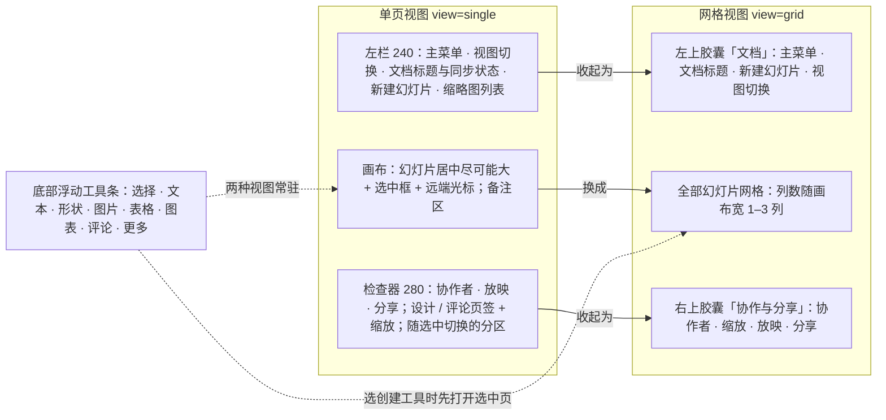
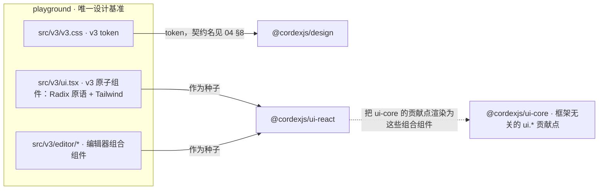
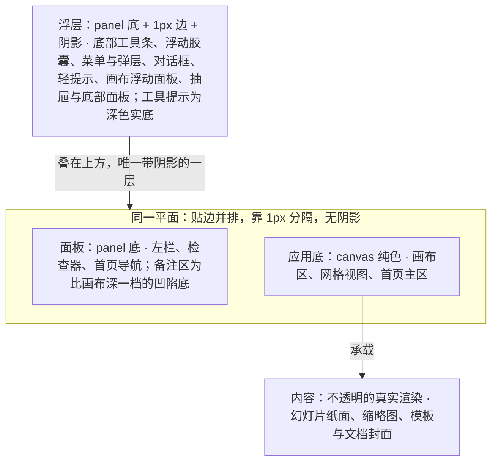

> 状态：草稿 v4.0 | 负责：设计（总编排起草） | 更新：2026-09-18；2026-09-25（补图）；2026-09-25（矛盾收口，rulings §4.18）；2026-09-30（§4.22：§6.2 材质 token 由两档改为三档，新增浮层档 `--glass-bg-float` / `glass-float`（亮 84%、暗 96%）；§3「画布覆盖层」迷你工具条改 `glass-float`、画在屏幕坐标覆盖层，补 `CanvasFloat` 画布浮签 12px；§6.1 层次图、§6.3 应用方式同步；§6.5 补浮层档核算并注明 SR-2 待用户确认）；2026-10-04（design-language-v3 第 0 批：改写为 v3 中性平面规范（rulings §4.25 DS-1…DS-8）——§0 原则改为 v3 组件规则（S-01…S-13），§1 基础改为 v3 token 摘要，§2 组件规则按 `src/v3/ui.tsx` 重写，§3 改为编辑器结构（左栏、画布、底部工具条、检查器、网格视图与浮动胶囊、主菜单、画布覆盖层）并补 §3.1 命令去处与旧入口去向、§3.2 视图切换、§3.3 反馈分层，§4 模板 T-01 编辑器壳与 T-07 首页按样张改写、T-02…T-06 保留功能口径并注明随第 N 批定稿，§5 遵循方式补设计质量门 Q1–Q10（80-process/01 §4）与迁移三批，§6 材质与层次改为平面层次；shadcn Rhea + Liquid Glass 内容删除并标注被取代）；2026-10-04（design-language-v3 第 0 批：术语残留清理：ribbon / 状态栏 / `ui.ribbon` / `ui.statusBar` 的历史陈述改用 check-terms 认可的标记措辞（废弃、取代、作废）；§3.1 旧入口去向表首列去掉 Ribbon 字样）；2026-10-04（design-language-v3 第 0 批：复验修正——§3.1 旧入口去向、§3.3 反馈分层、§4 T-01 / T-02 / T-07 的未定项不再另给批次，改为引用 03-screens/02 §2.4、§6.2、§7.1（评审与只读浏览、模式切换、账户入口与返回首页、「?」与「⋯」各项随第 1 批，横幅通道与错误态随第 1 批）；§2 缩放读数按样张改为实测口径、品牌方标三种中性色、同步状态与头像折叠改指 03-02、「未覆盖」与画布覆盖层注明第 1 批 kit 已起草；S-06 与 §5 第 5 条改为「唯一的实心强调色主操作按钮（当前工具按下态不计）」，状态色文字口径改指 04 §2.5；§3 视图状态改为「只有一份，样张为 URL 参数 view」；§5 第 1 条补场景状态参数；原「状态胶囊」改称文件名旁的同步状态行（rulings §4.25 DS-6），带作废标记的历史陈述统一措辞）；2026-10-04（design-language-v3 第 0 批：复验第 2 轮修正——§3 主菜单行按样张改为「返回首页 ┊ 文件 · 编辑 · 视图 · 插入 · 排列 ┊ 帮助」完整条目（第 0 批拍板 / 第 1 批起草分开标注），删去「顶层项为占位」；§2 缩放读数行与 §3.1 快捷键说明改为样张命令清单（适应窗口 ⌘0、100% ⌘1，已与 ED-16 一致），删去 ⇧1；§3.1 旧入口去向表的模式、导出与保真报告、「?」、返回首页注明样张已起草的落位，T-07 同步；§2 同步状态行与 §3 网格视图行补网格胶囊里同步状态的紧凑形态；§3 底部工具条补「全部形状 72 ›」；§2 菜单行改为 `V3Menu` 与 kit `Menu` 两种实现；S-10 补 3 / 2 / 1px 例外，§1.3 11px 与 12px 的读数分工、§1.4 `transition-shadow` 例外按代码改正）；2026-10-05（design-language-v3 第 0 批修正：按 rulings §4.25 写入外壳类裁决——§3 检查器行与 §3.1 格式行注明文字格式只在检查器、画布覆盖层行删去选中迷你工具条（DS-13）；检查器分区说明补空内容占位符不设「插入到占位符」按钮组（DS-14）与评审、只读角色下只读展示当前值（DS-15）；检查器与网格右上胶囊的头像组里自己的头像打开账户菜单，主菜单另有「插件…」，旧入口去向表的插件、账户头像、返回首页、「?」与新增「◐主题」行同步（DS-18）；文档菜单删「移动到…」、「更多」与 §3.1 创建行删「组件」（DS-19）；§2 颜色块与 §3 无选中态「背景」「页面颜色」合并为「背景」（DS-20）；T-07 首页左栏删「设置」，「待裁决」改为已裁决（DS-10）；T-01 紧凑与仅查看形态随第 1 批出样张（DS-17））；2026-10-05（design-language-v3 第 0 批修正：§1.4 图标规则补菜单触发器不带工具提示——工具条「更多」、主菜单、文档菜单、缩放读数与自己的头像，与样张 `IconButton` 的 `noTip`、50/10 §4 一致；§5 第 6 条与图后说明注明全量迁移后 v3 token 并入 `src/index.css`、旧 token 随旧路由删除，与 80-process/02 §2 的取值归属一致）；2026-10-05（design-language-v3 第 0 批修正：快捷键值按 rulings §4.25 DS-11、DS-16 同步——§3 检查器行「放映」提示由 ⌘↵ 改为 F5；§3.1 快捷键说明改为定稿口径（命令面板 `Mod+K`、超链接 `Mod+Shift+K`、工具单键 V / T / S / C 已登记 ED-16、替换 ⇧⌘H / Ctrl+H）；T-07 首页搜索框 ⌘K 改为开始页作用域的聚焦搜索）；2026-10-05（design-language-v3 第 0 批修正：按 rulings §4.25 DS-9 改写——§1.1 token 摘要去掉复述的取值（唯一来源 `src/v3/v3.css`，04 §2.2–§2.5 解释），补控件边界 `border-control` / `seg-on-line` 与 `accent-solid` 两行，删去「见 04 §2.6 待复核」；§2 主操作按钮改为 `accent-solid` 底白字，分段控件补 1px `seg-on-line` 内描边，字段补静止 1px `border-control` 内描边与 `text-2` 标签；§3 画布尺寸标签改用 `accent-solid`；S-06 状态色文字的可放表面按 04 §2.5 改为 canvas / panel / panel-2；§3.1 快捷键面板入口补账户菜单「键盘快捷键」（PRD AS-06），删去「账户菜单是否同列」；T-07 左栏「帮助」注明打开 AS-04 的帮助菜单、帮助中心只是其中一项）；2026-10-07（design-language-v3 第 0 批修正收尾：§3.1 账户菜单条目改为引用 AS-06）；2026-10-07（design-language-v3 第 1 批：按已拍板的第 1 批样张回写（rulings §4.25 DS-13、DS-17、DS-21…DS-26）——S-06 补画布上的选中框、手柄、参考线与焦点环统一用强调色（DS-24），S-12 补迷你工具条全部取消（DS-13、DS-22）、「编辑数据」只在检查器（DS-26）与母版视图唯一的常驻退出入口（DS-21）；§1.4 焦点环与动效按第 1 批；§2 补触控 44 档、背景快捷色块与颜色选择弹层、缩放菜单的比例输入框（03-20）、菜单两种实现的分工，「未覆盖」行改为指向 04 §4.1a；§3 主菜单顶层定稿（含「插件…」的位置）、左栏「新建幻灯片 ▾」改为版式画廊、工具条去掉「选择」的 ▾ 并补图片 / 表格 / 图表弹层与评审条（DS-23）、检查器补图表数据面板临时替换检查器栏（DS-26）与面板可拖、画布覆盖层改为只承载浮签、手柄、选区标签、尺寸角标与参考线（rulings §4.22 SF-01 已修订）；检查器选中态表补「放映」节（DS-25）、「位置与大小」合为一节与第 1 批其余选中类型；§3.1 命令去处补表格、图表（DS-22），旧入口去向按 DS-21 结案母版视图入口；§3.3 反馈分层写入横幅、轻提示、字段错误与检查器说明行的定稿形态；新增 §3.4 浮层与菜单规范；§4 T-01 补紧凑与仅查看形态、评审条与浏览条，T-02 母版视图入口与横幅退出（DS-21）；§5 第 1 条补第 1 批场景路由；§6 图 2 与规则补第 1 批浮层（对话框、轻提示、画布浮动面板、抽屉与底部面板）与横幅、抽屉的层次口径）；2026-10-07（design-language-v3 第 1 批 · 第二步：按 rulings §4.25 DS-27…DS-30、TB 技术口径与第一步上报的跨线影响回写——§2 母版缩略图窗格补 03-26 §7 的定稿尺寸（版式行缩进 18、缩略图宽 92）；§3 图 1「怎么读」与 §3.2 视图状态按 TB-30 写明参考应用同步到地址栏参数 `view`、嵌入场景由宿主决定；检查器拖宽 240–480（TB-25）；母版视图「帮助」多「关于母版继承」（TB-15）；画布覆盖层补表格的单元格编辑环、选区与 M3 插入手柄、拖动柄；检查器选中态补对齐行两个分布按钮（TB-20）、图表的 M2 只读口径（TB-13）、连接符起点 / 终点下拉（TB-21）；§3.1 快捷键补删除线 / 上标 / 下标与粘贴为纯文本（DS-29）、「超链接…」改名「链接…」（TB-6），旧入口去向的「视图」页签行写全缩放、网格与参考线与缩略图侧栏开关（03-20 §1），「幻灯片大小」改为入口尚未定并删去失效的 03-02 §7.1 指向，账户菜单条目按 DS-18 补注；§3.3 母版视图里横幅可两条（TB-14）、轻提示层级并引用 03-19 §4.3；§3.4 画布浮动面板、抽屉与底部面板的层级，横幅例外，右键顺序补形状的「链接…」「操作设置…」「更改形状 ▸」（TB-18），同一原因的说明行含缩略图右键（TB-22）；§4 T-01 仅查看形态的评论 M3 起可发表与回复（DS-28），T-02 缩到 < 640 退出母版视图（TB-16）、横幅例外、「帮助」新增项与占位符类型（DS-30）；§5 第 1 条 `_kit` 即产品 `/styleguide` 的样张（TB-3）；§6 抽屉、底部面板与轻提示的层级（TB-2））；2026-10-08（design-language-v3 第 1 批收口：按 rulings §4.25 DS-28、DS-31…DS-33、TB-1 括注的更正与 TB-29…TB-52 回写——§3 底部工具条注明「选择」由 slide-ui 贡献、评审条与浏览条的固定项由外壳渲染（TB-1、TB-38），主菜单「帮助」的壳意图 `help-center` 与开发者面板（TB-39、TB-40）、「文件 › 幻灯片大小…」（DS-31）；检查器选中态：无选中的「主题」补内置主题 5 套与每个主题 3 个变体（DS-33、DS-32），形状补快速样式（DS-31）、图片填充与内阴影为 P2（TB-43）、不透明度同时写填充与描边 alpha（TB-47）、「替代文本」节（TB-32），母版的占位符勾选项为「文本」（TB-34）；§3.1 补 `ui.toolbar` 槽位与插件对象命令的去处（TB-29）、插件条目多时的暂行收纳（TB-31），旧入口去向的「幻灯片大小」改为主菜单「文件 › 幻灯片大小…」（DS-31，原「v3 入口尚未定」作废）并补快速样式的去处；§3.3 确认对话框补会波及其他页的可撤销操作（§4.20 FE-05、DS-32）；§3.4 弹层补快速样式库，对话框例改为「插入链接」并补重置页（TB-6、DS-32），评审模式下缩略图右键的说明行（TB-51）；§4 T-01 手机与平板的评论分开（DS-28、TB-49），T-02 母版视图入口按完整形态判定（TB-44）；§5 第 1 条 `/styleguide` 只在测试环境挂出（TB-50））；2026-10-08（design-language-v3 第 1 批评审修改：按 rulings §4.25 DS-34…DS-37、TB-55、TB-56 回写控件画法与快速样式——S-06 强调色补按下的开关（DS-36）；S-10 分段选中块贴边后为 4（TB-55）；§1.1 分隔线与控件边界两行改写、新增控件语义一行（DS-35）；§2 次要按钮改为透明底加细边（DS-37），图标按钮按下、分段控件、多选切换条、文本 / 数值输入、颜色行、下拉选择、检查器页签与网格幻灯片项按安静样式改写；§3 检查器形状行与 §3.4 弹层例的快速样式改为样式库在节内原位展开、缩略去衬底（DS-34、TB-56）；§5 第 5 条审查清单补控件画法）；2026-10-15（design-language-v3 第 2 批：按已拍板的第 2 批样张与 rulings §4.25 DS-38…DS-63 回写——S-12 入口唯一补第 2 批（新评论只有评论工具、保真报告只有主菜单「文件」、恢复只在预览横幅、插件整页面板从插件分区「展开」，DS-38、DS-45、DS-51），S-13 列表加载改为「转圈 + 一句文字」、不画骨架行（DS-53）；§2 补开关、列表折叠行、加载行与面板整块状态、「分享」按钮的待处理圆点、缩略图警示角标，下拉补列表行内变体，头像组、同步状态与评论计数角标按第 2 批改写（DS-42、DS-48、DS-51、DS-53、DS-61、DS-62）；§3 检查器补整栏面板（DS-38），底部工具条补评论工具发表后保持按下（DS-44）与「更多」的插件收纳（DS-49），画布覆盖层补评论钉的选中、悬停卡、聚合钉与浮动撰写框，「评论」页签一行按第 2 批评论面板改写（DS-43、DS-45、DS-62）；§3.1 插件条目很多时的收纳定稿（DS-49）；§3.3 反馈分层重写：阻断页补访问被撤销与查看人数已满（DS-50、DS-60），横幅的叠放、着色与不可关闭（DS-39、DS-41、DS-58），二次确认分三档——非模态确认卡、行内确认、模态确认框（DS-40），轻提示与页级提示条的着色与播报（DS-41、DS-51），第 2 批定稿的形态；§3.4 补整栏面板、非模态确认卡、行内确认、留言弹层与浮动撰写框的选用，菜单条目规范补选值下拉与插件分组（DS-49）；§4 T-01 补整栏面板、版本预览、访问撤销阻断页与仅查看形态的评论（DS-38、DS-39、DS-46、DS-50）；§5 第 1 条补第 2 批场景、第 5 条审查清单补第 2 批的检查项、第 8 条补第 2 批拍板与推迟到第 3 批的项（备选状态保留并标「未采纳」，DS-63）；§6 规则补整栏面板与第 2 批浮层的层次；同日再补，按回写中的裁决 rulings §4.25 DS-64 与技术口径 TB-59…TB-61、TB-67——S-12 插件整页面板的「展开」由宿主按分区条目的 `expandPanel` 画出（TB-59）；S-13 注明 DS-53 只覆盖第 2 批画面，管理员插件清单与开始页随第 3 批统一（TB-67）；§3 检查器一行与 §3.4 选用表的整栏面板宽度改为沿用检查器宽度（缺省 280）与 max(400, 检查器当前宽度)、分隔条可否拖动（TB-60），检查器页签只由内置包贡献（TB-59）；§3.4 菜单条目规范第 2 条补评论钉菜单由 slide-ui 直接渲染、不开放贡献（TB-61）与降级对象在评审、只读浏览与降权下照常出菜单（DS-64）；§4 T-01 宽度同步；§5 第 8 条推迟到第 3 批的项补 TB-67 三项；同日再补，按 rulings §4.25 TB-80——§3.3 着色与播报的横幅一条补样张未画的三条文档状态横幅（「发现新版本」、换纪元后的两条、「文档已达元素上限，只读打开」）的底色、图标与能否关闭随第 3 批横幅样张与横幅高度一起拍板，§5 第 8 条推迟到第 3 批的项补这一项）；2026-10-22（design-language-v3 第 3 批：按已拍板的第 3 批样张与 rulings §4.25 DS-71…DS-136、TB-101…TB-129 回写——S-10 圆形补序号角标；S-12 入口唯一补第 3 批（左栏即筛选、空态不放按钮、被拒横幅只陈述事实、帮助菜单只列已配置项、阅读顺序的两处入口、模板库不放新建与导入，DS-79、DS-88、DS-89、DS-96、DS-116、TB-110）；S-13 加载行覆盖到开始页、文档列表与管理清单（DS-86）；§1.4 动效补放映控制条与跟随条；§2 主操作按钮的不可用与进行中（DS-123、TB-122）、次按钮在画布底上一律 outline（TB-128）、视图切换改分段（DS-133）、头像组的跟随按钮与序号角标（DS-106、DS-132、TB-123）、备注区凹陷底（DS-134、DS-135）、模板卡与文档卡（DS-81、DS-83、DS-85、TB-107、TB-108），共享件一行补第 3 批；§3 左栏的视图切换与文件名（DS-82、DS-133）、画布的跟随外框（DS-106）、检查器的放映提示与跟随按钮（TB-103、DS-106）、主菜单的嵌入出口、「文件 › 导出…」与「帮助 › 帮助中心」（DS-78、DS-89、DS-104、DS-105、DS-112）；§3.1 旧入口去向的主题、快捷键面板与账户菜单（DS-90、DS-91、DS-115）；§3.3 阻断页补回收站、找不到文档、链接已失效、导入失败与登录、错误页（DS-71、DS-85、DS-97、DS-118、DS-122），横幅补高度、应用壳页面的位置、三条文档状态横幅与 status / alert 的分工（DS-75、DS-92、DS-126…DS-128、TB-119），二次确认补永久删除文档、退出登录与管理页确认卡（DS-85、TB-120、TB-122），轻提示补导出完成（DS-100）；§3.4 浮层与菜单补模态抽屉、偏好设置、快捷键面板、命令面板与搜索框下拉，菜单条目规范补外链条目（DS-80、DS-89、DS-93、DS-94、DS-113、DS-115、DS-117）；§4 T-01 补紧凑、平板、嵌入与跟随（DS-106、DS-112、DS-130、DS-131、TB-125），T-03 文档列表、T-04 只读查看器、T-05 放映、T-06 设置按样张定稿（T-06 改为居中对话框，DS-113），T-07 首页补齐第 3 批，新增 T-08 阻断页与登录、错误页（DS-71、DS-97、DS-118）；§5 第 1 条补第 3 批场景与宿主，第 5 条审查清单补第 3 批，第 8 条推迟到第 3 批的项逐条结案；§6 规则补第 3 批浮层）；2026-10-22（同日再补，按回写中的裁决 rulings §4.25 DS-137 与技术口径 TB-131、TB-132、TB-134、TB-136…TB-138、TB-144、TB-145、TB-151——§2「分享」按钮 M2 不可用（DS-137）；§3 左栏的文档菜单降权三项不可用（TB-138），主菜单「返回首页」按 `navigate-back`（TB-145）、「关于母版继承」与帮助中心同一规则（TB-132）；§3.4 外链条目补命令面板与母版视图（TB-132），个人资料对话框（TB-137）；§4 T-02 触控设备上的原因写「在电脑上编辑」（TB-136），T-03 网格 / 列表共用一份本机偏好（TB-131）、「我的文档」「与我共享」按内容更新时间倒序（TB-144）、M2 的「分享…」不可用（DS-137），T-04 搜索与缩略图条、备注同为缺省关的宿主选项，T-05「全屏」只在允许全屏时出现（TB-134）、单页渲染失败的页级占位（TB-151），T-07 网格 / 列表同 T-03（TB-131）、「更多模板 →」M3 起、帮助与账户菜单改指 03-29 §2.4、§2.5）；2026-10-22（同日再补，按回写中的技术口径 rulings §4.25 TB-153…TB-156、TB-159…TB-161——§2「分享」按钮 M2 的工具提示「分享 · 后续版本提供」与不渲染的条件（TB-161）；§3「?」去处一行与 §3.4 画布浮动面板一行补快捷键面板的手机形态、触控形态不写「⌘/」（TB-154）；§3.3 阻断页补「恢复」失败的内联错误（TB-155）与 M2「申请访问」不可用（TB-156），§3.4 留言弹层 M3 起（TB-156）；§4 T-01、T-02 嵌入又是触控设备时以「在电脑上编辑」为准（TB-159），T-03 回收站卡片「恢复」失败的轻提示（TB-155），T-07 顶部提示按宽度与触控分两句（TB-153）、集成方模板源随 PD-23 定（TB-160），T-08 补「恢复」失败与 M2「申请访问」（TB-155、TB-156）；2026-10-22 复核修正：§1.1 面板一行与 §6 图 2 删去「备注区」（DS-134 后备注区是凹陷底 `--v3-notes-fill`）；§3 左栏文档菜单降权一句补 DS-139；§3.1 幻灯片大小一行的「样张状态待补」改为已补（与 04 待决事项一致）；§3.3 与 T-08 补阻断页说明句不变（TB-156）；T-01、T-02 写明「触控设备」只指平板（TB-163）；T-07 补平板的左栏与列数按窗口宽度（TB-165）；§5 第 7 条迁移期间的「入口随第 N 批定稿」写法改为三批都已拍板；§2 文档卡一行、T-03 与 T-07 补卡片第二行缺最近编辑者或还没有快照时的写法（TB-171）；§3.3 原写「仅查看形态（< 640）里横幅放在最顶上、按钮换到文案下方」，按 TB-172 改为手机与平板的横幅都在最顶上、按钮只在一行放不下时才换行；T-07 补平板保留「最近」的切换与排序、搜索框随左栏不写 ⌘K（TB-170）；T-03、T-07 补列表形态的编辑者与时间两列、搜索下拉与结果页的每一行同第二行写法，T-07 补开始页「最近编辑」排序与第二行取同一时间（TB-171）；§3.3 补统一高 40 指非触控形态、触控形态的按钮与 × 照常 44 而横幅随之撑高（TB-172）；§3.3 补一行放得下时上下内边距仍是 5、共高 55，应用壳页面的横幅在触控形态同此（TB-172））；2026-10-23（design-language-v3 第 3 批评审修改：按 rulings §4.25 DS-140…DS-143、TB-179…TB-182 回写——S-05 与 §1.4 图标只为文件类型图标开例外（Tabler，DS-143、TB-182）；§1.4 圆角：对话框由 8 改为 12（DS-142），补导入落区 4、主区拖入落区 8；§2 次要按钮的 outline 例子去掉导入失败页，第 1 批共享件一行补评审修改并入的件与对话框标题行（DS-140、DS-142）；§3.3 反馈分层里导入失败不再是阻断页（DS-140 取代 DS-97）；§3.4 新增导入对话框一行（宽 560、固定高 406，TB-179、TB-181）；T-08 阻断页的用途去掉导入页与导入过渡页（DS-140 取代 DS-97、DS-98）；§1.1 颜色表「边框就是控件本身」一行补导入落区的例外（DS-141、TB-180，与 04 §2.2 一致））；2026-11-04（design-language-v3 母版视图改版：S-12 补母版视图的常驻入口与出口；S-13 取消母版视图加载的豁免；检查器分区表「母版视图」一行改为面板标题只写类型、节序同普通视图；原入口去向表「视图」页签一行补检查器两个入口与上下文条，原状态栏去向表的母版范围改为上下文条；交互层级里的模式横幅改称上下文条；T-02 补检查器两个上下文入口、上下文条、窗格选中即编辑对象与占位符标注、「占位符 ▾」第 2 位；rulings §4.25 DS-144…DS-177；需求编号、优先级与里程碑不变） | 依赖：charter v0.2（D10 修订）、04-design-system v1.0、rulings §4.25 DS-1…DS-8、DS-10、DS-13…DS-15、DS-17…DS-64、TB-1…TB-3、TB-6、TB-13…TB-16、TB-18、TB-20…TB-22、TB-25、TB-29…TB-32、TB-34、TB-38…TB-40、TB-43、TB-44、TB-47、TB-49…TB-51、TB-55、TB-56、TB-59…TB-61、TB-66、TB-67、TB-80、DS-71…DS-137、DS-139…DS-143、TB-101…TB-163、TB-165、TB-170…TB-172、TB-179…TB-182、DS-144…DS-177、§4.20 FE-05、§4.22 D-10、SF-01（已被 DS-13、DS-22 修订）、§4.9–§4.10（Q9–Q20）、80-process/01 §4；样张 `playground/src/v3/`

# 09 设计规范（Design Specification）—— v3 中性平面

> v4.0（2026-10-04）：编辑器废弃 ribbon，改 Figma 式结构（DS-1）——底部浮动工具条只管创建，右侧检查器只管当前选中对象的属性，其余命令进主菜单、右键、命令面板与快捷键；视觉改中性平面（DS-2）；视图切换入口在左栏顶部与网格左上胶囊（DS-3）；网格视图收起两侧面板为两个浮动胶囊（DS-4）；状态栏废弃（DS-6）。本规范只定义：组件规则、编辑器结构、页面模板、层次与遵循方式；token 取值见 04 §2。唯一可执行基准是 `docs/20-design/playground/src/v3/`（样张路由 `#/v3/editor`、`#/v3/home`）。
>
> **被取代**：v2.0（2026-09-15，shadcn Nova）与 v3.0–v3.1（2026-09-16 起，shadcn Rhea + Liquid Glass 材质层、悬浮玻璃卡、Office ribbon、状态胶囊，rulings §4.8、设计 11）的组件映射、组合模式、模板尺寸与材质规则全部作废（rulings §4.25 DS-1、DS-2）；旧版路由在全量迁移前保留作对比（DS-7），全文见 git 历史（本文 v3.1）。仍有效的功能口径（母版视图可用范围、查看器可选条、设置的关闭语义等）已摘入 §4。

---

## 0. 原则

| 编号 | 规则 |
|---|---|
| S-01 | **复用 Radix 行为**：hover / active / focus / disabled / aria 状态由 Radix 原语提供，稿件与实现不重写；视觉一律走 v3 token（04 §2）。样张在 `src/v3/ui.tsx` 自写一层薄封装（菜单直接用 Radix DropdownMenu，工具提示复用 shadcn Tooltip）；产品是否继续以 shadcn 复制件为种子（ADR-0017）由前端线随实现定（第 1 批样张没有改变这一点：kit 件仍是 Radix 原语上的薄封装，`src/v3/kit/`） |
| S-02 | **只在组合层做定制**：左栏、缩略图列表、创建工具条、检查器分区、网格视图、浮动胶囊、画布覆盖层是原子组件的组合，不是新组件库 |
| S-03 | **主题即契约**：组件只读语义 token，不读裸色值；契约名见 04 §8 |
| S-04 | **Tailwind 工具类，不写组件 CSS**：只允许 token 文件里的变量与少量作用域规则；不写 `style={{}}`；画布内文档内容（位置/尺寸/字号/颜色）是数据，样张以容器单位 `cqw` 渲染 |
| S-05 | **单一风格**：Lucide 线性图标（16 / 20px、描边 1.5）、Geist 字体（CJK 回退系统字体）、单档紧凑尺寸；不混用第二套图标、字体或风格。唯一的例外是文件类型图标（2026-10-23，rulings §4.25 DS-143、TB-182）：导出格式行、导入上传行与「导出本地副本」的 .pptx 一行取 Tabler Icons 的 `file-type-*` 原件（插件格式用通用 `file` 字形），20px、同样按 1.5 描边、`currentColor`，只作装饰；规则见 04 §2.14 |
| S-06 | **强调色只给主操作、当前工具、选中**（当前页、选中对象、聚焦字段）**与按下的开关**（B / I / U / S、上下标、翻转、查找的 Aa 与 ab 按下时的强调色淡底 `--v3-toggle-on`，rulings §4.25 DS-36，04 §2.2；原只列前三类）；画布上的选中框、手柄、智能参考线与焦点环统一用强调色，不同标记靠线型、手柄形状与数值角标区分，不再另设第二种彩色（rulings §4.25 DS-24，画法见 04 §2.3a）；一屏只有一个实心强调色**主操作**按钮（编辑器「分享」、首页「新建演示文稿」；工具条当前工具的强调色底是按下态，不计）；品牌方标用中性色；状态色文字可放在 `canvas` / `panel` / `panel-2` 上，各自浅底上只放状态色图标（04 §2.5，DS-9 后的规则） |
| S-07 | playground 与 03-screens 冲突时以 playground 为准并回写文档；新增界面先在 `registry.ts` 登记；界面改动先过设计质量门（§5） |
| S-08 | **平面**：无渐变背景、光晕、毛玻璃（`backdrop-filter`）；只有浮层带阴影（底部工具条、浮动胶囊、菜单、弹层、对话框、轻提示、画布浮动面板，以及盖在画布上的抽屉与底部面板，04 §2.10）；内容层（纸面、缩略图、模板封面）不透明 |
| S-09 | **面板贴边、1px 分隔**：左栏与检查器贴应用边缘、靠 1px `--v3-border` 与画布分开；节与节之间 1px 分隔线；不悬浮、不加外边距卡片、不卡片套卡片（v3 反转了 v3.0 的「层次靠留白与材质，不靠线」） |
| S-10 | **无药丸**：按钮、分段、输入框、页签都不用 `rounded-full`；圆角只用 4 / 6 / 8 / 12 四档（分段选中块贴边后与槽同为 4，rulings §4.25 TB-55；例外见 04 §2.9：切换条与动作条的按下项、色块与表格网格格子 3，备注把手、底部面板把手、版式缩略、滑块槽与进度条 2，选中手柄 1；圆形只给头像与评论钉、色点、单选圈、旋转手柄与线条端点、连接点、滑块圆钮与视频播放钮，以及第 3 批头像上的序号角标，DS-132） |
| S-11 | **中文 ≥ 12px**：含中文的文本最小 12px，11px 只给纯数字与西文（04 §2.8） |
| S-12 | **入口唯一**：同一操作在常驻界面上只有一个入口——创建只在工具条，格式只在检查器，视图切换每种视图一个常驻入口；主菜单、右键、快捷键、命令面板不算重复（Q2）。第 1 批据此定稿：画布上不设任何迷你工具条（文字 DS-13，表格、图表 DS-22）；图表「编辑数据」只在检查器「数据」分区（DS-26）；母版视图的常驻退出入口只有上下文条（母版视图的模式横幅）的「关闭母版视图」（DS-21、DS-145），普通视图里的常驻进入入口只有检查器「版式」节的「编辑版式」（2026-11-02，DS-147），母版视图里「编辑母版」的常驻入口只有窗格的母版行（DS-146）；隐藏幻灯片的常驻入口是无选中时检查器「放映」节，缩略图右键是第二入口（DS-25）。第 2 批（2026-10-15）：新评论的常驻入口只有工具条「评论」（点对象落元素锚点、点空白处落页级锚点），右键 / ⇧F10 的「添加评论」是不常驻的第二入口，面板里不常驻撰写框（DS-45）；保真报告的常驻入口只有主菜单「文件 › 保真报告」，不设常驻角标（DS-51）；版本历史的常驻入口是文档菜单「版本历史」，「恢复此版本」只在预览横幅上、列表行上不重复；个人插件面板的常驻入口是主菜单「插件…」，插件整页面板从它在检查器里的插件分区「展开」（DS-38；这个按钮由宿主按分区条目的 `expandPanel` 画出，插件不另放入口，命令打开走 Operation `ui.openPanel{id}`，rulings §4.25 TB-59）；个人插件面板里「去管理 › 插件」整个对话框只留一个。选中缺插件元素时横幅与检查器对象说明里各有一个「查看详情」、去处相同，两处都留：横幅不能为选中而收起，检查器的入口只在选中时出现（DS-52）。第 3 批（2026-10-22）：文档列表的筛选就是左栏导航，列表页不设页内筛选条（DS-79）；开始页与文档列表的空态只留引导句、不放「新建」按钮——顶栏与模板行已有（DS-88）；管理页的被拒横幅只陈述事实、不放「只看被拒插件」，筛选就在下方（DS-96）；帮助菜单只列配置了链接的条目（DS-89）；阅读顺序的常驻入口是偏好设置「无障碍」组，命令面板是第二入口、检查器不设（DS-116）；模板库不放「导入」「新建」、网格不含「空白」，新建空白与导入在上一层的开始页（TB-110）；快捷键面板的三个入口（主菜单「帮助」、账户菜单、`Mod+/`）打开同一个面板（rulings §4.10 D12） |
| S-13 | **真实内容**：缩略图、网格、模板与最近文档都是真实渲染的幻灯片（同一组件按容器缩放），不用骨架条。加载也不画骨架行：列表与面板的加载统一为「转圈 + 一句文字」（`LoadingRow`），面板整块出错统一为居中的整块状态（`PanelState`，rulings §4.25 DS-53，04 §4.1c）——2026-10-22 起同样覆盖开始页、文档列表与管理员插件清单（rulings §4.25 DS-86；原推迟依据 TB-67，README D15 结案）：超过 300 ms 才出现，翻页时在列表末尾追加一行加载行；没有封面的新文档画白纸面 + 居中图标，也不是骨架；第 1 批打开文档时的版式骨架（真实的母版装饰与虚线占位框）维持已拍板画法；母版视图的加载 2026-11-03 起同为「转圈 + 一句文字」，失败为整块状态 + 次按钮「重试」（rulings §4.25 DS-154；原「母版视图加载时的窗格占位块维持已拍板画法」作废） |

---

## 1. 基础（token 摘要，取值以 04 §2 与 `src/v3/v3.css` 为准）

### 1.1 颜色

取值只在 `src/v3/v3.css`（设计 04 §2.2–§2.5 逐项解释），本表只列角色与用法，不复述数值（80-process/02 §2）。

| 角色 | token | 用法 |
|---|---|---|
| 应用底 | `--v3-canvas` | 编辑器画布区、网格视图、首页主区 |
| 面板、浮层底 | `--v3-panel` | 左栏、检查器、首页导航；工具条、浮动胶囊、菜单、弹层（备注区 2026-10-22 起改为比画布深一档的凹陷底 `--v3-notes-fill`，rulings §4.25 DS-134，§2「备注区」行） |
| 面板上的二级表面、悬停 | `--v3-panel-2` / `--v3-panel-3` | 输入底、分段与切换条的槽、悬停底（下拉、次按钮、菜单项）、按下的图标按钮与选中页签的底；`panel-3` 只给 `panel-2` 之上的悬停与滑块、进度条的轨道（下拉与次按钮静止时透明，rulings §4.25 DS-35、DS-37；原「字段与下拉底、次要按钮底」作废） |
| 分隔线与边框 | `--v3-border` | 分区（面板贴边线、节分隔、浮层描边）；下拉、次按钮、分段选中块与输入悬停的细边与它同档（DS-35） |
| 「边框就是控件本身」的图形 | `--v3-border-control` | 复选框、单选圈、滑块圆钮、插入表格网格未选格、自己头像的外圈、把手、滚动条与虚线落区（≥ 3:1）；字段、下拉、分段选中块与按下态不再用它（DS-35 修订 DS-9，原为它们的 1px 内描边）；导入的落区例外：导入对话框的落区静止时用与分隔线同档的 `--v3-border`，拖入悬停与开始页、文档列表主区的拖入落区同为强调色虚线加 `--v3-accent-soft` 淡底（2026-10-23，rulings §4.25 DS-141、TB-180，04 §2.2） |
| 控件语义 | `--v3-field-*`、`--v3-select-*`、`--v3-seg-*`、`--v3-toggle-on`、`--v3-on-*`、`--v3-btn-*` 等 | 输入、下拉、分段、开关、按下态与次按钮各自的底、线与不可用取值（安静样式，DS-35…DS-37；取值与对照见 04 §2.2「控件语义 token」） |
| 文字三级 | `--v3-text` / `-2` / `-3` | 主文字 / 一切承载可读信息的次要文字 / 只给占位符与不可用项（DS-9） |
| 强调色（品牌蓝，DS-2） | `--v3-accent`、`--v3-accent-solid` | 线、环与只放图标的强调色底；带文字的强调色实底（主操作按钮、尺寸标签，DS-9）；按下的开关用它调出的淡底 `--v3-toggle-on`（DS-36） |
| 浮层阴影 | `--v3-shadow` | 只给浮层（S-03） |

同屏的有彩色只有强调色、幻灯片内容、协作者身份色与对应状态出现时的状态色（Q3）；对比度的配对、基线与使用规则见 04 §2.6（rulings §4.25 DS-9 已调整取值，原待复核 1–5 已在该节结案；2026-10-08 起字段、下拉、分段与按钮的边界按 DS-35 不再要求 3:1，靠底色、标签与当前值识别，状态另有字重与图标描边线索）。

### 1.2 幻灯片内容与纸面

纸面白色、圆角 4px；单页画布上暗色不加阴影、亮色只加极轻的边与影（`--v3-slide-shadow`）。幻灯片内容的颜色是文档数据（样张为 `.v3-slide` 下的 `--s-*`），不随界面主题与强调色变化；白纸面上叠的界面文字用 `.v3-paper` 取亮色文字 token（04 §2.2a）。

### 1.3 字体与字阶

字族 `'Geist Variable'` → `-apple-system, BlinkMacSystemFont, 'Segoe UI'` → `'PingFang SC', 'Microsoft YaHei'`；数字 `tabular-nums`。字阶四档：11px 只给纯数字与西文（左栏页码与评论计数、尺寸标签、单字母标签、快捷键提示；缩放读数、网格页码与网格评论计数用 12px）· 12px 界面默认（根字号 12 / 行高 18）· 13px 600 面板标题与文档标题 · 16px 600 首页页面标题。层级靠字重与 `text` / `text-2`，不靠更多字号。

### 1.4 间距、圆角、阴影、图标、动效

- **间距**：4pt 阶；面板内左右 16、检查器节上下 12、节内行距 8、控件组内 4（04 §2.7）。
- **圆角**：4（字段、菜单项、24px 按钮、纸面、小标记与提示签、导入对话框里的虚线落区）/ 6（28px 按钮、页签、封面、工具提示）/ 8（36px 工具条按钮、菜单面板、弹层、轻提示、画布浮动面板、备注区、主区拖入落区）/ 12（工具条、浮动胶囊、画布提示条、底部面板的上沿、对话框）（04 §2.9；对话框 2026-10-23 由 8 改为 12，rulings §4.25 DS-142）。
- **阴影**：只有浮层带 `--v3-shadow`，且同时带 1px 边；面板、卡片、字段、按钮无阴影（04 §2.10）。
- **焦点环**：2px 强调色、偏移 1px，与画布上的选中框、参考线同一种颜色（DS-24）；字段为 1px 强调色内描边；纸面上的界面件（占位符图标条）用界面当前的强调色、偏移 2px；网格视图幻灯片（含仅查看形态的幻灯片列表）例外为 2px 中性色 `--v3-text`、偏移 4px；不可用项仍可聚焦、照常画焦点环（04 §2.11a）。
- **图标**：Lucide，通用 16px、工具条 20px，描边 1.5；文件类型图标是唯一的例外家族（Tabler，20px，S-05、04 §2.14，DS-143）；主操作"文字"（「分享」），工具与次操作纯图标 + 工具提示；菜单触发器不带工具提示（工具条「更多」、主菜单、文档菜单、缩放读数与自己的头像，读屏名取按钮的 `aria-label` 或可见文字；`ui.tsx` `IconButton` 的 `noTip`，「更多」只在不可用时以提示说明原因）；仅图标按钮必须 `aria-label`（04 §2.14）。
- **动效**：组件只用颜色过渡（150ms）；第 1 批的例外只有描边与外圈过渡（`transition-shadow`）、折叠 ▾ 的旋转、表格插入手柄的透明度与加载转圈（`motion-safe` 下才转）；菜单、弹层、对话框、抽屉、底部面板与视图切换不加进出、位移或缩放动画（工具提示沿用 shadcn 自带的淡入与轻微缩放）；第 3 批：放映控制条与跟随条在鼠标静止 3 秒后 200ms 淡出（DS-106、DS-107）；`prefers-reduced-motion` 全局 1ms（04 §2.12）。

---

## 2. 组件规则（Cordex 元素 → v3 原子组件，`src/v3/ui.tsx`）

| Cordex 元素 | v3 实现 | 规格 | 备注 |
|---|---|---|---|
| 主操作按钮 | `Button variant="primary"` | 28px、圆角 6、12px 500、`accent-solid` 底白字（带文字的强调色实底，DS-9），悬停 `accent-solid-hover`；不可用与进行中保持 kit 的不可用态（`panel-2` 底 + `text-3`，进行中加转圈、宽度不变），画布底上同样如此（rulings §4.25 DS-123，未采用「画布底一律 outline 不可用态」）；页面级主按钮（登录页）桌面定宽 240，触控 44 高、占满列宽（TB-122） | 一屏一个 |
| 次要按钮 | `Button` `secondary`：透明底 + 1px 与分隔线同档的细边，悬停与打开铺 `panel-2`，不可用时细边降为 `panel-2`（rulings §4.25 DS-37：对话框、横幅、左栏与检查器里的次按钮全局如此；原「面板上，`panel-2` 底」作废）/ `outline`（画布底上，`panel` 底 + 1px 边） | 同上尺寸 | 「取消」、横幅「查看详情」、左栏「新建幻灯片 ▾」与「+」用 secondary；画布底上的次按钮一律 outline（rulings §4.25 TB-128）：开始页与文档列表顶栏的「导入 .pptx」、各页的「重试」、回收站卡片的「恢复」、模板库、阻断页（打开中、打开失败、登录页的「注册」、错误页）与上传失败占位；导入失败 2026-10-23 起在导入对话框里，「重试」是正文里的 secondary（rulings §4.25 DS-140）；主按钮仍是强调色实底 |
| 幽灵按钮 / 链接式按钮 | `Button variant="ghost"`；或无底文字按钮 + 图标（「更多模板 →」） | `text-2`，悬停 `panel-2` 底或转 `text` | — |
| 图标按钮 | `IconButton` 24 / 28 / 36，触控 44（仅查看形态，图标 20） | ghost / on（只铺 `panel-2`、不描边，按下的图标描边 2，与悬停区分，rulings §4.25 DS-35）/ accent；自己的弹层开着时为按下态 | 必须 `aria-label`，自带工具提示，开关类 `aria-pressed`；不可用时 `aria-disabled`、仍可聚焦，提示「名称 · 原因」 |
| 视图切换 | `ViewToggle`：「单页」`RectangleHorizontal`、「网格」`LayoutGrid`，`role="group" aria-label="视图"`，两项各是 `aria-pressed` 按钮 | 2026-10-22 改为分段控件同一画法（rulings §4.25 DS-133）：28 高的槽铺 `panel-2`、不描边，选中块面板色 + 细边、贴边、圆角 4，两项各 28 × 28；左栏顶部与网格左上胶囊同一个件（左栏顶行由 52 宽变为 56）；原两枚 24 / 28 图标按钮与 on 态作废 | 读写同一 URL 参数 `view`（§3.2）；按钮、读屏名、工具提示与焦点交接不变 |
| 分段控件 | `Segmented` | 槽只铺 `panel-2`、不描边，28px；选中块用面板色加细边、贴边撑满槽高（槽内边距与项间距 0，TB-55），选中项字重 500、图标描边 2（DS-35，非颜色线索；原「选中块 `seg-on` 24px + 1px `seg-on-line` 内描边」（DS-9）作废）；选项为图标或短文字，各带工具提示 | 2–4 项互斥；不是胶囊 |
| 多选切换条 | `ToggleStrip` | 与分段同一槽，但保留 2px 内边距与间距（TB-55）；每项独立 `aria-pressed`，按下项为强调色淡底（`--v3-toggle-on`）、不描边、图标描边 2（DS-36） | B / I / U / S、上下标、翻转；查找面板的 Aa、ab 同一按下画法 |
| 文本 / 数值输入 | `Field` | 28px、`FIELD_FRAME`（只铺 `panel-2` 淡底、不描边，DS-35；原「`panel-2` 底 + 1px `border-control` 内描边」（DS-9）作废）、框内左侧 `text-2` 短标签、数值 `tabular-nums`；悬停出一道与分隔线同档的细边、底色不变，聚焦时这条线换成强调色，校验错误换成 `danger`，不可用时底再降一档 | 单位写进值（`0°`、`100%`）；标签不替代 `aria-label`；可以为空的字段不另加框内标识（TB-57） |
| 颜色行 | `ColorRow`（检查器） | 一个 28px 输入字段（同 `FIELD_FRAME`）：色块 + 十六进制 + 1px 面板色的通高切口 + 不透明度（DS-35） | 两个输入各有 `aria-label` |
| 颜色块 | `Swatch` / `ColorChip` | 16px、圆角 3、1px 内描边，出现在颜色行与背景颜色下拉；「背景」节的常用主题色快捷项为 24px、圆角 4、间距 8，选中 2px 强调色外圈（隔 2px 面板底），各带工具提示「名称 色值」（`BackgroundControl`；原「页面颜色」色块按钮随两节合并取消，rulings §4.25 DS-20） | 颜色选择弹层：`Popover` 锚在颜色行的色块上、贴检查器左缘向左展开，内容为 `SwatchPicker`（主题颜色、标准色、最近使用；文字颜色为主题色 10 × 6 明暗变体，03-screens/16）+ 自定义色值（`ColorField`），04 §4.1a |
| 下拉选择 | `SelectTrigger` / `MenuField`（`SELECT_FRAME`） | 28px，透明底 + 1px 与分隔线同档的细边，悬停与打开铺 `panel-2`，不可用时细边降为 `panel-2`（DS-35）；右侧 ▾；可带前导缩略（版式缩略 32×18、色块 16、列表图标）；字体、列表样式、切换、文本颜色触发器与主题卡同一画法 | 弹出单选菜单；与输入一眼分开：输入淡底无框，下拉透明底细边。列表行内变体（第 2 批）：列表里每行都有下拉时（分享成员行的角色「可编辑 ⌄」）平时无框无底、右对齐，悬停、键盘聚焦与展开时才铺 `panel-2`（04 §4.1） |
| 检查器页签 | `role="tablist"` 下的按钮组 | 28px、圆角 6、12px；选中只铺 `panel-2`、不描边，`text`、字重 500；未选透明底，`text-2`、字重 400（DS-35：字重是选中的非颜色线索） | 只此一套：不用下划线页签，不用胶囊分段 |
| 菜单 / 子菜单 | 都基于 Radix DropdownMenu、共用 `MENU_CONTENT` / `MENU_ITEM` 样式：`V3Menu`（`ui.tsx`，平铺条目）与 kit `Menu` / `MenuItems`（`kit/Menu.tsx`，子菜单、勾选与单选、分组小标题、常驻说明行、不可用原因） | 04 §4.1；子菜单第一项与父项对齐（`alignOffset −5`）；条目规范见 §3.4 | `V3Menu`：文档菜单、下拉字段、首页排序、母版视图「新建版式 ▾」；kit `Menu`：主菜单、缩放、账户菜单、工具条「图片 ▾」与「更多」、右键菜单（`ContextMenu`） |
| 工具提示 | `Tip` | 深色实底 `#111111`、12px 白字、快捷键 11px | 键盘聚焦立即出现，程序转交焦点且最近操作是鼠标时不弹 |
| 协作者头像组 | `Collaborators`：3 个 24px `Avatar` 叠放（间距 −6px），描边取所在表面色；身份色 12 色按用户哈希取色、同一场里撞色顺延（rulings §4.25 DS-42，04 §2.4） | 在线人数并入头像组（DS-6） | 人数多时的折叠与「+N」见 03-screens/02 §3.5；他人的头像是「跟随 〈姓名〉」按钮（`aria-pressed`），跟随中外圈 2px 换成对方身份色（DS-106）；同色第 13 位起挂序号角标——头像组里在头像下沿中线、在线列表里在右下（24 配 14、20 配 12，DS-132，04 §2.4）；头像一律身份色首字（TB-123） |
| 缩放读数 | `ZoomMenu`：读数 ▾，28px，右对齐展开 | 单页与网格同一口径：读数是量出来的实际比例（幻灯片显示宽 ÷ 1280，1600 × 1000 视口单页约 77%），菜单只放命令、不带选中态（03-20 定稿）：顶部比例输入框（28px、`FIELD_FRAME`，10–400，↵ 确认）┊ 放大 `⌘+` / 缩小 `⌘−` ┊ 适应窗口 `⌘0` / 适应宽度 ┊ 50% / 75% / 100% `⌘1` / 150% / 200%；命令部分与主菜单「视图 › 缩放」同一份；放大超过适应窗口时画布出现原生滚动条，滚轮或空格 + 拖动平移（03-screens/02 §3.5） | `aria-label` 含可见读数（「缩放 77%」，WCAG 2.5.3）；底座的 `ZoomMenu` 还没有比例输入框，迁移时按 03-20 补 |
| 品牌方标 | `LogoMark` 20px，三种中性色填充：底 `--v3-text`、内框 `--v3-panel`、两条横线 `--v3-text` 与 `--v3-text-2`（04 §2.14） | 编辑器主菜单触发器（方标 + ▾）、首页品牌行（方标 + 「Cordex」13px 600） | 不用强调色 |
| 同步状态 | 12px `text-2` + 12px 图标（对勾、转圈等） | 左栏文档标题下方；网格视图中缺省「已同步」不显示，非缺省状态以紧凑形态跟在左上胶囊的文件名后（03-screens/02 §5.1） | 常态不着色（DS-6）；还带着待同步计数的（离线、登录已过期、协同已暂停、未保存到服务器）用警告色图标，转为只读、文档已不存在与「服务器保存延迟」用中性图标（rulings §4.25 DS-61，04 §2.5）；嵌入式单人保存的本地保存、保存失败按 03-19；各态文案见 03-screens/02 §3.1 |
| 评论计数角标 | 圆角 4、`panel` 底 + 1px 边、`text-2` + `MessageSquare` | 左栏缩略图 16px 高 / 11px；网格 20px 高 / 12px | 叠在缩略图右上；数的是未解决的评论，工具提示「N 条未解决 · 另有 M 条已解决」，读屏名带计数（「第 4 页，2 条未解决评论，另有 1 条已解决」，rulings §4.25 DS-62） |
| 缩略图警示角标 | 与评论计数角标同一尺寸，按这一页最严重一条的级别着色：以占位显示为警告浅底 + 警告色三角，整页无法解析为危险浅底 + 危险色 `FileWarning` | 与评论角标并排时警示在左、评论在右 | 读屏名「N 处内容以占位显示」「N 处内容无法解析」（DS-51，04 §2.5） |
| 「分享」按钮 | `Button variant="primary"`（检查器顶行与网格右上胶囊同一个）；有待处理的访问申请时右上角 8px 强调色圆点 + 2px 面板色外圈 | 同主操作按钮 | 圆点 `aria-hidden`，读屏名与工具提示「分享（N 个待处理的访问申请）」；只有所有者看到；文档已被删除时不可用（DS-48、DS-62，04 §4.1c）；分享在 M3 开放，M2 留在原位、不可用（`aria-disabled`、仍可聚焦），工具提示「分享 · 后续版本提供」、读屏名「分享（后续版本提供）」（rulings §4.25 DS-137、TB-161，FE-06）；宿主既没给分享回调、也没标「后续版本提供」时不渲染（TB-161） |
| 开关 | `Switch`：轨道 28 × 16，关为槽色淡底 + 细边，开为强调色底 + 白色圆钮 | — | 只用于个人插件面板的个人启停（DS-56）；检查器里的开关类属性仍用复选 |
| 列表折叠行 | `FoldRow`：高 32、12px ▸ 在文字前（展开转 90°）、12px `text-2`，整行一个按钮 | 箭头左缘与列表正文对齐（16） | 评论「已解决 N」、版本历史的月份行、自动版本组行与「最近删除」共用（04 §4.1c）；与检查器的可折叠分区不是同一个件 |
| 加载行、面板整块状态 | `LoadingRow`：转圈 14 + 一句文字；`PanelState`：图标 20 · 标题 13px 600 · 说明 · 次按钮「重试」，居中 | 列表里左对齐行高 32，整块居中 | 列表与面板的加载、出错只有这一种画法，不画骨架行（DS-53、S-13） |
| 备注区 | 120px 高、圆角 8，凹陷底 `--v3-notes-fill`（暗 `#151515` / 亮 `#EBEBEB`，比画布深一档）、静止不描边、悬停出与分隔线同档的细边；占位「添加演讲者备注…」暗色 `text-3`、亮色 `text-2`（rulings §4.25 DS-134，04 §2.2、§2.6；原 `panel` 底 + 1px 边作废） | 上方把手 40 × 4、圆角 2，取值不变（`--v3-handle`，DS-135） | 开关在主菜单「视图」（§3.2） |
| 缩略图项（左栏） | 原生 `<button>`：页码列 20px（11px tabular）+ 缩略图（圆角 4、1px 边） | 当前页：整行 `accent-soft` 底，缩略图强调色描边（1px 边 + 0.5px ring），页码转 `text`；悬停 `panel-2` 底；隐藏页的页码加斜线、下方斜线眼睛图标、缩略图 60% 不透明（DS-25） | `aria-current`、`aria-label="第 N 页"`（隐藏页另读「已隐藏，放映时跳过」）；右键与 ⇧F10 打开缩略图菜单 |
| 网格幻灯片项 | 原生 `<button>`：页码（12px，当前页强调色）+ 幻灯片框（圆角 4） | 静止 1px `border`、悬停 1px `--v3-hover-line`（`text-3` 与分隔线各半，DS-35；原悬停 `text-3`）、当前页 2px 强调色；键盘焦点框例外（04 §2.11a） | 单击选中，双击或 Enter 打开 |
| 母版缩略图窗格 | 功能口径见 T-02（母版大缩略图 + 缩进的版式小缩略图，同款卡片，非文字树） | v3 画法已定稿（rulings §4.25 DS-21，03-screens/26 §3、§7）：按左栏缩略图项的规则延伸，窗格在左栏原位、`role="listbox"`（「母版与版式」）；母版行为整宽缩略图，版式行左缩进 18 + 1px 连接线、缩略图宽 92（16:9）；选中项为整行 `accent-soft` 底 + 缩略图强调色描边（同左栏）；其余尺寸与各状态以 03-26 §7 为准 | 原 `ring-2 ring-primary ring-offset-2` 与 `rounded-xl` 卡作废 |
| 模板卡 / 文档卡（首页、文档列表、回收站、模板库） | 封面圆角 6 + 1px 边；标题与元信息在封面下方 | 模板悬停描边变强调色、名称转 `text`；文档卡悬停整卡 `card-hover` 底、封面右上出现「⋯」；标题 13px 500、元信息 12px `text-2`（第二行「编辑者 · 相对时间」；缺最近编辑者时只写相对时间，还没有快照时按创建时间写、不写编辑者，不拿所有者顶替，rulings §4.25 TB-171）；共享头像：我拥有的共享文档叠 2 位协作者，别人共享给我的是一枚所有者头像（DS-83）；回收站卡片封面 60%、常驻「恢复」（DS-85） | 封面全部真实渲染（S-13），没有封面的新文档画白纸面 + 居中图标；文档卡片是链接、整组漫游、「⋯」菜单开始页与文档列表同一份（rulings §4.25 DS-81、TB-107、TB-108，04 §4.1d） |
| 大幅面幻灯片内容 | `SlideArt`（样张；示例文稿 6 页）/ `CoverArt`（首页封面） | 16:9 容器，内部尺寸全部 `cqw` | 画布、缩略图、网格、封面同一组件 |
| 第 1 批共享件 | 弹层、右键菜单、对话框（含确认框）、画布浮动面板与提示条、轻提示、横幅、占位符图标条、表格网格、检查器控件（数值 / 文本字段、颜色字段与色块选择、滑块、复选、单选、进度、折叠分区、说明行、空态、小标记、只读行）、纸面作用域、分隔条、画布标记件 | 外观与行为契约见 04 §4.1a、§4.1b（rulings §4.25 DS-21 拍板） | 浮层与菜单的选用规则见 §3.4；第 2 批共享件（列表折叠行、加载行、面板整块状态、开关、整栏面板、降级对象的纸面占位、「分享」按钮的待处理圆点、页级提示条）见 04 §4.1c（DS-38…DS-62）；第 3 批共享件（应用壳外壳、文档卡片、阻断页、模态抽屉、搜索框下拉、跟随条、序号角标、命令面板、放映控制条，以及 2026-10-23 评审修改并入的导入对话框底座、模态底部面板、主区拖入落区与文件类型图标）见 04 §4.1d（DS-71…DS-136、DS-140…DS-143）；对话框与模态抽屉的标题行 2026-10-23 按 Figma 统一为 40、× 用正文色、对话框圆角 12（DS-142，04 §4.1a）；检查器里的开关类属性仍一律用复选（04 §4.1） |

---

## 3. 编辑器结构

**图 1 编辑器结构：单页视图与网格视图**

怎么读：两个分组是同一编辑器的两种视图，只有一份视图状态（样张里即 URL 参数 `view`；参考应用把它同步到地址栏查询参数 `view`，嵌入场景由宿主决定，rulings §4.25 TB-30，§3.2）；实线表示切到网格时左栏与检查器收起为两个浮动胶囊、画布换成全部幻灯片的网格；虚线表示底部工具条在两种视图都在，网格里选创建工具会先打开选中页、回到单页再放置。
依据：rulings §4.25 DS-1、DS-3、DS-4；样张 `src/v3/Editor.tsx`、`editor/GridView.tsx`。

| 区域 | 组成 | 尺寸 | 规则 |
|---|---|---|---|
| 左栏（单页） | 顶行：主菜单（方标 ▾）+ 视图切换（分段，rulings §4.25 DS-133）；文档标题 ▾（13px 600，文档菜单随权限：能编辑 = 重命名 · 创建副本 ┊ 版本历史，编辑中被降权时三项都留在原位不可用、写「需要编辑权限」，rulings §4.25 TB-138（「创建副本」一项按 DS-139）；评审者与查看者没有文档菜单，文件名只显示、不是菜单触发器，DS-82；样张原有的「移动到…」按 DS-19 删除）；同步状态；「新建幻灯片 ▾」打开版式画廊（贴左栏右缘展开、按母版分组的真实版式卡片，默认高亮「与当前页相同」，与检查器「版式」同一组件，03-14）+「+」（按当前页的版式新建，⌘M）；缩略图列表 `<nav aria-label="幻灯片">`，右键或 ⇧F10 打开缩略图菜单 | 宽 240（可拖 160–420，04 §2.13）；顶部内边距左右 16、上 12；缩略图行间 4 | 贴左边，右侧 1px 分隔（兼作分隔条）；列表独立纵向滚动；评审模式与只读角色不提供新建 |
| 画布（单页） | 幻灯片居中、尽可能大：宽 = min(可用宽, 可用高 × 16/9)（容器查询，不靠 JS 测量）；选中框、手柄、尺寸角标与参考线等画在画布覆盖层（本表末行，画法见 04 §2.3a）；远端光标与名签；点空白处取消选择；放大超过适应窗口时出现原生滚动条，滚轮或空格 + 拖动平移 | 四周留白左右 ≥ 48、上 40、下 24；画布区底部留 72 给工具条 | 暗色纸面无阴影、亮色极轻阴影；无缩放胶囊（缩放读数在检查器页签行）；横幅在画布列顶部占文档流（§3.3）；跟随某位协作者时画布列四周 2px 对方身份色外框、顶部居中跟随条（rulings §4.25 DS-106，05 §4） |
| 备注区 | 「添加演讲者备注…」文本区（凹陷底，DS-134）+ 上方把手 | 高 120（可拖 64–320，把手兼作分隔条）、左右与画布同为 48 | 主菜单「视图 › 备注」开关；网格视图不显示 |
| 底部工具条 | 选择（指针，快捷键提示 V；原 ▾ 已去掉：没有第二种选择类工具）· 文本（T）· 形状（S，点开 4 × 3 形状弹层：矩形、圆角矩形、圆、三角形、菱形、星形、十字、六边形、左右箭头、对话气泡、直线、箭头线；底部「全部形状 72 ›」一行在原位换成完整形状库，03-15）· 图片（▾ 菜单：此设备… / 来自 URL… / 屏幕截图与相册 M4+，03-04）· 表格（8 行 × 10 列网格弹层 +「插入表格…」，03-30）· 图表（类型菜单：五类 + 子类型，03-31）· 评论（C）· 更多（页眉和页脚、日期和时间、幻灯片编号、符号、公式 M4+ ┊ 图标、视频 P2、音频 P2 ┊ 链接…（对话框「插入链接」，rulings §4.25 TB-6）┊ 插件按钮，03-04；样张原列的「组件」按 DS-19 删除） | 36px 按钮、20px 图标；内边距 4、间距 4、圆角 12；距画布底 16、水平居中；弹层在按钮上方、离工具条外沿 8 | 只管创建（DS-1），主行条目固定；当前工具强调色底白图标；弹层开着时按钮按下，选定、Esc 或点外部后关闭并回到「选择」（选了形状则「形状」保持按下、进入插入工具态，画布顶部出提示条）；「评论」是「用后回到选择」的例外：点选后在落点旁出浮动撰写框，发表或取消后工具仍按下、可以接着落下一条，没有撰写框时按 Esc 或 V 回到「选择」；编辑文字时对选中文字发起评论不进入评论工具（rulings §4.25 DS-44，03-screens/06）；「更多」里插件不超过 3 个、每个不超过 3 条时每个插件一组平铺，否则为「插件 · N」小标题、每个插件一行、条目进子菜单（DS-49）；不可用的工具留在原位写原因；评审模式下整条换成评审条、查看者换成浏览条（DS-23，§4 T-01）；「选择」是 slide-ui 贡献的内置条目，评审条与浏览条的固定项（「浏览」「评审模式」「返回编辑」「只读浏览中」）由外壳渲染，`reviewBar` 槽位只放评论、高亮与上一处 / 下一处等条目（rulings §4.25 TB-1、TB-38）；`role="toolbar" aria-label="创建工具"` |
| 检查器（单页） | 顶部协作行：头像组（自己的头像打开账户菜单，DS-18；他人的头像是「跟随」按钮，DS-106）· 放映（`Play`，从当前页放映，工具提示「从当前页放映 ⇧F5」，rulings §4.25 TB-103；从头放映仍是 F5 与命令面板，PRD ED-16；样张原写的 ⌘↵ 作废，DS-11）· 分享；页签行：设计 / 评论 + 缩放读数；内容随选中切换（下表） | 宽 280（可拖 240–480，PRD ED-12、rulings §4.25 TB-25，04 §2.13）；协作行 48、页签行 44、面板标题 40；图表数据面板展开时整栏宽 max(400, 检查器当前宽度)（TB-60） | 贴右边，左侧 1px 分隔；属性区只放当前选中对象的属性（对齐行属于选中对象的排布），创建在工具条、其余命令进菜单；文字格式只在这里，画布上不设任何迷你工具条（DS-13、DS-22）；评审模式、只读角色与降权时只读展示当前值、不显示禁用控件，顶部一行说明权限（DS-15）；评审模式下默认打开「评论」页签（DS-23）；图表「编辑数据」点「展开」后检查器栏临时换成完整数据网格，标题行有「收起到检查器」与「关闭」，画布相应收窄、图表始终可见（DS-26）；整栏面板（rulings §4.25 DS-38、TB-60，04 §2.13、§4.1c）：版本历史、保真报告沿用检查器宽度（缺省 280）、不加宽，开着时分隔条照常可拖；插件整页面板与图表数据面板宽 max(400, 检查器当前宽度)，开着时分隔条不可拖、关闭后回到原宽；协作行不动、页签行换成面板标题行，开着时点评论钉先收起面板再切到「评论」；检查器页签只由内置包贡献（当前只有「评论」），第三方插件只能以整栏面板出现（TB-59）；放映与分享在顶部协作行，「分享」有待处理的访问申请时带强调色圆点（DS-48）；非所有者点「分享」打开只读的「谁能访问…」（03-screens/08）；「分享」M3 起可用，M2 留在原位不可用、写「后续版本提供」（DS-137，§2） |
| 网格视图 | 左上「文档」胶囊：主菜单 · 文档标题 ▾ · 竖分隔 · +新建幻灯片 · 视图切换；右上「协作与分享」胶囊：头像组（自己的头像同样打开账户菜单，DS-18）· 缩放读数 · 竖分隔 · 放映 · 分享；全部幻灯片网格；底部工具条照常 | 胶囊高 48、圆角 12、距画布上 / 左 / 右 12；网格最宽 1440、列距 32、行距 40，上内边距 88、下 112（同值设为 `scroll-padding`） | 左栏与检查器不渲染（DS-4）；胶囊是浮层，带阴影；同步状态缺省不显示，非缺省状态以紧凑形态跟在文件名后（03-screens/02 §5.1，第 1 批定稿）；横幅在网格里同样占文档流，两个胶囊与网格整体下移 |
| 主菜单 | 方标 ▾ → 返回首页（嵌入时不渲染、连同其后的分隔线，宿主在 `cordex:init` 的 `intents` 里声明了 `navigate-back` 时才出现，rulings §4.25 DS-112、TB-145）┊ 文件 ▸ · 编辑 ▸ · 视图 ▸ · 插入 ▸ · 排列 ▸ ┊ 插件…（打开个人插件面板，DS-18）┊ 帮助 ▸。「文件 › 导出…」⇧⌘E（DS-78；⌘E 是居中对齐），没有编辑权限时留在原位不可用——查看者「只有查看权限」，评审者与编辑中被降权的「需要编辑权限」（DS-105）；不设「打印…」，需要打印时导出 PDF（DS-104）。「视图」子菜单：单页视图、网格视图（单选）┊ 备注（勾选；网格下置灰并写「网格视图下不显示」）┊ 网格与参考线 ▸ · 缩放 ▸ ┊ 母版视图 ⌥⌘M（在母版视图里同一位置变成「关闭母版视图」）┊ 模式：编辑 / 评审（查看者没有这一组）。「帮助」：命令面板… ⌘K · 键盘快捷键 ⌘/ ┊ 帮助中心（只在集成方配置了链接时出现、新标签页打开、带外链图标，没配置时不占位，DS-89）；母版视图中「帮助」多一项「关于母版继承」（PRD ML-01，rulings §4.25 TB-15），同样只在集成方配置了对应链接时出现、带外链图标（TB-132）；「帮助中心」与「关于母版继承」走壳意图 `help-center`，与其余应用级菜单项同一管线（TB-39）；开发者面板在「帮助」最后一组（分隔线之后），只在开发构建或 `features.developerMenu` 打开时出现（TB-40）。「文件」另有「幻灯片大小…」（P2，P2 前留在原位、不可用并标 P2，DS-31） | 菜单 04 §4.1 | 条目是统一的一份（`kit/mainMenu.tsx`），第 1 批全部定稿（DS-21）；文件、编辑、插入、排列各子菜单逐项见 03-screens/02 §2.3；评审、浏览与降权时，改文档的命令留在原位不可用并写原因，「插入」「排列」整组不可用（04 §4.1b） |
| 画布覆盖层 | 屏幕坐标覆盖层，承载：选中框与各种手柄（缩放、旋转、调整、线条端点、连接点、锁定）、选区标签与尺寸 / 数值角标、智能参考线、文件参考线与网格、框选与悬停框、表格的单元格编辑环与选区、M3 的悬停「+」插入手柄与分隔线拖动柄、画布浮签（键盘提示、拖入说明、一次性内联提示）与画布顶部提示条、占位符图标条、裁剪框与其出口浮条（「取消 / 完成」）、远端光标与选区、评论钉（第 2 批：选中的钉加强调色外圈，悬停或聚焦时旁边一张不可交互的小卡，过密时合并为中性底的聚合钉，导入的批注用中性钉；评论工具的临时钉与落点旁的浮动撰写框；编辑模式照常显示评论钉，只有放映与母版视图不显示，DS-43、DS-44）、同时编辑同一文本框时文本框上沿的「● 某某也在编辑此文本框」提示签与对方的插入符（DS-60）、保真报告「定位」的 2px 短暂外框（DS-51）。**不再有迷你工具条**：文字 DS-13，表格、图表 DS-22，图片与其余对象第 1 批同样没有（rulings §4.22 SF-01 已修订）；原条上的命令去处见 04 §4.2 | 按屏幕尺寸绘制、不随缩放变小（样张的手柄与标签为固定 CSS 尺寸）；只在编辑时出现，不进缩略图、放映与导出 | `render.overlay`；颜色只用强调色与中性色（远端协作者用身份色），以线型与数值角标区分标记（DS-24，04 §2.3a）；除评论钉与点选区域外不接收指针；不得用毛玻璃，浮签为 `panel` 底 + 1px 边 + 阴影的浮层 |

**检查器内容随选中切换**（DS-1）：

| 选中 | 面板标题 | 分区（自上而下） |
|---|---|---|
| 无选中 | 幻灯片 N | 版式（下拉 + 版式缩略，点开版式画廊，03-27）· 主题（主题缩略 28 + 名称与字体 + 「调整主题」；点主题卡展开主题画廊与变体，03-28：内置主题 5 套——简约 / 商务 / 暗色 / 学术 / 活力，与开始页模板同一套（rulings §4.25 DS-33），每个主题 3 个色板变体（DS-32））· 背景（先选纯色 / 渐变 / 图片，再选背景颜色；常用主题色做成 24px 色块快捷项。第 0 批样张的「页面颜色」节并入本节，DS-20）· 放映（切换：文件里带来的切换效果只读展示，字段留在原位不可用（rulings §4.10 Q15）；「放映时跳过此页」是隐藏幻灯片的常驻入口，缩略图右键「隐藏幻灯片 / 取消隐藏」为第二入口，DS-25） |
| 形状 | 矩形 | 标题上方对齐行（左 / 水平居中 / 右 / 顶 / 垂直居中 / 底 + 横向分布 · 纵向分布，两个分布按钮单选时不可用，与多选、右键同一组命令，rulings §4.25 TB-20；多选时另有「对齐参照」）· 位置与大小（X / Y ┊ W / H + 锁定比例 ┊ 旋转 + 水平 / 垂直翻转；所有对象共用一节，04 §4.1a）· 快速样式（「填充」节上方一行主题样式缩略图，点开后 42 格样式库在本节里原位展开、下方各节下移，不遮挡画布，节标题右侧有「收起样式库」；缩略去掉白衬底、外圈用色块内线；PRD ED-06 M2 P1，rulings §4.25 DS-31、DS-34、TB-56，DS-34 修订了 DS-31 的「样式库弹层」；画法见 04 §4.1a，样张 `main-states.quick-styles` 与 `quick-styles-gallery`）· 填充（无 / 纯色 / 渐变 / 图片 + 颜色行）· 描边（无 / 实线 / 虚线）· 阴影（无 / 外阴影 / 内阴影）——图片填充与内阴影为 P2，留在原位、标 P2、不可用（TB-43）· 不透明度（同时写填充与描边颜色的 alpha，一步撤销，TB-47）· 操作（单击时的动作，与右键「操作设置…」同一对话框，03-15）· 替代文本（与图片同一组件：描述框、标记为装饰性、缺失警示，承接右键「编辑替代文本…」，TB-32；样张未画） |
| 文字（编辑态） | 文本 | 字体（西文与中文字体分开、字号、字重、B / I / U / S）· 段落（左 / 居中 / 右 / 两端对齐、行距、段后）· 颜色（文字颜色、高亮）· 列表（项目符号、编号、级别）· 文本框（自动调整与缩小比例等）；五个分区以 03-screens/16 为准 |
| 图片 / 已有媒体 | 图片（单色图标为「图标」）/ 视频 | 图形填充（只对单色图标）· 图片（名称与格式，替换 / 裁剪 / 重置 / 压缩）· 不透明度 · 位置与大小 · 替代文本（≤ 250 字，可标记为装饰性）；已有视频换成视频一节。裁剪模式下检查器只留裁剪数值（键盘等价）；以 03-screens/18 为准 |
| 表格 / 单元格 | 表格 / 单元格 | 表格：位置与大小 · 表格样式 · 文本 · 替代文本；单元格：表格样式 · 单元格（填充、边框、边距与对齐）· 文本（所选单元格）· 行高与列宽；M2 时结构与样式项带 M3 标记、锁定；以 03-screens/30 为准 |
| 图表 | 图表（后附「N 类别 × M 系列」等说明） | 类型（下拉即更改类型）· 图表元素（标题、图例、数据标签）· 数据（紧凑网格只显示前 8 × 4，「展开」打开数据面板）· 位置与大小 · 替代文本 · 坐标轴与格式；非五类的只读类型只有说明、位置与大小、替代文本；M2 时五类图表的「类型」节只读并标 M3，非五类显示「此类型仅支持查看」说明卡（rulings §4.25 TB-13）；以 03-screens/31 为准 |
| 多选、组合、连接符 | N 个对象 / 组合 / 连接符 | 多选：对齐行 · 位置与大小（不一致的值显示「多个值」）· 共有分区；组合：对齐行 · 位置与大小 · 组合（包含 N 个对象、取消组合）· 不透明度；连接符：连接（起点、终点为「形状 · 连接点」下拉，即拖动端点的键盘等价，rulings §4.25 TB-21；07 §1.2a）· 线条 · 连接符类型 · 位置与大小；以 03-screens/17 为准 |
| 空内容占位符 | 占位符名 | 占位符（类型、索引、来自版式）· 位置与大小（逐项继承，本页修改可重置）；不设「插入到占位符」按钮组，插入走占位符图标条与底部工具条（DS-14）；以 03-screens/16 为准 |
| 母版视图 | 版式 / 母版 / 占位符 | 面板标题只写类型（「版式」「母版」「内容占位符」…），节序同普通视图（rulings §4.25 DS-151）——版式或母版：对象（名称、使用情况、所属母版）· 占位符（勾选显示哪些占位符；「文本」取代「正文」，与占位符类型同名，rulings §4.25 TB-34、DS-30）· 主题 · 背景；占位符：信息 · 位置与大小 · 文本样式 · 填充（覆盖项用文字标记，可重置为母版值）；以 03-screens/26 为准 |
| 「评论」页签 | — （顶部是筛选行，不另设面板标题） | 2026-10-15 按第 2 批评论面板定稿（rulings §4.25 DS-43、DS-45、DS-62，以 03-screens/06 为准）：顶部分段筛选「全部 / 当前页 / 未解决 / @我」（缺省「当前页」）+ 排序，有已脱离锚点的线程时第二行出临时筛选「已脱离锚点 N」；线程未解决在前，已解决收在末尾的折叠行「已解决 N」；每条为 20px 头像 · 作者（500）· 时间 · 正文，选中的线程铺强调色淡底；面板里不常驻撰写框，空态写「第 N 页还没有评论」并提示用工具条的「评论」（C）点选对象或空白处添加评论。第 1 批评审、只读浏览与紧凑抽屉里的评论页签随之换成这一面板 |

上表各选中类型已随第 1 批定稿（rulings §4.25 DS-21），分区的字段与状态以所注界面文档为准，本表只作索引。评审模式、只读角色与降权时，各选中态的分区都只读展示当前值：不显示禁用控件，只列属性与当前值（`StaticRow`），顶部一行说明权限（DS-15）。

### 3.1 命令的去处（DS-1、DS-5）

| 命令类 | v3 入口 | 贡献点 |
|---|---|---|
| 创建：插入文本、形状、图片、表格、图表、评论；视频、音频、符号、链接（样张原列的「组件」按 DS-19 删除）；插件的创建按钮 | 底部工具条；低频项与插件按钮进「更多」 | `ui.toolbar` |
| 格式：当前选中对象的属性（版式、主题、背景、放映、位置与大小、填充、描边、阴影、字体、段落、列表…）；插件的格式分区 | 检查器「设计」页签的对应分区；文字格式只在这里（含表格、图表里的文字），粗体、斜体等另有快捷键；画布上不设任何迷你工具条（文字 DS-13，表格、图表 DS-22）；图表「编辑数据」是「数据」分区的「展开」，「更改类型」是「类型」字段的下拉（DS-22、DS-26） | `ui.inspectorSection`（新增） |
| 其余：文件、编辑、排列、导出、版本历史、重命名、创建副本、帮助等；表格的插删行列、合并拆分与删除表格（DS-22） | 主菜单、文档菜单、右键、命令面板、快捷键 | `ui.command`、`ui.contextMenu`、`ui.shortcut` |
| 状态：同步、在线人数、插件异常、保真差异 | 文件名下方、头像组、按需横幅；通知走 `ui.notification`；保真差异为打开后一次轻提示与页级提示条（DS-51） | 内置（DS-6，`ui.statusBar` 已作废） |
| 视图：单页 / 网格、备注 | 左栏顶部 / 网格左上胶囊 + 主菜单「视图」 | 内置（§3.2） |

`ui.toolbar` 只有 `create`、`create.more`、`reviewBar` 三个槽位：对象的上下文槽位 `toolbar.<selectionKind>` 随迷你工具条一并删除，插件针对所选对象的命令走 `ui.inspectorSection`（按选中类型挂检查器分区）与 `ui.contextMenu` 的对象菜单槽位（rulings §4.25 TB-29）；工具条的「选择」是 slide-ui 贡献的内置条目（TB-38）。插件条目很多时的收纳 2026-10-15 定稿（rulings §4.25 DS-49，取代 TB-31 的暂行规则，设计 06 §2.6、§2.12）：「更多」与主菜单「插入」在插件不超过 3 个、且每个不超过 3 条时每个插件一组平铺，否则改成「插件 · N」小标题、每个插件一行、条目进子菜单；同一选中对象的检查器插件分区超过 2 个时全部默认折叠为一行，展开状态按分区记在本机。内置条目与内置分区的位置和长短不随插件数量变化。

快捷键以 PRD ED-16 为准（2026-10-05 按 rulings §4.25 DS-11、DS-16 定稿）：命令面板为 `Mod+K`（ED-30，原 `Mod+Shift+P`；DS-1、DS-5 原文的「⌘K」即命令面板），链接（命令名统一为「链接…」，TB-6）随之改为 `Mod+Shift+K`（ED-19）；样张工具提示里的单字母工具键（选择 V、文本 T、形状 S、评论 C）已登记 ED-16，其余工具不设单键，只在焦点位于画布或底部工具条、且不在文本编辑态与 IME 组合态时生效（单页里按 S 同时展开常用形状弹层，评审条只响应 V 与 C）；放映为 F5 / Shift+F5，样张原有的 ⌘↵ 作废；替换在 macOS 为 ⇧⌘H、Windows / Linux 为 Ctrl+H；缩放菜单的提示（适应窗口 ⌘0、100% ⌘1）与 ED-16 一致。文本编辑时的删除线 `Mod+Shift+X`、上标 `Mod+Shift+=`、下标 `Mod+=` 已登记 ED-16（只在文本编辑时生效：文本编辑中 `Mod+=` 执行下标，画布上仍为放大），粘贴为纯文本 `Mod+Shift+V` 为 P2、随「粘贴选项」上线（rulings §4.25 DS-29）。

**旧入口（ribbon 版，已被 DS-1 取代）的去向**（逐项去向以 03-screens/02 §7.1、§2.4、§6.2 为准，本表只作摘要；2026-10-07 按第 1 批拍板结案，DS-21…DS-26）

| 旧入口 | v3 去向 |
|---|---|
| 「开始 / 插入」页签的创建类控件 | 工具条对应工具或「更多」：文本框 → 文本，形状库 → 形状，图片 → 图片，表格 → 表格，图表 → 图表，批注 → 评论，视频 / 音频 / 符号 / 超链接 → 更多（链接命令名统一为「链接…」，rulings §4.25 TB-6） |
| 各页签的格式类控件（字体、段落、形状格式、对齐） | 检查器对应分区（字体、段落、填充、描边、阴影、对齐行）；原「绘图」组的快速样式在形状检查器「填充」节上方（DS-31），样式库在节内原位展开（DS-34）；层次与组合进主菜单「排列」与右键 |
| 「设计」页签（主题、变体、背景、幻灯片大小） | 无选中时检查器的「主题」「背景」分区；主题变体在点主题卡展开的主题画廊里（03-screens/28 §0）；幻灯片大小（P2，前端 50/18 SLD-07）在主菜单「文件 › 幻灯片大小…」，P2 前留在原位、不可用并标 P2（rulings §4.25 DS-31，条目见 03-screens/02 §2.3、03-screens/28 §0；原写「v3 入口尚未定」作废；样张 `main-states.file-menu` 已补，随第 1 批评审确认，04 待决事项「形状快速样式与幻灯片大小的入口」） |
| 「视图」页签（缩放、普通 / 母版） | 缩放读数在检查器页签行（网格视图与紧凑形态在右上胶囊），主菜单「视图 › 缩放」是同一份命令；网格与参考线进主菜单「视图 › 网格与参考线」，与画布空白处右键同一张清单；缩略图侧栏开关取消，左栏不能整栏隐藏（要更大的画布用网格视图或把左栏拖窄，03-screens/20 §1）；单页 / 网格见 §3.2；母版视图从主菜单「视图 › 母版视图」、`Mod+Alt+M` 与命令面板进入，另有检查器「版式」节的「编辑版式」（常驻）与选中占位符形状时顶行的「转到版式」（2026-11-02，DS-147，修订 DS-21「不设常驻按钮」半句），母版视图中上下文条的「关闭母版视图」是唯一的常驻退出入口（DS-21、DS-145，03-screens/02 §2.4） |
| 「切换」页签（只读展示，Q15） | 无选中时检查器「放映」节：文件里带来的切换效果只读展示，字段留在原位不可用（03-screens/02 §4.1） |
| 页签行右侧「?」（快捷键面板） | 主菜单「帮助 › 键盘快捷键」、账户菜单「键盘快捷键」（PRD AS-06，03-screens/02 §7）与 `Mod+/`（03-screens/02 §7.1）；主菜单「帮助」另列「命令面板… ⌘K」；快捷键面板是画布浮动面板（与查找和替换同一位置，开始页上浮在主区右上，rulings §4.25 DS-115）；开始页与文档列表在手机（< 640）上改为贴底的底部面板、平板（触控、≥ 640）上照常浮动，触控形态的菜单项不写「⌘/」（TB-154；编辑器的仅查看形态没有它的入口，03-24 §1.5） |
| 页签行右侧「◐主题」（亮暗切换） | 账户菜单的主题三项「浅色 / 深色 / 跟随系统」（DS-18；2026-10-22 按 DS-90 由两项改为三项，与偏好设置「外观 › 主题」同一偏好） |
| 应用栏在场头像、「分享」 | 检查器顶部协作行；网格右上胶囊 |
| 应用栏模式下拉（编辑 / 评审） | 主菜单「视图 › 模式」（编辑 / 评审单选，查看者没有这一组）；评审时评审条替换底部工具条，有编辑权限时评审条上有「返回编辑」（DS-23，03-screens/02 §6.2「模式切换」） |
| 应用栏「⋯」更多菜单 | 重命名、创建副本、版本历史进文档菜单（样张另加的「移动到…」按 DS-19 删除）；导出、保真报告进主菜单「文件」，个人插件面板进主菜单「插件…」（DS-18）（03-screens/02 §7.1） |
| 应用栏账户头像、「返回」首页 | 返回首页在主菜单（DS-18）；账户入口为检查器顶行（网格：右上胶囊）头像组里自己的头像，点开账户菜单（DS-18，03-screens/02 §7）；条目与次序以 PRD AS-06 为唯一归属，开始页、编辑器与文档列表是同一个菜单（含键盘快捷键、管理（仅平台管理员）、帮助中心，rulings §4.25 DS-18 补注），2026-10-22 第 3 批按 AS-06 定稿全部条目（DS-89…DS-91，01 §1：主题三项单选、「个人资料…」M3 起出现、「帮助中心」按配置出现） |
| 状态栏（页码、选区、母版范围、同步、在线人数；已废弃） | 同步状态在文件名下方、在线人数并入头像组、插件异常按需横幅（DS-6）；页码与选区不再常驻显示（左栏当前页高亮、检查器面板标题即选中对象名）；母版视图的对象名、继承来源与影响页数写进上下文条（母版视图的模式横幅，03-screens/26 §6.3），没有编辑范围单选（rulings §4.25 DS-145、DS-146；原「编辑范围画在画布上、幻灯片框左上方」作废） |

### 3.2 视图切换（DS-3、DS-4）

- **唯一状态源**：编辑器只有一份视图状态（DS-4）。样张里即 URL 参数 `view`（`single` 为缺省值、不写进 URL，`grid`），切换用 `replace`，不新增历史记录，其余参数原样保留；产品里由 Operation `ui.setEditorView` 与上下文键 `editorView` 承载（前端 50/09 §6.3）；参考应用 `apps/web` 把 `editorView` 同步到地址栏查询参数 `view`（缺省的单页不写，切换用 `replace`、不新增浏览历史），刷新后保持视图，嵌入场景由宿主决定是否同步（rulings §4.25 TB-30；路由表见前端 50/02 §2）。
- **三个入口读写同一状态**：单页时左栏顶部、网格时左上胶囊，各是该视图里唯一的常驻入口；主菜单「视图」子菜单为次入口（不常驻），备注开关也在那里。底部工具条只放创建工具，不放视图开关（docs-sync 设计取舍①）。
- **进入网格**：左栏与检查器不渲染，收为两个浮动胶囊——左上接替左栏顶部，右上接替检查器顶部；收起形状弹层、回到选择工具；备注不显示（菜单项置灰，单页里的开关值不变，回单页后原样恢复）。
- **回到单页**：双击或在某页上按 Enter（定位到该页）、点胶囊「单页」、主菜单「单页视图」，或在网格里选创建工具（打开选中页并带入该工具，工具提示写「在第 N 页添加…」，docs-sync 设计取舍③）。
- **键盘焦点的转移**：见 07 §2.2。

### 3.3 反馈分层（v3）

由强到弱：**阻断页**（整个工作区换成一页，不渲染残缺的左栏、检查器与工具条，只留按钮组里的出路，03-screens/02 §6.2：打开失败、没有访问权限；第 2 批补会话中访问被撤销——与「打开失败 · 没有访问权限」同一布局，「申请访问」为主操作、另有「返回文档列表」，内存里的文档与待同步更改一并清空、不提供导出，rulings §4.25 DS-50；查看人数已满——只有「返回文档列表」，写明「有名额空出时会自动打开，保持此页即可」，DS-60；第 3 批（2026-10-22）补：此文档在回收站中——所有者看到，主按钮「恢复」，DS-85，「恢复」失败时主按钮上方一行内联错误、按钮恢复可用，TB-155；「申请访问」随分享 M3 开放，M2 留在原位、不可用、写「后续版本提供」，阻断页的说明句不变，TB-156；找不到该文档——只有「返回文档列表」，DS-122；链接已失效，DS-71；导入失败不再是阻断页——2026-10-23 起由 DS-140 取代，在导入对话框里原位换成整块状态（03-screens/13）；登录页、OIDC 回调、新窗口登录回调、路由兜底、应用出错与配置错误页与阻断页同一画法，DS-71、DS-118，T-08）> **横幅**（连接、离线、权限变化、文档状态、插件异常、母版视图、版本预览等，按需出现、同一时刻一条，DS-6；模式横幅——母版视图的上下文条（TB-14、DS-145）与版本预览的预览横幅（DS-39）——常驻在上，其余横幅在它下方另占一条，最多两条；统一高 40，DS-75；开始页、文档列表、模板库与管理页的横幅在主区顶栏之下、只横跨主区，最多两条叠放，DS-92）> **二次确认**（三档，见下文，DS-40）> **轻提示**（toast，`ui.notification`：命令结果与可撤销操作，带「撤销」「重试」等动作；第 2 批另有打开后的保真差异、被提权、降权但本端没有未同步更改、命名版本达上限、软冲突，DS-51、DS-57、DS-58）> **字段内联错误** > **检查器顶部说明行**（只读、继承、离线等；登录已过期、协同已暂停期间写命令被拒时，字段留在原位不可用、顶部一行写原因，DS-58）> **画布提示条与提示签**（模式与下一步操作；保真的页级提示条，DS-51）> **文件名下方的同步状态**与头像组（常驻、常态不着色）。同一事件只用一层，同一件事也只走一条读屏通道（如申请访问已发送：页上常驻一句「已发送申请，等待文档所有者批准」，不再另出轻提示）；面板与对话框里的状态说明（离线、只读）用说明行，横幅只在横幅通道。原「状态胶囊 / 状态栏」一层随 DS-6 作废，其承担的同步与在线人数分别并入文件名旁与头像组，模式提示改由画布提示条承担。

**二次确认的三档**（2026-10-15，rulings §4.25 DS-40）：

| 档 | 用在 | 形态 | 焦点与关闭 |
|---|---|---|---|
| 非模态确认卡 | 能找回的操作：恢复版本——恢复前服务端先把当前内容存成标「恢复前」的自动版本，找回走版本历史、不靠本会话的撤销，所以不归下面第三档里「会波及其他页」的一类 | 锚在触发按钮下方、右对齐的弹层（宽 320、内边距 16，04 §4.1a Popover）：标题 13px 600 写成问句（「恢复到『提案定稿』？」）、说明 12px `text-2`（「将以这个版本的内容创建一个新版本，当前更改不会丢失。」）、有协作者正在编辑时另有一行头像与说明（不阻止操作）、右下「取消」（次按钮）与主按钮（强调色，不用危险色） | 不加遮罩、画布不被打断；Esc、点外面或「取消」关闭，焦点回触发按钮 |
| 行内确认 | 在对象上就地确认、不可撤销的操作：移除成员（入口在该成员的角色下拉末项，不设行尾 ×）、把链接收紧到「仅邀请」（同时撤销旧链接） | 在该行或该节里展开：说明（主文字色，按分句换行，写明后果，如「移除王小明？对方将立即失去访问权限」）+「取消」（次按钮）+ 危险色主按钮（「移除」「更改」），次在左、主在右；不另开模态 | 用户打开时焦点落在「取消」，确认句经组的 `aria-describedby` 一起读出；Esc 等同「取消」、不关所在的对话框；关闭后焦点回到触发它的下拉 |
| 模态确认框 | 不可撤销的销毁：彻底删除元素（版本历史「最近删除」）、删除整条讨论串（只有文档所有者能删，发起人只能删自己的评论与回复）、应用内离开或刷新会丢失未同步更改（DS-59）；第 3 批：永久删除文档（只在回收站发起，不要求输入文档名，危险主按钮「永久删除」，DS-85）、退出登录时有未同步更改（先尝试同步、仍有才弹，导出后回到编辑器、不自动退出，TB-122）、管理页有草稿时离开；管理页的两张当下确认卡（禁用被依赖的插件、首次启用第三方）同为模态 md 480、初始焦点在「取消」，但确认后只进草稿、不是销毁，主按钮用强调色、不用危险色（TB-120）；以及第 1 批「会波及其他页、要先看清后果」的操作：删除被引用的版式或母版、重置页——确认后仍可撤销，轻提示带「撤销」（rulings §4.20 FE-05、§4.25 DS-32，各选项不变） | kit `Dialog` 的确认框（宽 360、无分隔线与 ×，04 §4.1a）：标题写成问句并点名对象，说明写后果（「删除此讨论串？将同时删除 N 条回复，删除后无法恢复。」）；销毁性操作的主按钮为危险色实底；离开与刷新拦截左下另有「导出为本地副本」 | 模态、遮罩后不可达；初始焦点在安全项（「取消」；离开拦截为「留下」）；Esc、点遮罩、「取消」关闭，焦点回打开前的焦点元素 |

普通的删除能撤销，立即执行、不弹确认（轻提示带「撤销」）；删除自己的评论或回复先乐观隐藏、5 秒内可撤销。03-05 §6 原把「移除协作者」列为确认对话框的例子，改为行内确认（DS-40）；未采纳的备选「恢复也用模态对话框」「行尾 × 移除」留在样张里、标「未采纳」（DS-63）。

**着色与播报**（2026-10-15，rulings §4.25 DS-41、DS-51、DS-59、DS-61；取值见 04 §2.5）：

- **横幅**：阻断或需要人工处理的用对应状态色的浅底——警告浅底给离线、登录已过期、未保存到服务器（发起方），危险浅底给权限降级、登录账号已变更、隔离态（协同已暂停）、文档已被删除、有更改过大无法同步；不阻断、不丢数据的用中性底加状态色图标——缺少插件（警告色拼图）、插件启动失败（危险色图标）、「已恢复」与「已导出本地副本」（成功色对勾）；要用户回头看、但不是错误的用中性底加中性图标——离线超过 24 小时后的「已恢复」（不自动收起，DS-59）、编辑者名额已满（DS-58）。浅底上不可用或进行中的按钮文字用 `text-2`（04 §2.6）。处理前不可关闭的由四类加到六类（权限降级、访问权限已变更、隔离态、登录已过期，再加文档已被删除、有更改过大无法同步；访问权限已变更改为阻断页），导出后降级为可关闭的「已导出本地副本」（DS-58，03-12）。第 3 批（2026-10-22，rulings §4.25 DS-126…DS-128，原推迟依据 TB-80）定稿的三条文档状态横幅：「发现新版本，刷新后继续」警告浅底 + 刷新图标、不可关闭、只有「刷新」；换纪元后的「文档已替换为导入的文件 / 文档已由管理员重建」中性底 + 信息图标、可关闭、不自动消失，有未提交更改时同「有更改过大无法同步」（危险浅底、导出前不可关闭）；「文档已达元素上限，只读打开」中性底 + 锁形、可关闭、没有按钮。应用壳页面：离线横幅同编辑器（警告浅底），管理页的被拒横幅危险浅底、不可关闭，非生产警示中性底 + 警告色盾牌、不可关闭（TB-119）。播报：会话中发生的错误横幅为 `alert`；页面一打开就成立的状态横幅（管理页的被拒、非生产警示）与其余横幅为 `status`（rulings §4.25 TB-119；不阻断的插件横幅即使用危险色图标也是 `status`）。
- **轻提示**：左侧图标按语气——命令结果不带图标；中性说明用 `text-2` 图标（打开后的保真差异为 `Info`，权限变化为锁形）；结果用对应状态色（成功、错误，如命名版本达上限）；由协作者引起的提示用对方头像（「王小明移动了该形状」「李雷已将文档恢复到『提案定稿』」）。保真差异的提示不用警告色，警告色只留在缩略图角标与报告条目上（DS-51）。对话框开着时遮罩会盖住轻提示，对话框里操作的结果写在对话框底栏（个人插件面板，DS-56）。第 3 批：导出完成「已导出「X.pptx」」中性、无图标，约 5 秒收起，服务端格式多一个「下载」，对话框不设「完成」态（DS-100）；应用壳页面没有底部工具条，轻提示离主区底 24；移到回收站、从最近移除等可撤销的轻提示带「撤销」。
- **页级提示条**：画布顶部居中的浮动胶囊，中性 `Info` 图标（整页无法解析时危险色），带「查看详情」，不设 ×；每页每会话第一次进入时出现，约 5 秒淡出，悬停或聚焦时停住；报告开着时不出，选中降级对象时让位（DS-51，04 §4.1c）。
- **同步状态行**：还带着待同步计数的用警告色图标，转为只读、文档已不存在、只说明服务器状态的用中性图标（DS-61，04 §2.5）。
- **播报**：横幅、轻提示与提示条都不抢焦点；每条轻提示与页级提示条自己是一个 polite 播报区（错误为 `alert`），出现后的两帧里先把内容挡在无障碍树外、再放进来，保证念且只念一次（07 §3）。

第 1 批定稿、第 2 批沿用的形态（kit 件，外观与行为见 04 §4.1a、§4.1c）：横幅在画布列顶部、占文档流（网格视图里两个胶囊一并下移），仅查看形态（手机与平板）里横幅放在最顶上，按钮只在一行放不下时才换到文案下方独占一行，按钮与 × 照常触控高 44、横幅随之撑高，一行放得下时上下内边距仍是 5、共高 55（统一高 40 指非触控形态，应用壳页面的横幅在触控形态同此；DS-60、rulings §4.25 TB-172）；轻提示在画布列底部居中、工具条上方 12，多条自下而上叠放，层级 `--layer-toast` 在工具条之下（工具条的弹层盖住提示，04 §2.11）；可撤销操作的轻提示停留约 5 秒，「撤销」可 Tab 到达、不抢焦点（撤销与剪贴板类轻提示的文案与动作见 03-screens/19 §4.3、§5）；字段错误为 1px 危险色内描边 + 下方一行说明；检查器说明行在面板顶部。离线、插件、保真报告等具体横幅与提示的文案按第 2 批定稿，以 03-12、03-09、03-10 为准；一律遵守 S-08：实色、不加模糊。

### 3.4 浮层与菜单（第 1 批定稿，第 2 批补）

外观与行为契约见 04 §4.1、§4.1a、§4.1b、§4.1c，键盘与读屏见 07 §1.2、§2、§3；本节只定选用与摆放。依据：rulings §4.25 DS-21；第 2 批的整栏面板、对话框与确认形态按 DS-38、DS-40（2026-10-15）；样张 `_kit` 与第 1、2 批各场景。

| 需要 | 用 | 摆放 | 例 |
|---|---|---|---|
| 从一个按钮或控件就地选一个值、尺寸或对象 | 弹层（Popover） | 锚在触发处：工具条按钮上方居中、离工具条外沿 8；检查器里贴检查器左缘向左展开；左栏里贴左栏右缘向右 | 形状弹层、表格网格、颜色选择、版式画廊、字体列表、符号面板（非模态，插入后保持打开）；形状快速样式库不用弹层，在检查器「快速样式」节里原位展开（rulings §4.25 DS-34 修订 DS-31：弹层会盖住靠右的选中对象） |
| 能找回的操作的二次确认；阻断页上的补充输入 | 弹层（非模态） | 锚在触发按钮下方；不加遮罩 | 恢复版本的确认卡（§3.3）；申请访问的留言弹层（可选留言 ≤ 200 字 +「发送」，打开时就没有权限与会话中访问被撤销两处共用，03-screens/08、12；M3 起，TB-156） |
| 在画布上的某一点写一段话 | 浮动撰写框（弹层画法，宽 288） | 落点旁的临时钉边上，不盖住标题与已有的钉，放不下时换到钉的上方或另一侧；不切检查器页签 | 评论工具点选后的撰写框（rulings §4.25 DS-44，03-screens/06）；@提及候选在撰写框里弹出 |
| 一组命令，或单选 / 勾选的取值 | 菜单（kit `Menu` / `V3Menu`） | 下拉在触发器下方，工具条上的向上；子菜单向右，第一项与父项对齐 | 主菜单、文档菜单、缩放、「图片 ▾」、「更多」、账户菜单、下拉字段；分享的角色、链接权限与有效期，评论的排序；第 3 批：开始页左栏的帮助菜单与用户行的账户菜单（向上展开）、文档卡片的「⋯」菜单（锚在「⋯」下、右对齐）、放映「更多」（向上，取舞台的暗色 token） |
| 边输边看结果 | 搜索框下拉（弹层画法） | 锚在左栏搜索框下方 | 开始页与文档列表的搜索：前 5 条即时结果 +「查看全部结果」（rulings §4.25 DS-80；未采纳的备选是主区换成结果页、边输边搜） |
| 找一条命令并执行 | 命令面板 | 宽 480、水平居中、顶部锚定；不加遮罩、焦点圈定，层级盖过对话框 | `Mod+K`、主菜单「帮助 › 命令面板…」（DS-117；未采纳的备选是加遮罩） |
| 对当前对象的命令 | 右键菜单（`ContextMenu`） | 在落点向右下展开，放不下翻转；⇧F10 / 菜单键在焦点对象上打开 | 形状、文本、画布空白处、缩略图、表格、图表数据网格；第 2 批：评论钉（贴在钉的右侧、不盖住钉）、降级对象（贴在窄占位的右缘、不压住尺寸角标） |
| 对象上就地确认的不可撤销操作 | 行内确认 | 在该行或该节里展开，不另开模态 | 移除成员、把链接收紧到「仅邀请」（§3.3） |
| 先填表才能执行，或不可撤销的二次确认 | 对话框 | 居中、带遮罩，模态；内容会增减的对话框顶部锚定、只向下伸展（04 §4.1a） | 插入表格…、页眉和页脚、插入链接（命令「链接…」，rulings §4.25 TB-6）、删除被引用的版式、重置页（DS-32）；第 2 批：分享（480，顶部锚定）、导出本地副本（列出未保存的更改，DS-58）、彻底删除元素、删除讨论串、离开与刷新拦截（§3.3）；第 3 批：导出（480，顶部锚定）、模板预览（640，顶部锚定，DS-93）、个人资料（M3，480：显示名可改、邮箱与头像只读，TB-137）、永久删除文档、管理页的确认卡与变更确认（§3.3） |
| 设置类、低频、与当前选中无关、每行要放下状态与开关的列表 | 对话框（宽 640） | 居中、带遮罩；各状态固定高 720（不超过视口高 − 64） | 个人插件面板（主菜单「插件…」，DS-38；未采纳的备选是放进 400 整栏） |
| 个人偏好、条目少、改了即生效 | 对话框（宽 480） | 居中、带遮罩、顶部锚定在 max(64px, 12vh)、只向下伸展、最高到视口底留 32；手机上是贴底的底部面板 | 偏好设置（rulings §4.25 DS-113，T-06；未采纳的备选是右侧抽屉 320） |
| 选一个文件、等它处理完，结果在原处给出 | 对话框（宽 560、固定高 406） | 居中、带遮罩，叠在发起它的页面上；选文件、拖入、上传、解析与失败在框里原位换，框体不跳；手机上是贴底的底部面板 | 导入（开始页与文档列表顶栏的「导入 .pptx」、主区拖入落区，2026-10-23，rulings §4.25 DS-140、TB-179、TB-181，03-screens/13；取代 DS-97、DS-98 的整屏导入页与过渡页；未采纳的备选是只把入口换成对话框、选好文件后仍进整屏过渡页） |
| 只读的详情，看完就关 | 模态抽屉（宽 480） | 右侧贴边整高、带遮罩；打开它的那一行在遮罩后保留强调色淡底 | 管理员插件详情（DS-94；未采纳的备选是无遮罩） |
| 列表或报告，要边看边对照画布 | 检查器整栏面板（沿用检查器宽度，缺省 280） | 检查器栏原位换成面板，协作行不动；画布不跳动，开着时分隔条照常可拖（TB-60） | 版本历史、保真报告（DS-38；未采纳的备选：版本历史放左栏或加宽到 400、保真报告做成对话框） |
| 编辑或整页内容需要宽度 | 检查器整栏面板（宽 max(400, 检查器当前宽度)） | 同上，检查器栏加宽、画布相应收窄；开着时分隔条不可拖，关闭后回到原宽（TB-60） | 图表数据面板（DS-26）、插件整页面板（从插件分区「展开」或命令打开，TB-59；DS-38，未采纳的备选是作检查器第三个页签） |
| 停在画布上、边看边用的工具 | 画布浮动面板 | 画布列右上（缺省），让开横幅与工具条；层级 `--layer-panel`（04 §2.11）；同一位置同一时刻只开一个 | 查找和替换；第 3 批：快捷键面板（宽 360，开着时画布照常可点、可试键，开始页上浮在主区右上，DS-115；未采纳的备选是居中对话框；开始页与文档列表在手机上改为贴底的底部面板，TB-154） |
| 当前模式或下一步操作的提示 | 画布提示条 / 提示签 | 提示条在画布顶部居中；提示签贴着相关对象 | 插入工具态、评论工具态、数字跳页；吸附已临时关闭、按住 Shift 等比缩放；第 2 批：保真的页级提示条（04 §4.1c）、「● 王小明也在编辑此文本框」（DS-60） |
| 命令结果、可撤销操作、不阻断的问题 | 轻提示 | 画布列底部居中、工具条上方 | 已删除 2 页（撤销）、粘贴超过 25 MB；第 2 批：打开后有保真差异（查看）、已恢复到『提案定稿』、你现在可以编辑此文档、王小明移动了该形状（恢复我的值） |
| 持续存在、影响整篇文档的状态 | 横幅 | 画布列顶部、占文档流；同一时刻一条，模式横幅（母版视图 TB-14、版本预览 DS-39）之下可再有一条；应用壳页面在主区顶栏之下（DS-92） | 离线、权限已变更、缺少插件、母版视图、版本预览；第 3 批：发现新版本、换纪元、元素上限，管理页的被拒与非生产警示 |
| 窄屏下的两侧内容 | 抽屉 / 底部面板 | 紧凑形态：贴左右边的抽屉，从横幅下沿开始（DS-130）；仅查看形态：贴底的底部面板（04 §5）；层级 `--layer-panel` | 幻灯片列表、检查器、评论（手机上可发表与回复，DS-46）；第 3 批：开始页与文档列表的导航抽屉（DS-87）、紧凑形态的插件整页面板底部 Sheet（DS-130）；平板的评论面板由版面排出，竖屏贴底、横屏侧栏（DS-131） |

**菜单条目规范**（画法见 04 §4.1 Menu 行）：

1. 分组用分隔线；组内可有 12px 分组小标题（如「模式」「网格间距」「插件」）。
2. 右键菜单的顺序（逐目标见 03-screens/05 §2.2、§3）：剪贴板一组在前 → 对象自己的命令（排列、旋转、组合等；形状的「更改形状 ▸」在「旋转」之后）→ 替代文本、添加评论（形状另把「链接…」「操作设置…」「编辑替代文本…」排成一组，rulings §4.25 TB-18）→ 删除（危险色、单独一组）→ 最末是「插件」分组，条目右侧注明来源插件（设计 06 §4）。第 2 批：画布空白处右键（含 ⇧F10 菜单）在「更换版式… · 重置页…」一组之后加一组「添加评论 C」（DS-44）；评论钉为 解决 · 复制链接 ┊ 删除讨论串…（只有文档所有者能删整条，DS-40），这份菜单由 slide-ui `CommentPins` 直接渲染、不走 `ui.contextMenu`、没有插件分组，查看者没有这份菜单、在钉上右键不拦截浏览器菜单（rulings §4.25 TB-61）；降级对象按「能摆放」口径为 剪切 · 复制 · 粘贴 · 原位复制 ┊ 排列 ▸ · 组合 ┊ 编辑替代文本… · 添加评论 C ┊ 查看保真详情（缺插件元素为「查看详情」）┊ 删除，没有格式类命令与旋转（DS-52）；评审、只读浏览与降权下照常出这份菜单，编辑类命令留在原位不可用、顶部一行写原因，「复制」、有评论权限时的「添加评论」与「查看保真详情 / 查看详情」照常可用（DS-64、rulings §4.22 D-10）。
3. 快捷键提示写在右侧，按 PRD ED-16，修饰键按 macOS 顺序（⌃⌥⇧⌘）；撤销 / 重做带步骤名（「撤销：移动形状」）。
4. 不可用项不隐藏：留在原位、可聚焦，右侧写原因（「剪贴板为空」「需选中 2 个以上对象」「需要编辑权限」「后续版本提供」「需在 PowerPoint 中修改」「插件不可用时不能修改」）；一组共用一个原因时，在面板顶部放一行常驻说明（评审模式的右键；缩略图右键在只读与降权时同此，rulings §4.25 TB-22；评审模式下缩略图右键的说明行写「评审模式下不可用」，与主菜单同一口径，TB-51），里程碑未到的项另挂 M3 / P2 / M4+ 小标记。
5. 同一份条目只定义一次、多处复用：主菜单「视图 › 网格与参考线」与画布空白处右键是同一张清单；缩放读数的菜单与主菜单「视图 › 缩放」是同一份命令；缩略图右键在左栏与网格是同一份；主菜单「插入」与工具条同序、同快捷键；保真占位与缺插件元素的右键是同一份。
6. 插件条目（2026-10-15，rulings §4.25 DS-49）：「更多」与主菜单「插入」里插件不超过 3 个、且每个不超过 3 条时，每个插件一组平铺（分组标题「〈插件名〉 · 第三方」）；否则改成「插件 · N」小标题，每个插件一行「〈插件名〉 ▸」（行首插件图标），条目进子菜单、子菜单顶部仍是归属标题。内置条目的位置与长短不随插件数量变化。
7. 选值的下拉（分享的角色、链接权限与有效期，评论的排序）选了即收起；勾选与切换类菜单（账户菜单的主题三项，DS-90）选了不收。
8. 外链条目（2026-10-22，rulings §4.25 DS-89）：右侧 12px 外链图标、新标签页打开，读屏名带「在新标签页打开」；只在集成方配置了链接时出现，没配置时不出现、也不占位（帮助菜单的指南条目、账户菜单与编辑器主菜单的「帮助中心」，以及命令面板的「帮助中心」与母版视图「帮助 › 关于母版继承」，TB-132）；「键盘快捷键 ⌘/」不是外链，始终在。

---

## 4. 页面模板

| 模板 | 结构 |
|---|---|
| T-01 编辑器壳 | 根 `flex h-dvh`，底色 `--v3-canvas`：「跳至画布」跳转链接（页面第一个可聚焦元素，聚焦时才出现）· 左栏 240 · 主区（横幅 + 画布 + 备注 + 底部工具条）· 检查器 280；网格视图下主区独占：浮动胶囊 + 网格 + 工具条（§3）。应用栏、Ribbon 与状态栏均已废弃。断点（第 1 批定稿，DS-17、DS-21；系统规则见 04 §5，线框、尺寸与状态见 03-screens/02 §5a）：≥ 1024 为上述结构；紧凑（640–1024）两侧收为左上 / 右上胶囊、按需展开为盖在画布上的抽屉（同一时刻一个）；仅查看（< 640 或触控）为查看形态（文档内容只读）：顶部条、当前页全宽、底部浮动条（上一页 · 页码 · 下一页 ┊ 评论）与底部面板；评论 M3 起在手机（< 640）上可在底部面板发表与回复，解决仍在更大窗口中进行（rulings §4.25 DS-28，样张随第 2 批），平板（`pointer: coarse` 且 ≥ 640）按 PRD NF-07 仍为只读评审（TB-49）。评审与只读浏览（原 `ReadonlyRibbonNotice` 细条与评审工具条作废）：评审条替换底部创建工具条，画布只读、只有评论钉可点，检查器默认「评论」页签、「设计」页签只读展示（DS-23、DS-15）；查看者为浏览条（上一处 / 下一处评论 +「只读浏览中」）；没有任何条目时工具条位置只放一句只读提示（03-screens/02 §6.2）。第 2 批（2026-10-15）：检查器整栏面板——版本历史、保真报告沿用检查器宽度（缺省 280），插件整页面板与图表数据面板宽 max(400, 检查器当前宽度)（DS-38、TB-60）；版本预览时左栏与画布换成所选版本的只读内容、不提供新建，底部工具条收起，预览横幅常驻在上（DS-39，03-screens/07）；会话中访问被撤销时整个工作区换成阻断页（DS-50）；仅查看形态的评论在手机上已出样张（可发表与回复、解决在更大窗口中进行），平板维持只读评审（DS-46）。第 3 批（2026-10-22）：紧凑形态的非模态抽屉从横幅下沿开始，版本历史、保真报告进检查器抽屉，插件整页面板改画布底部 Sheet（DS-130）；平板评论面板竖屏上下排开、横屏右侧侧栏 360，状态行「仅查看 · 在电脑上编辑」（DS-131、TB-125）；嵌入（`/embed`）按容器宽度取这三种形态，不渲染「返回首页」，仅查看的状态行只写「仅查看」，不可用原因写「当前区域太窄，暂不可用」（DS-112、TB-115）——改写的只是「在更大窗口中编辑」一类的说法，嵌入又是触控设备（平板）时以「在电脑上编辑」为准，手机照窗口窄改写（TB-159、TB-163）；跟随某位协作者时画布列外框与顶部跟随条（DS-106）；协同快照打开期间外壳照常、全部不可用，画布中央转圈 +「正在打开…」+「取消」（DS-99） |
| T-02 母版视图 | 功能口径不变：**同一个编辑器，不是专用模式**；左栏为母版缩略图窗格（母版大缩略图 + 缩进的版式小缩略图，同款卡片，非文字树）；检查器中仅「评论」不可用；快捷键 `Mod+Alt+M`；仅编辑模式（有 `doc.write`）且为完整形态时提供入口，评审 / 放映不提供；不是完整形态（视口 < 1024 或触控设备：`breakpoint != 'desktop'` 或 `platform == 'mobile'`）即不可进入（rulings §4.25 TB-44）——紧凑形态里菜单项不可用并写「在更大窗口中编辑」，仅查看形态没有主菜单、按快捷键时的提示与状态行同一口径：窄窗口「在更大窗口中编辑」，触控设备（平板）「在电脑上编辑」（rulings §4.25 TB-136、TB-125）；嵌入里写「当前区域太窄，暂不可用」（DS-112），嵌入又是触控设备时以「在电脑上编辑」为准（TB-159）；「触控设备」只指平板，手机不论是否触控都按窗口窄写（TB-163）（原因文案以 03-screens/26 §1.1 为准；原「需要 ≥ 1024 宽度」作废）；退出后回到进入前的页与检查器页签；已在母版视图中时缩窄到紧凑形态（640–1024）不强制退出、缩到 < 640 进入仅查看形态即退出（rulings §4.25 TB-16）、被降权原地只读（rulings §4.9–§4.10 Q9 / Q12、§4.18 UX-11 / UX-20，见 03-screens/26）。原「Ribbon 最左插入母版页签、页签行视图模式分段、关闭组」等布局随 Ribbon 作废。v3（第 1 批定稿，DS-21；2026-11-03 母版视图改版，DS-144…DS-177）：入口为主菜单「视图 › 母版视图」、`Mod+Alt+M` 与命令面板，另有检查器「版式」节的「编辑版式」（普通视图里唯一的常驻进入入口）与选中占位符形状时检查器顶行的「转到版式」（rulings §4.25 DS-147，修订 DS-21「不设常驻按钮」半句）；画布列顶部是上下文条（母版视图的模式横幅：「母版视图」┊ 对象 ┊ 影响页数或当前状态 +「关闭母版视图」，DS-145），这枚按钮是唯一的常驻退出入口，另三种退出为主菜单同一位置的「关闭母版视图」、`Mod+Alt+M`、无选中时的 Esc；其余横幅在上下文条下方另占一条（TB-14）；主菜单「帮助」多一项「关于母版继承」（TB-15；只在集成方配置了对应链接时出现、带外链图标，TB-132）；窗格选中即编辑对象，原「版式 \| 母版」编辑范围单选作废（DS-146），占位符一律虚线 + 类型名、继承项点线 +「母版 · 类型」（DS-148）；工具条「占位符 ▾」排在「选择」之后第 2 位、没有「评论」（M3；单键 P，DS-152；类型为内容 / 文本 / 图片 / 表格 / 图表 / 媒体（P2）┊ 标题 / 页脚 / 日期 / 页码，rulings §4.25 DS-30，03-screens/26 §4.3）；左上胶囊与左栏没有单页 / 网格切换；母版编辑命令的去处见 03-screens/02 §2.4、03-screens/26 与 PRD ML-01 |
| T-03 文档列表 | 2026-10-22 按第 3 批样张定稿（rulings §4.25 DS-79…DS-88，样张 `#/v3/documents`，03-screens/01）：与 T-07 同一外壳——左栏 220 主导航「首页 / 最近 / 我的文档 / 与我共享 / 回收站」，后四项就是筛选，列表页没有页内筛选条，`/documents` 不带 filter 落「最近」（DS-79）；顶栏标题即当前视图名，右侧「导入 .pptx」（outline）与「新建演示文稿」（primary），回收站视图顶栏只有标题。列表头只有网格 / 列表切换（本机的视图偏好，与开始页「最近」共用一份，rulings §4.25 TB-131），不写数量、不排序——各视图次序固定：最近是固定的在前、其后按我打开的时间，我的文档与与我共享按内容更新时间倒序（与卡片第二行的时间同源，改名、移入与恢复回收站不改变次序，TB-144），回收站按移入时间（DS-80、DS-84）。网格四列（紧凑形态三列），卡片同首页「最近」：16:9 真实封面 · 标题 ·「编辑者 · 相对时间」（缺最近编辑者只写时间、还没有快照时按创建时间写，TB-171）· 共享头像（DS-83），卡片是链接、整组漫游、「⋯」菜单与开始页同一份（DS-81、TB-107、TB-108），菜单里的「分享…」M3 起可用、M2 留在原位不可用并写「后续版本提供」（DS-137）；列表行 120 封面 · 标题 · 编辑者 96 · 时间 132 · 头像（编辑者与时间取法同卡片第二行，缺最近编辑者时编辑者一列空着，TB-171），不画列名行。回收站（M3）：封面变淡、第二行「N 天后永久删除」、右下常驻「恢复」（outline），卡片不能打开，「永久删除…」只在回收站发起、模态确认（DS-85）；卡片上的「恢复」失败用轻提示「无法恢复「〈名〉」」+「重试」，与永久删除失败同一画法（TB-155）。加载为居中加载行、翻页在末尾追加加载行（DS-86），空态只留引导句（DS-88），出错为整块状态 +「重试」（outline）；搜索框下拉与结果页（DS-80；每一行的编辑者与时间同卡片第二行，TB-171）、横幅在顶栏之下（DS-92）、窄屏抽屉与手机形态（DS-87）同 T-07 |
| T-04 只读查看器 | 功能口径不变：`preset-slide-viewer` 提供翻页、页码输入 + 总页数、缩放、全屏（只在浏览器或容器允许全屏时渲染）、导入摘要（ⓘ）；缩略图条、备注与搜索是宿主选项 `thumbnails` / `notes` / `search`、缺省全关，关时对应 UI 不渲染、代码按需加载、不计入 350 KB 基线（Q18、PRD OF-14，前端 50/12 §4，见 03-screens/25）。2026-10-22 按第 3 批样张定稿（rulings §4.25 DS-110、DS-111、TB-114，样张 `viewer`）：贴边顶部条高 48、`panel` 底、1px 下边线——上一页 · 下一页 · 页码输入 / 总页数 ┊ 缩小 · 缩放读数 ▾（菜单含比例输入、适应窗口与适应宽度）· 放大 ┊ 全屏 · 搜索（宿主开启时）· ⓘ；「全屏」只是整个容器进入浏览器全屏，查看器没有放映；当前页适应窗口（四周 48 / 40，容器窄于 960 时 16）。ⓘ 卡沿用第 2 批的卡片（宽 264）：缺插件时最前多一行「N 处内容需要插件「X」，以占位显示」（DS-110），没有影响查看的差异时写「未发现影响查看的差异」（TB-114）。缩略图条在画布下方贴边，备注是右侧贴边的非模态面板 320。打开中同编辑器的版式骨架；打开失败只剩阻断页，按钮只有宿主提供下载回调时的「下载原文件」（TB-114）。窄屏（< 640）向编辑器的仅查看形态靠齐：不画顶部条，当前页全宽、底部浮动翻页条 ┊ 更多，「更多」与幻灯片列表为底部面板，备注为下方只读卡（DS-111）。原玻璃工具卡作废 |
| T-05 放映 | 2026-10-22 按第 3 批样张定稿（rulings §4.25 DS-106…DS-109、TB-102…TB-104、TB-111、TB-112，样张 `present`，03-screens/11）：舞台 `--v3-stage` 底色、不随界面亮暗，幻灯片 16:9 居中、按宽或按高适应、不裁切；控制条与编辑器底部工具条同一外观（实色、1px 边、圆角 12、浮层阴影，一律取暗色 token；原 `backdrop-blur` 毛玻璃胶囊作废）：上一页 · 页码 · 下一页 ┊ 黑屏 B · 更多 ┊ 退出放映 Esc；鼠标移动时在底部居中浮现，静止 3 秒与指针一起隐藏，不做键盘提示浮层与「显示 / 隐藏光标」（DS-107）；「更多」只有「白屏 W」「跳至页码…」，窗口内舞台时多一项「全屏」（DS-108），浏览器或容器根本不允许全屏时不出这一项、与查看器的全屏按钮同一规则（rulings §4.25 TB-134）；放映中吞掉 F5 / ⇧F5（DS-108）；某一页渲染失败时只把这一页换成页级占位「此页内容暂时无法显示」、不中断放映，与保真「此页内容无法解析」同一画法、在渲染层的纸面内画（TB-151）；敲数字出跳页提示条（TB-104）；末页之后是结束页「放映结束，单击退出」，退出回到进入前的模式、停在最后显示的页（TB-102、DS-109）；观众先跟随再放映，舞台顶部同一个跟随条（DS-106）；手机上按钮 44、间距 8 |
| T-06 设置 | 2026-10-22 按第 3 批样张定稿（rulings §4.25 DS-113、DS-114、DS-116、DS-76，样张 `settings`，03-screens/23）：**居中模态对话框 480**（kit `Dialog` md），标题「偏好设置」+ ×（Esc），说明「改动立即生效，只保存在这台设备上，不影响协作者。」；水平居中、顶部锚定在 max(64px, 12vh)、只向下伸展，最高到视口底留 32，超出时正文滚动、标题与说明固定（§3.4「内容会增减的对话框」）；分组 外观 · 语言与单位 · 无障碍 · 通知 · 隐私与诊断 · 关于，节标题 12px 600 + 1px 分隔、不套卡片，控件列宽 200；改了即生效、没有保存按钮；× / Esc / 点遮罩关闭，**关闭 = 返回打开它的页面**（`/settings` 叠在来路之上）；入口只有账户菜单「偏好设置… ⌘,」（AS-06、DS-10）。没有「密度」（DS-76）；通知组只留「协作者加入时提示」（DS-114）；「无障碍 › 阅读顺序」是阅读顺序的常驻入口（DS-116）；手机（< 640）为贴底的模态底部面板（TB-118）。原「右侧抽屉，关闭即保存」作废（未采纳的备选「右侧抽屉 320」留在样张里，DS-63），原玻璃抽屉与 `.cordex-well` / `.cordex-group` 分组作废 |
| T-07 应用首页 | v3（样张 `#/v3/home`）：左侧导航宽 220、贴边——品牌行 56（方标 + 「Cordex」）、搜索框 28（右侧 ⌘K 提示）、主导航 首页 / 最近 / 我的文档 / 与我共享 / 回收站（2026-10-22 按 rulings §4.25 DS-79 加第 5 项），底部 帮助 / 分隔 / 账户行（24px 头像 + 姓名；样张原有的「设置」项按 DS-10 删除，设置只在账户菜单）。主区顶栏 56（下方 1px 分隔）：页面标题「首页」16px 600，右侧「导入 .pptx」（outline）与「新建演示文稿」（primary）。内容区：「从模板开始」一行 6 个真实渲染模板（空白、简约、商务、暗色、学术、活力；空白卡叠「+ 空白演示文稿」）+ 右端「更多模板 →」（M3 起；M2 不显示，PRD AS-03）；「最近」默认 4 列网格（封面、标题、编辑者 · 时间、共享者头像），可切列表（封面 120 · 标题 · 编辑者 · 时间 · 共享者；编辑者与时间取法同卡片第二行，TB-171），右侧网格 / 列表切换与排序菜单（最近打开 / 最近编辑 / 名称 / 创建时间；「最近编辑」与卡片第二行取同一时间——内容更新时间，还没有快照时取创建时间，与「我的文档」的次序同口径，TB-171、TB-144；排序只是开始页这一段的本机视图偏好，不带到文档列表，rulings §4.25 TB-127；网格 / 列表也是本机视图偏好，与文档列表共用一份，TB-131）。去掉问候大标题与「指南与帮助」卡片区。编辑器的「返回首页」在主菜单（DS-18，03-screens/02 §2.3、§7.1）。**已裁决**：侧栏底部的「设置」项与 PRD AS-06（D13）「设置的唯一入口是账户菜单」冲突，按 DS-10 删除（左栏「帮助」打开 AS-04 的帮助菜单——原「指南与帮助」条目收在这里，帮助中心只是其中一项——不在冲突之列）。首页搜索框的 ⌘K 是开始页作用域的聚焦搜索（PRD AS-01，2026-10-05 rulings §4.25 DS-11；编辑器内 `Mod+K` 为命令面板，ED-30），快捷键面板只在从开始页打开时把它列在最上一组「开始页」（rulings §4.25 TB-105、TB-116）。第 3 批（2026-10-22，rulings §4.25 DS-79…DS-92，样张 `home`、`account-menu`）补齐：「最近」卡片右上「⋯」菜单与文档列表同一份（DS-81）；第二行「编辑者 · 相对时间」与共享头像（DS-83；缺最近编辑者——系统作业建的文档——只写相对时间，还没有快照时按创建时间写、不写编辑者，不拿所有者顶替，rulings §4.25 TB-171）；没有封面的新文档画白纸面 + 居中图标；加载为居中加载行、不画骨架（DS-86）；空态只留引导句、不放按钮（DS-88）；左栏「帮助」打开帮助菜单，只列配置了链接的条目、「键盘快捷键 ⌘/」始终在（DS-89，03-screens/29 §2.4）；用户行打开账户菜单（03-screens/29 §2.5、01 §1，DS-90、DS-91）；横幅在主区顶栏之下、只横跨主区（DS-92）；搜索框输入后下方弹出即时结果（DS-80；每行的编辑者与时间同卡片第二行，TB-171）；「更多模板 →」M3 起才出现、进模板库（DS-72、DS-93；集成方模板源怎样下发随 PRD PD-23 定，在那之前按部署配置里的静态来源列表设计，某一来源取不到只影响它那一组，rulings §4.25 TB-160）；640–1024 左栏收成左侧抽屉（顶栏左端「显示导航」），< 640 或触控不渲染模板行与顶栏两个按钮、顶部一行提示：< 640 写「在更大窗口中新建或导入演示文稿」（DS-87），平板（触控、≥ 640）写「在电脑上新建或导入演示文稿」（TB-153）；平板的左栏与卡片列数按窗口宽度取，同桌面与紧凑（≥ 1024 左栏常驻、四列，640–1024 抽屉、三列），其余照触控形态：命中区 44、卡片「⋯」常显（TB-165）；「最近」的网格 / 列表切换与排序菜单在平板上照桌面与紧凑保留、只有手机（< 640）不放，搜索框在平板上随左栏、手机上在主区提示行之下，触控高 44、不写 ⌘K（TB-170）。同一外壳承载文档列表（T-03）、模板库（只做从模板新建，TB-110）与管理页（03-screens/32） |
| T-08 阻断页与登录、错误页 | 2026-10-22（rulings §4.25 DS-71、DS-118…DS-122，样张 `shell-pages`，03-33）：画布底色上居中一列、不加卡片——图标 32（`text-2`）· 可选的上下文一行（文档名；回调页写产品名）· 标题 16px 600 · 说明 12px `text-2`（最宽 420、不加句号）· 可选的内联错误（主按钮上方）· 按钮行 · 可选的弱提示；不渲染导航、左栏、检查器与工具条（kit `BlockingPage`，04 §4.1d）。用于编辑器打开失败（整屏的导入页与导入过渡页 2026-10-23 起由 DS-140 取代，导入改为叠在原页上的对话框，见 §3.4 与 03-screens/13）、登录页（品牌标 32 ·「登录 Cordex」· 说明 · 主按钮「使用组织账号登录」240 × 28 · 弱提示，第 3 批唯一的新版式，DS-118）、OIDC 回调与新窗口登录回调、路由兜底、应用出错与配置错误页、嵌入里的阻断页；页面级主按钮触控 44、占满列宽（TB-122）；画布底上的次按钮 outline（TB-128），主按钮的不可用与进行中用 kit 的不可用态（DS-123）；内联错误除登录失败外也用于「此文档在回收站中」的「恢复」失败（「无法恢复「〈名〉」，请稍后重试」，TB-155）；「没有访问权限」等页上的「申请访问」M2 留在原位、不可用、写「后续版本提供」，标题与说明句不随里程碑变（TB-156） |

---

## 5. 遵循方式

1. **playground 是唯一基准**：v3 样张路由 `#/v3/editor`（参数 `state=empty|shape|text|shapes-menu`、`view=single|grid`、`theme=dark|light`、`accent=blue|violet|coral`；另可用场景状态 `state=<场景 id>.<状态 id>`——第 1 批 17 个场景、220 个状态已拍板（DS-21），共享件示例为 `state=_kit.<状态>`——它也是产品 `/styleguide`（组件全状态页，a11y 与 csp-strict 门禁的对象；apps/web 只在测试环境挂出，TB-50）的样张（rulings §4.25 TB-3，04 §4.1a）；第 2 批协作族 6 个场景、188 个状态（comments、version-history、share、plugins、fidelity、offline-conflict）2026-10-15 拍板（DS-38…DS-62），拍板时画给用户对照的备选状态（`alt-*`）留在样张里、标题前标「未采纳」，实现以推荐状态为准（DS-63）；第 3 批应用壳族 18 个场景 2026-10-22 拍板（DS-79…DS-136，备选同样标「未采纳」），编辑器宿主的场景照旧在 `#/v3/editor`；见 `src/v3/scenarios/README.md`；窄屏形态按各状态注明的视口查看）、`#/v3/home`（参数 `theme`；第 3 批场景 `home`、`account-menu`）与第 3 批新增的页面级宿主 `#/v3/documents`、`#/v3/templates`、`#/v3/admin/plugins`、`#/v3/page`、`#/v3/embed`（参数同 `state`、`theme`，嵌入另有 `frame`；宿主与路由见 `src/v3/scenarios/README.md` §3e），代码在 `src/v3/`；页面不放演示控件，状态全部走 URL 参数，保证截图干净。旧版（ribbon 版，已被 DS-1 取代）路由保留到全量迁移完成（DS-7），只作对比，不再是新界面的基准。
2. **设计质量门**：界面改动先做样张，与标杆产品（默认 Figma Slides）同视口对照截图（1600×1000、2 倍像素），逐项过检查清单 Q1–Q10，用户拍板后才回写文档；流程、通过标准与截图存放位置以 80-process/01 §4 为准。本规范与 04 中的落点：

   | 检查项 | 落点 |
   |---|---|
   | Q1 内容占比 | §3 画布尽可能大、网格独占主区 |
   | Q2 入口唯一 | S-12、§3.1、§3.2 |
   | Q3 颜色 | S-06、04 §2.3–§2.5 |
   | Q4 形状 | S-10、04 §2.9 |
   | Q5 材质 | S-08、§6 |
   | Q6 密度与对齐 | 04 §2.7、§2.13 |
   | Q7 文字 | S-11、04 §2.8 |
   | Q8 真实内容 | S-13 |
   | Q9 双主题 | 04 §2.2、§2.6 |
   | Q10 token | S-03、04 §8 |

3. **实现规则**：样张组件只在 `src/v3/` 内，不改 `src/components/ui/*`；v3 token 只在 `.v3-root` 作用域内生效；旧版的 `[data-slot]` 玻璃规则不得作用于 v3（样张工具提示改用 `data-slot="v3-tooltip"` 即为此）；浮层挂进 v3 根节点内渲染以继承 token。
4. **宿主防线**：v3 根节点自己声明文字色、底色与字号，不依赖 `body` 继承，嵌入宿主（claude.ai artifact 查看器等）给 `body` 注入的未分层样式影响不到 v3；旧版仍靠 `index.css` 里未分层的 `body` 防线。验收时仍须用 `scripts/host-wrap.py` 生成宿主外壳版再截图，不能只看 `dist/index.html`。
5. **审查清单**：仅图标按钮有 `aria-label`；输入有可见标签（框内标签亦可）且有 `aria-label`；一屏只一个实心强调色主操作按钮（工具条当前工具的强调色底是按下态，不计；按下的开关是强调色淡底，也不计）；控件只引用 04 §2.2 的控件语义 token、按安静样式画（输入不描边，下拉与次按钮透明底加细边，rulings §4.25 DS-35…DS-37），不直接写 `--v3-border-control`，选中与按下另有字重或图标描边；无渐变、光晕、`backdrop-filter`；无药丸按钮；圆角只用四档；阴影只在浮层；含中文文本 ≥ 12px；亮暗主题各过一遍；`npm run build` 通过（TS strict）。第 2 批补（rulings §4.25 DS-38…DS-62）：同一种状态只用一种画法——列表加载用加载行、不画骨架行，面板整块出错用居中的整块状态，列表里的折叠用折叠行（04 §4.1c）；状态色只给图标与必要文字，正常态不着色，不阻断的提示用中性底（04 §2.5）；二次确认按三档选形态（§3.3）；整栏面板、对话框与弹层按 §3.4 选；焦点永远不经过 `body`，浮层关闭在内容卸载的同一个任务里交还焦点（07 §2.4）；轻提示与提示条各自是播报区、同一件事只播一次（07 §3）；样张里标「未采纳」的备选状态不作实现依据（DS-63）。第 3 批补（rulings §4.25 DS-71…DS-136）：画布底上的次按钮一律 outline、主按钮的不可用与进行中用 kit 的不可用态（TB-128、DS-123）；横幅高 40，应用壳页面的横幅在顶栏之下（DS-75、DS-92）；列表头、搜索下拉与搜索结果不写数量（DS-80）；同一种入口在常驻界面上只有一处（S-12 第 3 批）；阻断页、登录页与错误页用同一个阻断页画法、不加卡片（T-08）。docs-sync 的机械扫描结果：`src/v3` 中渐变、`backdrop-filter`、药丸按钮 0 处，21 个视图的含中文文本节点最小 12px。
6. **与产品代码的关系**：v3 样张是 `@cordexjs/ui-react` 组件与 `@cordexjs/design` token 的种子（契约名见 04 §8）；全量迁移后旧版 `src/components/ui`、`src/components/editor` 与 `src/index.css` 里的旧 token 随旧路由删除（DS-7），v3 的 token 取值由 `src/v3/v3.css` 并入 `src/index.css`（取值的唯一归属见 80-process/02 §2）。
7. **与 03-screens 的关系**：界面文档保留线框、状态与交互说明，头部"设计基准"行指向本规范与 playground 路由。三批样张都已拍板（第 3 批 2026-10-22），界面文档里不再有「入口随 design-language-v3 第 N 批定稿」这类待定写法；迁移期间的这条写法随之作废，后续新增界面同样先过设计质量门再回写（第 2 条）。
8. **迁移节奏（DS-8）**：其余界面分三批，每批过设计质量门、用户拍板后回写该批文档——第 1 批编辑器族（插入、文本、表格、图表、母版、版式、设计主题、右键、查找等，2026-10-07 拍板）→ 第 2 批协作族（评论、历史、分享、插件、离线、保真报告，2026-10-15 拍板，DS-38…DS-63）→ 第 3 批应用壳族（文档列表、开始页补态、账户菜单、模板库、管理、导入导出、放映、查看器、嵌入、设置、快捷键、命令面板、登录与错误页，2026-10-22 拍板，DS-79…DS-136；其中 DS-80、DS-91、DS-96、DS-98、DS-123 未采用推荐）；第 3 批文档评审时用户又提两处修改，样张出评审态、过门后 2026-10-23 拍板 DS-140…DS-143（导入改为叠在原页上的对话框，取代 DS-97、DS-98；全站对话框按 Figma 统一，DS-142 未采用推荐；导出格式加文件类型图标）。第 2 批推迟到第 3 批的项都已在第 3 批定稿（README D15 结案）：横幅高度统一为 40（DS-75）；通用导出对话框按样张定稿（03-screens/22，DS-100…DS-105）；紧凑形态里的整栏面板与抽屉从横幅下沿开始（DS-130）、平板评论面板按方向落位（DS-131）；第 13 位起的序号角标（DS-132）；回写中并入的三项——加载画法统一到开始页、文档列表与管理员插件清单（DS-86）、阅读顺序的常驻入口在偏好设置「无障碍」组（DS-116）、「导入后自动高亮导入详情」与「评论 @ 我时提示」两个开关删去（DS-114）；以及三条文档状态横幅的底色、图标与能否关闭（DS-126…DS-128）。

**playground 到产品包的落点**

怎么读：左侧分组是今天可执行的 v3 样张代码，实线说明它们各自落到哪个产品包；虚线是依赖方向——ui-react 依赖 ui-core 并渲染其贡献点，ui-core 不依赖 React（章程 §5.2）。旧版 `src/components/ui` 与 `src/index.css` 里的旧 token 不再是种子，全量迁移后删除（v3 token 届时并入 `src/index.css`，80-process/02 §2）。
依据：rulings §4.25 DS-2、DS-7；本节第 6 条。

---

## 6. 层次与阴影（v3，取代 v3.0 起的「材质与层次」）

**图 2 v3 的层次**

怎么读：只有最上面的浮层带阴影；面板与应用底在同一平面上贴边并排，靠 1px 分隔线区分，不悬浮；内容放在应用底上，永远不透明。与旧版四层玻璃模型的区别：没有材质，没有背景光斑，面板不再是悬浮卡。
依据：rulings §4.25 DS-2、DS-21；`src/v3/v3.css` 中 `--v3-shadow` 只用于浮层；第 1 批的浮层清单见 04 §2.10。

规则：

- 阴影只给浮层，浮层在两套主题下都同时带 1px `--v3-border` 边；面板、卡片、字段、按钮、纸面（暗色）无阴影，亮色纸面只有 `--v3-slide-shadow` 的极轻边影（04 §2.10）。
- 面板贴应用边缘，不留外边距；同一面板内的分区用 1px 分隔线，不叠底色卡。
- 按钮自己的弹层打开时，该按钮的工具提示压住不弹（样张形状按钮），避免两个浮层叠在同一位置。
- 第 2 批（DS-38、DS-40）：检查器整栏面板就是检查器本身，在平面层、贴边、不带阴影；非模态确认卡、申请访问的留言弹层、评论的浮动撰写框与钉的悬停卡、页级提示条都是浮层，带阴影与 1px 边。
- 横幅在画布列的文档流里，属于平面层、不带阴影；紧凑形态的抽屉虽然贴边，但盖在画布上，所以按浮层带阴影，层级与仅查看形态的底部面板、画布浮动面板同为 `--layer-panel`；轻提示的层级 `--layer-toast` 在工具条之下（04 §2.11，rulings §4.25 TB-2）。
- 第 3 批（2026-10-22）：命令面板（不加遮罩）、快捷键面板、模态抽屉（管理员插件详情，贴边但盖在页面上，带遮罩）、开始页与文档列表紧凑形态的导航抽屉、搜索框下拉、卡片「⋯」菜单与帮助菜单、管理页的底部保存条、放映控制条与跟随条都是浮层，带阴影与 1px 边；应用壳页面的横幅在主区顶栏之下、在文档流里，不带阴影（DS-92）；平板竖屏的评论面板与横屏侧栏由版面排出、不浮在内容上，不带阴影（DS-131）；备注区的凹陷底在平面层（DS-134）。

**作废**（DS-2）：v3.0–v3.1 的材质 token（`--glass-bg` / `--glass-bg-strong` / `--glass-bg-float` / `--glass-border-color` / `--glass-blur` / `--glass-shadow`）与 `--canvas-glow` 背景光斑；`@utility glass` / `glass-strong` / `glass-float` 及其声明顺序硬规则；浮层 `data-slot` 自动玻璃化与遮罩模糊；`prefers-reduced-transparency` / `@supports` 退化规则；性能规则（同屏 `backdrop-filter` ≤ 4、`contain: paint`、`data-interacting`）；玻璃面板对比核算。rulings §4.22 SR-2（暗色 `glass-float` 不透明度）随材质层作废而失去对象。v3 的对比度见 04 §2.6。
