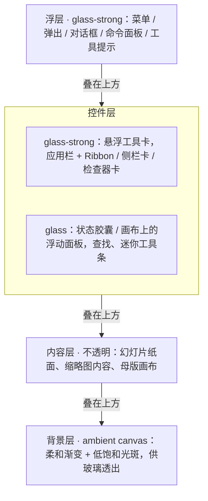
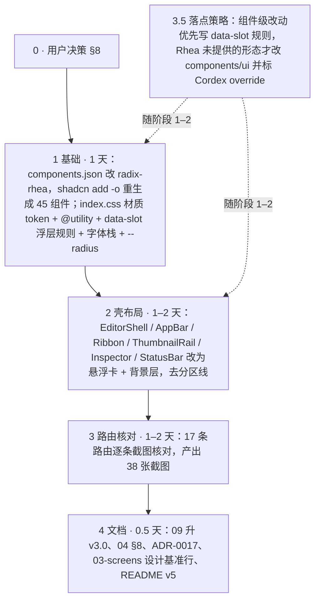

> 状态：已裁决并实施（rulings §4.8，2026-09-16） | 负责：总编排（设计线） | 更新：2026-09-16；2026-09-25（补图） | 依赖：`10-modernization-audit.md`（审计）、`09-design-specification.md` v2.0、ADR-0017、charter D10

# 11 现代化改造提案：以 iOS 27 Liquid Glass 为参照的设计语言升级

用户反馈（2026-09-16）：现有 playground "过于不现代化、很多组件粗糙"，要求参考 iOS 最新设计风格，尽可能贴近"现代化 + 毛玻璃"。本文给出依据、三条路线的对比、推荐路线的目标设计语言与实施计划；逐屏问题证据见审计文档 10，样张见 §7。

## 0. 结论先行

推荐 **路线 B：切换 shadcn 基础风格到 Rhea（紧凑版 Luma，macOS Tahoe 几何）+ 自建玻璃材质层 + 悬浮式应用壳**。

- 组件层继续 100% 复用 shadcn（用户约束 D10 不变）：Luma/Rhea 是 shadcn 官方 2026 年为 macOS Tahoe 时代出的风格，胶囊按钮、无边框填充输入、大圆角面板、柔和高度一次到位；切换只需改 `components.json` 的 `style` 并 `shadcn add -o` 重生成 45 个组件，已在临时副本验证：41 个文件更新、`index.css` 无需改动、`npm run build` 通过。
- 玻璃材质与悬浮层次不在 shadcn 组件里，而在我们自己的两层：`index.css` 的材质 token + `@utility glass/glass-strong` + 针对 shadcn `data-slot` 的浮层规则；`src/components/editor/*` 组合组件的布局（悬浮工具卡、侧栏卡、状态胶囊）。
- 可回退：`style` 改回 `radix-nova` 重生成即可；材质层是纯 CSS 增量。

## 1. 依据

### 1.1 Apple Liquid Glass（iOS 26 → iOS 27）可迁移到桌面 Web 的规则

| 规则 | 来源 | 对本项目的含义 |
|---|---|---|
| 控件层悬浮于内容层之上，内容始终主导；玻璃只用于导航/控件层，不用于内容 | WWDC25 "Meet Liquid Glass"；createwithswift 三原则 | 幻灯片纸面、缩略图内容保持不透明；工具栏/侧栏/检查器/弹层用玻璃 |
| 层次靠深度（透明度、折射、视觉重量）而非靠色块与线 | Medium/THE USEFUL APPS 解读 | 删除边到边 1px 分区线，用材质边缘 + 间距分区 |
| 两种变体：regular（自适应亮暗，最通用）与 clear（媒体背景上） | CSS-Tricks | 桌面编辑器只用 regular；文字密集面板用更不透明的 strong 档 |
| iOS 27：默认透明度降低、玻璃更有效"扩散"复杂背景以保证可读性、新增暗色边缘 rim、更亮的高光、更均匀折射、圆角更一致、侧栏与窗口圆角更新、用户可调透明度滑杆、遵循"降低透明度/增强对比" | MacRumors 2026-06-10；CSS-Tricks | token 取"偏不透明"档（亮 72–84% 白、暗 62–78%），暗色加 rim，提供 `prefers-reduced-transparency` 退化 |
| 同心圆角（内圆角 = 外圆角 − 内边距），胶囊控件，控件按语义成组 | HIG "Harmony" | 圆角刻度与 concentric 规则写进 09 v3 |
| 玻璃上文字必须保证对比（社区对 iOS 26 可读性的批评是 27 调整的主因） | designedforhumans；ui-ux-pro-max glassmorphism 条目 | 面板文字 ≥ 4.5:1 用对比核算表逐项证明，不靠感觉 |

来源：[Meet Liquid Glass (WWDC25)](https://developer.apple.com/videos/play/wwdc2025/219/)、[Liquid Glass 三原则](https://www.createwithswift.com/liquid-glass-redefining-design-through-hierarchy-harmony-and-consistency/)、[CSS-Tricks: Getting Clarity on Apple's Liquid Glass](https://css-tricks.com/getting-clarity-on-apples-liquid-glass/)、[MacRumors: How Liquid Glass Is Changing in iOS 27](https://www.macrumors.com/2026/06/10/how-liquid-glass-is-changing-in-ios-27/)、[Liquid Glass 可访问性讨论](https://designedforhumans.tech/blog/liquid-glass-smart-or-bad-for-accessibility)、[Liquid Glass in the Browser (kube.io)](https://kube.io/blog/liquid-glass-css-svg/)。

### 1.2 shadcn/ui 官方风格（2025-12 至 2026-07）

| 风格 | 官方描述 | 评价 |
|---|---|---|
| Vega | 经典 shadcn 外观 | 偏旧 |
| **Nova（现状）** | 减少内外边距的紧凑布局 | 几何仍是 2023 式：小圆角、描边输入、硬边框 |
| Maia | 柔和圆润、留白宽裕 | 现代但偏营销页密度 |
| Lyra | 方正锐利，配等宽字体 | 与目标相反 |
| Mira | 紧凑高密度 | 密度合适但几何不现代 |
| **Luma（2026-03）** | "圆润几何、柔和高度、呼吸感布局，灵感来自 macOS Tahoe" | 正是 Liquid Glass 时代的桌面几何 |
| **Rhea（2026-05）** | Luma 的紧凑版：更小间距、更密表面、更紧的按钮/输入/菜单/卡片/列表，"面向空间有限的专注型产品界面" | 编辑器最合适 |
| Sera | （文档未给出描述） | 未评估 |

来源：shadcn changelog（2025-12 shadcn create、2026-03 Luma、2026-05 Rhea、2026-07 React Aria）。本地 CLI 4.21 已支持 `-p rhea/luma`。

### 1.3 ui-ux-pro-max 检索留痕（总编排本轮）

| 查询 | 命中 | 采纳 |
|---|---|---|
| `"glassmorphism translucent blur" --domain style` | Glassmorphism：blur 10–20px、白 15–30%、1px 白 20% 描边、需鲜艳背景、文字 4.5:1、复杂度中、性能低成本 | 采纳 blur 档位与描边规则；**不采纳** 15–30% 的低不透明度（那是营销页规则，桌面编辑器文字密集，取 72–84%，与 iOS 27 降低透明度方向一致） |
| `"ios apple modern minimal" --domain style` | Minimalism & Swiss（无 iOS 专门条目） | 确认现状的风格判定；作为"不做什么"的参照（不加装饰） |
| 设计 agent 与前端 agent 的查询 | 见审计 10 §6 与样张报告 | — |

## 2. 现状问题摘要（引自审计 `10-modernization-audit.md` §3，38 张截图逐屏核对）

| # | 共性问题 | 影响路由 | 路线 B 中的对应改法 |
|---|---|---|---|
| 1 | 三栏/多区布局靠 `border-r/l/t` 硬线分区，不是留白 + 材质 | 10/19 | 悬浮卡 + 8px 间隙（§4.1、阶段 2） |
| 2 | Ribbon 是 Office 2013 式：竖线分组 + 11px 灰标签 + 等权重小图标 | 10/19 | 悬浮工具卡、间距分组、标签移除/极淡（Q4） |
| 3 | 状态栏/进度条"终端化"：纯文字 + 圆点、贴底通宽细进度条 | 13/19 | 状态胶囊 + 语义色 subtle 徽标（Q5） |
| 4 | 骨架灰条身兼二职：既是加载态又是空内容占位 | ≥12/19 | 加载态用 shimmer；内容占位用 `SlideContent`/线框示意 |
| 5 | 卡片/对话框/面板零阴影，只有 `ring-1` 发丝描边 | 10/19 | 两级阴影 + 材质边缘（§4.2、§4.4） |
| 6 | Tab 视觉 3–4 套并存（下划线 / 底边 / 描边 / 胶囊） | 11/19 | 收敛为 Rhea 分段胶囊一套 |
| 7 | 图标按钮无可见容器，命中区不可预期 | 7/19 | 静止态圆形浅底 + hover 加深（Rhea 默认几何） |
| 8 | 圆角偏小且不分层（6.4–11.2px 区间） | 19/19 | 圆角刻度"越浮越圆"（§4.3） |
| 9 | 全稿唯一的材质线索（弹层 4px 模糊 + 10% 遮罩）几乎不可感知 | 4/19 | 材质 token 全面铺开到控件层与浮层 |
| 10 | 密集单色小图标缺主次节奏 | 13/19 | 主操作图标 + 文字、次操作纯图标 + tooltip |

审计 §4 还按九个组件族（应用壳、Ribbon、侧栏与检查器、画布背景、对话框与弹层、菜单与命令面板、表单控件、徽标与状态、放映舞台）给出了逐条改法，并区分"只改 token/组件类"与"要改布局"；本文 §4–§5 直接采用其结论，不再复述。

## 3. 三条路线对比

| | A. 仅微调 Nova | **B. Rhea + 玻璃层 + 悬浮壳（推荐）** | C. 自绘 Liquid Glass（SVG 折射 / WebGL） |
|---|---|---|---|
| 做法 | 改 token：圆角 8→12、去线、加阴影 | 切 Rhea 重生成组件；材质 token + data-slot 浮层规则；重排 6 个组合组件 | 自写玻璃组件（`feTurbulence`/`feDisplacementMap` 折射、高光扫光） |
| 视觉达成度 | 低：仍是描边输入与硬边框 | 高：几何 + 材质 + 层次三者齐 | 最高但过度（编辑器不需要折射动画） |
| 工作量 | 0.5 天 | 3–5 天（含 17 条路由核对） | 2 周+ |
| 风险 | 达不到用户预期 | blur 性能、玻璃上对比度（有对策，§6） | 仅 Chrome 支持 SVG backdrop-filter；性能；可维护性 |
| 与 D10（复用 shadcn）一致 | 是 | 是 | 否（自建组件） |
| 可回退 | 是 | 是（改 `style` 重生成） | 难 |

## 4. 目标设计语言（将并入 09 v3.0）

### 4.1 层次模型（四层）

**提案中的四层层次模型**

怎么读：自上而下是从最上层到最底层，箭头表示「叠在下一层之上」。这是提案稿，定稿版见 09-design-specification §6.1（状态胶囊改为 glass-strong，并补入横幅与画布缩放胶囊）。

规则：玻璃不叠玻璃（浮层落在控件层之上时，浮层用 strong，控件层不再加模糊）；同一视口玻璃面板 ≤ 4 块。

### 4.2 材质 token（提案值，以样张与对比核算表定稿）

| token | 亮 | 暗 |
|---|---|---|
| `--glass-bg` | `rgb(255 255 255 / .72)` | `rgb(28 34 52 / .62)` |
| `--glass-strong-bg` | `rgb(255 255 255 / .84)` | `rgb(28 34 52 / .78)` |
| `--glass-blur` | `blur(24px) saturate(150%)` | `blur(24px) saturate(140%)` |
| `--glass-border` | `rgb(255 255 255 / .55)` | `rgb(255 255 255 / .10)` |
| `--glass-rim` | `0 0 0 1px rgb(15 20 40 / .08)` | `0 0 0 1px rgb(0 0 0 / .35)`（iOS 27 暗色边缘） |
| `--glass-highlight` | `inset 0 1px 0 rgb(255 255 255 / .70)` | `inset 0 1px 0 rgb(255 255 255 / .08)` |
| `--glass-shadow` | `0 8px 32px rgb(20 25 50 / .10), 0 1px 2px rgb(20 25 50 / .06)` | `0 12px 40px rgb(0 0 0 / .45)` |
| `--canvas`（背景层） | `#EEF1F8 → #E9ECF5 → #EEF3F3` 线性渐变 + 靛蓝 6% / 青 5% 径向光斑 | `#101523` + 微弱光晕 |

退化：`@media (prefers-reduced-transparency: reduce)` 与 `@supports not (backdrop-filter: blur(1px))` 时 `glass*` 退化为不透明 `var(--card)` + 普通阴影；`prefers-contrast: more` 时描边改为 `var(--border-strong)`。

### 4.3 几何

| 对象 | 圆角 | 备注 |
|---|---|---|
| 按钮、输入、分段、徽标 | `rounded-full`（Rhea 默认） | 胶囊 |
| 菜单项、列表行、缩略图卡 | `rounded-lg`（10px） | |
| 弹层、卡片、侧栏卡、工具卡 | `rounded-2xl`（16px） | 同心：内元素圆角 = 16 − 内边距 |
| 对话框、Sheet | `rounded-3xl`（20px） | |
| 纸面（幻灯片） | `rounded-md`（6px） | 内容层不夸张 |

`--radius` 基准由 0.5rem 调至 0.75rem（Rhea 组件按 `--radius-*` 刻度取值，需核对每类组件实际圆角）。

### 4.4 分隔与边框、阴影、字体、色彩、动效、密度

- **分隔**：禁止边到边 1px 分区线；区块靠间距（8px 卡间距）与材质边缘分区；列表内发丝线 `border-foreground/5`。
- **阴影**：两级——浮层/悬浮卡用 `--glass-shadow`；控件本身无阴影（Rhea 的柔和高度已足够）。
- **字体**：`-apple-system, BlinkMacSystemFont, "SF Pro Text", "Helvetica Neue", "PingFang SC", "Microsoft YaHei", sans-serif`（Geist 保留为最后回退或删除）；字号阶不变，标题 600、正文 400、次要 400 淡色，避免 500 泛滥。
- **色彩**：色板不变（primary #4A54E1、语义色、presence 12 色）；中性灰改为带蓝味（背景层已是）；tint 只给主操作与选中态；玻璃上的次要文字改用 `--foreground/70` 而非独立灰值，随材质自适应。
- **动效**：悬停/按下 150–200ms ease-out；浮层出现 200ms（缩放 .96→1 + 淡入）；侧栏折叠 220ms；`prefers-reduced-motion` 全部 1ms。
- **密度**：Rhea 紧凑档；命中区 ≥ 24px（触控 44）。
- **画布浮动元素**（审计 §4 D 族）：选中框控制点由 6px 直角白块改为 10–12px 圆形手柄（白底 + 主色描边 + 轻阴影）；远端选区/光标标签、评论钉、迷你工具条共用同一套"浮动标签"语言（胶囊、白描边、`shadow-sm`）。
- **加载态与占位**（审计 §3 #4）：真正加载用 `Skeleton` shimmer；内容占位用 `SlideContent`/线框示意，不再让灰条身兼二职。

## 5. 实施计划（路线 B）

| 阶段 | 内容 | 产物 | 估时 |
|---|---|---|---|
| 0 | 用户决策 §8 | — | — |
| 1 基础 | `components.json` → `radix-rhea`，`shadcn add -o` 重生成 45 组件；`index.css` 材质 token + `@utility glass/glass-strong` + data-slot 浮层规则 + 字体栈 + `--radius` | 构建通过、styleguide 更新 | 1 天 |
| 2 壳布局 | `EditorShell`/`AppBar`/`Ribbon`/`ThumbnailRail`/`Inspector`/`StatusBar` 改为悬浮卡 + 背景层；去分区线；Ribbon 组样式 | `#/editor` 亮暗定稿 | 1–2 天 |
| 3 路由核对 | 17 条路由逐条截图核对（截断、分区线残留、对比度）；`/documents` `/present` `/viewer` `/settings` 等非壳页面同步 | 38 张截图 | 1–2 天 |
| 3.5 落点策略 | 组件级改动优先用 `index.css` 的 `data-slot` 规则表达（升级时 `shadcn add -o` 不会覆盖）；只有 Rhea 没有提供的形态（如 Tabs 胶囊 variant、Overlay 材质）才直接改 `src/components/ui/*`，并在文件头注释标记 `// Cordex override`，由扫描脚本列出覆盖清单 | 覆盖清单 | 随阶段 1–2 |
| 4 文档 | 09 → v3.0（材质/层次/几何章节）、04 §8 更新、ADR-0017 追加"风格 Rhea + 材质层"、03-screens 设计基准行、README v5 变更 | 文档 | 0.5 天 |

**路线 B 实施阶段**

怎么读：实线是阶段先后，虚线表示 3.5 不是独立阶段，而是贯穿阶段 1–2 的落点约束。

## 6. 风险与对策

| 风险 | 对策 |
|---|---|
| `backdrop-filter` 多层叠加与画布缩放时掉帧 | 玻璃面板 ≤ 4 块；画布区不加玻璃；面板 `contain: paint`；缩放/拖拽时给壳加 `data-interacting` 临时降级为不透明 |
| 玻璃上文字对比不足 | 文字密集面板一律 strong 档；发布前对 9 个文字/材质组合做对比核算表（04 §2 方法）；不达标提高不透明度而不是加深文字 |
| 暗色发灰、层次混 | 背景层保持深且低饱和；rim + 高光区分层；面板不透明度 78% |
| Windows / Linux 字体 | 栈内含 Segoe（系统默认）与微软雅黑；不依赖 SF 才成立的字重 |
| Firefox / Safari | `-webkit-backdrop-filter` 由 Tailwind 输出；`@supports` 退化 |
| 与 03-screens 文档失配 | 阶段 4 只改"设计基准行"与 09；界面规格（状态/交互）不受视觉语言影响 |

## 7. 样张（路线 B 的可点击验证）

- **可点击样张**（临时副本构建，未进仓库）：https://claude.ai/code/artifact/b6766867-9da7-4198-9ec4-fb05f43a7c76 —— 切换到 Rhea + 材质 token + 悬浮壳后的完整 playground，`#/editor` 亮/暗为主要核对对象，其余路由通过共享组件自动继承，未逐一精修。
- **三栏对比画廊**：https://claude.ai/code/artifact/9d47af4e-3520-48bd-a6e9-f10dbd485e65 —— 19 条路由 × 现状 Nova（亮/暗）/ Rhea 基线 / Rhea + 玻璃样张。

样张改动落点（前端 agent 报告，总编排核对截图后确认）：
- 纯 CSS/token：`index.css` 新增 `--glass-*` 亮暗双套、`@utility glass/glass-strong`、`prefers-reduced-transparency` 与 `@supports` 退化、背景层光斑渐变、10 类 shadcn 浮层的 `data-slot` 玻璃规则、字体栈改系统 SF 优先、`--canvas` 改 `#EEF1F8/#101523`。
- 布局：`EditorShell`（`p-2 gap-2`，应用栏 + Ribbon 合成一张悬浮工具卡，侧栏/检查器为悬浮卡，分隔手柄静止透明）、`StatusBar`（整条悬浮胶囊）、`NotesBar`、`SlideCanvas`（缩放条居中胶囊）、`ThumbnailRail`、`Inspector`、`ribbon/primitives`（去竖线、柔和分组底、页签胶囊）、`HomeTab`（修复字体/字号下拉截断）、`Main`/`Masters`/`Comments`/`Documents` 局部。
- 未改 `src/components/ui/*`，未加依赖。

样张已知未尽善处（正式实施时处理）：画布默认 100% 缩放时纸面几乎顶满、背景层渐变可视面积小（建议默认"适应窗口"留出 24–32px 呼吸区）；Tooltip 采用固定深色玻璃胶囊不随主题翻转（待设计确认）；Ribbon 分组底 3% 偏克制（可调 5–6%）；`MasterTab` 残留一个失效类；移动端 Sheet 分支与 Main 的加载/失败骨架未玻璃化；其余 14 条路由未逐一截图复核。

## 8. 待用户决策

| # | 问题 | 默认答案（不答复即按此执行） |
|---|---|---|
| Q1 | 路线 A / B / C | B |
| Q2 | 基础风格 Rhea（紧凑）还是 Luma（宽松） | Rhea；`/documents`、`/settings` 等低密度页可用更大间距 |
| Q3 | 主色是否从靛蓝 #4A54E1 调整为更"iOS 蓝"（如 #0A84FF 系） | 不调，保持已裁决色板 |
| Q4 | Ribbon 是否保留 Office 式组标题与竖线 | 去竖线、组标题降为 11px 极淡或移除，用间距分组 |
| Q5 | 状态栏形态：底部悬浮胶囊 vs 细条 | 以样张更精致者为准 |
| Q6 | 字体：系统 SF 栈优先 vs 保留 Geist | 系统栈优先，Geist 移除（少 76 kB 字体） |
