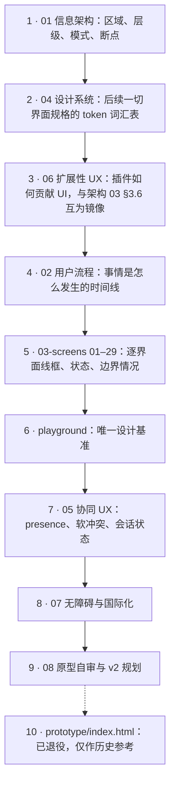

> 状态：草稿 | 负责：设计 | 更新：2026-09-18；2026-09-24（rulings §4.15：D7 结案；T-0 / Q3 / Q5 / Q6 / Q7 / Q8 回写 02、04、05、07、03-screens/01、06、08、10、11、12、13、18、19、22、29）；2026-09-25（补图）；2026-09-25（矛盾收口，rulings §4.18） | 依赖：charter v0.1（已核对 v0.2）、PRD（`10-prd/`，含 `03-features/07-masters-layouts-and-themes.md`、`08-app-shell.md`）、架构 03/README（`30-architecture/`）、rulings §4.7–§4.10
> 章程已升至 v0.2（向后兼容、只增不改语义，见 `00-charter/charter.md` 顶部变更说明）；本文档集已核对 v0.2 新增内容（`preset-slide-viewer`、Q20、§5.5 贡献点 id 定稿等）并按其更新，状态头按章程原文约定继续标注「charter v0.1」，无需重写。

# 设计条线总览

本目录是基于 cordis 4 的可插拔办公文档 SDK / 在线协同编辑器的设计基线，首个文档类型为 PowerPoint（.pptx）。本文档给出设计原则、范围、阅读指引、待决事项、对章程的异议/建议、术语补充。本轮修订已与产品条线 `docs/10-prd/`（README、`03-features/02-editing.md`、`03-features/03-collaboration.md`、`03-features/04-plugin-sdk.md`、`04-non-functional-requirements.md`）与架构条线 `docs/30-architecture/`（README、`03-kernel-and-plugin-model.md`、`02-layering-and-packages.md`）逐条核对，具体对齐点见各文件内联标注（引用格式如"PRD CO-08""架构 03 §3.6"）。

---

## 1. 设计原则

1. **忠实优先，编辑其次**：导入的 pptx 即便包含当前不可编辑的特性（动画、切换、SmartArt 等），也必须高保真渲染并**如实告知**用户"这部分被原样保留"，而不是静默丢失或静默假装可编辑。这是保真报告（03-screens/10）存在的原因。
2. **命令驱动、状态透明**：一切用户可见的操作都对应一个命令（core.command），且 UI 永远诚实地反映当前状态（加载/错误/只读/离线），不伪造"一切正常"的假象。
3. **插件是一等公民，但视觉统一**：第三方贡献的 UI 必须遵循与内置功能相同的 token 与交互规范，同时必须带有清晰的归属标识（设计 06 §4），让用户随时分得清"这是编辑器自带的，还是某个插件加的"。
4. **软冲突要可见，但不能打断心流**：CRDT 保证没有需要人工合并的硬冲突，但用户体感上的"我正在操作的东西被别人动了"必须被明确表达（05-collaboration-ux.md），且优先用内联提示而非阻断式对话框。
5. **桌面优先，窄屏是变化点不是缩水复刻**：继承 Univer 教训 A7，窄屏/触屏下的呈现是同一套贡献点的"紧凑呈现"，不是另建一套 UI 或阉割功能范围之外的东西（产品已明确 <640px 仅承诺查看/评论体验，见 01-information-architecture.md §6）。
6. **键盘与屏幕阅读器是同等公民，不是补丁**：DOM/SVG 渲染架构基线（章程 ADR-0021）本身就是无障碍的先天优势，设计从一开始就利用而不是事后补救（07-accessibility-and-i18n.md）。
7. **插件失败可见但不致命**：任一插件的 Fiber 进入 `FAILED` 不应让整个编辑器 chrome 崩溃或留下费解的空白，必须有明确的降级表达（设计 06 §3，对应章程 A11）。
8. **一切视觉数值皆 token**：颜色、间距、字号、圆角、阴影、层级、动效时长——凡是会在两处以上出现的数值，必须来自 `@cordexjs/design` 发布的变量（shadcn 主题变量 + Cordex 扩展裸名变量，如 `--primary`、`--layer-*`、`--duration-*`；原 `--cordex-*` 前缀已作废，rulings C-22），不允许组件内魔法数字（04-design-system.md 开头与 §9，修补 Univer 报告标记的"非颜色 token 缺失"）。

---

## 2. 范围

### 2.1 覆盖范围

- 编辑器信息架构、三种模式（编辑/评审/放映）、关键用户流程（打开/编辑/协同/软冲突/离线/导出/评论/版本历史/插件生命周期）。
- 29 份界面文档（`03-screens/01`–`29`，2026-09-17 新增 `29-home-start-page.md` 应用首页 / 开始页）的线框、全部状态与边界情况；组件规格以 09 v3.1 与 `playground/` 为准。
- 设计 token 体系与组件清单，覆盖亮/暗主题与两档密度（04-design-system.md）。
- 协同 UX 的完整规格：presence、远端光标/选区、跟随模式、软冲突可视化（覆盖 PRD CO-08 全部 11 种场景）、会话状态指示、评论锚定与脱离锚点态、版本历史、权限变化反馈（05-collaboration-ux.md）。
- 插件 UI 贡献的槽位规范：与架构 03 §3.6 贡献点总表、产品 PS-02 贡献点目录逐一对应（06-extensibility-ux.md）。
- 键盘导航、屏幕阅读器语义、IME、RTL、文案规范、对比度，覆盖 PRD NF-05（WCAG 2.2 AA）与 NF-06（国际化）的 UX 侧要求（07-accessibility-and-i18n.md）。
- ~~低保真可点击 HTML 原型（`prototype/index.html`）~~ —— **已退役**（2026-09-15 起由 `playground/` 取代，仅作历史参考，见 §8 v4 变更）。
- ~~**高保真设计稿**（`mockups/`，2026-09-15，ui-ux-pro-max skill 驱动的自包含 HTML）~~ —— **已退役**（playground 路由覆盖后仅作历史参考；其中 `26-master-view.html` 的"母版树"与专用页签形态已被 v11–v15 修订取代，勿据此实现），详见 §8"v3 变更""v4 变更"。
- **母版视图**（同一个编辑器，对齐 PowerPoint 幻灯片母版视图）：Ribbon 页签行右侧常驻「普通｜母版」分段为主入口（快捷键 `Mod+Alt+M`）；进入后 Ribbon 最左插入「母版」页签（编辑母版 / 母版版式 / 主题 / 背景 / 关闭五组）并隐藏「设计」，其余页签照常；左侧栏为**母版缩略图窗格**（母版大缩略图 + 缩进的版式小缩略图，同款卡片与选中环）；检查器仅禁用评论；母版 / 版式编辑（占位符、背景、文本样式、主题）。完整规格见 `03-screens/26`–`28`、`01-information-architecture.md` §2.4 / §5a、09 T-02。

### 2.2 明确不覆盖（超出本轮范围）

- 高保真视觉设计（色彩/字体的品牌化打磨）——**2026-09-15 起解除**：先由 `mockups/`（已退役）过渡，现由 `playground/`（shadcn Rhea + Liquid Glass 材质层，`registry.ts` 19 条路由全部 ready）承担全部界面的视觉终稿；界面文档保留线框、状态与交互说明。
- 移动端原生 App；编辑类触控手势的完整规格（NF-07：触控编辑为 M4+/P2，本轮只做查看/评论的触控适配）。
- 插件市场/发现型 UI（区别于本轮已设计的"已安装插件管理"，03-screens/09）。
- 大规模只读广播（"1 人讲、200 人看"，PRD CO-14，P2/M4+）的专属 UI。
- 演讲者视图（双屏：备注+下一页+计时器）的完整规格——03-screens/11 已预留概念但标注为待产品确认范围，未细化。
- 高对比主题（`forced-colors`）的具体 token 数值——P1，非本轮阻塞项。

---

## 3. 阅读指引

建议顺序：

1. `01-information-architecture.md` —— 先建立整体空间感（区域、层级、模式、断点）。
2. `04-design-system.md` —— token 体系是后续一切界面规格的词汇表。
3. `06-extensibility-ux.md` —— 理解插件如何贡献 UI，这是"每一级可插拔"在设计层面的落实，与架构 03 §3.6 互为镜像。
4. `02-user-flows.md` —— 关键流程，建立"事情是怎么发生的"的时间线视角。
5. `03-screens/*.md` —— 逐个界面的线框、状态、边界情况，前端可直接对照开工。**2026-09-15 新增 13–25**（`13-import-progress-and-degraded-states.md`、`14-slide-management-and-layouts.md`、`15-insert-menu-and-shape-library.md`、`16-text-editing-and-formatting.md`、`17-selection-alignment-and-snapping.md`、`18-image-editing.md`、`19-undo-redo-clipboard-and-save-state.md`、`20-view-zoom-and-navigation.md`、`21-find-and-replace.md`、`22-export-dialog.md`、`23-settings-panel.md`、`24-keyboard-shortcuts-panel.md`、`25-viewer-preset-shell.md`），覆盖 `10-prd/07-design-coverage-and-gaps.md` 的 M1/M2 P0 缺口；原有 `03`（属性面板）、`05`（上下文菜单）、`06`（评论面板）、`09`（插件管理器）、`12`（离线/冲突横幅）在文末各追加一节"补充（G-xx）"，不改动原有正文。**2026-09-15 同轮再新增 26–28**（`26-master-view-and-editing.md`、`27-layout-picker-and-reset.md`、`28-design-tab-and-themes.md`，对应产品线并行撰写中的 `10-prd/03-features/07-masters-layouts-and-themes.md` ML-01–04），三份均含"设计规格"与"应用的 UX 规则"小节；原有 `02`、`03`、`14`、`20` 同样各追加一节"补充/更新"指向母版视图的衔接点，`01-information-architecture.md` 新增"§5a 视图模式：普通/母版"，`02-user-flows.md` 新增"F10 母版视图与版式/主题管理"与对应的 `F-P16`，`06-extensibility-ux.md` 新增"§2.10a 母版视图下的贡献点"。**2026-09-17 新增 29**（`29-home-start-page.md`，应用首页 / 开始页，对应 PRD `08-app-shell.md` AS-01…06、09 T-07、playground `#/home`）；界面文档共 **29 份**。**2026-09-18**：`26` / `01` / `02` / `06` 按 rulings §4.10 回写（母版视图 = 同一个编辑器、母版缩略图窗格、`Mod+Alt+M`、Q11–Q13 / Q16 / Q18 / Q20）。
6. `playground/` —— **2026-09-15 起唯一设计基准**：shadcn/ui + Tailwind 实现的真实组件页面（`npm install && npm run build`，或直接看已发布的 artifact）；`mockups/*.html` 与 `prototype/index.html` 均已退役，仅作历史静态稿。
7. `05-collaboration-ux.md` —— 协同相关的横切规格（presence、软冲突、会话状态）。
8. `07-accessibility-and-i18n.md` —— 横切的无障碍与国际化规则。
9. `08-prototype-audit-and-v2-plan.md` —— **2026-09-15 新增**：原型现状自审、设计文档↔原型覆盖矩阵、功能缺口清单、v2 信息架构与路由方案、实施顺序与验收标准；是本轮原型 v2 重写与界面文档扩充的直接依据。
10. `prototype/index.html` —— **已退役**的低保真可点击原型（v2 / v3：hash 路由 + 共享外壳 + 每路由状态切换器，详见 08 文档 §4 与本文件 §8"v2 变更""v3 变更"）；其"母版树"等表述已被 playground 取代，勿据此实现。

**推荐阅读顺序**

怎么读：实线是建议的阅读先后，前四步建立空间感、词汇表、扩展模型与时间线，再进入逐界面细节；虚线指向已退役的历史原型，只在追溯时阅读。

---

## 4. 待决事项（决策人可随时否决默认值）

| # | 问题 | 当前默认/处理方式 | 决策人 |
|---|---|---|---|
| D1 | 幻灯片文本的默认度量单位（pt/cm/inch）与语言环境映射规则 | 未预设，03-screens/03 数值输入暂不做单位切换 | 产品 |
| D2 | 评论的删除权限矩阵（`owner` 是否可删除任何人的评论） | 设计按 PRD §1 角色表做了合理外推（评论所有者删自己的，`owner` 删任何），PRD CO-04 未逐字列出 | 产品 |
| D3 | 放映模式"演讲者视图"（双屏：备注+下一页+计时器）是否在当前里程碑范围 | 03-screens/11 预留概念，未细化设计 | 产品 |
| D4 | 保真报告的"不再提醒"是否需要跨会话/全局静音（当前仅做当次会话静音） | 03-screens/10 仅做会话级静音 | 产品 |
| D5 | 分享对话框是否需要"转移所有权"能力 | 03-screens/08 未设计此能力 | 产品 |
| D6 | 密度模式是否需要第三档"宽松（spacious）" | 04-design-system.md 只做了舒适/紧凑两档 | 产品/设计（无强需求可不做） |
| ~~D7~~ | ~~是否支持未登录/匿名访客身份~~ | **已结案**：不支持匿名，分享链接始终要求登录（rulings §4.13 S-1、§4.15 Q6）；单组织部署、无租户（§4.15 T-0）；注册由部署开关 `auth.selfSignup` 控制、默认关（管理员邀请 / 在 IdP 建号）。已回写 02-user-flows、03-screens/08 | — |
| ~~D8~~ | ~~`render.overlay` 贡献点未出现在架构 03 §3.6 v0.1 总表~~ | **已解决**：章程 v0.2 §5.5 贡献点 id 定稿已正式收录 `render.overlay`（与 `ui.statusBar` 等 id 的最终大小写一并定稿），见 06-extensibility-ux.md §2.7/§2.8 | — |
| D9 | `ui.ribbon` 的 tab/group/control 三级如何精确编码进统一的 `{id, slot, order, when}` 贡献形状（是否需要 `kind` 判别字段） | 06-extensibility-ux.md §2.1 给出 UX 视角示意，未定型 | 架构-结构 |
| D10 | 密度选择器属性名 `data-cordex-density` | 设计按 `data-cordex-theme` 命名空间一致性推荐给出，架构尚未给出显式字段名 | 架构-结构/运行时 |
| D11 | 高对比主题（`themes/high-contrast.ts`）具体 token 数值 | P1，非本轮阻塞项，无障碍验收标准明确后由设计补齐 | 设计（自行认领，供后续里程碑） |

---

## 5. 对章程的异议/建议

本轮未发现需要修改章程条款本身的实质性问题（章程 §5.5 的贡献点 id 列表本身即标注"如"，是示例而非穷尽列表，设计条线的槽位命名在此框架内工作，不构成异议）。以下是两条建议，供总编排在裁决相关跨条线问题时一并考虑：

1. ~~**放映模式播放动画/切换效果，是否与章程 §2.3 非目标条款冲突，建议显式澄清**~~（**已结案**：rulings §4.3 设计-1——M1–M3 放映渲染每页结束态、不播放，播放为 M4+ P2；01-IA §5.1、03-screens/11 已按此改写，rulings §4.18 UX-16）：原文如下，仅作记录——章程 §2.3 写"不在 M1–M3 内做动画/切换效果的**编辑**（仅保留与回写）"。设计条线的解读是：这只禁止"编辑"，不禁止"放映时按原样播放"——若不能播放，放映模式的产品价值会被严重削弱，且与保真报告"已保留但不可编辑"的一贯表达一致。03-screens/11、02-user-flows.md 已按此解读设计。建议总编排确认这一解读，并在章程或 PRD 相应条款中补一句显式澄清，避免下游（尤其架构 07 渲染管线）误读为"完全不渲染动画"。
2. **"应用壳级但含业务逻辑"的 UI 组件归属需要架构裁定**：章程 §5.2 定义 `apps/web` 为"仅组装、零业务逻辑"，但设计条线交付的分享与权限对话框（03-screens/08）、插件管理器（03-screens/09）等界面明显带有状态管理与业务判断（角色变更、依赖冲突提示等），不像是"组装"能覆盖的复杂度。产品条线在 `10-prd/03-features/03-collaboration.md` CO-15 已提出相同疑虑并建议回写章程 §5.2（见该文件"对章程的异议/建议"#10）。设计条线在此附议：这类界面的实现应归属某个可复用包（如某个 `preset` 或 `ui-react` 之上的应用级组件库），而不是完全放进"零业务逻辑"的 `apps/web`，具体归属请架构-结构裁定。

---

## 6. 术语补充（章程 §4 之外，本设计条线使用）

| 术语 | 英文/标识 | 定义 | 来源 |
|---|---|---|---|
| 评审模式 | Review Mode | 编辑器三态之一：只读浏览 + 评论，无编辑能力 | 本设计条线新增，见 01-information-architecture.md §5 |
| 放映模式 | Present Mode | 编辑器三态之一：全屏只读呈现；M1–M3 渲染每页结束态（放映为主序列可见性终态，M2 P1），不播放动画与切换，播放为 M4+ P2（章程 §2.3、rulings 设计-1） | 同上，见 03-screens/11 |
| 保真报告 | Fidelity Report | 打开 pptx 后生成的报告，说明哪些特性被不透明保留（opaque preservation）但当前不可编辑 | 本设计条线新增，见 03-screens/10 |
| 软冲突 | Soft Conflict | CRDT 并发操作合并成功但结果可能不符合任一用户意图的情形，与"硬冲突"相对 | 章程 §4 隐含，PRD CO-08 正式定义，设计条线沿用 |
| 贡献槽位 | Contribution Slot | 贡献点在 UI 上的具体承载位置（如某个 ribbon 分组、检查器坞的某个 Tab），是贡献点（逻辑概念）在界面上的可视化落点 | 本设计条线新增，见设计 06 |
| 跟随模式 | Follow Mode | 点击协作者头像后，本地视口/当前页自动同步其视角；被跟随者不感知 | PRD CO-03，设计条线细化交互，见 05-collaboration-ux.md §4 |
| 归属标识 | Attribution Badge | 标记某 UI 元素由第三方插件贡献的视觉标记 | 本设计条线新增，见设计 06 §4 |
| 密度模式 | Density Mode | 舒适/紧凑两档界面控件尺寸预设 | 本设计条线新增，见 04-design-system.md §2.13 |
| 检查器坞 | Inspector Dock | 承载属性/评论/版本历史/插件面板的互斥容器，是编辑器主界面的固定区域之一 | 本设计条线新增，见 01-information-architecture.md §2.3 |
| 评论锚点 | Comment Anchor | 评论线程关联的画布位置（页/元素/文本范围三种类型） | PRD CO-04，设计条线细化呈现，见 03-screens/06 |
| 已脱离锚点 | Detached (from anchor) | 评论锚点对象被删除后，线程转为的状态：不再有画布定位，仍可读/回复/解决 | PRD CO-04 术语，设计条线采用（取代早期草稿"孤立评论"提法） |
| 备注区 | Speaker Notes (panel) | 画布下方可折叠的演讲者备注文本编辑区 | 本轮从 PRD ED-29 焦点顺序要求反推补齐，见 01-information-architecture.md §2.3a |
| 会话状态机 | Session State Machine | 协同连接状态的六个态：`connecting`/`syncing`/`synced`/`reconnecting`/`offline`/`readonly-degraded` | PRD CO §3，设计条线在 05-collaboration-ux.md §7、03-screens/12 中作为呈现依据 |
| 命令面板 | Command Palette | `Mod+Shift+P` 呼出的全局命令模糊搜索入口，读取 `ui.command`/`core.command` | 章程 §5.2 提及但未列入 §4 术语表，本设计条线补充定义 |

---

## 7. 需要总编排协调的跨条线问题

以下问题需要总编排分派给相应条线处理，设计条线已按当前最合理的默认假设继续工作，不阻塞：

1. ~~`render.overlay` 贡献点的产品/架构同步差异~~：**已由章程 v0.2 §5.5 解决**（正式收录 `render.overlay`，并把 `ui.statusBar`/`ui.dialog`/`ui.notification`/`ui.theme` 等 id 的大小写一并定稿为 camelCase）。本轮已据此更新 06-extensibility-ux.md 全部相关小节，无需架构条线再处理。
2. **`ui.ribbon` 三级贡献（tab/group/control）如何编码进统一形状**：架构 03 §3.2 给出的共享 `{id, slot, order, when}` 形状未说明三级如何判别（是否需要 `kind` 字段），设计 06 §2.1 给出的是 UX 视角示意，需要架构-结构定稿。
3. **"应用壳级但含业务逻辑"的 UI 归属**（详见本文件 §5 第 2 条）：需要架构-结构裁定分享对话框、插件管理器一类界面应归属哪个包，产品条线已在其 README 提出类似请求，建议总编排合并处理。
4. **密度选择器属性名 `data-cordex-density`**：设计侧按命名空间一致性给出的推荐值，需要架构-结构/运行时在 `theme.service.ts` 细化时确认或改名。
5. **评论删除权限矩阵**（本文件 §4 D2）与**度量单位默认值**（D1）：需要产品条线在 PRD 相应章节补齐精确口径，设计条线目前的实现是合理外推而非产品原文。
6. **放映模式"演讲者视图"是否在当前里程碑范围**（D3）：若产品确认需要，设计条线可在下一轮把 03-screens/11 的预留概念细化为完整规格。
7. ~~**放映模式播放动画/切换效果与章程 §2.3 非目标条款的关系**（本文件 §5 第 1 条）：建议总编排确认设计条线的解读并视需要回写章程/PRD 措辞，供架构 07（渲染管线）与产品条线对齐验收口径。~~（**已结案**：rulings 设计-1，M1–M3 不播放；rulings §4.18 UX-16）

### 7.1 本轮已完成的跨条线补充请求（供总编排核对，无需再协调）

架构-运行时（B）与架构-结构（A）在本轮修订期间提出的补充请求均已覆盖，不再需要进一步跨条线协调：CO-08 软冲突表全部 11 行的呈现形态逐行映射（05-collaboration-ux.md §5）；`readonly-degraded` 的本地更改导出+不自动合并说明（05-collaboration-ux.md §8、03-screens/12）；评论"已脱离锚点"的汇总筛选（03-screens/06）；20 人规模下头像簇与画布远端光标/选区的分级折叠规则（05-collaboration-ux.md §1a）；`preset-slide-viewer` 极简查看器壳的最小 IA 与 Q20 关联（01-information-architecture.md §8）；`ui.theme` 贡献点与 token 体系的允许/禁止覆盖范围（06-extensibility-ux.md §2.11）。

## 8. UI/UX 评审记录（2026-09-15，ui-ux-pro-max）

评审方法：以 ui-ux-pro-max skill 的 119 条 UX 规则（优先级 1 可访问性 → 10 图表）逐类对照设计文档与原型，并用 WCAG 相对亮度公式脚本核算全部语义配对与 12 个协作者色对亮/暗画布的对比度。发现与处置如下（"落点"为修订所在文件）：

| # | 发现（规则 id） | 处置 | 落点 |
|---|---|---|---|
| 1 | 亮色 `text-tertiary` 3.10:1、`text-disabled` 1.87:1、暗色 `text-disabled` 2.28:1（color-contrast） | 改为 #667085（4.97）/ #8A93A2（3.10）/ #6B7689（3.79） | 04 §2.2/§2.3/§2.6、原型 |
| 2 | 表单控件边框 `border-default` 1.39:1（WCAG 1.4.11） | 新增 `border-control`（亮 3.10 / 暗 3.79），控件一律引用 | 04 §2.2/§2.3、03-screens/03 |
| 3 | `success-default`/`warning-default` 被用作文字（3.45 / 4.00） | 规则：`*-default` 只作图标/边框，文字用 `*-emphasis` | 04 §2.5/§2.6、原型 |
| 4 | presence 3/4/5/6 在亮画布 <3:1、9 在暗画布 <3:1 | 替换 7 色并增加描边/标签对比度无关化技法 | 04 §2.1/§2.4、05、原型 |
| 5 | 组件内裸 hex（放映舞台、纸面、白字） | 新增 `doc-paper/doc-ink/stage-*` 与主题无关 token | 04 §2.2、原型 |
| 6 | 原型 30 个 emoji 图标按钮（no-emoji-icons）、字号 9–10px | 单一 Phosphor 家族 SVG sprite；新增 `2xs`=11px 仅限徽标/键帽，可读文字 ≥ 12px | 04 §2.8/§2.14、06、原型 |
| 7 | 命中区：迷你工具条 22px；窄屏把按钮缩到 26px（web-target-size / touch-target-size） | ≥ 24px；触控/窄屏 ≥ 44px 且间距 ≥ 8px，减少控件而非缩小控件 | 04 §4.1/§5、07 §2、01 §6、原型 |
| 8 | 输入框无可见标签（input-labels），占位符当标签 | 属性面板/分享对话框改为可见标签 + 帮助文字 | 03-screens/03、08、原型 |
| 9 | 删除即时执行且无撤销（undo-support） | 可撤销 toast（5 s、`aria-live`）；不可撤销操作才确认 | 03-screens/05、12、原型 |
| 10 | toast/横幅无 live region；对话框无 `role="dialog"`、无焦点循环与归还（toast-accessibility / focus-management） | 补齐语义与焦点管理 | 03-screens/10、12、08、原型 |
| 11 | 页签用 `span`，缩略图/评论钉用 `div`（keyboard-nav） | `role="tablist/tab"` 的 `button` + 方向键；缩略图与评论钉为 `button` | 07 §1.2、03-screens/02、原型 |
| 12 | hover/按下无过渡；原型未实现 `prefers-reduced-motion`（state-transition / reduced-motion） | 120–180ms 过渡，退出 0.6–0.7×，reduced-motion 降为 1ms | 04 §2.12、12、原型 |
| 13 | 深链接无明确格式（deep-linking / state-preservation） | `/d/{documentId}?page=&comment=`，返回恢复状态 | 01 §4 |
| 14 | Tooltip 仅 hover（aria-labels） | `:focus-visible` 也显示，且不替代 `aria-label` | 04 §2.14/§4.1、07 §2 |
| 15 | 地标与跳转链接未落到线框（skip-links） | header/main/aside/footer + "跳至画布" | 03-screens/02、原型 |

**未采纳的 skill 建议**：`--design-system` 推荐 Plus Jakarta Sans 与青绿主色（#0D9488）。保留系统字体栈（SDK 嵌入场景规避外链字体许可与加载成本，见 04 §2.8）与靛蓝 accent（与语义色、协作者色的色相分离，见 04 §2.1）；推荐的 Minimalism & Swiss 风格与本设计一致，无需调整。

**验证**：原型在修订后经脚本复核——亮/暗两套文字配对（10 组）全部 ≥ 4.5:1，控件/禁用配对（5 组）全部 ≥ 3:1，presence 8 色对两套画布全部 ≥ 3:1；无裸 hex、无裸 px 字号；`role="dialog"` 3 处、`aria-live` 3 处、`role="tab"` 10 处、`aria-label` 68 处；脚本语法与标签配对通过。

### v2 变更（2026-09-15，依据 `08-prototype-audit-and-v2-plan.md` 与 `10-prd/07-design-coverage-and-gaps.md`）

- **界面文档**：新增 13 份（`03-screens/13`–`25`，覆盖 M1/M2 P0 缺口 G-01/02/03/04/05/06/10–27/30/31）；既有 `03`、`05`、`06`、`09`、`12` 各追加一节"补充（G-xx）"（不改动原文）；`02-user-flows.md` 新增"F-P 原型 v2 流程映射"小节，`01-information-architecture.md` 新增"§9 原型 v2 路由表"。
- **原型 v2**：`prototype/index.html` 由 v1 的 1,020 行单屏演示重写为 1,537 行、**15 个 hash 路由**（14 个产品/流程路由 + 1 个元信息导航目录，见 08 文档 §4.2 路由表）+ 共享外壳 + 每路由状态切换器（原型控制条"状态"下拉，泛化自 v1 的"连接状态"选择器模式）；新增"视口宽度"（1024/400px 模拟，无需真实缩放窗口）与"角色预设"（owner/editor/commenter/viewer）两个原型控制条开关（07 §3 要求）；新增"软冲突演示"开关，覆盖 CO-08 场景 B/C/D 三种 P0 高频场景为可点击（其余场景按总编排裁决 08 §6 Q1 作静态帧处理，未逐一实现）。硬性约束（图标 sprite 复用、无 emoji、token 化、命中区、可见标签、可撤销 toast、dialog/tab/menu 语义、reduced-motion、无 alert/confirm/下载）已用脚本复核：标签配对/JS 语法/id 唯一性通过，裸 hex 与 <11px 字号已清零。
- **15 条流程（07 §3 F-P01–15）覆盖程度**：F-P07 导出、F-P08 评论、F-P11 版本历史、F-P13 放映、F-P14 系统面板为完整可点击闭环；F-P01 打开（含保真报告真实入口）、F-P02 幻灯片管理、F-P03 插入与撤销重做、F-P09 协同软冲突（3 场景）、F-P10 离线重连降权、F-P12 分享权限、F-P15 查看器壳为可点击但简化（如页面拖拽重排以点击/右键菜单替代真实拖拽）；F-P04 查找替换、F-P05 图片裁剪、F-P06 多选框选与参考线为按钮触发的提示/单帧演示，未做完整交互序列。
- **仍未覆盖/简化的缺口（供下一轮跟进）**：表格结构编辑（G-32/62）与图表数据编辑（G-63）未建独立界面文件与路由，仅在 PRD 缺口清单中登记；协作者规模折叠规则（05 §1a，C-01/C-02）与画布框选/智能参考线（G-17）在原型中为单一静态状态，未随"视口宽度/角色预设"之外的维度联动；登录鉴权页（G-66）、开发者面板（G-44/67）、回收站（G-64）、演讲者视图（D3，按产品默认答案本轮不做）未纳入本轮路由。

### v3 变更（2026-09-15，ui-ux-pro-max skill 驱动的高保真设计稿 + 母版）

**背景**：用户反馈此前设计稿"过于简略"（仅 ASCII 线框与低保真原型），且左侧栏与编辑器均未考虑幻灯片母版；要求本轮设计过程必须使用 `ui-ux-pro-max` skill 并留痕，产出高保真设计稿并补齐母版视图与母版编辑。

**skill 调用记录**（`Skill` 工具调用 `ui-ux-pro-max` 加载工作流后，脚本 `~/.claude/skills/ui-ux-pro-max/scripts/search.py`，`python3` 执行；命令与采纳情况留痕供评审核对）：

| 步骤 | 命令 | 采纳情况 |
|---|---|---|
| 设计系统基线 | `search.py "collaborative presentation editor productivity tool professional minimal" --design-system -p "Cordex Slides" --variance 3 --motion 3 --density 8` | 部分采纳：确认 Minimalism & Swiss 风格判定（与既有设计一致）、`--density 8`→紧凑密度（母版视图三栏同屏，`mockups/26/28` 采用 `data-density="compact"`）、Pre-Delivery Checklist 全部条目已满足。**不采纳**：推荐主色 `#0D9488`/强调色 `#EA580C`、字体 Plus Jakarta Sans（与已裁决的靛蓝 accent `#4A54E1`、系统字体栈冲突，理由见 `04-design-system.md` §7 比对表）；"Product Demo + Features" 营销页结构与图表类型建议（Gauge/Bullet/Waffle）不适用于本产品/本轮范围 |
| `--domain ux` × 12（含 4 组 0 命中后按协议重试） | `"placeholder empty state"`、`"modal dialog focus"`、`"toast undo"`、`"form inline validation"`、`"data table sortable"`、`"virtualized list performance"`、`"gallery grid keyboard navigation"`、`"color picker swatches accessible"`；0 命中重试：`"ribbon toolbar dense grouping"`→`"dense toolbar"`（仍 0 命中，如实标注未找到匹配，沿用设计 06 §2.1 既有槽位密度规则）、`"canvas selection handles"`→`"resize handle drag"`（命中 Dragging Movements）、`"comment thread anchored"`→`"inline comment annotation"`、`"presence avatars stack"`→`"avatar group overflow"` | 命中的 Focus Appearance（2px+3:1）、Toast 3–5s 自动消失、Dragging Movements 键盘等价、Color Only（不单靠颜色）、Empty States（helpful message+action）等规则与既有裁决交叉验证一致，逐条登记在对应 `03-screens/26–28`、`mockups/*.html` 的"应用的 UX 规则"小节 |
| `--domain icons` × 2 | `"lock toggle state icon"`、`"template layout master icon"`→0 命中重试`"layout grid icon"`（命中 `grid-four`/`columns`） | 确认新增 `i-master`/`i-layout` 图标方向（分区矩形隐喻），按 Phosphor regular 描边风格手绘，见各 `mockups/*.html` 内联 sprite |
| `--domain color` × 2 | `"dense dashboard accent color"`、`"semantic status color pairs"` | 仅作方法论交叉验证（强调色应与状态色分离），不采纳具体色值，既有靛蓝 accent 保留 |
| `--domain typography` × 1 | `"dense ui small text hierarchy"` | 不采纳（返回的字体配对均为外链字体，与系统字体栈裁决冲突） |
| `--domain chart` × 1 | `"chart legend accessible"` | 本轮界面范围不含数据图表 chrome，登记不适用 |
| `--stack react` × 2 | `"virtualized tree list state"`、`"compound component composition state"` | **采纳为实现提示**（非视觉决策）：Tab+TabPanel 共享 Context、避免 5 层以上 prop drilling，写入 `06-extensibility-ux.md` §2.10a；列表组件泛型 props 供母版树/缩略图虚拟化实现参考 |

完整比对表见 `04-design-system.md` §7"与 ui-ux-pro-max 设计系统基线的比对"；每份新增/更新的 `03-screens/*.md` 与 `mockups/*.html` 均在文末/页内附"应用的 UX 规则"小节列出规则 id 与落实方式。

**A. 高保真设计稿**（`mockups/`，`tokens.css`/`shell.css` 为共用支撑文件，`index.html` 为目录页；全部 13 稿均 ≤500 行、自包含、真实示例内容、内嵌 Phosphor 风格图标 sprite、亮/暗两套 `data-theme` token，遵守本文件 §8 已有的对比度/命中区/可见标签/语义化约束）：

| 文件 | 对应界面文档 | 说明 |
|---|---|---|
| `02-editor-main.html` | 03-screens/02 | 普通视图：左侧栏含"普通/母版"入口 |
| `26-master-view.html` | 03-screens/26 | 母版树、继承叠加画布、占位符属性（核心新增） |
| `27-layout-picker-and-reset.html` | 03-screens/27 | 版式选择器按母版分组、重置页（核心新增） |
| `28-design-tab-and-themes.html` | 03-screens/28 | 设计页签、主题变体、主题色/字体编辑（核心新增） |
| `01-document-list.html` | 03-screens/01 | 应用壳文档列表 |
| `06-insert-flyout.html` | 03-screens/04、15 | 插入页签、形状库 flyout、变换手柄 |
| `07-text-editing.html` | 03-screens/16 | 文本编辑态、颜色选择器、超链接对话框 |
| `08-comments.html` | 03-screens/06 | 评论面板、撰写框 @ 候选、已脱离锚点 |
| `10-share.html` | 03-screens/08 | 分享与权限、待处理访问申请 |
| `11-export.html` | 03-screens/22 | 导出对话框、生成中、未同步更改 |
| `13-viewer.html` | 03-screens/25 | 只读查看器 preset 壳、窄屏收敛 |
| `14-settings.html` | 03-screens/23 | 设置抽屉、集成方锁定态 |
| `15-offline-degraded.html` | 03-screens/12、13 | 离线/降权六态横幅、三层降级占位 |

**B. 界面文档升级为设计规格**：新增 `03-screens/26-master-view-and-editing.md`、`27-layout-picker-and-reset.md`、`28-design-tab-and-themes.md`（均含"设计规格"+"应用的 UX 规则"小节）；更新 `01-information-architecture.md`（§2.4 母版视图区域网格、§5a 视图模式矩阵、§9 路由表新增 `#/editor/masters`）、`02-user-flows.md`（新增 F10 母版视图与版式/主题管理 + F-P16）、`03-screens/02`（§2.4 侧栏模式入口 + 设计规格）、`03-screens/03`（占位符母版属性范围边界 + 设计规格）、`03-screens/14`（按母版分组的衔接点 + 设计规格）、`03-screens/20`（母版视图入口由 P2 灰显占位提升为 M2 P0 + 快捷键 `Mod+Shift+M` + 设计规格）、`06-extensibility-ux.md`（§2.10a `viewMode` context key 与母版视图下贡献点的 `when` 规则）；`04-design-system.md` 新增 §7"与 ui-ux-pro-max 设计系统基线的比对"。

**C. 原型 v3 增量**：`prototype/index.html` 新增路由 `#/editor/masters`（独立 `data-route-group="editor-masters"`，与 `editor/share` 同一模式，导航目录 `#route-nav`/`#ctl-route` 已自动登记）：左侧栏母版树可展开/选中（母版父节点+版式子节点，含引用页数徽标）、选中版式后画布随之更新并叠加母版继承占位符（虚线+"母版"徽标提示）、点击画布占位符更新右侧检查器坞属性（占位符类型/位置与大小/"已在此版式覆盖"徽标/重置为母版值）、"关闭母版视图"返回 `#/editor`；原有 `#/editor` 缩略图侧栏顶部新增"普通/母版"分段入口跳转到新路由。以上四条路径已用 Playwright 实际点击验证：路由 hash 保持、树选中状态切换、属性面板联动、关闭后正确返回，均产生真实可观察的状态变化（非仅视觉高亮），控制台无 JS 报错。

**里程碑口径提示**：本轮母版相关设计按用户给定范围（`ML-01` 母版视图 M2 P0、`ML-02` 版式应用与重置 M2 P0、`ML-03` 母版与版式编辑 M3 P0、`ML-04` 主题 M3 P1）执行，相对 `10-prd/07-design-coverage-and-gaps.md` 现行矩阵"ED-25 母版视图｜M2/P2｜只读"是显著的优先级前移（查看 P2→M2 P0，编辑 M4+P2→M3 P0）。产品线 `10-prd/03-features/07-masters-layouts-and-themes.md` 落地后需核对编号与措辞一致性，若有出入以产品线文件为准。

**未完成项（如实汇报）**：
- 高保真设计稿覆盖 A 节列出的 13 个优先级界面（含母版视图全部四稿）；其余约 12 个 `03-screens/*` 界面（04、05、09、17、18、19、21、23、24 等，见 `03-screens/` 目录）本轮未产出对应高保真 mockup，仍以既有结构化规格（线框+状态+交互说明）为准，非视觉终稿。
- `03-screens/28` 主题编辑的"另存为新主题"/"设置为默认主题"两个按钮仅在 mockup 中静态呈现，未在 `prototype/index.html` 中实现可点击版本（本轮原型增量聚焦 `ML-01`/`ML-02`，`ML-03`/`ML-04` 的编辑态以 mockup 为准，不强求原型逐一可点击）。
- `10-prd/03-features/07-masters-layouts-and-themes.md` 尚未由产品线落地，本轮 `ML-01`–`04` 编号与范围为设计条线按用户给定范围先行假设，需在该文件出现后核对一次并对齐编号（已在 `03-screens/26` 页首与本节登记）。
- 高对比主题具体 token 数值（D11）、密度属性名最终定名（D10）等既有待决事项不受本轮影响，仍待架构/产品条线确认。

### v4 变更（2026-09-15，设计系统改为复用 shadcn/ui）

- 用户先指出"缺少一套完整且可遵循的设计规范、稿件不精致"，随后明确要求"组件应直接复用成熟组件，如 shadcn"。处置：`09-design-specification.md` 改写为 v2.0（shadcn 主题变量映射、Cordex 元素→shadcn 组件映射表、组合模式、模板、遵循方式）；手工套件 `kit/` 作废删除。
- 新建设计 playground `playground/`（Vite 8 + React 19 + TS strict + Tailwind 4 + shadcn CLI 4.21，`radix-nova` 预设，45 个组件），设计稿即真实组件页面：`/styleguide` 为组件状态基准，其余 17 条界面路由按 `src/routes/registry.ts` 登记；构建 `npm run build` 后产物 `dist/` 作为多文件 artifact 发布。
- 旧静态稿 `mockups/` 与低保真原型 `prototype/` 在 playground 路由覆盖后退役为历史参考。
- `03-screens/` 全部 28 份界面文档在 H1 下方加入统一的"设计基准（2026-09-15 起）"提示行：组件规格以 09 v2.0 为准、列出对应 playground 路由（无独立路由的界面注明承载位置，如右键菜单/查找面板承载于 `#/editor`）、并声明文内 `mockups/*.html` 与线框图为历史静态稿。文档正文未改写，避免与 playground 路由实现并行期间产生二次失配；路由全部 ready 后再逐份核对"设计规格"小节。
- **路由全部就绪（2026-09-15 晚）**：前端 agent 续跑完成剩余 12 条路由，`registry.ts` 18 条全部 `ready`（17 条界面路由 + `/styleguide`；2026-09-17 v16 新增 `/home` 后为 19 条）；实现中发现并修复 3 个真实问题：`react-resizable-panels` v4 把裸数字尺寸解释为像素而非百分比（三栏壳曾渲染成 16px 宽）、母版页签"关闭母版视图"未贴右缘、`RadioGroup` 默认 `w-full` 压扁行内标签。agent 运行的 ui-ux-pro-max 查询：`comment thread inline discussion panel`、`timeline restore previous state`、`presentation player controls fullscreen`、`connection status banner offline sync`、`mention autocomplete at symbol`、`role permission access list sharing`、`destructive action undo confirmation`；采纳要点：不可逆操作走 AlertDialog、可逆操作走可撤销 toast、放映控制条不自动播放、筛选 chip 用 `aria-pressed` 按钮、名称/错误不硬截断。
- **总编排复核**：`npm run build` 通过；机械检查 emoji 0、`debugger`/`console.log` 0；把 21 处 `text-[10px]` 统一为主题字阶 `text-2xs`（11px，仅徽标与画布标签，见 09 §1.3），2 处可读文字提升为 `text-xs`；评论"已解决"徽标的 ✓ 字符改为 Lucide `Check`。新增 `src/components/editor/SlideContent.tsx`（真实文字内容、字号按容器宽度 cqw 缩放、正文取自 `mock-data.slideBodies`），替换放映舞台、只读查看器、离线/导出/分享/历史/版式画布上的骨架条与占位文字；`MiniSlide` 仅保留在缩略图、版式画廊等小幅面。用 Playwright（`--channel=chrome`）逐路由截图 17 张核对，playground artifact 同 URL 重新发布为第 2 版。

### v5 变更（2026-09-16，现代化审计与 Liquid Glass 改造提案，待用户决策）

- 用户反馈 playground "过于不现代化、组件粗糙"，要求参考 iOS 最新设计风格（现代化 + 毛玻璃）重新设计。处置：设计审计 agent 对 19 条路由亮/暗共 38 张截图逐屏审计，产出 `10-modernization-audit.md`（审计标准、逐屏表、10 条共性问题、九大组件族改法、风险、skill 留痕 8 条查询）。
- 总编排调研：Apple Liquid Glass（iOS 26→27 的修正方向：降低默认透明度、暗色边缘、更亮高光、可读性优先、降低透明度偏好）；shadcn 官方风格 Luma（2026-03，macOS Tahoe 灵感）与 Rhea（2026-05，紧凑版）。在临时副本把基础风格切到 Rhea，41 个组件自动更新、构建通过。
- 前端 agent 在临时副本做出"Rhea + 材质 token + 悬浮壳"的样张（亮/暗，弹层用真实点击验证），未改 `src/components/ui/*`。样张与画廊已发布为独立 artifact（见 `docs/README.md`）。
- 提案 `11-modern-glass-redesign-proposal.md`：推荐路线 B，含四层层次模型、材质 token、圆角刻度、实施四阶段、风险对策与 6 项待决策。**仓库内 playground 尚未改动**，等用户在 §8 拍板后进入实施。
- **v5 实施完成（2026-09-16 晚，用户裁决：路线 B、Rhea、主色去紫、Ribbon/状态栏按默认、保留 Geist）**：仓库 playground `components.json` 切 `radix-rhea` 并重生成 45 个组件（复制件未改）；移植材质层与悬浮壳；`SlideCanvas` 新增 `zoom="fit"` 默认（`ZoomValue`），Ribbon 视图页签与查看器显示实际百分比；主色亮 `#3A5CE6`/暗 `#6B93FF`、暗焦点环 `#7DA2FF`，暗色 `--muted-foreground` 提亮为 `#8A94A6`（玻璃面板对比核算）；胶囊页签选中态用 `[data-slot="tabs-*"]` 规则加强。精修 agent A（编辑器族 9 路由 + 主界面加载/评审态；检查器页签统一胶囊；母版视图单页签左对齐、提示条不换行）与 agent B（目录、样式指南材质分区、文档列表单卡顶栏、导入/导出/放映/查看器/设置分组列表/离线 Alert 横幅）各自截图核对；总编排全量 38 张截图复核、机械检查（`variant="line"` 0、emoji 0、`debugger` 0、<11px 0）通过，playground artifact 同 URL 发布第 3 版，对比画廊新增"实施后"两列。规范 09 v3.0、04 v0.4、ADR-0017 修订、rulings §4.8、章程 D10 同步。
- 已知未尽善（下一轮）：`History` 无时间线竖轨；`Plugins` 分区标题未徽标化；Styleguide 视口截图因 `Command` 焦点滚到中段（整页截图正常）；Viewer 打开失败态缺退出入口；`prefers-contrast: more` 描边规则未实现；`text-2xs` 11px 保留为徽标/键帽/画布标签/Ribbon 组标题例外（09 v3.0 §1.3）。
- **v5 反馈修正（2026-09-16 晚）**：用户截图指出暗色选中态成"黑洞"——根因是暗色填充 token 极性（`--muted #0F1420` 比玻璃表面暗），修正为 `--secondary #262E40 / --muted #232A3B / --accent #2C3548 / --border #2A3245` 并给 Toggle/ToggleGroup 选中态加 `[data-slot]` 显式规则；普通/母版切换按用户要求移到 Ribbon 页签行右侧（`ViewModeSwitch`，普通与母版视图同位置），缩略图栏顶部分段控件移除（`showModeToggle` 默认 false）。playground 同 URL 发布第 4 版，画廊"实施后"两列刷新。
- **v5 自审修正（2026-09-16 深夜，用户："你自己再截图看一下，我看着还有问题"）**：总编排对 38 张截图逐区放大自审，发现并修复：(1) **玻璃从未真正模糊**——编译产物中 `backdrop-filter` 被 Lightning CSS 去重丢弃只剩 `-webkit-` 前缀，Chrome 不识别；调整为 `-webkit-` 在前、标准属性在后，`getComputedStyle` 验证为 `blur(24px) saturate(1.5)`（09 §6.3 新增声明顺序硬规则）；(2) 主题逻辑从 `ThemeToggle` 的 effect 抽为全局 store `src/lib/theme.ts`（首屏即应用；多实例同步；**响应宿主 `<html data-theme>` 标记**，artifact 查看器切暗色时页面跟随）；(3) 路由级代码分割（`React.lazy` + `Suspense`），首包 850 KB → 295 KB，嵌入查看器首屏更快；(4) 检查器只有一个页签时改为分区标题，不再渲染撑满整行的单个胶囊；(5) 头像首字母在浅色玻璃上不可见（Rhea fallback 为 muted 前景）→ 显式 `bg-muted text-foreground`；(6) 迷你工具条字体名对比不足 → 前景色 80%；(7) 样式指南 sticky 页头补 `isolate` 与主内容 `z-0`。artifact 同 URL 第 5 版。
- 说明：claude.ai artifact 查看器在被遮挡/自动化的浏览器窗口里会出现"首屏不绘制、需滚动或改尺寸才出现"，静态画廊 artifact 亦然，属浏览器对遮挡窗口的渲染节流，不是页面缺陷。
- **v6 宿主内暗色文字修复（2026-09-16 深夜，用户第二次截图："这么明显的问题为什么一直没修"）**：根因是 artifact 宿主给 `body` 注入未分层的 `color:#141413`/系统字体/浅色背景，我们的正文色写在 `@layer base` 里永远输给它，暗色下所有继承色文字近黑；之前所有验证都直接打开 `dist/index.html`，没有套宿主外壳，因此一直没复现。处置：(1) `index.css` 末尾加未分层 `body` 防线（色、字体、字号、行高、背景）；(2) 新增 `playground/scripts/host-wrap.py` 用宿主的真实骨架（`Artifact read` 得到的 HTML）包裹产物做**宿主外壳复现**，暗色前后对比截图确认；(3) `scripts/publish-entry.py` 固化发布入口生成；(4) 09 §5 新增"宿主防线"规则，验收必须过宿主外壳。artifact 同 URL 第 6 版。
- **v7 浅色字段 token（2026-09-16 深夜，用户："白色下输入框看着有问题"）**：根因是 Rhea 用 `--input` 做字段填充基色（`bg-input/50`），而 Cordex 的浅色 `--input=#8A93A2` 是描边色，叠白后成重灰。改 `--input` #DFE3EA、新增 `--border-control`、`--muted-foreground` 加深到 #5F6B80，并用 `[data-slot]` 规则统一字段悬停/聚焦态；宿主外壳截图验证；artifact 同 URL 第 7 版。
- **v8 检查器分组间距（2026-09-16 深夜，用户："属性面板那块少了间距"）**：根因是 `.inspector-groups` 标记类加在 `<Accordion>` 根元素自身，而规则写成后代选择器 `.inspector-groups [data-slot="accordion"]`，分组间 gap 从未生效，又已去掉 Rhea 的分隔线，折叠行紧贴成一团。改为同时匹配自身与后代，并按 iOS 分组列表节奏定稿（分区间 10px、触发器 36px、内容内边距 12、行距 10px，底色 4.5%/6%）。宿主外壳在 1440×900 与 1800×1100 两个视口截图验证；artifact 同 URL 第 8 版。
- **v9 分组卡三层配色（2026-09-16 深夜，用户："配色上有点问题"）**：面板/分组/字段三层同调浅灰 → Apple 表单层次（浅灰井 → 白卡 + 发丝描边 → 灰字段），暗色同构；抽成 `.cordex-well`/`.cordex-group` 公共类，检查器与设置抽屉共用；宿主外壳亮/暗截图核对；artifact 同 URL 第 9 版。
- **v10 编辑器族评审与修复（2026-09-16 晚，用户："编辑器主界面的所有页面用 agent 评价一下，每个页面都截图看效果"）**：评审 agent 在宿主外壳内截得 108 张（10 路由 × 全部演示状态 × 亮/暗）后因网络停滞失败，总编排接手逐张评审并写成 `12-editor-routes-review.md`（逐屏表、8 条共性问题、规范偏差、亮点、处置结果）；同日修复 14 项（3 项高严重度：评审态检查器空白、只读 Ribbon 空玻璃卡、暗色图片占位对比不足），新增 `ReadonlyRibbonNotice`、`EditorShell` 面板改像素尺寸、手柄改圆形等；截图画廊发布为独立 artifact；playground 同 URL 第 10 版。
- **v11 母版视图与普通视图统一（2026-09-16 晚，用户："母版视图下整个编辑器跟普通的是一致的，但现在刻意区分了，查一下 Office 的做法"）**：核对 Microsoft 支持文档与教程：PowerPoint 幻灯片母版视图只是在功能区最左新增"幻灯片母版"页签（编辑母版/母版版式/编辑主题/背景/大小/关闭），开始/插入/切换/动画/审阅/视图照常可用，缩略图窗格显示母版 + 缩进的版式。处置：`MasterRibbon` 复用 `buildEditorTabs`，母版页签置首（强调色）+ 开始/插入/切换/视图/插件，仅隐藏"设计"；检查器仅禁用"评论"；09 T-02 与 03-screens/26 同步。playground 同 URL 第 11 版。
- **v12 母版缩略图窗格（2026-09-16 晚，用户："母版视图下左侧和普通是一样的，都是缩略图"）**：母版视图左栏由文字树改为缩略图窗格（母版大缩略图 + 缩进版式小缩略图，同款卡片与选中环），`ThumbnailRail` 的 `MasterTree` 替换为 `MasterThumbnails`；09 §2/§3/T-02 与 03-screens/26 同步；playground 同 URL 第 12 版。
- **v13 关闭母版视图按钮（2026-09-16 晚，用户："应该是一个独立按钮，工具栏里面的"）**：从主题组的空余处移出，改为母版页签最右独立的"关闭"组大按钮（红色 × 圆底图标 + 文字，`ml-auto`），对应 PowerPoint 的 Close 组；09 T-02 与 03-screens/26 同步；playground 同 URL 第 13 版。
- **v14 Ribbon 高度节奏与检查器叠色（2026-09-17，用户："工具栏按钮高度不一致；属性面板叠色过多且不应有横向滚动条"）**：Ribbon 小控件统一 28px、堆叠行距 4px、大按钮 60px（两行）；检查器去掉井层着色（两层色阶），属性行 `min-w-0` + 内容区 `overflow-x-hidden` 消除横向滚动（根因：`<input>` 固有宽度 size=20 使 flex 子项无法收缩）；09 §3 与 04 同步；playground 同 URL 第 14 版。
- **v15 逐页签节奏与母版页签重排（2026-09-17，用户："工具栏每个 tab 都看一下，母版不对"；"母版里的按钮图示脱离风格、一会按行一会按列"）**：用脚本逐页签点击并量高——设计页签主题卡 80px 撑破、切换/视图/母版页签复选框行 16px、单行组 51px 与 83px 不等高；处置：内容区固定 91px + 组 `self-stretch`，主题卡缩为 84×60、变体 44×28，复选框堆叠 3×20 / 2×28，组标签行固定 11px；母版页签按 PowerPoint 五组重排为"左大按钮 + 右两行小控件"统一节奏，图标改 Lucide 线性（去彩色方块、红圈），关闭用 `CircleX`。复测：7 个页签组高全为 83、控件仅 28/60（复选框栈 20）。playground 同 URL 第 15 版。
- **v16 应用首页（2026-09-17，用户："少了个首页，进入编辑器的官方首页，最好带指南入口"）**：新增 `#/home`（`src/routes/Home.tsx`，T-07）：左栏导航卡 + 新建/模板/导入卡、最近文档列表、指南与帮助卡（快速入门、快捷键、母版与版式、协同编辑、帮助中心）；四个演示状态（默认/首次使用/加载/离线）；编辑器应用栏"返回"改落首页；新增 `03-screens/29-home-start-page.md`；PRD 待登记开始页需求域（03-29 §5）。playground 同 URL 第 16 版。
- **v17 品牌、用户菜单、设置入口与关闭（2026-09-17，用户："logo、用户头像、设置入口、设置关闭都有点问题"）**：新增 `components/brand.tsx`（`BrandMark` 自有幻灯片图形 + "Cordex 幻灯片"字标，替换三处泛用 Palette 图标与不一致命名）、`components/user-menu.tsx`（`UserMenu` 行/头像两种触发，设置/快捷键/帮助/退出的唯一入口，头像去在场环）；首页侧栏底部改为"设置"幽灵按钮 + 用户行；设置抽屉关闭原本会切到快捷键抽屉，现改为返回打开它的页面并补头部说明。09 §2/T-06、03-29 同步；playground 同 URL 第 17 版。
- **v18 设置入口去重（2026-09-17，用户："设置按钮重了，外面的应该收到菜单里"）**：首页侧栏底部的"设置"项移除，设置只在账户菜单（`UserMenu`）中；09 §2 与 03-29 同步；playground 同 URL 第 18 版。
- **v19 检查器内容超出面板（2026-09-17，用户截图）**：根因是 Rhea `Accordion` 根元素自带 `w-full`，叠加 `m-3` 外边距后在 300px 面板内右侧溢出 11px（此前 `overflow-x-hidden` 只是把溢出裁掉，`scrollWidth` 测不到）；`.inspector-groups[data-slot=accordion]` 改 `width: auto`。复测编辑器与母版视图检查器：左右边距各 12px、无元素越界。playground 同 URL 第 19 版。
- **v20 母版检查器复核（2026-09-17，用户："母版视图的检查器也再截图看一下"）**：四个状态 × 亮/暗共 8 张截图，越界元素均为 0；发现双字段属性行标签列固定 16px 导致"字号/字重"折行，改为按内容定宽（`min-w-4 whitespace-nowrap`）。playground 同 URL 第 20 版。
- **v21 PRD 同步（2026-09-17，用户："产品文档有按要求改吗？是否与设计稿一致？"→"按清单同步 PRD，快捷键用 Mod+Alt+M，主题组留在母版页签"）**：核对结果与处置见 `10-prd/08-prd-design-alignment-2026-09-17.md`；设计侧改动：03-screens/26 快捷键改 `Mod+Alt+M`、playground 视图页签 tooltip 改 ⌘⌥M、03-screens/29 §5 改为已登记 AS 域。playground 同 URL 第 21 版。

- **v22 复核回写（2026-09-18，用户交互裁决 Q11–Q20，rulings §4.10；记录 `10-prd/09-prd-design-alignment-2026-09-18.md`）**：四路 agent 复核（正向 / 反向 / 文档↔playground / 落地矩阵）后按裁决回写——设计文档：`03-screens/26` 正文重写（同一编辑器、母版缩略图窗格、五组、Q11/Q12/Q16）、`01` §1/§2.4/§5a/§9、`02` F1/F10、`06` §2.10a、`02/20/23/24/03/07/14/15/27/28/25/11/01/22/10` 逐项回写，`04/06/12/17` 加实现口径头注，`12` 标历史快照；规范 `09` v3.1（尺寸/材质退化/断点 1024·640/T-01 ⋯ 与头像/T-02 可用范围/T-04 查看器可选条/T-07 去设置）、`04` v0.5（token 表回写、Geist、Lucide、Ribbon 36+91、主题选择器）；playground：应用栏「⋯」菜单与账户头像（Q14/Q20）、返回首页文案、快捷键面板入口 `/settings?panel=shortcuts` 与清单补三条、切换页签只读（Q15）、母版视图入口按 Q12（评审/窄屏禁用 + tooltip，`Mod+Alt+M` 进入/退出绑定）、不匹配 toast + 撤销（Q13）、删除被引用版式确认对话框（Q11）、版式多选与 11 类占位符 + 上限提示（Q16）、删「设置为默认主题/另存为新主题」（Q17）、查看器可选缩略图条与备注抽屉（Q18）、断点 1024/640 紧凑态与仅查看态（Q19）、玻璃退化覆盖浮层、演讲者视图占位移除、评论钉对比度、mock 邮箱改示例域名、过期注释与死代码清理；artifact 发布 Version 24（旧资源置空）。`--border-control` 亮色按用户裁决 Q21 提高为 #757F8F（Version 25）。已知未尽：< 640 Ribbon 未收为 48px 查看工具条；Sheet 圆角留白、`contain: paint`、`data-interacting`、`prefers-contrast: more` 待实现（M2）。