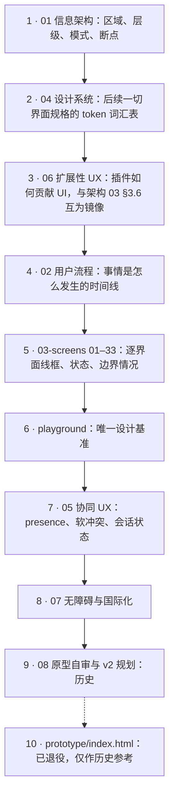

> 状态：草稿 | 负责：设计 | 更新：2026-09-18；2026-09-24（rulings §4.15：D7 结案；T-0 / Q3 / Q5 / Q6 / Q7 / Q8 回写 02、04、05、07、03-screens/01、06、08、10、11、12、13、18、19、22、29）；2026-09-25（补图）；2026-09-25（矛盾收口，rulings §4.18）；2026-09-25（§4.19）；2026-09-30（§4.21 剩余缺口样张回写：界面文档由 29 份增至 31 份——新增 `03-screens/30-table-editing.md` 表格编辑（G-32 / G-62）与 `31-chart-editing.md` 图表编辑（G-63），`16` 补空内容占位符图标条（G-80）与日期和时间格式选择器（G-81）；§2.1 计数、§3 阅读指引与推荐阅读顺序图、§8 v2 遗留缺口注记同步；playground 登记 22 条路由）；2026-10-01（§4.23 插件管理样张回写：界面文档由 31 份增至 32 份——`03-screens/09` 整篇重写为个人插件面板（G-86 / G-87），新增 `32-admin-plugin-management.md` 管理员插件管理（G-84 / G-85）；`06` §3 / §4、`03-02`、`03-24`、`01` §9 同步；§2.1 计数、§3 阅读指引与推荐阅读顺序图同步；playground 登记 23 条路由）；2026-10-04（rulings §4.25：新增「设计质量门」一节）；2026-10-04（design-language-v3 第 0 批：开头注明现行设计语言为 v3 中性平面，§1 补原则 9；新增 §2.3「现行设计语言与 playground 现状」——v3 样张路由与 ribbon 版并存、三批迁移与界面文档的对应、迁完删除旧版（DS-7、DS-8）；§2.1、§2.2、§3 的规范版本与 playground 计数改为 09 v4.0、04 v1.0、`registry.ts` 25 条，母版视图条目改为功能口径，阅读指引中的 08 标为历史；§4 D9 结案、D6 / D10 改口径、新增 D12–D14；§6 术语按 v3 改写并补创建工具条、浮动胶囊、单页 / 网格视图；§7 第 2 条结案；§8 补 v23 记录；末节设计质量门补拍板结果）；2026-10-04（design-language-v3 第 0 批：术语残留清理：ribbon / 状态栏 / `ui.ribbon` / `ui.statusBar` 的历史陈述改用 check-terms 认可的标记措辞（废弃、取代、作废））；2026-10-04（design-language-v3 第 0 批：复验修正——v11 历史条目补「已被 rulings §4.25 DS-1 取代」注记；对比度待复核由 4 项增为 5 项（设计 04 §2.6 新增待复核 5：状态色只在 panel 上达到文字线，随第 2 批）；§2.3 写明 `/styleguide` 由 v3 接替路由承担组件状态基准、接替前门禁对象不变；术语表的底部创建工具条、单页 / 网格视图（不再写「由 URL 参数唯一决定」）、浮动胶囊改为引用章程 §4.6）；2026-10-04（design-language-v3 第 0 批：复验第 2 轮修正——§7 第 2 条改为 `ui.inspectorSection` 条目字段以前端 50/09 §6.1 为唯一定义（40/16 只登记 id 与贡献方，06 只写设计约束），与 80/02 §2 单一归属一致；D14 删去已与 ED-16 对齐的缩放提示 ⇧1）；2026-10-05（design-language-v3 第 0 批修正：按 rulings §4.25 写入外壳类裁决——§4 D13 按 DS-10 结案，「帮助」不再列为冲突项；§2.3 第 1 批范围补编辑器紧凑与仅查看形态（DS-17）；§6「检查器」术语补自己的头像打开账户菜单（DS-18）、文字格式只在检查器（DS-13）与只读展示（DS-15）；§8 v23 记录补 D13 结案与本轮外壳类细化）；2026-10-05（design-language-v3 第 0 批修正：§4 D13 按结案格式划去编号、补首页其余七条差异同日结案（03-29 §6、PRD PD-28）；D14 按 rulings §4.25 DS-11、DS-16 结案（命令面板 `Mod+K`、超链接 `Mod+Shift+K`、工具单键补登 ED-16、样张 ⌘↵ 作废）；D12 的 1–4 项按 DS-9 改为已裁决、第 5 项仍随第 2 批）；2026-10-05（design-language-v3 第 0 批修正：§6 术语「命令面板」的快捷键由 `Mod+Shift+P` 改为 `Mod+K`（rulings §4.25 DS-11）；§8 v23 记录的 D14 注明结案与键值同步范围）；2026-10-05（design-language-v3 第 0 批修正：D12 第 5 项按设计 04 §2.6「原待复核 1–5 的结案」改为已结案，整条划去编号；D13 结案说明里左栏「帮助」改为打开 AS-04 的帮助菜单（帮助中心只是其中一项）；§8 v23 记录的 D12 注明结案）；2026-10-07（design-language-v3 第 1 批：按已拍板的第 1 批样张与 rulings §4.25 DS-21…DS-30、TB 技术口径定稿——§2.1 母版视图条目改为 v3 入口与退出（DS-21，03-screens/26 §1）；§2.3 `#/v3/editor` 行补第 1 批 17 个场景、registry 说明与 `/styleguide` 按 TB-3 结案，第 1 批一行改为已拍板并回写、窄屏形态改指 03-02 §5a；§3 阅读指引补 03-screens/28 新标题；§4 D1 按 DS-27 结案、§7 第 5 条同步；§6 术语「单页 / 网格视图」按 TB-30、检查器拖宽（TB-25）、底部创建工具条的评审条（DS-23）、浮动胶囊的紧凑形态（DS-17）；§8 新增 v24 第 1 批记录；末节设计质量门补第 1 批拍板）；2026-10-08（design-language-v3 第 1 批收口：§2.3 `/styleguide` 补「只在测试环境挂出」（rulings §4.25 TB-50）；§4 D14 结案说明补链接命令名「链接…」（TB-6）；§8 v24 记录补第二轮裁决 DS-31…DS-33 与 TB-31…TB-52，并改正 03 的归批说法；末节设计质量门补两处待补样张状态与主题画廊（DS-31、DS-33））；2026-10-08（design-language-v3 第 1 批评审修改：按 rulings §4.25 DS-34…DS-37、TB-55…TB-58——§1 原则 9 强调色补「按下的开关」（DS-36）；§4 D12 结案说明补 DS-35 对「输入框加 1px 独立边界」的修订；§8 评审记录第 2 条补修订注记，v24 记录补第 1 批评审意见（安静控件定为缺省、样式库原位展开、开关按下强调色淡底、次按钮透明底加细边）；末节设计质量门补评审意见后的样张修改）；2026-10-15（design-language-v3 第 2 批：按已拍板的第 2 批样张与 rulings §4.25 DS-38…DS-63——§1 原则 9 补「同一种状态只留一种画法」（DS-62）；§2.1 协同 UX 覆盖范围补分享与访问申请；§2.3 `#/v3/editor` 行补第 2 批 6 个场景、188 个状态，第 2 批一行改为已拍板并回写（备选状态保留并标「未采纳」，DS-63）；§3 阅读指引补第 2 批回写；§4 D2 按 DS-40、D4 按 DS-51 结案，新增 D15（第 2 批推迟到第 3 批的五项：横幅高度、通用导出对话框、紧凑形态的整栏面板与平板评论面板的落位、第 13 位起的序号角标）；§6 术语补整栏面板、页级提示条、访问申请、降级对象，检查器与评论锚点按第 2 批改写；§8 新增 v25 第 2 批记录；末节设计质量门补第 2 批拍板；同日再补，按回写中的裁决 rulings §4.25 DS-64…DS-68 与技术口径 TB-59…TB-75——§2.3 批次表第 2 批一行补回写中的裁决编号；§4 D15 按 TB-67 由五项增至八项（DS-53 加载画法在管理员插件清单与开始页的统一、阅读顺序的检查器入口、设置里「导入后自动高亮导入详情」开关的去留）；§6 术语「整栏面板」按 TB-60 改为沿用检查器宽度（缺省 280）与 max(400, 检查器当前宽度)，补插件整页面板的打开方式与「检查器页签只由内置包贡献」（TB-59）；§8 v25 记录补 DS-64…DS-68、TB-59…TB-75；同日再补，按回写中的裁决 rulings §4.25 DS-69、DS-70 与技术口径 TB-76…TB-86——§2.3 批次表第 2 批一行的裁决编号补到 DS-70、TB-86；§4 D15 由八项增至九项，补 ⑨ 样张未画的三条文档状态横幅（「发现新版本」、换纪元后的两条、「文档已达元素上限，只读打开」）的底色、图标与能否关闭并入第 3 批横幅样张、与横幅高度一起拍板（TB-80），⑥⑦⑧ 三项按 TB-67 核对无误；§8 v25 记录补 DS-69、DS-70 与 TB-76…TB-86；同日再补，按 rulings §4.25 TB-87…TB-95——§2.3 批次表第 2 批一行的技术口径补到 TB-95；§8 v25 记录补 TB-87…TB-95 一句；§4 D15 不变（这几条没有新的推迟项））；2026-10-22（design-language-v3 第 3 批：按已拍板的第 3 批样张与 rulings §4.25 DS-71…DS-136、TB-101…TB-129 回写——界面文档由 32 份增至 33 份：新增 `03-screens/33-login-session-and-error-pages.md` 登录、会话与错误页（DS-71，PRD 07 G-66 的落点）；§1 原则 9 补第 3 批的入口唯一；§2.1 覆盖范围、计数与单档尺寸（DS-76）；§2.3 路由表补第 3 批的页面级宿主与 18 个场景，批次表第 3 批一行改为已拍板并回写；§3 阅读指引第 5、6 条与推荐阅读顺序图补 33、第 3 批回写与页面级宿主；§2.2 演讲者视图一条、§4 D3 与 §7 第 6 条改为 03-screens/11 §6 照写的 PRD 07 §4 D3 默认答案（不在 M2–M3）；§4 D6、D10 按 DS-76 结案，D15 九项全部结案（DS-75、DS-86、DS-100…DS-105、DS-114、DS-116、DS-126…DS-128、DS-130…DS-132）；§6 术语：密度模式作废，检查器、整栏面板、跟随模式、命令面板、单页 / 网格视图、备注区按第 3 批，新增应用壳页面、阻断页、导入过渡页、回收站、跟随条、序号角标、快捷键面板、偏好设置；§7 第 4 条失去对象（DS-76）；§8 v2 变更里登录鉴权页与回收站注明已补（03-screens/33、01）、v3 变更里 D10 的注记、新增 v26 第 3 批记录；末节设计质量门补第 3 批拍板）；2026-10-22（同日再补，按回写中的裁决 rulings §4.25 DS-137、DS-138 与技术口径 TB-130…TB-151——§2.3 批次表第 3 批一行补回写中的裁决编号；§3 阅读指引第 5 条补第 3 批改写的 01、29 两份的要点（左栏即筛选、搜索框下拉、回收站，开始页的帮助与账户菜单、模板库在 03-29 §7）；§6 术语「导入页 / 导入过渡页」的「取消」回到打开导入页之前的那一页（TB-133），「回收站」的保留天数读部署配置（TB-141）；§8 v26 记录补回写中的裁决）；2026-10-22（同日再补，按回写中的技术口径 rulings §4.25 TB-152…TB-162——§2.3 批次表第 3 批一行的技术口径改到 TB-162；§6 术语「快捷键面板」补手机形态与触控形态不写「⌘/」（TB-154），「访问申请」补 M2 阻断页的「申请访问」不可用（TB-156）；§7 第 5 条「评论删除权限矩阵」按已结案的 §4 D2（DS-40）划去；§8 v26 记录补 TB-152…TB-162 这 11 条技术口径；2026-10-22 复核修正：§2.3 按 `registry.ts` 现状改写（共 30 条、页面级宿主已登记、v3 说明写第 0–3 批已拍板），批次表第 3 批一行补 DS-139 与 TB-163…TB-169，§2.1、§2.2 与「迁移节奏」改为三批都已拍板；§4 D10 与 §7 第 4 条的「随第 3 批由各归属文档删去」改为已删去；§6「快捷键面板」补 TB-164，「访问申请」补阻断页说明句不变（TB-156）；§8 v26 删去回写轮次字样，补 DS-139 与 TB-163…TB-169 的要点；§2.3 批次表第 3 批一行的技术口径改到 TB-178，§4 D15 ① 补统一高 40 指非触控形态、触控形态一行放得下时共高 55、应用壳页面同此（TB-172），§8 v26 补 TB-170…TB-178 的要点）；2026-10-23（design-language-v3 第 3 批评审修改：按 rulings §4.25 DS-140…DS-143、TB-179…TB-183 回写——§2.3 `#/v3/editor` 行与批次表第 3 批一行补评审修改的裁决编号，DS-98 注明由 DS-140 取代；§6 术语「导入页 / 导入过渡页」改为「导入对话框」（DS-140 取代 DS-97、DS-98）；§8 新增 v27 第 3 批评审修改记录；末节设计质量门补评审修改的拍板）；2026-11-04（design-language-v3 母版视图改版：§2.1 母版视图一条补检查器两个上下文入口与上下文条；§2.3 `#/v3/editor` 一行补母版视图改版的拍板与对比场景的去留，批次表新增「母版视图改版」一行；§6 术语补「上下文条」「占位符标注」两行；§8 新增 v28 母版视图改版记录（含样张转正、随之改的已拍板画面与回写的文档清单）；rulings §4.25 DS-144…DS-177、TB-186…TB-210；需求编号、优先级与里程碑不变）；2026-11-05（prd-v3-current：§4 D6 结案说明里的 200% 缩放改指 PRD NF-05 的验收口径与已知限制（rulings §4.26 PV-24），只改引用；需求编号、优先级与里程碑不变） | 依赖：charter v0.1（已核对 v0.2）、PRD（`10-prd/`，含 `03-features/07-masters-layouts-and-themes.md`、`08-app-shell.md`）、架构 03/README（`30-architecture/`）、rulings §4.7–§4.10、§4.25（第 2 批 DS-38…DS-70、TB-59…TB-95；第 3 批 DS-71…DS-143、TB-101…TB-183；母版视图改版 DS-144…DS-177、TB-186…TB-210）
> 章程已升至 v0.2（向后兼容、只增不改语义，见 `00-charter/charter.md` 顶部变更说明）；本文档集已核对 v0.2 新增内容（`preset-slide-viewer`、Q20、§5.5 贡献点 id 定稿等）并按其更新，状态头按章程原文约定继续标注「charter v0.1」，无需重写。

# 设计条线总览

本目录是基于 cordis 4 的可插拔办公文档 SDK / 在线协同编辑器的设计基线，首个文档类型为 PowerPoint（.pptx）。本文档给出设计原则、范围、阅读指引、待决事项、对章程的异议/建议、术语补充。本轮修订已与产品条线 `docs/10-prd/`（README、`03-features/02-editing.md`、`03-features/03-collaboration.md`、`03-features/04-plugin-sdk.md`、`04-non-functional-requirements.md`）与架构条线 `docs/30-architecture/`（README、`03-kernel-and-plugin-model.md`、`02-layering-and-packages.md`）逐条核对，具体对齐点见各文件内联标注（引用格式如"PRD CO-08""架构 03 §3.6"）。

> **现行设计语言：v3 中性平面**（rulings §4.25 DS-1、DS-2，2026-10-04 样张拍板）——编辑器去掉 ribbon，改 Figma 式结构：底部浮动工具条只管创建，右侧检查器只管当前选中对象的属性，其余命令进主菜单、右键、命令面板与快捷键；视觉为中性灰阶平面、品牌蓝（亮 `#3A5CE6` / 暗 `#5B7CFF`）只做强调，去掉渐变、光晕与毛玻璃，只有浮层带阴影。规范见 [09](09-design-specification.md) v4.0 与 [04](04-design-system.md) v1.0；2026-09-16 起的 Rhea + Liquid Glass 方向（[11](11-modern-glass-redesign-proposal.md)）已被取代。playground 现状与迁移见 §2.3。

---

## 1. 设计原则

1. **忠实优先，编辑其次**：导入的 pptx 即便包含当前不可编辑的特性（动画、切换、SmartArt 等），也必须高保真渲染并**如实告知**用户"这部分被原样保留"，而不是静默丢失或静默假装可编辑。这是保真报告（03-screens/10）存在的原因。
2. **命令驱动、状态透明**：一切用户可见的操作都对应一个命令（core.command），且 UI 永远诚实地反映当前状态（加载/错误/只读/离线），不伪造"一切正常"的假象。
3. **插件是一等公民，但视觉统一**：第三方贡献的 UI 必须遵循与内置功能相同的 token 与交互规范，同时必须带有清晰的归属标识（设计 06 §4），让用户随时分得清"这是编辑器自带的，还是某个插件加的"。
4. **软冲突要可见，但不能打断心流**：CRDT 保证没有需要人工合并的硬冲突，但用户体感上的"我正在操作的东西被别人动了"必须被明确表达（05-collaboration-ux.md），且优先用内联提示而非阻断式对话框。
5. **桌面优先，窄屏是变化点不是缩水复刻**：继承 Univer 教训 A7，窄屏/触屏下的呈现是同一套贡献点的"紧凑呈现"，不是另建一套 UI 或阉割功能范围之外的东西（产品已明确 <640px 仅承诺查看/评论体验，见 01-information-architecture.md §6）。
6. **键盘与屏幕阅读器是同等公民，不是补丁**：DOM/SVG 渲染架构基线（章程 ADR-0021）本身就是无障碍的先天优势，设计从一开始就利用而不是事后补救（07-accessibility-and-i18n.md）。
7. **插件失败可见但不致命**：任一插件的 Fiber 进入 `FAILED` 不应让整个编辑器 chrome 崩溃或留下费解的空白，必须有明确的降级表达（设计 06 §3，对应章程 A11）。
8. **一切视觉数值皆 token**：颜色、间距、字号、圆角、阴影、层级、动效时长——凡是会在两处以上出现的数值，必须来自 `@cordexjs/design` 发布的变量（shadcn 主题变量 + Cordex 扩展裸名变量，如 `--primary`、`--layer-*`、`--duration-*`；原 `--cordex-*` 前缀已作废，rulings C-22），不允许组件内魔法数字（04-design-system.md 开头与 §9，修补 Univer 报告标记的"非颜色 token 缺失"）。
9. **中性平面，命令各归其位**（rulings §4.25 DS-1、DS-2，2026-10-04 起）：灰阶分层级、强调色只给主操作 / 当前工具 / 选中 / 按下的开关（强调色淡底，2026-10-08 按 DS-36 补）；检查器控件按安静样式画，靠底色、标签与当前值识别（DS-35，04 §2.2、§2.6）；创建只在底部工具条，格式只在检查器，其余命令进主菜单、右键、命令面板与快捷键；同一操作在常驻界面上只有一个入口（设计质量门 Q2，09 S-12）；同一种状态只留一种画法——加载、出错、空态与列表折叠各有一份统一的件，二次确认按能否找回分三档选形态（2026-10-15 按 DS-40、DS-62 补，04 §4.1c、09 §3.3）；第 3 批据此去掉了文档列表的页内筛选条、空态里的「新建」按钮与管理页被拒横幅里的筛选按钮（2026-10-22，DS-79、DS-88、DS-96）。

---

## 2. 范围

### 2.1 覆盖范围

- 编辑器信息架构、三种模式（编辑/评审/放映）、关键用户流程（打开/编辑/协同/软冲突/离线/导出/评论/版本历史/插件生命周期）；应用壳页面（开始页、文档列表、模板库、管理页）、导入导出、放映、查看器与嵌入、登录与错误页（2026-10-22 第 3 批）。
- 33 份界面文档（`03-screens/01`–`33`，2026-09-17 新增 `29-home-start-page.md` 应用首页 / 开始页；2026-09-30 按 rulings §4.21 样张新增 `30-table-editing.md` 表格编辑、`31-chart-editing.md` 图表编辑；2026-10-01 按 rulings §4.23 样张新增 `32-admin-plugin-management.md` 管理员插件管理，`09` 重写为个人插件面板；2026-10-22 按 rulings §4.25 DS-71 新增 `33-login-session-and-error-pages.md` 登录、会话与错误页）的线框、全部状态与边界情况；组件规格以 09 v4.0（v3 中性平面）与 `playground/src/v3/` 为准；三批样张都已拍板并回写（第 3 批 2026-10-22），旧版路由（ribbon 版，已被 DS-1 取代）只作对比，全量迁移后删除（§2.3，DS-7）。
- 设计 token 体系与组件清单，覆盖亮/暗主题；v3 只有单档紧凑尺寸，原两档密度按 rulings §4.25 DS-76 删去（04-design-system.md §2.13）。
- 协同 UX 的完整规格：presence、远端光标/选区、跟随模式、软冲突可视化（覆盖 PRD CO-08 全部 11 种场景）、会话状态指示、评论锚定与脱离锚点态、版本历史、分享与访问申请（05 §12、02 F11，2026-10-15 补）、权限变化反馈（05-collaboration-ux.md）。
- 插件 UI 贡献的槽位规范：与架构 03 §3.6 贡献点总表、产品 PS-02 贡献点目录逐一对应（06-extensibility-ux.md）。
- 键盘导航、屏幕阅读器语义、IME、RTL、文案规范、对比度，覆盖 PRD NF-05（WCAG 2.2 AA）与 NF-06（国际化）的 UX 侧要求（07-accessibility-and-i18n.md）。
- ~~低保真可点击 HTML 原型（`prototype/index.html`）~~ —— **已退役**（2026-09-15 起由 `playground/` 取代，仅作历史参考，见 §8 v4 变更）。
- ~~**高保真设计稿**（`mockups/`，2026-09-15，ui-ux-pro-max skill 驱动的自包含 HTML）~~ —— **已退役**（playground 路由覆盖后仅作历史参考；其中 `26-master-view.html` 的"母版树"与专用页签形态已被 v11–v15 修订取代，勿据此实现），详见 §8"v3 变更""v4 变更"。
- **母版视图**（同一个编辑器，对齐 PowerPoint 幻灯片母版视图）：快捷键 `Mod+Alt+M`；左侧栏为**母版缩略图窗格**（母版大缩略图 + 缩进的版式小缩略图，同款卡片与选中环）；检查器仅禁用评论；母版 / 版式编辑（占位符、背景、文本样式、主题）。原「Ribbon 页签行分段入口、最左插入母版页签」的布局随 Ribbon 作废。v3 入口为主菜单「视图 › 母版视图」、`Mod+Alt+M` 与命令面板，另有检查器「版式」节的「编辑版式」（普通视图里唯一的常驻进入入口）与选中占位符形状时检查器顶行的「转到版式」（2026-11-02，rulings §4.25 DS-147，修订 DS-21「不设常驻按钮」半句）；画布列顶部的上下文条（母版视图的模式横幅）里的「关闭母版视图」是唯一的常驻退出入口；母版编辑命令的去处见 `03-screens/26` §1（2026-10-07 第 1 批定稿，rulings §4.25 DS-21；09 T-02）。完整规格见 `03-screens/26`–`28`、`01-information-architecture.md` §2.4 / §5a。

### 2.2 明确不覆盖（超出本轮范围）

- 高保真视觉设计（色彩/字体的品牌化打磨）——**2026-09-15 起解除**：先由 `mockups/`（已退役）过渡，现由 `playground/` 承担全部界面的视觉终稿：v3 样张路由（`#/v3/editor`、`#/v3/home` 与第 3 批的页面级宿主，§2.3）是现行设计语言，旧版 23 条路由（ribbon 结构 + shadcn Rhea + Liquid Glass，已被 DS-1、DS-2 取代）保留作对比；DS-8 的三批都已拍板，全量迁移后删除旧版（DS-7）；界面文档保留线框、状态与交互说明。
- 移动端原生 App；编辑类触控手势的完整规格（NF-07：触控编辑为 M4+/P2，本轮只做查看/评论的触控适配）。
- 插件市场/发现型 UI、界面上传或安装插件（2026-10-01 rulings §4.23 裁决 2 定为不做：插件只经部署预置；已设计的是个人插件面板 03-screens/09 与管理员插件管理 03-screens/32）。
- 大规模只读广播（"1 人讲、200 人看"，PRD CO-14，P2/M4+）的专属 UI。
- 演讲者视图（双屏：备注+下一页+计时器）的完整规格——按 PRD 07 §4 D3 的产品默认答案不在 M2–M3（ED-21 P2，排 M4+），03-screens/11 §6 照此写：放映中不显示备注，控制条与菜单不提供入口（2026-10-22 第 3 批改写）。
- 高对比主题（`forced-colors`）的具体 token 数值——P1，非本轮阻塞项。

### 2.3 现行设计语言与 playground 现状（2026-10-04，rulings §4.25）

**现行设计语言是 v3 中性平面**：结构按 DS-1（废弃 ribbon）、DS-3（视图切换入口）、DS-4（网格视图收起两侧面板）、DS-6（废弃状态栏），视觉按 DS-2；规范见 09 v4.0，token 见 04 v1.0。贡献点 `ui.ribbon` 删除，创建类走 `ui.toolbar`、格式类走新增的 `ui.inspectorSection`、其余走 `ui.command`（DS-5）；`ui.statusBar` 删除（DS-6），贡献点总数 27 → 26（以 40-modules/16 §4 为准）。

| playground 路由 | 设计语言 | 状态 |
|---|---|---|
| `#/v3/editor`（`state=empty\|shape\|text\|shapes-menu`、`view=single\|grid`、`theme=dark\|light`、`accent=blue\|violet\|coral`；场景状态 `state=<场景 id>.<状态 id>`） | v3 | 样张已拍板（第 0 批 DS-2…DS-4；第 1 批编辑器族 + 窄屏 17 个场景、220 个状态，2026-10-07，DS-21；第 2 批协作族 6 个场景、188 个状态，2026-10-15，DS-38…DS-62，拍板时画给用户对照的备选状态保留在样张里、标「未采纳」，实现以推荐状态为准，DS-63；第 3 批应用壳族 18 个场景，2026-10-22，DS-79…DS-136，其中导入、导出、放映、查看器、偏好设置、快捷键面板、命令面板、文档横幅、窄屏复核、在线人数与 TB-58 四项对照在编辑器宿主上，状态数以样张为准（转正后由 `src/v3/scenario-registry.ts` 自动发现）；第 3 批有 5 题采纳了原备选（DS-80、DS-91、DS-96、DS-98、DS-123），实现以采纳的状态为准，原推荐标「未采纳」；2026-10-23 文档评审时用户又提两处修改、拍板 DS-140…DS-143——导入改为叠在原页上的对话框（取代 DS-97、DS-98，导入对话框各态开在开始页与文档列表宿主上）、全站对话框按 Figma 统一（DS-142）、导出格式加文件类型图标）；2026-11-03 母版视图改版拍板（DS-144…DS-172，回写中再裁 DS-173…DS-177），拍板用的对比场景 `master-view-options` 照 DS-63 保留、没有采纳的状态标题前加「未采纳 · 」（DS-173），编辑器的现行基准；`accent` 的 violet / coral 只是对照备选 |
| `#/v3/home`（`theme`；`state=<场景>.<状态>`） | v3 | 样张已拍板，首页的现行基准；不带 state 是已拍板首页，带 state 打开第 3 批在开始页上的场景（首页补态、账户菜单等，2026-10-22） |
| `#/v3/documents`、`#/v3/templates`、`#/v3/admin/plugins`（应用壳）、`#/v3/page`（整屏：登录、回调与错误页）、`#/v3/embed`（中性宿主外框 + iframe，`frame=宽x高`）；参数同上 | v3 | 第 3 批的页面级宿主，样张已拍板（2026-10-22，DS-79…DS-136）：文档列表与回收站、模板库、管理 › 插件、登录与错误页、嵌入的现行基准；嵌入的宿主外框只是演示容器，不代表任何真实产品（DS-73）；在别的宿主路由上打开某个状态会自动转到它的宿主 |
| 其余 23 条（`/styleguide`、`/home`、`/documents`、`/editor/*`、`/export`、`/present`、`/viewer`、`/settings`、`/admin/plugins`、`/offline` 等） | 旧版（ribbon 结构 + Rhea + Liquid Glass，已被 DS-1、DS-2 取代） | 保留作对比与功能参照，不再作新界面的视觉基准；三批样张都已拍板（第 3 批 2026-10-22），全量迁移完成后删除（DS-7），历史只留在 git 与评审画廊 |

`src/routes/registry.ts` 共 30 条：旧版 23 条，加 v3 的 7 条宿主路由——`/v3/editor`、`/v3/home` 与第 3 批的五条页面级宿主（2026-10-22 第 3 批转正时登记）；v3 各条的说明写第 0–3 批都已拍板，状态为 `ready`；v3 的场景与状态由 `src/v3/scenario-registry.ts` 自动发现，目录页「设计语言 v3」按批分组列出。组件状态基准（rulings §4.25 TB-3）：a11y 与 csp-strict 门禁的对象仍是产品的 `/styleguide`（组件全状态页，70-testing/06 §7.2，50-frontend/09 V14），内容按 v3 kit，参考应用只在测试环境（`CORDEX_WEB_ENV=test`）挂出、路由登记在 50-frontend/02 §2，使 csp-strict 在同一份生产包与生产 CSP 下覆盖它（rulings §4.25 TB-50）；playground 里不在目录页展示的 `_kit` 场景是它的样张，旧版 `/styleguide` 样张随 DS-7 删除。v3 代码全部在 `playground/src/v3/`，token 只在 `.v3-root` 作用域内生效，与旧版互不影响。

**迁移节奏（DS-8）**：每批先做样张、过设计质量门（末节）、用户拍板，再回写该批文档；三批都已拍板并回写（第 3 批 2026-10-22），迁移期间「入口随 design-language-v3 第 N 批定稿」这类待定写法随之作废。按 DS-8 的分组对应到界面文档（以各批评审时为准）：

| 批次 | 范围 | 界面文档 |
|---|---|---|
| 第 0 批（2026-10-04，文档回写） | 设计系统与视觉规范、编辑器整体结构（左栏 / 画布 / 工具条 / 检查器 / 网格视图 / 主菜单）、首页、`ui.ribbon` 与 `ui.statusBar` 的去向（两者均已作废，DS-5、DS-6），以及各线描述编辑器整体结构、ribbon、状态栏的通用段落 | 04、07、09、本文件；`03-screens/02`、`29` |
| 第 1 批 编辑器族（2026-10-07 拍板并回写，DS-21） | 插入、文本、表格、图表、母版、版式、设计主题、右键、查找等；编辑器的紧凑窗口（640–1024px）与仅查看（< 640px）两种形态也随本批出样张（rulings §4.25 DS-17，未放到第 3 批） | `03-screens/03`、`04`、`05`、`14`–`21`、`26`–`28`、`30`、`31`；窄屏形态回写 `03-screens/02` §5a 与 01 §6 |
| 第 2 批 协作族（2026-10-15 拍板并回写，DS-38…DS-63；回写中再裁 DS-64…DS-70，技术口径 TB-59…TB-95） | 评论、历史、分享、插件、离线、保真报告；25 题均按推荐，备选状态保留并标「未采纳」（DS-63）；同时改了第 1 批已拍板的若干画面（插件横幅改中性底、编辑模式补评论钉、画布空白处右键加「添加评论」、仅查看形态评论面板改手机画法、打开失败页「申请访问」接留言弹层、缺插件占位改两行、降权横幅后半句、评论页签换成第 2 批评论面板，§8 v25） | `03-screens/06`–`10`、`12` 整篇改写；第 1 批受影响的 `03-screens/02`、`05`、`13` 等随之改；01、02、04、05、06、07、09 与本文件 |
| 第 3 批 应用壳族（2026-10-22 拍板并回写，DS-79…DS-136；开工前已裁 DS-71…DS-78，技术口径 TB-101…TB-129；回写中再裁 DS-137…DS-139，技术口径 TB-130…TB-178；文档评审时的修改 2026-10-23 拍板，DS-140…DS-143，技术口径 TB-179…TB-183） | 文档列表与回收站、开始页补态、账户菜单、模板库、管理员插件、导入导出、放映、查看器与嵌入、偏好设置、快捷键面板、命令面板、登录与错误页、文档横幅、窄屏复核、在线人数，以及 TB-58 留下的四项对照；58 题中 5 题采纳原备选（DS-80 搜索用下拉、DS-91「个人资料…」M3 前不显示、DS-96 去掉「只看被拒插件」、DS-98 先进导入页（2026-10-23 起由 DS-140 取代）、DS-123 画布底主按钮用 kit 不可用态），原推荐标「未采纳」；评审修改：导入改为叠在原页上的对话框（DS-140、DS-141）、全站对话框按 Figma 统一（DS-142，第 1–3 批全部对话框随之改）、导出格式加文件类型图标（DS-143），§8 v27；同时改了第 0–2 批已拍板的若干画面（首页左栏加「回收站」、横幅统一高 40、「文件 › 导出…」改 ⇧⌘E、评审者与查看者没有文档菜单（文件名不再是菜单触发器）、降权后「文件 › 导出…」不可用、头像组里他人的头像是「跟随」按钮、紧凑形态的整栏面板进抽屉与底部 Sheet、平板评论面板按方向排、头像序号角标、视图切换改分段、备注区改凹陷底，§8 v26） | `03-screens/01`、`11`、`22`–`25`、`32` 整篇改写，`13`、`29` 改写受影响的节，新增 `33`（DS-71）；第 1、2 批受影响的 `03-screens/02`、`06`–`10`、`12`、`14`、`20` 等随之改；01、02、04、05、06、07、09 与本文件 |
| 母版视图改版（2026-10-23 至 11-04，2026-11-03 拍板，DS-144…DS-172；回写中再裁 DS-173…DS-177，技术口径 TB-186…TB-210） | 2026-10-23 用户反馈母版视图「切换是切换不过去的」，选择按标杆重新设计（DS-144，未采用推荐）：第一步把母版视图接成编辑器宿主的全局模式（主菜单、`Mod+Alt+M`、命令面板与网格胶囊都能进出），第二步按 PowerPoint、Google Slides、Keynote 重做，方向「同壳上下文条 · 点哪编辑哪」；42 题全部按推荐；同时改了第 1–3 批已拍板的若干画面（检查器「版式」节多「编辑版式」、选中占位符形状时检查器顶行多「转到版式」、版式缩略与版式画廊卡片换一种细线框、「主题颜色与字体」改盖检查器栏、快捷键面板多母版视图的三行，§8 v28） | `03-screens/26` 整篇改写；随之改 `03-screens/02`、`03`、`04`、`06`、`07`、`09`、`10`、`12`、`13`、`16`、`17`、`20`、`24`、`27`、`28`；01、02、04、05、06、07、09 与本文件 |

历史文档 08、10、11、12 描述的是旧原型与 Rhea + Liquid Glass 时期，状态头已注明被 rulings §4.25 DS-1 / DS-2 取代，正文不再修订。

---

## 3. 阅读指引

建议顺序：

1. `01-information-architecture.md` —— 先建立整体空间感（区域、层级、模式、断点）。
2. `04-design-system.md` —— token 体系是后续一切界面规格的词汇表。
3. `06-extensibility-ux.md` —— 理解插件如何贡献 UI，这是"每一级可插拔"在设计层面的落实，与架构 03 §3.6 互为镜像。
4. `02-user-flows.md` —— 关键流程，建立"事情是怎么发生的"的时间线视角。
5. `03-screens/*.md` —— 逐个界面的线框、状态、边界情况，前端可直接对照开工。**2026-09-15 新增 13–25**（`13-import-progress-and-degraded-states.md`、`14-slide-management-and-layouts.md`、`15-insert-menu-and-shape-library.md`、`16-text-editing-and-formatting.md`、`17-selection-alignment-and-snapping.md`、`18-image-editing.md`、`19-undo-redo-clipboard-and-save-state.md`、`20-view-zoom-and-navigation.md`、`21-find-and-replace.md`、`22-export-dialog.md`、`23-settings-panel.md`、`24-keyboard-shortcuts-panel.md`、`25-viewer-preset-shell.md`），覆盖 `10-prd/07-design-coverage-and-gaps.md` 的 M1/M2 P0 缺口；原有 `03`（属性面板）、`05`（上下文菜单）、`06`（评论面板）、`09`（插件管理器）、`12`（离线/冲突横幅）在文末各追加一节"补充（G-xx）"，不改动原有正文。**2026-09-15 同轮再新增 26–28**（`26-master-view-and-editing.md`、`27-layout-picker-and-reset.md`、`28-design-tab-and-themes.md`，对应产品线并行撰写中的 `10-prd/03-features/07-masters-layouts-and-themes.md` ML-01–04），三份均含"设计规格"与"应用的 UX 规则"小节；原有 `02`、`03`、`14`、`20` 同样各追加一节"补充/更新"指向母版视图的衔接点，`01-information-architecture.md` 新增"§5a 视图模式：普通/母版"，`02-user-flows.md` 新增"F10 母版视图与版式/主题管理"与对应的 `F-P16`，`06-extensibility-ux.md` 新增"§2.10a 母版视图下的贡献点"。**2026-09-17 新增 29**（`29-home-start-page.md`，应用首页 / 开始页，对应 PRD `08-app-shell.md` AS-01…06、09 T-07、playground `#/home`）；界面文档共 **29 份**。**2026-09-18**：`26` / `01` / `02` / `06` 按 rulings §4.10 回写（母版视图 = 同一个编辑器、母版缩略图窗格、`Mod+Alt+M`、Q11–Q13 / Q16 / Q18 / Q20）。**2026-09-30 新增 30–31**（rulings §4.21 剩余缺口样张回写）：[`30-table-editing.md`](03-screens/30-table-editing.md) 表格编辑（G-32 插入与单元格文本 M2、G-62 结构与样式 M3，playground `#/editor/table`）、[`31-chart-editing.md`](03-screens/31-chart-editing.md) 图表编辑（G-63 插入图表与数据编辑 M3，playground `#/editor/chart`）；[`16`](03-screens/16-text-editing-and-formatting.md) 补空内容占位符图标条（G-80）与文本编辑态的日期和时间格式选择器（G-81）；界面文档共 **31 份**。**2026-10-01**（rulings §4.23 插件管理样张回写）：[`09-plugin-manager.md`](03-screens/09-plugin-manager.md) 整篇重写为个人插件面板（G-86 / G-87，playground `#/editor/plugins` 14 态），新增 [`32-admin-plugin-management.md`](03-screens/32-admin-plugin-management.md) 管理员插件管理（G-84 / G-85，playground `#/admin/plugins` 11 态）；界面文档共 **32 份**。**2026-10-07**（design-language-v3 第 1 批）：编辑器族与窄屏形态按已拍板样张回写（§2.3）；[`28-design-tab-and-themes.md`](03-screens/28-design-tab-and-themes.md) 的标题改为「设计主题：主题画廊、变体、主题颜色与字体」，文件名不变。**2026-10-15**（design-language-v3 第 2 批）：协作族的 `06`、`07`、`08`、`09`、`10`、`12` 按已拍板样张整篇改写（§2.3）。**2026-10-22**（design-language-v3 第 3 批）：应用壳族的 `01`、`11`、`22`、`23`、`24`、`25`、`32` 按已拍板样张整篇改写，`13`、`29` 改写受影响的节（§2.3）——[`01-document-list.md`](03-screens/01-document-list.md) 文档列表：左栏「最近 / 我的文档 / 与我共享 / 回收站」就是筛选、搜索框下拉与搜索结果页、卡片与「⋯」菜单、回收站（M3）；[`29-home-start-page.md`](03-screens/29-home-start-page.md) 开始页：首页各态、帮助菜单与账户菜单（§2.4、§2.5），模板库（M3）在它的 §7；[`23-settings-panel.md`](03-screens/23-settings-panel.md) 的标题改为「偏好设置」（DS-113），[`24-keyboard-shortcuts-panel.md`](03-screens/24-keyboard-shortcuts-panel.md) 的标题改为「键盘快捷键面板与命令面板」，文件名都不变；**新增 33**（rulings §4.25 DS-71）：[`33-login-session-and-error-pages.md`](03-screens/33-login-session-and-error-pages.md) 登录、会话与错误页（登录页、OIDC 回调与登录失败、新窗口重新登录、路由兜底与错误页、退出登录的未同步确认、嵌入里的登录与打开失败，PRD 07 G-66 的落点，playground `#/v3/page`、`#/v3/embed`）；界面文档共 **33 份**。
6. `playground/` —— **2026-09-15 起唯一设计基准**：真实组件页面（`npm install && npm run build`，或直接看已发布的 artifact）；2026-10-04 起现行设计语言为 v3（`#/v3/editor`、`#/v3/home`，2026-10-22 起另有第 3 批的页面级宿主 `#/v3/documents`、`#/v3/templates`、`#/v3/admin/plugins`、`#/v3/page`、`#/v3/embed`，代码 `src/v3/`），旧版（ribbon 版，已被 DS-1 取代）路由保留作对比直到全量迁移（§2.3）；`mockups/*.html` 与 `prototype/index.html` 均已退役，仅作历史静态稿。
7. `05-collaboration-ux.md` —— 协同相关的横切规格（presence、软冲突、会话状态）。
8. `07-accessibility-and-i18n.md` —— 横切的无障碍与国际化规则。
9. `08-prototype-audit-and-v2-plan.md` —— **2026-09-15 新增（历史，已被 rulings §4.25 DS-1 / DS-2 取代）**：原型现状自审、设计文档↔原型覆盖矩阵、功能缺口清单、v2 信息架构与路由方案、实施顺序与验收标准；是本轮原型 v2 重写与界面文档扩充的直接依据。
10. `prototype/index.html` —— **已退役**的低保真可点击原型（v2 / v3：hash 路由 + 共享外壳 + 每路由状态切换器，详见 08 文档 §4 与本文件 §8"v2 变更""v3 变更"）；其"母版树"等表述已被 playground 取代，勿据此实现。

**推荐阅读顺序**

怎么读：实线是建议的阅读先后，前四步建立空间感、词汇表、扩展模型与时间线，再进入逐界面细节；虚线指向已退役的历史原型，只在追溯时阅读。

---

## 4. 待决事项（决策人可随时否决默认值）

| # | 问题 | 当前默认/处理方式 | 决策人 |
|---|---|---|---|
| ~~D1~~ | ~~幻灯片文本的默认度量单位（pt/cm/inch）与语言环境映射规则~~ | **已结案**（2026-10-07，rulings §4.25 DS-27，§4.22 SR-4 同时结案）：文档与样张的数值按 pt 书写，产品按设置的度量单位显示（中文默认 cm、英文默认 in，03-screens/23）；网格间距三档 6 / 12 / 18 pt、缺省 12 pt | — |
| ~~D2~~ | ~~评论的删除权限矩阵（`owner` 是否可删除任何人的评论）~~ | **已结案**（2026-10-15，rulings §4.25 DS-40）：整条讨论串只有文档所有者能删（走模态确认「删除此讨论串？将同时删除 N 条回复，删除后无法恢复。」），发起人只能删自己的评论与回复；所有者也可删他人的回复；与 PRD CO-04「删除自己的（所有者可删任何）」一致（03-screens/06，05 §10） | — |
| D3 | 放映模式"演讲者视图"（双屏：备注+下一页+计时器）是否在当前里程碑范围 | 按 PRD 07 §4 D3 的产品默认答案：不在 M2–M3（ED-21 P2，排 M4+），放映中不显示备注，控制条与菜单不提供入口、不做灰显占位；03-screens/11 §6 已照此写（2026-10-22 第 3 批改写），M4+ 排期时再出样张 | 产品 |
| ~~D4~~ | ~~保真报告的"不再提醒"是否需要跨会话/全局静音（当前仅做当次会话静音）~~ | **已结案**（2026-10-15，rulings §4.25 DS-51）：去掉「本次不再提醒」；打开后有差异时只出一次轻提示，看过报告或关掉提示即算已读，同一文档有新差异前不再出（每用户本地，不同步给他人）；常驻入口只有主菜单「文件 › 保真报告」（03-screens/10） | — |
| D5 | 分享对话框是否需要"转移所有权"能力 | 03-screens/08 未设计此能力 | 产品 |
| ~~D6~~ | ~~密度模式是否需要第三档"宽松（spacious）"~~ | **已结案**（2026-10-16，rulings §4.25 DS-76）：v3 只留单档紧凑尺寸，原舒适 / 紧凑两档与第三档都不做，偏好设置里删去「密度」一行；要更大的界面用浏览器缩放（200% 缩放的验收口径与已知限制见 PRD NF-05，rulings §4.26 PV-24）；04 §2.13、03-screens/23 | — |
| ~~D7~~ | ~~是否支持未登录/匿名访客身份~~ | **已结案**：不支持匿名，分享链接始终要求登录（rulings §4.13 S-1、§4.15 Q6）；单组织部署、无租户（§4.15 T-0）；注册由部署开关 `auth.selfSignup` 控制、默认关（管理员邀请 / 在 IdP 建号）。已回写 02-user-flows、03-screens/08 | — |
| ~~D8~~ | ~~`render.overlay` 贡献点未出现在架构 03 §3.6 v0.1 总表~~ | **已解决**：章程 v0.2 §5.5 贡献点 id 定稿已正式收录 `render.overlay`（与 `ui.statusBar` 等 id 的最终大小写一并定稿；`ui.statusBar` 已于 2026-10-04 作废，DS-6），见 06-extensibility-ux.md §2.7/§2.8 | — |
| ~~D9~~ | ~~`ui.ribbon` 的 tab/group/control 三级如何精确编码进统一的 `{id, slot, order, when}` 贡献形状~~ | **已失去对象**：`ui.ribbon` 已作废，创建类走 `ui.toolbar`、格式类走新增 `ui.inspectorSection`、其余走 `ui.command`（rulings §4.25 DS-5） | — |
| ~~D10~~ | ~~密度选择器属性名 `data-cordex-density`~~ | **已失去对象**（2026-10-16，rulings §4.25 DS-76）：只留单档尺寸，不再需要密度选择器；`data-cordex-density`、`ThemeState.density`、上下文键 `density`、`ThemeService.setDensity` 与 `ui.theme` 的 `density?` 已于 2026-10-22 第 3 批回写中由各归属文档删去或注明作废（架构 30/03 §3.6、ADR-0017、40-modules/10、前端 50/09 §3） | — |
| D11 | 高对比主题（`themes/high-contrast.ts`）具体 token 数值 | P1，非本轮阻塞项，无障碍验收标准明确后由设计补齐 | 设计（自行认领，供后续里程碑） |
| ~~D12~~ | ~~v3 样张的 5 项对比度缺口：`text-3` 承载可读信息、暗色强调色上白字、身份色上白字、字段无独立边界；状态色只在 panel 上达到文字线（2026-10-04 复验补登）~~ | **已结案**（2026-10-05，rulings §4.25 DS-9）：调整 token 达到 WCAG AA——`text-3` 只用于占位与禁用、可读信息改用 `text-2`，带文字的强调色实底改用 `accent-solid`、协作者身份色加深到白字 ≥ 4.5:1，输入框加 1px 独立边界（2026-10-08 被 DS-35 修订：改为安静样式，输入只铺淡底、不描边，控件边界不再要求 3:1，04 §2.6），改后重截样张；第 5 项随 `danger` 加深一并结案（状态色文字可放 canvas / panel / panel-2，各自浅底上只放图标；第 2 批若要在浅底上写状态色文字再加深并核算）。取值与核算以 04 §2.6「原待复核 1–5 的结案」为准 | — |
| ~~D13~~ | ~~v3 首页侧栏底部的「设置」项与 PRD AS-06（D13）「设置的唯一入口是账户菜单」冲突~~ | **已结案**（2026-10-05，rulings §4.25 DS-10）：按 AS-06，设置只在账户菜单，首页左栏去掉「设置」项（03-screens/29 §2.1、09 T-07）；左栏「帮助」打开 AS-04 的帮助菜单（原「指南与帮助」条目收在这里，帮助中心只是其中一项），不在冲突之列；首页其余七条样张差异按 DS-11、DS-12 同日结案（03-screens/29 §6，PRD README PD-28） | — |
| ~~D14~~ | ~~rulings §4.25 DS-1、DS-5 原文写「⌘K」，而命令面板快捷键是 PRD ED-30 的 `Mod+Shift+P`、`Mod+K` 为 ED-19 超链接；样张工具提示另有单字母工具键与 ⌘↵ 未登记 ED-16（缩放菜单的提示已改为与 ED-16 一致的 ⌘0 / ⌘1）~~ | **已结案**（2026-10-05，rulings §4.25 DS-11、DS-16）：命令面板改用 `Mod+K`（DS-1 / DS-5 的「⌘K」即命令面板），超链接改为 `Mod+Shift+K`（命令名随后统一为「链接…」、对话框标题「插入链接」，TB-6）；工具单键 V / T / S / C 补登 ED-16；放映按 ED-16 为 F5 / Shift+F5，样张 ⌘↵ 作废；替换在 macOS 为 ⇧⌘H。PRD 02 ED-16、ED-19、ED-30 已改写，样张提示随之一致 | — |
| ~~D15~~ | ~~第 2 批推迟到第 3 批的九项（rulings §4.25 DS-38、DS-42、DS-46、DS-62、TB-67、TB-80）~~ | **已结案**（2026-10-22，第 3 批拍板，rulings §4.25）：① 横幅高度统一为 40（含 1px 底边），带按钮的横幅上下内边距由 6 改为 5，按钮仍 28 垂直居中，多行照常撑高（DS-75，04 §4.1a；高 40 指桌面与紧凑这两种非触控形态，触控形态的按钮与 × 照常 44、横幅随之撑高，一行放得下时共高 55，应用壳页面同此，TB-172）；② 通用导出对话框已出 v3 样张并拍板（DS-100…DS-105，03-screens/22 整篇改写）；③ 紧凑形态（640–1024）里版本历史、保真报告进右侧检查器抽屉（宽 280），插件整页面板改画布底部 Sheet，非模态抽屉从横幅下沿开始（DS-130，01 §6、06 §2.2）；④ 平板评论面板按方向排：竖屏当前页在上、面板在下，横屏右侧整高侧栏（DS-131，03-screens/06、05 §10）；⑤ 同色第 13 位起写序号角标：头像组里挂在头像下沿中线、在线列表里在右下，第一位不画，会话数不上头像（DS-132，04 §2.4、05 §2）；⑥ 开始页、文档列表、管理员插件清单的加载统一用 DS-53 的加载行：超过 300 ms 才出现、居中一行、翻页追加在末尾、不画骨架（DS-86）；⑦ 阅读顺序的常驻入口在偏好设置「无障碍」组，命令面板是第二入口，选它打开偏好设置、焦点落在「无障碍 › 阅读顺序」，检查器不设入口（DS-116，03-screens/23、07 §3）；⑧「导入后自动高亮导入详情」与「评论 @ 我时提示」两个开关都删去，通知组只留「协作者加入时提示」（缺省关）（DS-114，03-screens/23）；⑨ 三条文档状态横幅：「发现新版本」警告浅底 + 刷新图标、不可关闭、唯一按钮「刷新」（DS-126）；换纪元后没有未提交更改时中性底 + 信息图标、可关闭、不自动消失，有未提交更改时同「更改过大无法同步」（DS-127）；「文档已达元素上限，只读打开」同「编辑者名额已满」，中性底 + 锁形、可关闭、无按钮（DS-128）；见 03-screens/12、05 §7 | — |

---

## 5. 对章程的异议/建议

本轮未发现需要修改章程条款本身的实质性问题（章程 §5.5 的贡献点 id 列表本身即标注"如"，是示例而非穷尽列表，设计条线的槽位命名在此框架内工作，不构成异议）。以下是两条建议，供总编排在裁决相关跨条线问题时一并考虑：

1. ~~**放映模式播放动画/切换效果，是否与章程 §2.3 非目标条款冲突，建议显式澄清**~~（**已结案**：rulings §4.3 设计-1——M1–M3 放映渲染每页结束态、不播放，播放为 M4+ P2；01-IA §5.1、03-screens/11 已按此改写，rulings §4.18 UX-16）：原文如下，仅作记录——章程 §2.3 写"不在 M1–M3 内做动画/切换效果的**编辑**（仅保留与回写）"。设计条线的解读是：这只禁止"编辑"，不禁止"放映时按原样播放"——若不能播放，放映模式的产品价值会被严重削弱，且与保真报告"已保留但不可编辑"的一贯表达一致。03-screens/11、02-user-flows.md 已按此解读设计。建议总编排确认这一解读，并在章程或 PRD 相应条款中补一句显式澄清，避免下游（尤其架构 07 渲染管线）误读为"完全不渲染动画"。
2. **"应用壳级但含业务逻辑"的 UI 组件归属需要架构裁定**：章程 §5.2 定义 `apps/web` 为"仅组装、零业务逻辑"，但设计条线交付的分享与权限对话框（03-screens/08）、插件管理器（03-screens/09）等界面明显带有状态管理与业务判断（角色变更、依赖冲突提示等），不像是"组装"能覆盖的复杂度。产品条线在 `10-prd/03-features/03-collaboration.md` CO-15 已提出相同疑虑并建议回写章程 §5.2（见该文件"对章程的异议/建议"#10）。设计条线在此附议：这类界面的实现应归属某个可复用包（如某个 `preset` 或 `ui-react` 之上的应用级组件库），而不是完全放进"零业务逻辑"的 `apps/web`，具体归属请架构-结构裁定。

---

## 6. 术语补充（章程 §4 之外，本设计条线使用）

| 术语 | 英文/标识 | 定义 | 来源 |
|---|---|---|---|
| 评审模式 | Review Mode | 编辑器三态之一：只读浏览 + 评论，无编辑能力 | 本设计条线新增，见 01-information-architecture.md §5 |
| 放映模式 | Present Mode | 编辑器三态之一：全屏只读呈现；M1–M3 渲染每页结束态（放映为主序列可见性终态，M2 P1），不播放动画与切换，播放为 M4+ P2（章程 §2.3、rulings 设计-1） | 同上，见 03-screens/11 |
| 保真报告 | Fidelity Report | 打开 pptx 后生成的报告，说明哪些特性被不透明保留（opaque preservation）但当前不可编辑 | 本设计条线新增，见 03-screens/10 |
| 软冲突 | Soft Conflict | CRDT 并发操作合并成功但结果可能不符合任一用户意图的情形，与"硬冲突"相对 | 章程 §4 隐含，PRD CO-08 正式定义，设计条线沿用 |
| 贡献槽位 | Contribution Slot | 贡献点在 UI 上的具体承载位置（如创建工具条的「更多」、检查器的某个分区），是贡献点（逻辑概念）在界面上的可视化落点 | 本设计条线新增，见设计 06 |
| 跟随模式 | Follow Mode | 点检查器协作行里他人的头像（按钮「跟随 〈姓名〉」）后，本地视口与当前页随对方翻页、滚动、缩放；跟随中对方头像外圈与画布列外框换成对方身份色，画布顶部是跟随条；自己翻页、滚动或缩放即退出；被跟随者不感知；先跟随再进放映即在放映里保持跟随（2026-10-22，rulings §4.25 DS-106、TB-113） | PRD CO-03，设计条线细化交互，见 05-collaboration-ux.md §4 |
| 归属标识 | Attribution Badge | 标记某 UI 元素由第三方插件贡献的视觉标记 | 本设计条线新增，见设计 06 §4 |
| ~~密度模式~~ | ~~Density Mode~~ | **已作废**（2026-10-16，rulings §4.25 DS-76）：原舒适 / 紧凑两档界面控件尺寸预设删去，v3 只留单档紧凑尺寸，偏好设置里没有「密度」一行；要更大的界面用浏览器缩放 | 本设计条线新增，见 04-design-system.md §2.13 |
| 检查器 | Inspector | 编辑器右侧 280px 贴边面板（原称「检查器坞」；桌面形态可拖宽 240–480，rulings §4.25 TB-25）：顶部协作行（头像组、放映、分享；头像组里自己的头像打开账户菜单，rulings §4.25 DS-18；「分享」有待处理的访问申请时带强调色圆点，DS-48），「设计」页签只放当前选中对象的属性、随选中切换分区（文字格式只在这里，DS-13；评审模式与只读角色下只读展示当前值，DS-15），「评论」页签放评论面板（分段筛选、线程与回复，DS-43）；需要整栏空间时换成整栏面板（见下）；网格视图下收起为右上「协作与分享」胶囊；2026-10-22 起协作行里他人的头像是「跟随」按钮（DS-106），「放映」从当前页放映 ⇧F5（TB-103），紧凑形态（640–1024）里检查器是右侧抽屉、从横幅下沿开始（DS-130） | 本设计条线新增，见 09 §3 |
| 整栏面板 | Inspector Takeover | 检查器整栏换成一个面板：协作行不动，页签行换成面板标题行。列表与报告类（版本历史、保真报告）沿用检查器宽度（缺省 280），开着时检查器左缘的分隔条照常可拖；编辑与整页类（图表数据面板、插件整页面板）宽 max(400, 检查器当前宽度)，开着时分隔条不可拖，关闭后回到检查器原宽（rulings §4.25 DS-26、DS-38、TB-60）。插件整页面板从同一插件检查器分区右下的「展开」（由宿主按分区条目的 `expandPanel` 画出）或命令打开，跟着触发它的选中对象；检查器页签只由内置包贡献（当前只有「评论」），第三方面板不作页签（TB-59）。紧凑形态（640–1024）里列表与报告类进右侧检查器抽屉（宽 280），插件整页面板改画布底部 Sheet（2026-10-22，DS-130） | 本设计条线新增，见 04 §2.13、§4.1c，01 §2.1，06 §2.2 |
| 页级提示条 | Page Hint | 画布顶部居中的浮动胶囊，说明这一页有以占位显示或无法解析的内容，带「查看详情」：本会话每页第一次进入时出现、约 5 秒淡出，不设 ×（rulings §4.25 DS-51） | 本设计条线新增，见 04 §4.1c、03-screens/13 |
| 访问申请 | Access Request | 没有权限的用户在阻断页留言申请访问；所有者在分享对话框顶部「访问申请 N」一节选角色后批准或拒绝，「分享」按钮上的圆点提示有待处理的申请（PRD 原称「待处理申请」，rulings §4.25 DS-48 统一为「访问申请」）；随分享在 M3 开放，M2 阻断页上的「申请访问」留在原位、不可用，写「后续版本提供」，阻断页的说明句不变（TB-156） | PRD 07 G-56，见 03-screens/08、05 §12 |
| 降级对象 | Degraded Object | 画布上暂时无法显示的对象（保真占位）与缺少插件的元素，共用一种选中类型与一套检查器分区；纸面上画成虚线框 + 图标 + 一行标题 + 一行原因（rulings §4.25 DS-52） | 前端 50/10，见 04 §4.1c、§4.2 |
| 底部创建工具条 | Creation Toolbar | 画布底部居中的浮动工具条，只管创建：选择、文本、形状、图片、表格、图表、评论、更多；两种视图常驻，插件的创建按钮进「更多」（`ui.toolbar`）；评审模式与只读浏览时整条换成评审条 / 浏览条（rulings §4.25 DS-23，03-screens/02 §6.2） | 章程 §4.6（rulings §4.25 DS-1、DS-5），见 09 §3 |
| 单页视图 / 网格视图 | Single / Grid View | 编辑器的两种视图，只有一份视图状态（参考应用同步到地址栏查询参数 `view`：缺省的单页不写，切换不新增浏览历史，刷新后保持；嵌入由宿主决定，rulings §4.25 TB-30）：单页为左栏 + 画布 + 检查器，网格为全部幻灯片排开；入口在左栏顶部（单页）、网格左上胶囊（网格）与主菜单「视图」；左栏与胶囊里的切换是分段控件（两项各 28，2026-10-22，rulings §4.25 DS-133） | 章程 §4.6（rulings §4.25 DS-3、DS-4），见 09 §3.2 |
| 浮动胶囊 | Floating Capsule | 网格视图里接替左栏与检查器的两个浮层：左上「文档」、右上「协作与分享」；紧凑形态（640–1024）的单页视图用同一对胶囊（rulings §4.25 DS-17，03-screens/02 §5a） | 章程 §4.6（rulings §4.25 DS-4），见 09 §3 |
| 评论锚点 | Comment Anchor | 评论线程关联的画布位置（页/元素/文本范围三种类型）：用评论工具点对象落元素锚点、点空白处落页级锚点，编辑文字时右键「添加评论」落文本范围锚点（rulings §4.25 DS-44、DS-45） | PRD CO-04，设计条线细化呈现，见 03-screens/06 |
| 已脱离锚点 | Detached (from anchor) | 评论锚点对象被删除后，线程转为的状态：不再有画布定位，仍可读/回复/解决 | PRD CO-04 术语，设计条线采用（取代早期草稿"孤立评论"提法） |
| 备注区 | Speaker Notes (panel) | 画布下方的演讲者备注文本编辑区，主菜单「视图 › 备注」开关，网格视图不显示；凹陷底、不描边（`--v3-notes-fill`，悬停出细边），亮色占位字用 `text-2`（2026-10-22，rulings §4.25 DS-134，04 §2.2）；上方拖动把手维持原画法（DS-135） | 本轮从 PRD ED-29 焦点顺序要求反推补齐，见 01-information-architecture.md §2.3a、09 §3 |
| 会话状态机 | Session State Machine | 协同连接状态的六个态：`connecting`/`syncing`/`synced`/`reconnecting`/`offline`/`readonly-degraded` | PRD CO §3，设计条线在 05-collaboration-ux.md §7、03-screens/12 中作为呈现依据 |
| 命令面板 | Command Palette | `Mod+K` 呼出的全局命令模糊搜索入口（2026-10-05 由 `Mod+Shift+P` 改，rulings §4.25 DS-11；DS-1、DS-5 的「⌘K」即此入口），读取 `ui.command`/`core.command`；宽 480、顶部锚定、不加遮罩、焦点圈定，层级盖过对话框（2026-10-22，DS-117，03-screens/24） | 章程 §5.2 提及但未列入 §4 术语表，本设计条线补充定义 |
| 应用壳页面 | App Shell Pages | 编辑器之外共用一套外壳的页面：开始页、文档列表、模板库、管理 › 插件——左栏 220（导航、搜索与用户行）+ 主区顶栏 56 + 顶栏之下只横跨主区的横幅通道（最多两条叠放）；左栏「最近 / 我的文档 / 与我共享 / 回收站」就是文档列表的筛选，列表页不设页内筛选条（2026-10-22，rulings §4.25 DS-79、DS-92） | 本设计条线新增，见 01 §1、04 §4.1d、03-screens/01、29 |
| 阻断页 | Blocking Page | 整个区域不能用时画的页：画布底色上居中一列、不加卡片——图标 32、可选的上下文一行、标题、说明与按钮；用于打开失败、「此文档在回收站中」、找不到该文档、链接已失效、登录页、回调与错误页，以及嵌入里的登录提示与打开失败（2026-10-22，rulings §4.25 DS-71、DS-85、DS-118） | 本设计条线新增，见 04 §4.1d、09 T-08、03-screens/33 |
| 导入对话框 | Import Dialog | 开始页与文档列表顶栏的「导入 .pptx」在原页上打开的「导入」对话框（宽 560、固定高 406，同 Figma 文件浏览器的 Import 对话框；手机为贴底的底部面板、平板为对话框）：选文件、拖入、上传、服务端解析与失败都在框里原位切换，成功后关闭、进编辑器；主区的拖入落区照常保留，松开即打开它的上传态；`/import` 叠在来路之上、浏览器后退等于关闭，上传与解析中「取消」、× 与 Esc 都是中止并关闭、留在原页（2026-10-23，rulings §4.25 DS-140、TB-179…TB-181）。原称「导入页 / 导入过渡页」（DS-97、DS-98 的整屏画法）2026-10-23 起由 DS-140 取代 | 本设计条线新增，见 01 §1、04 §4.1d、03-screens/13 |
| 回收站 | Trash | 左栏第 5 项（DS-79）：移到回收站的文档列在这里，卡片封面变淡、常驻「恢复」、不能打开，保留天数读部署配置（缺省 30，rulings §4.25 TB-141）；只在回收站里「永久删除…」（第三档模态确认，M3）；所有者从旧链接打开时是「此文档在回收站中」阻断页（2026-10-22，rulings §4.25 DS-85） | PRD 08 AS-01、06 SV-11，见 03-screens/01 |
| 跟随条 | Follow Bar | 跟随中画布顶部居中的一条提示：头像 ·「正在跟随 〈姓名〉」┊「停止跟随」；编辑器与放映同一个件，放映里停止后换成「已停止跟随 〈姓名〉 ┊ 返回同步」（2026-10-22，rulings §4.25 DS-106、TB-113） | 本设计条线新增，见 05 §4、04 §4.1d、03-screens/11 |
| 序号角标 | Avatar Badge | 12 种身份色用完后（第 13 位起）复用颜色的头像上写的数字，即这个人在同色里的序号，同色第一位不画：头像组里挂在头像看得见那一段的底部中线、在线列表里在右下（24px 头像配 14、20px 配 12）；会话数不上头像（2026-10-22，rulings §4.25 DS-132、TB-124） | 本设计条线新增，见 04 §2.4、05 §2 |
| 快捷键面板 | Shortcuts Panel | 主菜单「帮助 › 键盘快捷键」、账户菜单「键盘快捷键」、开始页的帮助菜单与 `Mod+/` 打开的画布浮动面板（非模态，画布列右上、宽 360，与查找和替换同一位置、同一时刻只开一个；开始页上浮在主区右上）：搜索框 + 按作用域分组的快捷键，插件各一组；开始页与文档列表在手机（< 640）上改为贴底的底部面板、平板上照常浮动，触控形态的菜单项一律不写键位提示（「⌘/」「⌘,」都不写，面板里照常列出）（2026-10-22，rulings §4.25 DS-115、TB-105、TB-116、TB-154、TB-164） | 本设计条线新增，见 03-screens/24 |
| 偏好设置 | Preferences | 原称「设置」（03-screens/23 的标题随之改）：账户菜单「偏好设置…」或 `Mod+,` 打开的居中模态对话框（宽 480、顶部锚定），改了即生效、没有保存按钮；分组 外观 · 语言与单位 · 无障碍 · 通知 · 隐私与诊断 · 关于，不画密度；`/settings` 叠在来路之上（2026-10-22，rulings §4.25 DS-10、DS-76、DS-113） | PRD 08 AS-06，见 03-screens/23 |
| 上下文条 | Context Bar | 母版视图画布列顶部的模式横幅：图标 +「母版视图」┊ 正在编辑的对象与继承来源 ┊ 说明 +「关闭母版视图」；对象段是纯文字、主语是对象，与版本预览的模式横幅同形；各文档首次出现写「上下文条（母版视图的模式横幅）」；标识符不改（贡献 `slide.panel.masterBanner`、件 `MasterViewBanner`、testid `banner.master`），PRD 仍称「母版视图横幅」（2026-11-02，rulings §4.25 DS-145、TB-208） | 本设计条线新增，见 03-screens/26 §6.3 |
| 占位符标注 | Placeholder Annotation | 母版视图画布上给每个占位符画的线与类型名：本版式的占位符 1px 虚线 + 类型名，继承自母版的页脚、日期、页码点线 +「母版 · 类型」，放不下的类型名不写；只画在编辑界面，不进缩略图、放映与导出（2026-11-02，rulings §4.25 DS-148、TB-188） | 本设计条线新增，见 03-screens/26 §4.2 |

---

## 7. 需要总编排协调的跨条线问题

以下问题需要总编排分派给相应条线处理，设计条线已按当前最合理的默认假设继续工作，不阻塞：

1. ~~`render.overlay` 贡献点的产品/架构同步差异~~：**已由章程 v0.2 §5.5 解决**（正式收录 `render.overlay`，并把 `ui.statusBar`/`ui.dialog`/`ui.notification`/`ui.theme` 等 id 的大小写一并定稿为 camelCase；其中 `ui.statusBar` 已于 2026-10-04 作废，DS-6）。本轮已据此更新 06-extensibility-ux.md 全部相关小节，无需架构条线再处理。
2. ~~**`ui.ribbon` 三级贡献（tab/group/control）如何编码进统一形状**~~（**已失去对象**：`ui.ribbon` 已按 rulings §4.25 DS-5 作废；新增的 `ui.inspectorSection` 条目字段的唯一定义在前端 50-frontend/09 §6.1，40-modules/16 §4 只登记 id、项类型名与贡献方，设计 06 §2.12 只写设计约束）。
3. **"应用壳级但含业务逻辑"的 UI 归属**（详见本文件 §5 第 2 条）：需要架构-结构裁定分享对话框、插件管理器一类界面应归属哪个包，产品条线已在其 README 提出类似请求，建议总编排合并处理。
4. ~~**密度选择器属性名 `data-cordex-density`**：设计侧按命名空间一致性给出的推荐值，需要架构-结构/运行时在 `theme.service.ts` 细化时确认或改名。~~（**已失去对象**：2026-10-16 rulings §4.25 DS-76 只留单档尺寸，§4 D6、D10 结案；`data-cordex-density`、`ThemeState.density`、`ThemeService.setDensity` 等已于 2026-10-22 第 3 批回写中由各归属文档删去或注明作废，见 §4 D10）
5. ~~**评论删除权限矩阵**（本文件 §4 D2）：需要产品条线在 PRD 相应章节补齐精确口径，设计条线目前的实现是合理外推而非产品原文。~~（**已结案**：2026-10-15 rulings §4.25 DS-40——整条讨论串只有文档所有者能删，发起人只能删自己的评论与回复，与 PRD CO-04 一致，§4 D2）度量单位默认值（D1）已于 2026-10-07 按 rulings §4.25 DS-27 结案。
6. **放映模式"演讲者视图"是否在当前里程碑范围**（D3）：按 PRD 07 §4 D3 的产品默认答案不在 M2–M3，03-screens/11 §6 已照此写；若产品在 M4+ 排期，设计条线再按设计质量门出样张、细化为完整规格。
7. ~~**放映模式播放动画/切换效果与章程 §2.3 非目标条款的关系**（本文件 §5 第 1 条）：建议总编排确认设计条线的解读并视需要回写章程/PRD 措辞，供架构 07（渲染管线）与产品条线对齐验收口径。~~（**已结案**：rulings 设计-1，M1–M3 不播放；rulings §4.18 UX-16）

### 7.1 本轮已完成的跨条线补充请求（供总编排核对，无需再协调）

架构-运行时（B）与架构-结构（A）在本轮修订期间提出的补充请求均已覆盖，不再需要进一步跨条线协调：CO-08 软冲突表全部 11 行的呈现形态逐行映射（05-collaboration-ux.md §5）；`readonly-degraded` 的本地更改导出+不自动合并说明（05-collaboration-ux.md §8、03-screens/12）；评论"已脱离锚点"的汇总筛选（03-screens/06）；20 人规模下头像簇与画布远端光标/选区的分级折叠规则（05-collaboration-ux.md §1a）；`preset-slide-viewer` 极简查看器壳的最小 IA 与 Q20 关联（01-information-architecture.md §8）；`ui.theme` 贡献点与 token 体系的允许/禁止覆盖范围（06-extensibility-ux.md §2.11）。

## 8. UI/UX 评审记录（2026-09-15，ui-ux-pro-max）

评审方法：以 ui-ux-pro-max skill 的 119 条 UX 规则（优先级 1 可访问性 → 10 图表）逐类对照设计文档与原型，并用 WCAG 相对亮度公式脚本核算全部语义配对与 12 个协作者色对亮/暗画布的对比度。发现与处置如下（"落点"为修订所在文件）：

| # | 发现（规则 id） | 处置 | 落点 |
|---|---|---|---|
| 1 | 亮色 `text-tertiary` 3.10:1、`text-disabled` 1.87:1、暗色 `text-disabled` 2.28:1（color-contrast） | 改为 #667085（4.97）/ #8A93A2（3.10）/ #6B7689（3.79） | 04 §2.2/§2.3/§2.6、原型 |
| 2 | 表单控件边框 `border-default` 1.39:1（WCAG 1.4.11） | 新增 `border-control`（亮 3.10 / 暗 3.79），控件一律引用（2026-10-08 起 v3 按 rulings §4.25 DS-35 修订：字段、下拉与选中块改为安静样式，`border-control` 只留给复选框、单选圈、插入表格网格等，04 §2.2） | 04 §2.2/§2.3、03-screens/03 |
| 3 | `success-default`/`warning-default` 被用作文字（3.45 / 4.00） | 规则：`*-default` 只作图标/边框，文字用 `*-emphasis` | 04 §2.5/§2.6、原型 |
| 4 | presence 3/4/5/6 在亮画布 <3:1、9 在暗画布 <3:1 | 替换 7 色并增加描边/标签对比度无关化技法 | 04 §2.1/§2.4、05、原型 |
| 5 | 组件内裸 hex（放映舞台、纸面、白字） | 新增 `doc-paper/doc-ink/stage-*` 与主题无关 token | 04 §2.2、原型 |
| 6 | 原型 30 个 emoji 图标按钮（no-emoji-icons）、字号 9–10px | 单一 Phosphor 家族 SVG sprite；新增 `2xs`=11px 仅限徽标/键帽，可读文字 ≥ 12px | 04 §2.8/§2.14、06、原型 |
| 7 | 命中区：迷你工具条 22px；窄屏把按钮缩到 26px（web-target-size / touch-target-size） | ≥ 24px；触控/窄屏 ≥ 44px 且间距 ≥ 8px，减少控件而非缩小控件 | 04 §4.1/§5、07 §2、01 §6、原型 |
| 8 | 输入框无可见标签（input-labels），占位符当标签 | 属性面板/分享对话框改为可见标签 + 帮助文字 | 03-screens/03、08、原型 |
| 9 | 删除即时执行且无撤销（undo-support） | 可撤销 toast（5 s、`aria-live`）；不可撤销操作才确认 | 03-screens/05、12、原型 |
| 10 | toast/横幅无 live region；对话框无 `role="dialog"`、无焦点循环与归还（toast-accessibility / focus-management） | 补齐语义与焦点管理 | 03-screens/10、12、08、原型 |
| 11 | 页签用 `span`，缩略图/评论钉用 `div`（keyboard-nav） | `role="tablist/tab"` 的 `button` + 方向键；缩略图与评论钉为 `button` | 07 §1.2、03-screens/02、原型 |
| 12 | hover/按下无过渡；原型未实现 `prefers-reduced-motion`（state-transition / reduced-motion） | 120–180ms 过渡，退出 0.6–0.7×，reduced-motion 降为 1ms | 04 §2.12、12、原型 |
| 13 | 深链接无明确格式（deep-linking / state-preservation） | `/documents/{documentId}?page=&comment=`（2026-09-25 由 `/d/` 改，INC-35），返回恢复状态 | 01 §4 |
| 14 | Tooltip 仅 hover（aria-labels） | `:focus-visible` 也显示，且不替代 `aria-label` | 04 §2.14/§4.1、07 §2 |
| 15 | 地标与跳转链接未落到线框（skip-links） | header/main/aside/footer + "跳至画布" | 03-screens/02、原型 |

**未采纳的 skill 建议**：`--design-system` 推荐 Plus Jakarta Sans 与青绿主色（#0D9488）。保留系统字体栈（SDK 嵌入场景规避外链字体许可与加载成本，见 04 §2.8）与靛蓝 accent（与语义色、协作者色的色相分离，见 04 §2.1）；推荐的 Minimalism & Swiss 风格与本设计一致，无需调整。

**验证**：原型在修订后经脚本复核——亮/暗两套文字配对（10 组）全部 ≥ 4.5:1，控件/禁用配对（5 组）全部 ≥ 3:1，presence 8 色对两套画布全部 ≥ 3:1；无裸 hex、无裸 px 字号；`role="dialog"` 3 处、`aria-live` 3 处、`role="tab"` 10 处、`aria-label` 68 处；脚本语法与标签配对通过。

### v2 变更（2026-09-15，依据 `08-prototype-audit-and-v2-plan.md` 与 `10-prd/07-design-coverage-and-gaps.md`）

- **界面文档**：新增 13 份（`03-screens/13`–`25`，覆盖 M1/M2 P0 缺口 G-01/02/03/04/05/06/10–27/30/31）；既有 `03`、`05`、`06`、`09`、`12` 各追加一节"补充（G-xx）"（不改动原文）；`02-user-flows.md` 新增"F-P 原型 v2 流程映射"小节，`01-information-architecture.md` 新增"§9 原型 v2 路由表"。
- **原型 v2**：`prototype/index.html` 由 v1 的 1,020 行单屏演示重写为 1,537 行、**15 个 hash 路由**（14 个产品/流程路由 + 1 个元信息导航目录，见 08 文档 §4.2 路由表）+ 共享外壳 + 每路由状态切换器（原型控制条"状态"下拉，泛化自 v1 的"连接状态"选择器模式）；新增"视口宽度"（1024/400px 模拟，无需真实缩放窗口）与"角色预设"（owner/editor/commenter/viewer）两个原型控制条开关（07 §3 要求）；新增"软冲突演示"开关，覆盖 CO-08 场景 B/C/D 三种 P0 高频场景为可点击（其余场景按总编排裁决 08 §6 Q1 作静态帧处理，未逐一实现）。硬性约束（图标 sprite 复用、无 emoji、token 化、命中区、可见标签、可撤销 toast、dialog/tab/menu 语义、reduced-motion、无 alert/confirm/下载）已用脚本复核：标签配对/JS 语法/id 唯一性通过，裸 hex 与 <11px 字号已清零。
- **15 条流程（07 §3 F-P01–15）覆盖程度**：F-P07 导出、F-P08 评论、F-P11 版本历史、F-P13 放映、F-P14 系统面板为完整可点击闭环；F-P01 打开（含保真报告真实入口）、F-P02 幻灯片管理、F-P03 插入与撤销重做、F-P09 协同软冲突（3 场景）、F-P10 离线重连降权、F-P12 分享权限、F-P15 查看器壳为可点击但简化（如页面拖拽重排以点击/右键菜单替代真实拖拽）；F-P04 查找替换、F-P05 图片裁剪、F-P06 多选框选与参考线为按钮触发的提示/单帧演示，未做完整交互序列。
- **仍未覆盖/简化的缺口（供下一轮跟进）**：表格结构编辑（G-32/62）与图表数据编辑（G-63）未建独立界面文件与路由，仅在 PRD 缺口清单中登记（→ 2026-09-30 已补：`03-screens/30`、`31` 与 playground `#/editor/table`、`#/editor/chart`）；协作者规模折叠规则（05 §1a，C-01/C-02）与画布框选/智能参考线（G-17）在原型中为单一静态状态，未随"视口宽度/角色预设"之外的维度联动；登录鉴权页（G-66，→ 2026-10-22 已补：`03-screens/33`）、开发者面板（G-44/67）、回收站（G-64，→ 2026-10-22 已补：`03-screens/01` §6）、演讲者视图（D3，按产品默认答案本轮不做）未纳入本轮路由。

### v3 变更（2026-09-15，ui-ux-pro-max skill 驱动的高保真设计稿 + 母版）

**背景**：用户反馈此前设计稿"过于简略"（仅 ASCII 线框与低保真原型），且左侧栏与编辑器均未考虑幻灯片母版；要求本轮设计过程必须使用 `ui-ux-pro-max` skill 并留痕，产出高保真设计稿并补齐母版视图与母版编辑。

**skill 调用记录**（`Skill` 工具调用 `ui-ux-pro-max` 加载工作流后，脚本 `~/.claude/skills/ui-ux-pro-max/scripts/search.py`，`python3` 执行；命令与采纳情况留痕供评审核对）：

| 步骤 | 命令 | 采纳情况 |
|---|---|---|
| 设计系统基线 | `search.py "collaborative presentation editor productivity tool professional minimal" --design-system -p "Cordex Slides" --variance 3 --motion 3 --density 8` | 部分采纳：确认 Minimalism & Swiss 风格判定（与既有设计一致）、`--density 8`→紧凑密度（母版视图三栏同屏，`mockups/26/28` 采用 `data-density="compact"`）、Pre-Delivery Checklist 全部条目已满足。**不采纳**：推荐主色 `#0D9488`/强调色 `#EA580C`、字体 Plus Jakarta Sans（与已裁决的靛蓝 accent `#4A54E1`、系统字体栈冲突，理由见 `04-design-system.md` §7 比对表）；"Product Demo + Features" 营销页结构与图表类型建议（Gauge/Bullet/Waffle）不适用于本产品/本轮范围 |
| `--domain ux` × 12（含 4 组 0 命中后按协议重试） | `"placeholder empty state"`、`"modal dialog focus"`、`"toast undo"`、`"form inline validation"`、`"data table sortable"`、`"virtualized list performance"`、`"gallery grid keyboard navigation"`、`"color picker swatches accessible"`；0 命中重试：`"ribbon toolbar dense grouping"`→`"dense toolbar"`（仍 0 命中，如实标注未找到匹配，沿用设计 06 §2.1 既有槽位密度规则）、`"canvas selection handles"`→`"resize handle drag"`（命中 Dragging Movements）、`"comment thread anchored"`→`"inline comment annotation"`、`"presence avatars stack"`→`"avatar group overflow"` | 命中的 Focus Appearance（2px+3:1）、Toast 3–5s 自动消失、Dragging Movements 键盘等价、Color Only（不单靠颜色）、Empty States（helpful message+action）等规则与既有裁决交叉验证一致，逐条登记在对应 `03-screens/26–28`、`mockups/*.html` 的"应用的 UX 规则"小节；检索词里的 ribbon 结构已被 rulings §4.25 DS-1 取代 |
| `--domain icons` × 2 | `"lock toggle state icon"`、`"template layout master icon"`→0 命中重试`"layout grid icon"`（命中 `grid-four`/`columns`） | 确认新增 `i-master`/`i-layout` 图标方向（分区矩形隐喻），按 Phosphor regular 描边风格手绘，见各 `mockups/*.html` 内联 sprite |
| `--domain color` × 2 | `"dense dashboard accent color"`、`"semantic status color pairs"` | 仅作方法论交叉验证（强调色应与状态色分离），不采纳具体色值，既有靛蓝 accent 保留 |
| `--domain typography` × 1 | `"dense ui small text hierarchy"` | 不采纳（返回的字体配对均为外链字体，与系统字体栈裁决冲突） |
| `--domain chart` × 1 | `"chart legend accessible"` | 本轮界面范围不含数据图表 chrome，登记不适用 |
| `--stack react` × 2 | `"virtualized tree list state"`、`"compound component composition state"` | **采纳为实现提示**（非视觉决策）：Tab+TabPanel 共享 Context、避免 5 层以上 prop drilling，写入 `06-extensibility-ux.md` §2.10a；列表组件泛型 props 供母版树/缩略图虚拟化实现参考 |

完整比对表见 `04-design-system.md` §7"与 ui-ux-pro-max 设计系统基线的比对"；每份新增/更新的 `03-screens/*.md` 与 `mockups/*.html` 均在文末/页内附"应用的 UX 规则"小节列出规则 id 与落实方式。

**A. 高保真设计稿**（`mockups/`，`tokens.css`/`shell.css` 为共用支撑文件，`index.html` 为目录页；全部 13 稿均 ≤500 行、自包含、真实示例内容、内嵌 Phosphor 风格图标 sprite、亮/暗两套 `data-theme` token，遵守本文件 §8 已有的对比度/命中区/可见标签/语义化约束）：

| 文件 | 对应界面文档 | 说明 |
|---|---|---|
| `02-editor-main.html` | 03-screens/02 | 普通视图：左侧栏含"普通/母版"入口 |
| `26-master-view.html` | 03-screens/26 | 母版树、继承叠加画布、占位符属性（核心新增） |
| `27-layout-picker-and-reset.html` | 03-screens/27 | 版式选择器按母版分组、重置页（核心新增） |
| `28-design-tab-and-themes.html` | 03-screens/28 | 设计页签、主题变体、主题色/字体编辑（核心新增） |
| `01-document-list.html` | 03-screens/01 | 应用壳文档列表 |
| `06-insert-flyout.html` | 03-screens/04、15 | 插入页签、形状库 flyout、变换手柄 |
| `07-text-editing.html` | 03-screens/16 | 文本编辑态、颜色选择器、超链接对话框 |
| `08-comments.html` | 03-screens/06 | 评论面板、撰写框 @ 候选、已脱离锚点 |
| `10-share.html` | 03-screens/08 | 分享与权限、待处理访问申请 |
| `11-export.html` | 03-screens/22 | 导出对话框、生成中、未同步更改 |
| `13-viewer.html` | 03-screens/25 | 只读查看器 preset 壳、窄屏收敛 |
| `14-settings.html` | 03-screens/23 | 设置抽屉、集成方锁定态 |
| `15-offline-degraded.html` | 03-screens/12、13 | 离线/降权六态横幅、三层降级占位 |

**B. 界面文档升级为设计规格**：新增 `03-screens/26-master-view-and-editing.md`、`27-layout-picker-and-reset.md`、`28-design-tab-and-themes.md`（均含"设计规格"+"应用的 UX 规则"小节）；更新 `01-information-architecture.md`（§2.4 母版视图区域网格、§5a 视图模式矩阵、§9 路由表新增 `#/editor/masters`）、`02-user-flows.md`（新增 F10 母版视图与版式/主题管理 + F-P16）、`03-screens/02`（§2.4 侧栏模式入口 + 设计规格）、`03-screens/03`（占位符母版属性范围边界 + 设计规格）、`03-screens/14`（按母版分组的衔接点 + 设计规格）、`03-screens/20`（母版视图入口由 P2 灰显占位提升为 M2 P0 + 快捷键 `Mod+Shift+M` + 设计规格）、`06-extensibility-ux.md`（§2.10a `viewMode` context key 与母版视图下贡献点的 `when` 规则）；`04-design-system.md` 新增 §7"与 ui-ux-pro-max 设计系统基线的比对"。

**C. 原型 v3 增量**：`prototype/index.html` 新增路由 `#/editor/masters`（独立 `data-route-group="editor-masters"`，与 `editor/share` 同一模式，导航目录 `#route-nav`/`#ctl-route` 已自动登记）：左侧栏母版树可展开/选中（母版父节点+版式子节点，含引用页数徽标）、选中版式后画布随之更新并叠加母版继承占位符（虚线+"母版"徽标提示）、点击画布占位符更新右侧检查器坞属性（占位符类型/位置与大小/"已在此版式覆盖"徽标/重置为母版值）、"关闭母版视图"返回 `#/editor`；原有 `#/editor` 缩略图侧栏顶部新增"普通/母版"分段入口跳转到新路由。以上四条路径已用 Playwright 实际点击验证：路由 hash 保持、树选中状态切换、属性面板联动、关闭后正确返回，均产生真实可观察的状态变化（非仅视觉高亮），控制台无 JS 报错。

**里程碑口径提示**：本轮母版相关设计按用户给定范围（`ML-01` 母版视图 M2 P0、`ML-02` 版式应用与重置 M2 P0、`ML-03` 母版与版式编辑 M3 P0、`ML-04` 主题 M3 P1）执行，相对 `10-prd/07-design-coverage-and-gaps.md` 现行矩阵"ED-25 母版视图｜M2/P2｜只读"是显著的优先级前移（查看 P2→M2 P0，编辑 M4+P2→M3 P0）。产品线 `10-prd/03-features/07-masters-layouts-and-themes.md` 落地后需核对编号与措辞一致性，若有出入以产品线文件为准。

**未完成项（如实汇报）**：
- 高保真设计稿覆盖 A 节列出的 13 个优先级界面（含母版视图全部四稿）；其余约 12 个 `03-screens/*` 界面（04、05、09、17、18、19、21、23、24 等，见 `03-screens/` 目录）本轮未产出对应高保真 mockup，仍以既有结构化规格（线框+状态+交互说明）为准，非视觉终稿。
- `03-screens/28` 主题编辑的"另存为新主题"/"设置为默认主题"两个按钮仅在 mockup 中静态呈现，未在 `prototype/index.html` 中实现可点击版本（本轮原型增量聚焦 `ML-01`/`ML-02`，`ML-03`/`ML-04` 的编辑态以 mockup 为准，不强求原型逐一可点击）。
- `10-prd/03-features/07-masters-layouts-and-themes.md` 尚未由产品线落地，本轮 `ML-01`–`04` 编号与范围为设计条线按用户给定范围先行假设，需在该文件出现后核对一次并对齐编号（已在 `03-screens/26` 页首与本节登记）。
- 高对比主题具体 token 数值（D11）、密度属性名最终定名（D10，2026-10-16 按 rulings §4.25 DS-76 失去对象）等既有待决事项不受本轮影响，仍待架构/产品条线确认。

### v4 变更（2026-09-15，设计系统改为复用 shadcn/ui）

- 用户先指出"缺少一套完整且可遵循的设计规范、稿件不精致"，随后明确要求"组件应直接复用成熟组件，如 shadcn"。处置：`09-design-specification.md` 改写为 v2.0（shadcn 主题变量映射、Cordex 元素→shadcn 组件映射表、组合模式、模板、遵循方式）；手工套件 `kit/` 作废删除。
- 新建设计 playground `playground/`（Vite 8 + React 19 + TS strict + Tailwind 4 + shadcn CLI 4.21，`radix-nova` 预设，45 个组件），设计稿即真实组件页面：`/styleguide` 为组件状态基准，其余 17 条界面路由按 `src/routes/registry.ts` 登记；构建 `npm run build` 后产物 `dist/` 作为多文件 artifact 发布。
- 旧静态稿 `mockups/` 与低保真原型 `prototype/` 在 playground 路由覆盖后退役为历史参考。
- `03-screens/` 全部 28 份界面文档在 H1 下方加入统一的"设计基准（2026-09-15 起）"提示行：组件规格以 09 v2.0 为准、列出对应 playground 路由（无独立路由的界面注明承载位置，如右键菜单/查找面板承载于 `#/editor`）、并声明文内 `mockups/*.html` 与线框图为历史静态稿。文档正文未改写，避免与 playground 路由实现并行期间产生二次失配；路由全部 ready 后再逐份核对"设计规格"小节。
- **路由全部就绪（2026-09-15 晚）**：前端 agent 续跑完成剩余 12 条路由，`registry.ts` 18 条全部 `ready`（17 条界面路由 + `/styleguide`；2026-09-17 v16 新增 `/home` 后为 19 条）；实现中发现并修复 3 个真实问题：`react-resizable-panels` v4 把裸数字尺寸解释为像素而非百分比（三栏壳曾渲染成 16px 宽）、母版页签"关闭母版视图"未贴右缘、`RadioGroup` 默认 `w-full` 压扁行内标签。agent 运行的 ui-ux-pro-max 查询：`comment thread inline discussion panel`、`timeline restore previous state`、`presentation player controls fullscreen`、`connection status banner offline sync`、`mention autocomplete at symbol`、`role permission access list sharing`、`destructive action undo confirmation`；采纳要点：不可逆操作走 AlertDialog、可逆操作走可撤销 toast、放映控制条不自动播放、筛选 chip 用 `aria-pressed` 按钮、名称/错误不硬截断。
- **总编排复核**：`npm run build` 通过；机械检查 emoji 0、`debugger`/`console.log` 0；把 21 处 `text-[10px]` 统一为主题字阶 `text-2xs`（11px，仅徽标与画布标签，见 09 §1.3），2 处可读文字提升为 `text-xs`；评论"已解决"徽标的 ✓ 字符改为 Lucide `Check`。新增 `src/components/editor/SlideContent.tsx`（真实文字内容、字号按容器宽度 cqw 缩放、正文取自 `mock-data.slideBodies`），替换放映舞台、只读查看器、离线/导出/分享/历史/版式画布上的骨架条与占位文字；`MiniSlide` 仅保留在缩略图、版式画廊等小幅面。用 Playwright（`--channel=chrome`）逐路由截图 17 张核对，playground artifact 同 URL 重新发布为第 2 版。

### v5 变更（2026-09-16，现代化审计与 Liquid Glass 改造提案，待用户决策）

- 用户反馈 playground "过于不现代化、组件粗糙"，要求参考 iOS 最新设计风格（现代化 + 毛玻璃）重新设计。处置：设计审计 agent 对 19 条路由亮/暗共 38 张截图逐屏审计，产出 `10-modernization-audit.md`（审计标准、逐屏表、10 条共性问题、九大组件族改法、风险、skill 留痕 8 条查询）。
- 总编排调研：Apple Liquid Glass（iOS 26→27 的修正方向：降低默认透明度、暗色边缘、更亮高光、可读性优先、降低透明度偏好）；shadcn 官方风格 Luma（2026-03，macOS Tahoe 灵感）与 Rhea（2026-05，紧凑版）。在临时副本把基础风格切到 Rhea，41 个组件自动更新、构建通过。
- 前端 agent 在临时副本做出"Rhea + 材质 token + 悬浮壳"的样张（亮/暗，弹层用真实点击验证），未改 `src/components/ui/*`。样张与画廊已发布为独立 artifact（见 `docs/README.md`）。
- 提案 `11-modern-glass-redesign-proposal.md`：推荐路线 B，含四层层次模型、材质 token、圆角刻度、实施四阶段、风险对策与 6 项待决策。**仓库内 playground 尚未改动**，等用户在 §8 拍板后进入实施。
- **v5 实施完成（2026-09-16 晚，用户裁决：路线 B、Rhea、主色去紫、Ribbon/状态栏按默认、保留 Geist）**：仓库 playground `components.json` 切 `radix-rhea` 并重生成 45 个组件（复制件未改）；移植材质层与悬浮壳；`SlideCanvas` 新增 `zoom="fit"` 默认（`ZoomValue`），Ribbon 视图页签与查看器显示实际百分比；主色亮 `#3A5CE6`/暗 `#6B93FF`、暗焦点环 `#7DA2FF`，暗色 `--muted-foreground` 提亮为 `#8A94A6`（玻璃面板对比核算）；胶囊页签选中态用 `[data-slot="tabs-*"]` 规则加强。精修 agent A（编辑器族 9 路由 + 主界面加载/评审态；检查器页签统一胶囊；母版视图单页签左对齐、提示条不换行）与 agent B（目录、样式指南材质分区、文档列表单卡顶栏、导入/导出/放映/查看器/设置分组列表/离线 Alert 横幅）各自截图核对；总编排全量 38 张截图复核、机械检查（`variant="line"` 0、emoji 0、`debugger` 0、<11px 0）通过，playground artifact 同 URL 发布第 3 版，对比画廊新增"实施后"两列。规范 09 v3.0、04 v0.4、ADR-0017 修订、rulings §4.8、章程 D10 同步。（其中 Ribbon 与状态栏已被 rulings §4.25 DS-1、DS-6 取代。）
- 已知未尽善（下一轮）：`History` 无时间线竖轨；`Plugins` 分区标题未徽标化；Styleguide 视口截图因 `Command` 焦点滚到中段（整页截图正常）；Viewer 打开失败态缺退出入口；`prefers-contrast: more` 描边规则未实现；`text-2xs` 11px 保留为徽标/键帽/画布标签/Ribbon 组标题例外（09 v3.0 §1.3；Ribbon 已被 rulings §4.25 DS-1 取代）。
- **v5 反馈修正（2026-09-16 晚）**：用户截图指出暗色选中态成"黑洞"——根因是暗色填充 token 极性（`--muted #0F1420` 比玻璃表面暗），修正为 `--secondary #262E40 / --muted #232A3B / --accent #2C3548 / --border #2A3245` 并给 Toggle/ToggleGroup 选中态加 `[data-slot]` 显式规则；普通/母版切换按用户要求移到 Ribbon 页签行右侧（`ViewModeSwitch`，普通与母版视图同位置），缩略图栏顶部分段控件移除（`showModeToggle` 默认 false）。playground 同 URL 发布第 4 版，画廊"实施后"两列刷新。（Ribbon 页签行已被 rulings §4.25 DS-1 取代。）
- **v5 自审修正（2026-09-16 深夜，用户："你自己再截图看一下，我看着还有问题"）**：总编排对 38 张截图逐区放大自审，发现并修复：(1) **玻璃从未真正模糊**——编译产物中 `backdrop-filter` 被 Lightning CSS 去重丢弃只剩 `-webkit-` 前缀，Chrome 不识别；调整为 `-webkit-` 在前、标准属性在后，`getComputedStyle` 验证为 `blur(24px) saturate(1.5)`（09 §6.3 新增声明顺序硬规则）；(2) 主题逻辑从 `ThemeToggle` 的 effect 抽为全局 store `src/lib/theme.ts`（首屏即应用；多实例同步；**响应宿主 `<html data-theme>` 标记**，artifact 查看器切暗色时页面跟随）；(3) 路由级代码分割（`React.lazy` + `Suspense`），首包 850 KB → 295 KB，嵌入查看器首屏更快；(4) 检查器只有一个页签时改为分区标题，不再渲染撑满整行的单个胶囊；(5) 头像首字母在浅色玻璃上不可见（Rhea fallback 为 muted 前景）→ 显式 `bg-muted text-foreground`；(6) 迷你工具条字体名对比不足 → 前景色 80%；(7) 样式指南 sticky 页头补 `isolate` 与主内容 `z-0`。artifact 同 URL 第 5 版。
- 说明：claude.ai artifact 查看器在被遮挡/自动化的浏览器窗口里会出现"首屏不绘制、需滚动或改尺寸才出现"，静态画廊 artifact 亦然，属浏览器对遮挡窗口的渲染节流，不是页面缺陷。
- **v6 宿主内暗色文字修复（2026-09-16 深夜，用户第二次截图："这么明显的问题为什么一直没修"）**：根因是 artifact 宿主给 `body` 注入未分层的 `color:#141413`/系统字体/浅色背景，我们的正文色写在 `@layer base` 里永远输给它，暗色下所有继承色文字近黑；之前所有验证都直接打开 `dist/index.html`，没有套宿主外壳，因此一直没复现。处置：(1) `index.css` 末尾加未分层 `body` 防线（色、字体、字号、行高、背景）；(2) 新增 `playground/scripts/host-wrap.py` 用宿主的真实骨架（`Artifact read` 得到的 HTML）包裹产物做**宿主外壳复现**，暗色前后对比截图确认；(3) `scripts/publish-entry.py` 固化发布入口生成；(4) 09 §5 新增"宿主防线"规则，验收必须过宿主外壳。artifact 同 URL 第 6 版。
- **v7 浅色字段 token（2026-09-16 深夜，用户："白色下输入框看着有问题"）**：根因是 Rhea 用 `--input` 做字段填充基色（`bg-input/50`），而 Cordex 的浅色 `--input=#8A93A2` 是描边色，叠白后成重灰。改 `--input` #DFE3EA、新增 `--border-control`、`--muted-foreground` 加深到 #5F6B80，并用 `[data-slot]` 规则统一字段悬停/聚焦态；宿主外壳截图验证；artifact 同 URL 第 7 版。
- **v8 检查器分组间距（2026-09-16 深夜，用户："属性面板那块少了间距"）**：根因是 `.inspector-groups` 标记类加在 `<Accordion>` 根元素自身，而规则写成后代选择器 `.inspector-groups [data-slot="accordion"]`，分组间 gap 从未生效，又已去掉 Rhea 的分隔线，折叠行紧贴成一团。改为同时匹配自身与后代，并按 iOS 分组列表节奏定稿（分区间 10px、触发器 36px、内容内边距 12、行距 10px，底色 4.5%/6%）。宿主外壳在 1440×900 与 1800×1100 两个视口截图验证；artifact 同 URL 第 8 版。
- **v9 分组卡三层配色（2026-09-16 深夜，用户："配色上有点问题"）**：面板/分组/字段三层同调浅灰 → Apple 表单层次（浅灰井 → 白卡 + 发丝描边 → 灰字段），暗色同构；抽成 `.cordex-well`/`.cordex-group` 公共类，检查器与设置抽屉共用；宿主外壳亮/暗截图核对；artifact 同 URL 第 9 版。
- **v10 编辑器族评审与修复（2026-09-16 晚，用户："编辑器主界面的所有页面用 agent 评价一下，每个页面都截图看效果"）**：评审 agent 在宿主外壳内截得 108 张（10 路由 × 全部演示状态 × 亮/暗）后因网络停滞失败，总编排接手逐张评审并写成 `12-editor-routes-review.md`（逐屏表、8 条共性问题、规范偏差、亮点、处置结果）；同日修复 14 项（3 项高严重度：评审态检查器空白、只读 Ribbon 空玻璃卡、暗色图片占位对比不足），新增 `ReadonlyRibbonNotice`、`EditorShell` 面板改像素尺寸、手柄改圆形等；截图画廊发布为独立 artifact；playground 同 URL 第 10 版。（Ribbon 已被 rulings §4.25 DS-1 取代。）
- **v11 母版视图与普通视图统一（2026-09-16 晚，用户："母版视图下整个编辑器跟普通的是一致的，但现在刻意区分了，查一下 Office 的做法"）**：核对 Microsoft 支持文档与教程：PowerPoint 幻灯片母版视图只是在功能区最左新增"幻灯片母版"页签（编辑母版/母版版式/编辑主题/背景/大小/关闭），开始/插入/切换/动画/审阅/视图照常可用，缩略图窗格显示母版 + 缩进的版式。处置：`MasterRibbon` 复用 `buildEditorTabs`，母版页签置首（强调色）+ 开始/插入/切换/视图/插件，仅隐藏"设计"；检查器仅禁用"评论"；09 T-02 与 03-screens/26 同步。playground 同 URL 第 11 版。（Ribbon 与 `MasterRibbon` 已被 rulings §4.25 DS-1 取代。）
- **v12 母版缩略图窗格（2026-09-16 晚，用户："母版视图下左侧和普通是一样的，都是缩略图"）**：母版视图左栏由文字树改为缩略图窗格（母版大缩略图 + 缩进版式小缩略图，同款卡片与选中环），`ThumbnailRail` 的 `MasterTree` 替换为 `MasterThumbnails`；09 §2/§3/T-02 与 03-screens/26 同步；playground 同 URL 第 12 版。
- **v13 关闭母版视图按钮（2026-09-16 晚，用户："应该是一个独立按钮，工具栏里面的"）**：从主题组的空余处移出，改为母版页签最右独立的"关闭"组大按钮（红色 × 圆底图标 + 文字，`ml-auto`），对应 PowerPoint 的 Close 组；09 T-02 与 03-screens/26 同步；playground 同 URL 第 13 版。
- **v14 Ribbon 高度节奏与检查器叠色（2026-09-17，用户："工具栏按钮高度不一致；属性面板叠色过多且不应有横向滚动条"）**：Ribbon 小控件统一 28px、堆叠行距 4px、大按钮 60px（两行）；检查器去掉井层着色（两层色阶），属性行 `min-w-0` + 内容区 `overflow-x-hidden` 消除横向滚动（根因：`<input>` 固有宽度 size=20 使 flex 子项无法收缩）；09 §3 与 04 同步；playground 同 URL 第 14 版。（Ribbon 已被 rulings §4.25 DS-1 取代。）
- **v15 逐页签节奏与母版页签重排（2026-09-17，用户："工具栏每个 tab 都看一下，母版不对"；"母版里的按钮图示脱离风格、一会按行一会按列"）**：用脚本逐页签点击并量高——设计页签主题卡 80px 撑破、切换/视图/母版页签复选框行 16px、单行组 51px 与 83px 不等高；处置：内容区固定 91px + 组 `self-stretch`，主题卡缩为 84×60、变体 44×28，复选框堆叠 3×20 / 2×28，组标签行固定 11px；母版页签按 PowerPoint 五组重排为"左大按钮 + 右两行小控件"统一节奏，图标改 Lucide 线性（去彩色方块、红圈），关闭用 `CircleX`。复测：7 个页签组高全为 83、控件仅 28/60（复选框栈 20）。playground 同 URL 第 15 版。
- **v16 应用首页（2026-09-17，用户："少了个首页，进入编辑器的官方首页，最好带指南入口"）**：新增 `#/home`（`src/routes/Home.tsx`，T-07）：左栏导航卡 + 新建/模板/导入卡、最近文档列表、指南与帮助卡（快速入门、快捷键、母版与版式、协同编辑、帮助中心）；四个演示状态（默认/首次使用/加载/离线）；编辑器应用栏"返回"改落首页；新增 `03-screens/29-home-start-page.md`；PRD 待登记开始页需求域（03-29 §5）。playground 同 URL 第 16 版。
- **v17 品牌、用户菜单、设置入口与关闭（2026-09-17，用户："logo、用户头像、设置入口、设置关闭都有点问题"）**：新增 `components/brand.tsx`（`BrandMark` 自有幻灯片图形 + "Cordex 幻灯片"字标，替换三处泛用 Palette 图标与不一致命名）、`components/user-menu.tsx`（`UserMenu` 行/头像两种触发，设置/快捷键/帮助/退出的唯一入口，头像去在场环）；首页侧栏底部改为"设置"幽灵按钮 + 用户行；设置抽屉关闭原本会切到快捷键抽屉，现改为返回打开它的页面并补头部说明。09 §2/T-06、03-29 同步；playground 同 URL 第 17 版。
- **v18 设置入口去重（2026-09-17，用户："设置按钮重了，外面的应该收到菜单里"）**：首页侧栏底部的"设置"项移除，设置只在账户菜单（`UserMenu`）中；09 §2 与 03-29 同步；playground 同 URL 第 18 版。
- **v19 检查器内容超出面板（2026-09-17，用户截图）**：根因是 Rhea `Accordion` 根元素自带 `w-full`，叠加 `m-3` 外边距后在 300px 面板内右侧溢出 11px（此前 `overflow-x-hidden` 只是把溢出裁掉，`scrollWidth` 测不到）；`.inspector-groups[data-slot=accordion]` 改 `width: auto`。复测编辑器与母版视图检查器：左右边距各 12px、无元素越界。playground 同 URL 第 19 版。
- **v20 母版检查器复核（2026-09-17，用户："母版视图的检查器也再截图看一下"）**：四个状态 × 亮/暗共 8 张截图，越界元素均为 0；发现双字段属性行标签列固定 16px 导致"字号/字重"折行，改为按内容定宽（`min-w-4 whitespace-nowrap`）。playground 同 URL 第 20 版。
- **v21 PRD 同步（2026-09-17，用户："产品文档有按要求改吗？是否与设计稿一致？"→"按清单同步 PRD，快捷键用 Mod+Alt+M，主题组留在母版页签"）**：核对结果与处置见 `10-prd/08-prd-design-alignment-2026-09-17.md`；设计侧改动：03-screens/26 快捷键改 `Mod+Alt+M`、playground 视图页签 tooltip 改 ⌘⌥M、03-screens/29 §5 改为已登记 AS 域。playground 同 URL 第 21 版。

- **v22 复核回写（2026-09-18，用户交互裁决 Q11–Q20，rulings §4.10；记录 `10-prd/09-prd-design-alignment-2026-09-18.md`）**：四路 agent 复核（正向 / 反向 / 文档↔playground / 落地矩阵）后按裁决回写——设计文档：`03-screens/26` 正文重写（同一编辑器、母版缩略图窗格、五组、Q11/Q12/Q16）、`01` §1/§2.4/§5a/§9、`02` F1/F10、`06` §2.10a、`02/20/23/24/03/07/14/15/27/28/25/11/01/22/10` 逐项回写，`04/06/12/17` 加实现口径头注，`12` 标历史快照；规范 `09` v3.1（尺寸/材质退化/断点 1024·640/T-01 ⋯ 与头像/T-02 可用范围/T-04 查看器可选条/T-07 去设置）、`04` v0.5（token 表回写、Geist、Lucide、Ribbon 36+91、主题选择器）；playground：应用栏「⋯」菜单与账户头像（Q14/Q20）、返回首页文案、快捷键面板入口 `/settings?panel=shortcuts` 与清单补三条、切换页签只读（Q15）、母版视图入口按 Q12（评审/窄屏禁用 + tooltip，`Mod+Alt+M` 进入/退出绑定）、不匹配 toast + 撤销（Q13）、删除被引用版式确认对话框（Q11）、版式多选与 11 类占位符 + 上限提示（Q16）、删「设置为默认主题/另存为新主题」（Q17）、查看器可选缩略图条与备注抽屉（Q18）、断点 1024/640 紧凑态与仅查看态（Q19）、玻璃退化覆盖浮层、演讲者视图占位移除、评论钉对比度、mock 邮箱改示例域名、过期注释与死代码清理；artifact 发布 Version 24（旧资源置空）。`--border-control` 亮色按用户裁决 Q21 提高为 #757F8F（Version 25）。已知未尽：< 640 Ribbon 未收为 48px 查看工具条（Ribbon 已被 rulings §4.25 DS-1 取代）；Sheet 圆角留白、`contain: paint`、`data-interacting`、`prefers-contrast: more` 待实现（M2）。

- **v23 设计语言 v3（2026-10-04，用户：现设计「整体有点奇怪」，以 Figma Slides 为基准；rulings §4.25 DS-1…DS-8，变更 `design-language-v3`）**：在 playground 新增 `#/v3/editor`（四种状态 × 单页 / 网格 × 亮暗）与 `#/v3/home` 样张，代码 `src/v3/`，旧路由保留作对比；过设计质量门 Q1–Q10（对照截图与结论见 `openspec/changes/design-language-v3/docs-sync.md`），用户拍板整体方向、品牌蓝强调色、视图切换入口与网格视图收起两侧面板；第 0 批回写 04 v1.0、09 v4.0、07 与本文件 §2.3（历史文档 08、10、11、12 标注被取代）。已知待复核：04 §2.6 的对比度缺口（D12，2026-10-05 按 rulings §4.25 DS-9 结案）、首页设置入口（D13，2026-10-05 按 rulings §4.25 DS-10 结案）、快捷键口径（D14，2026-10-05 按 DS-11、DS-16 结案：命令面板 `Mod+K`、超链接 `Mod+Shift+K`、工具单键补登 ED-16、macOS 替换 ⇧⌘H，键值已同步到 01、02、06、07、09 与 `03-screens/02`、`04`、`05`、`16`、`20`、`21`、`24`、`26`）。2026-10-05 外壳类细化（DS-13 文字迷你工具条取消、DS-14 检查器不设占位符插入按钮组、DS-15 只读检查器只展示当前值、DS-17 窄屏形态补进第 1 批、DS-18 头像账户菜单与主菜单「插件…」「返回首页」、DS-19 删「组件」「移动到…」、DS-20 背景两节合并）已写入 01、02、06、07、09 与 `03-screens/02`、`29`。

- **v24 第 1 批 编辑器族 + 窄屏（2026-10-07，rulings §4.25 DS-21…DS-30、TB-1…TB-30，变更 `design-language-v3`）**：`#/v3/editor` 新增第 1 批 17 个场景、220 个状态（状态路由 `state=<场景 id>.<状态 id>`），用户拍板样张并逐题裁决五项取舍（DS-22…DS-26）与文档回写中提出的四项（DS-27…DS-30），总编排按既有裁决裁定技术口径 TB-1…TB-30；回写 01、02、04、05、06、07、09 与 `03-screens/02`、`03`、`04`、`05`、`12`、`13`、`14`–`21`、`24`、`26`–`28`、`30`、`31`（03 的检查器结构以 03-02 §3.5、§4 为准，本文只改与本批裁决冲突的条目；第 2、3 批的 12、13、24 只做本批裁决直接要求的最小改动）。2026-10-08 第二轮与收口：用户再裁 DS-31…DS-33（形状「快速样式」放检查器「填充」节上方、「幻灯片大小…」放主菜单「文件」并标 P2；PRD 与样张的细节出入以样张为准；编辑器主题画廊与开始页模板统一为 5 套内置主题），总编排裁定 TB-31…TB-52 并更正 TB-1 的括注（创建工具条的「选择」仍由 slide-ui 贡献，TB-38），同批回写 01、02、05、06 与 `03-screens/02`、`03`、`12`、`13`、`23`、`24` 等。2026-10-08 第 1 批评审意见：用户对照 Figma 指出检查器按钮边框、背景色过于突兀，样张做「安静控件」变体并经三视角评审修正后，用户逐题裁决 DS-34…DS-37——快速样式库改为检查器内原位展开（修订 DS-31 的弹层）、安静样式定为缺省（修订 DS-9 的输入框独立边界，控件边界不再要求 3:1）、开关按下用强调色淡底（强调色范围补「按下的开关」）、次按钮全局改为透明底加细边；总编排裁定 TB-55…TB-58（分段选中块贴边、快速样式缩略去衬底、可为空字段不加框内标识、未覆盖界面列入后续批次）；回写 04 §1、§2.2、§2.6、§4.1、§4.1a，07 §1.2b、§8，09 §1.1、§2、§3，06 §2.1、§2.12 与本文件等。

- **v25 第 2 批 协作族（2026-10-15，rulings §4.25 DS-38…DS-63，变更 `design-language-v3`）**：`#/v3/editor` 新增第 2 批 6 个场景、188 个状态（评论、版本历史、分享、插件、保真报告、离线与冲突），用 Figma、Keynote、Google 官方帮助文档的截图作标杆对照，样张经自审与独立复验后交用户拍板；用户逐题裁决 25 题，均按推荐（DS-38…DS-62）：整栏面板的落位与宽度、版本预览换左栏与画布且横幅可叠放、二次确认分三档、状态色按方案 B 且不阻断的插件横幅改中性底、身份色 12 色、评论的筛选与撰写与页级评论与手机平板、分享的链接区与访问申请、插件条目的收纳、会话中访问被撤销改为阻断页、保真报告只留主菜单入口与页级提示条、降级对象的统一画法、加载出错空态的统一画法、插件横幅的先后与单个失败的标题、插件面板与版本历史细则、需要人工处理的横幅与离线文案与离开拦截、仅查看形态的横幅与同时编辑提示、同步状态行各态，以及第 2 批内部 7 处改齐、第 1 批评论页签换成第 2 批评论面板、横幅高度推迟到第 3 批；DS-63：拍板时画的备选状态保留在样张里、标「未采纳」（用户未采用推荐的「从样张删掉」）。改动了第 1 批已拍板的画面：4 个插件横幅改中性底（DS-41），编辑模式停在第 4 页的 12 个画面补评论钉（DS-43），两个画布空白处右键加「添加评论 C」（DS-44），仅查看形态的评论面板改手机画法（DS-46），打开失败页的「申请访问」接留言弹层（DS-48），3 个缺插件画面的占位由三行改两行（DS-52），3 个降权画面的横幅后半句（DS-58），4 个画面的评论页签换成第 2 批评论面板（DS-62）。回写 `03-screens/06`、`07`、`08`、`09`、`10`、`12`（整篇改写）与 01、02（F7、F8 改写，新增 F11）、04（§2.4、§2.5 定稿，新增 §4.1c）、05（新增 §10–§12）、06、07（新增 §2.4）、09（§3.3 三档确认）、本文件，以及第 1 批受影响的界面文档与 PRD、前端、后端、测试各线。同日回写中，用户再裁 DS-64…DS-68，均按推荐：评审、只读浏览与降权下「无法显示的对象」与缺插件元素照常出右键菜单（编辑类命令留在原位不可用，DS-64）、写了内容的评论撰写框遇到换页保留草稿（DS-65）、分享链接到期等同收紧（DS-66）、访问申请在 M3 新增 Webhook 事件、由集成方通知所有者（DS-67）、申请被拒不告知申请人（DS-68）；总编排按既有裁决与一致性裁定技术口径 TB-59…TB-75（插件整页面板与检查器分区的绑定、整栏面板沿用检查器当前宽度、评论钉右键不开放贡献、↵ 落钉的前提、未画样张的横幅归档、「分享」圆点的数据来源、推迟到第 3 批的几项等）。随后用户再裁 DS-69、DS-70，均按推荐：链接授予角色时非所有者在只读的「谁能访问…」里「复制链接」复制的是分享链接、与所有者相同（同 Figma，修订 TB-65「非所有者拿不到令牌」一句，DS-69）、版本历史里最早那一条按文档来源写（导入、新建空白、从模板新建、创建副本，DS-70）；总编排裁定 TB-76…TB-86（直达管理页里某个插件详情的深链地址、插件启动与贡献失败的错误码、个人插件面板两组都把失败行排在最前、恢复的评论撰写框不抢焦点且进网格视图与切到评审模式同样保留草稿、三条未画的文档状态横幅并入第 3 批横幅样张、第 1 批第 4 页示例评论只写规则、「导出本地副本」对话框放在 SDK、非所有者的令牌随成员列表给出等）。推迟到第 3 批的由五项增至九项，见 §4 D15（TB-67、TB-80）。收口时总编排再裁定 TB-87…TB-95：切到评审模式或从评审返回编辑后仍停在同一页时撰写框的草稿当场恢复（草稿按页存、不按模式存）、有恢复的撰写框时用户又发起新评论不另开而是进那个撰写框、草稿留着期间锚点不在了时退为页级或元素锚点、仅查看形态底部「评论」的计数取本页未解决数、版本历史月份行与读屏名的类别名（「导入版本」「初始版本」）与未命名源文档的副本写法、分享令牌解密失败时「复制链接」留在原位不可用、令牌加密件的模块归属与读者投影取哪几列、上传文件名的限长；推迟项不变。

- **v26 第 3 批 应用壳族（2026-10-22，rulings §4.25 DS-71…DS-136、TB-101…TB-129，变更 `design-language-v3`）**：开工前（2026-10-16）用户先裁 DS-71…DS-78，只有嵌入一题未采用推荐：登录、回调与错误页并入第 3 批并新建 `03-screens/33`（DS-71），模板库出一版最小样张（DS-72），嵌入画全套（DS-73，用户未采用「只画登录提示一组」），TB-58 留下的四项出「现画法 / 改后」对照（DS-74），横幅统一高 40（DS-75），只留单档尺寸（DS-76，§4 D6、D10 结案），标杆对照同第 2 批（DS-77），`Mod+E` 留给居中对齐、「文件 › 导出…」改 ⇧⌘E（DS-78）；总编排同时裁定 TB-101…TB-106。playground 新增页面级宿主 `#/v3/documents`、`#/v3/templates`、`#/v3/admin/plugins`、`#/v3/page`、`#/v3/embed` 与第 3 批 18 个场景（嵌入 iframe 里的页面另有一个不在目录页展示的场景），用 Figma（优先）、Google Slides、Keynote 官方帮助文档的截图作标杆，样张经自审与独立评审后交用户拍板。用户逐题裁决 58 题（DS-79…DS-136），53 题按推荐，5 题采纳原备选：搜索用搜索框下拉（DS-80）、「个人资料…」M3 前不显示（DS-91）、被拒横幅去掉「只看被拒插件」（DS-96）、「导入 .pptx」先进导入页（DS-98）、画布底主按钮的不可用与进行中保持 kit 主按钮不可用态（DS-123）；原推荐留在样张里、标「未采纳」（DS-63）。裁决覆盖：左栏即文档列表的筛选并加「回收站」、卡片与卡片菜单、评审者与查看者不能创建副本、网格 / 列表与排序、回收站、加载行扩到开始页文档列表与管理清单、窄屏与触控、空态不放「新建」、帮助菜单与账户菜单、应用壳横幅的位置、模板库 M3 的范围（DS-79…DS-93）；管理员插件的详情抽屉、草稿行与被拒横幅（DS-94…DS-96）；导入页与导入过渡页、协同快照打开期间的画面、导出的收尾、取消、PNG、细节、打印与降权后的导出（DS-97…DS-105）；放映里的跟随、键盘提示、全屏入口与退出停在哪页，查看器缺插件的说明与窄屏，嵌入的出口（DS-106…DS-112）；偏好设置、通知组、快捷键面板、阅读顺序入口、命令面板不加遮罩（DS-113…DS-117）；登录页、登录失败、IdP 不可达、文档不存在、停用账号与新窗口重新登录（DS-118…DS-125）；三条文档状态横幅、「导出本地副本」的说明、紧凑形态的整栏面板、平板评论面板、序号角标与 TB-58 四项（DS-126…DS-136）。回写中总编排按既有裁决裁定 TB-107…TB-129：文档卡片网格的键盘模型与链接语义、壳页面上「分享…」的路由、模板库只做从模板新建、放映的指针与页码、放映中的权限与版本变化、跟随条按钮统一为「停止跟随」、查看器与嵌入的失败页、快捷键面板与命令面板的条目、偏好设置的存储与锁定、管理页的几处口径与确认卡、登录与会话的几处行为、头像一律身份色首字、多会话统一称「窗口」、平板的状态行、评论钉由谁画、开始页的排序菜单、画布底的次按钮一律 outline、导入过渡页的「取消」等同后退。改动了第 0–2 批已拍板的画面：首页左栏加「回收站」（DS-79），带按钮的横幅矮 1px（DS-75），「文件 › 导出…」显示 ⇧⌘E（DS-78），评审者与查看者的文件名不再是菜单触发器、文档菜单没有「创建副本」（DS-82），主菜单「帮助 › 帮助中心」按集成方配置出现（DS-89），编辑器头像打开的账户菜单条目同开始页（DS-90、DS-91），降权后「文件 › 导出…」不可用（DS-105），头像组里他人的头像是「跟随」按钮（DS-106），查看器里的保真摘要换成查看器桌面壳（DS-110），嵌入时不渲染「返回首页」（DS-112），紧凑形态的非模态抽屉从横幅下沿开始（DS-130），平板评论面板竖屏上下排开（DS-131），视图切换改分段、备注区改凹陷底、锁定比例未锁时是断开的链（DS-133、DS-134、DS-136），三处「放映」按钮的工具提示改为「从当前页放映 ⇧F5」（TB-103）。回写 `03-screens/01`、`11`、`22`–`25`、`32`（整篇改写）、`13`、`29`（受影响的节）与新建的 `33`，第 1、2 批受影响的 `02`、`06`–`10`、`12`、`14`、`20` 只改有关段落；01（站点结构与应用壳页面、窄屏与嵌入、查看器、路由）、02（F1 登录与打开失败、F3 跟随、F5–F8、F10、F11）、04（备注区与放映舞台 token、序号角标、新增 §4.1d 第 3 批共享件、去掉密度）、05（跟随、序号角标、三条横幅、多会话称「窗口」）、06、07（应用壳的地标与键盘、文档卡片网格、阻断页、放映舞台）、09（新增 T-08，T-06 改为居中对话框）与本文件；PRD、前端、后端、测试、模块各线同批回写。§4 D15 九项全部结案。同日回写中，用户再裁 DS-137、DS-138，均按推荐：分享在 M3 开放，M2 的卡片菜单「分享…」与编辑器「分享」按钮留在原位、不可用，写「后续版本提供」（DS-137，用户未采用「M2 不显示」与「M2 只给只读的『谁能访问…』」）；备注为空时，桌面只读态、查看器与仅查看形态的备注卡一律写「这一页没有演讲者备注」（DS-138）。总编排按既有裁决与一致性裁定 TB-130…TB-151：搜索框下拉的键盘与手机形态、网格 / 列表在开始页与文档列表共用一份本机偏好、命令面板与母版视图里的帮助入口按配置出现、导入页进过渡页后「取消」回到打开导入页之前的那一页、不允许全屏时「更多」里没有「全屏」、缩略图虚拟化的挂载数、触控设备上的不可用原因一律「在电脑上编辑」、个人资料对话框、降权时文档菜单三项不可用、导出本地副本没点名的原因用中性句、内置登录服务不支持强制重新输入账号时的退路、回收站保留天数与导入大小上限的下发、「我的文档」「与我共享」的次序、个人资料不再收头像地址、自助注册打开却没配注册地址时拒绝启动、嵌入里壳意图的声明、元素上限横幅里的两个数、浏览器导出图片的页数上限、缩放的两条无参命令、嵌入标记的传法、页级占位由渲染层画；回写 01、02、04、05、06、07、09 与本文件，界面文档与各线随之。其后回写中总编排再裁定 TB-152…TB-162：SVG 多页导出只受每份文档的页数天花板（分档上限只对 PNG）、平板上开始页与文档列表的顶部提示写「在电脑上新建或导入演示文稿」、快捷键面板在手机上是贴底的底部面板而平板照常浮动（触控形态的菜单项不写「⌘/」）、「恢复」失败在阻断页上是内联错误而在回收站卡片上是轻提示加「重试」、M2 阻断页的「申请访问」留在原位不可用、运行时单页渲染出错时缩略图用占位而导出作业失败、web 容器读导入大小上限的方式、嵌入又是触控设备时以「在电脑上编辑」为准、M3 集成方模板源的下发、M2「分享」按钮的宿主属性、打开外壳界面的意图进命令面板；回写 01、02、04、05、06、07、09 与本文件。随后用户再裁 DS-139（按推荐）：编辑中被降权后文档菜单的「创建副本」与「重命名」「版本历史」「文件 › 导出…」同一规则，留在原位、不可用，写「需要编辑权限」，取代第 1 批拍板时「降权时『创建副本』照常」的样张修正（用户未采用「维持照常、在 U-09 下注明例外」）；总编排再裁定 TB-163…TB-169：「触控设备」只指平板、手机一律按窗口窄写，触控形态的菜单项一律不写键位提示，平板上开始页与文档列表的左栏与列数按窗口宽度，浏览器导出图片遇运行时单页渲染出错即失败，手机与触控设备直接打开 `/import` 照常显示导入页，M3 集成方模板源跨源时的 CSP，测试部署里制造运行时渲染出错的故障注入点，另给 TB-156 补「阻断页的说明句不变」；本文件与 01、02、04、05、06、07、09 随之补齐。总编排再裁定 TB-170…TB-178：平板上列表头的网格 / 列表切换与开始页「最近」的排序菜单照桌面保留、只有手机不放，平板的搜索框随左栏、不写 ⌘K；卡片第二行缺最近编辑者时只写时间、还没有快照时按创建时间写，不拿所有者顶替，列表形态的编辑者与时间两列、搜索下拉与搜索结果页的每一行同此，开始页「最近编辑」排序与第二行取同一时间；仅查看形态（手机与平板）的横幅都在最顶上，按钮只在一行放不下时才换到文案下方，触控形态的按钮与 × 照常 44、横幅随之撑高（统一高 40 指非触控形态），一行放得下时共高 55，应用壳页面同此；导出因页面渲染出错失败时，服务端与浏览器写同一句原因「有一页暂时无法生成，请重试；文档本身不受影响」（`render.page_failed`，面向用户、带语言包键），服务端作业因单页超时失败时写「生成文件时超时，请重试；文档本身不受影响」；服务端渲染页 `/render` 不设故障注入点，服务端集成测试的页级失败用 renderer 桩、真实合成由组件级用例覆盖；导出失败态里其余失败（renderer 忙、注入超时、浏览器崩溃与网络、存储等）显示通用文案，不再举「服务暂时不可用」为例；诊断包 `diagnostics.dump()` 归 SDK，由 kernel 的诊断 API 组成、经 SDK 宿主对外提供，没有 apps/web 的嵌入形态 A 同样可用，随 PRD EM-12 为 M1；自动化作业 `convert` 与 `fill-template` 的页级失败同 render-export，`render.page_failed` 在 protocol 的错误码表里登记为线上引用码；01、02、04、07、09 与本文件随之补齐。

- **v27 第 3 批评审修改（2026-10-23，rulings §4.25 DS-140…DS-143、TB-179…TB-183，变更 `design-language-v3`）**：用户在第 3 批文档评审中提出两处修改——导入的页面「太不符合我要求的 Figma 风格」，导出的 pptx、pdf「要对应的 icon，从成熟 icon 库拉一下」。样张按 Figma 文件浏览器的 Import 对话框与几套开源图标库各出评审态（导入：对话框 9 态与两个备选；导出：推荐的 Tabler Icons 与 Bootstrap Icons、Phosphor、彩色文件图标三套备选），经自审、独立评审与设计质量门后交用户拍板：DS-140 导入全程在叠在原页上的「导入」对话框里（宽 560，手机为底部面板），选文件、拖入、上传、服务端解析与失败都在框里原位换，取代 DS-97（整屏导入过渡页）与 DS-98（整屏导入页）；DS-141 落区静止用与分隔线同档的安静虚线，拖入悬停用强调色虚线加淡底；DS-142 全站对话框按 Figma 统一——标题栏 48 → 40、圆角 8 → 12、关闭 × 用正文色，第 1–3 批全部对话框随之改（用户未采用推荐的「维持现画法」）；DS-143 导出格式行加 Tabler 文件类型图标（用户未采用 Bootstrap Icons、Phosphor 与彩色文件图标）。总编排裁定 TB-179…TB-183：导入对话框的尺寸、`/import` 叠在来路之上与历史、取消即关闭、失败后只有「关闭」（TB-179，修订 TB-129、TB-133）；拖放的口径与主区拖入落区改强调色高亮、松开打开上传态（TB-180）；手机为底部面板、平板为对话框（TB-181，修订 TB-167）；文件类型图标还用于导入上传行与「导出本地副本」、插件格式用通用字形、04 §2.14 只为它开例外、来源登记在前端 50/17、复制进 ui-react 不加运行时依赖（TB-182）；授权不明的彩色备选不保留（TB-183）。样张转正：导入 17 → 18 态（整屏旧画法九态与 DS-97 的未采纳备选删去），导出 18 → 23 态（新增 `m3-pdf`，删去与缺省重复的两态与彩色两态），kit 新增导入对话框的底座接口、模态底部面板与文件类型图标，模态抽屉的标题行随对话框改；第 3 批可见状态 273 → 279。外框高按标题栏 40 算是 406（TB-179 原写的 414 是标题栏 48 时的值）。回写 01（站点地图、应用壳页面、对话框路由、路由表）、02（F1 的导入流程与 E1、E1a、E1b、E3）、04（虚线落区的例外与核算、对话框与模态抽屉的画法与圆角、导入对话框的尺寸、文件类型图标的例外、§4.1d 新增四件）、06（插件格式的图标、`ui.dialog` 的外观）、07（导入对话框的键盘、焦点与读屏，焦点已落好时不再移动）、09（S-05、圆角、§3.4 导入对话框、T-08）与本文件；界面文档 `03-screens/13`（导入对话框）、`22`（格式行的图标）与受影响的界面文档，以及 PRD、前端、后端、测试、模块各线同批回写。
- **v28 母版视图改版（2026-10-23 至 11-04，rulings §4.25 DS-144…DS-177、TB-186…TB-210，变更 `design-language-v3`）**：2026-10-23 用户反馈母版视图「切换是切换不过去的」，选择「按标杆重新设计母版视图」（DS-144，未采用推荐的「接通切换并补画未画部分」）。改版分两步：第一步把母版视图接成编辑器宿主的全局模式，主菜单、`Mod+Alt+M`、命令面板与网格胶囊都能进出；第二步按 PowerPoint 幻灯片母版、Google Slides「编辑主题」、Keynote「编辑幻灯片版式」重做（标杆截图在 `openspec/changes/design-language-v3/benchmarks/master-view/`），方向「同壳上下文条 · 点哪编辑哪」。2026-11-02 至 11-03 用户逐题拍板 42 题，全部按推荐（DS-145…DS-172）：上下文条取代母版横幅与画布上方的范围行（DS-145）；取消编辑范围，窗格选中即编辑对象，继承项在检查器顶行用「在母版中编辑」（DS-146）；普通视图检查器「版式」节加「编辑版式」、补画「转到版式」（DS-147）；占位符一律虚线 + 类型名、继承项点线（DS-148）；窗格与版式画廊的缩略图一种细线 + 整行取舍（DS-149）；熟手效率四项（DS-150）；检查器标题只写类型、节序同普通视图（DS-151）；「占位符 ▾」排第 2 位、单键 P（DS-152）；多选版式时画布排出真实渲染（DS-153）；加载与失败取消豁免（DS-154）；「主题颜色与字体」盖检查器栏（DS-155）；M3 为主 + 一组 M2（DS-156）；母版视图里普通视图的入口、带进来的浮动层、画布外框的焦点环、「未命名版式 n」的编号，以及第一步接线的 12 题与拍板时一并问的 8 题（DS-157…DS-172）。回写中再裁五题（2026-11-04，均按推荐）：拍板用的对比场景照 DS-63 保留并标「未采纳」（DS-173）、「转到版式」只在选中对象本身是占位符形状时出现（DS-174）、窗格里的版式名不限行数（DS-175）、03-13 虚拟化缩略图的逐项占位画法不变只改理由（DS-176）、母版视图里不可用的头像外观不变（DS-177）。总编排技术口径 TB-186…TB-210（图标、画布几何、标注层与落位、缩略图画法、Esc 逐级、母版视图的三个键、不可用原因的次序、浮动层的收起、入口判定的两种新情形、`canvas.top` 的去向等）。样张转正（2026-11-04）：落到普通视图的五项提议——「编辑版式」、「转到版式」、版式缩略的细线框、「主题颜色与字体」盖检查器栏、快捷键面板里母版视图的三行——改为缺省，删去提议开关；拍板用的对比场景 `master-view-options`（14 态）照 DS-63 保留，没有采纳的状态标题前加「未采纳 · 」（DS-173）；补做母版视图里普通视图的入口留在原位不可用（DS-157、DS-177）、普通视图带进来的浮动层进出时收起（DS-158），以及第一步接线与拍板时一并问的题里要改样张的几条（DS-162、DS-163、DS-168、DS-170、DS-171）；text-edit 场景改用自带的母版数据（补「内容与图片」「两栏内容与图片」两个版式），「转到版式」画到 16 个文本态、`master-view.goto-layout` 与 5 个空占位符态；转正不增删状态，样张说明见 playground `src/v3/scenarios/README.md` §3g。改动了第 1–3 批已拍板的画面：凡露出检查器「版式」节的普通视图画面，节标题右侧多「编辑版式」（DS-147），「版式」字段的缩略、版式画廊卡片与重置确认里的预览换一种细线框（DS-149）；选中占位符形状（空占位符，或来自版式占位符的标题、文本框）时检查器顶行多「转到版式」（DS-147、DS-174）；「主题颜色与字体」改盖检查器栏，「字体」页的说明随之在逗号后分两行（DS-155）；快捷键面板多母版视图的三行（TB-196）；第 1 批母版视图各态、紧凑形态的母版视图与第 2 批 `offline-conflict.master-offline`、`master-degraded` 按新画法重画（规则见 `03-screens/02` §6.2）。回写：rulings §4.25 新增 DS-144…DS-177 与 TB-186…TB-210，「被修订的既有口径」补 15 行，§4.9 Q8、§4.10 Q12 与 Q16、§4.25 DS-15、DS-21、DS-53、TB-46 加修订注记；提案（`proposal.md`）补母版视图改版的改动说明、需求编号、影响矩阵与已裁决；PRD 的功能文档 07（ML-01、ML-03，§0、§1 与图 2-1）、02（ED-12、ED-16、ED-25）、03（CO-03）、09（PM-10），里程碑与范围 05（M2 验收 9），README（母版视图改版改读表），以及 `07-design-coverage-and-gaps.md`、`09-prd-design-alignment-2026-09-18.md` 两篇的文首注记；设计 `03-screens/26` 整篇改写，随之改 `03-screens/02`（「编辑版式」、母版视图里普通视图的入口、紧凑形态的母版视图、随之改的已拍板画面）、`03`（三种分区，「转到版式」只在占位符形状上出）、`04`（「占位符 ▾」与 P）、`06`（母版视图的工具条没有「评论」）、`07`、`09`、`10`（母版视图里留在原位不可用，版本历史开着时不能进入）、`12`（母版视图的两条横幅）、`13`（逐项占位的理由）、`16`（「转到版式」顶行）、`17`（Esc 逐级）、`20`（入口、可用性与图 8-1）、`24`（母版视图的三个键与命令面板）、`27`（缩略的细线框、只读时的「编辑版式」）、`28`（盖检查器栏、M2 只展示），以及 01（§2.4 母版视图的线框、入口与可用性，§5a 状态图）、02（F10、F-P16）、04（占位符标注与 M2 锁签、母版视图图标、上下文条、弹层盖检查器栏的例外，删去 `--v3-scope-on`）、05（跟随）、06（`canvas.top`、「占位符 ▾」与竖分隔）、07（母版窗格的键盘、插入占位符的键盘等价、上下文条的读屏、Esc 分流图）、09（加载取消豁免、检查器标题与节序）与本文件（§2.1、§2.3 批次表，§6 术语「上下文条」「占位符标注」）；架构 30/03 §3.6（`ui.*` 的 `group` 字段与上下文键 `inspectorTakeover`）、30/05 §7（两条无参命令）、ADR-0018（修订：母版视图的「占位符 ▾」）与 ADR 索引；模块 40/10（视图模型、贡献点与 §3a 删件登记）、40/07（`master-annotations` 覆盖层与落位纯函数），以及 40/00、40/03、40/11、40/13、40/16、40/18 与 40 的 README；前端 50/11（入口判定、进入与退出、会话记忆）、50/10（外壳、Esc 逐级、命令面板与快捷键）、50/09（`inspectorTakeover`）、50/16（母版视图文案键表、焦点与读屏）、50/07（跟随），以及 50/01、50/03、50/05、50/08、50/13、50/18、50/21 与 50 的 README；测试 70/06（e2e 与组件断言）、70/04（代表状态与随之重拍）、70/09（`master-node-switch`）、70/13（追溯）、70/11（夹具）、70/02 与 70 的 README；`docs/_tools` 的 `capture-screens.cjs`（`03-screens/26` 改登记 14 态，27 的 `readonly` 标签跟改）、`terms.json`（改版作废的旧名）与工具说明 README；变更目录里文档直接引用、画面已变的对照截图按原文件名重拍，`screens/master-view/` 的清单改写，标杆截图登记在 `benchmarks/master-view/`。后端不改。

## 设计质量门（2026-10-04，rulings §4.25 TP-4）

自 2026-10-04 起，任何涉及界面布局、交互、视觉或文案层级的变更，先在 playground 做样张，与标杆产品同尺寸对照截图，逐项过检查清单 Q1–Q10，用户拍板后才回写本目录文档。流程、检查清单与截图存放位置见 [80-process/01](../80-process/01-change-lifecycle.md) §4。编辑器废弃 ribbon、改 Figma 式结构与中性平面视觉（rulings §4.25 DS-1、DS-2）由变更 `design-language-v3` 落地：样张已于 2026-10-04 拍板（DS-2…DS-4），第 0 批文档已回写（§2.3）；第 1 批（编辑器族 + 窄屏）样张 2026-10-07 拍板（DS-21）并回写，2026-10-08 补裁的形状「快速样式」与「文件 › 幻灯片大小…」两处样张状态、主题画廊的 5 套内置主题按 DS-31、DS-33 补画后经评审确认；同日第 1 批评审意见按 DS-34…DS-37 修改样张（安静控件定为缺省，样张删除 `controls` 参数与原画法；快速样式库改为检查器内原位展开）；第 2 批（协作族）样张 2026-10-15 拍板（DS-38…DS-62，标杆为 Figma、Keynote、Google 官方帮助文档的截图，与 80-process/01 §4「同尺寸对照」的出入记在变更的 docs-sync），备选状态保留并标「未采纳」（DS-63），随后回写（§2.3、§8 v25）；第 3 批（应用壳族）样张 2026-10-22 拍板（DS-79…DS-136，开工前已裁 DS-71…DS-78；标杆为 Figma、Google Slides、Keynote 官方帮助文档的截图，DS-77，与「同尺寸对照」的出入同样记在 docs-sync），5 题采纳原备选、原推荐标「未采纳」（DS-63），随后回写（§2.3、§8 v26）；2026-10-23 第 3 批文档评审时用户提出的两处修改（导入改为 Figma 式对话框、导出格式加文件类型图标）同样先出评审态样张、与 Figma 截图同尺寸对照、过门后拍板（DS-140…DS-143，未采纳的备选按 DS-63 保留、授权不明的彩色图标按 TB-183 不保留），随后回写（§8 v27）；至此 DS-8 的各批都已过门并拍板；旧版路由保留作对比，全量迁移后删除（DS-7）。

