# 01 总架构：系统上下文、容器、统一原则、技术栈与端到端数据流

> 状态：草稿 | 负责：架构-结构 | 更新：2026-09-14；2026-09-24（rulings §4.15：T-0 单组织；Q6 外置 OIDC IdP（可选 Casdoor）；Q10 自托管 compose 洁净栈 Postgres 18 / Valkey / SeaweedFS / renderer sidecar；Q5 超包络导入拒绝；Q2 Vite 8）；2026-09-25（补图）；2026-09-25（矛盾收口，rulings §4.18）；2026-09-25（§4.19：D-M2-CONTENT 打开路径改为 M1 本地字节 / M2 起协同快照 + 票据 + WS（§4.1）、协同后端提前到 M2（§4.3）；INC-02 `permission` 帧名；§4.1–§4.4、§5 加 50 / 60 线链接）；2026-09-25（§4.19）；2026-09-26（§4.21：升格为全仓唯一总架构；§3 并入原 08 §0 五条为统一原则表 P1–P14；新增 §2.3 前后端分工、§3a 技术栈与复用总表及许可分级；§4 协同改 Hocuspocus 4、导出关系部件写回口径、补协同总览时序与导入导出总览；§5 只留一张对象图；§6 改阅读路径；新增 §7 M1–M4 里程碑边界唯一表）；2026-09-26（§4.21 整合：§7 协同行 M2 补七个自有扩展、写入器与三档溢写、连接污染，M3 补反代一致性哈希与跨实例 PermissionSync）；2026-09-26（§4.21 复核：Nest 包删 config / schedule；SVG 消毒理由对齐 60/19；P12 补 drizzle-orm、bullmq、ws、extension-redis；装配图 collab 标签与 60/01 分工）；2026-10-01（包与插件规划显化：新增 §2a 包与插件规划——全局数字卡、npm 包 / cordis 插件 / Nest 模块三者关系、按层带分布、各 preset 装配数、按里程碑装入数，数字引用 `docs/_tools/plugin-counts.json`） | 依赖：charter v0.1；rulings §4.15–§4.21；[PRD 05](../10-prd/05-milestones-and-scope.md) §0.3

**本文定位**：本文是全仓**唯一一份总架构**，只讲跨端的东西——系统边界、容器、前后端分工、统一原则、技术栈与复用的总口径、四条端到端数据流与里程碑边界。浏览器侧的架构在 [50/01 前端架构](../50-frontend/01-overview-and-runtime-map.md)，服务端的架构在 [60/01 后端架构](../60-backend/01-service-overview-and-roles.md)，三篇合称「架构三件套」，阅读顺序固定为 30/01 → 50/01 → 60/01（rulings §4.21 q-arch-reorg 方案 B）。原 08「后端一页总览」已撤销：五条跨端原则并入本文 §3，两张后端总图与服务端里程碑迁往 60/01。

**架构三件套与下钻路径**

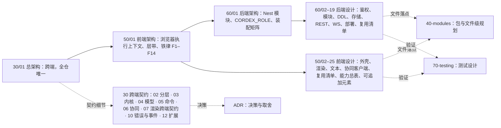

怎么读：实线是固定的阅读顺序——先读本文建立全局，再读前端架构、后端架构，然后按需下钻到各侧设计；虚线是查细节时的去向：跨端契约在 30 目录各篇，决策依据在 ADR，包与文件落点在 40-modules，验证方式在 70-testing。

本文是以下内容的唯一源（其它文档只引用，不重述）：

| 内容 | 节 |
|---|---|
| 系统上下文与容器（C4 L1/L2） | §1、§2 |
| 前后端分工（哪些代码只在浏览器、只在服务端、两端共用） | §2.3 |
| 包与插件规划总览（数字引自 `plugin-counts.json`，逐行明细在 40/16） | §2a |
| 统一原则表（P1–P14，映射前端铁律 F1–F14 与后端落点） | §3 |
| 技术栈与复用总表（跨端层级）、许可分级口径 | §3a |
| 四条端到端跨端数据流（打开、编辑、协同、导入导出） | §4 |
| 运行时对象关系总图 | §5 |
| 阅读路径与文档边界 | §6 |
| M1–M4 里程碑边界表 | §7 |

---

## 1. C4 L1 — 系统上下文

**C4 L1 系统上下文图**

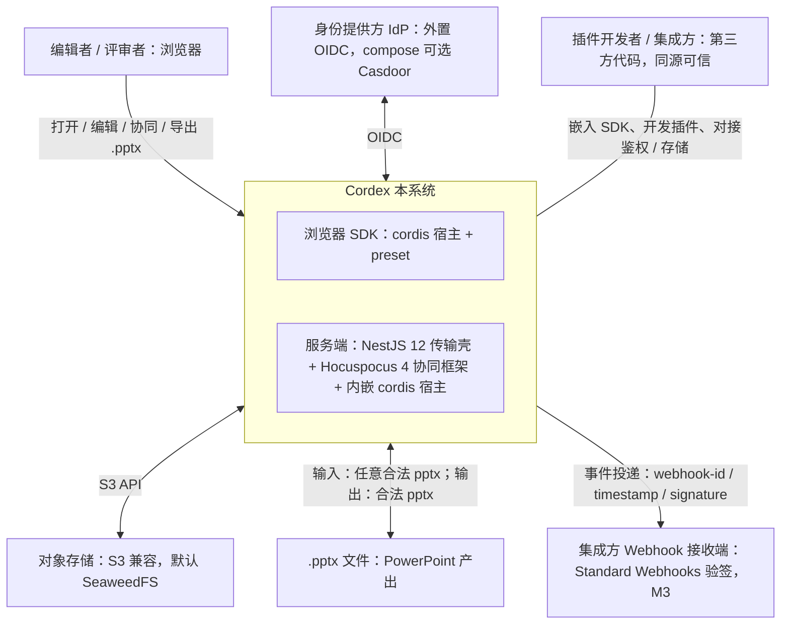

怎么读：中间子图是本系统（浏览器 SDK + 服务端两部分），四周是人与外部系统；双向箭头表示双向交互（OIDC 登录、S3 读写、pptx 导入导出），无箭头的连线表示插件开发者 / 集成方以嵌入与扩展的方式使用本系统；Webhook 是唯一由本系统主动发往集成方的出站调用（M3）。

依据：rulings §4.15 Q6（外置 OIDC、可选 Casdoor）、Q10（SeaweedFS）；rulings §4.21 q-nest-major（Nest 12）、q-ws-gateway（Hocuspocus 4）、q-webhook-sig（Standard Webhooks）。

- **用户**：编辑者、评审者（PRD 02 的角色）；**插件开发者**与**集成方**同样是一等用户（章程 §2.2）。
- **外部系统**：OIDC IdP（部署方任意 OIDC IdP，compose 可选内置 Casdoor；服务端不持有密码）、S3 兼容对象存储（默认 SeaweedFS，生产推荐客户自有 S3）、PowerPoint 作为文件的生产者 / 消费者（也是视觉回归的 oracle，见 [70-testing/04](../70-testing/04-visual-oracle.md)）、集成方的 Webhook 接收端（签名按 Standard Webhooks：`webhook-id`、`webhook-timestamp`、`webhook-signature: v1,<base64>`，用 `node:crypto` 实现，旧头 `X-Cordex-Signature` 作废，rulings §4.21 q-webhook-sig）。
- **部署边界**：一次部署 = 一个组织（rulings §4.15 T-0），系统内没有租户概念；多组织需求走多套部署，将来若做 SaaS 另立项。
- **信任边界**：插件与宿主同源可信（章程 §2.3），不做运行时沙箱；`isolate()` 只是解析域。服务端永不抓取文档外链；不可信图片只在 renderer 沙箱内栅格化。

---

## 2. C4 L2 — 容器

### 2.1 浏览器侧

**C4 L2 容器图 · 浏览器侧**

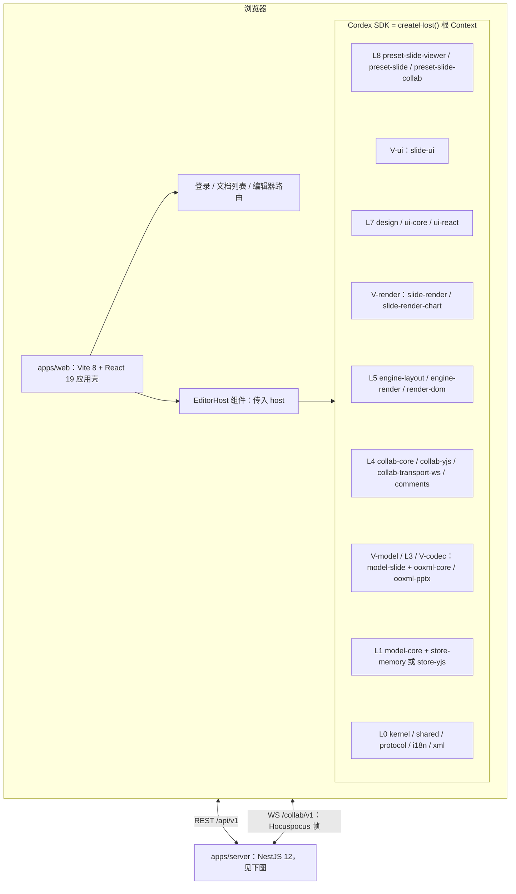

怎么读：SDK 子图内自上而下是秩由高到低的包组（只表示层次顺序，不代表逐层依赖；秩表唯一源是 [02](./02-layering-and-packages.md) §1）。V-ui（秩 75）高于 L7（秩 70），故单列在 L7 之上；V-render（秩 55）位于 L7 与 L5 之间。L0 新增零依赖的 `@cordexjs/xml`（XML 词法与保真树，ADR-0019）。浏览器与服务端之间有 REST 与 WS 两条通道，WS 线上格式自 §4.21 起为 Hocuspocus 帧（y-protocols sync / awareness + Auth + Stateless）。

依据：本节表；02 §1 分层网格；rulings §4.21 X:q-xml-package、q-ws-gateway。

### 2.2 服务端与数据存储

**C4 L2 容器图 · 服务端与数据存储**

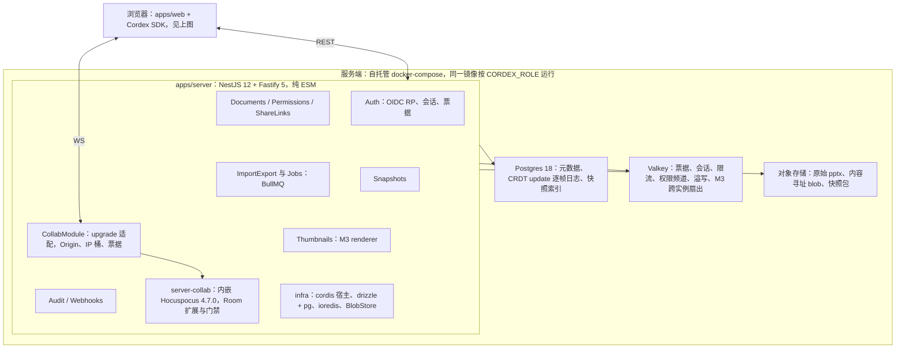

怎么读：`apps/server` 子图内是 Nest 模块与 infra 客户端（网格排布只为版面，模块间无依赖含义）；WS 升级只进 `CollabModule` 的适配层，完成 Origin、IP 令牌桶与票据校验后交给 `server-collab` 内嵌的 Hocuspocus 实例（不用 Nest `WsAdapter`，也不用 Hocuspocus 的 `Server` 类）；实线箭头从 `apps/server` 指向三类数据存储，表示读写访问。模块清单与装配矩阵见 [60/01](../60-backend/01-service-overview-and-roles.md) §3、§5。

依据：rulings §4.15 Q10；rulings §4.21 q-nest-major、q-ws-gateway、q-db-access；H 组默认 H-d-01、H-d-12、H-d-25。

| 容器 | 技术 | 职责 | 详见 |
|---|---|---|---|
| 浏览器 SDK | TS，cordis 4，React 19 绑定 | 打开、渲染、编辑、协同客户端、导出；**全部能力都是插件** | [50/01](../50-frontend/01-overview-and-runtime-map.md)、02、03 |
| `apps/web` | Vite 8 + React 19 + react-router 8 | 组装 preset，路由与登录；零业务逻辑 | [50-frontend/02](../50-frontend/02-app-shell-routing-and-session.md) |
| `apps/server` | NestJS 12.1（纯 ESM 构建）+ Fastify 5；OTel 以 `node --import` 预加载 | 传输壳：REST、WS 升级适配、作业；业务逻辑在 `server-*` 包 | [60/01](../60-backend/01-service-overview-and-roles.md) |
| 协同服务端 | `@cordexjs/server-collab` 内嵌 `@hocuspocus/server` 4.7.0（精确钉版本） | Room、门禁 L1–L4、逐帧落库与两级 ack、awareness 校验盖章、控制面；只在 `collab` / `all` 角色装配 | [60-backend/05](../60-backend/05-modules-collab-and-snapshots.md)、ADR-0039 |
| 服务端 cordis 宿主 | `@cordexjs/server-headless` | 在 Node 26 中加载同一批 iso 插件做导入 / 导出 / 校验 / 迁移；worker 每任务一宿主 | [60-backend/06](../60-backend/06-modules-jobs-import-export-thumbnails.md) |
| renderer sidecar | headless Chromium（同一份 render-dom 代码），`CORDEX_ROLE=renderer` | M3 权威缩略图（640 px WebP）与 PDF；零出站、非 root、沙箱、无凭据，只接受 worker 经鉴权内部 RPC 的入站请求 | 60-backend/06、ADR-0026 |
| Postgres | 18（下限 16；uuid v7 在应用层生成）；drizzle-orm 0.45.x 作类型镜像，迁移为手写 SQL | 文档元数据、权限、CRDT update 逐帧日志、快照索引、审计；文档级 RLS 兜底 | [60-backend/08](../60-backend/08-db-conventions-roles-rls-migrations.md)、ADR-0022 |
| Valkey | Redis ≥ 7.2 协议兼容，钉次版本（推荐 9.1.2） | 票据、会话、限流、权限变更频道、溢写一级档；M3 起 Hocuspocus extension-redis 跨实例扇出 | [60-backend/14](../60-backend/14-valkey-object-storage-and-retention.md) |
| 对象存储 | S3 兼容（默认 SeaweedFS，`snapshots` 桶开版本化） | 原始 pptx、内容寻址 blob（媒体、不透明部件）、快照包；浏览器预签名直传 / 直读经反代子域 `s3.<域名>`（rulings §4.18 BE-01） | 60-backend/14 |
| IdP（可选） | Casdoor（compose `idp` profile，可换任意 OIDC IdP） | 登录与账号；注册由部署开关 `auth.selfSignup` 控制（默认关）；浏览器经反代子域 `idp.<域名>` 到达登录页 | [60-backend/02](../60-backend/02-auth-chain.md)、ADR-0029 |

**服务端运行时装配：CORDEX_ROLE 与 renderer sidecar**

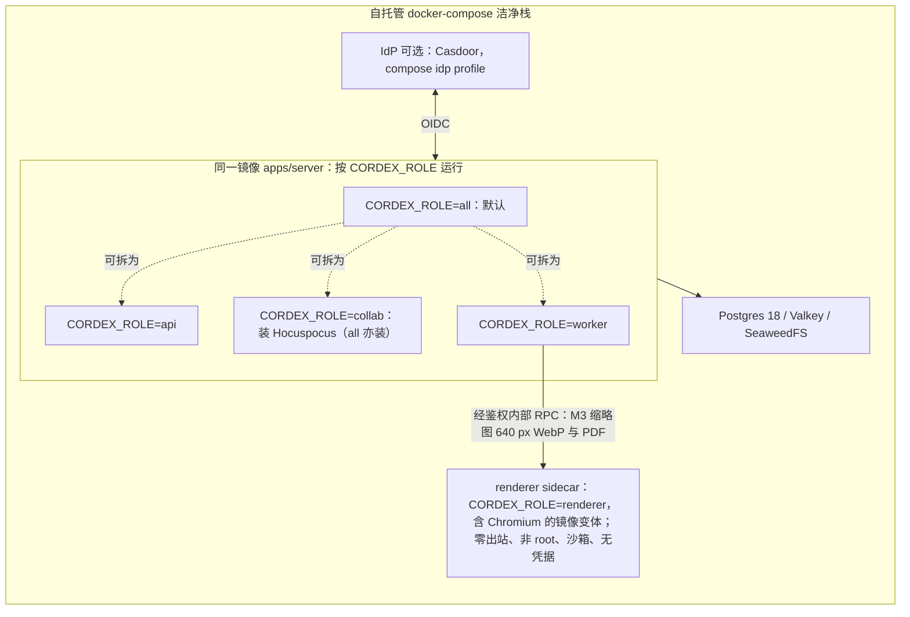

怎么读：虚线表示 `all` 角色可按需拆成 api / collab / worker 三个进程（各角色装配哪些模块以 [60/01](../60-backend/01-service-overview-and-roles.md) §5 的「模块 × 角色 × 部件」矩阵为准，快照 REST 与管理动作只在 collab，rulings §4.18 BE-03/BE-13）；Hocuspocus 实例只在 `collab`（或 `all`）进程内；renderer 只接受 worker 经鉴权内部 RPC 的入站请求（实线），自身零出站。本图只表达「同一镜像按角色拆分」这一点，进程内组成与角色装配细节只在 [60/01](../60-backend/01-service-overview-and-roles.md) §0 图 0-2 维护，两处冲突以 60/01 为准。

依据：本节容器表；rulings §4.15 Q8、Q10；ADR-0037 决策 1。

### 2.3 前后端分工

**同一份模型与格式代码在两端运行**（章程 §2.2）：`model-core`、`model-slide`、`xml`、`ooxml-*`、`store-*`、`engine-layout`、`engine-render` 都是 `iso` 类；浏览器与 Node 各自提供 `TextMeasurer`（`canvas` / `node-font`）与 `RenderTarget`（浏览器 `dom`；服务端不在 Node 里绘制，缩略图与 PDF 由 renderer 里的同一份浏览器代码完成）。

**前后端分工图：浏览器专属、两端共用、服务端专属**

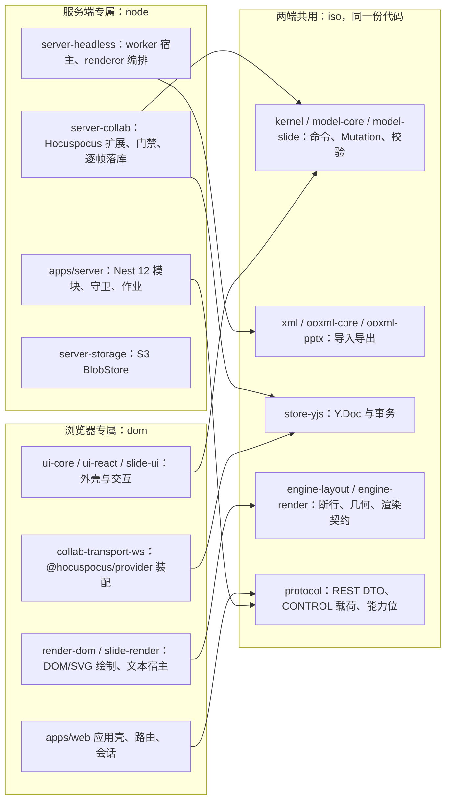

怎么读：左右两个子图只在各自一端运行，中间子图是两端各装一份的 iso 包；箭头表示「依赖并在本端运行那份 iso 代码」。服务端对文档的一切理解（门禁 L4 的不变量校验、导入导出、迁移、修复）都来自中间这份代码，没有第二套实现；浏览器与服务端之间只交换 CRDT update、awareness、CONTROL 载荷与 REST DTO（均由 `protocol` 定义）。

| 关注点 | 浏览器 | 服务端 | 两端共用的 iso 代码 | 详见 |
|---|---|---|---|---|
| 打开 | M1 本地字节在 Worker 中渐进解析；M2 起服务端文档经 `snapshots/latest` bootstrap | 快照与 update 日志加载进 Room（`onLoadDocument`） | `ooxml-pptx` 导入、`xml.scan` 包络计数、`store-yjs` | §4.1 |
| 编辑 | 命令管线（权限 fail-closed → 事务 → 历史） | 不执行命令；只对到达的 update 做门禁 L1–L4 | `model-slide` 的不变量与 `validateChangeSet` | §4.2、[30/05](./05-command-and-history.md) |
| 协同 | `@hocuspocus/provider` + 自有调度器、在途 FIFO、被拒回滚 | Hocuspocus 钩子扩展：握手、门禁、逐帧落库、两级 ack、控制面 | CRDT 映射（[30/06](./06-collaboration.md) §1）、CONTROL 载荷 schema | §4.3 |
| 导入导出 | Worker 内导入与导出（M1 起） | 服务端导入作业（M2）、导出与 PDF（M3） | `ooxml-pptx.encode` 纯函数，两端字节一致 | §4.4 |
| 渲染 | DOM/SVG 单实现、可见缩略图 | renderer 内跑同一份浏览器渲染代码（M3） | `engine-layout` 断行与几何、`engine-render` 契约 | [07](./07-rendering.md) |
| 权限 | 命令管线第三检查点（UX） | REST 守卫链 + WS 票据与每帧角色（fail-closed） | `protocol` 能力位矩阵 | §3 P11 |

---

## 2a. 包与插件规划

本节回答三个问题：一共有多少个包、多少个插件、每个 preset 装多少。数字一律取自 [`docs/_tools/plugin-counts.json`](../_tools/plugin-counts.json)，它由 `check-plugin-counts.py` 从 [40/16 插件总账](../40-modules/16-plugin-catalog.md) §2–§5.1 与章程 §5.2 机械重算；逐行明细以 40/16 为准，本节只给全局视图（2026-10-01 新增）。

### 2a.1 全局数字卡

| 维度 | 数 | 构成 | 明细 |
|---|---|---|---|
| npm 包（M1–M4） | **31** | 另有 M5 包 2 个（`preset-doc`/`preset-sheet`）、应用 2 个（`apps/web`、`apps/server`）、构建期 `tooling/*` | 章程 §5.2；[40/16 §2.1](../40-modules/16-plugin-catalog.md#21-包与插件单元的对应npm-包--cordis-插件--nest-模块) |
| 运行时插件单元 | **78** | cordis 可插拔 48 + 纯库 5 + Nest 模块 25 | [40/16 §0.1](../40-modules/16-plugin-catalog.md#01-数字速览表) |
| cordis 可插拔单元 | **48** | host 4、definition 4、provider 20、plugin 17、bundle 3 | 40/16 §2 主表「形态」列 |
| Nest 模块 | **25** | 基础 5 + 业务 20 | [60/01 §3](../60-backend/01-service-overview-and-roles.md#3-nest-模块清单) |
| Definition（可替换契约） | **25** | 模型存储 3、渲染度量 5、协同 3、UI 1、内核治理 5、服务端专属 8 | [40/16 §3](../40-modules/16-plugin-catalog.md#3-definition--provider-可插拔矩阵章程-54-的完整版) |
| 贡献点 | **27** | model-core 7、ui-core 10、engine-render 4、kernel 2、engine-layout 1、i18n 1、model-slide 1、comments 1 | [40/16 §4](../40-modules/16-plugin-catalog.md#4-贡献点总账) |
| preset | **4** | 浏览器侧 3 个（均为 npm 包：viewer 17、slide 17、collab 20 个条目）+ 服务端装配脚本 `preset-server`（11 个条目） | 本节 2a.4 |

「插件单元」是能被 cordis 装进 Fiber 树、或被 Nest 按角色装配的最小单位；「包」是发布与依赖治理的单位。两者不是一一对应，下一小节说明。

### 2a.2 npm 包、cordis 插件与 Nest 模块的关系

**图 2a-1 包、插件单元与 preset 的关系**

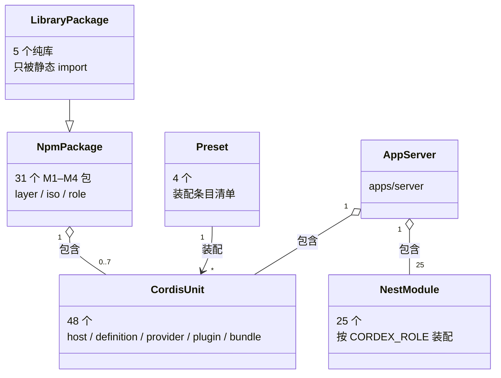

怎么读：空心菱形表示「包含」，基数写在两端；一个 npm 包含 cordis 单元 0 到 7 个（纯库包含 0 个，`preset-slide-viewer` 最多，含 bundle 与 6 个胶水或惰性插件），`apps/server` 不是 npm 包，却含 12 个服务端 cordis 单元与全部 25 个 Nest 模块；preset 只装配 cordis 单元，从不装 Nest 模块。
依据：40/16 §1 分类口径与 §2.1 逐包对应；60/01 §3。

三条规则：

- **一个包可含多个插件单元**：`model-slide` 有主插件与 `/editing` 子插件两个（查看器不装后者）；`preset-slide` 有 `shell-glue` 与 bundle 两个；`preset-slide-viewer` 有 7 个。
- **有的包不是插件**：`shared`、`protocol`、`xml`、`ooxml-core`、`design` 五个纯库没有 `plugin.ts`，不进 Fiber 树，不能被 preset 排除，只被别的包 `import`。
- **Nest 模块不是 cordis 插件**：它们走 Nest 自己的 DI，按 `CORDEX_ROLE` 整模块启停（[60/01 §5](../60-backend/01-service-overview-and-roles.md#5-模块--角色--部件装配矩阵)）；服务端的 cordis 单元只在 `CordisHostModule` 托管的那一个 Context 里（`preset-server`）。

### 2a.3 按层带的包与插件分布

| 层带（章程 §5.1） | 包数 | 包 | cordis 单元 | 纯库 | 运行位置 |
|---|---|---|---|---|---|
| L0 基础 | 5 | shared、kernel、protocol、i18n、xml | 2 | 3 | 两端 |
| L1 文档内核 | 3 | model-core、store-memory、store-yjs | 3 | 0 | 两端 |
| L3 格式基础 | 1 | ooxml-core | 0 | 1 | 两端 |
| L4 协同与评论 | 5 | collab-core、collab-yjs、collab-transport-ws、collab-offline-idb、comments | 5 | 0 | 浏览器 |
| L5 引擎 | 3 | engine-layout、engine-render、render-dom | 3 | 0 | 两端（render-dom 仅浏览器） |
| L7 UI 基座 | 3 | design、ui-core、ui-react | 2 | 1 | 浏览器 |
| 垂直束 slide（V-*） | 5 | model-slide、ooxml-pptx、slide-render、slide-render-chart、slide-ui | 6 | 0 | 两端（渲染与 UI 仅浏览器） |
| L8 预设 | 3 | preset-slide、preset-slide-collab、preset-slide-viewer | 11 | 0 | 浏览器 |
| LS 服务端 | 3 | server-collab、server-storage、server-headless | 3 | 0 | 服务端 |
| 应用 | 2（非 npm） | apps/web、apps/server | 1 + 12 | 0 | 各自一端；apps/server 另含 25 个 Nest 模块 |
| **合计** | **31 + 2 应用** | — | **48** | **5** | 两端 14、浏览器 24、服务端 40 个单元 |

L8 预设的 11 个单元是 3 个 bundle、`shell-glue`、查看器的 `read-only`/`viewer-shell`/`design-css` 与 3 个惰性子功能，以及三者共用 id 的语言包条目；垂直束的 6 个单元里 `model-slide` 占 2 个。

**图 2a-2 层带、包数与 cordis 单元数**

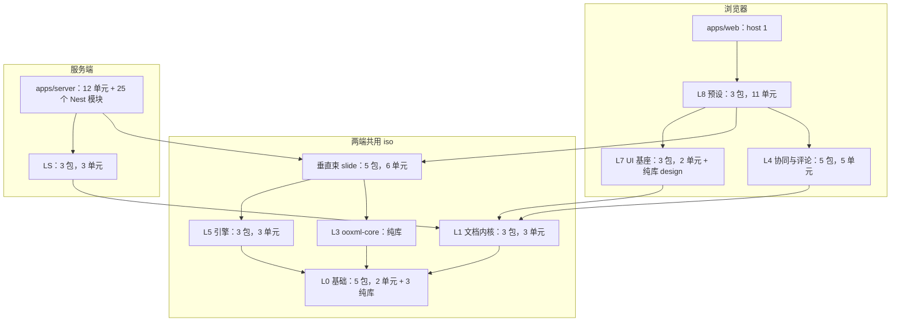

怎么读：从上往下是依赖方向（上层依赖下层），节点写「包数，cordis 单元数」；左侧子图只在浏览器装载，中间子图两端各装一份（其中 `render-dom`、`slide-render`、`slide-ui` 等 dom 包只在浏览器），右侧子图只在服务端；`apps/server` 经 `preset-server` 装配垂直束的 iso 部分（模型与编解码）。
依据：章程 §5.1 秩表与 §5.2；40/16 §2 主表「层/秩」「运行位置」列。

### 2a.4 各 preset 装配的插件数

| preset | 形态 | 常驻 | 惰性或部分 | 合计条目 | 说明 |
|---|---|---|---|---|---|
| `preset-slide-viewer` | npm 包 | 12 | 5 | **17** | 只读查看器，无编辑 UI、无协同；`read-only` 策略不可排除 |
| `preset-slide` | npm 包 | 15 | 2 | **17** | 单人编辑：viewer 基线减查看器专属，加编辑四包与胶水 |
| `preset-slide-collab` | npm 包 | 17 | 3 | **20** | 协同：`store-yjs` 替换 `store-memory`，加协同客户端，M3 起加 `comments` |
| `preset-server` | `apps/server` 内装配脚本 | 9 | 2 | **11** | 按单元展开为 21（3 个 kernel 适配器合 1 条、8 个 IO 适配器作为 `server-collab` 配置注入）；按角色 api 8、collab 9、worker 10、renderer 0 |

浏览器三者条目的逐条对比见 [50/01 §1b](../50-frontend/01-overview-and-runtime-map.md)，服务端按角色的差异见 [60/01 §1b](../60-backend/01-service-overview-and-roles.md)。

### 2a.5 按里程碑逐步装入

「首装」取 40/16 §2 主表同名列：cordis 单元按 [40/11](../40-modules/11-preset-assembly-and-app-shell.md) §11 各 preset 装入的时点，服务端 cordis 单元随 M2 协同后端交付（rulings §4.19 D-M2-CONTENT），Nest 模块按 60/01 §3「首次交付」列。里程碑边界本身以 §7 为准。

| 里程碑 | 新装 cordis 单元 | 新装纯库 | 新装 Nest 模块 | 新装合计 | 累计单元 | 累计 cordis |
|---|---|---|---|---|---|---|
| M1 打开与保真 | 23 | 5 | 0 | 28 | 28 | 23 |
| M2 单人编辑 + 协同后端 | 22 | 0 | 21 | 43 | 71 | 45 |
| M3 多人协同体验层 | 2 | 0 | 4 | 6 | 77 | 47 |
| M4 插件 SDK 公开 | 1 | 0 | 0 | 1 | 78 | 48 |

**图 2a-3 各里程碑装入的单元**

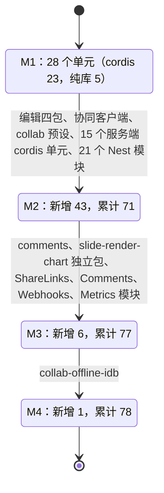

怎么读：每个状态是一个里程碑结束时已装入的单元数，迁移标签列出该里程碑新装的单元。M1 是查看器与单人预设的只读切片（kernel、模型、编解码、引擎、渲染、UI 基座外壳、查看器胶水与 5 个纯库），没有服务端；M2 一次装入编辑能力、协同客户端与全部服务端 cordis 单元；M3 与 M4 只做增量。
依据：40/16 §2「首装」列与 §0.1；40/11 §11；60/01 §3；rulings §4.19 D-M2-CONTENT。

M2 新装的 cordis 单元共 22 个：`store-yjs`、`model-slide/editing`、`collab-yjs`、`collab-transport-ws`、`slide-ui`、`shell-glue`、`preset-slide-collab`，加服务端 15 个（`server-storage`、`server-collab`、`server-headless`、8 个协同 IO 适配器、3 个 kernel Node 适配器、`CordisHostService` 宿主）。

---

## 3. 统一原则表（跨端，P1–P14）

原 README §1 的 P1–P8、原 01 §3「四大原则」与原 08 §0 的五条跨端原则合并为下表，编号 P1–P8 不变，原 08 §0 第 1–5 条依次为 P9–P13，P14 为 §4.21 新增。每条原则都映射到前端铁律（[50/01](../50-frontend/01-overview-and-runtime-map.md) §3 的 F1–F14，F1–F14 全部出现至少一次）与后端落点（以 60/01 §11 驱动放行边界为主）；执行点名称以 [09-type-discipline](./09-type-discipline/README.md) 为准。

| # | 原则 | 跨端落地（含一个被禁止的反例） | 执行点 | 前端铁律 | 后端落点 |
|---|---|---|---|---|---|
| P1 | **SDK 优先** | `packages/*` 是产品，`preset-*` 是「产品形状」，`apps/*` 只组装与传输。反例：在 `apps/web/src` 里写「插入形状」的逻辑 | depcruise `cordex-apps-only-assemble`（R9）；lint `no-restricted-syntax`（apps/** 禁领域定义） | F1、F2 | 见 P9 |
| P2 | **每一级可插拔** | 每个可替换能力有 Definition、≥ 1 个 Provider，Consumer 只依赖 Definition；移除任一 Provider 系统仍可启动（降级）。反例：`ui-core` 直接 `import { YjsStore } from '@cordexjs/store-yjs'` | depcruise 三角色（R7）；preset「移除 Provider 仍可启动」矩阵；`run<Definition>Conformance` 契约套件 | F6、F12 | `server-collab` 的 IO 能力经 8 个 Definition 注入（60/01 §11） |
| P3 | **文档类型盲** | 水平层不知道幻灯片；`DocumentType`、`Mutation`、`SceneProvider`、UI 贡献全部由垂直束注入。反例：`model-core` 里出现 `slideId` | depcruise R3 `doc-type-blind`；lint `cordex/no-doc-type-literals`；`fixture` 文档类型盲测（[12](./12-extension-to-doc-and-sheet.md)） | F8、F9 | 见 P13 |
| P4 | **规范必有执行点** | 每条规则配「机械验证」；没有执行点的规则不得写入。反例：写在 README 里的「请勿深引用 src」 | `scan-policy`（CI job `policy-check`）读 09-08 矩阵，校验执行 job 存在且在 PR 触发 | F1–F14 各有入口 | [60-backend/README](../60-backend/README.md) §7 机械验证总表 |
| P5 | **唯一注册抽象** | 全代码库只有 `ContributionPoint`；不存在 `register*` 方法与模块级 `Map` | lint `cordex/no-register-methods-outside-kernel`、`cordex/no-module-level-mutable-state` | F14 | 服务端插件同样经 `ctx.contribute` 装配（`cordis-host/`） |
| P6 | **时间可组合** | 激活期创建的一切资源都归 `ctx.effect()` 所有；卸载后 `fiber.getEffects()` 为空 | `defineLifecycleSuite` 对每个插件包强制运行 | F13 | 宿主生命周期映射（60/01 §9）；停机顺序自写 `drainAll`（ADR-0039） |
| P7 | **单一事实源** | 运行时模型只经 `DocumentStore` 读写；协同模式下 CRDT 文档即事实源，Mutation 不上网络；派生数据不入 Snapshot；正式 `seq` 只由 Postgres 分配 | `Persisted<T>` 类型测试；快照 schema 校验；传输契约断言出站帧种类 | F3、F4、F5 | 逐帧 update 日志 + 压缩快照；只有 `ack{tier:'db'}` 清客户端 pending（[60-backend/05](../60-backend/05-modules-collab-and-snapshots.md)） |
| P8 | **失败可传播、可隔离** | 命令返回 `Result<T, E>`；插件 `apply` 抛错只让自身 Fiber `FAILED`；元素渲染逐元素隔离 | lint `cordex/no-boolean-command-result`；kernel 失败隔离测试 | F3 | 启动断言失败即退出（60/01 §6）；Hocuspocus 钩子一律自包异常，未预期异常关 1011（ADR-0039） |
| P9 | **服务端薄壳**（D8；原 08 §0 第 1 条） | 业务逻辑在 `server-*` 包与各模块 domain / application 层，Nest 只做传输、装配与编排；`apps/server/src/modules/**` 不得 import `yjs` / `@cordexjs/model-*` / `@cordexjs/ooxml-*` | depcruise `server-app-thin` | F1 | 60/01 §3、§11 |
| P10 | **同一份 iso 代码两端运行**（原第 2 条） | 每个进程一个 cordis 宿主；一个 Room = 宿主里的一个服务端 Unit，由 `store-yjs` 接管 Hocuspocus 的 Document（与客户端同一份文档类型代码）；worker 的导入导出在 `worker_threads` 中每任务新建宿主 | `iso-smoke`（`node --import` 冒烟）；depcruise R16 | F10 | 60/01 §9；[60-backend/06](../60-backend/06-modules-jobs-import-export-thumbnails.md) |
| P11 | **fail-closed 多点 + 纵深防御**（原第 3 条） | REST `DocumentRoleGuard` 与 WS（票据 + `onAuthenticate` 握手 + 每帧角色）都是「无显式允许即拒绝」；客户端命令管线是第三点（UX）；文档级 RLS 是纵深防御，不替代前两点；文档内容不以 HTML 注入 DOM | 路由鉴权覆盖测试；`runCollabServerConformance`；RLS 角色 × 表矩阵；lint TD-081 | F7、F12 | [60-backend/02](../60-backend/02-auth-chain.md)；ADR-0029 |
| P12 | **驱动与第三方单点放行**（原第 4 条） | 每个第三方包只在登记的包里出现：`@nestjs/*` 只在 `apps/server`；`pg` 与 `drizzle-orm` 同位、`ioredis` 与 `bullmq` 只在 apps/server 适配器目录，`@aws-sdk` 只在 `server-storage`；`ws` 只在 apps/server collab 的 upgrade 适配层；`@hocuspocus/server` 只在 `server-collab`，`@hocuspocus/extension-redis` 只在 apps/server 组装（M3）；`@hocuspocus/provider` 只在 `collab-yjs` 与 `collab-transport-ws` | depcruise R5 `third-party-single-entry`（单点表见 [02](./02-layering-and-packages.md) §4.0.1）；syncpack 单版本 | F11 | 60/01 §11 |
| P13 | **服务端文档类型盲**（原第 5 条） | `server-*` 不 import 任何垂直束；导入导出经 `formats` / `documentTypes` 按 `documentType` 取 codec，插件清单只由组合根 `cordis-host/preset-server.ts` 提供；评论镜像按 `comments.` 前缀识别；M5 新增文档类型时 `server-*` diff = 0 | depcruise R3（组合根豁免只覆盖 `cordis-host/**`）；M5 `horizontal-freeze` | F8 | 60/01 §11（FE-01 行） |
| P14 | **复用优先、许可分级准入**（§4.21 新增） | 有合适的成熟组件就复用；凡「维持自研」必须写明为什么没有合适的成熟库；新依赖按许可分级准入（§3a.4），并四处同步：章程 §5.3 单点表、`license-allowlist`、catalog 精确锁、[50-frontend/13](../50-frontend/13-performance-and-bundling.md) 体积预算 | license-allowlist 扫描；depcruise R5；ADR-0049 | 前端复用清单 50/17 | 后端复用清单 60/19 |

**原则分组与执行面**

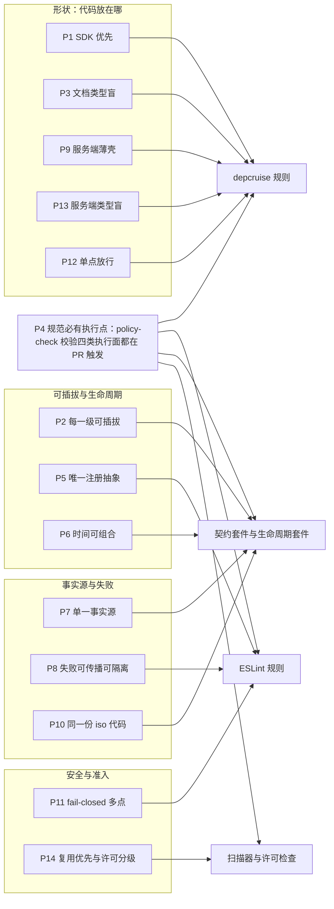

怎么读：四个子图按原则关心的问题分组，箭头指向该原则的主要执行面（一条原则可能还有别的执行点，见上表「执行点」列）；P4 是元原则，它不直接约束代码，而是由 `policy-check` 校验其余原则的执行面都存在且在 PR 触发。

依据：原 README §1（P1–P8）、原 01 §3、原 08 §0（五条跨端原则）；50/01 §3（F1–F14）；60/01 §11；rulings §4.21 q-arch-reorg、q-license-tiers。

---

## 3a. 技术栈与复用总表（跨端层级）

用户要求「前端、后端理论上能复用的组件，尽可能用可复用的成熟组件」（rulings §4.21 用户诉求 1）。本节是**跨端层级**的总表：每个能力一行，给出采用的组件、许可、落在哪一端与哪个包，以及复用或自研的理由；逐包、逐版本的全表在 [前端复用组件清单 50/17](../50-frontend/17-reuse-and-dependency-catalog.md) 与 [后端复用组件清单 60/19](../60-backend/19-reuse-and-dependency-catalog.md)。版本以 `pnpm-workspace.yaml` catalog 精确锁为准，本节只写主版本或已裁决钉死的版本（2026-09-26 npm 实测，出处见证据文件 R / H / X）。凡「维持自研」的行都写明为什么没有合适的成熟库（P14）。

**依赖层带图：第三方组件落在哪一层**

```mermaid
flowchart TB
  subgraph bandApp["L8 与 LS：apps 与服务端包"]
    web["apps/web ← react-router 8、Vite 8"]
    server["apps/server ← NestJS 12、Fastify 5、drizzle-orm、pg、ioredis、BullMQ"]
    srvCollab["server-collab ← @hocuspocus/server 4.7.0"]
    srvStorage["server-storage ← @aws-sdk v3"]
    srvHeadless["server-headless ← playwright-core、opentype.js"]
  end
  subgraph bandUi["L7 与 V-ui：dom"]
    uiBase["ui-react 与 *-ui ← React 19、shadcn 复制件、radix-ui、Tailwind 4、lucide、sonner、cmdk"]
    uiNew["ui-react 与 *-ui ← react-colorful、colord、react-virtual、pragmatic-dnd、react-hook-form"]
  end
  subgraph bandRender["L5 与 V-render：dom"]
    renderDom["render-dom ← 无渲染库，自研 DOM/SVG"]
    chart["slide-render-chart ← d3-scale、d3-shape、d3-array、numfmt"]
    emf["slide-render 的 EMF Worker ← emf-converter 4"]
  end
  subgraph bandCollab["L4：iso"]
    collab["collab-yjs 与 collab-transport-ws ← @hocuspocus/provider 4.7.0、y-protocols"]
  end
  subgraph bandModel["L1 与 L3：iso"]
    storeYjs["store-yjs ← yjs 13.6.33"]
    ooxml["ooxml-core ← fflate 0.8；XML 只用 @cordexjs/xml"]
  end
  subgraph bandBase["L0：iso"]
    kernel["kernel ← cordis 4.0.0-rc.10"]
    protocol["protocol ← zod 4"]
    order["shared/order ← 内置 rocicorp 分数索引源码"]
    xml["xml ← 零依赖，自研词法与保真树"]
  end
  bandApp ~~~ bandUi ~~~ bandRender ~~~ bandCollab ~~~ bandModel ~~~ bandBase
```

怎么读：子图自上而下是秩由高到低的层带，节点写「包 ← 该包独占引入的第三方组件」。每个第三方组件只允许出现在图中所示的包里（P12，单点表唯一源是 [02](./02-layering-and-packages.md) §4.0.1）；图里没有的包没有运行时第三方依赖，其中 `shared` 与 `xml` 按规则必须零依赖。

### 3a.1 两端共用（iso，同一份代码）

| 能力 | 采用 | 许可 | 复用或自研的理由 | 详见 |
|---|---|---|---|---|
| 插件内核与生命周期 | cordis 4.0.0-rc.10（只由 kernel 引入） | MIT | 现成的 Context / Fiber / effect 模型，满足可插拔与时间可组合 | [03](./03-kernel-and-plugin-model.md) |
| schema 与边界校验 | zod 4（Standard Schema） | MIT | 前后端共用 DTO 与配置 schema；单点放宽为 protocol / kernel 加各包 `config` 与 `schema` 文件（R-d-56） | 02 §4.0.1 |
| CRDT、同步与 awareness 编码 | yjs 13.6.33、y-protocols 1.0.7、lib0 0.2.x，精确锁 | MIT | 事实标准；Yjs 14 跟踪 `@y/y` RC，M3 前 spike（R-d-37） | [06](./06-collaboration.md) |
| 协同线上协议 | Hocuspocus 帧（y-protocols sync / awareness + Auth + Stateless）；服务端 `@hocuspocus/server`、客户端 `@hocuspocus/provider`，均 4.7.0 精确钉 | MIT | 用户裁决采用（q-ws-gateway）；自有控制面改为 Stateless 载荷，两级 ack、门禁、溢写仍自有 | ADR-0039 |
| zip 编解码 | fflate 0.8.x（只由 ooxml-core 引入） | MIT | 同构、体积小；多页 PNG 打包复用 ooxml-core 导出的 `writeZip`，不扩单点（R-d-51） | 02 §4.0.1 |
| XML 词法与保真树 | **自研** `@cordexjs/xml`（L0 · 秩 0 · 零依赖）；saxes 6.0.0 与 libxml2-wasm 只作 devDependency 差分 oracle；@rgrove/parse-xml 5 作退路 | — | 21 个候选实测后裁决：不建树计数、词法层限额、流式分片与深嵌套安全，现成库都做不到，补上就等于写一个词法器；saxes 已归档不能作运行时依赖 | ADR-0019 |
| 分数索引 FracKey | 内置 rocicorp fractional-indexing 算法源码（注明出处），键格式改为整数头 + 随机后缀 | CC0-1.0（内置源码用途） | 成熟实现（Excalidraw 在用），连续追加时键不增长，减少 rekey | ADR-0032 |
| 断行机会表 | tooling 从最新 UCD 生成；linebreak 只作一致性对照 | — | `Intl.Segmenter` 没有 line 粒度，生成表跟随 Unicode 版本、运行时零依赖（R-d-27） | [07](./07-rendering.md) §5 |
| 预设几何 | 187 种 prstGeom 由 tooling 从 `presetShapeDefinitions.xml` 编译 | — | 两端共用编译期表；pptx-viewer-core 只在仓库外隔离运行作对照（R-d-32） | 07 §5 |
| UUIDv7 | 自研（ADR-0014） | — | 前后端调研有分歧，按 L0 零依赖收口（R-d-33） | ADR-0014 |

### 3a.2 前端（摘要；全表见 50/17）

| 能力 | 采用 | 许可 | 落点 |
|---|---|---|---|
| UI 原子与壳层 | shadcn/ui 复制件（CLI 4.21.0，style radix-rhea）、radix-ui 1.6.7、Tailwind 4.3、lucide-react、sonner、cmdk、react-resizable-panels 4.13 | MIT / ISC | ui-react 与 `*-ui`（ADR-0017） |
| UI 框架与应用构建 | React 19.3.x；react-router 8、Vite 8 | MIT | ui-react、`*-ui`、apps/web |
| 颜色 | react-colorful 5.8（pnpm patch 改静态 CSS）、colord 2.10；构建期 culori 4 | MIT | ui-react；tooling |
| 虚拟列表、拖拽、表单 | @tanstack/react-virtual 3、@atlaskit/pragmatic-drag-and-drop 4、react-hook-form 7 + standardSchemaResolver（直接复用 protocol 的 zod schema） | MIT / Apache-2.0 / MIT | slide-ui、ui-react |
| 剪贴板 HTML 转纯文本 | htmlparser2 12（回调模式、惰性加载） | MIT | ui-core 剪贴板管线 |
| Worker RPC、上传并发 | comlink 4.4、p-queue 9 | Apache-2.0 / MIT | 各 Worker 入口；apps/web |
| EMF / WMF 栅格化 | emf-converter 4.0.x（惰性 Worker） | Apache-2.0 | slide-render |
| 图表绘制 | d3-scale 4、d3-shape 3、d3-array 3 做底层，按 OOXML 语义自研布局（manualLayout、Excel 自动刻度、堆积、饼图标签避让） | ISC | slide-render-chart（M1–M2 为 slide-render 的 `./chart` 子路径；ADR-0036） |
| 图表数据编辑（M3） | @tanstack/react-table 9 + shadcn Table；数字格式 numfmt 3.2；内嵌 xlsx 用自研最小写出器 | MIT | UI 层（落点见 [50/24](../50-frontend/24-elements-tables-and-charts.md)）；ooxml-pptx |
| 插入图标（M3 P2） | lucide-static（与界面同风格），PNG 回退由 canvas 生成 | ISC | slide-ui 惰性图标库 |
| 离线持久化（M4） | idb 8 自写适配 | ISC | collab-offline-idb |
| RTL 与复杂文种（M4 / M5） | harfbuzzjs + bidi-js（CSP 补 `wasm-unsafe-eval` 例外） | MIT | render-dom 惰性度量器、engine-layout |
| 公式（M4+） | 基于 `@cordexjs/xml` 的树自研 OMML↔MathML；MathJax 4 输出 SVG、惰性加载（字体数据许可待核） | Apache-2.0 | 立项时登记 |
| 浏览器遥测 | @opentelemetry/sdk-trace-web + exporter-trace-otlp-http 成对锁版本；Sentry 只作可选 sink | Apache-2.0 | apps/web |

前端**维持自研**的部分与理由（逐项详见 50/17）：

- **文本编辑宿主**（ADR-0028）：ProseMirror、Lexical、Slate 都基于 contenteditable 并自带排版，会与自有行模型形成两套排版，编辑态与只读态无法像素一致；EditContext 作为第三实现并入 R-M2-1 spike（R-d-31）。
- **断行、度量与 autofit**：PowerPoint 的 `normAutofit`、`spcPct` 行距、东亚禁则需要确定的行几何，CSS 排版读不出行模型；HarfBuzz 在 M1 体积与收益不匹配，留到 M4 / M5 做 RTL。
- **DOM/SVG 渲染管线**：没有按 OOXML 语义出图、又能在 headless 中同代码运行的成熟渲染库；Canvas、WebGL、foreignObject 路线已被 ADR-0021 否决。
- **选择手柄、吸附、缩放平移、裁剪覆盖层、连接符、快捷键**：现成交互库（moveable、selecto、cropperjs）运行时注入样式，过不了 CSP 与 Trusted Types，也不理解 OOXML 的旋转、翻转与组合坐标；连接符是预设几何加 adj，不需要通用避障路由；快捷键要按 `code` 匹配、做冲突诊断并与贡献点联动。命中测试维持线性扫描，M2 bench 超过 2 ms 再引 rbush（R-d-30）。
- **OOXML 颜色变换**（`schemeClr`、`lumMod` / `tint` / `alpha`）：iso 纯函数，现成颜色库不覆盖 DrawingML 修饰符语义（界面侧颜色解析用 colord）。

### 3a.3 后端（摘要；全表见 60/19）

| 能力 | 采用 | 许可 | 落点 |
|---|---|---|---|
| 传输壳 | NestJS 12（core / common / platform-fastify / testing 12.1.0，bullmq 12.0.0，terminus 12.1.x；不装 `@nestjs/config`、`@nestjs/schedule`，配置用 zod + 自研 loader、cron 用 croner，见 [60/19 §2.1](../60-backend/19-reuse-and-dependency-catalog.md)）+ Fastify 5；apps/server 纯 ESM 构建 | MIT | apps/server |
| 协同框架 | @hocuspocus/server 4.7.0 嵌入 Nest 底层 HTTP server 的 upgrade（ws `noServer`）；M3 装 @hocuspocus/extension-redis 4.7.0 | MIT | server-collab；extension-redis 在 apps/server 组装 |
| DB 访问 | drizzle-orm 0.45.x + 手写 `schema/*.ts`，pg 8.23；漂移检查直查 `pg_catalog`（含 relkind `'p'` 的分区父表），不用 drizzle-kit pull；Drizzle 1.0 的破坏性变更在 M2 前评估 | Apache-2.0 / MIT | apps/server 的 `db/` 与模块 infrastructure（ADR-0022 修订） |
| Valkey 客户端与作业 | ioredis 6.0.x；BullMQ 6.3.x + @nestjs/bullmq 12 | MIT | apps/server |
| 对象存储 | @aws-sdk/client-s3 v3（`forcePathStyle`） | Apache-2.0 | server-storage |
| 身份 | openid-client 6.8、jose 6.2、@fastify/cookie 11 | MIT | apps/server |
| 日志与观测 | pino 10 + nestjs-pino 5.2；OTel sdk-node 0.222 以 `node --import` 预加载，Fastify 用 @fastify/otel；instrumentation-nestjs-core 暂不支持 Nest 12，Nest 层 span 由 @fastify/otel 加手工 span 补齐；`/metrics` 用 exporter-prometheus | MIT / Apache-2.0 | apps/server（ADR-0030 修订） |
| headless 与字体 | playwright-core 1.63 + chromium-headless-shell；node-font 度量用 opentype.js 2.0 | Apache-2.0 / BSD 系 / MIT | server-headless |
| 输入校验与出站 | image-size 2、file-type 22；undici 8 + ipaddr.js 2.5；@fastify/multipart 10、@fastify/busboy 3 | MIT | apps/server |
| 契约与安全头 | zod-openapi 6（构建期生成 OpenAPI 3.1）、@fastify/helmet 13；JCS 用 canonicalize 5.1 | MIT / Apache-2.0 | protocol 构建脚本；apps/server |
| Webhook 签名 | Standard Webhooks（`webhook-id`、`webhook-timestamp`、`webhook-signature: v1,<base64>`，多签名空格分隔以支持轮换），`node:crypto` 约 15 行实现，不引 standardwebhooks 包 | — | apps/server webhooks |
| 基础设施 | Postgres 18、Valkey 9.1.2、SeaweedFS 4.47、Casdoor v4.10.x，全部按 digest 钉死；Grafana / Loki 只在显式 profile | PostgreSQL / BSD-3 / Apache-2.0 | compose（ADR-0037） |

后端**维持自研**的部分与理由（逐项详见 60/19）：

- **逐帧持久化、两级 ack 与 Postgres 故障溢写**：Hocuspocus 的 `onStoreDocument` 是整文档 debounce 持久化，给不出逐帧 `seq`，也不能在 PG 故障时不拒写，因此只拿它当压缩检查节拍；门禁 L1–L4、控制面、`LeaseLock`、名额 Lua（`admit.lua`）同样挂在钩子上自写（H-d-12；原「FanoutBus 自研」改为 M3 由 extension-redis 承担）。
- **迁移执行器、RLS 会话上下文、ddl-check**：SQL 文件是事实源，分区、RLS、函数与 GRANT 只能手写；ORM 迁移工具不覆盖。
- **限流令牌桶**：rate-limiter-flexible 只有固定窗口，满足不了 HTTP 与 WS 升级共用桶、「先扣后退」（rulings §4.20 BE-01 / BE-02）。
- **SVG 消毒**：DOMPurify 在 Node 下要带 jsdom（约 7 MB），需在持凭据的 api 进程里用完整 DOM 引擎处理不可信输入；它按 HTML 序列化会破坏独立 SVG（U+00A0 写成 `&nbsp;`，按 XML 解析即失败）；DOCTYPE 与实体须严格拒绝。改为基于 `@cordexjs/xml` 严格解析、拒绝 DOCTYPE 的最小白名单（R-d-45，理由以 [60/19 §15.4](../60-backend/19-reuse-and-dependency-catalog.md) 为准）。
- **审计哈希链、SSRF 守卫编排、renderer 签名 RPC、登录会话**：安全边界需与本系统的 fencing、吊销 ≤ 5 s、零出站等口径逐项对齐，现成组件只能覆盖原语（判段用 ipaddr.js、JCS 用 canonicalize）。

### 3a.4 许可分级口径（ADR-0049；改写章程 D13 口径）

| 级别 | 许可 | 用途限制 | 例子 |
|---|---|---|---|
| 视同放行 | 宽松类：MIT、Apache-2.0、BSD-2-Clause、BSD-3-Clause、ISC、0BSD、BlueOak-1.0.0、MIT-0、Zlib、Python-2.0 等 | 无；照常登记单点与版本锁 | tslib（0BSD）、minimatch（BlueOak） |
| 限定用途 | OFL-1.1 | 只用于字体资产 | Geist、Noto、Liberation、Carlito、Caladea |
| 限定用途 | CC0-1.0 | 只用于数据文件与内置源码，内置源码须注明出处 | 内置 rocicorp fractional-indexing 算法 |
| 限定用途 | MPL-2.0 | 只允许**不修改**的依赖 | axe-core（测试）、mtx-decompressor（内嵌字体 MTX 解压） |
| 禁止 | LGPL、GPL、AGPL、SSPL、BUSL、Unlicense，以及更强的 copyleft | 不得进入任何依赖树；AGPL 组件只可作为 compose 的显式可选 profile（不进镜像主干） | k6（因此压测驱动自写）、standardwebhooks 的传递依赖 |
| 例外登记 | 按包逐条附证据 | 例外只覆盖所列版本 | @sesamecare-oss/redlock 1.4.0：package.json 标 UNLICENSED，LICENSE.md 为 MIT（随 extension-redis 引入，M3） |

**新依赖准入流程**

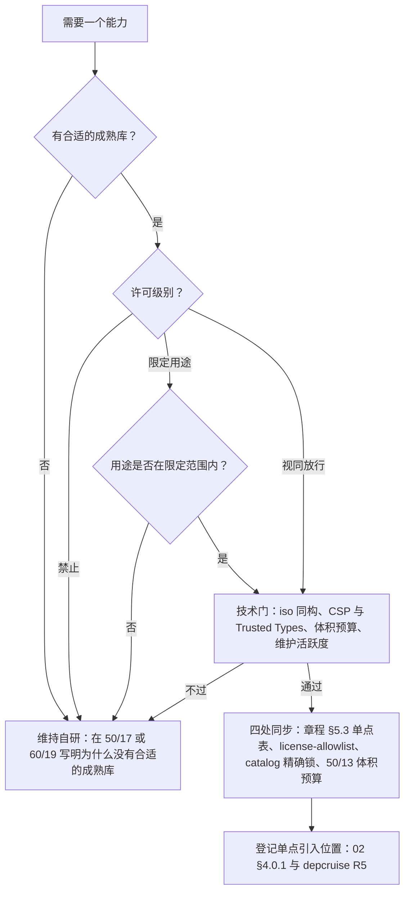

怎么读：自上而下是一个新依赖从提出到入库的判定顺序；任何一道门不过都落到「维持自研」，并且必须留下理由；通过的依赖在同一个 PR 内完成四处同步并登记唯一引入位置。

依据：rulings §4.21 q-license-tiers；R-d-10；ADR-0049（本节口径的决策记录）。

---

## 4. 端到端数据流总图

### 4.1 打开文档

两条打开路径（rulings §4.19 D-M2-CONTENT）：**M1 本地字节**（查看器、嵌入形态与 SDK 单人 preset 拿到的 .pptx 字节在浏览器 Worker 中解析，不经服务端；参考应用自 M2 起的导入改走服务端导入作业）与 **M2 起服务端文档**（应用壳新建 / 打开的文档内容以协同快照为唯一事实源，`GET snapshots/latest` 直接回字节 + 票据 + WS；不存在返回原始 pptx 预签名 URL 的内容端点，也不设过渡的 pptx 内容版本端点）。

**打开本地 .pptx 时序图（M1 起）**

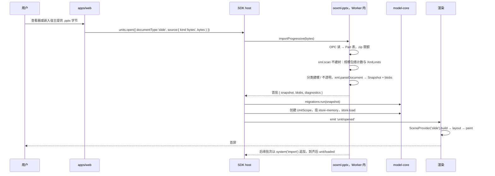

怎么读：从左到右是参与方，实线箭头是调用或事件，虚线箭头是返回；全程不经服务端。Worker 先用 `@cordexjs/xml` 的 `scan` 入口（不建树）完成规模包络计数与 XML 限额检查，超系统天花板整体拒绝（`format.quota_exceeded`，rulings §4.15 Q5），XML 超限返回 `format.limit_exceeded{limit, actual}`、DOCTYPE 一律拒绝（限额只在 ADR-0019 的 XmlLimits 表定义一次）；首批 `store.load` 后即发 `unit/opened`（可渲染、可编辑），后续批次以 `system('import')` 追加（不入撤销栈、不标脏），全部到齐再发 `unit/loaded`（[50-frontend/04](../50-frontend/04-document-commands-and-undo.md) §2，rulings §4.18 CO-12）。

**打开服务端文档时序图（M2 起）**

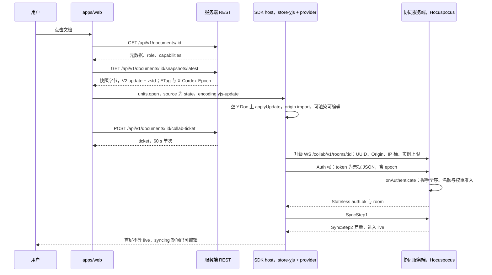

怎么读：先经 HTTP 取最新协同快照完成 bootstrap（不走 Worker 分批解析），再换票据建立 WS；升级前的 HTTP 层校验依次为 400 → 403 → 429 → 503，一个 WS 只承载一个文档。线上是 Hocuspocus 帧：票据放在 Auth 帧的 token 里，`auth.ok`、`room` 等控制消息走 Stateless 载荷（顺序与 step1 / step2 不保证，客户端以 Authenticated 进入 syncing，H-d-06）；Hocuspocus 内部文档名为 `docId:epoch`，URL 仍是 `docId`（H-d-14）。新建文档与服务端导入同样产出协同快照，此后打开都走本路径。REST 路径统一挂 `/api/v1` 前缀，WS 维持 `/collab/v1/rooms/:id`（rulings §4.18 BE-11）。

依据：rulings §4.19 D-M2-CONTENT；INC-14（`snapshots/latest` 直接回字节）；rulings §4.21 q-ws-gateway 与 H-d-01…H-d-06、H-d-14；[30/06](./06-collaboration.md) 的同步协议节。前端视角见 [50-frontend/01](../50-frontend/01-overview-and-runtime-map.md) §5.1，服务端视角见 [60-backend/01](../60-backend/01-service-overview-and-roles.md) §7 与 [60-backend/05](../60-backend/05-modules-collab-and-snapshots.md)。

要点：

- 导入产出的是 **Snapshot + Blob 集合**，不是运行时对象；Store 再从 Snapshot 构造状态（D6 的显式编解码边界）。
- 未建模的部件和 XML 子树在导入阶段就进入 `extensions` / blob（不透明保留，[30/04](./04-document-model.md) 的不透明保留节），不是导出时才想起来。
- `diagnostics` 是一等产出：渲染前 UI 就能提示「本文件含 SmartArt，将只保留不编辑」。
- 规模检查在解析早期完成：页数、单页元素数或文档总元素数超出部署配置的系统天花板（默认 200 页 / 单页 1,000 / 总 20,000）时**直接拒绝导入**（`format.quota_exceeded`），不做只读降级打开。

### 4.2 编辑（M2）

**编辑数据流图（M2）**

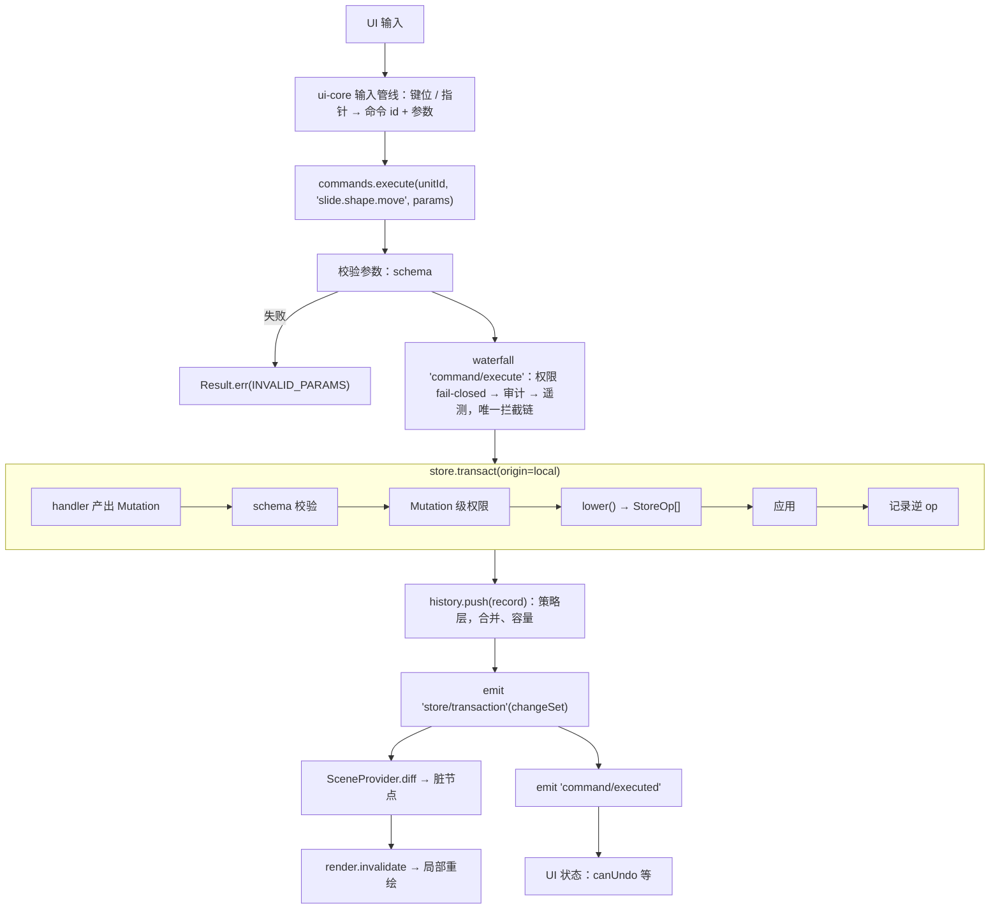

怎么读：自上而下是一次编辑命令经过的阶段；子图是单个事务内部的顺序步骤；两次 emit 依次发出，各自引出一条支线：`store/transaction` 驱动局部重绘，`command/executed` 驱动 UI 状态。M2 起服务端文档的 Store 是 store-yjs，同一事务再经 provider 上网络（§4.3）。编辑器每个能力如何落到命令、渲染器与 UI 入口，见 [编辑器能力实现总表 50/18](../50-frontend/18-editor-capabilities.md) 与 [可追加元素目录 50/19](../50-frontend/19-insertable-elements-overview.md)；命令、撤销与错误的 UI 表达见 [50-frontend/04](../50-frontend/04-document-commands-and-undo.md)。

### 4.3 协同（M2 起单实例协同后端，M3 多人体验层与多实例）

协同后端随 M2 交付（rulings §4.19 D-M2-CONTENT）：M2 在单实例 `all` 进程内嵌 Hocuspocus 4.7.0，交付钩子扩展、逐帧落库与两级 ack、PG 故障溢写与客户端官方 provider；M3 装 extension-redis 做多实例扇出，并交付在场、评论、权限细化、离线体验等多人协同体验层（§7）。协议与语义的跨端唯一源是 [30/06](./06-collaboration.md)，服务端机制见 [60-backend/05](../60-backend/05-modules-collab-and-snapshots.md) 与 [60-backend/16](../60-backend/16-ws-protocol-server-view.md)，客户端见 [50-frontend/07](../50-frontend/07-collaboration-client.md)，决策见 ADR-0039（部分取代 ADR-0023）。

**协同数据流图：update、awareness 与权限三条通道**

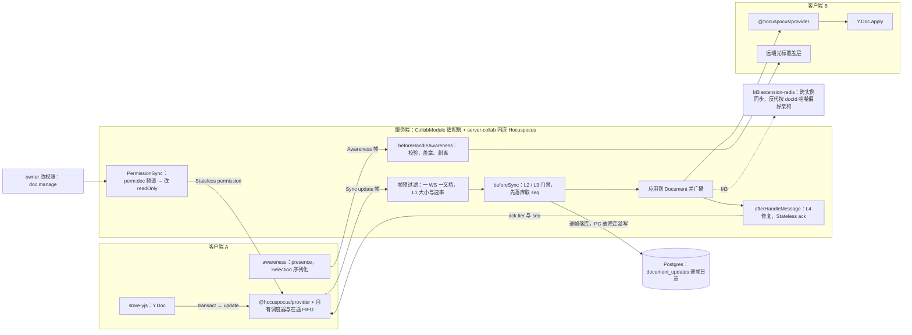

怎么读：上面一条是 CRDT update（先过门禁、先落库、再应用与广播、最后回 ack），中间是 awareness（服务端只就地校验、盖章与剥离，从不因 awareness 断连），最下一条是权限变更：持有 `doc.manage` 的文档所有者改权限后，服务端经 Valkey `perm:doc` 频道逐会话重算角色，改连接的 `readOnly` 并下发 Stateless `permission`，降为 none 时发 `revoked` 并以 4403 关闭（H-d-08）。虚线的 extension-redis 只在 M3 多实例时装配。

**协同总览时序：一次写入从客户端到落库与确认**

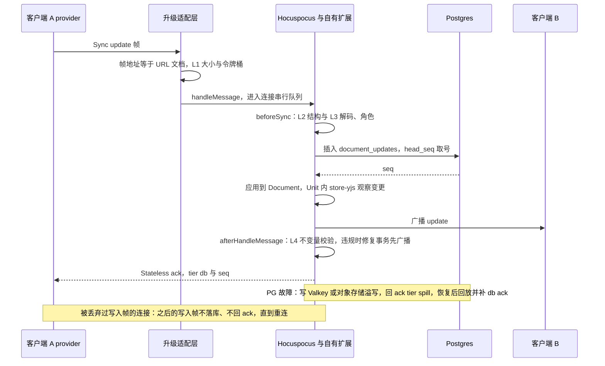

怎么读：纵向是时间顺序。落库发生在应用与广播**之前**（逐帧落库 + 两级 ack，H:q-hp-persist-ack），所以客户端只有收到 `tier:'db'` 的 ack 才清掉 pending；`tier:'spill'` 只表示已溢写、仍须等待回放后的 db ack。两个注记分别是 PG 故障降级路径与「连接污染」拒绝规则（H-d-09）。

要点：

- **唯一事实源**：CRDT 文档是唯一事实源（D5）；Mutation 不上网络，网络上只有 CRDT update、awareness 与 Stateless 控制载荷；正式 `seq` 只由 Postgres 分配（P7）。
- **权限三检查点**：客户端命令管线（UX）、REST 守卫链、WS（票据 + `onAuthenticate` + 每帧角色），后两者 fail-closed（P11）；网关的写入门槛为 ≥ commenter，commenter 的写入范围由软门禁路径规则限定在评论资源（30/06 权限与校验两节、ADR-0034）。
- **服务端自发事务的顺序**（H:q-hp-server-tx）：版本恢复、彻底删除、墓碑清扫这类低频事务在复制文档上**先落库再应用**；软门禁修复**先广播**再送写入器。
- **满员与长离线**：满员房间的 awareness 在包装 `Connection.send` 处只合并 awareness 帧（H:q-hp-awareness-tick）；step2 单独设 16 MiB 上限，单个 update 仍 ≤ 1 MiB，超限返回 4413，客户端导出后重载（H:q-hp-step2-cap，改写 rulings §4.18 CO-10 的「先切块」）。
- **多实例**（M3）：extension-redis 负责跨实例同步 update、awareness 与 Stateless 事件，反代按 `documentId` 一致性哈希做**偏好亲和而非会话粘性**（改写 rulings §4.15 Q10 的「无粘性」）；权限、锁定、close、epoch 仍走自有 Valkey 频道（H:q-hp-fanout）。
- **客户端**：用官方 `@hocuspocus/provider`，外加自有调度器（注入 Clock）、在途 FIFO、被拒回滚与 OfflineStore 胶水（H:q-hp-provider）。

### 4.4 导入与导出（M1 起）

**导入导出总览：同一份 iso 编解码，两个运行位置**

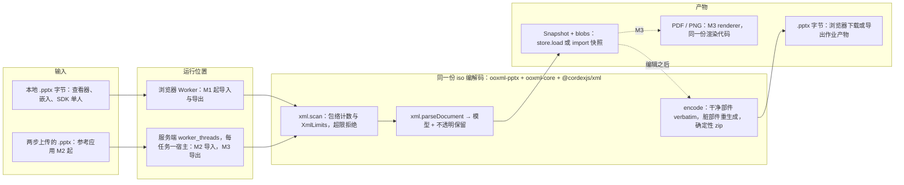

怎么读：左侧两种输入分别在浏览器 Worker 或服务端 worker 线程里运行，但调用的是同一份 iso 编解码代码；`encode` 是纯函数（不读时钟、不读 layout、zip 写入确定性），所以两端对同一快照导出的字节相同（SV-02，[60-backend/06](../60-backend/06-modules-jobs-import-export-thumbnails.md)）。XML 词法、保真树与序列化都在零依赖的 `@cordexjs/xml` 里，ooxml-core 只保留 OPC、命名空间归一化、MCE 与 c14n（测试用）等 OOXML 专属层（ADR-0019）。

**导出数据流图（M1 起）**

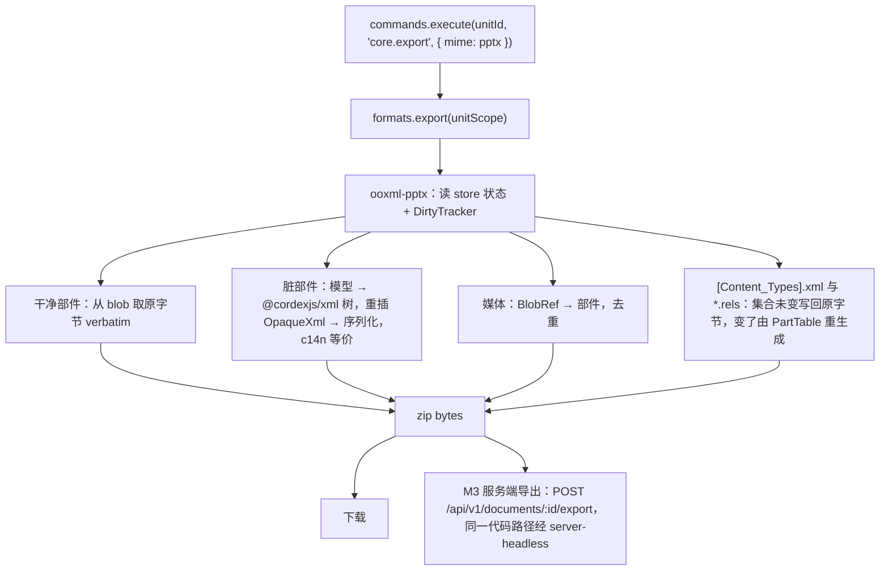

怎么读：导出命令经 `formats` 服务交给 ooxml-pptx 编码器，按部件类型分四路处理后汇合为 zip 字节，最后在浏览器下载（M1 起）或由服务端导出作业产出（M3）。保真门禁是**脏部件 c14n 等价**，逐字节一致只靠 verbatim；实体原文、引号风格、`<a/>` 写法、属性顺序、注释与 PI 是期望项不是门禁。`[Content_Types].xml` 与 `.rels`：关系集合与内容类型集合都没变时写回原字节，变了才由 PartTable 重生成，序列化器只需 c14n 等价（rulings §4.21 X:q-content-types，ADR-0008 决策 5 修订）。浏览器导出管线见 [50-frontend/01](../50-frontend/01-overview-and-runtime-map.md) §5.4，服务端导入导出作业见 60-backend/06。

---

## 5. 关键运行时对象关系（一页图）

全仓只保留这一张跨端的运行时对象图；浏览器侧展开（RuntimeConfig、Session、HostRegistry、EditorHost）见 [50/01 前端架构](../50-frontend/01-overview-and-runtime-map.md) §4，服务端 cordis 宿主与 Nest 生命周期、Room 与 Unit 的映射见 [60/01 后端架构](../60-backend/01-service-overview-and-roles.md) §9。

**运行时装配图：host、服务、贡献点表与 Unit 作用域**

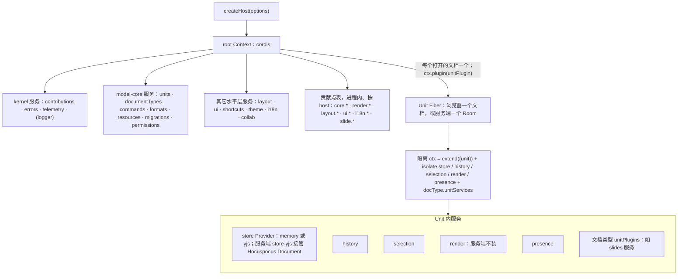

怎么读：箭头表示「挂载在其下 / 由其派生」；root 下的服务与贡献点表按 host 共享，每个打开的文档另有一个 Unit Fiber，其隔离 ctx 中的服务只属于该文档。服务端每个进程一个宿主，一个 Room 就是其中一个 Unit（P10），挂哪些 Provider 由 Unit 默认 Provider 登记表决定（[30/03](./03-kernel-and-plugin-model.md) 的 UnitScope 节，rulings §4.20 FE-01）。

- 一个页面可以有多个 host（多编辑器实例），互不干扰（无模块级状态，A10）。
- 一个 host 可以打开多个 Unit（同页多文档），服务按 Unit 隔离（K2）。

---

## 6. 阅读路径与文档边界

**阅读路径固定为 30/01 总架构 → 50/01 前端架构 → 60/01 后端架构**（rulings §4.21 q-arch-reorg 方案 B；文档站分区为「总架构 / 前端架构与设计 / 后端架构与设计」）。读完三件套后按需下钻：

| 想了解 | 先读 | 再读 |
|---|---|---|
| 整体与跨端原则 | 本文 | [30/README](./README.md) 的架构三件套与索引 |
| 包分层、秩表与依赖规则 | [02](./02-layering-and-packages.md) §1、§7 | 包与文件级目录：40-modules 各篇 §4 |
| 内核、插件、贡献点、UnitScope | [03](./03-kernel-and-plugin-model.md) | [50-frontend/03](../50-frontend/03-preset-assembly-and-plugins.md)（前端装配） |
| 文档模型、不透明保留、可追加元素的模型 | [04](./04-document-model.md) | ADR-0018、ADR-0008、[50/19](../50-frontend/19-insertable-elements-overview.md) |
| 命令、撤销、Mutation 降级 | [05](./05-command-and-history.md) | [50-frontend/04](../50-frontend/04-document-commands-and-undo.md) |
| 协同协议与语义 | [06](./06-collaboration.md) | ADR-0039、[50-frontend/07](../50-frontend/07-collaboration-client.md)、[60-backend/05](../60-backend/05-modules-collab-and-snapshots.md)、[60-backend/16](../60-backend/16-ws-protocol-server-view.md) |
| 渲染跨端契约 | [07](./07-rendering.md) | [50-frontend/05](../50-frontend/05-rendering-and-thumbnails.md)、50/19 |
| 错误码、事件、日志与遥测命名 | [10](./10-observability-and-errors.md) | [50-frontend/15](../50-frontend/15-events-errors-and-telemetry.md)、[60-backend/18](../60-backend/18-observability-and-ops-endpoints.md) |
| 类型治理与机械执行 | [09-type-discipline](./09-type-discipline/README.md) | [70-testing/12](../70-testing/12-ci-gates-mapping.md) |
| 扩展到 doc / sheet | [12](./12-extension-to-doc-and-sheet.md) | 40-modules/13 |
| 复用组件与许可 | 本文 §3a | [50/17](../50-frontend/17-reuse-and-dependency-catalog.md)、[60/19](../60-backend/19-reuse-and-dependency-catalog.md)、ADR-0049 |
| 测试 | [11](./11-testing-strategy.md) | [70-testing](../70-testing/README.md) |

边界：

- 本文只给跨端总图与总口径；各侧设计的唯一事实源（rulings §4.19）：前端 → [50-frontend](../50-frontend/README.md)；后端（含完整 DDL）→ [60-backend](../60-backend/README.md)；测试 → [70-testing](../70-testing/README.md)。30 目录保留跨端原则、跨端协议、iso 契约与 ADR，重复段落改为引用。
- 原 08「后端一页总览」撤销：五条原则见本文 §3（P9–P13），两张后端总图与服务端里程碑见 60/01，其余专题按 [60-backend/README](../60-backend/README.md) §6 的映射在 60 线各篇。原 07 缩为「渲染跨端契约」，页合成、render-dom 与元素渲染器细节迁往 50/01 与 50/19。

---

## 7. M1–M4 里程碑边界（唯一表）

本节是设计线标注 M1–M4 边界时**唯一引用的表**，取代原先分散在 30/06 §0.1、原 08 §0.1、50/01 §8、60/01 §3 的五张里程碑表（这些位置改为引用本节，rulings §4.21 R-d-07）。里程碑骨架以章程 §7 为准；验收细则、P0 / P1 / P2 与需求编号以 [PRD 05](../10-prd/05-milestones-and-scope.md) 为准，两者冲突时以 PRD 05 为准并回写本表。M2 / M3 的分界沿用 rulings §4.19 D-M2-CONTENT：协同后端（网关、Room、update 持久化与快照、服务端导入）随 M2 交付，M3 是多人协同体验层。

**里程碑能力叠加（M1–M4）**

```mermaid
flowchart LR
  subgraph m1["M1 打开与保真"]
    a1["本地字节渐进打开，DOM/SVG 渲染"]
    a2["gated 对象：表格与图表只读、SmartArt、OLE 预览"]
    a3["零编辑往返，客户端导出"]
  end
  subgraph m2["M2 单人编辑 + 协同后端"]
    b1["命令、撤销、文本与 IME、形状、图片、表格插入与单元格文字"]
    b2["单实例 Hocuspocus：逐帧落库、两级 ack、溢写"]
    b3["OIDC、文档目录、服务端导入、包内封面"]
  end
  subgraph m3["M3 多人协同体验层"]
    c1["在场、评论、分享与权限、离线体验、版本历史"]
    c2["extension-redis 多实例、服务端导出、缩略图与 PDF"]
    c3["表格结构与样式、图表插入与五类编辑、图标与符号"]
  end
  subgraph m4["M4 插件 SDK 公开"]
    d1["插件 SDK、兼容性套件、JWT 与 API Key"]
    d2["跨刷新离线、Helm；M4+ SmartArt 转形状、公式、截图与相册"]
  end
  m1 --> m2 --> m3 --> m4
```

怎么读：箭头是里程碑先后，每个子图列出该里程碑新增的主要能力，后一个里程碑包含前一个的全部能力（只增不减）；逐项边界见下表。

| 领域 | M1 打开与保真 | M2 单人编辑 + 协同后端 | M3 多人协同体验层 | M4 插件 SDK 公开（含 M4+） |
|---|---|---|---|---|
| 打开与渲染 | 本地字节在 Worker 中渐进打开；DOM/SVG 单实现；表格、图表只读（SSIM ≥ 0.80）、SmartArt 按 `dsp:drawing` 渲染、OLE 显示预览为 gated 对象；chartex 占位 | 服务端文档经快照 bootstrap；EMF / WMF 惰性栅格化（P1）；基础放映（P1，无动画） | 服务端权威缩略图（前半段）与 PDF（后半段），renderer sidecar | 动画播放（P2）；chartex 近似渲染评估（M4+） |
| 编辑能力（[50/18](../50-frontend/18-editor-capabilities.md)） | — | 命令、撤销重做、文本与 IME、形状、图片、幻灯片增删排序、属性编辑；母版视图只读与版式应用、重置；超链接（P1） | 母版与版式编辑、主题（P1）；连接符肘形与曲线重算（P1） | SmartArt「转换为形状」（M4+，一次性物化为组合，节点文字编辑之后再评估）；公式（M4+，基于 `@cordexjs/xml` 自研 OMML↔MathML，MathJax 4 惰性渲染） |
| 可追加元素（[50/19](../50-frontend/19-insertable-elements-overview.md)） | 全部元素族只读查看 | 文本框、形状库约 72 项、线条、动作按钮、图片与 SVG（P0）；连接符（P1）；表格插入与改单元格文字；音视频插入（P2，插入时不写 `p:timing`，导出后靠 PowerPoint 媒体控件点播）；页眉页脚（P2） | 图表插入与五类编辑（bar / line / pie / area / scatter，P1）；表格行列插删、合并拆分与样式；图标与符号（P2，图标用 lucide-static，符号用自建 Unicode 表） | 屏幕截图与相册（M4+ P2）；录屏不做；SmartArt、OLE、3D、墨迹、缩放定位不提供插入，自定义几何的顶点编辑为非目标 |
| 表格模型 | 只读渲染 | 在现有模型上插入表格、改单元格文字 | 结构编辑开工前改为归一化模型：`columns` / `rows` 为 `Record<Id, {order: FracKey, …}>`，`cells` 以 `"RowId:ColId"` 为键，合并记在锚格，导出按 order 重建 `a:tbl`；不变量 I-TBL1、I-TBL2 兜底（ADR-0018） | — |
| 协同与持久化 | 无协同链路 | 单实例嵌入 Hocuspocus 4.7.0（自挂 upgrade）与七个自有扩展（ADR-0039 表 39-3）；门禁 L1–L4；逐帧写入器、两级 ack 与三档溢写（PG 故障依次写 Valkey、对象存储）及 `room.persist`；连接污染规则；awareness 中继；压缩与 auto 快照、`snapshots/latest`；墓碑清扫与换纪元；客户端官方 provider 与自有调度器、基础重连 | extension-redis 多实例扇出与反代按 documentId 一致性哈希（偏好亲和、非会话粘性）、跨实例 PermissionSync 与溢写认领、名额按用户计；在场、软冲突、协同撤销跳过；离线体验；版本历史（命名、列表、恢复，恢复的撤销以 ADR-0038 定稿为前提）；彻底删除元素 | 跨刷新离线持久化 `collab-offline-idb`（P2） |
| 身份与权限 | — | OIDC 登录与会话、JIT 建号；建档者即 owner；REST 与网关 fail-closed；分享入口不开放 | 按人分享、分享链接、四种角色、权限变更 ≤ 2 s 生效；查看者变体；文档级 RLS 测试阻断合并 | 集成方签名 JWT 与 API Key（JIT 影子用户） |
| 文档目录与数据生命周期 | — | 新建（空白 / 模板）、创建副本、列表与元数据、改名、回收站、最近与固定；保留期作业 | 永久删除文档、用户擦除、唯一 owner 转移（`cordex-ops documents:reassign-owner`） | — |
| 导入导出 | 客户端导出 pptx，零编辑往返逐部件字节一致 | 服务端导入（两步上传、异步作业、可取消、超天花板拒绝）与包内过渡封面；客户端导出 pptx、单页 PNG / SVG | 服务端导出 pptx、PDF、批量 PNG | 模板填充 + 批量导出（服务端） |
| 评论与集成 | — | — | 评论（`@cordexjs/comments`）；Webhook（Standard Webhooks 签名）；审计查询与哈希链 | — |
| 部署与运维 | — | 单实例 `CORDEX_ROLE=all`；`/healthz`、`/readyz`；协同与服务端压测的自托管 runner 在 M2 前落地 | compose 洁净栈出口（断网 e2e、digest、SBOM、镜像许可）、按角色拆分部署、监控与告警 | 离线安装包、多架构、Helm（P1） |
| 技术栈基线 | Node 26、pnpm 11；NestJS 12（纯 ESM，OTel 以 `node --import` 预加载）；Yjs 13.6.33 精确锁 | Drizzle 1.0 破坏性变更在 M2 前评估；Hocuspocus 4.7.0 精确钉，升级须过协同契约套件 | Yjs 14 在 M3 前 spike | — |
| 可插拔证据 | store-memory 与 render-dom 可被 no-op Provider 替换后仍能启动 | 第三方示例插件（二维码元素 + ribbon 按钮）零改内核 | store-yjs 替换 store-memory 仅改 preset；M3 末最小 canvas Provider 过 `render.target` 契约；`UiRenderer('vanilla')` 过 UI 契约 | 内部非核心成员仅凭公开文档独立完成一个插件 |

M5（多文档类型孵化）不在本表：`model-doc` / `model-sheet` 骨架通过文档类型盲验证、水平层零改动（章程 §7、PRD 05）。

依据：章程 §7；PRD 05 §0.3；rulings §4.19 D-M2-CONTENT、D-TEST-INFRA；rulings §4.20 BE-05+TX-22、TX-01+BE-10；rulings §4.21 q-table-depth、q-chart-route、q-media-insert、q-smartart、q-equation、q-extra-inserts、q-nest-major、q-db-access 与 H:q-hp-* 六题。
