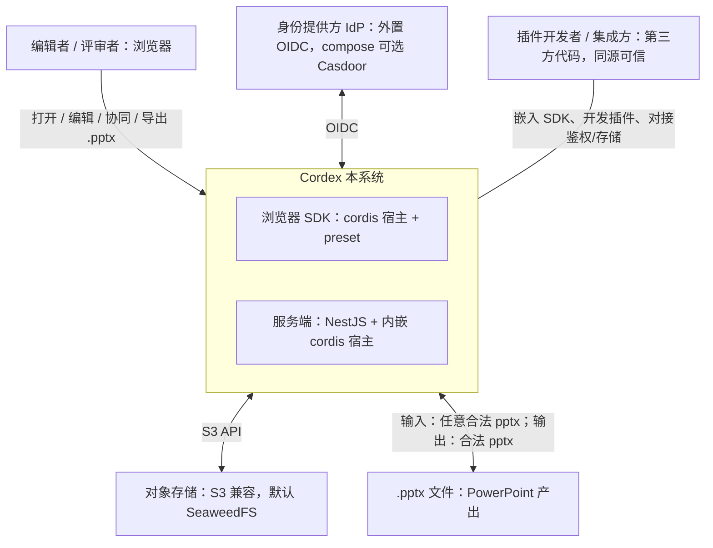
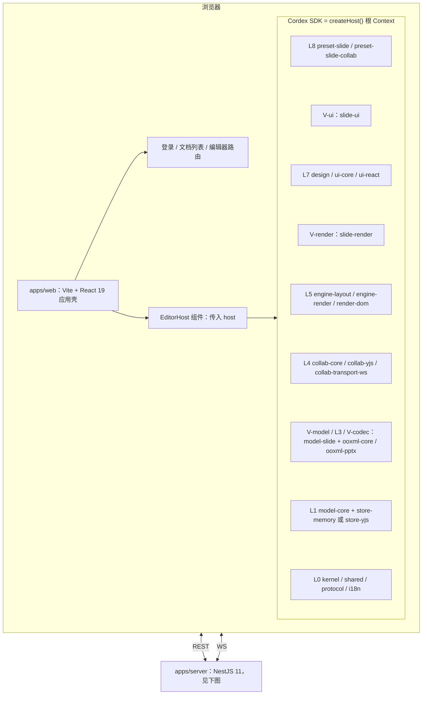
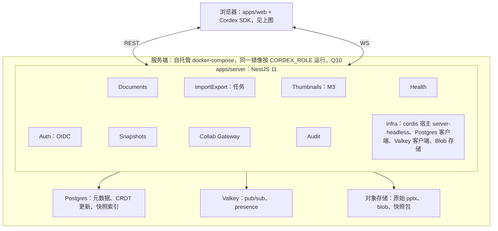
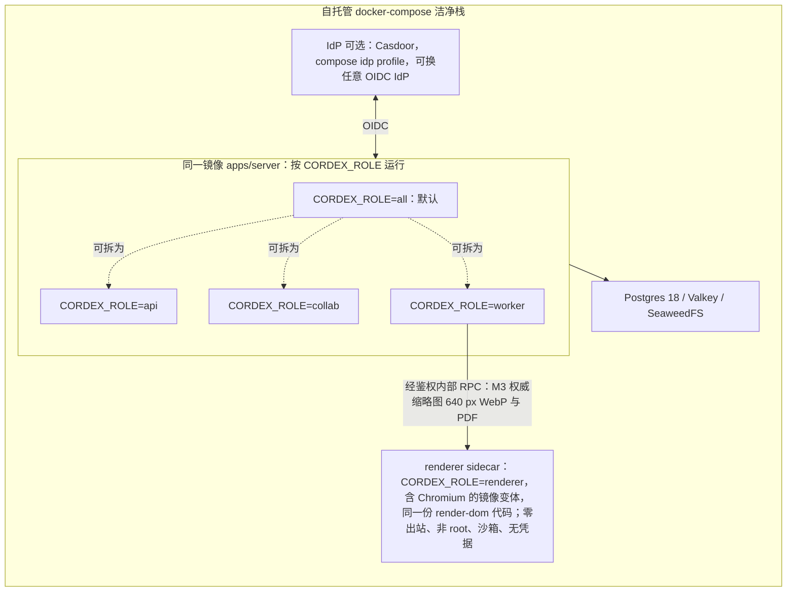
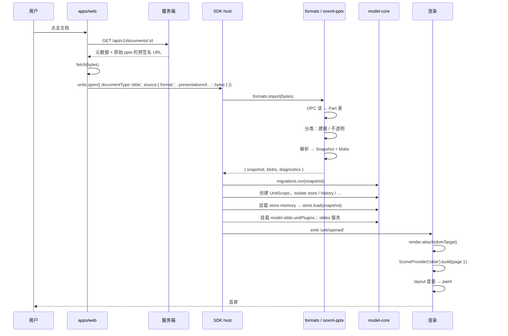
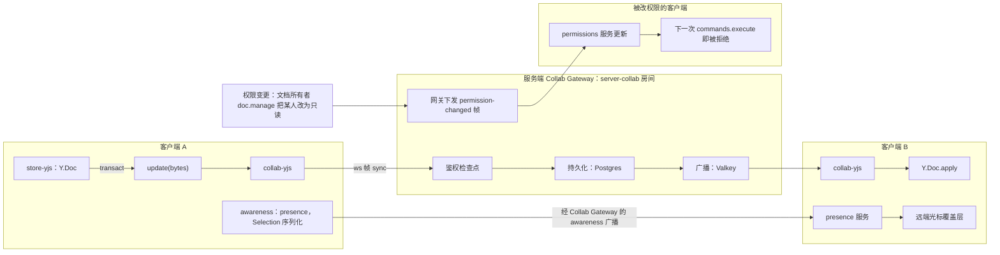
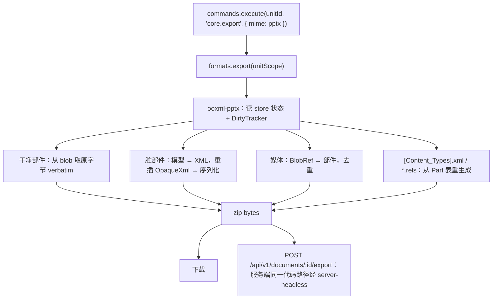
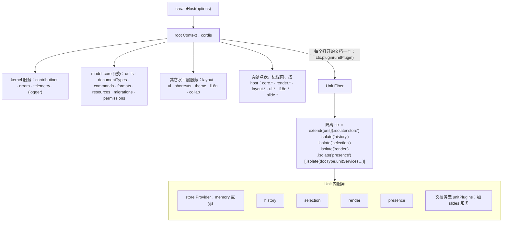

# 01 架构总览：系统上下文、容器、原则与端到端数据流

> 状态：草稿 | 负责：架构-结构 | 更新：2026-09-14；2026-09-24（rulings §4.15：T-0 单组织；Q6 外置 OIDC IdP（可选 Casdoor）；Q10 自托管 compose 洁净栈 Postgres 18 / Valkey / SeaweedFS / renderer sidecar；Q5 超包络导入拒绝；Q2 Vite 8）；2026-09-25（补图）；2026-09-25（矛盾收口，rulings §4.18） | 依赖：charter v0.1

---

## 1. C4 L1 — 系统上下文

**C4 L1 系统上下文图**

怎么读：中间子图是本系统（浏览器 SDK + 服务端两部分），四周是人与外部系统；双向箭头表示双向交互（OIDC 登录、S3 读写、pptx 导入导出），无箭头的连线表示插件开发者/集成方以嵌入与扩展的方式使用本系统。

依据：本文 §1 要点列表；rulings §4.15 Q6（外置 OIDC、可选 Casdoor）、Q10（SeaweedFS）。

- **用户**：编辑者、评审者（PRD 02 的角色）；**插件开发者**与**集成方**同样是一等用户（章程 §2.2）。
- **外部系统**：OIDC IdP（rulings §4.15 Q6：部署方任意 OIDC IdP，compose 可选内置 Casdoor；服务端不持有密码）、S3 兼容对象存储（Q10：默认 SeaweedFS，生产推荐客户自有 S3）、PowerPoint 作为文件的生产者/消费者（也是视觉回归的 oracle，见 11）。
- **部署边界**：一次部署 = 一个组织（rulings §4.15 T-0），系统内没有租户概念；多组织需求走多套部署，将来若做 SaaS 另立项。
- **信任边界**：插件与宿主同源可信（章程 §2.3），不做运行时沙箱；`isolate()` 只是解析域。

---

## 2. C4 L2 — 容器

**C4 L2 容器图 · 浏览器侧**

怎么读：SDK 子图内自上而下是秩由高到低的包组（只表示层次顺序，不代表逐层依赖）；原 ASCII 图中的旧层号「L2/L3」「L6」已按 02 §1 的层带编码写作 V-model / L3 / V-codec 与 V-render、V-ui，其中 V-ui（秩 75）高于 L7（秩 70），故单列在 L7 之上，V-render（秩 55）位于 L7 与 L5 之间。浏览器与服务端之间有 REST 与 WS 两条通道。

依据：本文 §2 表；02 §1 分层网格。

**C4 L2 容器图 · 服务端与数据存储**

怎么读：`apps/server` 子图内是 Nest 模块与 infra 客户端（网格排布只为版面，模块间无依赖含义）；实线箭头从 `apps/server` 指向三类数据存储，表示读写访问。

依据：本文 §2 表；rulings §4.15 Q10。

| 容器 | 技术 | 职责 | 详见 |
|---|---|---|---|
| 浏览器 SDK | TS，cordis 4，React 19 绑定 | 打开、渲染、编辑、协同客户端、导出；**全部能力都是插件** | 02、03 |
| `apps/web` | Vite 8 + React 19 + react-router 8 | 组装 preset，路由与登录；零业务逻辑 | 02 §3 |
| `apps/server` | NestJS 11 | 传输壳：REST、WS 网关、任务；业务逻辑在 `server-*` 包 | 08 |
| 服务端 cordis 宿主 | `@cordexjs/server-headless` | 在 Node 26 中加载同一批 iso 插件做导入/导出/校验/迁移 | 02 §4.24、08 |
| renderer sidecar | headless Chromium（同一份 render-dom 代码），`CORDEX_ROLE=renderer` | M3 权威缩略图（640 px WebP）与 PDF；零出站、非 root、沙箱、无凭据，只接受 worker 经鉴权内部 RPC 的入站请求 | 08 §7、ADR-0026 |
| Postgres | 18（下限 16；uuid v7 在应用层生成） | 文档元数据、权限、CRDT update 追加表、快照索引、审计；文档级 RLS 兜底 | 08、ADR-0022 |
| Valkey | 钉次版本，Redis ≥ 7.2 协议兼容 | 跨实例 pub/sub、presence、S-3 溢写 | 08 |
| 对象存储 | S3 兼容（默认 SeaweedFS，保留 `snapshots/` 版本化） | 原始 pptx、内容寻址 blob（媒体、不透明部件）、快照包；浏览器预签名直传/直读经反代子域 `s3.<域名>`（保持 Host 头，预签名按 `storage.s3.publicEndpoint` 生成），容器仍只在 backend 网络、不开宿主端口（rulings §4.18 BE-01） | 04 §2.5、08 |
| IdP（可选） | Casdoor（compose `idp` profile，可换任意 OIDC IdP） | 登录与账号；注册由部署开关 `auth.selfSignup` 控制（默认关）；浏览器经反代子域 `idp.<域名>` 到达登录页，issuer 用对外 URL（rulings §4.18 BE-01） | 08 §9、ADR-0029 |

**服务端运行时装配：CORDEX_ROLE 与 renderer sidecar**

怎么读：虚线表示 `all` 角色可按需拆成 api / collab / worker 三个进程（各角色装配哪些模块以 40-modules/12 §7.1「模块 × 角色 × 部件」矩阵为准，快照 REST 与管理动作只在 collab，rulings §4.18 BE-03/BE-13）；renderer 只接受 worker 经鉴权内部 RPC 的入站请求（实线），自身零出站；IdP 与数据存储是同一 compose 栈里的独立容器。

依据：本表 renderer sidecar / IdP 行；02 §3.2 `Dockerfile` 与 `docker-compose.yml` 行；rulings §4.15 Q8、Q10。

**同一份模型/格式代码在两端运行**（章程 §2.2）：`model-core`、`model-slide`、`ooxml-*`、`store-*`、`engine-layout` 均为 `iso` 类；浏览器与 Node 各自提供 `TextMeasurer` Provider 与 `RenderTarget` Provider。

---

## 3. 四大原则（章程 §0 三关键词 + R7）

| 原则 | 结构层面的含义 | 一个反例（我们禁止的） |
|---|---|---|
| **SDK 优先** | `packages/*` 是产品；`preset-*` 是「产品形状」；`apps/*` 只是样例组装 | 在 `apps/web/src` 里写「插入形状」的逻辑 |
| **每一级可插拔** | 每层至少一个 Definition + 可替换 Provider；Consumer 只依赖 Definition；移除 Provider → 降级不崩 | `ui-core` 直接 `import { YjsStore } from '@cordexjs/store-yjs'` |
| **文档类型盲** | 水平层不知道幻灯片；`DocumentType`、`Mutation`、`SceneProvider`、UI 贡献全部由垂直束注入 | `model-core` 里出现 `slideId`（Univer A1/A2） |
| **规范必有执行点** | 本目录每条规则配「机械验证」；`policy-check` 校验规则 ↔ CI job 对应 | 写在 README 里的「请勿深引用 src」（Univer A17/A27） |

---

## 4. 端到端数据流总图

### 4.1 打开文档（单人，M1）

**打开文档时序图（单人，M1）**

怎么读：从左到右是参与方，实线箭头是调用或事件，虚线箭头是返回；「服务端」一列对应原图中标注为 `(server)` 的元数据请求（REST 路径统一挂 `/api/v1` 前缀，rulings §4.18 BE-11）；导入产出的是 Snapshot + blobs，随后才建 UnitScope 并加载 Store。本图画的是小文件的一次装载；大文件按渐进打开执行（07 §14.2、04 §2.2，rulings §4.18 CO-12）：Worker 先完成规模包络计数（超天花板整体拒绝），首批 `store.load` 后即发 `unit/opened`（可渲染、可编辑），后续批次以 `system('import')` 追加（不入撤销栈、不标脏），全部到齐再发 `unit/loaded`；协同模式不走此路径，Y 状态由 HTTP 快照 bootstrap。

要点：
- 导入产出的是 **Snapshot + Blob 集合**，不是运行时对象；Store 再从 Snapshot 构造状态（D6 的显式编解码边界）。
- 未建模的部件和 XML 子树在导入阶段就进入 `extensions`/blob（不透明保留，04 §5），不是导出时才想起来。
- `diagnostics` 是一等产出：渲染前 UI 就能提示「本文件含 SmartArt，将只保留不编辑」。
- 规模检查在解析早期完成（rulings §4.15 Q5，04 §5.5）：页数、单页元素数或文档总元素数超出部署配置的系统天花板（默认 200 页 / 单页 1,000 / 总 20,000）时**直接拒绝导入**（`format.quota_exceeded`），不做只读降级打开。

### 4.2 编辑（M2）

**编辑数据流图（M2）**

怎么读：自上而下是一次编辑命令经过的阶段；子图是单个事务内部的顺序步骤；两次 emit 依次发出，各自引出一条支线：`store/transaction` 驱动局部重绘，`command/executed` 驱动 UI 状态。

### 4.3 协同（M3；协议细节见 06）

**协同数据流图（M3）**

怎么读：箭头是数据或控制的流向；上两条是 CRDT update（先鉴权、再持久化、再广播）与 awareness 两条通道（awareness 同样经服务端房间广播，server-collab 负责 awareness 广播，图中以边标签表示、未展开网关内部），最下一条是权限变更经网关下发、在客户端下一次执行命令时生效——发起者是持有 `doc.manage` 的**文档所有者**，部署级平台管理员不持有文档角色、不能改文档权限（40-modules/08 ROLE_CAPABILITIES；2026-09-25 rulings §4.18 BE-22）。Postgres 可用时按「鉴权 → 持久化 → 广播」顺序；PG 故障降级期 update 通过门禁、进入溢写档后即在本实例广播并跨实例扇出，不等持久化，持久性由发起方 pending 兜底（06 §6.4，rulings §4.18 CO-08）。

要点：CRDT 文档是唯一事实源（D5）；Mutation 不上网络，网络上只有 CRDT update；权限在两处（管线 + 网关）检查（D12）。

### 4.4 导出（M1 起）

**导出数据流图（M1 起）**

怎么读：导出命令经 `formats` 服务交给 ooxml-pptx 编码器，按部件类型分四路处理后汇合为 zip 字节，最后在浏览器下载或提交服务端（两端走同一份编码代码）。

---

## 5. 关键运行时对象关系（一页图）

**运行时装配图：host、服务、贡献点表与 Unit 作用域**

怎么读：箭头表示「挂载在其下 / 由其派生」；root 下的服务与贡献点表按 host 共享，每个打开的文档另有一个 Unit Fiber，其隔离 ctx 中的服务只属于该文档。

- 一个页面可以有多个 host（多编辑器实例），互不干扰（无模块级状态，A10）。
- 一个 host 可以打开多个 Unit（同页多文档），服务按 Unit 隔离（K2）。

---

## 6. 与其它文档的边界

- 本文只给总图。分层与目录 → 02；内核与插件 → 03；模型与格式 → 04；命令 → 05；协同/渲染/后端/观测/测试 → 06/07/08/10/11（运行时线）；规则的执行细节 → 09（类型治理线）。
