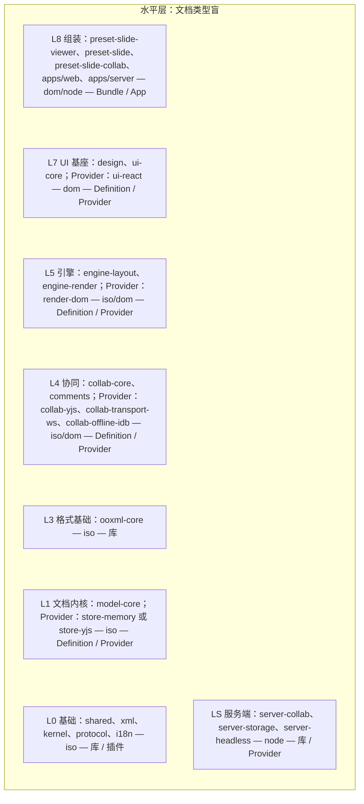
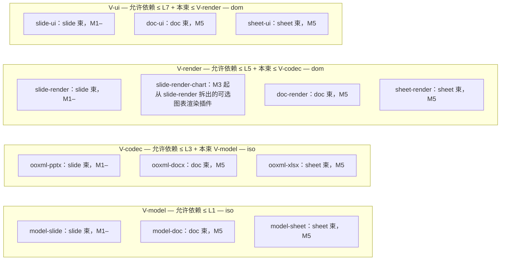
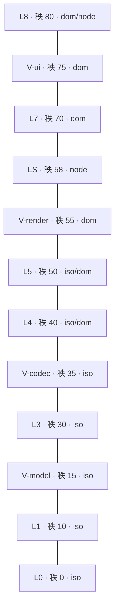
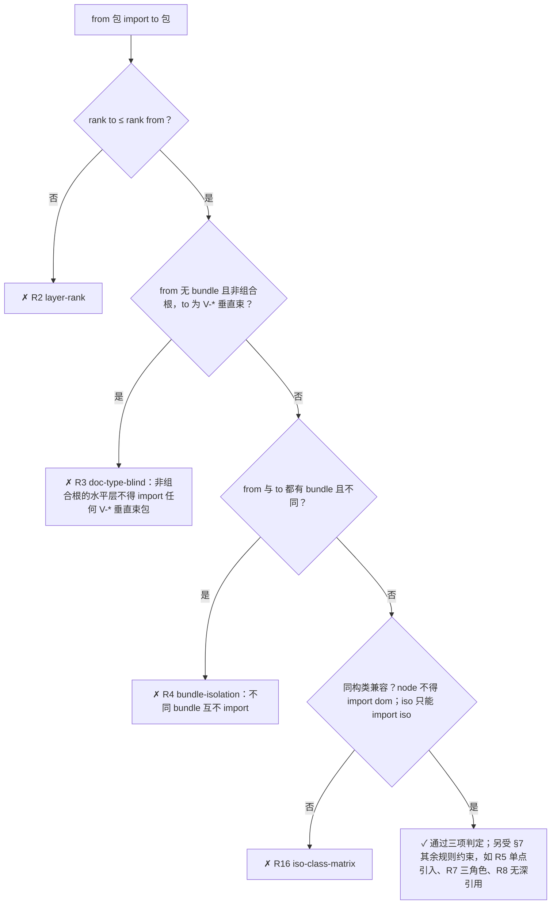
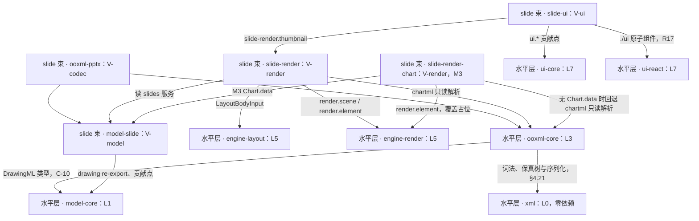
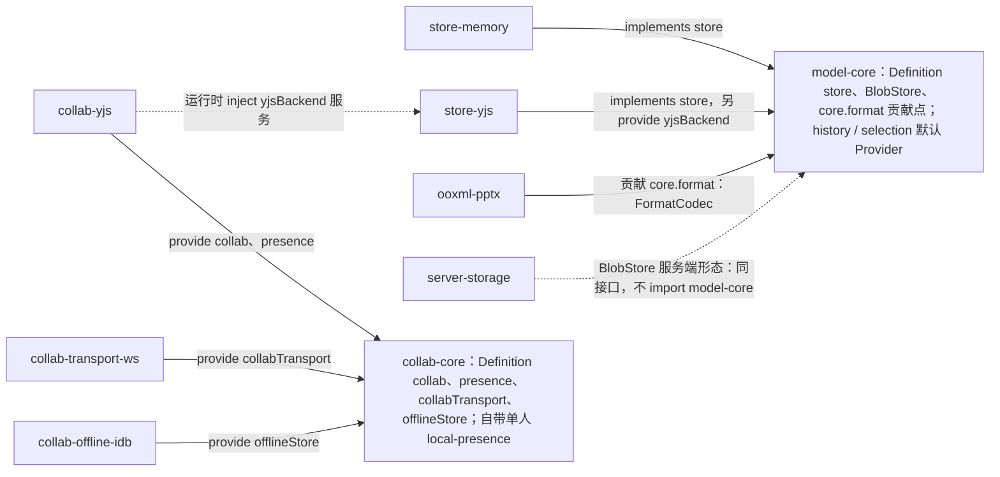
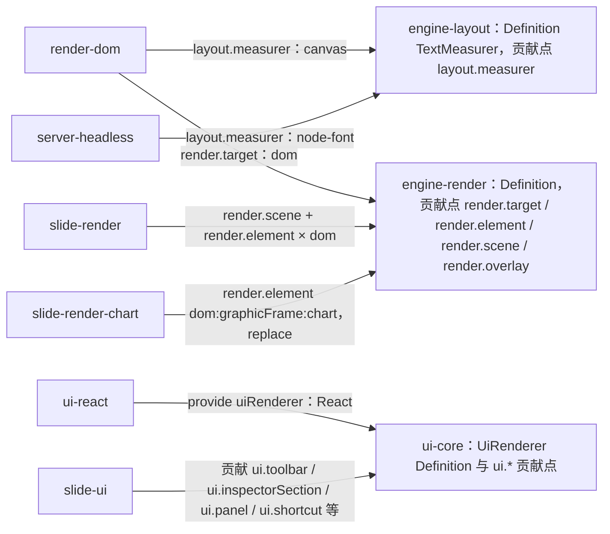

# 02 分层与包：秩表、仓库根目录、package.json 策略、第三方单点与依赖规则

> 状态：草稿 | 负责：架构-结构 | 更新：2026-09-18（补 §4.0.1 `cordex.role` 七值↔四值折叠表、§4 开头 DDD 目录旁注，14 §1 C-11）；2026-09-24（rulings §4.15：Q9 pnpm 11 双锁 + Node 26、删 `.npmrc` 非鉴权设置、lockfile-guard；Q1 包模板 publishConfig/private、内部依赖 `workspace:` 协议、release 走 OIDC trusted publishing；Q10 compose 组件 Valkey/SeaweedFS/renderer/可选 Casdoor；T-0 去租户；Q2 `*-ui` domain/application 框架无关规则）；2026-09-24（rulings §4.16 Q15：`ooxml-pptx` codec 与夹具的 `.pptm` 改为拒绝导入口径）；2026-09-24（复核修正，rulings §4.17：L5 包模板补 `license: "Apache-2.0"`；M17 R14a 改名 `cordex-ui-bundle-core-framework-free`；M15 §2 docker-compose 行 profile 划分按 ADR-0037）；2026-09-25（补图）；2026-09-25（矛盾收口，rulings §4.18）；2026-09-25（§4.19：D-COMMENTS-PKG 登记 iso 包 `@cordexjs/comments`（§1、§4.12c、§4.21）与 `comments.threads` 命名空间（§4.10）；D-M2-CONTENT 参考应用 M2 起用 `preset-slide-collab`、快照直接回字节（§3.2、§4.21）；§3.1、§3.2、§4.17–§4.24 加 50 / 60 线链接）；2026-09-25（§4.19）；2026-09-25（设计线拆分：§3.1 `apps/web` 与 §3.2 `apps/server` 的 `src/` 子树压缩为包级定位 + 链接 40-modules/08、09、11、12 §4 与 50-frontend/02–03、60-backend/01、17；`FixedMetricsMeasurer` 改 `FixedWidthMeasurer`（70-testing 回写））；2026-09-26（§4.20）（FE-01：§4.5 model-core `Config` 删 `defaultStoreProvider`，`units.service.ts` 增 `registerUnitProvider`/`listUnitProviders`，`unit-plugin.ts` 改为按登记表挂载；FE-06：§4 ui-core `model/` 公共骨架加 `enablement?`、`context-keys.ts` 标准键补 `editorMode`、`unitLoaded`、`can.*`；FE-05/FE-03：slide-ui `MasterThumbnails` 删除被引用版式改为确认后可撤销、默认版式取 `defaultLayoutOf`）；2026-09-26（§4.21：去目录树——§3–§4 逐包目录树删除，各包标题留一行桩指 40-modules 对应 §4，§4.19 UI 依赖清单迁 50/17；§1 秩表加 L0 `@cordexjs/xml` 并定为全仓唯一源；§4.0.1 单点表补 §4.21 新依赖、zod 单点放宽、fflate 多页 zip 经 ooxml-core `writeZip`；§4.9 ooxml-core 依赖上限改为 shared, xml, model-core、关系部件写回改为「结构不变写回原字节」；§7 R5 / R9 / R11 同步）；2026-09-26（§4.21 整合：§4.0.1 单点表补 mtx-decompressor、rbush、use-sync-external-store、simplify-js、fit-curve、浏览器 OTel 与一方包白名单；server-app-thin 与 R9 白名单加 @cordexjs/ooxml-core/zip；§4.1b 改指 40/04 §4.3；§4.0.1 单点表注明 depcruise R5 由章程 §5.3 登记表生成；numfmt 放行 slide-ui 图表数据分区）；2026-09-26（§4.21 复核：fflate 单点只在 ooxml-core）；2026-10-04（design-language-v3 第 0 批：图中 slide-ui 的贡献点改为 `ui.toolbar` / `ui.inspectorSection` / `ui.panel` / `ui.shortcut`（rulings §4.25 DS-5）） | 依赖：charter v0.1
> 本文是 M0 后半段「创建仓库骨架」的直接输入。包名/层号/同构类以章程 §5.2 为准，不得更名。§4.21 起本文只保留跨端的分层规则（§1 秩表是全仓唯一源）、仓库根目录、`package.json` 策略、第三方单点表与依赖规则；逐包目录树与逐文件职责以 40-modules 各篇 §4 为唯一源，本文各包标题保留一行桩供既有引用命中。

---

## 1. 分层网格（章程 §5.1 的落地版）

**分层网格 · 水平层**



怎么读：每个节点是一层，格式为「层号 名称：包 — 同构类 — 角色」；「Provider：」之后的包即原网格中方括号标注的可替换 Provider；左列自上而下为 L8 → L0，LS（服务端）单列在旁，其秩见下方秩表。节点之间没有依赖箭头，依赖规则见秩表与 §7。

**分层网格 · 垂直束层带**



怎么读：每个子图是一个层带，标题给出「允许依赖的水平层 — 同构类」；每束（slide / doc / sheet）横跨这四个层带，在每个层带中各有一个主包（slide 束在 V-render 另有 M3 起拆出的可选包 slide-render-chart），束与束之间互不依赖（§7 R4）。

「层带」是本文对章程「L2/L3/L6 垂直束视为各自层号」的机械化解读（README C-1；**总编排已裁决采纳，章程 v0.2 起不再使用 L2/L6 作层号**）。机械化形式是一张**秩表**（类型治理线 depcruise 用数值比较，语义与本文 §7 R2 的允许矩阵等价）。**本节秩表是全仓唯一源**（rulings §4.21 R-d-06）：[50/01 前端架构](../50-frontend/01-overview-and-runtime-map.md) §2、40-modules/18 §3 与章程 §5.1 只引用本表，不再各自重画数值。§4.21 起 L0 新增 `@cordexjs/xml`（秩 0 · iso · library），与 `shared` 一样零运行时依赖（R11）：

```
 layer     L0   L1   V-model   L3   V-codec   L4   L5   V-render   LS   L7   V-ui   L8
 rank       0   10     15      30     35      40   50     55       58   70    75    80
 规则：rank(to) ≤ rank(from)
       ∧ 束间隔离（不同 bundle 互不 import；无 bundle 且非组合根的水平层不得 import 任何 V-* 垂直束包）
       ∧ 同构类（node 不得 import dom；iso 只能 import iso）
 例：V-model(15)→L1(10) ✓  V-model→L3(30) ✗  V-codec(35)→V-model(15) ✓  V-render(55)→L5(50) ✓
     LS(58)→engine-layout/engine-render(L5, iso) ✓  LS→render-dom(L5, dom) ✗（同构类拦截）  LS→L7 ✗
     LS(server-headless)→model-slide ✗（LS 不是组合根，R3 拦截；slide 束由 apps/server 装配）
     L3(ooxml-core)→L0(xml) ✓  L0(xml)→L0(shared) ✗（R11：xml 与 shared 零依赖）  apps/server 媒体模块→xml ✓（R9 白名单）
     L8 组合根（compositionRoot:true）→任意 ✓，但 preset 带 bundle 后仍受束间隔离（preset-doc→slide 束 ✗），
     apps/web 仍受 R9 白名单（apps/web→model-slide ✗）
```

**秩阶梯**



怎么读：自下而上秩递增；连线只表示秩的先后，不表示依赖。一个包只能 import 秩不高于自己的包，之后还要经过束间隔离与同构类两道过滤（见下图），例如 LS 的秩高于 V-render，但 node 不得 import dom，因此仍被拦截。秩由 `cordex.layer` 查本表得出，**不写进** package.json（`cordex` 字段 schema 拒绝 `rank` 等未知键，2026-09-25 rulings §4.18 FE-21）。

**依赖判定流程：rank ∧ 束间隔离 ∧ 同构类**



怎么读：菱形是逐项判定，任何一项不满足即为 error；三项判定对应上方秩表下的「规则」三行，规则编号取自 §7。组合根（`compositionRoot: true` 的 preset-*、apps/web、apps/server）在 R3 处豁免，但不豁免 R4 与 R9（2026-09-25 rulings §4.18 FE-01）。

第 7 节把它写成 dependency-cruiser 规则的语义；`package.json#cordex` 字段编码见 §4.0.1。

---

## 2. 仓库根目录

```
/
├── package.json                 私有工作区根（private:true）：**双锁**（rulings §4.15 Q9）——`packageManager: "pnpm@11.x.y"`（精确版本，可附 `+sha512` 哈希）+ `devEngines.packageManager { name: pnpm, version: 同一精确版本, onFail: error }` + `devEngines.runtime { name: node, version: ">=26", onFail: error }`；`engines.node: ">=26"`；corepack 仅为可选安装渠道，**不是**锁定依据；脚本：build/typecheck/lint/test/test:typecheck/depcruise/api/manifest/scan/policy/iso-smoke/check（check = 全部门禁；12 个脚本的逐条作用以 40-modules/01 §2.6 为准）。仓库根一律用 pnpm（根目录执行 npm/npx 会因 devEngines 报 EBADDEVENGINES）
├── pnpm-workspace.yaml          packages: apps/*, packages/*, tooling/*, docs/20-design/playground（playground 纳入根 workspace，但不进 turbo 门禁任务图）；**全部 pnpm 设置显式写在这里**（pnpm 11 不再从 .npmrc 读取非鉴权设置）：nodeLinker: isolated、shamefullyHoist: false、strictPeerDependencies: true、autoInstallPeers: false、minimumReleaseAge: 1440、blockExoticSubdeps: true、allowBuilds（白名单）；catalog: 第三方版本目录（cordis、zod、yjs 13.6.x 精确版本、react 19.3.x、vitest、typescript 钉 5.9 或 6.x（ADR-0046）…），各包用 catalog: 引用，保证单版本；内部依赖一律 `workspace:` 协议（peer 写 `workspace:^`，其余写 `workspace:*`）
├── pnpm-lock.yaml               **全仓唯一 lockfile**；子目录出现任何 lockfile（含 package-lock.json、yarn.lock）由 lockfile-guard 拒绝；CI 以 `pnpm install --frozen-lockfile` 安装
├── .node-version                26（fnm/nvm 等读取；与 devEngines.runtime 一致）
├── turbo.json                   任务图：build(dependsOn ^build, outputs lib/**)、typecheck、lint、test、test:typecheck、depcruise、api、manifest（= `tsx tooling/scripts/scan-manifest.ts --check`）、scan、policy、iso-smoke——任务名与根 scripts 同名（40-modules/01 §2.6；原 api-extract/manifest-gen/policy-check 旧名作废，2026-09-25 rulings §4.18 GV-13）；远程缓存可选
├── tsconfig.json                solution 文件：只含 references（全部包 + apps），`tsc -b` 入口；无 files
├── tsconfig.base.json           extends tooling/tsconfig/base.json；仅供编辑器发现；包不直接 extends 此文件（各包按同构类 extends iso/dom/node）
├── eslint.config.js             flat config：import @cordexjs/eslint-config 预设；按 package.json#cordex 派生同构类/层级规则参数
├── biome.json                   仅 formatter（缩进/引号/行宽）；linter 关闭（lint 归 ESLint，避免双规则集冲突）
├── .dependency-cruiser.cjs      引用 tooling/depcruise 生成的规则；规则语义见 §7；配置由 09-03 承接
├── lefthook.yml                 三阶段（pre-commit / commit-msg / pre-push）的步骤、顺序与时间预算见 09-07 §2（pre-commit 首步为 lockfile-guard `tooling/scripts/lockfile-guard.ts`：只允许根 pnpm-lock.yaml、packageManager 与 devEngines 版本一致）；物理位于仓库根（lefthook 发现约定，40-modules/01 D-2）；本行不再复述步骤清单，避免与 09-07 漂移（2026-09-25 rulings §4.18 GV-13/GV-12）
├── .changeset/config.json       Changesets：fixed 组 = 水平 L0–L1 lockstep 包（ADR-0002）；ignore apps/*
│                                （不再有入库的 `.npmrc`：幻影依赖为零（K9）所需的 nodeLinker/strictPeer/autoInstallPeers 已移入 pnpm-workspace.yaml；`.npmrc` 仅允许放鉴权信息且不入库，rulings §4.15 Q9）
├── .editorconfig / .gitignore / .gitattributes（fixtures/**/*.pptx 走 Git LFS）
├── README.md                    仓库说明：一句话定义、快速开始、文档入口（docs/README.md）
├── LICENSE                      待决 A-7（建议 Apache-2.0）
├── CONTRIBUTING.md              贡献流程：openspec change → 实现 → 门禁；「规范↔执行」勾选表
├── SECURITY.md                  漏洞披露；pptx 输入视为不可信（zip 限额，04 §5.6）
├── .github/                     见 §2.1
├── apps/                        见 §3
├── packages/                    见 §4
├── tooling/                     见 §5
├── fixtures/                    见 §6
├── docs/                        本目录（章程 §8 文档树）
└── openspec/                    变更管理（proposal/design/specs/tasks），实现变更引用 docs/
```

### 2.1 `.github/`

```
.github/
├── workflows/
│   ├── ci.yml                   PR 门禁（全部在 pull_request 触发，A18；禁 --quiet，A16）：共用安装步骤 `pnpm install --frozen-lockfile`，之后为 09-07 §3 封闭集合中的 job——lint、typecheck、test、test-typecheck、iso-smoke、depcruise、api-surface、scanners（先 lockfile-guard，再 14 个扫描器中除 scan-policy 外的 13 个，加 3 个 check-* 治理检查脚本；`scan-manifest --check`、`schema-lock`、`shadcn-diff` 等为该 job 的步骤）、xsd-validate、coverage-patch（job policy-check 在 policy-matrix.yml，e2e/perf 在 e2e.yml，三个文件合计即 13 个 job）；逐 job 内容见 09-07 §3（2026-09-25 rulings §4.18 GV-13/GV-14：原「并入 install 步骤」与步骤名串写法作废，lockfile-guard 并入 scanners job）
│   ├── e2e.yml                  job e2e（Playwright apps/web；视觉 oracle 为其步骤：PR 跑 gated 类别、nightly 全量；security:rls 与 renderer 零出站为 PR 冒烟子集，M3 起阻断）与 job perf；PR 触发，允许 fixtures 缺失时跳过 oracle 并标注
│   ├── release.yml              Changesets 版本与发布（main 分支）；M1 起走 **npm OIDC trusted publishing + provenance**（`permissions: id-token: write`），不保留长期 npm token；只发布无 `private:true` 的包；npm org 于首次公开发布前注册并开启强制 2FA（rulings §4.15 Q1）
│   └── policy-matrix.yml        运行 `tooling/scripts/scan-policy.ts`（job policy-check）：09-08 矩阵中每条规范的执行 job 必须属于 09-07 §3 的 13 个 job 名且在 PR 触发器中
├── CODEOWNERS                   packages/{shared,kernel,protocol,model-core,engine-*}/ → 架构 owner；packages/*-slide*/ → slide 团队；tooling/ → 类型治理
├── pull_request_template.md     勾选：涉及哪些规范、对应执行点是否新增/修改、是否有 changeset、是否更新 manifest/api.md
└── ISSUE_TEMPLATE/              bug（附最小 pptx）、feature、plugin-compat
```

---

## 3. `apps/`

`apps/*` 只做组装与传输壳（章程 R2、P1），两者都是组合根（`cordex.compositionRoot: true`，R3 豁免、R9 约束）。**机械验证**（以 40-modules/11 §10 为准统一，2026-09-25 rulings §4.18 FE-05）：depcruise 规则 `cordex-apps-only-assemble`（09-03 §3.7，TD-093）——apps/web 只可 import `@cordexjs/preset-*`、`@cordexjs/protocol`、`@cordexjs/design`、`@cordexjs/ui-react`（`EditorHost`、壳组件、`./ui`、`./styles.css`）、`@cordexjs/i18n`、`@cordexjs/shared`、`@cordexjs/kernel`（**值导入仅限 `src/application/host/**`**，其余只许 `import type`），另放行 `react`/`react-dom`/`react-router`/`tailwindcss`/`@tailwindcss/*`；apps/server 的 `src/modules/**` 只可 import `@cordexjs/server-*`、`@cordexjs/protocol`、`@cordexjs/kernel`（类型）以及 `@cordexjs/xml`（仅媒体模块的 SVG 消毒，rulings §4.21 X:q-xml-package），`src/cordis-host/**` 另可 import 装配所需的 iso 插件包（FE-01/FE-02）；depcruise `server-app-thin`——`apps/server/src/modules/**` 不得 import `yjs`/`@cordexjs/model-*`/`@cordexjs/ooxml-*`，业务逻辑只经 `@cordexjs/server-*` 触达；白名单两项：`@cordexjs/xml`（仅媒体模块的 SVG 消毒）与 `@cordexjs/ooxml-core/zip` 子路径（仅导出模块的多页 PNG 打包，只含 `writeZip`，不带出 OPC 与 XML，rulings §4.21 R-d-51、40-modules/04 §6.1）；lint `no-restricted-syntax`（09-02 §3 `rules/assembly.ts`，原称扫描器 `no-domain-defs-in-apps`/`single-create-host-callsite`）——apps/** 内不得出现 `defineCommand`/`defineMutation`/`defineOperation`/`defineContributionPoint`/`ctx.contribute(`，`createHost(`、`createSlide*Preset(` 只在 `create-editor-host.ts` 出现。

### 3.1 `apps/web`（L8，dom）

> 目录树已删（§4.21）：文件级目录见 40-modules/11 §4.4；路由、会话、RuntimeConfig 与组合根行为见 [50-frontend/02](../50-frontend/02-app-shell-routing-and-session.md) 与 [50-frontend/03](../50-frontend/03-preset-assembly-and-plugins.md)；本包 `cordex: { layer:'L8', iso:'dom', role:'app', compositionRoot:true }`，import 白名单见本节开头与 §7 R9。

### 3.2 `apps/server`（L8，node）

> 目录树已删（§4.21）：文件级目录见 40-modules/08、09、12 各篇 §4（进程入口、根模块与基础设施见 40-modules/12 §4.13）；Nest 模块清单、`CORDEX_ROLE` 与装配矩阵、宿主生命周期见 [60/01 后端架构](../60-backend/01-service-overview-and-roles.md)，部署与镜像见 [60-backend/17](../60-backend/17-deployment-and-config.md)；本包 `cordex: { layer:'L8', iso:'node', role:'app', compositionRoot:true }`，NestJS 12 纯 ESM 构建，`server-app-thin` 与 import 白名单见本节开头。

---

## 4. `packages/`

> §4.21 起逐包目录树删除（R-d-06）：物理目录与逐文件职责只以 `40-modules/<NN>` §4 为准（DDD 五目录：`domain/ application/ infrastructure/ interface|ui/ testing/`，2026-09-18 14 §1 C-11 关联裁定；详见 `40-modules/00-module-map.md`）；下面各包标题保留，正文只留一行桩指向对应 40-modules 篇与该包的跨端约束。§4.0 包模板与字段策略、§4.0.2 `./testing` 约定仍是所有包的共同规则。

### 4.0 包模板（所有包相同的骨架）

```
packages/<name>/
├── package.json                 见 §4.0.1
├── tsconfig.json                extends ../../tooling/tsconfig/{iso|dom|node}.json；compilerOptions.rootDir=src、outDir=lib、composite=true、isolatedDeclarations=true；references: 依赖包（与 package.json 依赖一一对应，由 tooling/scripts/sync-references 校验）
├── tsconfig.test.json           extends tsconfig.json；include src/**/__tests__、src/testing；types: vitest/globals
├── vitest.config.ts             environment：iso→node；dom→happy-dom（真实布局用例 browser mode）；node→node；setupFiles 引入 @cordexjs/kernel/testing 的 matchers
├── api-extractor.json           extends ../../tooling/api-extractor/base.json；mainEntryPointFilePath lib/index.d.ts；reportFolder etc/
├── etc/<name>.api.md            api-extractor 报告基线（入库；PR diff 必审，A21）
├── README.md                    包职责、公共 API 概览；「服务/贡献点/事件」表由 manifest-gen 写入标记区（保持与 manifest 一致）
├── CHANGELOG.md                 Changesets 生成
├── cordex-manifest.json            构建产物（由 src/manifest.ts 序列化；发布时包含；**不入库**；仅插件包有）
├── src/
│   ├── index.ts                 仅 re-export 公共 API（api-extractor 入口）；禁止副作用（sideEffects:false 的保证）
│   ├── plugin.ts                函数插件：export const name/inject/provide/Config + export function apply(ctx, config)（仅插件包有；纯库无）
│   ├── manifest.ts              生成物（头部标记 generated，**入库**，manifest-gen 即 `tooling/scripts/scan-manifest.ts` 生成、CI `--check` 无 diff），export const manifest: Manifest（ADR-0003；2026-09-25 rulings §4.18 GV-17）
│   ├── <pkg>.contribution.ts    declare module '@cordexjs/kernel' 增强（Context/Events/I18nKeys）+ 贡献点定义导出；不得含运行时 import（lint contribution-file-purity）
│   ├── contracts/               Definition：接口、请求/结果类型、Standard Schema
│   ├── services/                Provider：Service 子类（*.service.ts）
│   ├── errors.ts                本包错误码（defineErrors）
│   ├── events.ts                本包事件名常量（与 contribution 文件声明一致；lint `cordex/events-must-be-declared` 校验，09-02 §4.4）
│   ├── testing/index.ts         `./testing` 子路径：测试替身、构造器、契约套件工厂；可 import vitest 类型但不得 import 测试运行器实现
│   └── __tests__/               单测；插件包必含 lifecycle.test.ts（调用 defineLifecycleSuite）
└── lib/                         构建产物（gitignore）：逐文件 .js + .d.ts + .map
```

#### 4.0.1 `package.json` 字段策略

```jsonc
{
  "name": "@cordexjs/model-core",
  "version": "0.1.0",                       // 水平 L0–L1 lockstep；其余独立（ADR-0002）
  "type": "module",                          // ESM only；不发 CJS（Node ≥26 基线与所有 bundler 均支持）
  "license": "Apache-2.0",                   // 仓库许可证（rulings §4.16 Q12）；可发布包必带，`create-package` 模板写入；根目录另有 LICENSE/NOTICE
  "sideEffects": false,                      // 所有包均无导入副作用；design 的 css 文件例外，用数组显式列出 ["./css/*.css"]
  "files": ["lib", "etc/*.api.md", "cordex-manifest.json", "README.md", "CHANGELOG.md"],
  "exports": {                               // 显式子路径 = cordex.publicEntry（"." 必有，"./testing" 按需，其余逐个登记），禁止 "./*"（A27）；publint + attw 门禁
    ".":           { "types": "./lib/index.d.ts",         "default": "./lib/index.js" },
    "./testing":   { "types": "./lib/testing/index.d.ts", "default": "./lib/testing/index.js" },
    "./package.json": "./package.json",
    "./cordex-manifest.json": "./cordex-manifest.json"
  },
  "peerDependencies": {                      // 需要单实例的 @cordexjs 包全部是 peer（kernel 必须单例，否则两套 cordis）
    "@cordexjs/kernel": "workspace:^",
    "@cordexjs/protocol": "workspace:^"
  },
  "dependencies": {                          // 纯库、无状态、可多实例的包作为普通依赖；内部非 peer 依赖一律 workspace:*
    "@cordexjs/shared": "workspace:*"
  },
  "publishConfig": { "access": "public", "provenance": true },  // 可发布包必带；私有包（tooling/*、apps/*、测试套件）改为顶层 "private": true 且不得带 publishConfig
  "devDependencies": { "@cordexjs/kernel": "workspace:*", "@cordexjs/protocol": "workspace:*" },  // peer 的开发副本
  "cordex": {                                   // 本项目元数据（总编排裁决的规范编码，章程 v0.2 采纳）；schema 在 tooling/depcruise/cordex-field.schema.json（09-03）
    "layer": "L1",                           // L0|L1|L3|L4|L5|L7|L8|LS|V-model|V-codec|V-render|V-ui（不再使用 L2/L6）；秩表见 §1
    "bundle": undefined,                     // slide|doc|sheet —— layer 以 V- 开头时必填；compositionRoot 的 preset 选填（preset-slide* 标 slide、preset-doc 标 doc，填了即受 R4 约束）；其余包省略（depcruise 由此判定盲性与束间隔离；rulings §4.18 FE-01）
    "iso": "iso",                            // iso|dom|node —— 决定 tsconfig 预设、vitest 环境、iso-smoke 是否运行、同构类依赖规则（node ✗→dom；iso 只→iso）
    "role": "definition",                    // library|plugin|definition|provider|bundle|app|tooling（provider 需给出 implements）
    "implements": [],                        // provider 必填：所实现的 Definition 服务名，例如 ["store"]（R7 读取）
    "compositionRoot": false,                // 仅 preset-*、apps/web、apps/server 为 true，且须显式写出（R3 豁免与三角色豁免只读显式值）
    "publicEntry": [".", "./testing", "./package.json", "./cordex-manifest.json"],  // 与 exports 的 key 集合逐一相等（R8、scan-manifest (c)）
    "stability": "beta"                      // stable|beta|experimental —— 公共面稳定级（PRD PS-02；进入 manifest.stability 与 api-extractor 报告）
  }
  // 封闭八键（layer/iso/bundle/role/implements/compositionRoot/publicEntry/stability）；rank 不写入，由 layer 查 §1 秩表得出，schema 拒绝未知键（rulings §4.18 FE-21）
  // 垂直束示例：{ "layer": "V-model", "bundle": "slide", "iso": "iso", "role": "plugin", "stability": "beta" }
  // 组合根示例（preset-slide）：{ "layer": "L8", "bundle": "slide", "iso": "dom", "role": "bundle", "compositionRoot": true, "publicEntry": [".", "./entries", ...] }
}
```

**`role` 七值 ↔ 四值折叠表**（2026-09-18，14 §1 C-11，落实 `40-modules/00-module-map.md` G-2/Q-M1）：`package.json#cordex.role` 与 [09-type-discipline/03-boundaries.md §2](./09-type-discipline/03-boundaries.md) 的 `role` 是**同一物理字段的两级折叠**——本节的 7 值面向人类与 `create-package` 脚手架书写，`depcruise` 三角色规则（09-boundaries §3.5）求值时按下表折叠为 4 值再读取：

| 本节（02 §4.0.1）七值 | 09-boundaries §2 四值（depcruise 实际读取） |
|---|---|
| `definition` | `definition` |
| `provider` | `provider` |
| `library` \| `plugin` \| `bundle` \| `app` \| `tooling` | `consumer`（若该包同时是某 Definition 的 Provider，如 kernel 自身，则按 `provider` 折叠） |

`n/a` 不由折叠产生，是 09-boundaries 四值枚举中为未来不参与三角色判定的包保留的取值。两份文档新增/调整 `role` 取值集合时须同步更新彼此与共享 schema 文件（09-boundaries §2 末段）。

规则摘要与执行点：

| 规则 | 执行点 |
|---|---|
| `exports` 显式子路径 = `cordex.publicEntry`（`.` 必有，`./testing` 按需，其余逐个登记，另含 `package.json`、`cordex-manifest.json` 元数据入口）；每个代码子路径须有 api-extractor 基线；无 `./*` 通配（2026-09-25 rulings §4.18 FE-04） | `publint`、`@arethetypeswrong/cli`、`scan-manifest` 规则 (c)（09-06 §6，exports key = publicEntry）、depcruise R8（09-03 §3.6）；原称扫描器 `exports-explicit` |
| `sideEffects: false`（design 例外列 css） | 扫描器：`src/index.ts` 无顶层调用表达式；bundler 验证 |
| **第三方单点**（depcruise R5 与 ESLint `restricted-imports` 由章程 §5.3「第三方单点登记表」生成（ADR-0049 决策 3 ①），本表与之同步维护、内容一致；新增依赖须在同一 PR 四处同步：章程 §5.3 单点表、`license-allowlist`、catalog 精确锁、50/13 体积预算，许可按 ADR-0049 分级准入，R-d-10）。**内核与模型**：`cordis` 仅 kernel；`zod` 仅 protocol、kernel 与各包的 `config` / `schema` 文件（`**/config/**`、`**/schema/**`、`*.schema.ts`；§4.21 由「仅 protocol/kernel」放宽，R-d-56）；`yjs`/`y-protocols`/`lib0` 仅 store-yjs/collab-yjs/server-collab；`fflate` 仅 ooxml-core（server-storage 不引 zip，原「/server-storage」删去，与 30/01、60/19 §9 一致；多页 PNG 打包复用 ooxml-core 导出的 `writeZip`，登记进其 `publicEntry`，不扩 fflate 单点，R-d-51）；XML 运行时只用 `@cordexjs/xml`（零依赖），`saxes`、`libxml2-wasm` 只作 `@cordexjs/xml` 的 devDependency 差分 oracle；`mtx-decompressor` 仅 ooxml-core 的 `infrastructure/fonts/`（内嵌字体 MTX 解压，惰性 import，MPL-2.0 未修改依赖，ADR-0049）；分数索引是 shared/order 内置的 rocicorp 源码（CC0，注明出处），不是 npm 依赖。**协同**：`@hocuspocus/server` 仅 server-collab；`@hocuspocus/provider` 仅 collab-yjs 与 collab-transport-ws；`@hocuspocus/extension-redis` 与 `ioredis` 仅 apps/server（extension-redis 于 M3 组装，运行时经其 `createClient` / `redis` 配置注入 apps/server 的 ioredis 6.0.x 实例；其自带的传递依赖 ioredis ~5.6.1 作单版本例外登记在 60/19）；`idb`（M4 自写 IDB 适配）仅 collab-offline-idb。**渲染**：`d3-scale`/`d3-shape`/`d3-array`、`numfmt` 仅 slide-render-chart（M1–M2 为 slide-render 的 `./chart` 子路径），`numfmt` 另放行 slide-ui 的图表数据分区（M3，解析数据网格输入）；`emf-converter` 仅 slide-render 的 EMF Worker；`harfbuzzjs`/`bidi-js`（M4 / M5）仅 render-dom 惰性度量器与 engine-layout；`comlink` 仅各 Worker 入口的 infrastructure 目录；`rbush`（M2 命中测试 bench p95 超 2 ms 才引）仅 engine-render。**UI**：`react`、`radix-ui`、`class-variance-authority`、`clsx`、`tailwind-merge`、`lucide-react`、`tailwindcss`/`@tailwindcss/*`、`tw-animate-css`、`cmdk`、`sonner`、`react-resizable-panels`、`@fontsource-variable/geist`，以及 §4.21 新增的 `react-colorful`、`colord`、`@tanstack/react-virtual`、`@atlaskit/pragmatic-drag-and-drop`、`react-hook-form`、`@tanstack/react-table`（M3 图表数据网格）、`lucide-static`（M3 插入图标）、`use-sync-external-store` 仅 ui-react 与 `*-ui`；`simplify-js`、`fit-curve`（P2 任意多边形与自由曲线绘制，惰性 chunk）仅 slide-ui（shadcn 复制件所在，章程 §5.3 规则 4、ADR-0017；`vaul` 已停止维护，drawer 不迁移）；`htmlparser2` 仅 ui-core 剪贴板管线（惰性加载）；例外：apps/web 可直接依赖 `react`/`react-dom`/`react-router`/`tailwindcss`/`@tailwindcss/*`（rulings §4.15 Q2，`react-router` 仅限 apps/web）以及 `react-hook-form`、`p-queue`（上传队列）、`@opentelemetry/sdk-trace-web` 与 `@opentelemetry/exporter-trace-otlp-http`（成对锁版本）、`@sentry/browser`（可选 sink）；`cn` 所用 `clsx`/`tailwind-merge` 精确锁版本。**服务端**：`@nestjs/*` 仅 apps/server；`fastify`、`pg`/`drizzle-orm`、`ioredis`/`bullmq`、`@aws-sdk/*`、`playwright-core` 的放行目录以 60-backend/01 §11 为准；`opentype.js` 仅 server-headless（node-font）与 tooling；一方包的 `server-app-thin` 例外：`@cordexjs/xml` 在 apps/server 只允许媒体模块的 `svg-sanitizer.ts`，`@cordexjs/ooxml-core/zip` 只允许导出模块的多页 PNG 打包（d-51）。逐包全表见 50/17、60/19 | depcruise `third-party-single-entry`（09-03）；`syncpack` 单版本；license-allowlist 扫描 |
| 内部依赖只用 `workspace:` 协议：peer 写 `workspace:^`，其余（dependencies/devDependencies）写 `workspace:*`；禁止对内部包写 semver 范围（pnpm 11 会让 semver 范围走 registry，构成依赖混淆面，rulings §4.15 Q1） | `syncpack` 规则（09-03 §4）+ 09-08 矩阵 TD 行（附负向测试） |
| 可发布包带 `publishConfig.access: "public"`；私有包 `private: true`；包名匹配项目 scope | `create-package` 模板 + `scan-manifest` 规则 (g)（09-06 §6，TD-080） |
| `@cordexjs/*` 需要单实例者为 `peerDependencies`；`shared` 为 dependency | `scan-manifest` 规则 (h)（09-06 §6，TD-100；原称扫描器 `peer-policy`）读取 `cordex.role`：plugin/provider/definition 的 `@cordexjs/kernel`、`@cordexjs/model-core` 等必须在 peer |
| `cordex` 字段必填、schema 校验（封闭八键；`layer` 取值集合；`bundle` V-* 必填、组合根 preset 选填、其余省略；provider 必填 `implements`；`compositionRoot` 仅 preset-*/apps 且显式；拒绝 `rank` 等未知键） | `manypkg check` + 自定义 schema（09-03 §2，TD-102）；depcruise 规则由该字段生成（§7） |
| 内部依赖 ⊆ 章程 §5.2 依赖上限 ∪ 隐式 L0（kernel/shared/protocol 对非 L0 包隐式允许；design、shared 例外）；tsconfig `references` = package.json 内部依赖 | `scan-manifest` 规则 (i) 读 `tooling/policy/dependency-limits.json`（09-06 §6，TD-101）+ `tooling/scripts/sync-references.ts`（2026-09-25 rulings §4.18 FE-02） |
| 同构类：`iso` 包 tsconfig 无 `dom` lib、无 `@types/node`；禁止 `node:*` | tsconfig 预设 + `no-restricted-imports` + `iso-smoke`（`node --import` 冒烟）（A20） |

#### 4.0.2 `./testing` 子路径的约定

- 仅导出**测试辅助**：替身（fake/recording）、构造器（builders）、契约套件工厂（`defineXxxSuite`）、fixture 加载器。
- 不得导出生产代码；生产代码不得 import 任何 `./testing`（depcruise `no-testing-in-prod`）。
- 契约套件是 Provider 的验收：`store-memory`/`store-yjs` 的 `__tests__` 必须实例化 `@cordexjs/model-core/testing` 的 `runDocumentStoreConformance`。契约套件统一命名为 `run<Definition>Conformance`（总编排裁决；如 `runFormatCodecConformance`、`runRenderTargetConformance`、`runTextMeasurerConformance`），由各 Definition 包的 `testing/` 导出；生命周期套件 `defineLifecycleSuite` 不受影响。

---

### 4.1 `@cordexjs/shared` — L0 · iso · library

> 目录树已删（§4.21）：文件级目录见 40-modules/02 §4.1；零依赖（R11）；`order.ts` 内置 rocicorp fractional-indexing 算法源码（CC0，注明出处），键格式为整数头 + 随机后缀（ADR-0032 决策 2 修订）。

### 4.1b `@cordexjs/xml` — L0 · iso · library（§4.21 新增）

> 新增（§4.21，X:q-xml-package）：XML 词法器、保真树、序列化、`XmlLimits` 与合规 / 差分测试都在本包；`scan`（不建树，负责计数与限额）与 `parseDocument`（建整树）两个入口，都支持 write/end 与按时间片让出；零运行时依赖（不依赖任何包，`shared` 也不依赖；R11）；saxes 6.0.0 与 libxml2-wasm 只作 devDependency 差分 oracle；使用方为 ooxml-core 与 apps/server 媒体模块（SVG 消毒）；决策见 [ADR-0019](adr/0019-xml-lexer-and-fidelity-tree.md)，文件级目录见 [40-modules/04](../40-modules/04-ooxml-format-and-pptx-codec.md) §4.3（文件职责 §5.3）。

### 4.2 `@cordexjs/kernel` — L0 · iso · plugin（内核）

> 目录树已删（§4.21）：文件级目录见 40-modules/02 §4.2；唯一 import `cordis` 的包（R12），签名级契约见 [03](./03-kernel-and-plugin-model.md)。

### 4.3 `@cordexjs/protocol` — L0 · iso · library

> 目录树已删（§4.21）：文件级目录见 40-modules/02 §4.3；全部 zod（Standard Schema）定义、禁止 `enum`（A3）；§4.21 起 CONTROL 判别联合作为 Hocuspocus Stateless 载荷使用（ADR-0039）。

### 4.4 `@cordexjs/i18n` — L0 · iso · plugin

> 目录树已删（§4.21）：文件级目录见 40-modules/02 §4.4；语言包键集合一致性由 `scan-contributions` 规则 (f) 校验。

### 4.5 `@cordexjs/model-core` — L1 · iso · definition（文档内核）

> 目录树已删（§4.21）：文件级目录见 40-modules/02 §4.5；签名级草案见 [04](./04-document-model.md) 与 [05](./05-command-and-history.md)；DrawingML 运行时类型在 `src/drawing/`（归属决策见 §4.9）。

### 4.6 `@cordexjs/store-memory` — L1 · iso · provider（implements `store`）

> 目录树已删（§4.21）：文件级目录见 40-modules/02 §4.6；须实例化 `runDocumentStoreConformance`（§4.0.2）。

### 4.7 `@cordexjs/store-yjs` — L1 · iso · provider（implements `store`；唯一 import `yjs` 的模型侧包）

> 目录树已删（§4.21）：文件级目录见 40-modules/02 §4.7；§4.21 起支持「接管外部 Y.Doc」，服务端 Room 由它接管 Hocuspocus 的 Document，客户端把 provider 登记为 remote origin（H-d-26）。

### 4.8 `@cordexjs/model-slide` — V-model · iso · plugin（垂直束 slide）

> 目录树已删（§4.21）：文件级目录见 40-modules/03 §4；对象模型见 [04](./04-document-model.md)，可追加元素的模型补全、插入命令族与表格归一化见 ADR-0018。

### 4.9 `@cordexjs/ooxml-core` — L3 · iso · library

> 目录树已删（§4.21）：文件级目录见 40-modules/04 §4.1。以下三条是跨端的包级约束，保留在此：

- **依赖上限**：`shared, xml, model-core`（§4.21 由「shared, model-core」扩为三项，X:q-xml-package）；运行时不引任何第三方 XML 库，词法、保真树与序列化来自 `@cordexjs/xml`（§4.1b）；本包只保留 OOXML 专属层：OPC、命名空间（Strict↔Transitional 48 对）、normalize、mce、c14n（测试用）。
- **`[Content_Types].xml` 与 `*.rels` 写回**：关系集合与内容类型集合都没变时写回原字节，变了才由 PartTable 重生成；序列化器只需 c14n 等价，不必逐字节复现（rulings §4.21 X:q-content-types；ADR-0008 决策 5 修订，与 04 的保真口径一致）。
- **DrawingML 类型归属**（C-10 决策）：`Color / Fill / Line / EffectList / Geometry / Transform / FontRef / TextBody…` 的运行时类型与 zod schema 放在 `model-core/src/drawing/`（L1，iso；无 XML 知识、无文档类型字面量）；`ooxml-core/drawingml/*` 只做 XML ↔ 上述类型的编解码，因此依赖 `model-core`（L3 → L1，向下合法）；`model-slide` 不 import `ooxml-core`。放弃的方案：类型放 `ooxml-core`（迫使 V-model 向上依赖 L3）、放 `shared`（违反零领域知识）。

### 4.10 `@cordexjs/ooxml-pptx` — V-codec · iso · plugin（FormatCodec Provider）

> 目录树已删（§4.21）：文件级目录见 40-modules/04 §4.2；导出确定性（不读时钟、不读 layout、zip 写入确定性）见 [30/01 总架构](./01-overview.md) §4.4 与 60-backend/06 §7。

### 4.11 `@cordexjs/collab-core` — L4 · iso · definition

> 目录树已删（§4.21）：文件级目录见 40-modules/05 §4.1；契约签名见 [06](./06-collaboration.md)。

### 4.12 `@cordexjs/collab-yjs` / `@cordexjs/collab-transport-ws` — L4 · iso · provider

> 目录树已删（§4.21）：文件级目录见 40-modules/05 §4.2、§4.3；§4.21 起 `@hocuspocus/provider` 4.7.0 只在这两个包内（collab-yjs 用 HocuspocusProvider，collab-transport-ws 用 HocuspocusProviderWebsocket、计量垫片与调度器），两级 ack、在途 FIFO、被拒回滚与 OfflineStore 仍自有（ADR-0039，H-d-25）。

### 4.12b `@cordexjs/collab-offline-idb` — L4 · dom · provider（implements `offlineStore`；总编排接受的 B 线新增包）

> 目录树已删（§4.21）：文件级目录见 40-modules/05 §4.4；跨刷新离线持久化（M4 P2）用 idb 8 自写适配（R-d-26）。

### 4.12c `@cordexjs/comments` — L4 · iso · plugin（横向能力、文档类型盲；rulings §4.19 D-COMMENTS-PKG）

> 目录树已删（§4.21）：包级规划见 [40-modules/20](../40-modules/20-comments-client.md)（M3 前补齐）；`cordex: { layer:'L4', iso:'iso', role:'plugin' }`，依赖上限 `model-core`、`protocol`、`kernel`、`shared`，不依赖 `collab-*`；ResourceHook `comments.threads`，浏览器行为见 [50-frontend/08](../50-frontend/08-comments-and-version-history.md)，服务端镜像见 [60-backend/07](../60-backend/07-modules-comments-webhooks-audit.md)。

### 4.13 `@cordexjs/engine-layout` — L5 · iso · plugin（含 `TextMeasurer` Definition）

> 目录树已删（§4.21）：文件级目录见 40-modules/06 §4.1；度量与断行契约见 [07 渲染跨端契约](./07-rendering.md) §5，断行机会表由 tooling 从 UCD 生成（R-d-27）。

### 4.14 `@cordexjs/engine-render` — L5 · iso · definition（渲染契约与管线）

> 目录树已删（§4.21）：文件级目录见 40-modules/06 §4.2；贡献点与帧管线契约见 [07 渲染跨端契约](./07-rendering.md) §2。

### 4.15 `@cordexjs/render-dom` — L5 · dom · provider（implements `render.target:'dom'`、`layout.measurer:'canvas'`）

> 目录树已删（§4.21）：文件级目录见 40-modules/06 §4.3；职责与内部结构见 [50/01 前端架构](../50-frontend/01-overview-and-runtime-map.md)（§4a 节）；不依赖 `@cordexjs/design`（秩表 R2 保证）。

### 4.16 `@cordexjs/slide-render` — V-render · dom · plugin

> 目录树已删（§4.21）：文件级目录见 40-modules/07 §4.1；页合成见 [50/01 前端架构](../50-frontend/01-overview-and-runtime-map.md)（§4a 节），逐元素渲染器见 [50/19](../50-frontend/19-insertable-elements-overview.md)。

### 4.16b `@cordexjs/slide-render-chart` — V-render · dom · plugin（**M3 起**从 slide-render 拆出；总编排接受）

> 目录树已删（§4.21）：文件级目录见 40-modules/07 §4.2；`cordex: { layer:'V-render', bundle:'slide', iso:'dom', role:'plugin' }`；绘图底层为 d3-scale / d3-shape / d3-array（ISC）加自研 OOXML 布局，数字格式用 numfmt（ADR-0036），单点见 §4.0.1。

### 4.17 `@cordexjs/design` — L7 · dom · library（对 SDK 零依赖；只交付主题变量 CSS，ADR-0017）

> 目录树已删（§4.21）：文件级目录见 40-modules/10 §4.1；只交付主题变量 CSS、对 SDK 零依赖（R18），UI 体系与主题见 [50-frontend/09](../50-frontend/09-ui-system-and-theming.md)。

### 4.18 `@cordexjs/ui-core` — L7 · dom · plugin（框架无关的 UI 基座）

> 目录树已删（§4.21）：文件级目录见 40-modules/10 §4.2；框架无关（R14），`ui.*` 贡献点见 [03](./03-kernel-and-plugin-model.md)，UI 契约见 [50-frontend/09](../50-frontend/09-ui-system-and-theming.md)。

### 4.19 `@cordexjs/ui-react` — L7 · dom · provider（React 19 绑定；shadcn/ui 复制模式，ADR-0017）

> 目录树已删（§4.21）：文件级目录见 40-modules/10 §4.3；UI 组件依赖清单（shadcn 复制件、Radix、Tailwind、Lucide、Geist 与 §4.21 新增的颜色、虚拟列表、拖拽、表单组件）迁往 [50/17 前端复用组件清单](../50-frontend/17-reuse-and-dependency-catalog.md)，单点口径见 §4.0.1（ADR-0017）。

### 4.20 `@cordexjs/slide-ui` — V-ui · dom · plugin

> 目录树已删（§4.21）：文件级目录见 40-modules/10 §4.4；编辑器外壳与交互见 [50-frontend/10](../50-frontend/10-editor-shell-and-interaction.md)，插入入口与各元素设计见 [50/19](../50-frontend/19-insertable-elements-overview.md) 与其后按元素族分篇的 50/20–25。

### 4.21 `@cordexjs/preset-slide` — L8 · dom · bundle（组合根）

> 目录树已删（§4.21）：文件级目录见 40-modules/11 §4.1、§4.2（后者为 preset-slide-collab）；条目清单、派生链与「移除 Provider 仍可启动」矩阵见 [50-frontend/03](../50-frontend/03-preset-assembly-and-plugins.md)；`cordex: { layer:'L8', bundle:'slide', iso:'dom', role:'bundle', compositionRoot:true }`。

### 4.21b `@cordexjs/preset-slide-viewer` — L8 · dom · bundle（只读查看器；总编排纳入章程包清单，PRD OF-14 / EM-07 ≤ 350 KB）

> 目录树已删（§4.21）：文件级目录见 40-modules/11 §4.3；只读两道保证（不加载 `model-slide/editing` + read-only 权限策略，ADR-0015）与查看器壳见 [50-frontend/12](../50-frontend/12-viewer-embedding-and-render-page.md)。

### 4.22 `@cordexjs/server-collab` — LS · node · library（与 Nest 解耦）

> 目录树已删（§4.21）：文件级目录见 40-modules/09 §4.4；§4.21 起包内持有 `@hocuspocus/server` 4.7.0 的 Hocuspocus 实例，房间、门禁、持久化做成 Hocuspocus 扩展，IO 仍经 Definition 注入、不依赖 pg / ioredis / @aws-sdk；契约见 [60-backend/05](../60-backend/05-modules-collab-and-snapshots.md)，决策见 ADR-0039。

### 4.23 `@cordexjs/server-storage` — LS · node · provider（BlobStore）

> 目录树已删（§4.21）：文件级目录见 40-modules/08 §4.9；契约与对象键布局见 [60-backend/04](../60-backend/04-modules-documents-storage-media.md) 与 [60-backend/14](../60-backend/14-valkey-object-storage-and-retention.md)。

### 4.24 `@cordexjs/server-headless` — LS · node · plugin/host

> 目录树已删（§4.21）：文件级目录见 40-modules/09 §4.5；文档类型盲（插件清单由 apps/server 的 `cordis-host/preset-server.ts` 提供，FE-01），node-font 度量用 opentype.js 2.0；契约与作业编排见 [60-backend/06](../60-backend/06-modules-jobs-import-export-thumbnails.md)。

---

## 5. `tooling/`

一行说明；详细规格由 09 承接。

```
tooling/
├── tsconfig/              base.json（最严格集 + isolatedDeclarations + verbatimModuleSyntax）、iso.json（lib: ES2023，无 dom，无 @types/node）、dom.json、node.json、nest.json、build.json、vitest.json → 09-01
├── eslint-config/         flat config 预设（typescript-eslint strict-type-checked）+ 路径级内建规则配置 `rules/{type-safety,restricted-imports,restricted-globals,dom-injection,style,assembly,determinism}.ts` + 自定义规则包 `@cordexjs/eslint-plugin`（21 条 `cordex/*` 规则，全名见 09-02 §4；本条线旧称 no-register-methods、events-declared、contribution-file-purity 等与全名的对照见 09-08 §11）→ 09-02
├── depcruise/             规则生成器：读取各包 package.json#cordex → 生成 .dependency-cruiser 规则（层带允许矩阵、文档类型盲（组合根豁免）、三角色、单点引入、同构、无深引用（读 publicEntry）、apps-only-assemble、viewer-no-editing、no-testing-in-prod、no-orphans）→ 09-03
├── api-extractor/         base.json；报告目录约定 → 09-04
├── policy/                budgets.json、milestones.json、requirements.json、event-domains.json、dependency-limits.json（章程 §5.2 依赖上限列导出，FE-02）、policy-row schema、`cordex` 包元数据 schema（封闭八键，FE-21）→ 09-06 §15、09-03 §2
├── scripts/
│   ├── scan-*.ts          14 个扫描器（09-06 §1）：scan-type-escapes（类型逃逸预算，原「type-budget」）、scan-contributions、scan-effects、scan-isomorphic（静态部分 + 生成 iso-smoke 清单，原「iso-smoke/」目录）、scan-manifest（= manifest-gen：ts-morph 静态分析生成 src/manifest.ts 并入库，`--check` 无 diff；cordex-manifest.json 构建时序列化、不入库 → ADR-0003、09-06 §6）、scan-config-usage（原「config-fields-read」）、scan-deprecations（原「deprecated-expiry」）、scan-policy（= policy-check：读取 09-08 矩阵，校验每条规范的执行机制存在）、scan-telemetry-events、scan-command-capabilities、scan-requirement-tags、scan-observability-identifiers、scan-bundle-budget、scan-doc-access-via-permission
│   ├── lockfile-guard.ts  4 个治理检查脚本之一：只允许根 pnpm-lock.yaml；packageManager == devEngines.packageManager.version；pnpm-workspace.yaml 安全设置显式存在（lefthook pre-commit 首步 + CI scanners job，rulings §4.15 Q9）
│   ├── check-workspace-protocol.ts / check-rls-coverage.ts / check-image-policy.ts   其余 3 个治理检查脚本（09-08 TD-080/083/084；不计入扫描器数）
│   ├── create-package.ts  从 §4.0 模板生成新包（写入 cordex 字段、tsconfig references、changeset）
│   ├── sync-references.ts tsconfig references = package.json 内部依赖（双向校验，FE-02）
│   ├── compile-preset-geometry.ts  presetShapeDefinitions.xml → engine-layout/geometry/preset-table
│   ├── compile-schema-order.ts     XSD → ooxml-core/preserve/schema-order
│   └── lib/               ts-project、report、budget、changed-files 等共享工具
│                            （原草图的 `manifest-gen/`、`scanners/`、`policy-check/`、`iso-smoke/` 四个独立目录合并入本目录与 `policy/`；旧扫描器名 exports-explicit、peer-policy、schema-lock、i18n-keys-sync 等的去向见 09-08 §11.1；物理目录与文件以 40-modules/01 §4/§5 为准，2026-09-25 rulings §4.18 GV-13/GV-15）
└── changeset-config/      fixed 组生成（读取 cordex.layer ∈ {L0, L1} 的包）
```

---

## 6. `fixtures/`

```
fixtures/
├── README.md              语料分级与来源许可；如何新增
├── pptx/
│   ├── minimal/           最小合法文件（空白页、单文本框）—— M1 全 verbatim 往返
│   ├── features/          按特性一文件：占位符继承、分组、表格、图表、SmartArt、媒体、Strict 命名空间、宏包拒绝（.pptm → format.macro_rejected）、备注、评论
│   └── wild/              真实世界文件（脱敏，LFS）
├── snapshots/             各 documentType 各 schemaVersion 的快照样本（迁移测试语料，ADR-0009）
└── oracle/                PowerPoint 导出的 PNG/PDF 基准（11）
```

---

## 7. 依赖规则（章程 §5.3 的 dependency-cruiser 语义描述）

每条规则 severity 一律 `error`（A16）。具体配置由 09-03 承接；规则**必须配负向测试**（故意违规样例）才允许进入配置（A17）。

| # | 规则名 | from | to | 语义 |
|---|---|---|---|---|
| R1 | `no-circular` | 任意 | 任意 | 包级与文件级无环 |
| R2 | `layer-rank` | 包（读 `cordex.layer`） | 包 | **秩表比较**（总编排裁决，§1）：`rank(to) ≤ rank(from)`，其中 L0=0、L1=10、V-model=15、L3=30、V-codec=35、L4=40、L5=50、V-render=55、LS=58、L7=70、V-ui=75、L8=80。与本文旧「允许矩阵」语义等价：V-model → ≤L1；V-codec → ≤L3 + 同束 V-model；V-render → ≤L5 + 同束 ≤V-codec；V-ui → ≤L7 + 同束 ≤V-render；LS → ≤L5（且经 R16 只达 iso 包：engine-layout/engine-render 可、render-dom 不可）；L8 → 任意；apps 见 R9 |
| R3 | `doc-type-blind` | 无 `cordex.bundle` 且 `cordex.compositionRoot !== true` 的包 | `cordex.layer` 以 `V-` 开头的包（垂直束；与章程 §5.3 规则 3 同一判据，带 `bundle` 的 preset 不作 to 侧） | 禁止（非组合根的水平层不得 import 垂直束；秩表允许但本规则否决，如 L3→V-model、LS server-headless→model-slide）。**组合根豁免**（2026-09-25 rulings §4.18 FE-01）：`compositionRoot: true` 的 preset-*、apps/web、apps/server 按元数据显式豁免；豁免不越过 R4（preset 带 bundle，preset-doc→slide 束仍被拦）与 R9（apps/web 不得直接 import 束包）。夹具：apps/web→preset、preset-slide→model-slide 通过；engine-render→model-slide 拒绝；preset-doc→model-slide 被 R4 拒绝；apps/web→model-slide 被 R9 拒绝 |
| R4 | `bundle-isolation` | `cordex.bundle == X` | `cordex.bundle == Y ≠ X` | 禁止（束与束互不依赖） |
| R5 | `third-party-single-entry` | 任意 | §4.0.1 单点表登记的全部第三方包（§4.21 起含 `@hocuspocus/*`、`d3-*`、`numfmt`、`emf-converter`、`comlink`、`htmlparser2`、`react-colorful`、`colord`、`@tanstack/*`、`@atlaskit/pragmatic-drag-and-drop`、`react-hook-form`、`lucide-static`、`idb`、`opentype.js` 等；`y-indexeddb` 不再使用） | 仅允许单点表中为该包登记的位置 import（UI 组件依赖仅 ui-react 与 `*-ui`，ADR-0017；apps/web 的放行见 §4.0.1 表，rulings §4.15 Q2）；`zod` 按 §4.0.1 的放宽口径判定：protocol、kernel 与各包 `config` / `schema` 文件可 import（R-d-56），其余位置仍拒绝 |
| R6 | `iso-no-dom-no-node` | `cordex.iso == 'iso'` | `node:*`、`dom` 全局 | 禁止（配合 tsconfig lib 与 `no-restricted-globals`） |
| R7 | `three-roles` | `cordex.role == 'provider'` | 另一 `provider`（同 `implements`） | 禁止 Provider 互相 import；`consumer` 只可 import `definition`（读 `implements` 与 `provide`） |
| R8 | `no-deep-import` | 任意 | `@cordexjs/x/<subpath>` 且 `./<subpath>` 不在目标包 `cordex.publicEntry` 中（含 `src/*`、`lib/*` 深引用与 `./*` 通配） | 禁止；跨包只能走目标包 `exports` 显式登记的子路径（= `publicEntry`，每个代码子路径须有 api-extractor 基线），`./testing` 仅限测试（R10）；判定查询目标包元数据而非固定正则（2026-09-25 rulings §4.18 FE-04；已登记子路径：kernel `./preset`、shared `./order`、model-slide `./editing`、protocol `./permissions` 与 `./render/page` 等、ui-react `./ui` 与 `./styles.css`、design 四个 css 文件、preset-slide(-viewer) `./entries`、slide-render `./chart`（M1–M2））；R17/R18 保留为子路径专项限制 |
| R9 | `apps-only-assemble` | `apps/web` / `apps/server` | 见 §3 | 判据是**不含领域定义**（rulings §4.15 Q2，14 M-11/R-14）：apps/** 不得 `defineCommand`/`defineMutation`/`defineOperation`/`defineContributionPoint`/`ctx.contribute(`，`createHost(`/`createSlide*Preset(` 只在 `create-editor-host.ts`（lint `no-restricted-syntax`，09-02 §3；原称扫描器 `no-domain-defs-in-apps`/`single-create-host-callsite`）；apps/web 可 import preset-*、protocol、design、`@cordexjs/ui-react`（`EditorHost`、壳组件、`./ui`、`./styles.css`）、i18n、shared、kernel（值导入仅 `src/application/host/**`，其余只许 `import type`），以及 §5.3 规则 4 为其放行的 `react`/`react-dom`/`react-router`/`tailwindcss`/`@tailwindcss/*`（`react-router` 仅限 apps/web）；apps/server 的 `src/modules/**` 只 import server-*/protocol/kernel（类型）、`@cordexjs/xml`（仅媒体模块的 SVG 消毒，§4.21）与 `@cordexjs/ooxml-core/zip`（仅多页 PNG 打包，R-d-51），`src/cordis-host/**` 另可 import 装配所需的 iso 插件包（以 11 §10 为准统一，2026-09-25 rulings §4.18 FE-05/FE-01；depcruise `cordex-apps-only-assemble`，09-03 §3.7，TD-093） |
| R10 | `no-testing-in-prod` | `src/**`（非 `testing/`、非 `__tests__/`） | `@cordexjs/*/testing` | 禁止 |
| R11 | `shared-has-no-deps` | `@cordexjs/shared`、`@cordexjs/xml`（§4.21 起 from 集合扩为两包，规则名不变） | 任意外部/内部包（devDependency 的差分 oracle 除外：`@cordexjs/xml` 的 `saxes`、`libxml2-wasm` 只在测试中出现） | 禁止 |
| R12 | `only-kernel-imports-cordis` | 非 kernel | `cordis`、`@cordisjs/*` | 禁止（server-headless 的 loader 例外：`@cordisjs/plugin-loader` 允许，ADR-0010） |
| R13 | `no-orphans` / `not-in-pkg` | 任意 | 任意 | 无孤儿文件；import 的包必须在自身 package.json 依赖中（K9） |
| R14a | `cordex-ui-bundle-core-framework-free`（全仓唯一名，原名 `ui-bundle-core-no-framework` 作废，2026-09-24 复核 M17；文件 `tooling/depcruise/rules/ui-bundle-core-framework-free.ts`，40-modules/01 第 9 条规则，TD-082） | `*-ui/src/{domain,application}/**` | `react`、`react-dom`、`radix-ui`、`@cordexjs/ui-react` | 禁止（rulings §4.15 Q2：「框架可换」的可验证范围 = ui-core 与各 `*-ui` 的 domain/application 框架无关；换框架需重写 ui-react、各 `*-ui` 的 `ui/` 层与第三方 custom 组件）；附负向测试 |
| R14 | `ui-core-no-framework` | `@cordexjs/ui-core` | `react`、`vue`、`radix-ui`、`tailwindcss`、`lucide-react`、`@cordexjs/design`（运行时 TS） | 禁止（`.css` 与 type-only 允许）；ui-core 只定义贡献点/输入管线/`UiRenderer` Definition |
| R15 | `engine-no-model` | `@cordexjs/engine-*`、`@cordexjs/render-dom` | `@cordexjs/model-*` | 禁止（A4/A5） |
| R16 | `iso-class-matrix` | 包（读 `cordex.iso`） | 包（读 `cordex.iso`） | `node` 不得 import `dom`；`iso` 只能 import `iso`；`dom` 可 import `iso`/`dom`；`node` 可 import `iso`/`node`（配合 R6 的 API 级禁令） |
| R17 | `shadcn-ui-dir-private` | 除 `@cordexjs/ui-react`、`cordex.layer == 'V-ui'` 的包（`*-ui`）与 `apps/*` 之外的任何包 | `@cordexjs/ui-react/ui` 子路径、`packages/ui-react/src/components/ui/**` | 禁止（shadcn 复制件只供 UI 绑定层、垂直束 UI 与应用壳使用；水平层/模型/渲染包不得依赖 UI 原子）；配套测试断言 `packages/ui-react/src/__tests__/shadcn-copy.test.ts`（`components.json` ↔ 文件 ↔ 桶文件一致、全仓仅一份复制件、`// Cordex override` 清单）+ `scanners` job 的 `shadcn-diff` 步骤（09-08 TD-091；原称扫描器 `shadcn-components-sync`/`single-shadcn-copy`/`shadcn-overrides`，rulings §4.18 GV-15）（ADR-0017） |
| R18 | `design-css-only` | `@cordexjs/design` | 任意运行时依赖（含 react/radix-ui/tailwindcss） | 禁止：`dependencies` 为空、`src/**` 无运行时 import、`exports` 只含类型入口与 `.css`（逐个登记进 `publicEntry`，不写通配）；配套测试断言 `packages/design/src/__tests__/theme-vars-contract.test.ts`（ui-react/`*-ui`/apps 使用的主题变量与 `@theme inline` 名必须在 design 的 tokens CSS 声明；`--cordex-*` 前缀已作废，出现即失败；09-08 TD-092；原称扫描器 `theme-vars-contract`，rulings §4.18 GV-15）（K7、ADR-0017） |

**slide 束包依赖（按层带）**



怎么读：节点前缀区分 slide 束与水平层；箭头从依赖方指向被依赖方（import 方向），全部满足秩表「只向下」；`model-slide` 不 import `ooxml-core`（§4.9 决策），因此两者之间没有箭头；`xml` 是 L0 的零依赖包，只有入边没有出边。

依据：本节 §4.8–§4.10、§4.13、§4.16、§4.16b、§4.20；rulings §4.15 Q7（放行 slide-render → ooxml-core）；rulings §4.18 FE-02（章程上限列补 slide-render-chart → engine-render、model-slide、ooxml-core）。

**Definition 与 Provider · 模型与协同**



怎么读：实线从 Provider 或贡献方指向其实现的 Definition（表示契约关系，直接依赖仍以章程 §5.2「依赖上限」为准）；`server-storage` 一条为虚线，它提供与 `model-core.BlobStore` 同接口的服务端形态，但章程 §5.2 其依赖上限只有 `shared`，不 import `model-core`；`collab-yjs → store-yjs` 的虚线是运行时注入 `yjsBackend` 服务（§4.7：以服务取代旧稿 symbol 键，依赖在 manifest 可见），因此在 store-memory 的 Unit 下 collab-yjs 会自然 PENDING。

**Definition 与 Provider · 引擎与 UI**



怎么读：箭头从贡献方或 Provider 指向定义契约的包，标签是具体贡献点或服务（表示契约关系，直接依赖仍以章程 §5.2「依赖上限」为准）；同一 Definition 可有多个 Provider（浏览器 canvas 度量与 Node 字体度量）。

依据：本节 §4.13–§4.16b、§4.18–§4.20、§4.24。

配套 lint（非依赖图的边界，见 09-02）：`no-unit-scoped-inject-at-root`（根级插件不得 `inject: ['store'|'history'|'selection'|'render'|'presence']`）、`no-doc-type-literals`、`contribution-file-purity`。

---

## 8. 骨架创建顺序（M0 后半段的操作清单）

1. 根文件 + `tooling/tsconfig`、`tooling/eslint-config`、`tooling/depcruise`、`lefthook.yml`、`ci.yml`（先有门禁，再有代码，章程 M0 验收）。
2. `tooling/scripts/create-package` 生成全部包骨架（仅 `index.ts`/`plugin.ts` 占位/`manifest.ts` 生成/`__tests__/lifecycle.test.ts`），使 `pnpm check` 全绿。
3. 写 `shared` 与 `xml`（两者零依赖，可并行；`xml` 先接 W3C XML Conformance 的 not-wf / wf 与 Namespaces 子集）→ `kernel`（03）→ `protocol` → `model-core`（04/05）→ `store-memory` → `model-slide` → `ooxml-core` → `ooxml-pptx`（M1 路径）。
4. `engine-layout` → `engine-render` → `render-dom` → `slide-render`（含 `chart/` 惰性块）→ `preset-slide-viewer`（M1 查看器，OF-14）→ `apps/web` 最小壳；M2 起 `model-slide/editing` → `ui-core` → `ui-react` → `slide-ui` → `preset-slide`。

---

## 9. 本文对章程的追加建议（汇总到 README §5）

- **C-10**：`@cordexjs/ooxml-core` 依赖上限由「shared」改为「shared, model-core」（§4.21 再扩为「shared, xml, model-core」，XML 词法与保真树抽为 L0 零依赖包 `@cordexjs/xml`，X:q-xml-package），理由见 §4.9 注（DrawingML 运行时类型放在 `model-core/src/drawing/`，避免 `model-slide` 向上依赖 L3）。相应地 `model-core` 新增目录 `src/drawing/`（Color/Fill/Line/Effect/Geometry/Transform/Font/TextBody 词汇的运行时类型与 schema；无 XML、无文档类型知识；文件与 §4.8 `model/drawing/` 同名，§4.8 中 `model/drawing/*` 改为 re-export + slide 特有扩展）。
