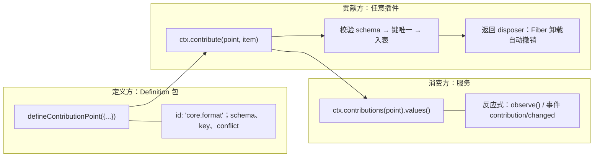
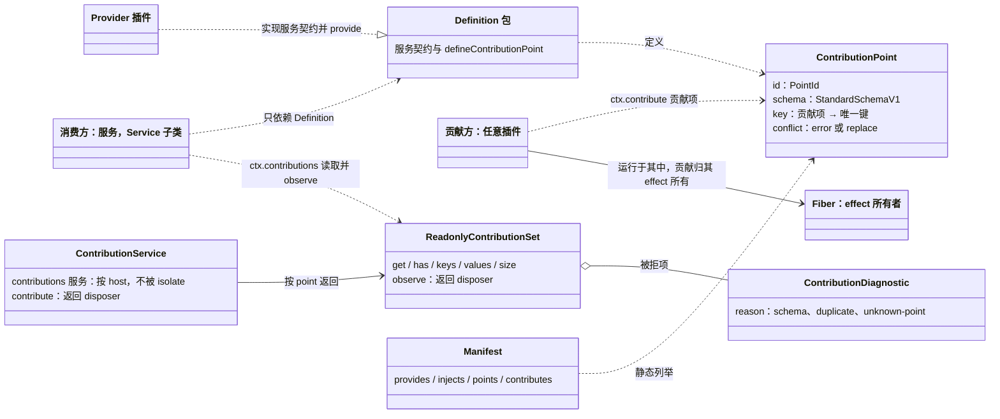
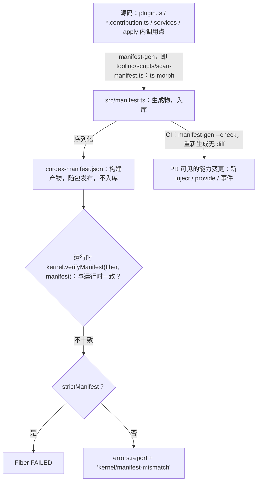
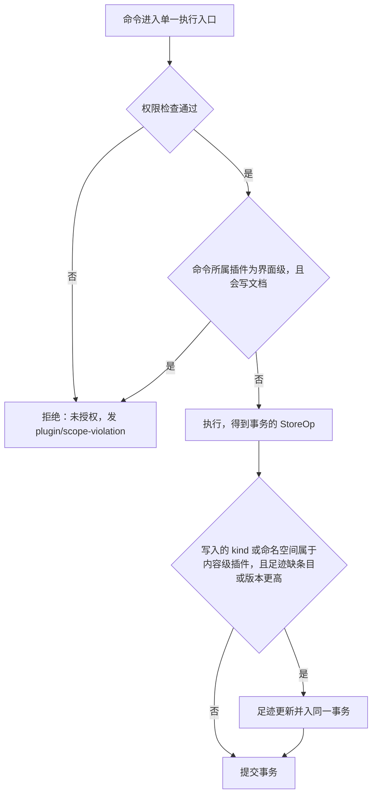
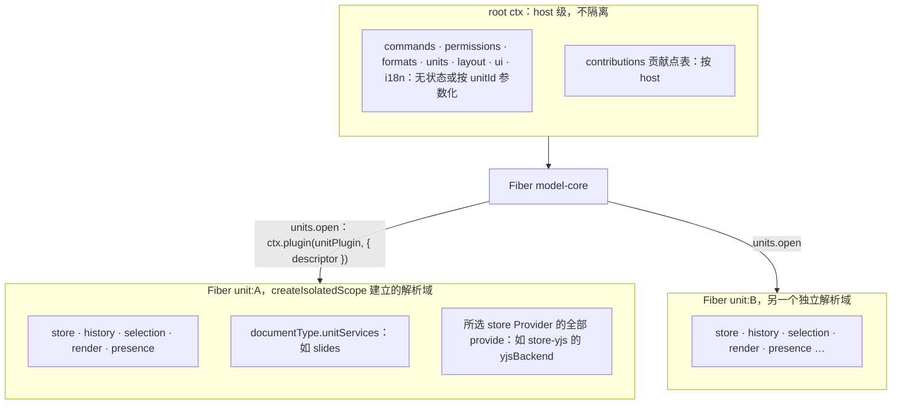
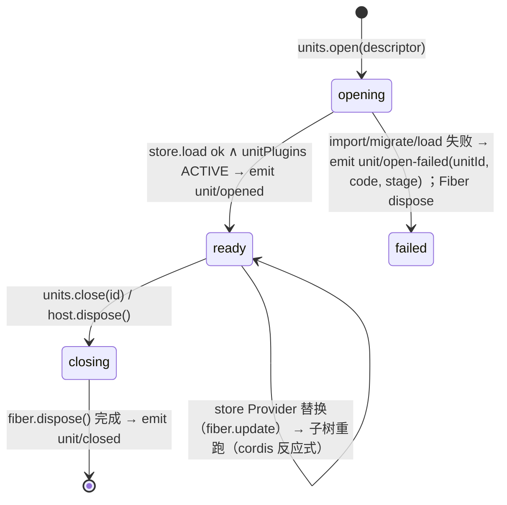
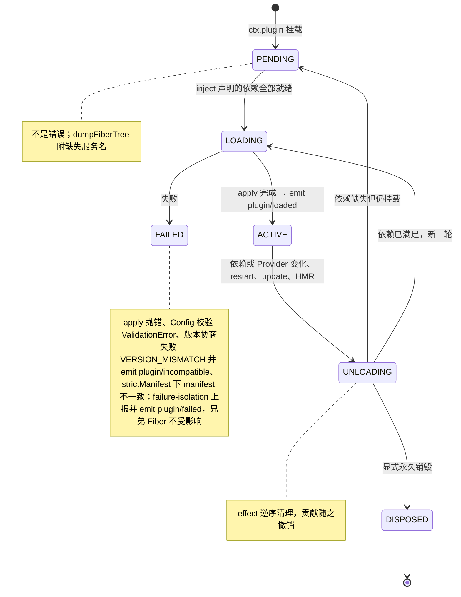
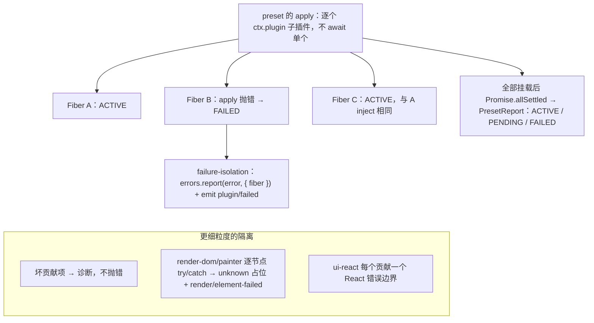

# 03 内核与插件模型：kernel 封装、ContributionPoint、Manifest、UnitScope、生命周期、preset 与版本协商

> 状态：草稿 | 负责：架构-结构 | 更新：2026-09-22（§3.6 按 14 §1 C-05/C-13/C-23/C-24 与 14 §2 收编：`render.overlay` 项类型、事件域并集、`when` 键新增）；2026-09-25（补图）；2026-09-25（矛盾收口，rulings §4.18）；2026-09-25（§4.19：§3.6 登记 `comments.anchorResolver`（D-COMMENTS-PKG））；2026-09-26（§4.20）（FE-06：§3.6 `ContributionBase.enablement`、`ui.shortcut`/`ui.command` 带 `enablement`，上下文键补 `editorMode`、`unitLoaded`、`can.*` 并改指 50-frontend/09 §6.3；FE-01：§5.1 伪代码改为按登记表挂载、新增 §5.1a `units.registerUnitProvider`/`listUnitProviders`、§9 `PresetEntry` 补 `scope` 与 `provides`；§11 补两行机械验证）；2026-09-26（§4.21 Remap：原 30/08 引用按 60-backend/README §6.1 改指新位置，30/08 已删除）；2026-10-01（§4.23 插件管理：§4.1 Manifest 增 `scope` 字段；新增 §4.3 作用域判定、界面级写命令拒绝与内容插件足迹维护）；2026-10-04（design-language-v3 第 0 批：§3.6 删除 `ui.ribbon`、`ui.statusBar`，新增 `ui.inspectorSection`（按选中对象类型挂检查器分区），贡献点总数 27 → 26；表下 14 §1 C-05 注记改为 DS-5 口径；命名规则示例与上下文键段去掉 ribbon，rulings §4.25 DS-1、DS-5、DS-6）；2026-10-04（design-language-v3 第 0 批：§3.6 `PointId` 注释示例 `ui.ribbon` 改为 `ui.toolbar`（rulings §4.25 DS-5））；2026-10-04（design-language-v3 第 0 批：复验第 2 轮修正——§3.6 `focusRegion` 补齐为 `canvas | rail | inspector | toolbar | grid` 并注明以 50/09 §6.3 为准；`ui.*` 行注明条目字段以 50/09 §6.1 为准；2026-10-04 注记里的「⌘K」注明泛指命令面板（快捷键仍为 `Mod+Shift+P`，`Mod+K` 为超链接））；2026-10-05（design-language-v3 第 0 批修正：§3.6 2026-10-04 注记的命令面板快捷键按 rulings §4.25 DS-11 改为 `Mod+K`（「⌘K」即命令面板），超链接改为 `Mod+Shift+K`）；2026-10-07（design-language-v3 第 1 批：§3.6 `ui.toolbar` 行的承载范围改为底部创建工具条与评审条 / 浏览条，槽位只有 `create`、`create.more`、`reviewBar`；对象上下文槽位 `toolbar.<selectionKind>` 随迷你工具条全部取消而作废（rulings §4.25 TB-29、DS-13、DS-22），贡献点总数 26 不变）；2026-10-15（§3.6 注记：`ui.panel{slot:'inspector'}` 的第三方整页面板改为 400 宽检查器整栏、不作页签，rulings §4.25 DS-38；同日再补（TB-59、TB-60）：`ui.inspectorSection` 可选字段 `expandPanel` 绑定整栏面板、宿主画「展开」，命令打开走 `ui.openPanel{id}`，页签只由内置包贡献（当前只有「评论」），整栏宽 max(400, 检查器当前宽度)；字段定义以 50/09 §6.1 为准，贡献点与项类型不变；同日再补：§7 诊断表与 §8 机械验证的 `kernel/PLUGIN_FAILED` 改写为 30/10 §1.1a 登记的点式码 `kernel.plugin_failed`，`details.phase` 区分启动与贡献（rulings §4.25 TB-77））；2026-10-22（design-language-v3 第 3 批：§3.6 `ui.theme` 的项类型删 `density?`、上下文键删 `density`——v3 只留单档控件尺寸（rulings §4.25 DS-76）；贡献点总数、项类型其余字段与命名规则不变）；2026-10-22（design-language-v3 第 3 批回写收口：§3.6 `ui.contextMenu` 条目与 `ui.command` 呈现元数据补外链呈现标记 `external?: true`——帮助中心与「关于母版继承」用它，宿主画外链图标、读屏名带「在新标签页打开」，打开仍由命令完成（rulings §4.25 DS-89、TB-132；字段以 50-frontend/09 §6.1 为准）；贡献点总数与其余项类型不变；2026-10-22 复核修正：§1.2 `CordexHost` 增 `dumpDiagnostics()`——诊断包由 kernel 的诊断 API 组成、经宿主对外提供，没有 apps/web 的嵌入形态 A 也可用（rulings §4.25 TB-177，PRD EM-12；落点 40-modules/02 §5.2 `diagnostics/bundle.ts`），`diagnostics()` 不变）；2026-11-04（design-language-v3 母版视图改版：§3.6 上下文键补标准键 `inspectorTakeover`——检查器当前开着的整栏面板 id，没有整栏面板时取 `null`；母版视图入口的「版本历史开着」与网格视图的「关闭版本历史后可用」都按它判（rulings §4.25 TB-209，键名与取值以 50-frontend/09 §6.3 为准）；§3.6 `ui.*` 一行补 `ui.toolbar` 条目的可选分组字段 `group`——创建工具条在相邻两组之间画竖分隔，只在 `create` 槽生效（TB-210，字段语义以 50-frontend/09 §6.1 为准）；贡献点总数、项类型其余字段与命名规则不变，需求编号、优先级与里程碑不变） | 依赖：charter v0.1；rulings §4.25 TB-209、TB-210；50-frontend/09 §6.1、§6.3（`group` 字段与 `inspectorTakeover` 的登记）；2026-09-22 再修订：`Service` 改值导出、`defineContributionPoint` 签名以 09-plugin-type-contracts §1.1 为准、`conflict:'replace'` 适用范围放宽（见 `40-modules/17` §7 G-2/G-3/G-4）
> 事实来源：`cordis@4.0.0-rc.10` 生成式 API 文档（Context / Fiber / Events / Registry / Service）与 `cordis-primer.md`。凡标注「草案」的签名允许在实现期微调，但**语义**（谁拥有生命周期、失败如何隔离、何时 PENDING）不得改变。

---

## 1. kernel 封装：为什么要有一层薄壳

`cordis` 处于 rc（D1）。`@cordexjs/kernel` 的目标是让**其余所有包只依赖 `@cordexjs/kernel` 的 API 面**，cordis 升级的破坏性被 kernel 吸收。kernel 不新增概念，只做四件事：re-export、`createHost`、ContributionPoint + Manifest、`errors`/`telemetry`/logger 适配 + `createIsolatedScope` + 诊断。

### 1.1 re-export 面（草案）

```ts
// @cordexjs/kernel/src/index.ts（草案）
export type { Context, Plugin, Fiber, Events, Inject, EffectMeta, Disposable } from 'cordis'
export { Service } from 'cordis'                                    // 值导出：插件需 `class X extends Service`（2026-09-22 修订，原 type-only 与 §2.1/§2.3 的写法矛盾）
export { FiberState, CordisError, ValidationError } from 'cordis'   // 值导出：状态枚举与两个错误类
export { createHost } from './host'
export type { CordexHost, HostOptions } from './host'
export { defineContributionPoint } from './contribution/point'
export type { ContributionPoint, ReadonlyContributionSet, ContributionDiagnostic } from './contribution'
export type { Manifest, ContributionEntry } from './manifest/types'
export { createIsolatedScope } from './scope'
export type { CordexError, ErrorTable, ErrorsService, TelemetryService } from './services'
export { dumpFiberTree, assertNoLiveEffects } from './diagnostics'
```

规则：`import ... from 'cordis'` 只允许出现在 `packages/kernel/src/**`（depcruise R12 `only-kernel-imports-cordis`）。类型层面的桥接见 ADR-0001。

### 1.2 `createHost`（草案）

```ts
interface HostOptions {
  kernelVersion?: string            // 默认读取 kernel 自身 package.json 版本；用于 peer 校验（ADR-0002）
  strictManifest?: boolean          // true：manifest 与运行时不一致 → Fiber FAILED；false（默认开发期）：errors.report
  defaultSinks?: boolean            // 默认 true：kernel 自身贡献控制台 `errors.sink` 与 no-op `telemetry.sink`；Sentry/OTel 等适配是「贡献 sink 的插件」，不是回调（ADR-0011）
  loggerSink?: LoggerSink           // 默认 cordis 内建 console logger
  clock?: () => number              // 测试注入
}
interface CordexHost {
  readonly ctx: Context             // 根 ctx（cordis 根 Context 的子层：kernel 插件的 ctx）
  readonly kernelVersion: string
  plugin<P extends Plugin>(plugin: P, ...config: Spread<GetPluginConfig<P>>): Fiber & PromiseLike<Fiber>   // 透传 ctx.plugin
  diagnostics(): HostDiagnostics    // Fiber 树 + 贡献诊断 + manifest 不一致清单
  dumpDiagnostics(): DiagnosticsBundle  // 2026-10-22（rulings §4.25 TB-177）：诊断包（PRD EM-12）——Fiber 树、插件清单与版本、最近 200 条事件的名称与非内容属性、性能标记，不含文档内容；由 kernel 的诊断 API 组成（10 §4），落点 40-modules/02 §5.2
  dispose(): Promise<void>          // 销毁根 Fiber → 全部 effect 逆序清理
}
declare function createHost(options?: HostOptions): CordexHost
```

`createHost` 做的事（顺序无关，全部在 kernel 插件 `apply` 内以 effect 形式完成）：
1. `new Context()`（cordis 根）；`ctx.plugin(kernelPlugin, options)`；
2. kernel 插件 `provide ['contributions', 'errors', 'telemetry']`：三个 Service 子类；`ctx.mixin('contributions', ['contribute'])`（全仓唯一 mixin 调用点）；定义贡献点 `errors.sink`/`telemetry.sink`，并在 `defaultSinks !== false` 时自身贡献默认 sink；
3. 挂失败隔离监听（§8）；
4. 记录 `kernelVersion`，之后每个插件挂载时由 `verifyManifest` 做 peer 范围校验（§10）。

**多实例**：一个页面调用多次 `createHost()` 得到互不相干的宇宙（各自的贡献表、服务表）。禁止模块级可变状态使这一点成立（lint `no-module-level-mutable-state`）。

### 1.3 `errors` / `telemetry` / logger（契约草案，运行时细节见 10）

```ts
// errors
type ErrorCode = `${Lowercase<string>}.${Lowercase<string>}`   // 点式 `<域>.<snake_case>`（10 §1.1；rulings §4.3 CS-13）：'command.permission_denied'、'kernel.version_mismatch'、'format.no_document_type'；第三方 `<vendor>:<域>.<name>`（D15）
interface ErrorTable { readonly [name: string]: { message: string; data?: StandardSchemaV1 } }
declare function defineErrors<const D extends string, const T extends ErrorTable>(domain: D, table: T): { [K in keyof T]: `${D}.${K & string}` }   // 源码中以大写标识符引用（PERMISSION_DENIED），运行时字符串为点式
class CordexError extends Error { readonly code: ErrorCode; readonly data?: unknown; readonly fiber?: string; cause?: unknown }
interface ErrorsService {
  create(code: ErrorCode, data?: unknown, cause?: unknown): CordexError
  report(error: unknown, context?: { fiber?: string; unitId?: string }): void   // 归类（CordexError | CordisError | ValidationError | unknown）→ sink
  wrap(unknown: unknown, fallback: ErrorCode): CordexError
  isOceError(x: unknown): x is CordexError
}
// telemetry
interface TelemetryService {
  counter(name: string, value?: number, attrs?: Attrs): void
  histogram(name: string, value: number, attrs?: Attrs): void
  span<T>(name: string, fn: (span: Span) => T, attrs?: Attrs): T
  event(name: string, attrs?: Attrs): void
}
```

规则：生产代码禁止 `throw new Error(...)` 与 `console.*`（lint `no-bare-throw`、`no-console`，sink 实现文件白名单）；错误码由 `defineErrors(domain, table)` 生成为点式 `<域>.<snake_case>`（与 10 §1.1 一致；本文档其它处出现的 `<pkg>/CODE`、大写码名均指同一码的**源码标识符**），扫描器校验全仓错误码唯一且域在白名单内；第三方错误码 `<vendor>:<域>.<name>`（D15），天然无碰撞。

配套两项（ADR-0011）：
- **错误码目录生成**（PRD EM-12）：错误码目录（`scan-observability-identifiers`，09-06 §13；原称 `tooling/scanners/error-codes-catalog`，旧 `tooling/scanners/` 目录已并入 `tooling/scripts/`，rulings §4.18 GV-13/GV-15）从全部 `defineErrors` 表生成错误码目录文档（码、消息、`data` schema、所属包、首次出现版本），CI diff 校验，避免文档与代码脱节。
- **遥测事件注册表**（PRD 06 §5）：`defineTelemetryEvents(pkg, table)` 声明遥测事件名与属性 schema；`telemetry.event(name, attrs)` 的 `name` 受限于已声明集合；lint `cordex/telemetry-events-must-be-declared`（09-02 §4.15）与扫描器 `scan-telemetry-events`（09-06 §10，TD-060；原称 `telemetry-events-declared`）拒绝未声明事件。cordis `Events`（进程内、不采样）与遥测事件（可采样、经 sink 出口）是两个命名空间，允许同名；`perf/*` 只存在于遥测。

---

## 2. 插件形态与文件约定

### 2.1 三种形态的选择规则（primer §3.2、指南 §21）

| 需要 | 形态 | 本项目用法 |
|---|---|---|
| 只需要生命周期（挂载/卸载/贡献） | **函数插件**（默认） | 所有 `plugin.ts` |
| 直接可调用的能力（`ctx.xxx`） | `Service` 子类（类插件） | `services/*.service.ts`；由函数插件在 `apply` 内 `ctx.plugin(XxxService)` 挂载 |
| 对象形态 | `{ apply }` | 仅 preset 聚合时偶用；不推荐 |

### 2.2 `plugin.ts` 的标准形状（草案）

```ts
// packages/<pkg>/src/plugin.ts
import { z } from '@cordexjs/protocol/schema'         // Standard Schema 实现集中于 protocol/kernel（R5）
export const name = 'model-slide'                 // = package 名去 scope；manifest.id 用完整包名
export const inject = ['contributions', 'documentTypes', 'commands'] as const   // 硬依赖
export const provide = ['slides'] as const        // 若提供服务
export const Config = z.object({ /* 部署可变值 */ })
export type Config = z.infer<typeof Config>
export function apply(ctx: Context, config: Config): void {
  ctx.contribute(DocumentTypePoint, slideDocumentType)        // 贡献 = effect
  for (const m of allSlideMutations) ctx.contribute(MutationPoint, m)
  ctx.plugin(SlidesServicePlugin)                              // 子插件
}
export default { name, inject, provide, Config, apply }        // 对象形态供 preset 统一引用
```

约束（全部有执行点）：
- `inject` 只写硬依赖；可选能力用 `ctx.get()`（primer MUST #1）。判断口径：「没有这个服务，插件行为还完整吗？」
- `apply` 内创建的每个资源经 `ctx.effect()` 或本身已是 effect（`ctx.on/plugin/provide/contribute`）；原生 `setTimeout/addEventListener/new WebSocket/observe` 必须在 `ctx.effect` 回调内（lint `effect-owned-timers`）。
- 不得 `import` 其它 Provider 包（R7）。
- 根级插件不得 `inject` UnitScope 服务（lint `no-unit-scoped-inject-at-root`）。

### 2.3 文件约定（primer §5.3 细化）

| 文件 | 允许内容 | 禁止内容 | 执行点 |
|---|---|---|---|
| `index.ts` | `export … from` | 任何顶层语句/调用 | lint `no-restricted-syntax`（`**/src/index.ts` override，09-02 §3，TD-096；原称扫描器 `index-pure`，rulings §4.18 GV-15 归并） |
| `plugin.ts` | name/inject/provide/Config/apply | 模块级 `let`/可变 `Map` | lint |
| `manifest.ts` | 生成物（头部 `generated`，入库） | 人工编辑 | manifest-gen `--check`（即 `tooling/scripts/scan-manifest.ts`，09-06 §6，重新生成无 diff） |
| `*.contribution.ts` | `declare module '@cordexjs/kernel'` 增强；`defineContributionPoint` 调用；类型导出 | 运行时 import（`import type` 除外）、副作用 | lint `contribution-file-purity` |
| `contracts/*` | 接口、类型、schema、抽象类 | 具体实现 | 评审 + api-extractor |
| `services/*.service.ts` | `class X extends Service` | `ctx.mixin`、原型赋值 | lint |
| `testing/*` | 替身/构造器/套件 | 生产逻辑 | depcruise R10 |

---

## 3. ContributionPoint：唯一的注册抽象

### 3.1 概念

一个 ContributionPoint 是**类型化、带 schema、有唯一键、由 effect 拥有生命周期、可静态列举**的注册槽。它取代 Univer 的 104 个 `register*`（A8）：

**贡献点三方流转图**



怎么读：从左到右依次是定义、贡献、消费三方，实线箭头表示贡献点对象与贡献项的流向；无箭头连线把同一方的补充说明挂在主节点上。

### 3.2 签名草案

```ts
type PointId = `${Lowercase<string>}.${string}`                     // 'core.documentType'、'ui.toolbar'、'slide.shapeKind'

type ItemOf<S extends StandardSchemaV1> = StandardSchemaV1.InferOutput<S>

interface ContributionPointOptions<S extends StandardSchemaV1> {   // 唯一类型参数绑定 schema（K-2）
  id: PointId
  schema: S                                     // parse, don't validate：贡献项进入表之前被 parse（含默认值填充）
  key: (item: ItemOf<S>) => string              // 唯一键；重复按 conflict 处理
  conflict?: 'error' | 'replace'                // 默认 'error'：重复键 → 拒绝后者并诊断（§3.3）；'replace'：后者覆盖。
                                                // 'replace' 须在贡献点定义时显式声明；当前取值见 §3.6 总表 conflict 列
                                                // （ui.*、render.element、render.overlay、i18n.bundle）——各处不再手写允许清单
                                                // （K-3；2026-09-25 rulings §4.18 GV-24）
  describe?: (item: ItemOf<S>) => string        // 诊断与 manifest 可读文本
}
interface ContributionPoint<T> {
  readonly id: PointId
  readonly conflict: 'error' | 'replace'
  readonly [pointBrand]: true                   // 防止把普通对象当贡献点传入；schema/key/describe 为内部字段
}
// 签名以 `09-type-discipline/09-plugin-type-contracts.md` §1.1 为准（rulings K-2）：唯一类型参数 S 绑定 schema，
// 贡献项类型由 `StandardSchemaV1.InferOutput<S>` 反推，调用方不得显式传入，以保证「schema 与类型失配」在类型层面
// 不可表达。旧的 `ContributionPointSpec<T, K>` 双参数形式作废（2026-09-25 rulings §4.18 GV-18 统一本块全部签名）。
declare function defineContributionPoint<S extends StandardSchemaV1>(options: ContributionPointOptions<S>): ContributionPoint<ItemOf<S>>

// ctx 上的两个入口（由 kernel mixin 提供）
interface Context {
  contribute<T>(point: ContributionPoint<T>, item: T): () => void          // effect 拥有；返回提前撤销的 disposer（被拒绝时为 no-op）
  contributions<T>(point: ContributionPoint<T>): ReadonlyContributionSet<T>   // 通过 Service.invoke 使 ctx.contributions(...) 可调用
}
interface ReadonlyContributionSet<T> extends Iterable<T> {
  get(key: string): T | undefined
  has(key: string): boolean
  keys(): IterableIterator<string>
  values(): IterableIterator<T>                 // 稳定顺序：按贡献时间；ui.* 消费方再按 order 排序
  readonly size: number
  observe(listener: (change: { kind: 'added' | 'removed' | 'replaced'; key: string; item: T }) => void): () => void   // 也是 effect
  diagnostics(): readonly ContributionDiagnostic[]
}
```

### 3.3 语义细则

| 主题 | 规则 |
|---|---|
| 生命周期 | `contribute()` 在当前 Fiber 上注册 effect；Fiber `UNLOADING` 时逆序撤销；对已销毁 Fiber 调用抛 `CordisError('INACTIVE_EFFECT')`（cordis 语义） |
| 校验 | `schema['~standard'].validate(item)` 失败 → **不抛给调用方**：记录 `ContributionDiagnostic{reason:'schema'}`，`errors.report`，返回 no-op disposer。理由：一个坏贡献不应让整个插件 FAILED（A11），但必须可见（10） |
| 唯一键 | 同 `point` 内 `key(item)` 重复：`conflict:'error'`（缺省）→ 拒绝后者 + 诊断 `duplicate` + `errors.report`，返回 no-op disposer，**不抛异常**（与「校验」行同一理由，A11）；`conflict:'replace'` → 覆盖并发 `replaced`。类型契约侧的 `DuplicateContributionError` 已作废（09-09 §1.2、09-05 §5 同步，2026-09-25 rulings §4.18 GV-18） |
| 未知贡献点 | 贡献到未 `define` 的 point 不可能发生（类型层面 point 必须是 `defineContributionPoint` 的返回值）；跨 host 传递 point 对象 → `unknown-point` 诊断 |
| 反应式 | 消费方用 `observe()` 或监听 `contribution/changed(pointId, kind, key)`；**不得**在激活期缓存 `values()` 的快照后长期使用（primer MUST NOT #3 的推广） |
| 作用域 | 贡献表按 **host** 存在（`contributions` 服务不被 isolate）。按 Unit 的差异不用贡献点表达，用 UnitScope 服务表达（§5） |
| 静态可列举 | manifest-gen 通过 AST 找到 `ctx.contribute(<PointIdent>, …)` 与 `defineContributionPoint({ id })`，据此生成 `contributes`/`points`（§4） |
| 顺序无关 | 贡献先于消费方激活或后于都可以：消费方总是读当前表并 `observe()` |

### 3.4 与 cordis 原生机制的边界

| cordis 机制 | 何时用 | 与贡献点的关系 |
|---|---|---|
| `ctx.provide` / `Service` | **单例能力**（`store`、`commands`） | 贡献点是**多项集合**；服务是一个对象。服务的实现读贡献点表 |
| `ctx.on` 事件 | 观察运行时发生的事 | 贡献是**声明**（静态可列举），事件是**发生**；不用事件模拟注册 |
| `waterfall` | 唯一拦截机制（命令管线） | 不用贡献点做拦截链；渲染热路径不用任何链（A30） |

**Definition / Provider / 贡献点关系图**



怎么读：虚线箭头是「使用/依赖」，空心三角虚线是「实现契约」，实线箭头是「持有/返回」，空心菱形是「聚合」；单例能力走 Service（Provider 实现、Consumer 只依赖 Definition），多项集合走贡献点。

依据：本节 §3.1–§3.4；§2.2 约束（不得 import 其它 Provider 包，R7）；01 §3「每一级可插拔」。

### 3.5 诊断

`host.diagnostics().contributions` 汇总每个 point 的 size、键列表、被拒绝项（原因、来源 Fiber 名、schema issues）。UI 开发面板与 `server-headless validate` 都读它。

### 3.6 贡献点总表（v0.1；章程 §5.5 列表的完整版，README C-3）

| id | 定义包 | 项类型 | 键 | conflict | 消费方 |
|---|---|---|---|---|---|
| `core.documentType` | model-core | `DocumentType<S>` | `id` | error | `documentTypes`、`units` |
| `core.command` | model-core | `CommandDef` \| `OperationDef` | `id` | error | `commands` |
| `core.mutation` | model-core | `MutationDef` | `type` | error | `commands`（事务内） |
| `core.format` | model-core | `FormatCodec` | `id` | error | `formats` |
| `core.resource` | model-core | `ResourceHook` | `namespace` | error | `resources`、snapshot codec |
| `core.migration` | model-core | `Migration` | `${documentType}:${from}->${to}` | error | `migrations` |
| `core.permissionPolicy` | model-core | `PermissionPolicy` | `id` | error | `permissions` |
| `layout.measurer` | engine-layout | `TextMeasurer` | `id` | error | `layout` |
| `render.target` | engine-render | `RenderTarget` | `id` | error | `render` |
| `render.element` | engine-render | `ElementRenderer` | `${targetId}:${kind}` | replace（K-3；主包图表占位由 `./chart` 子路径或 `slide-render-chart` 以同 key 覆盖，2026-09-25 由 error 更正，rulings §4.18 GV-24） | `render`（查表） |
| `render.scene` | engine-render | `SceneProvider` | `documentType` | error | `render` |
| `render.overlay` | engine-render | `OverlayRenderer { id; zIndex; mount(ctx, target) }`（选区框/参考线/远端光标等覆盖层；`mount`/`unmount` 生命周期持有 DOM 节点，2026-09-18 按 M-06 定义改写，14 §1 C-23） | `id` | replace | `render`（overlay 层，07） |
| `errors.sink` | kernel | `ErrorSink { id; report(err, ctx) }` | `id` | error | `errors`（扇出） |
| `telemetry.sink` | kernel | `TelemetrySink { id; counter/histogram/span/event 接收端 }` | `id` | error | `telemetry`（扇出） |
| `i18n.bundle` | i18n | `{ namespace; locale; messages }` | `${namespace}:${locale}` | replace | `i18n` |
| `ui.toolbar` / `ui.inspectorSection` / `ui.panel` / `ui.contextMenu` / `ui.dialog` / `ui.notification` | ui-core | 各自项类型，公共骨架 `ContributionBase { id; slot; order; when?; enablement?; owner? }`：`when` 只管**可见性**（为假不渲染），`enablement` 只管**可用性**（语法同 `when`；为假时禁用而不隐藏、`aria-disabled` 并给出原因，PRD ED-30；2026-09-26，rulings §4.20 FE-06）。`ui.toolbar` 承载底部创建工具条（第三方创建类按钮只进「更多」）与评审条 / 浏览条，槽位只有 `create`、`create.more`、`reviewBar`（对象上下文槽位 `toolbar.<selectionKind>` 2026-10-07 随迷你工具条全部取消而作废，插件针对所选对象的命令改走 `ui.inspectorSection` 与 `ui.contextMenu`，rulings §4.25 TB-29）；`ui.inspectorSection` 按选中对象类型挂检查器分区（2026-10-04 新增，rulings §4.25 DS-5）；各项类型的条目字段以 50-frontend/09 §6.1 为准（2026-10-22 起 `ui.contextMenu` 条目可带外链呈现标记 `external?: true`，帮助中心与「关于母版继承」用它，rulings §4.25 DS-89、TB-132；2026-11-04 起 `ui.toolbar` 条目可带分组字段 `group?`：创建工具条在相邻两组之间画竖分隔，只在 `create` 槽生效、第三方条目不用，母版视图里「选择」「占位符 ▾」一组、其余创建工具一组，rulings §4.25 TB-210） | `id` | replace | `ui` |
| `ui.shortcut` | ui-core | `{ id; chord; commandId; params?; when?; enablement? }`（`when` 为假时和弦不匹配、交还浏览器；`enablement` 为假时和弦仍被消费并提示原因） | `id` | replace | `shortcuts` |
| `ui.command` | ui-core | 命令**呈现元数据** `{ commandId; title; icon?; category; when?; enablement?; keywords?; external? }`（`enablement` 为假或能力位未授予时置灰并附原因，不隐藏；`external` 同 `ui.contextMenu` 条目的外链呈现标记，命令面板的「帮助中心」用它，2026-10-22，rulings §4.25 TB-132；字段以 50-frontend/09 §6.1 为准） | `commandId` | replace | `ui`（命令面板/菜单） |
| `ui.theme` | ui-core | `ThemeContribution { id; tokens: Partial<TokenSet> }`（设计 token 覆盖集，Beta；`density?` 2026-10-22 随 rulings §4.25 DS-76 删去） | `id` | replace | `theme` |
| `slide.shapeKind` | model-slide | `ShapeKindDef` | `kind` | error | `slides`、slide-render |
| `comments.anchorResolver` | comments（2026-09-25，rulings §4.19 D-COMMENTS-PKG） | `CommentAnchorResolver { documentType; resolve(anchor, unit); describe(anchor) }`（锚点抽象由文档类型提供解析，评论包本身文档类型盲） | `documentType` | error | `comments`（slide 的 resolver 由 slide-ui 贡献，02 §4.12c） |

> 2026-10-04（rulings §4.25 DS-5、DS-6，变更 `design-language-v3`）：删除 `ui.ribbon` 与 `ui.statusBar`，新增 `ui.inspectorSection`，贡献点总数 27 → 26（逐 id 展开与贡献方见 40-modules/16 §4）。原 `ui.ribbon` 按命令性质拆分：创建类走 `ui.toolbar`（插件按钮进底部工具条「更多」），格式类走 `ui.inspectorSection`，其余命令走 `ui.command`（命令面板、菜单、右键；DS-1、DS-5 原文的「⌘K」即命令面板，快捷键为 PRD ED-30 的 `Mod+K`——2026-10-05 由 `Mod+Shift+P` 改，ED-19 超链接随之改为 `Mod+Shift+K`，rulings §4.25 DS-11）；原 `ui.statusBar` 的状态只走 `ui.notification` 与横幅（同步状态在文件名旁、在线人数并入头像组、插件异常按需横幅）。2026-09-18 的 14 §1 C-05 映射（Ribbon 页签 = `ui.ribbon{kind:'tab'}`、检查器分区 = `ui.panel{slot:'inspector'}`，不新增 `ui.ribbonTab`/`ui.inspector`）随之作废：检查器分区改走 `ui.inspectorSection`，`ui.panel{slot:'inspector'}` 只承载检查器页签级的整页面板（20/06 §2.2、§2.12）。2026-10-15（rulings §4.25 DS-38）：第三方的整页面板不再作检查器页签，渲染为检查器的编辑与整页类整栏（与图表「编辑数据」同一先例；宽 max(400, 检查器当前宽度)，开着时检查器分隔条不可拖，TB-60），选中别的对象即收起。同日 TB-59 补齐绑定方式：`ui.inspectorSection` 条目新增可选字段 `expandPanel`（同一插件的 `ui.panel{slot:'inspector'}` 条目 id），有它时由宿主在该分区右下画「展开」、点了打开这个整栏面板，面板跟着触发它的选中对象；命令或快捷键打开走 Operation `ui.openPanel{id}`。检查器页签行是宿主的「设计」加内置包贡献的 `ui.panel{slot:'inspector'}` 页签（当前只有「评论」），第三方的 `ui.panel{slot:'inspector'}` 条目一律只作整栏面板，不以 `order` 区分。字段定义以 50-frontend/09 §6.1 为准，本表只注引用；贡献点、项类型与 slot 名都不变，变的是外壳的呈现方式。

命名规则：id 一律 `<域>.<名>`，`<名>` 为 camelCase（`core.documentType`、`ui.contextMenu`、`ui.inspectorSection`）；事件一律 `<域>/<动作>`（kebab-case 动作）。**第三方前缀**（章程 D15；PRD CS-07 的定稿）：第三方插件的贡献点 `<vendor>:<域>.<名>`、事件 `<vendor>:<域>/<动作>`、能力位 `<vendor>:<域>.<action>`，其中 `vendor` = 包的 npm scope 去 `@`（`@acme/cordex-comments` → `acme:comments.thread`、`acme:comments/added`）；内核与垂直束的域名单固定为 `core kernel contribution unit command store history selection permission format render layout ui i18n collab collab-server presence plugin error perf view export comment slide doc sheet`（与章程 §5.5 合并为一份并集，2026-09-18，14 §1 C-24；`app` 为应用壳私有域，不入此表，见章程 §5.5）。扫描器 `event-domain-whitelist`：拒绝既不在名单又无 `<vendor>:` 前缀的域，并校验前缀与声明该事件/贡献点的包的 scope 机械对应（无 scope 的第三方包不得声明公开事件与贡献点 id）。`telemetry.sink`/`errors.sink` 是贡献点；`collabTransport`、`BlobStore` 一类**单例可替换能力**是服务 Provider 座而非贡献点（判据：集合 → 贡献点；单例 → 服务）。

**`when` / `enablement` 子句上下文键**（`ui-core/context-keys.ts`；`ui.*` 贡献的 `when` 与 `enablement` 只能引用此处登记的键，由 `scan-contributions` 规则 (e) 校验（09-06 §3，TD-089；原称扫描器 `when-keys-declared`；2026-09-26 起检查范围含 `enablement`，rulings §4.20 FE-06）。**键全集、取值与来源以 [50-frontend/09](../50-frontend/09-ui-system-and-theming.md) §6.3 为准**，本段只列架构口径）：`unitType`（documentType id）、**`viewMode`**（取值受 `DocumentType.viewModes` 约束；slide：`normal | master | presenter`——ML-01 母版视图下 toolbar/inspectorSection/panel/contextMenu 据此切换贡献，例 `when: "unitType == 'slide' && viewMode == 'master'"`）、**`editTargetKind`**（`slide | layout | master`，母版视图中的当前编辑目标）、`selectionKind`、`selectionCount`、`canUndo`、`canRedo`、`isCollab`、`isReadOnly`、`platform`（`desktop | mobile`）、**`breakpoint`**（`desktop | compact | narrow`，与 `platform` 正交，取视口宽度语义）、**`textEditing`**、**`focusRegion`**（取值以 50-frontend/09 §6.3 为准，现为 `canvas | rail | inspector | toolbar | grid`，备注与浮动胶囊为空；原 `ribbon` 区域 2026-10-04 随 ribbon 删除取消，底部工具条与网格视图各设一个取值，rulings §4.25 DS-1、DS-4）（后三者 2026-09-18 新增（40-modules），见 14 §2/§5.5；原标准键 `density` 2026-10-22 随 rulings §4.25 DS-76 删去）、**`editorMode`**（`edit | review | view`，打开或重开 Unit 时按角色映射，会话内只随用户切换，`permission/changed` 不改它）、**`unitLoaded`**（渐进打开首批后为假、`unit/loaded` 后为真；全文命令入口以 `enablement: unitLoaded` 禁用而非隐藏）、**`can.<capability>`** 键族（布尔；`<capability>` 取 protocol `permissions/actions.ts` 的能力位全集，即 `can.doc.read`、`can.doc.comment`、`can.doc.write`、`can.doc.export`、`can.doc.manage`、`can.history.read`、`can.history.restore`；由打开时的权限快照与之后的 `permission/changed` 逐位写入；`isReadOnly` ≡ `!can.doc.write`）（后三者 2026-09-26 登记，rulings §4.20 FE-06）、**`inspectorTakeover`**（检查器当前开着的整栏面板 id，没有整栏面板时取 `null`；母版视图入口的「版本历史开着」与网格视图的「关闭版本历史后可用」都按它判，主菜单、命令面板与检查器入口因此写得出原因；2026-11-04 登记，rulings §4.25 TB-209，键名与取值以 50-frontend/09 §6.3 为准）。**`can.` 是 ui-core 保留前缀**：`can.<x>` 的 `<x>` 必须是 protocol 定义的能力位，ui-core 以外的包（垂直束与第三方）以 `registerPrefixedKey('can.…')` 登记即违规，由 `scan-contributions` 规则 (e) 执行。垂直束可登记前缀键（如 `slide.hasNotes`、`slide.hasChartEditor`），第三方按 D15 `<vendor>:` 前缀。条目最终可用 = 目标命令已注册 ∧ 命令声明的能力位已授予（`can.<capability>`）∧ `enablement` 为真，三者任一为假都只禁用、不隐藏（50-frontend/09 §6.1）。上下文键由 `view.setMode`（ui-core 内置 Operation，14 §1 C-01）/`slide.selectMasterOrLayout` 等 Operation 更新（05 §13.3），反应式驱动 `ui` 服务重新过滤贡献。

---

## 4. Manifest：不运行就知道插件贡献了什么

### 4.1 字段（草案）

```ts
interface Manifest {
  id: string                      // '@cordexjs/model-slide'
  version: string                 // 与 package.json 同步
  iso: 'iso' | 'dom' | 'node'
  kernel: string                  // 对 @cordexjs/kernel 的 peer 范围（来自 package.json.peerDependencies）
  peers: Record<string, string>   // 其它 @cordexjs/* peer 范围
  plugin: { name: string; hasConfig: boolean; configSchema?: JsonSchema }   // Config 的 JSON Schema（zod → JSON Schema，供 loader/UI）
  provides: string[]              // 服务名
  injects: string[]               // 硬依赖服务名
  optional: string[]              // ctx.get('x') 出现过的服务名
  points: PointId[]               // 本包 define 的贡献点
  contributes: ContributionEntry[]        // { point: PointId; keys?: string[]（静态可知时）; count?: number }
  events: { emits: string[]; listens: string[]; waterfalls: string[] }
  unitScoped: boolean             // 是否只在 UnitScope 下挂载（provide 了隔离服务或 inject 了隔离服务）
  stability: 'stable' | 'beta' | 'experimental'          // 本包公共面的稳定级（PRD PS-02；来自 package.json#cordex.stability）
  documentTypes: string[]         // 本包贡献或专属的文档类型（垂直束填 bundle；水平层为空数组）
  permissions: string[]           // 本包命令/Mutation 声明使用的能力位集合（静态收集 CommandDef.permission 字面量；PRD PS-01）
  i18n: string[]                  // 本包贡献的 i18n 命名空间
  scope: 'content' | 'ui'         // 作用域（2026-10-01，rulings §4.23；PRD PS-01、PM-02）：生成器按 contributes / implements 推出最低作用域，作者只能声明得更严；见 §4.3
  generatedAt: string; generator: string   // 溯源
}
```

### 4.2 生成与校验流程（ADR-0003）

**Manifest 生成与校验流程**



怎么读：左支是构建期（生成入库、CI 校验无 diff，使能力变更在 PR 中可见；生成器 `tooling/manifest-gen` 与 09-06 的 `tooling/scripts/scan-manifest.ts` 是同一物，40-modules/01 D-1，语义不变——2026-09-25 rulings §4.18 GV-17 统一口径：`manifest.ts` 是生成物而非手写意图声明），右支是运行期（按 manifest 比对实际 provide/contribute/on，不一致时按 `strictManifest` 决定 FAILED 还是仅上报）。

静态分析范围与失败模式：
- 能识别：字面量 `inject`/`provide` 数组、`ctx.contribute(Ident, …)`、`ctx.on('lit', …)`、`ctx.emit/parallel/serial/bail/waterfall('lit', …)`、`ctx.get('lit')`、`defineContributionPoint({ id: 'lit' })`。
- 不能识别（动态字符串、循环内计算的 key）：生成器记 `count: 'dynamic'` 并在 `--check` 下要求源码用 `/* cordex-manifest: dynamic */` 注释显式承认；否则失败。宁可拒绝，不可猜。
- 运行时比对：`provides` 与 `injects` 必须完全一致；`contributes` 的 point 集合必须一致，keys 允许运行时多于静态（dynamic）但不得少于静态；`events.listens` 允许运行时多于静态（条件监听）。


### 4.3 作用域、界面级写命令拒绝与内容插件足迹（2026-10-01，rulings §4.23）

插件按作用域分两类（术语见章程 §4）：**内容级插件**（`scope:'content'`）会改变文档内容、渲染结果、导入导出或部署的基础行为，按部署统一启停；**界面级插件**（`scope:'ui'`）只改变本人看到的界面，管理员允许时可个人启停（PRD 09 PM-03、PM-10）。内核对作用域有三处落点：

1. **判定（构建期与部署时）**：清单生成器按 PRD 09 §2.2 的规则从 `contributes` 与 `implements` 推出最低作用域——贡献 `core.documentType`、`core.format`、`core.mutation`、`core.migration`、`core.resource`、`core.permissionPolicy`、`render.scene` / `render.target` / `render.element`、`layout.measurer`、`slide.shapeKind`，带写能力位（`doc.write` 或 `doc.comment`）的 `core.command`，实现任一 Provider 座，或贡献 `errors.sink` / `telemetry.sink`，即为内容级；只贡献 `ui.*`、`i18n.bundle`、`render.overlay` 与只读 `core.command` 才可能是界面级；未知贡献点默认内容级。作者声明的 `scope` 低于推出结果时 `manifest-gen --check` 失败，部署时校验同样拒绝（原因码 `scope_downgrade`）。各贡献点的归类见 40-modules/16 §4。
2. **运行期拒绝**：命令管线（`core.command` 的单一执行入口，ADR-0015）在执行前查命令所属插件的 `scope`；界面级插件的命令尝试产生文档写入（Mutation 或资源写）时按未授权拒绝，与权限拒绝同路径（fail-closed，ADR-0012），并发诊断事件 `plugin/scope-violation {pluginId, commandId}`。因此个人启停界面级插件不会让协作者看到不同的文档内容（PM-13 第 3 条）。
3. **足迹维护**：命令管线在事务提交前把本事务写入的元素 kind 与资源命名空间映射到负责的内容级插件，必要时把 `resources['core.pluginFootprint']` 的更新并入同一事务，只增不减（[ADR-0050](./adr/0050-content-plugin-footprint.md)；命名空间见 04 §2.7）。

**图 4-2 命令执行时的作用域检查与足迹更新**



怎么读：作用域检查紧跟在权限检查之后，二者走同一个拒绝出口；通过后才执行命令。足迹更新发生在提交前、与内容同一事务，所以协同的另一端要么同时看到内容与足迹，要么都看不到。
依据：rulings §4.23 裁决 3；PRD 09 PM-02、PM-13；ADR-0012、ADR-0015、ADR-0050。
---

## 5. UnitScope：每个打开的文档一个作用域

### 5.1 与 cordis 的精确对应

```
 root ctx（host）
  └─ Fiber[model-core]
       └─ Fiber[unit:<UnitId>]  ← ctx.plugin(unitPlugin, { descriptor })        ← 「打开 Unit」= 挂载此 Fiber
            apply(ctx) {
              const scoped = createIsolatedScope(ctx, {
                services: [...ISOLATED_SERVICES, ...documentType.unitServices, ...registeredProvides],   // ['store','history','selection','render','presence', 'slides', …登记项的 provides]
                meta: { [UnitScope.unit]: unit }                                  // ctx.extend(meta)：子树内 ctx[UnitScope.unit] 可读
              })
              const providers = unitProviderRegistry.snapshot()                  // 打开时刻的登记表快照（§5.1a，model-core 内部读完整条目）；之后的登记变化不影响本 Unit
              const store = providers.find(e => e.provides.includes('store'))     // 唯一登记；缺席 → 依赖方 PENDING
              if (store) scoped.plugin(store.plugin, { ...store.config, initialBody, schemaVersion })   // provide 'store' —— 在隔离域内
              for (const e of providers) if (e !== store) scoped.plugin(e.plugin, e.config)             // history/selection/render/presence/collab-yjs/comments …
              for (const p of documentType.unitPlugins) scoped.plugin(p)         // 如 slides 服务
              ctx.effect(() => { ctx.units.register(unit, scope); return () => ctx.units.unregister(unit.id) })
              ctx.emit('unit/opened', unit)                                       // 在 store 就绪后（见 5.3）
            }
```

- `ctx.isolate(name)`：**为服务 `name` 建立独立解析域**（rc.10：`isolate(name, label?)`，默认新 symbol）。`createIsolatedScope` 对列表内每个名字链式调用一次；不传 label，因此两个 Unit 的 `store` 永不合并。
- `ctx.extend(meta)`：把 `unit` 元数据挂到子 ctx（原型继承，父不变）。
- 「关闭 Unit」= `unitFiber.dispose()`：cordis 逆序运行全部 effect（子 Fiber 先于父）；`store`/`render`/DOM 节点/WS 全部释放。
- 子树内的插件 `inject: ['store']` 解析到本 Unit 的 store；根级插件看不到任何 `store`（从未在根提供）。

#### 5.1a Unit 默认 Provider 登记表（2026-09-26，rulings §4.20 FE-01）

`unit-plugin` 挂载哪些 Provider 由 `units` 服务的登记表决定，**model-core 不 import 任何水平层 Provider**（`engine-render`、`store-*`、`collab-*`、`comments` 的秩都高于 model-core，直接 `scoped.plugin(renderPlugin)` 会违反章程 §5.3 的只向下规则；原伪代码作废，40-modules/17 G-9）。

```ts
// model-core unit/units.service.ts（签名草案；契约以 40-modules/02 §6 为准）
interface UnitProviderEntry { id: PluginId; plugin: Plugin; config?: unknown; provides: readonly string[] }
interface UnitsService {
  registerUnitProvider(entry: UnitProviderEntry): Disposer                      // 返回撤销函数，由登记方的 effect 持有
  listUnitProviders(): readonly { id: PluginId; provides: readonly string[] }[]  // 供插件管理器与诊断
  // open / close / get / list / observe … 见 40-modules/02
}
```

- **登记分工**：model-core 在 `ready` 时只登记 `history`、`selection` 两个默认 Provider；`store`（store-memory / store-yjs）、`render`、`presence`、`collab-yjs`、`comments` 由 preset 中 `scope: 'unit'` 的条目在 preset mount 时登记（§9 `PresetEntry.scope`/`provides`）。原 `model-core.Config.defaultStoreProvider` 删除：store 由唯一的 `provides: ['store']` 登记决定。
- **唯一性**：同一 `provides` 服务名只允许登记一次；后来者被拒并记诊断（不抛异常），返回 no-op disposer。被 `exclude` 的条目不登记，打开的 Unit 中对应服务缺席、依赖方 `PENDING`（§7）。
- **时效**：登记在 `units.open` 之前或之后都可以；登记表变化**只影响之后打开的 Unit**，已打开的 Unit 不受影响（需重开才生效）。
- **撤销**：preset dispose 时撤销其全部登记；已打开的 Unit 随 host 一并销毁。
- **隔离**：登记项声明的 `provides` 服务名一并计入该 Unit 的隔离集（与「所选 store Provider 的全部 provide 名」同理，§5.2），例如 `comments` 服务按 Unit 各一份；对外的 `listUnitProviders()` 只给 `id` 与 `provides`，完整条目只在 model-core 内部读取。
- 机械验证（model-core `units` 契约用例，M1 前定稿）：同一 `provides` 第二次登记被拒且有诊断；登记后打开的 Unit 挂上登记项、已打开的 Unit 不变；dispose 后 `assertNoLiveEffects` 为空；model-core 不 import 秩更高的包由既有 depcruise 秩规则兜底。前端对接口形状的要求见 [50-frontend/03](../50-frontend/03-preset-assembly-and-plugins.md) §6.2。

### 5.2 被隔离的服务集

| 服务 | 由谁提供 | 为什么按 Unit 隔离 |
|---|---|---|
| `store` | store-memory / store-yjs（preset 的 `scope:'unit'` 条目登记，登记表中唯一 `provides:['store']`，§5.1a） | 每个文档一份状态与一份 Y.Doc |
| `history` | model-core 默认 Provider（`ready` 时自行登记） | 撤销栈按文档 |
| `selection` | model-core 默认 Provider（`ready` 时自行登记） | 选区按文档 |
| `render` | engine-render（preset 登记） | 每个文档有自己的 target/viewport |
| `presence` | collab-core 本地 / collab-yjs（preset 登记） | 房间按文档 |
| `documentType.unitServices` | 垂直束（如 `slides`） | 类型化读 API 绑定到本 Unit 的 store |
| Unit 默认 Provider 登记项的其余 `provides`（如 `comments`，M3） | 该登记项（preset 的 `scope:'unit'` 条目，§5.1a） | 服务状态按文档（如评论线程镜像）；2026-09-26 登记，rulings §4.20 FE-01 |
| store Provider 额外 `provide` 的服务（如 store-yjs 的 `yjsBackend`） | 该 Provider | `unit-plugin` 对所选 store Provider 的**全部** `provide` 名做 isolate，因此 collab-yjs `inject ['yjsBackend']` 在 store-memory 的 Unit 下自然 PENDING（可诊断的「协同需要 yjs 存储」）；取代 02 旧稿的 symbol 键 `doc-access`（B 线建议二选一） |

不隔离的：`commands`、`permissions`、`formats`、`units`、`layout`（缓存按内容哈希，天然共享）、`ui`、`i18n`。理由：它们是无状态或按 `unitId` 参数化的能力。lint `no-unit-scoped-inject-at-root` 保证根级插件不会误 inject 隔离服务。

**UnitScope 隔离域结构图**



怎么读：箭头表示 Fiber 的父子挂载关系；每个 Unit 子图是一个独立解析域，子树内 `inject: ['store']` 只解析到本 Unit 的服务，两个 Unit 的 `store` 永不合并；根级插件看不到任何隔离服务。

依据：本节 §5.1、§5.2。

### 5.3 open/close 生命周期（状态机）

**Unit 打开/关闭状态图**



怎么读：圆角框是 Unit 状态，箭头上的文字是触发条件与随之发出的事件；`ready` 上的自环表示替换 store Provider 时子树重跑而状态不变。

`units.open` 的步骤（在 unit Fiber 内，全部可失败并以 `Result` 返回）：
1. 解析 `documentType`（`documentTypes.get`；缺 → `UNIT_UNKNOWN_DOCUMENT_TYPE`）；
2. `source.kind === 'bytes'` → `formats.import` → `SnapshotBundle`；`'snapshot'` → 直接使用；`'state'`（`encoding: 'yjs-update' | 'snapshot-json'`，服务端/离线恢复用，60-backend/05 §3.2）→ 交给所选 store Provider 的 `loadState(bytes)`（store-memory 只接受 `snapshot-json`）；`'empty'` → `documentType.createEmpty()`；
3. `migrations.run(snapshot)` 到 `documentType.schemaVersion`；`validateSnapshot`；
4. 建隔离域、挂登记表中 `provides:['store']` 的 Provider 并 `load(body)`；`resources.apply(unitScope, snapshot.resources)`；
5. 按登记表（§5.1a，打开时刻的快照）挂其余 Unit 默认 Provider（history/selection/render/presence/collab-yjs/comments 等）与 `unitPlugins`；`await` 全部 Fiber 稳定（缺依赖的进入 PENDING 不算失败，见 §7）；
6. 注册到 `units` 表；`emit('unit/opened')`。

### 5.4 多 Unit 共存的保证

- 同一插件（如 `slides` 服务插件）在同一进程内被激活多次（每 Unit 一次）：禁止模块级状态（lint）；
- 测试：`units.open` 两次 → 两个 `store` 实例不同、互不观察到对方事务、关闭一个另一个不受影响、关闭后 `fiber.getEffects()` 为空（kernel/testing `assertNoLiveEffects`）。

### 5.5 `UnitScope` 对外句柄（草案）

```ts
interface UnitScope {
  readonly unit: Unit
  readonly ctx: Context                    // 隔离后的子 ctx：ctx.store / ctx.history / ctx.selection / ctx.render / ctx.presence 可用
  readonly fiber: Fiber
  dispose(): Promise<void>
}
// 任意子树内代码读取所属 Unit：
declare const UnitScope: { readonly unit: unique symbol }
function unitOf(ctx: Context): Unit | undefined   // ctx[UnitScope.unit]
```

为什么不像 Univer：Univer 用 per-unit 子注入器（K2，正确），但 `unitId + subUnitId` 寻址写死在 core（A2）。我们的 UnitScope 只隔离**服务**，不规定寻址；文档类型通过 `unitServices` 声明自己的按单元服务。

---

## 6. 加载顺序无关性

- 所有硬依赖走 `inject`；cordis 反应式满足依赖后才 `apply`（指南 §39：配置顺序不是依赖顺序）。
- preset 的 `plugins.ts` 是**集合**不是序列；测试 `preset-order-independence`：随机打乱 `ctx.plugin` 顺序 100 次，最终 Fiber 状态集合与贡献表相同。
- 贡献点消费方对贡献先后无假设（§3.3）。
- 唯一允许的顺序敏感点：`waterfall` 监听器的 `prepend`（权限门必须最先）；由 `commands` 服务在自身 `apply` 内以 `prepend: true` 注册，且为 kernel 测试断言。

---

## 7. PENDING 不是错误：诊断规则

| 现象 | 先看 | 处理 |
|---|---|---|
| 插件「什么都没做」 | `host.diagnostics().fibers` 中该 Fiber 的 `state` | `PENDING` → 列出缺失的 `inject`（`fiber.store` 为 undefined 时对比 manifest.injects 与当前可解析服务） |
| 插件 `FAILED` | `errors` sink 中的 `kernel.plugin_failed` 记录（`details.phase = 'activate'`，含 cause；贡献级失败同码、`phase = 'contribution'`，30/10 §1.1a，rulings §4.25 TB-77） | Config 校验 → `ValidationError`；`apply` 抛错 → 原错误 |
| 服务偶尔为 undefined | 是否在激活期缓存了 Provider 引用 | 改为每次 `ctx.xxx` 读取；或 `inject` 使其成为硬依赖 |

`dumpFiberTree(ctx)` 输出每个 Fiber 的 `name/state/uid/effects(label 树)`，并对 `PENDING` 附「缺失服务名」推断（对比 `Inject.resolve(plugin.inject)` 与 `ctx.get(name, false)`）。UI 开发面板（apps/web `?devtools`）与 `server-headless validate` 都调用它。

**插件 Fiber 生命周期状态图**



怎么读：方框是 cordis rc.10 导出的 Fiber 状态，箭头是状态迁移及其触发条件；右侧注释给出本项目在各状态上的约定（诊断、失败原因与上报、贡献撤销）。

依据：`00-charter/cordis-primer.md` §2 Fiber 状态机（本文头部声明的事实来源）；本文 §3.3、§4.2、§7、§8、§10。

---

## 8. 失败隔离（A11）

cordis 已保证：一个 Fiber 的 `apply` 抛错 → 该 Fiber `FAILED`，兄弟 Fiber 不受影响，`await ctx.plugin()` 对调用方 reject。kernel 在其上加三件事：

1. `failure-isolation.ts`：监听 Fiber 状态迁移，`FAILED` 时 `errors.report(error, { fiber })` 并 `emit('plugin/failed', { pluginId, version, code, phase })`（公开事件名按 10 §11 定稿；`ACTIVE` 时 `plugin/loaded`，版本协商失败 `plugin/incompatible`）；
2. preset 的 `apply` **不 await** 单个子插件（否则一个失败会中断后续挂载）；preset 在全部 `ctx.plugin` 调用后 `Promise.allSettled` 并汇总为 `PresetReport`（哪些 ACTIVE/PENDING/FAILED）；
3. 贡献项级隔离：坏贡献 → 诊断而非抛错（§3.3）；渲染元素级隔离：`render-dom/painter` 逐节点 `try/catch` → `unknown` 占位 + `render/element-failed(unitId, nodeId, kind, code)`（借鉴 pptx-renderer；契约在 07 细化；事件名定稿见 README §7.1）；UI 贡献级隔离：`ui-react` 每个贡献一个 React 错误边界。

**失败隔离分层图**



怎么读：上半部分是插件级隔离——一个子插件 FAILED 不中断兄弟插件挂载，失败经 failure-isolation 上报，preset 最终汇总为 PresetReport；下方子图是贡献项、渲染元素、UI 贡献三级更细粒度的隔离。

机械验证（kernel `__tests__/failure-isolation.test.ts`）：挂载 A（正常）、B（`apply` 抛错）、C（正常，inject 与 A 相同）→ 断言 A、C `ACTIVE`，B `FAILED`，`errors` sink 恰有一条 `kernel.plugin_failed`（`details.phase = 'activate'`；2026-10-15 由旧写法 `kernel/PLUGIN_FAILED` 改为 30/10 §1.1a 登记的点式码，TB-77），A 的贡献仍在表中。

---

## 9. preset 组合与 loader 的关系（ADR-0010）

| | preset（程序化） | loader（配置驱动，`@cordisjs/plugin-loader`） |
|---|---|---|
| 运行环境 | 浏览器 + Node | Node（面向文件系统与 YAML） |
| 组合来源 | `plugins.ts` 显式列表 + `options` | `cordis.yml` 条目（稳定 id、config、disabled、group/isolate） |
| tree-shaking | 是 | 否（动态 import） |
| 本项目 | **默认**；`preset-slide-viewer`（只读查看器，PRD OF-14）、`preset-slide`、`preset-slide-collab`、`server-headless.host`；惰性条目（`lazy` + `activateWhen`）承载图表渲染器、语言包等独立块（ADR-0010） | `server-headless` 可选开启，用于运维按配置增删插件（默认关闭） |

preset 的形状（草案）：

```ts
// 原始定义在 @cordexjs/kernel/preset（40-modules/11 §6、40-modules/02 §4.2 preset/entry.ts）；2026-09-26 对齐 40-modules/11（rulings §4.20 FE-01）
interface PresetEntry {
  id: PluginId                        // 稳定 id 便于 fiber.update 与诊断（对应 loader 的 id）
  plugin: Plugin
  config?: unknown
  scope: 'host' | 'unit'              // 'host' 挂根；'unit' 不挂根，mount 时经 units.registerUnitProvider 登记为 Unit 默认 Provider（§5.1a）
  required?: boolean                  // 为真时不可被 exclude
  provides?: readonly string[]        // 登记表的键：scope:'unit' 条目按它登记，同一服务名只允许一个条目登记（§5.1a）
}
// 原 `disabled?: boolean` 作废：移除条目走 PresetTrim.exclude（40-modules/11）
declare function createSlidePreset(options?: SlidePresetOptions): Plugin
// options.exclude / options.override 允许「移除 Provider」与「替换 Provider」而不改 preset 源码（章程 §5.4 验收）
```

`preset-*` 是章程所说的「产品的形状」；`apps/web` 只选 preset 并传 options。

---

## 10. 版本协商（ADR-0002）

1. 每个插件包 `peerDependencies` 声明 `@cordexjs/kernel` 与所依赖的 `@cordexjs/*` 范围；manifest-gen 复制到 `manifest.kernel/peers`。
2. 挂载时 `verifyManifest`：`satisfies(manifest.kernel, host.kernelVersion)` 为假 → `errors.create('kernel/VERSION_MISMATCH', { plugin, required, actual })` → Fiber `FAILED`（**阻断**，区别于 Univer 仅 log）。
3. 水平 L0–L1（`shared`、`kernel`、`protocol`、`i18n`、`model-core`、`store-*`）lockstep 发版（Changesets fixed 组），其它包独立 semver；preset 用 `^` 锁定兼容大版本。
4. 第三方插件：只允许依赖 `@cordexjs/kernel`、`@cordexjs/model-core` 与其所属垂直束的 V-model 包；插件兼容性测试套件（M4，11）以 `verifyManifest` + `defineLifecycleSuite` 为核心。

---

## 11. 本文规则的机械验证清单（交 09 承接）

| 规则 | 机制 |
|---|---|
| 只有 kernel import cordis | depcruise R12 |
| 只有 kernel 调用 `ctx.mixin`/原型赋值 | lint `no-mixin-outside-kernel`、`no-prototype-assignment` |
| 无 `register*` 方法、无模块级可变状态 | lint `no-register-methods`、`no-module-level-mutable-state` |
| 原生资源在 effect 内 | lint `effect-owned-timers`（`setTimeout/setInterval/addEventListener/new WebSocket/new *Observer` 必须在 `ctx.effect` 回调词法内） |
| 事件名先声明后使用 | lint `cordex/events-must-be-declared`（09-02 §4.4，TD-017；原称扫描器 `events-declared`；`ctx.on/emit/...('x')` 的 `'x'` 必须在某 `*.contribution.ts` 的 `Events` 增强中） |
| `*.contribution.ts` 无运行时 import | lint `contribution-file-purity` |
| 根级插件不 inject 隔离服务 | lint `no-unit-scoped-inject-at-root` |
| manifest 与源码一致 | `scanners` job 的 `scan-manifest --check` 步骤（09-06 §6 规则 (a)，TD-090）；运行时 `verifyManifest` |
| 卸载后无 effect、重复挂载无重复注册 | `@cordexjs/kernel/testing` `defineLifecycleSuite`；每个插件包 `__tests__/lifecycle.test.ts` 必须存在（`scan-effects` 规则 (2)，09-06 §4，TD-071；原称扫描器 `lifecycle-test-present`） |
| 失败隔离 | kernel `failure-isolation.test.ts`；preset `PresetReport` 测试 |
| 顺序无关 | preset `order-independence.test.ts`（存在性由 `scan-effects` 规则 (3) 保证，TD-095） |
| 版本失配阻断 | kernel `version-mismatch.test.ts` |
| `throw new Error` / `console.*` 禁止 | lint `no-bare-throw`、`no-console`（sink 白名单） |
| `when` / `enablement` 只引用已登记的键；`can.<x>` 属于 protocol 能力位；`can.` 前缀只由 ui-core 登记（§3.6，2026-09-26 rulings §4.20 FE-06） | `scan-contributions` 规则 (e)（09-06 §3，TD-089；负向夹具三条：`enablement` 引用未登记的键、拼错的 `can.doc.writ`、第三方登记 `can.` 前缀）；ui-core 单测断言 `enablement` 为假时控件仍渲染且带 `aria-disabled` |
| Unit 默认 Provider 登记表（§5.1a，FE-01） | model-core `units` 契约用例：同一 `provides` 重复登记被拒且有诊断、只影响之后打开的 Unit、dispose 后无残留；model-core 不 import 秩更高的包由 depcruise 秩规则兜底 |
