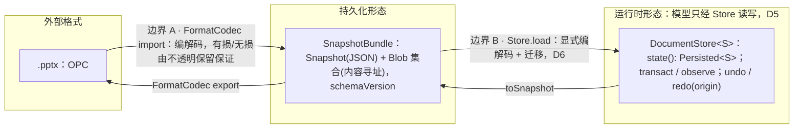
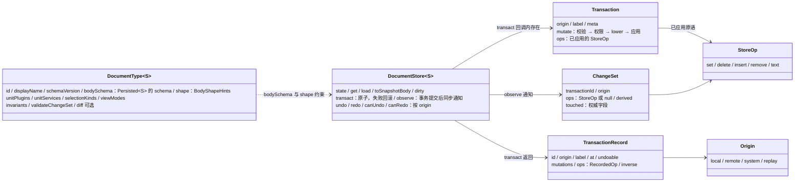
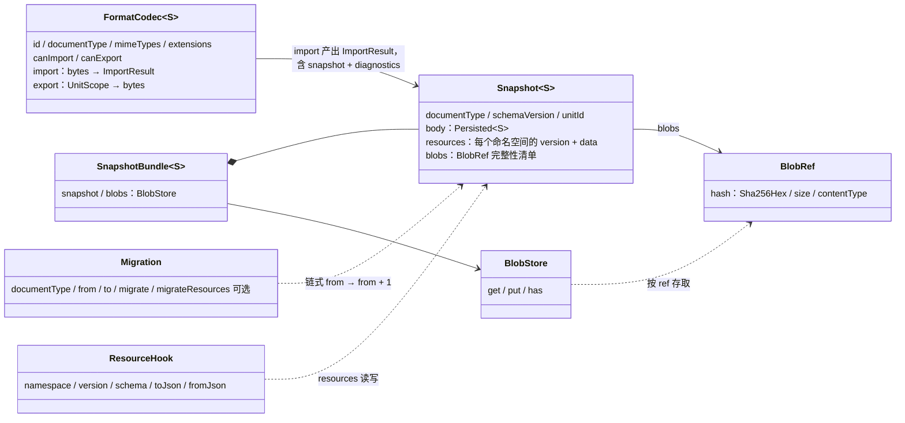
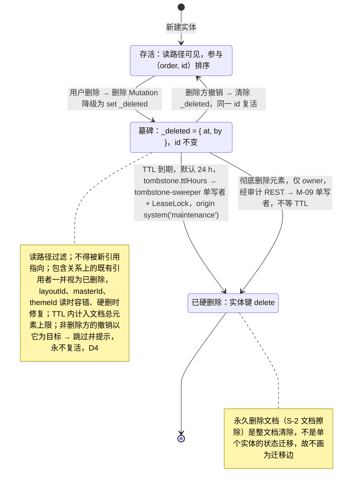
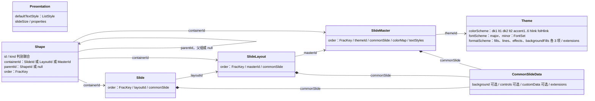
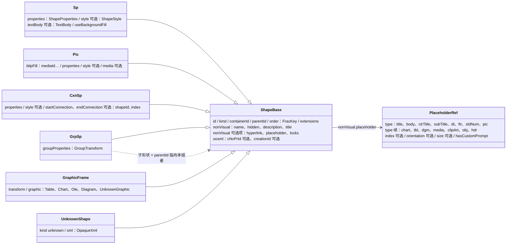
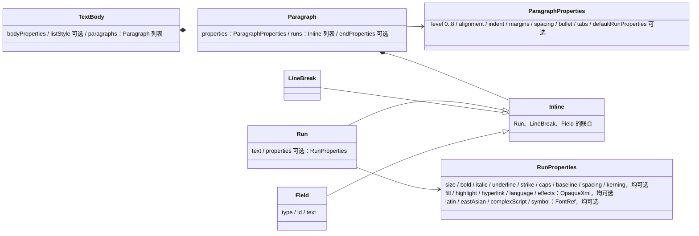
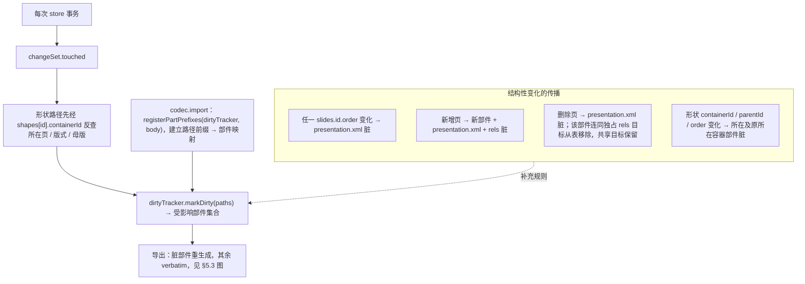
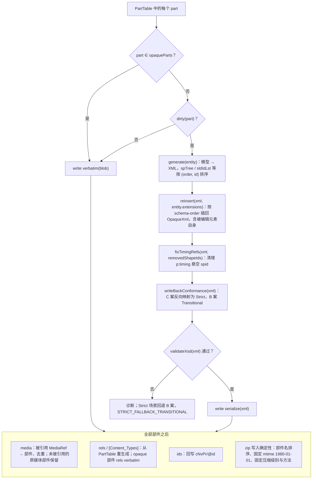
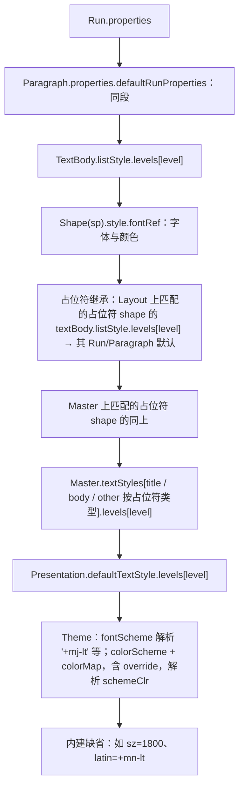

# 04 文档模型：model-core 抽象、model-slide 对象模型、OOXML 映射、不透明保留、样式继承、schema 迁移

> 状态：草稿 | 负责：架构-结构 | 更新：2026-09-19；2026-09-24（rulings §4.15：Q3 有身份实体删除改为软删除墓碑 + TTL 硬删除（§3.1a）；Q5 导入规模检查与超包络拒绝（§5.5）；Q7 Relationship 外部目标全部保留仅 http(s) 可激活、SmartArt drawing M1 必须只读解析、OLE 预览、EMF/WMF M2 栅格化；Q8 `docProps/thumbnail.jpeg` 为 encode() 显式输入）；2026-09-24（rulings §4.16 Q15：§4.1 部件表 `vbaProject.bin` 改为拒绝导入）；2026-09-24（复核修正，rulings §4.17：§3.1a 墓碑硬删除执行者改指 server-collab `tombstone-sweeper.ts`、TTL 键 `tombstone.ttlHours`；D4 撤销不复活他人删除；§5.5 `format.quota_exceeded` 补 `dimension`）；2026-09-25（补图）；2026-09-25（矛盾收口，rulings §4.18）；2026-09-25（§4.19：D-COMMENTS-PKG / INC-39 评论命名空间 `comments.threads`（§2.7、§10）；D-M2-CONTENT 版本恢复服务端用例随 M2 协同后端（§2.1、§10））；2026-09-25（§4.19）；2026-09-26（§4.20）（FE-03：§12.3 I-ML2 回退链落为单一纯函数 `defaultLayoutOf`；FE-04：§3.1a 第 3 条「引用者视为已删除」限于包含关系，I-ML2 墓碑期读时容错、硬删作业同事务修复；FE-23/FE-05：§12.3 末段 `deleteMaster.reassignTo` 目标母版规则与可撤销） | 依赖：charter v0.1
> 与 05（命令/Mutation/历史）、06（Yjs 映射，B 线）、07（渲染，B 线）配套。所有签名为「草案」。

---

## 1. 总览：三个边界

**三个边界：外部格式 → 持久化形态 → 运行时形态**



怎么读：三个子图是同一份文档的三种形态，左右两组往返箭头分别是边界 A（格式编解码）与边界 B（快照编解码与迁移）；运行时没有第二份模型。

- 边界 A 由 `core.format` 贡献的 `FormatCodec` 负责；未建模内容以 `OpaqueXml`/`OpaquePartRef` 穿过边界（§5）。
- 边界 B 由 `model-core/snapshot/codec.ts` 负责；`Derived<T>` 字段在此被剔除（§7）。
- 运行时形态**没有第二份模型**：`slides` 服务只是对 `store.state()` 的类型化读视图 + 命令封装。

---

## 2. model-core 抽象（签名级草案）

### 2.1 `Unit` 与 `DocumentType`

```ts
interface Unit { readonly id: UnitId; readonly documentType: string; readonly meta: { title?: string; source?: string }; readonly state: 'opening' | 'ready' | 'closing' | 'failed' }

interface DocumentType<S = unknown> {
  readonly id: string                                  // 'slide' | 'doc' | 'sheet' | 'fixture' | 第三方
  readonly displayName: I18nKey
  readonly schemaVersion: number                       // 当前 body schema 版本（整数，单调递增）
  readonly bodySchema: StandardSchemaV1<unknown, Persisted<S>>
  readonly shape: BodyShapeHints                       // 列表形状标注（B 线要求）：哪些路径前缀是「有序实体表」「原子值列表」「富文本」——store-yjs 据此选 Y.Map(+order) / Y.Array / Y.Text；store-memory 据此校验 insert/remove 只作用于原子列表
  createEmpty(): S
  readonly unitPlugins: readonly Plugin[]              // 在 UnitScope 内挂载（如 slides 服务）
  readonly unitServices: readonly string[]             // 需要按 Unit 隔离的额外服务名（如 'slides'）
  readonly selectionKinds: readonly string[]           // 该类型的 Selection.kind 取值
  readonly viewModes: readonly string[]                // 该类型的视图模式（slide：'normal' | 'master' | 'presenter'；fixture：['normal']）；水平层 Operation `view.setMode` 据此校验（05 §13.3）
  // —— 服务端可调用的纯函数面（B 线 08/ADR-0034 要求；全部无副作用、可在 server-headless 运行）——
  readonly invariants: readonly Invariant<S>[]         // 不变量：{ id; check(body): Violation[]; repair?(body, violations): S }（无父子环、parentId/layoutId 存在、order 唯一…）
  validateChangeSet(view: ReadonlyStoreView<S>, changeSet: ChangeSet): Result<void, readonly Violation[]>   // 默认实现 = 对 touched 路径相关的 invariants 求值（服务端软门禁）
  diff?(a: Persisted<S>, b: Persisted<S>): readonly Mutation[]   // 版本恢复 = 计算 a→b 的 Mutation 序列并作为一个事务（origin system('restore')）写回；版本恢复的服务端用例与界面均为 M3（PRD 05 §0.3）
}
interface BodyShapeHints { entityTables: readonly Path[]; atomicLists: readonly Path[]; richTexts: readonly Path[] }   // 路径含通配段 '*'
```

寻址不在 `DocumentType` 上规定（A2）：任何「子单元」概念（sheet 的工作表、slide 的页）都是 body 内部结构，用 `Path` 表达。

### 2.2 `DocumentStore<S>`（Definition；Provider：store-memory / store-yjs）

```ts
interface DocumentStore<S = unknown> {
  readonly unitId: UnitId
  readonly schemaVersion: number
  state(): Persisted<S>                                 // 当前不可变视图（结构共享）；引用在事务后变化，事务内不变
  get<T = unknown>(path: Path): T | undefined           // 路径读取（{id} 选择器按 id 字段解析）
  transact(fn: (tx: Transaction) => void, options: TransactOptions): Result<TransactionRecord, StoreError>   // 原子；fn 抛错或任一 op 失败 → 回滚
  observe(listener: (change: ChangeSet) => void): () => void      // 事务提交后同步通知；effect 拥有
  undo(origin: Origin): Result<TransactionRecord | null, StoreError>   // 只撤销该 origin 的最近事务（协同下 = 本地）
  redo(origin: Origin): Result<TransactionRecord | null, StoreError>
  canUndo(origin: Origin): boolean
  canRedo(origin: Origin): boolean
  toSnapshotBody(): Persisted<S>                        // 与 state() 等价但保证可 JSON 化
  load(body: Persisted<S>, origin: Origin): Result<void, StoreError>   // 整体加载（打开时；origin = system('load')）
  dirty(): ChangeSet | null                             // 自上次 markClean 以来的合并变更（供 codec 的 DirtyTracker）；markClean()
}
interface TransactOptions { origin: Origin; label: string; meta?: JsonObject; undoable?: boolean /* 默认 true */ }
```

**渐进打开的追加语义**（2026-09-25，rulings §4.18 CO-12，与 07 §14.2 同口径）：本地打开大文件时，Worker 跑 import-pipeline，**先**完成规模包络计数（超系统天花板整体拒绝，不装到一半才失败），**再**分批回传；首批经 `load(body, system('load'))` 装入后立即发 `unit/opened`（可渲染、可编辑），后续批次经 `transact(fn, { origin: { kind:'system', reason:'import' }, undoable: false })` **追加**——只写入首批未出现的实体键，不改写已有键；该来源不入撤销栈（`canUndo(local)` 不受影响）、`dirty()` 不计入（codec 的 DirtyTracker 忽略 `system('import'|'load')` 来源，§5.2），全部批次到齐后发 `unit/loaded`（事件表登记见 40-modules/02）。全选、查找替换、导出、跨页重排等全文类命令在 `unit/loaded` 之前等待或禁用（40-modules/03 命令守卫）。协同模式不走此路径：Y 状态由 HTTP 快照 bootstrap（06 §5）。

契约测试（`model-core/testing/document-store-conformance.ts`）覆盖：原子性、`state()` 引用语义、`observe` 时序（一次事务一次通知）、`undo/redo` 按 origin、`load` 后 `canUndo` 为 false、快照往返 `toSnapshotBody()` 深等于 `load` 入参、`text` op 语义、嵌套事务拒绝（`STORE_NESTED_TRANSACTION`）、**import 追加**（首批 `load` + 若干 `system('import')` 追加批次后：`toSnapshotBody()` 深等于一次性 `load` 全量的结果；`canUndo` 为 false；`dirty()` 为 null；追加批次触碰已有键时拒绝）。

### 2.3 `StoreOp` 原语（ADR-0013）

```ts
type StoreOp =
  | { op: 'set';    path: Path; value: JsonValue }                                  // 对象键写入/替换（含实体的 order: FracKey → 「移动」）
  | { op: 'delete'; path: Path }                                                    // 对象键删除
  | { op: 'insert'; path: Path; index: number; items: readonly JsonValue[] }        // 无身份值列表插入（columnWidths、渐变 stops、tab stops…）
  | { op: 'remove'; path: Path; index: number; count: number }                      // 无身份值列表删除
  | { op: 'text';   path: Path; delta: TextDelta }                                  // 富文本 delta（与 Y.Text delta 同形）
// 没有 move：有身份实体的顺序是实体属性 `order: FracKey`（ADR-0032），移动 = 单键 set，并发 LWW
type TextDelta = readonly ({ insert: string; attributes?: JsonObject } | { retain: number; attributes?: JsonObject } | { delete: number })[]
```

设计要点：
- 五种原语覆盖三种文档类型的结构变化（对象树 + 无身份值列表 + 富文本）；有身份集合（页、形状、母版、版式、节、评论…）一律为**实体表 + `order: FracKey`**，排序键 `(order, id)`；未来 `model-sheet` 的稀疏网格用 `set` 于 `cells.<sheet>:<r>:<c>` 键（12）。
- `FracKey` 由**命令层**经 `@cordexjs/shared/order.between(prev, next)` 生成并放入 Mutation 载荷（含随机后缀，因此不能在纯函数 `lower()` 内生成）；Mutation 载荷禁止数组下标（06 I4）。
- 逆操作在原语层推导：`set`→`set(旧值)`或`delete`，`insert`→`remove`，`text`→delta 求逆（需旧文本，Provider 在应用时捕获）。
- StoreOp 只在本地应用，**不上网络**；协同传输的是 CRDT update（06）。
- 有身份实体的**用户删除**不直接产出实体键的 `delete`，而是写 `_deleted` 墓碑（§3.1a，rulings §4.15 Q3）；实体键的 `delete` 只由三条服务端路径产生，全部以 `system('maintenance')` 单写者执行：TTL 硬删除作业、文档擦除（文档级「永久删除文档」，S-2 purgeAll）、经审计的「彻底删除元素」（元素级，仅对墓碑态、仅 owner，2026-09-25 rulings §4.18 CO-07，见 §3.1a）。

### 2.4 `Transaction` / `TransactionRecord` / `ChangeSet`

```ts
interface Transaction {
  readonly origin: Origin; readonly label: string; readonly meta?: JsonObject
  mutate<M extends Mutation>(mutation: M): Result<void, MutationError>   // 校验 → 权限 → lower → 应用；见 05
  readonly ops: readonly StoreOp[]                                         // 已应用的原语（只读视图）
}
interface TransactionRecord { id: TransactionId; origin: Origin; label: string; mutations: readonly Mutation[]; ops: readonly RecordedOp[]; inverse: readonly StoreOp[]; at: number; undoable: boolean }
type RecordedOp = StoreOp & { anchor?: { after?: string; before?: string } }   // insert / order 写入可记录邻居锚点（审计与版本 diff 的可读性；B 线要求）
interface ChangeSet {
  transactionId: TransactionId; origin: Origin
  ops: readonly StoreOp[] | null                        // 本地事务：精确；远端（CRDT update 应用后）：由 Y 事件推导，可能为 null 或近似
  derived: boolean                                      // true = ops 为推导值；消费者以 touched 为准
  touched: readonly Path[]                              // 前缀去重；权威字段
}
type Origin =
  | { kind: 'local'; clientId: string; via?: 'undo' | 'redo' }                                   // via：撤销/重做产生的本地事务
  | { kind: 'remote' }
  | { kind: 'system'; reason: 'load' | 'import' | 'migration' | 'repair' | 'restore' | 'maintenance' }   // import：渐进打开的后续追加批次（§2.2，不入撤销栈、不标脏）；repair：服务端不变量修复；restore：版本恢复；maintenance：rekey、TTL 硬删除与经审计的彻底删除元素等治理
  | { kind: 'replay' }
```

### 2.5 Snapshot、SnapshotBundle、BlobRef

```ts
interface Snapshot<S = unknown> {
  documentType: string; schemaVersion: number; unitId: UnitId
  body: Persisted<S>
  resources: Record<ResourceNamespace, { version: number; data: JsonValue }>   // ResourceHook 数据
  blobs: readonly BlobRef[]                                                     // body/resources 内引用到的全部 blob（完整性清单）
}
interface BlobRef { hash: Sha256Hex; size: number; contentType: string }
interface BlobStore { get(ref: BlobRef): Promise<Uint8Array | undefined>; put(bytes: Uint8Array, contentType: string): Promise<BlobRef>; has(ref: BlobRef): Promise<boolean> }
interface SnapshotBundle<S = unknown> { snapshot: Snapshot<S>; blobs: BlobStore }
```

- 二进制（媒体、不透明部件字节、嵌入字体）一律走 `BlobStore`（内容寻址、不可变、天然无冲突）；`Snapshot`/Y.Doc 内只有 `BlobRef`（README C-7）。
- `validateSnapshot` 检查：`bodySchema`、每个 resources 命名空间的 schema 与 version、`blobs` 清单与 body 中实际引用一致。

### 2.6 `schemaVersion` 与 `Migration`（ADR-0009）

```ts
interface Migration<S1 = unknown, S2 = unknown> { documentType: string; from: number; to: number; migrate(body: S1): S2; migrateResources?(r: Snapshot['resources']): Snapshot['resources'] }
interface MigrationsService {
  plan(documentType: string, from: number, to: number): Result<readonly Migration[], MigrationError>
  run(snapshot: Snapshot, to?: number): Result<Snapshot, MigrationError>            // 默认迁到 documentType.schemaVersion
  runOnUnit(scope: UnitScope, from: number, to: number): Promise<Result<void, MigrationError>>   // 服务端批量迁移（B 线 08 要求）：导出 body → 迁移 → 以 origin system('migration') 重新 load
}
```

- `from → to` 只允许 `to = from + 1`（链式），`plan` 找最短链；缺链 → `MIGRATION_PATH_MISSING`（打开失败并可见，不是静默）。
- ResourceHook 的 `version` 独立于 body；`migrateResources` 可选。
- **schema-lock**：`fixtures/snapshots/<type>/schema-lock.json` 记录当前 `bodySchema` 的 JSON Schema 哈希；CI 发现哈希变化但 `schemaVersion` 未增 → 失败。这是 A23（全仓 1 个迁移函数）的反制。

### 2.7 `ResourceHook`（K6 继承）

```ts
type ResourceNamespace = `${string}.${string}`         // `${pluginId}.${name}`，如 'comments.threads'（插件 @cordexjs/comments，id 'comments'）
interface ResourceHook<T extends JsonValue = JsonValue> {
  namespace: ResourceNamespace; version: number; schema: StandardSchemaV1<unknown, T>
  toJson(scope: UnitScope): T | undefined              // undefined = 本 Unit 无数据，不写入
  fromJson(scope: UnitScope, data: T): void            // 打开时恢复（在 store.load 之后）
}
```

`resources.collect/apply` 逐 hook 容错：单个 hook 抛错 → 诊断 + `errors.report`，其它 hook 继续（K6 的集中容错）。

- **命名空间必须文档类型盲**：横向插件的命名空间不带文档类型前缀。评论即 `resources['comments.threads'] = { version, data }`，`data` 内含 `threads` 与 `replies` 两张实体表（EntityTable，以 id 为键），由 iso 包 `@cordexjs/comments` 注册（02 §4.12c；rulings §4.19 D-COMMENTS-PKG、决策 INC-39——服务端评论镜像按 `comments.` 前缀识别、不得识别文档类型，rulings §4.18 FE-01）。协同模式下该命名空间在 Y.Doc 顶层 `resources` 下的同名键（06 §1.3），服务端软门禁的 commenter 路径前缀与之逐字一致（ADR-0031、ADR-0034）。
- **未注册命名空间原样保留**：打开的 Snapshot 或 Y 状态带有当前 preset 未注册的命名空间时（例如单人 preset 打开含 `comments.threads` 的文档），数据原样随 Snapshot / Y 状态往返与导出，不渲染、不可编辑；`validateSnapshot` 对未注册命名空间只校验其为合法 JSON，不报错（与 50-frontend/04 §1 同一口径）。

### 2.8 `permissions`（fail-closed；放置见 ADR-0012）

```ts
interface PermissionRequest { principal: Principal; unitId?: UnitId; action: Capability; resource?: { kind: string; id: string } }
interface PermissionPolicy { id: string; decide(req: PermissionRequest): PermissionDecision | undefined }   // undefined = 不表态
interface PermissionsService {
  check(req: PermissionRequest): PermissionDecision      // 任一 deny → deny；无任何 allow → deny；否则 allow
  setPrincipal(unitId: UnitId, principal: Principal): void
  applyRemoteDecisions(unitId: UnitId, decisions: readonly RemoteDecision[]): void   // 网关下发（06）；覆盖策略结果
}
```

### 2.9 `Selection<A>`

```ts
interface Selection<A = unknown> { kind: string; unitId: UnitId; anchors: readonly A[]; primary?: number }
```

`kind` 取自 `DocumentType.selectionKinds`；`A` 由文档类型定义（slide：§3.6）。序列化形式即 presence 载荷（06）。选区变化是 Operation，不入历史（05 §2）。

### 2.10 `FormatCodec`

```ts
interface FormatCodec<S = unknown> {
  id: string; documentType: string; mimeTypes: readonly string[]; extensions: readonly string[]
  canImport: boolean; canExport: boolean
  import(bytes: Uint8Array, opts: ImportOptions, blobs: BlobStore): Promise<Result<ImportResult<S>, FormatError>>
  export(scope: UnitScope, opts: ExportOptions): Promise<Result<Uint8Array, FormatError>>
}
interface ImportResult<S> { snapshot: Snapshot<S>; diagnostics: readonly ImportDiagnostic[] }
```

**model-core 抽象关系 · Store 与事务**



怎么读：每个框是 §2 中的一个接口（只列要点字段/方法名），实线箭头是「返回/持有」，虚线箭头是「约束/使用」；Store 只理解 5 种 StoreOp，事务通过 `mutate` 把 Mutation 降级为 StoreOp。

**model-core 抽象关系 · 快照与编解码**



怎么读：实心菱形是「组成」，实线箭头是「引用/产出」，虚线箭头是「作用于」；二进制一律经 BlobStore，快照与 Y.Doc 内只有 BlobRef。

---

## 3. model-slide 对象模型

### 3.1 归一化实体表（body 形态，A-9）

```ts
interface PresentationBody {
  presentation: Presentation                           // 单例：尺寸、页序、母版序、默认文本样式、属性、conformance、extensions
  masters: Record<MasterId, SlideMaster>
  layouts: Record<LayoutId, SlideLayout>
  slides:  Record<SlideId, Slide>
  themes:  Record<ThemeId, Theme>
  shapes:  Record<ShapeId, Shape>                      // 全部形状（含母版/版式/页上的）：containerId 指向所在页/版式/母版，parentId 指向父组或 null，order: FracKey 决定同级 z 序（无数组）
  media:   Record<MediaId, MediaRef>
  opaqueParts: Record<PartName, OpaquePartRef>         // 未建模的整部件（notes、comments、charts、vba…）
}
```

为什么归一化而非嵌套树：(1) `Path` 短且稳定（`['shapes', shapeId, 'properties', 'transform']`），Yjs 映射为浅层 Y.Map，冲突面小；(2) 移动形状/换组/换页序只改 `order`（与 `parentId`/`containerId`）单键，不搬子树、无数组下标（ADR-0032）；(3) 引用（占位符继承、连接线端点）用 id 表达。代价：查询需要索引与排序缓存（`query/selectors.ts` 纯函数 + 派生缓存，按 `(order, id)` 排序）。页序、母版序、版式序同理：`Slide.order`、`SlideMaster.order`、`SlideLayout.order`（导入时按 `sldIdLst` 等顺序生成等距键）。

### 3.1a 有身份实体的删除：软删除墓碑（rulings §4.15 Q3）

删除页/形状/母版/版式/节等有身份实体**不再**直接 `delete` 其实体键，而是：

1. **打标记**：命令层产出的删除 Mutation 降级为 `set(['shapes', id, '_deleted'], { at, by })`（墓碑）；实体 id 保持稳定，不复用、不换新 id。
2. **读路径过滤**：`query/selectors.ts`、`slides` 服务、SceneProvider、导出编码器一律跳过带 `_deleted` 的实体；`_deleted` 实体不参与 `(order, id)` 排序结果。
3. **不变量**：墓碑实体不得被新的引用指向（`containerId`/`parentId`/占位符继承/连接线端点）；指向墓碑的既有引用由 `invariants/` 的修复规则按「引用者一并视为已删除」处理——**这只指包含关系**（`containerId`、`parentId`：父被删则子随之不可见，恢复父即恢复子），不适用于 `layoutId`、`masterId`、`themeId` 这类引用：它们在墓碑期读时容错（读路径取替代目标渲染、不改写引用，撤销删除即恢复），只在目标被硬删时由硬删作业同一事务修复（§12.3，2026-09-26 rulings §4.20 FE-04）；墓碑在 TTL 内计入文档总元素上限（§5.5）。
4. **硬删除**：墓碑超过 TTL（默认 24 h，部署配置 `tombstone.ttlHours`）后由服务端墓碑硬删除单写者执行真正的 `delete`（server-collab `tombstone-sweeper.ts` + `LeaseLock`，判定 `_deleted.at + ttlHours < now`，origin `system('maintenance')`；08 §3、60-backend/05 §8、40-modules/09）。两条不等 TTL 的路径按层级拆开命名（2026-09-25，rulings §4.18 CO-07）：**文档级「永久删除文档」**（S-2 文档擦除，purgeAll）是整文档清除，不是单个实体的状态迁移；**元素级「彻底删除元素」**只对已是墓碑的实体开放、只能由 owner 发起——`POST /documents/:id/elements/purge{ids}` 经 M-08 鉴权，交 M-09 单写者以 `system('maintenance')` 立即硬删（复用 tombstone-sweeper 事务；房间未加载时先加载再执行），写审计 `document.element_purged`；它只清当前文档状态，历史快照与 update 表按保留期存在，引用的图片原件仍按 30 天无引用 GC，界面须明示「历史版本仍含该内容，要连历史清除请永久删除文档」；经此 REST 的硬删不算 ADR-0034 所说的旁路。
5. **撤销**：删除方撤销 = 清除 `_deleted`（同一 id 复活），与并发编辑不产生重复元素；并发「删除 vs 编辑」时编辑落在墓碑实体上、删除方撤销后可见（06 §8）。撤销目标已被**他人**删除（TTL 内亦然）→ 跳过并提示，撤销永不复活他人删除的元素（rulings §4.17 D4）。墓碑已被硬删除（TTL 到期或被「彻底删除元素」）后，删除方再撤销该步 → 按整步跳过（`store/undo-skipped{wholeStep:true}`，05 §6，CO-07）。

store-memory 与 store-yjs 语义一致（`runDocumentStoreConformance` 协同分节覆盖）。

**有身份实体的墓碑生命周期**



怎么读：三个状态对应实体在 Store 中的三种形态，箭头上是触发者与写入方式；只有删除方自己的撤销能把墓碑变回存活；实体级硬删除只从墓碑出发（TTL 到期或 owner 经审计的彻底删除元素），存活实体不能直接跳到已硬删除；文档级的永久删除文档作为注记，不属于实体状态机（与 PRD 03 图「tomb → gone」、ADR-0020 图 2 同口径）。

依据：本节 §3.1a、§2.3 末条；05 §6 第 3 条；rulings §4.15 Q3、§4.17 D4、§4.18 CO-07。

### 3.2 对象图

**对象图 · 容器与继承引用**



怎么读：实线箭头是按 id 的引用，实心菱形是内嵌组成；形状不挂在页/版式/母版对象里，而是存在 shapes 表中按 `containerId` 反查，同级按 `(order, id)` 排序。

**对象图 · Shape 判别联合**



怎么读：空心三角是「属于 Shape 联合的一个分支」，公共字段在 ShapeBase；组的子形状不是数组，而是 shapes 表中 `parentId` 指向本组的形状（虚线）。

**对象图 · 文本体**



怎么读：实心菱形是有序组成（段落列表、行内元素列表），空心三角是 Inline 联合的三个分支；各级属性字段均为可选，缺省即继承（§6、§12.1）。

字段级草案见 02 §4.8（每个文件一行）。以下只列**决策性**字段：

| 实体 | 字段 | 决策 |
|---|---|---|
| `Presentation.conformance` | `'transitional' \| 'strict'` | 记录原文件一致性类，供导出策略（A-3） |
| `Shape.containerId` / `parentId` / `order` | `SlideId \| LayoutId \| MasterId` / `ShapeId \| null` / `FracKey` | 归一化的容器与父引用；同级 z 序 = `(order, id)`；移动/换组/调 z 序都是单键 `set`（ADR-0032） |
| `Slide.order` / `SlideLayout.order` / `SlideMaster.order` | `FracKey` | 页序/版式序/母版序；导出时按 `(order, id)` 生成 `sldIdLst`/`sldLayoutIdLst`/`sldMasterIdLst` |
| `Shape.ooxml` | `{ cNvPrId?: number; creationId?: string }` | OOXML 侧 id 作为**数据**保留（ADR-0014） |
| `*.extensions` | `OpaqueSlot`（`OpaqueXml[]`） | 每个已建模实体都有；未知子元素落此 |
| `Slide.transition` / `timing` | `OpaqueXml?` | M1–M3 只保留（章程 Q7） |
| `Chart.partRef` | `OpaquePartRef` | M1–M2 部件不透明保留（写回 verbatim）；**M1 查看**由图表渲染器**只读解析**该部件（`ooxml-core/chartml/` 解析 `c:chartSpace`：图表类型、系列、`numCache`/`strCache`、轴、图例、标题 → 只读 `ChartReadModel`，不进模型、不进 Snapshot），不依赖位图预览（PRD OF-09；A-11 已对齐）；M3 起增加可编辑 `Chart.data`（ED-15） |
| `Pic.blipFill.mediaId` | `MediaId` → `MediaRef.blob: BlobRef` | 媒体不进 JSON |
| `Shape.bounds?` | `Derived<Rect>` | 示例：派生字段以品牌标注，不入 Snapshot |

### 3.3 `slide.shapeKind` 贡献点

```ts
interface ShapeKindDef<T extends Shape = Shape> {
  kind: T['kind'] | `graphicFrame:${string}`     // 'sp' | 'pic' | … | 'graphicFrame:table' | 第三方 'ext:<vendor>.<name>'
  schema: StandardSchemaV1<unknown, T>
  createDefault(box: Rect): T
  capabilities: { text: boolean; resize: boolean; rotate: boolean; group: boolean; connect: boolean }
  describe(shape: T): string
}
```

第三方新增元素类型（M2 验收）：贡献一个 `slide.shapeKind`（模型）+ 一个 `render.element`（渲染）+ 可选 `ui.*`（工具）。内核与 `model-slide` 零改动；`Shape` 联合对未知 kind 以 `unknown` 分支兜底，导出时未知 kind 的 shape 由其 `schema` 提供的 `toXml?` 可选钩子或退化为 `OpaqueXml` 保留。

### 3.4 `slides` 服务（UnitScope；读视图）

```ts
interface SlidesService {
  body(): PresentationBody
  slide(id: SlideId): Slide | undefined; shape(id: ShapeId): Shape | undefined
  order(): readonly SlideId[]; shapesOf(container: SlideId | LayoutId | MasterId): readonly ShapeId[]   // z 序
  resolved: { run(shapeId, paragraphIndex, runIndex): ResolvedRunProperties; paragraph(...): ResolvedParagraphProperties; shape(shapeId): ResolvedShapeVisual; color(color, ctxFor: SlideId): Rgba }
  // 便捷命令（内部仍 commands.execute）
  exec: { addSlide(opts): Promise<Result<SlideId>>; insertShape(slideId, kind, box): Promise<Result<ShapeId>>; … }
}
```

### 3.5 幻灯片 Mutation 与 Command 清单

见 02 §4.8 `mutations/`、`commands/` 与 05 §4/§5。

### 3.6 幻灯片 Selection 锚点

```ts
type SlideSelectionAnchor =
  | { kind: 'slide'; slideId: SlideId }
  | { kind: 'shape'; slideId: SlideId; shapeId: ShapeId }
  | { kind: 'text'; shapeId: ShapeId; start: TextPosition; end: TextPosition }        // TextPosition { paragraph: number; offset: number（grapheme）}
  | { kind: 'tableCell'; shapeId: ShapeId; row: number; col: number }
```

---

## 4. OOXML → 模型映射表（PresentationML / DrawingML）

保留策略：**建模** = 解析为类型化实体、可编辑、导出时重生成；**不透明** = 原样保留（部件级 `OpaquePartRef` 或节点级 `OpaqueXml`），导出时原样写回；**重生成** = 不保留原字节，永远由表生成；**丢弃** = 不写回（应为空集）。

### 4.1 部件级（Part）

| 部件（内容类型缩写） | 模型实体 | 策略 | 里程碑 |
|---|---|---|---|
| `[Content_Types].xml` | — | 重生成（由 PartTable） | M1 |
| `_rels/.rels`、`ppt/_rels/presentation.xml.rels` 及已建模部件的 `.rels` | — | 重生成（已建模部件）/ 不透明（未建模部件的 rels 随部件 verbatim） | M1 |
| `ppt/presentation.xml` | `Presentation`（sldSz、notesSz、defaultTextStyle、kinsoku/extLst→extensions）；`sldIdLst` → 各 `Slide.order`（等距 FracKey）+ `Slide.ooxml.sldId`；`sldMasterIdLst` → 各 `SlideMaster.order` | 建模 | M1 |
| `ppt/slideMasters/*.xml` | `SlideMaster` | 建模 | M1 |
| `ppt/slideLayouts/*.xml` | `SlideLayout` | 建模 | M1 |
| `ppt/slides/*.xml` | `Slide` | 建模（懒） | M1 |
| `ppt/theme/*.xml` | `Theme` | 建模（formatScheme 的 3×4 列表建模；`extraClrSchemeLst`、`custClrLst`、`objectDefaults`→extensions） | M1 |
| `ppt/notesSlides/*.xml`、`notesMasters/*.xml`、`handoutMasters/*.xml` | `opaqueParts` + `Slide.notesId`；备注**文本**由 `ooxml-pptx/import/notes-text.ts` 只读提取供备注面板显示（PRD OF-11 M1） | 不透明（M3 评估备注建模） | M1 |
| `ppt/comments/*.xml`、`commentAuthors.xml`、`ppt/comments/modernComment_*.xml` | `opaqueParts`（M3 由 comments 插件经 ResourceHook 建模） | 不透明 | M1 |
| `ppt/presProps.xml`、`viewProps.xml`、`tableStyles.xml` | `opaqueParts`（tableStyles M2 起**只读解析**供渲染，仍 verbatim 写回） | 不透明 | M1 |
| `ppt/charts/*.xml`、`chartN.xml.rels`、`embeddings/*.xlsx` | `Chart.partRef`；渲染期 `ooxml-core/chartml` **只读解析**（M1 查看，OF-09） | 不透明写回；只读解析渲染（M3 建模数据） | M1 |
| `ppt/diagrams/{data,layout,quickStyle,colors,drawing}*.xml` | `Diagram.parts`；`dsp:drawing` 部件由 `ooxml-core` **M1 必须只读解析**（含 `dsp:txXfrm`）供 slide-render 渲染（rulings §4.15 Q7；drawing 缺失时才占位 + 诊断） | 不透明写回；只读解析渲染 | M1 |
| `ppt/embeddings/*.bin`、`*.docx` 等 OLE | `Ole.embedRef`；`Ole.preview` 由 `ooxml-pptx/import/ole.ts` 从 `mc:Fallback` 中的 `p:pic` 提取（显示预览图，rulings §4.15 Q7） | 不透明 | M1 |
| `ppt/media/*` | `MediaRef.blob` | 二进制 blob（内容寻址；永不重生成）；EMF/WMF（含 OLE 预览）M2 起由 emf-converter（Apache-2.0）在 Worker chunk 中惰性栅格化用于显示，原字节不变 | M1 |
| `ppt/fonts/*.fntdata` | `opaqueParts` + 渲染期可选解混淆加载 | 不透明 | M2 |
| `ppt/tags/*.xml`、`customXml/*` | `opaqueParts` | 不透明 | M1 |
| `ppt/vbaProject.bin`（及 `.pptm` / macroEnabled 主内容类型） | —（不建模、不保留） | **拒绝导入** `format.macro_rejected`（rulings §4.16 Q15；检测见 40-modules/04 §2.6） | M1 |
| `docProps/core.xml` | `DocumentProperties.core` | 建模（title/creator/modified…） | M1 |
| `docProps/app.xml`、`custom.xml` | `DocumentProperties.app/custom`、`opaqueParts` | 不透明；编辑后属于「派生部件白名单」，允许重生成（§5.4） | M1 |
| `docProps/thumbnail.jpeg` | `opaqueParts` | 不透明；是 `encode()` 的**显式输入**（`thumbnailJpeg?: BlobRef`）：缺省时原部件原样保留，零编辑不新增该部件（保证浏览器与 Node 导出确定性，SV-02）；M2 服务端把它作为文档卡片过渡封面（只做头校验不解码，rulings §4.15 Q8） | M1 |
| `_xmlsignatures/*`（数字签名部件） | `opaqueParts` | 保留不重签；编辑保存后签名失效，发 `format.pptx.signature_invalidated` 诊断（章程 §10 Q15，rulings §4.12 U-05） | M1 |
| 未知内容类型的任何部件 | `opaqueParts` | 不透明 | M1 |

### 4.2 节点级（PresentationML `p:`）

| 元素 | 模型 | 策略 |
|---|---|---|
| `p:cSld` | `CommonSlideData` | 建模 |
| `p:cSld/p:bg` | `Background` | 建模（`bgPr` / `bgRef`） |
| `p:spTree` | shapes 表（每个顶层形状 `containerId` = 本部件实体、`parentId = null`、`order` 按文档顺序生成等距键） | 建模 |
| `p:nvGrpSpPr`（spTree 根） | — | 不透明（extensions 内保留根组的 nv 属性） |
| `p:sp`/`p:pic`/`p:grpSp`/`p:cxnSp`/`p:graphicFrame` | 对应 Shape | 建模 |
| `p:nvSpPr/p:cNvPr`（id、name、hidden、descr、title、hlinkClick、extLst→a16:creationId） | `nonVisual` + `ooxml` | 建模 |
| `p:nvSpPr/p:cNvSpPr`（spLocks、txBox） | `nonVisual.locks`、`Sp.isTextBox` | 建模 |
| `p:nvPr/p:ph` | `PlaceholderRef` | 建模 |
| `p:nvPr/a:audioFile`/`a:videoFile`/`p:media` | `Pic.media` | 建模（引用）；播放属性 extensions |
| `p:spPr` | `ShapeProperties` | 建模（`a:scene3d`/`a:sp3d`→OpaqueXml） |
| `p:style` | `ShapeStyle` | 建模 |
| `p:txBody` | `TextBody` | 建模 |
| `p:clrMapOvr` | `colorMapOverride` | 建模 |
| `p:transition`、`p:timing` | `OpaqueXml` | 不透明 |
| `p:hf` | `HeaderFooter` | 建模（4 个布尔） |
| `p:txStyles` | `textStyles` | 建模 |
| `p:controls`、`p:custDataLst` | `OpaqueXml` | 不透明 |
| `p:extLst`（任意层级） | `extensions` | 不透明 |
| `mc:AlternateContent` | `UnknownShape` 或所在节点的 `extensions`（若在属性位置） | 不透明（渲染选 Fallback 或受支持 Choice） |

### 4.3 节点级（DrawingML `a:`）

| 元素 | 模型 | 策略 |
|---|---|---|
| `a:xfrm`（off/ext/rot/flipH/flipV；grpSp 的 chOff/chExt） | `Transform` / `GroupTransform` | 建模 |
| `a:prstGeom`（prst、avLst） | `Geometry.preset` | 建模（187 种名称字面量） |
| `a:custGeom`（pathLst、avLst、gdLst、ahLst、cxnLst、rect） | `Geometry.custom` | 建模（`ahLst` 保留为 OpaqueXml，M1） |
| `a:noFill`/`solidFill`/`gradFill`/`blipFill`/`pattFill`/`grpFill` | `Fill` | 建模 |
| `a:ln`（w、cap、cmpd、algn、fill、prstDash/custDash、join、headEnd、tailEnd） | `Line` | 建模 |
| `a:effectLst`（outerShdw、innerShdw、glow、reflection、softEdge、blur） | `EffectList` | 建模；`a:effectDag`、其它效果 → OpaqueXml |
| `a:scene3d`、`a:sp3d` | `OpaqueXml` | 不透明 |
| 颜色 `a:srgbClr`/`schemeClr`/`sysClr`/`prstClr`/`hslClr`/`scrgbClr` + 修饰符 | `Color` | 建模 |
| `a:bodyPr`（anchor、wrap、insets、autofit、vert、numCol、rot、upright、`a:scene3d`→Opaque） | `BodyProperties` | 建模 |
| `a:lstStyle`（lvl1pPr..lvl9pPr、defPPr） | `ListStyle` | 建模 |
| `a:p`/`a:pPr`/`a:r`/`a:rPr`/`a:br`/`a:fld`/`a:endParaRPr` | `Paragraph`/`Inline`/`RunProperties` | 建模 |
| `a:buNone`/`buChar`/`buAutoNum`/`buBlip`/`buFont`/`buClr`/`buSzPct` | `Bullet` | 建模 |
| `a:latin`/`ea`/`cs`/`sym` | `FontRef` | 建模 |
| `a:hlinkClick`/`hlinkHover`/`hlinkMouseOver` | `Hyperlink` | 建模（hover 类 → extensions） |
| `a:tbl`（tblPr、tblGrid、tr、tc、tcPr） | `Table` | 建模 |
| `a:graphic/a:graphicData[@uri]` 未知 uri | `UnknownGraphic` | 不透明 |
| `a:extLst`（任意层级） | `extensions` | 不透明 |
| 主题 `a:clrScheme`/`fontScheme`/`fmtScheme` | `Theme` | 建模 |

### 4.4 Strict ↔ Transitional

导入：对**已建模部件**做命名空间归一化（Strict URI → Transitional，映射表在 `ooxml-core/xml/namespaces.ts`；借鉴 pptx-viewer 的 48 对映射），记录 `Presentation.conformance = 'strict'`；捕获的 `OpaqueXml.namespaces` 保存**原始** URI，以便反向写回。不透明部件不动。**零编辑导出**：全部 verbatim，字节相同（三案共同前提，PRD 硬要求 1）。

**有编辑时的导出**（README A-3 与 PRD PD-03 合并裁决，待决；产品硬要求：零编辑字节相同 + PowerPoint 365 打开无修复）：

| 案 | 做法 | 满足硬要求 | 代价 | 结论 |
|---|---|---|---|---|
| A 混合 | 脏部件写 Transitional，干净部件 verbatim（Strict） | ✗ 风险：`p:presentation/@conformance="strict"` 与 Transitional 部件不一致、同包命名空间混用，PowerPoint 很可能触发修复 | — | **放弃**（本条线旧默认作废） |
| B 整包转 Transitional | 有任一脏部件即重生成/改写**全部**部件为 Transitional（含不透明部件的命名空间改写） | ✓ | Strict 输入一经编辑「未触碰部件字节相同」失效；改写不透明 XML 的命名空间需要完整映射表 | 产品倾向；作为 **C 的自动回退** |
| C 保持原一致性类 | 脏部件经 Transitional→Strict 反向映射写回 Strict（只需覆盖我们**生成**的元素集合 + `OpaqueXml` 原始 URI），干净部件 verbatim | ✓ | 维护反向表；导出后对 Strict XSD 校验 | **推荐为目标**：导出时先 C，若 Strict XSD 不通过或反向表缺项 → 自动回退 B 并诊断 `STRICT_FALLBACK_TRANSITIONAL` |

无论哪案，`conformance` 字段与实际写出一致（B 回退时改写为 `transitional`）。语料 `fixtures/pptx/features/strict-*` 覆盖三种路径的验收。

---

## 5. 不透明保留与脏部件重生成（ADR-0008）

### 5.1 导入时的三层捕获

```
 层 1 部件级   PartTable 中每个 Part 读入即计算 sha256 → BlobRef（verbatim 字节保留）；未建模部件 → opaqueParts[partName] = OpaquePartRef
 层 2 节点级   已建模部件解析时，对每个已建模元素调用 captureUnknown(element, knownChildren)：
              未知子元素 → OpaqueXml { xml（含前缀声明）, anchor{ after: 前一个已知子元素 QName, ordinal }, namespaces }
              → 挂到该实体的 extensions
 层 3 属性级   已建模元素上的未知属性 → extensions 内 { kind:'attrs', attrs }（同一 OpaqueXml 结构的属性变体）
```

#### 5.1.1 元素级保留的保证（PRD CS-06 / OF-18「元素级保留」）

只有部件级 verbatim 是不够的：编辑第 k 页的一个形状会使整页部件重生成，若页内其它未建模内容（`p:timing`、`p:transition`、`extLst`、厂商扩展 `a14:`/`p14:`）不被逐元素保留，就会在「只改了一个形状」时丢失。因此：

1. **每个已建模实体都有 `extensions`**（层 2/3），重生成时按 `schema-order` 表插回锚点；这对**被触碰的元素本身**同样成立——编辑形状只改建模字段，其 `extLst`/未知属性/未知子元素随 `extensions` 原样回写。
2. **未被触碰的兄弟元素**在同一部件内从模型重生成：其建模字段未变、`extensions` 未变 → 规范化（C14N + 属性排序 + 忽略无意义空白）后逐字节一致；差异只允许落在被编辑元素的子树内（§5.4 判定）。
3. **顺序合法性**：`schema-order` 由 XSD 编译，覆盖每个已建模复杂类型；重生成部件必须通过 XSD（§5.4）。
4. **不透明子树中的引用**（PRD OF-12）：删除被 `p:timing` 引用的形状时，`ooxml-pptx/export/timing-refs.ts` 从该不透明子树移除对应 `spid` 引用（或整段失效的 `p:par`），使 PowerPoint 打开无修复；这是对不透明内容唯一允许的修改，且有专门测试。
5. **只读解析 ≠ 建模**：渲染器可以只读解析不透明部件（图表、备注文本）用于呈现，但不产生第二份可编辑模型；不透明保留只约束写回。

### 5.2 脏追踪

```
 codec.import 时：registerPartPrefixes(dirtyTracker, body)
   ['presentation'] → /ppt/presentation.xml
   ['slides', <id>] ∪ shapes 中 parent 链落在该页的 ['shapes', <shapeId>] → /ppt/slides/slideN.xml
   ['layouts', <id>] → /ppt/slideLayouts/…；['masters', <id>] → /ppt/slideMasters/…；['themes', <id>] → /ppt/theme/…
   ['presentation','properties','core'] → /docProps/core.xml
 每次 store 事务：changeSet.touched → dirtyTracker.markDirty(paths) → 受影响部件集合（形状路径需先经 shapes[id].containerId 反查所在页/版式/母版）
 结构性变化的传播：任一 slides.<id>.order 变化 → presentation.xml 脏；新增页 → 新部件 + presentation.xml + rels 脏；删除页 → presentation.xml 脏且该部件从表移除（连同其独占的 rels 目标：备注/图表/媒体；共享目标保留）
 形状的 containerId/parentId/order 变化 → 其所在（及原所在）容器部件脏
```

**脏追踪传播图**



怎么读：导入时注册映射、编辑时按 `touched` 路径标脏，两条实线在 `markDirty` 汇合；子图是结构性变化额外触发的标脏规则，以虚线补充到 `markDirty`。

### 5.3 导出算法

```
 for part in PartTable:
   if part ∈ opaqueParts:                 write verbatim(blob)
   elif not dirty(part):                  write verbatim(blob)            ← 「未修改零丢失」的来源
   else:                                  xml = generate(entity)          ← 模型 → XML（spTree/sldIdLst 等按 (order, id) 排序生成）
                                          reinsert(xml, entity.extensions) ← 按 schema-order 表把 OpaqueXml 插回锚点（含被编辑元素自身的 extensions）
                                          fixTimingRefs(xml, removedShapeIds) ← 不透明 p:timing 中悬空 spid 的清理（§5.1.1 第 4 条）
                                          writeBackConformance(xml)        ← 按 §4.4 裁决（C：反向映射为 Strict；B：Transitional）
                                          validateXsd(xml)                 ← 未通过 → 诊断 + （Strict 场景）回退 B
                                          write serialize(xml)
 确定性（B 线 SV-02「服务端与客户端导出字节级一致」的前提）：
   · zip 写入器确定性：条目按部件名排序、固定 mtime（1980-01-01）、固定压缩级别与方法、无平台属性位；
   · docProps 时间戳只来自模型字段（DocumentProperties.core.modified 由「保存」命令写入），编码器不读时钟；
   · 编码器不读 layout/度量服务（V-codec 秩 35 < engine-layout 秩 50，R2 机械禁止）；
   · 同一 Snapshot + 同一 blob 集合 → 两端产物 SHA-256 相同（roundtrip.ts 的 determinism 用例）
 media: 每个被引用的 MediaRef → 部件（去重）；未被引用的原媒体部件：保留（避免丢失被 opaque 部件引用的媒体）
 rels / [Content_Types]: 从 PartTable 重生成；opaque 部件的 rels verbatim
 ids: 回写 cNvPr/@id（ADR-0014）
```

**导出逐部件判定图**



怎么读：菱形是逐部件判定，左支 verbatim 是「未修改零丢失」的来源，右支是脏部件的重生成流水线（插回不透明内容、清理悬空引用、按一致性类写回、XSD 校验）；子图是所有部件处理完后的收尾步骤与确定性约束。

### 5.4 「部件级 diff 零差异」的唯一口径（与 PRD `01-open-and-fidelity.md` §4.1 / CS-01 合并；替代旧待决 A-12）

| 情形 | 判定 |
|---|---|
| **零编辑往返**（M1 验收） | 导出包的部件路径集合 == 源；每个部件 SHA-256 相同；`[Content_Types].xml` 与所有 `.rels` 亦**字节相同**（因此零编辑时 PartTable 必须原样写回这两类部件，而不是重生成——`write` 只在有结构变化时重生成）；zip 条目顺序、时间戳、压缩方法不计入 |
| **编辑后：未触碰部件** | 字节相同 |
| **编辑后：脏部件** | (a) XML 良构且通过对应 XSD（ECMA-376 Transitional；C 案下为 Strict）；(b) C14N + 属性排序 + 忽略无意义空白后的 diff 仅落在被编辑元素子树；(c) 被编辑元素的未知属性/子元素/`extLst` 全部保留（§5.1.1）；(d) `cNvPr@id` 在部件内唯一且被引用处（连接线、`p:timing`）一致 |
| **编辑后：派生部件白名单** | 允许变化：`docProps/core.xml`（`dcterms:modified`）、`docProps/app.xml`（页数/字数）、`docProps/thumbnail.jpeg`、`[Content_Types].xml`（新增类型）、被新增/删除部件影响的 `.rels` |
| **删除页** | 页部件及其独占的 rels 目标（媒体、图表、备注）被移除；共享目标保留；无孤儿部件（除非源文件本就有） |

验证实现：
- `ooxml-pptx/testing/roundtrip.ts` 实现上表判定并输出 `PartDiff[]`；`test` job 的 `fidelity-roundtrip` 步骤（M1 跑零编辑；M2 起对 `fixtures/pptx/features/*` 随机单元素编辑跑「编辑后」判定；失败即阻断合并，在 test job 日志中查看；CI job 名以 09-07 §3 的 13 个封闭集合为准，2026-09-25 rulings §4.18 GV-14）。
- **修改一页**：脏部件集合恰为预期（`dirty-tracker.test.ts`）。
- **重生成部件的保真**：每个已建模部件 `parse → generate → c14n` 与原 c14n 相等（codec 往返测试）；差异即建模缺口，进入 `diagnostics` 与保真指标（PRD MT-02）。
- **XSD**：`tooling/xsd/` 收录 ECMA-376 Transitional 与 Strict 的 PresentationML/DrawingML XSD，导出测试逐部件校验（运行时导出可选开启校验，默认只在 Strict 回退判定时运行）。
- **schema-order 表**：由 XSD 编译（`tooling/scripts/compile-schema-order`），单测覆盖每个已建模复杂类型的子元素顺序。

### 5.5 大文件与安全（章程 Q5、SECURITY）

`ZipLimits` 默认：`maxEntries 4000`、`maxEntryBytes 64 MiB`、`maxTotalBytes 512 MiB`、`maxMediaBytes 256 MiB`（借鉴 pptx-renderer，按 Q5 上调）；超限 → `ZIP_LIMIT_EXCEEDED` 诊断错误。媒体懒解压（`Part.bytes()` 为 Promise）。流式读取评估见 A-13。

**规模天花板检查（rulings §4.15 Q5）**：导入在解析 `presentation.xml` 与各页形状树后立即检查三项——页数（默认上限 200，软警告 150）、单页元素数（默认 1,000）、文档总元素数（默认 20,000，软警告 15,000；协同态下软删除墓碑计入，见 §3.1a）。任一超限即**拒绝导入**：返回 `format.quota_exceeded{ dimension, limit, actual }`（`dimension` 取值见 10 §1.4），不产出 Snapshot、不做只读降级打开。三项数字来自部署配置，**完全可调**；超出默认包络时启动告警、`/readyz` 标注，性能承诺（D200、DX-1000、20 编辑者 + 50 查看者、200 MB 的性能保证包络）不再成立。性能门禁只在包络内生效，且只收紧不放宽。命令层同一上限由 `maxElementsPerDoc` 守卫（05、40-modules/03）。

**外部关系（rulings §4.15 Q7，章程 D7）**：`TargetMode="External"` 的 Relationship **全部原样保留**（含 `mailto:`、`file:`、相对路径等任意 scheme），导出时重生成已建模部件的 `.rels` 也必须写回；**仅 `http(s)` 目标可被激活**（超链接可点击、外链图片/媒体可加载）。外链资源默认自动加载，部署配置 `externalResources`（`auto` | `confirm` | `never`）可收紧；服务端永不加载外链（07 §4.2、08 §9.2）。把「只允许 http(s)」写成 Relationship 不变量会让含 mailto/file 链接的文件在 M1 零编辑往返时丢关系，违反 D7 与 OF-18。

---

## 6. 样式继承链解析（纯函数 + 缓存失效）

### 6.1 链

**样式继承链**



怎么读：自上而下是字段解析的查找顺序，上一级未给出值才落到下一级；占位符两级按下方匹配规则找不到对应占位符时跳过该层。

占位符匹配规则（`style/inheritance-chain.ts`）：先 `type+index` 精确匹配；再 `type` 匹配（body/obj 视为同类，ctrTitle→title）；找不到则跳过该层。

### 6.2 纯函数与结果类型

```ts
declare function buildChain(body: PresentationBody, shapeId: ShapeId, paragraph: number, run: number): StyleChain   // 只读、无副作用
declare function resolveRunProperties(chain: StyleChain): ResolvedRunProperties     // 所有字段必填（不再 optional）
declare function resolveParagraphProperties(chain: StyleChain): ResolvedParagraphProperties
declare function resolveShapeVisual(body: PresentationBody, shapeId: ShapeId): ResolvedShapeVisual   // style.fillRef/lineRef/effectRef → theme.formatScheme[idx]，idx 1000+ 为背景填充
declare function resolveColor(color: Color, ctx: { theme: Theme; colorMap: ColorMap; override?: ColorMap }): Rgba
```

### 6.3 缓存与失效

- `createStyleCache()`：key = `(shapeId, paragraph, run)`；值带 `revision`；
- `invalidate(changeSet)`：`touched` 命中 `shapes.<id>` → 失效该形状及其**子孙**（组）；命中 `layouts.<id>`/`masters.<id>`/`themes.<id>`/`presentation.defaultTextStyle` → 失效使用它们的全部形状（通过反向索引 layout→slides→shapes）；
- 淘汰：LRU 容量按形状数（默认 5000），淘汰策略必须有被调用的测试（A29）。
- 同一套函数在 Node（server-headless 缩略图、校验）与浏览器运行（iso）。

对照 pptx-viewer 的 Element→Placeholder→Layout→Master→Theme 链：一致，但我们把「段落级/列表级」显式插入，并且结果类型全字段必填，渲染层不再做 `??` 兜底（指南 §98 显式解析阶段）。

---

## 7. 派生数据不入 Snapshot（A6）

```ts
declare const derived: unique symbol
type Derived<T> = T & { readonly [derived]: true }
type Persisted<T> = T extends readonly (infer U)[] ? readonly Persisted<U>[]
  : T extends object ? { [K in keyof T as T[K] extends Derived<unknown> ? never : K]: Persisted<T[K]> }
  : T
```

- 模型类型中的派生字段（布局盒、缩略图、解析后的样式、文本索引）标注 `Derived<…>`；`bodySchema` 定义在 `Persisted<S>` 上，多出字段被 `strictObject` 拒绝。
- 类型测试（vitest `expectTypeOf`）：`Persisted<PresentationBody>` 不含任何 `Derived` 字段；运行时测试：`toSnapshotBody()` 通过 `bodySchema.parse` 且深等于再 `load` 后的 `toSnapshotBody()`。
- 大多数派生数据根本不放进模型对象，而是放在服务的缓存（`layout` 服务、`styleCache`、`SceneProvider`），`Derived<T>` 是为少数需要挂在实体上的便利字段设的护栏。

---

## 8. 单位与品牌类型

| 品牌 | 底层 | 用途 | 换算 |
|---|---|---|---|
| `Emu` | number（整数） | 所有几何坐标/尺寸的**唯一**模型单位 | 1 in = 914 400；1 pt = 12 700；1 cm = 360 000 |
| `Pt` | number | 字号语义值（模型内字号存 `HundredthPt`） | |
| `HundredthPt` | number | OOXML `sz`（1/100 pt） | |
| `Angle60k` | number | OOXML 角度（1/60000 度） | |
| `Percent1000` | number | 千分比（`baseline`、`spcPct`） | |
| `Percent100k` | number | 十万分比（颜色修饰符 `lumMod` 等、`avLst` 中的比例） | |
| `Px` | number | 仅渲染层（Emu × dpi / 914400） | 出现在 `model-*` 中即为错误（lint `no-px-in-model`） |

品牌实现见 `shared/brand.ts`；解析 OOXML 词法（`"50%"` vs `50000`）在 `ooxml-core/units.ts`。对照 `@hokkyss/pptx-core` 的 `Emu/Inches/Points` 品牌单位：一致，并补充 OOXML 定点数品牌。

---

## 9. 稳定 id 策略（ADR-0014）

| 层 | id | 生成 | 唯一域 |
|---|---|---|---|
| 模型 | `NodeId`（`SlideId`/`ShapeId`/… 为其品牌细分） | 导入时 `newNodeId()`（UUIDv7；A-5）；新建时同 | 全局（跨文档也不冲突，利于复制粘贴与 CRDT） |
| OOXML | `p:cNvPr/@id`（uint32，每部件内唯一）、`a16:creationId`（GUID，PowerPoint 用于 Morph 匹配） | 原值保留在 `Shape.ooxml`；新形状导出时分配未占用 uint | 部件内 / 全局 |
| OOXML | `p:sldId/@id`（256..2147483647）、`r:id` | 保留在 `Slide.ooxml.sldId`；rels 的 `rId` 每次重生成 | 部件内 |

双向映射：导入建 `OoxmlIdMap`（部件名 + cNvPrId → NodeId）；导出反向；缺失/冲突 → 分配并发 `ID_COLLISION_REPAIRED` 诊断。`creationId` 若缺失且形状被修改，**不**自动生成（避免伪造 PowerPoint 语义）。

---

## 10. 对运行时线（B）的契约要求

| 主题 | 要求 | 文档 |
|---|---|---|
| Yjs 映射 | `store-yjs` 必须通过 `runDocumentStoreConformance`；归一化实体表 → 顶层 Y.Map（`shapes`、`slides`…）→ 每实体一个 Y.Map；`TextBody.paragraphs[i].runs` 是否用 Y.Text（富文本）还是 Y.Array<Y.Map> 由 06 决定，但 `text` op 的 delta 语义必须与 `store-memory` 一致 | 06 |
| 顺序键 | 已采纳 ADR-0032：`order: FracKey` 单键 LWW；请 06 把「并发同位插入按 `(order, id)` 一致」「键长治理 rekey（origin=maintenance）」写进契约套件协同分节；并修订 ADR-0032 第 6/7 条（Snapshot 保留键；键由命令层生成） | 06、ADR-0032 |
| Blob | `BlobStore` 的 IndexedDB（浏览器）与 S3（服务端）Provider；上传/下载与 presence 无关 | 06/08 |
| 渲染 | `SceneProvider('slide')` 由 `slide-render` 实现，输入是 `slides.resolved.*` 与 `layout` 服务；`ChangeSet.touched → DirtySet` 的映射精度要求：改一个形状只重绘该形状（RecordingTarget 断言） | 07 |
| 缩略图/导出图像 | 经 `RenderTarget.toImage`；服务端走 `server-headless.tasks.thumbnail` | 07/08 |
| 迁移与校验任务 | `server-headless.tasks.migrate/validate` 使用 `migrations.run/runOnUnit` 与 `validateSnapshot` | 08 |
| 服务端软门禁与修复（ADR-0034） | `documentType.validateChangeSet(view, changeSet)` + `documentType.invariants[].repair`（纯函数，origin `system('repair')`）；A 线在 model-slide `invariants/` 提供：无父子环、`parentId`/`containerId`/`layoutId`/`masterId` 存在、`order` 为合法 FracKey、占位符引用有效 | 08 |
| 版本恢复 | `documentType.diff(a, b) → Mutation[]` 作为一个事务写回（origin `system('restore')`；版本历史（命名、列表、预览与恢复）的服务端用例与界面均在 M3，PRD 05 §0.3「持久化与快照」行）；`units.open` 支持 `source: { kind:'state'; encoding:'yjs-update' \| 'snapshot-json'; bytes }` 与 `'empty'` | 08 |
| 现代评论部件 | `ooxml-pptx/import|export/comments.ts` ↔ `resources['comments.threads']`（M3；ResourceHook 由 `@cordexjs/comments` 定义，§2.7，存储见 ADR-0031；决策 INC-39） | 06/08 |
| 图表内嵌工作簿 | `ooxml-pptx/export/chart-workbook.ts`：从 `Chart.data` 生成最小 `.xlsx`（M3 P1；PD-06 由 B 决定不可行时的降级） | 08 |
| 导出确定性 | §5.3「确定性」四条；`roundtrip.ts` determinism 用例在浏览器与 Node 各跑一次并比对哈希 | 08/11 |

---

## 11. 机械验证清单

| 规则 | 机制 |
|---|---|
| 水平层无文档类型字面量 | lint `cordex/no-doc-type-literals`（09-02 §4.12，TD-086；含 `model-core/src/drawing/`，并检查 `model-core` 导出类型属性名不含文档类型词根） |
| 派生字段不入快照 | 类型测试 `Persisted<PresentationBody>`；运行时 `bodySchema.parse(toSnapshotBody())` |
| schema 变更必升版本 | `scanners` job 的 `schema-lock` 步骤（09-08 TD-063） |
| 迁移链完整 | `fixtures/snapshots/<type>/v*/` 全部可迁移到当前版本并通过校验 |
| 干净文件零丢失 / 编辑后口径 | `roundtrip.ts` 实现 §5.4 全部判定（M1 零编辑、M2 编辑后；`test` job 的 `fidelity-roundtrip` 步骤，rulings §4.18 GV-14） |
| 局部修改只重生成脏部件 | `dirty-tracker.test.ts` + 每个 features 语料的随机单形状修改测试 |
| 元素级保留（CS-06） | `preserve-*` 语料：编辑同页另一元素 → 目标元素与 `p:timing`/`extLst` c14n 一致；编辑带 `extLst` 的元素本身 → `extLst` 仍在且顺序合法（XSD） |
| 悬空动画引用清理（OF-12） | `timing-refs.test.ts` |
| Strict 三案 | `strict-*` 语料：零编辑字节相同；有编辑 → C 通过 Strict XSD 或回退 B 且诊断存在 |
| 图表只读解析不产生模型 | 类型测试：`ChartReadModel` 不出现在 `PresentationBody`/`Snapshot`；`chartml` 单测覆盖 §2.6 图表类型的 `numCache`/`strCache` 提取 |
| 导出确定性（SV-02） | `roundtrip.ts` determinism：同一 SnapshotBundle 两次导出（浏览器 + Node）SHA-256 相同；lint `no-restricted-properties`/`no-restricted-syntax`（09-02 §3 `rules/determinism.ts`，TD-097；原称扫描器 `codec-no-clock`：ooxml-* 禁止 `Date.now`、无参 `new Date()`、`performance.now`、`Math.random`）；R2 秩表禁止 V-codec import engine-layout |
| 不变量与修复为纯函数 | `invariants/*.test.ts`：`repair(check 失败的 body)` 后 `check` 为空；property：随机破坏 body → repair 幂等 |
| 列表形状标注与原语一致 | 契约套件：`insert/remove` 作用于 `shape.entityTables` 路径 → `STORE_INVALID_PATH`；实体表键写入必须含 `order` |
| 版式应用/重置可逆（ML-02） | property：对无显式覆盖的页，`applyLayout(L2)` → `applyLayout(L1)` → `resetSlide` ≡ 原页；`planLayoutChange` 确定性；`materialize` 后形状包围盒不变且**文本渲染快照不变**（不只比较包围盒）；**带显式 transform 的占位符换版式后位置不变**（inherit 保留显式覆盖，2026-09-25 rulings §4.18 CO-18） |
| 引用完整性修复幂等（ML-03） | `invariants/*.test.ts`：随机删除版式/母版/主题后 `repair` 一次即 `check` 为空，再 `repair` 无变化；导出通过 XSD 且 PowerPoint 打开无修复（oracle 语料 `fixtures/pptx/features/masters-*`） |
| 母版编辑只脏母版部件、但依赖页重绘 | `dirty-tracker.test.ts`：改母版 → 脏部件 == {masterN.xml}；RecordingTarget：全部依赖页 SceneNode 重绘（`dependentsOf`），缩略图 ≤ 500 ms（OF-15） |

---

## 12. 母版 / 版式 / 主题（ML 需求域：ML-01 母版视图 M2 P0、ML-02 版式应用与重置 M2 P0、ML-03 母版与版式编辑 M3 P0、ML-04 主题 M3 P1）

> 产品线 PRD `03-features/07-masters-layouts-and-themes.md` 的模型支撑；命令族见 05 §13；`viewMode` 上下文键见 03 §3.6；渲染契约要求见 README §7（对 B 线）。

### 12.1 模型字段充分性核对

| 需求 | 需要的模型能力 | 现有字段（§3、02 §4.8） | 补充 |
|---|---|---|---|
| ML-01 母版视图：列出母版及其版式、把版式/母版当「页」渲染、显示占位符提示框 | 母版/版式为一等实体、可排序、形状可按容器寻址、占位符元数据 | `SlideMaster{ id, order, commonSlide, colorMap, textStyles, themeId, headerFooter }`、`SlideLayout{ id, order, masterId, type, name, commonSlide, colorMapOverride, showMasterShapes, preserve }`、shapes 表 `containerId ∈ SlideId \| LayoutId \| MasterId`、`PlaceholderRef{ type, index, orientation, size, hasCustomPrompt }` | 追加 OOXML 属性：`SlideMaster.preserve`、`SlideLayout.userDrawn`、`SlideLayout.matchingName`（02 §4.8 已同步）；提示文字 = 版式/母版占位符自带的 `textBody`（`hasCustomPrompt`），否则按 `type` 用 i18n 默认提示 |
| ML-02 版式应用与重置 | 区分「显式覆盖」与「继承」；按 `(type, idx)` 重匹配；重置 = 删除覆盖 | 所有可继承字段在模型中均为**可选**：`ShapeProperties.transform?/geometry?/fill?/line?/effects?`、`Sp.style?`、`BodyProperties` 全字段可选、`TextBody.listStyle?`、`RunProperties`/`ParagraphProperties` 全字段可选——**缺省 = 继承**，§6 解析链补全 | 不变量 I-ML1：占位符形状上「缺省即继承」；导入时 XML 显式给出的值保留为显式（保真优先，不归一为继承）；`resetSlide` 只删覆盖字段（§12.2 `planReset`） |
| ML-03 母版 / 版式编辑 | 母版/版式上形状增删改、背景、按占位符类型与级别的文本样式、版式增删复制改名、占位符增删改 | shapes 表已容纳母版/版式形状（`containerId`）；`SlideMaster.textStyles{ title, body, other }: ListStyle(levels 0..8)`；`CommonSlideData.background` | 无新增字段。脏追踪：改母版只使母版部件脏，依赖页部件**不脏**（继承在渲染期解析）；但样式缓存与渲染脏映射必须失效全部依赖页（§6.3、`dependentsOf`） |
| ML-04 主题 | 颜色/字体方案编辑、把主题应用到母版 | `Theme{ name, colorScheme(12 槽), fontScheme{ major, minor }, formatScheme, extensions }`、`SlideMaster.themeId`、`ColorMap` | 无新增字段；`extraClrSchemeLst`/`custClrLst`/`objectDefaults` 留在 `extensions`；Office 主题变体（`themeOverride`、`p14:` 扩展）不建模、不透明保留 |

### 12.2 纯函数签名草案（`model-slide/src/style/placeholder-match.ts`、`effective.ts`）

```ts
// 占位符匹配（PowerPoint 语义）：(type, idx) 精确 → type 族等价 → idx（仅 body/obj 族）→ 无匹配
type PlaceholderFamily = 'title' | 'body' | 'footerLike' | 'media' | 'other'
declare function placeholderFamily(type: PlaceholderType): PlaceholderFamily
//   title|ctrTitle → title；body|subTitle|obj|tbl|chart|dgm|clipArt → body；pic|media → media；dt|ftr|sldNum|hdr → footerLike
declare function matchPlaceholder(target: PlaceholderRef, candidates: readonly { shapeId: ShapeId; ph: PlaceholderRef }[]): ShapeId | undefined

// 版式切换的重匹配计划（纯函数；命令据此产出确定性的 Mutation，05 §13.1）
interface PlaceholderRemap { shapeId: ShapeId; from: ShapeId | null; to: ShapeId | null; action: 'inherit' | 'materialize' | 'keep'; rewriteRef?: PlaceholderRef }
declare function planLayoutChange(body: PresentationBody, slideId: SlideId, newLayoutId: LayoutId): readonly PlaceholderRemap[]
//   inherit：找到匹配 → 形状上已有的显式覆盖（含 transform）原样保留，未覆盖字段随新版式继承；
//            若匹配到的占位符 (type, idx) 与形状现有 PlaceholderRef 不同，rewriteRef 给出新 ref（命令据此改写 ref，不算「无 Mutation」）
//   materialize：找不到匹配 → 按 InheritableField 全集把旧版式解析出的值（transform、geometry、fill、line、effects、bodyProperties、listStyle）
//            写成显式值并**移除 PlaceholderRef**（脱离占位符，导出不再带 p:ph；形状不跳位、不丢内容）
//   keep：非占位符形状不动
//   （PRD 07-masters :110–:114 显式覆盖保留、无匹配脱离占位符；2026-09-25 rulings §4.18 CO-18）

// 重置：删除占位符形状上的覆盖字段
type InheritableField = 'transform' | 'geometry' | 'fill' | 'line' | 'effects' | 'style' | 'bodyProperties' | 'listStyle'
declare function planReset(body: PresentationBody, slideId: SlideId): readonly { shapeId: ShapeId; clear: readonly InheritableField[] }[]

// 母版文本样式继承（§6 链的母版段）
declare function masterTextStyleKind(type: PlaceholderType | undefined): 'title' | 'body' | 'other'   // title 族 → title；body 族 → body；其它/非占位符 → other
declare function inheritedParagraphProperties(body: PresentationBody, shapeId: ShapeId, level: 0|1|2|3|4|5|6|7|8): ResolvedParagraphProperties
declare function resolvePlaceholderBox(body: PresentationBody, shapeId: ShapeId): Transform      // 形状 → 版式占位符 → 母版占位符（首个有显式 xfrm 者）→ 默认框
declare function effectiveBackground(body: PresentationBody, id: SlideId | LayoutId | MasterId): Background | undefined   // slide → layout → master
declare function effectiveColorMap(body: PresentationBody, id: SlideId | LayoutId): ColorMap      // master.colorMap ← layout.colorMapOverride ← slide.colorMapOverride
declare function dependentsOf(body: PresentationBody, id: LayoutId | MasterId | ThemeId): readonly (SlideId | LayoutId)[]   // 反向索引：渲染脏映射与缓存失效用
```

全部只读 `body`、无副作用，浏览器与 Node 复用；缓存同 §6.3（`dependentsOf` 随 `slides/*.layoutId`、`layouts/*.masterId`、`masters/*.themeId` 变化失效）。

### 12.3 引用完整性不变量与修复规则（`model-slide/src/invariants/`；ADR-0034 的 slide 实例）

| 不变量 | 检查 | 修复（纯函数；服务端 origin `system('repair')`，客户端读时容错） |
|---|---|---|
| I-ML2 `slide.layoutId ∈ layouts` | 每页的版式存在 | 重指到：原母版下同 `type` 的首个版式 → 该母版首个版式 → 首个母版的首个版式；该页占位符形状 `materialize`（旧版式已不可得时退化为母版占位符 → 默认框）；发 `collab/repair{ rule:'dangling-layout' }`。回退链由单一纯函数 `defaultLayoutOf(body, { masterId, type?, exclude? })` 实现（model-slide `domain/invariants/reassign.ts` 导出，跳过墓碑与 `exclude`），删除版式/母版的 `reassignTo` 默认值、slide-ui、SceneProvider 与导出编码器都调用同一导出，不得各写一份（2026-09-26，rulings §4.20 FE-03）。**墓碑期读时容错，硬删作业同事务修复**：`layoutId` 指向墓碑版式时不视为违规、不改写引用，读路径用 `defaultLayoutOf` 取替代版式渲染并发 `collab/soft-conflict{ type:'delete-vs-reference' }`；目标被硬删时由硬删作业在同一事务内按本行修复（FE-04，ADR-0034 墓碑修订） |
| I-ML3 `layout.masterId ∈ masters` | 每个版式的母版存在 | 重挂到首个母版；依赖页缓存失效 |
| I-ML4 `master.themeId ∈ themes` | 主题存在 | 指向任一现存主题；无主题 → 注入默认 Office 主题实体 |
| I-ML5 `masters` 非空 | PowerPoint 需 ≥ 1 母版 | 注入 `createEmptyPresentation()` 的默认母版 + 版式 + 主题 |
| I-ML6 主题被引用 | 每个 `themes[*]` 至少被一个母版引用 | 删除未引用主题实体（部件不再导出；诊断 `THEME_UNREFERENCED_DROPPED`） |
| I-ML7 同一版式内占位符 `(type, idx)` 唯一 | 软不变量 | 只诊断不修复（PowerPoint 亦容忍） |
| I-ML8 形状 `containerId` 存在且 `parentId` 同容器 | 形状属于存在的页/版式/母版 | 容器不存在 → 级联删除形状；父组异容器 → `parentId = null` |

命令层 fail-closed 前置（避免主动制造悬空）：`slide.deleteLayout` 在版式被任一页引用时返回 `err(LAYOUT_IN_USE)`，除非参数 `reassignTo` 给出目标版式（同一事务内先对引用页 `applyLayout` 再删除）；`slide.deleteMaster` 同理并级联删除其未引用版式，其 `reassignTo?: MasterId` 是目标母版，每个受影响页取 `defaultLayoutOf(body, { masterId: reassignTo, type: 原版式的 type })`（目标母版同 `type` 首个 → 目标母版首个），整个删除一个事务（rulings §4.20 FE-23）。两种带 `reassignTo` 的删除都入撤销栈、一步撤销（版式/母版以原 id 复活，FE-05；05 §13.2）。并发下（A 删版式、B 同时把它应用到页）CRDT 合并后引用指向墓碑——墓碑期读时容错，硬删时由 I-ML2 兜底修复（06 §8，05 §13.4）。

### 12.4 视图模式与渲染契约

母版视图（ML-01）的 `ViewDescriptor` 扩展为 `{ mode: 'master'; target: LayoutId | MasterId }`（02 §4.14 已同步）：`SceneProvider('slide').build` 渲染目标版式/母版的形状，版式视图叠加母版形状（`showMasterShapes` 语义），占位符渲染为提示框（自带 prompt 或按 `type` 的 i18n 默认文案）；命中测试与选择只作用于目标容器的形状。管线细节在 07（B）；`viewMode`/`editTargetKind` 上下文键见 03 §3.6；Operation 见 05 §13.3。
| 已建模部件往返 c14n 等价 | codec 往返测试；差异进 diagnostics 并统计（保真指标，PRD 04） |
| 单位品牌 | tsc（品牌类型）；lint `no-px-in-model`；`no-magic-emu`（禁止裸 914400 之类字面量，必须用常量） |
| 样式解析纯函数 | 单测 + property test（同输入同输出）；缓存淘汰被调用测试 |
| 所有 Mutation 保持 schema 有效 | model-slide property test：随机 Mutation 序列后 `bodySchema.parse` 通过 |
