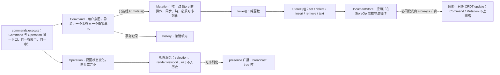
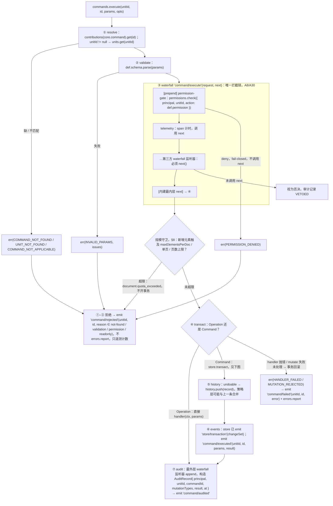
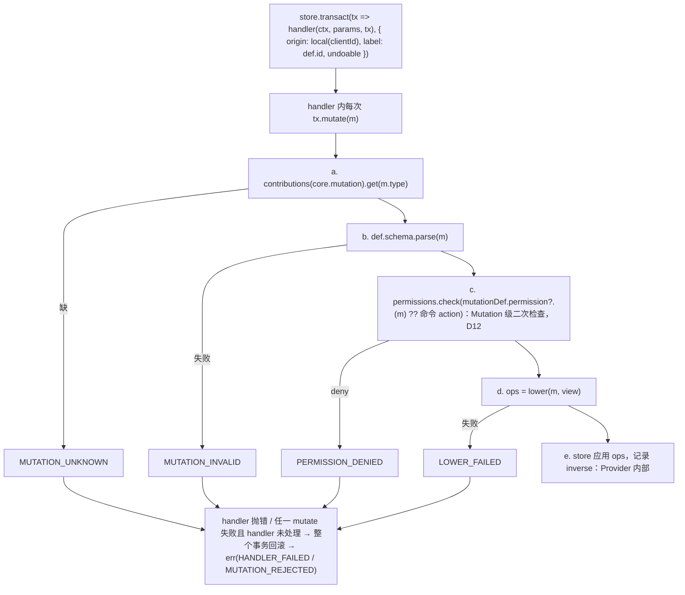
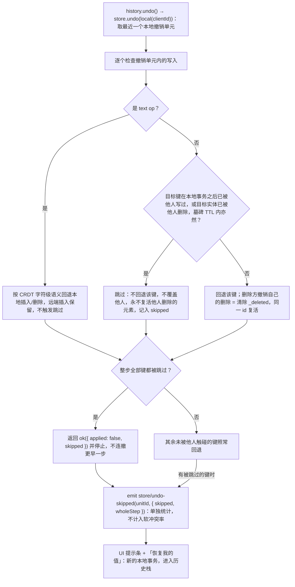
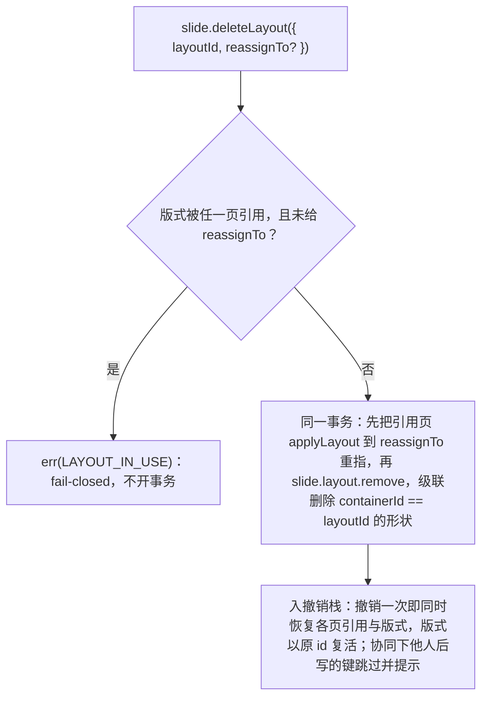
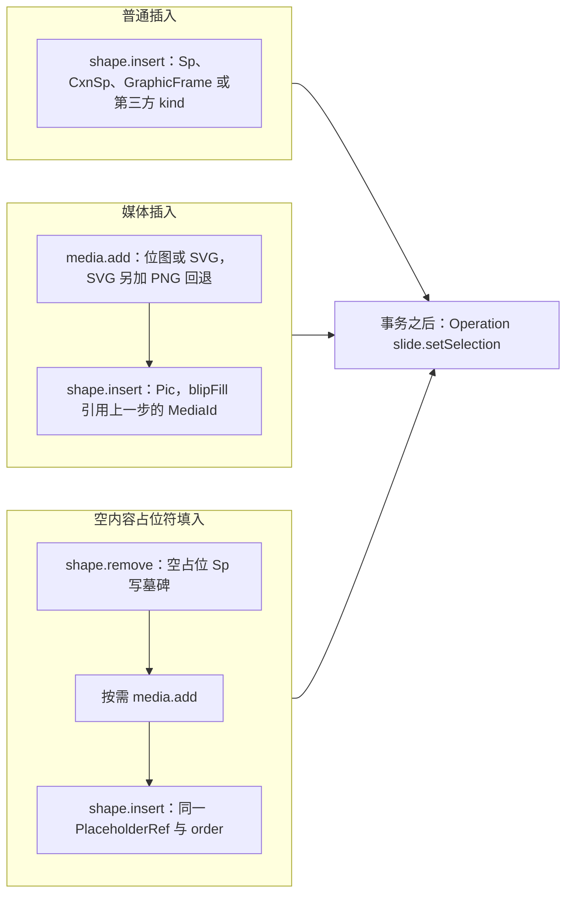
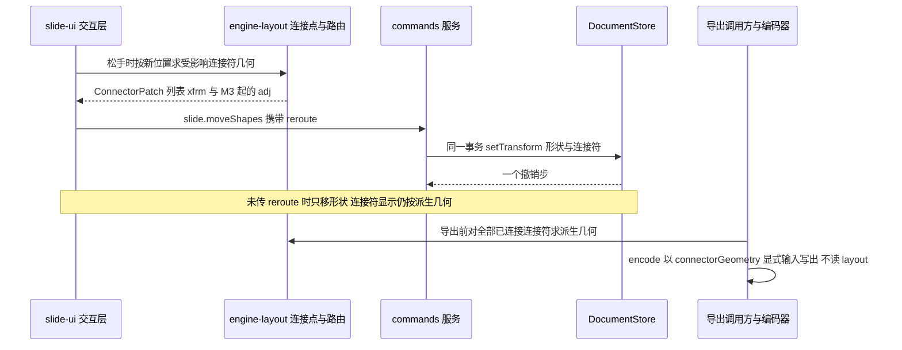

# 05 命令与历史：命令三分法、执行管线、Mutation 类型化与降级、Store 推导逆操作、协同撤销、失败传播

> 状态：草稿 | 负责：架构-结构 | 更新：2026-09-15；2026-09-24（rulings §4.15 Q3：§6 与 §13.4 协同撤销语义统一为「同键被他人后写 → 跳过并提示；整步被跳过 → 停下不连撤；删除 = 软删除墓碑 + TTL」，写入 DocumentStore 中性契约；Q5 `maxElementsPerDoc` 命令守卫）；2026-09-24（复核修正，rulings §4.17：D4 撤销永不复活他人删除的元素；D5/M2 `store/undo-skipped` 载荷 `{skipped, wholeStep}` 并单独统计；M3 撤销契约用例名照抄 M-02 §2.5；D2 编辑期超限 `document.quota_exceeded{dimension}`）；2026-09-25（补图）；2026-09-25（矛盾收口，rulings §4.18）；2026-09-25（§4.19：评论 Mutation 示例改 `comments.thread.add`（D-COMMENTS-PKG）；§6–§9 UI 表达加 50-frontend/04 链接）；2026-09-26（§4.20）（FE-05：§2 `CommandDef.undoable` 保持静态布尔、带 `reassignTo` 的删除确认后可撤销（Q11 修订），§12、§13.2 图与行同步；FE-23：`deleteMaster.reassignTo?: MasterId` 逐页按原版式 `type` 选取；FE-24：`resetPlaceholderFields`、`deleteLayout` 批量、`applyLayout` 计数、`updatePlaceholder.lstStyle`；FE-04：§13.4 冲突 (1) 改为墓碑期读时容错、硬删时修复；TX-01+BE-10：§6 U-07 链接 ADR-0038）；2026-09-26（§4.21：新增 §14 可追加元素的插入命令约束与新增 Mutation（插入守卫与事务组成、插入后选中、三种撤销合并、9 个新 Mutation、33 个新命令与 1 个新 Operation、表格 Mutation 按 id 改写、连接符 `reroute` 同事务写回）；§4.1 联合补新 Mutation；§8 表补插入行）；2026-09-26（§4.21 整合：§14.4 登记 50/18 §28 第二批薄命令 20 行与参数扩展）；2026-09-26（§4.21 Remap：原 30/08 引用按 60-backend/README §6.1 改指新位置，30/08 已删除）；2026-09-26（§4.21 复核：setBorders 参数形状） | 依赖：charter v0.1
> 继承 Univer K1（命令三分法，「最正确的一项」），规避其缺陷 #3（手写逆操作）与 `return false` 2,244 次的失败静默。签名为「草案」。

---

## 1. 三分法的精确契约（D4）

| 概念 | 是什么 | 能读 | 能写 | 同步性 | 序列化 | 历史 | 权限 | 网络 |
|---|---|---|---|---|---|---|---|---|
| **Command** | 用户意图；读状态、计算、在**一个事务**内产出若干 Mutation | Store、服务 | 只能经 `tx.mutate()` | 异步（`Promise<Result>`） | 参数可序列化；命令本身不传输 | 一个事务 = 一个撤销单元 | 命令级检查 | 不上网络 |
| **Mutation** | **唯一**改 Store 的操作；语义化、确定性 | 传入的只读视图 | 经 `lower()` 变为 `StoreOp[]` 被 Store 应用 | 同步、纯 | **必须**可序列化（审计/回放/测试） | 逆操作由 Store 在 `StoreOp` 层推导，**禁止手写** | Mutation 级二次检查 | 不上网络（协同传 CRDT update） |
| **Operation** | 视图状态变化：选区、缩放、当前页、面板开合 | 服务 | 只改 UnitScope 的视图服务（`selection`、`render.viewport`、`ui`） | 同步或异步 | 可序列化（presence 广播） | **不**入历史 | 一般无需 | 可作为 presence 广播 |

**类型层面的强制**（不是约定）：
- `CommandDef.handler(ctx, params, tx)` 拿到 `Transaction`；`OperationDef.handler(ctx, params)` **没有** `tx`，且 `OperationDef` 所在文件由 lint 禁止 import 任何 `MutationDef`（`operation-has-no-tx`）。
- `Mutation` 对象本身没有 `execute` 方法，也没有 `undo` 字段；`MutationDef.schema` 是 `strictObject`，出现 `undo`/`inverse` 键即校验失败（ADR-0007 的机械化）。
- 只有 `Transaction.mutate` 能应用 Mutation；`Transaction` 只在 `store.transact` 回调内存在，而 `store.transact` 只由 `commands` 服务的管线调用（`store.transact` 在生产代码中的调用点由 lint `cordex/store-transact-in-commands-only`（09-02 §4.20）限定为 `model-core/command/pipeline.ts` 一处，ADR-0015）。

**命令三分法流水线**



怎么读：左侧一个入口分出 Command 与 Operation 两条路；只有 Command 能经事务产出 Mutation，Mutation 降级为 5 种 StoreOp 后才进 Store；Operation 只改视图服务，不入历史；虚线是可选的对外传播（presence 广播、协同下的 CRDT update）。

---

## 2. 定义类型（草案）

```ts
interface CommandDef<P = unknown, R = void> {
  readonly type: 'command'
  readonly id: `${string}.${string}`                       // 'slide.insertShape'、'core.export'
  readonly documentType?: string                            // 省略 = 应用级或类型盲命令
  readonly schema: StandardSchemaV1<unknown, P>            // 参数（parse, don't validate）
  readonly permission: readonly Capability[]               // **必填、非空、AND 语义**（全部能力位满足才放行；rulings §4.2 Q-T8；PRD CO-05：未声明即拒绝；lint `command-declares-capability`）；只读命令显式 `['doc.read']`；词汇来自 protocol：'doc.read' | 'doc.comment' | 'doc.write' | 'doc.export' | 'doc.manage' | 'history.read' | 'history.restore' | `${string}:${string}.${string}`（第三方 `<vendor>:<域>.<action>`，章程 D15）；需按参数细化资源时用 `MutationDef.permission?(m)`（Mutation 级）
  readonly undoable?: boolean                               // 默认 true；false = 事务不入历史（如「保存」）。保持静态布尔，不按参数取值：带 reassignTo 删除被引用版式/母版同样入栈可撤销（UI 事前确认，rulings §4.20 FE-05，§13.2）
  readonly label?: I18nKey                                  // 历史条目显示名
  handler(ctx: Context /* UnitScope ctx 或 root ctx */, params: P, tx: Transaction): Promise<R> | R
}
interface OperationDef<P = unknown> {
  readonly type: 'operation'
  readonly id: `${string}.${string}`
  readonly documentType?: string
  readonly schema: StandardSchemaV1<unknown, P>
  readonly permission?: readonly Capability[]               // 默认 ['doc.read']（AND 语义同上）
  readonly broadcast?: boolean                              // true = 变化作为 presence 广播（06）
  handler(ctx: Context, params: P): Promise<void> | void     // 无 tx
}
interface MutationDef<M extends Mutation = Mutation> {
  readonly type: M['type']                                  // 'slide.shape.insert'
  readonly documentType: string
  readonly schema: StandardSchemaV1<unknown, M>            // strictObject
  lower(mutation: M, view: ReadonlyStoreView): Result<readonly StoreOp[], LowerError>   // 纯函数；可读当前状态以计算索引
  permission?(mutation: M): PermissionRequest['action'] | { action; resource }            // 默认继承命令的 action
  describe(mutation: M): string                             // 审计文本
}
interface Mutation { readonly type: `${string}.${string}.${string}`; readonly unitId: UnitId }
```

`ReadonlyStoreView` = `{ state(): Persisted<S>; get(path) }`（无写方法）。

---

## 3. 执行管线（waterfall 阶段）

**命令执行管线 · 主干 ①–⑦**



怎么读：纵向主干是成功路径 ①→⑦，子图是 ③ 唯一拦截链内监听器的顺序；左右分出的节点是失败出口——①–③ 的拒绝汇入 `command/rejected`，④ 的失败回滚走 `command/failed`；Operation 跳过事务与历史直接到审计；③ 与 ④ 之间的规模守卫取自 §8 表末行。

**命令执行管线 · ④ 事务内的 tx.mutate**



怎么读：a–e 是单个 Mutation 进入 Store 前的五步，任一步失败都返回类型化错误；handler 未处理该错误（或自身抛错）时整个事务回滚，事务成功后回到主干 ⑤。

### 3.1 请求与结果类型

```ts
interface CommandRequest<P> { unitId: UnitId | null; id: string; params: P; principal: Principal; origin: Origin; meta?: JsonObject; signal?: AbortSignal }
type CommandResult<R> = Result<{ value: R; transaction?: TransactionRecord }, CommandError>
interface CommandError extends CordexError { code: 'command.not_found' | 'command.unit_not_found' | 'command.not_applicable' | 'command.invalid_params' | 'command.permission_denied' | 'command.vetoed' | 'command.handler_failed' | 'command.mutation_rejected' | 'command.store_unavailable' }
// 点式错误码（10 §1.1、rulings §4.3）；本文管线图与正文中的大写名（COMMAND_NOT_FOUND 等）是 `defineErrors('command', …)` 生成表的源码标识符，运行时字符串即上述点式码
```

### 3.2 `commands` 服务（草案）

```ts
interface CommandsService {
  execute<P, R>(unitId: UnitId | null, id: string, params: P, opts?: { signal?: AbortSignal; meta?: JsonObject }): Promise<CommandResult<R>>
  has(id: string): boolean
  describe(id: string): CommandDescriptor | undefined     // id/documentType/permission/undoable/label（UI 用）
  observe(listener: (e: CommandExecution) => void): () => void
}
```

`unitId` 显式传入（A-6）：应用级命令（打开文件、切换主题）传 `null`；单元命令传 id，管线用 `units.get(unitId).ctx` 作为 handler 的 `ctx`，使 `ctx.store/history/selection/render` 解析到该 Unit。

### 3.3 为什么只有一条拦截链

Univer 有 7 套事件机制与 6 个语义重叠的 `intercept*`（A8），渲染热路径穿过 ~20 个拦截器（A30）。这里：`waterfall 'command/execute'` 是全系统**唯一**的环绕式拦截点；Store 层无拦截；渲染层无拦截（查表）。监听器不调用 `next()` 即否决（cordis 语义），审计会记录 `VETOED` 与监听器所属 Fiber 名——「忘了 next」会在测试与日志中立刻暴露（指南 §46）。

---

## 4. Mutation 类型化与降级（ADR-0013）

### 4.1 判别联合按文档类型贡献

```ts
// model-slide/mutations/shape.ts（草案）
type SlideMutation =
  | { type: 'slide.shape.insert'; unitId; shape: Shape /* 含 containerId、parentId、order: FracKey */ }
  | { type: 'slide.shape.remove'; unitId; shapeIds: readonly ShapeId[] }
  | { type: 'slide.shape.setOrder'; unitId; shapeId; order: FracKey; parentId?: ShapeId | null }     // z 序移动 / 进出组：单键写入
  | { type: 'slide.shape.setTransform'; unitId; shapeId; transform: Transform }
  | { type: 'slide.shape.setProperties'; unitId; shapeId; patch: Partial<ShapeProperties> }
  | { type: 'slide.text.applyDelta'; unitId; shapeId; paragraph?: number; delta: TextDelta }
  | { type: 'slide.slide.insert'; unitId; slide: Slide /* 含 order */; shapes: readonly Shape[] }
  | { type: 'slide.slide.setOrder'; unitId; slideId; order: FracKey }
  | { type: 'slide.shape.setNonVisual'; unitId; shapeId; patch: Partial<NonVisualProps> }          // 2026-09-26 §4.21 起新增 9 个，见 §14.2
  | { type: 'slide.pic.setBlipFill'; unitId; shapeId; patch: Partial<BlipFill> }
  | { type: 'slide.cxnSp.setConnections'; unitId; shapeId; start?: ConnectionRef | null; end?: ConnectionRef | null }
  | …
// 载荷中**没有** index/toIndex（06 I4、ADR-0032）：命令层用 `between(prev?.order, next?.order)`（`@cordexjs/shared/order`）把「插到 X 之后」变成具体 order 键；lower() 因而保持纯且确定。
```

- 每个成员一个 `MutationDef`，贡献到 `core.mutation`；`type` 三段式 `<documentType>.<entity>.<verb>`（`scan-command-capabilities` 规则 (c) 校验命名，09-06 §11）。
- 第三方插件可贡献新 Mutation（如 `@cordexjs/comments` 的 `comments.thread.add`，rulings §4.19 D-COMMENTS-PKG），无需改 `model-slide`。
- 水平层对联合无知：`commands` 只按 `m.type` 查表。

### 4.2 `lower()` 的规则

- **纯函数**：只读 `view`，不读服务、不读时间、不生成随机 id（id 必须在 Command 中生成并放入 Mutation，保证 Mutation 可回放）。
- 输出 `StoreOp[]`，路径基于归一化实体表：`shape.insert` → 一条 `set(['shapes', id], shape)`（形状自带 `containerId`/`parentId`/`order`）；`shape.setOrder` → `set(['shapes', id, 'order'], key)`（+ 可选 `set([..., 'parentId'], p)`）；`slide.setOrder` → `set(['slides', id, 'order'], key)`。没有数组下标操作（ADR-0013）。
- 失败可传播：容器不存在、索引越界 → `Result.err(LowerError)`，事务回滚。
- 测试：property test「任意合法 Mutation 序列 → body 仍满足 `bodySchema`」；每个 `lower` 有确定性快照测试。

### 4.3 为什么不让 Store 直接理解 Mutation

若 `store-yjs` 要为每种 Mutation 写一份 Y 操作，文档类型知识就进了水平层（A1），且新 Mutation 需改 Store。五种原语让 Store 永远不变（12 §3 的证明）。

---

## 5. 逆操作由 Store 推导（ADR-0007；Univer 缺陷 #3 的反制）

| 原语 | 逆 | 推导时机 |
|---|---|---|
| `set(path, v)` | 原键存在 → `set(path, old)`；不存在 → `delete(path)` | 应用前读旧值 |
| `delete(path)` | `set(path, old)` | 同上 |
| `insert(path, i, items)` | `remove(path, i, items.length)` | 直接 |
| `remove(path, i, n)` | `insert(path, i, removedItems)` | 应用前读被删项 |
| `text(path, delta)` | `invert(delta, oldText)` | 应用前读旧文本 |
| （移动）`set([..., 'order'], key)` | `set([..., 'order'], oldKey)` | 移动只是 `set`：并发下 LWW，无重复无丢失（ADR-0032） |

- `store-memory`：`apply-op.ts` 返回 `{ next, inverse }`；`TransactionRecord.inverse` = 逆序拼接。
- `store-yjs`：由 `Y.UndoManager` 在 CRDT 层完成（不需要 inverse ops），但 `TransactionRecord.inverse` 仍由 `apply-op` 计算并保留用于审计/回放的一致性（契约套件只断言撤销后状态，不断言 inverse 数组内容）。
- 机械验证：lint `no-inverse-in-mutation`（Mutation 类型/Def 中禁止 `undo|inverse|revert` 字段与方法）；`runDocumentStoreConformance`：`transact` 后 `undo` 深等于事务前 `state()`；property：`apply(inverse(apply(s, op))) ≡ s`。

为什么不像 Univer：Univer 为每个 Mutation 手写 `undoMutations`，2,244 处 `return false` 使失败原因不可见。这里逆操作零手写、失败为类型化 `Result`。

---

## 6. 协同下的撤销（按 origin 只撤本地）

- 每个客户端的 `Origin = local(clientId)`；远端更新到达时以 `remote` origin 应用（store-yjs：Y.Doc 的远端 update；store-memory 在协同模式下不使用）。
- `history.undo()` → `store.undo(local(clientId))`：只撤本地事务；`store-yjs` 的 `UndoManager.trackedOrigins = {localOrigin}`；`store-memory` 的历史栈按 origin 过滤。
- **协同撤销语义（rulings §4.15 Q3，不跟随 CRDT 库默认）**：写入 `DocumentStore` 契约的中性字段 `undo.remoteConflict: 'skip'`（字段名与 CRDT 无关），store-yjs 与 store-memory 同语义，由 `runDocumentStoreConformance`「中性撤销语义」分节（用例名以 40-modules/02 §2.5 为准：`remote-conflict-skip`、`undo-skip-no-cascade`、`soft-delete-tombstone`、`delete-vs-edit-undo`、`read-path-filters-tombstone`）验收：
  1. **同一键被他人后写 → 跳过并提示**：撤销单元中某个 `set` 的目标键在本地事务之后已被远端写过，该键**不回退**（不覆盖他人）；其余未被他人触碰的键照常回退。被跳过的键经事件 `store/undo-skipped(unitId, { skipped: UndoSkip[], wholeStep })` 报告（载荷以 40-modules/02 §2.4 为准；该事件**单独统计**跳过次数与整步跳过次数，不计入 `collab/soft-conflict` 软冲突率，rulings §4.17 D5），UI 以提示条告知，并提供「恢复我的值」——这是一个**新的本地事务**（重新写回本地旧值，进入历史栈），不是撤销的延续。
  2. **整步被跳过 → 停下不连撤**：若一个撤销单元的全部键都被跳过（实际无任何回退），本次 `history.undo()` 返回 `ok({ applied: false, skipped })` 并停止，**不**继续撤销更早的一步（Yjs 默认会「连撤两步」，由 undo 包装层阻断）。
  3. **删除 = 软删除墓碑**：用户删除有身份实体写 `_deleted` 墓碑而非删键（04 §3.1a），删除方撤销 = 清除墓碑、同一 id 复活；与并发编辑不会产生重复元素。**撤销目标已被他人删除（墓碑 TTL 内亦然）→ 跳过并提示，不看 TTL**：撤销永不复活他人删除的元素，恢复由删除方撤销或「恢复元素」（新事务）完成（rulings §4.17 D4）。墓碑 TTL（默认 24 h）后硬删除；文档级「永久删除文档」（S-2 文档擦除）与元素级经审计的「彻底删除元素」（仅墓碑态、仅 owner，04 §3.1a）不等 TTL。墓碑已被硬删除（TTL 到期或被彻底删除元素）后，删除方再撤销该步 → 目标不复存在，按**整步被跳过**处理（`store/undo-skipped{ wholeStep: true }`，同第 2 条，2026-09-25 rulings §4.18 CO-07）。
  4. 文本 `text` op 的撤销按 CRDT 字符级语义回退本地插入/删除，远端插入保留（字符级无「同键」概念，不触发跳过）。
  - U-07 版本恢复撤销（version-restore-undo）以本语义为基线，不采用「revertTo 整体回滚」式实现（它绕过 D4）。2026-09-26 立项为 [ADR-0038](adr/0038-version-restore-undo.md)（提议，rulings §4.20 TX-01+BE-10）：持有 Room 的实例内单事务、走命令管线；「他人后写」判据按本节第 1 条的中性口径——看当前值是否仍出自恢复事务的 struct 范围，而非值相等；恢复时删掉的元素以原 id 复活。
- `history` 策略层：
  - 合并（coalesce）：同 `label`、同 origin、间隔 < `coalesceMs`（默认 500ms）的连续文本事务合并为一个撤销单元；
  - 分组：`history.beginGroup(label) … endGroup()` 把多个命令并成一个撤销单元（如拖拽过程）；
  - 容量：默认 200 条；淘汰有测试；
  - 事件 `history/changed(unitId, { canUndo, canRedo, depth })` 驱动 UI 上下文键。
- `undoable: false` 的命令（导出、保存）不入栈。
- `system(...)` origin 的事务一律不入任何撤销栈——包括渐进打开时首批之后以 `system('import')` 追加的批次（04 §2.2，2026-09-25 rulings §4.18 CO-12），打开完成前后 `canUndo(local)` 都不因装载而变化。

**协同撤销跳过判定**



怎么读：菱形是逐键判定，最终按「整步是否全部跳过」决定停下还是部分回退；有跳过就发 `store/undo-skipped` 并由 UI 提示，恢复他人覆盖前的值要走新事务而不是继续撤销。

依据：本节第 1–4 条；04 §3.1a；rulings §4.15 Q3、§4.17 D4、D5。

UI 表达（提示条、「恢复我的值」「恢复元素」两个恢复命令与 UndoSkip 记录的保留规则，决策 RESTORE-CMD）的唯一源是 [50-frontend/04](../50-frontend/04-document-commands-and-undo.md) §6；本节契约不变。

---

## 7. Operation 与 presence

- Operation 只改视图服务；`selection.set()` 触发 `selection/changed`；`broadcast: true` 的 Operation 的效果由 `presence` 服务序列化广播（`Selection.serialize`），细节见 06。
- Operation 也走 `commands.execute`（同一入口、同一权限门、同一审计；ADR-0015），但跳过 ④ 的事务与 ⑤ 历史。
- 远端 presence 不产生 Operation：它直接更新 `presence` 服务状态（不是本地视图状态）。

---

## 8. 批量与事务边界

| 场景 | 做法 |
|---|---|
| 一个用户动作触发多个 Mutation | 一个 Command、一个 `tx`、多次 `tx.mutate` → 一个撤销单元 |
| 一个用户动作由多个命令组成（拖拽：连续 setTransform） | `history.beginGroup()`；或以一个 `slide.moveShapes` 命令收口（首选） |
| 命令调用命令 | 允许：`ctx.commands.execute(...)` 在 handler 内调用会开启**新事务**（嵌套事务被 Store 拒绝 `STORE_NESTED_TRANSACTION`）；因此复合命令应当直接 `tx.mutate`，而不是递归执行子命令（lint 提示 `no-nested-execute-in-handler`，warning 级→M2 起 error） |
| 导入/迁移写入 | `origin = system(...)`，`undoable: false`，不经命令管线（唯一例外，且只在 `units.open` 内部，含渐进打开首批之后的 `system('import')` 追加批次，04 §2.2；`cordex/store-transact-in-commands-only` 的允许列表） |
| 跨 Unit 命令 | 不支持（每个命令绑定一个 unitId 或 null）；复制粘贴分两条命令（剪贴板管线见 [50-frontend/04](../50-frontend/04-document-commands-and-undo.md) §9） |
| 插入一个元素（2026-09-26，rulings §4.21，§14） | 一个 Command、一个事务：按需 `media.add` + `shape.insert`；插入后选中是事务外的 Operation；上传字节不在事务内；三种合并例外见 §14.1 |
| 新增元素触及规模上限（rulings §4.15 Q5） | 命令守卫在 ③ 之后、④ 之前检查 `maxElementsPerDoc`（默认 20,000，软警告 15,000，墓碑计入）与单页 1,000、页数 200：超限 → `command/rejected{ reason: 'validation' }` + `document.quota_exceeded{ dimension, limit, actual }`（编辑期上限码，409、不关连接，`dimension` 取值见 10 §1.4，rulings §4.17 D2），不开事务；数字来自部署配置（04 §5.5） |

---

## 9. 失败原因可传播

- 所有入口返回 `Result<T, CordexError>`（`shared/result.ts`）；禁止 `boolean` 结果（lint `no-boolean-command-result`：`CommandDef.handler` 返回类型不得为 `boolean`；`commands.execute` 调用处不得用 `if (!ok)` 模式——以类型 `Result` 强制解构）。
- 每个失败码都有 `data`（issues、mutationType、fiber 名），`errors.report` 统一上报（PERMISSION_DENIED 只发 `permission/denied` 事件与遥测计数，不作为错误上报，避免噪音）。
- UI 层 `useCommand(id)` 返回 `{ run, lastError }`，通知组件把错误码映射为 i18n 文案（命名空间 `errors.<code>.{title, action}`，决策 ERR-COPY）；错误码 → UI 处理矩阵见 [50-frontend/04](../50-frontend/04-document-commands-and-undo.md) §4。
- 审计记录含 `result: 'ok' | code`。

---

## 10. 事件清单（本文相关）

| 事件 | 模式 | 载荷 | 发出者 |
|---|---|---|---|
| `command/execute` | waterfall | `(request, next) → Promise<CommandResult>` | `commands` |
| `command/executed` | emit | `(unitId, id, params, result)` | `commands` |
| `command/rejected` | emit | `(unitId, id, reason)`（管线 ①–③ 拒绝：not-found / validation / permission / readonly） | `commands` |
| `command/failed` | emit | `(unitId, id, error)`（④ 阶段 handler/事务失败并回滚） | `commands` |
| `command/audited` | emit | `(record: AuditRecord)` | `commands`（audit 监听器） |
| `store/transaction` | emit | `(unitId, changeSet)` | `store` Provider |
| `store/loaded` | emit | `(unitId)` | `store` Provider |
| `history/changed` | emit | `(unitId, { canUndo; canRedo; depth })` | `history` |
| `store/undo-skipped` | emit | `(unitId, { skipped: UndoSkip[]; wholeStep: boolean })`（以 40-modules/02 §2.4 为准；单独统计、不计入软冲突率，rulings §4.17 D5）（撤销时同键已被他人后写而跳过；`wholeStep` 表示整步被跳过并已停止，§6） | `store` Provider（undo 包装层） |
| `selection/changed` | emit | `(unitId, selection)` | `selection` |
| `view/mode-changed` | emit | `(unitId, mode, prev)`（`view.setMode` Operation 之后；10 §11） | `ui`（view.setMode handler） |
| `permission/denied` | emit | `(request, decision)` | `permissions` |
| `permission/changed` | emit | `(unitId, { added: Capability[]; removed: Capability[] })`（本地策略变化或网关下发 `applyRemoteDecisions` 后；唯一发出者） | `permissions` |

全部在 `model-core.contribution.ts` 的 `Events` 增强中声明（lint `cordex/events-must-be-declared`，09-02 §4.4；原称扫描器 `events-declared`）。

---

## 11. 对运行时线（B）的契约要求

- 06：`store-yjs` 的 `transact` 必须把 `origin` 传给 `Y.Doc.transact`；`UndoManager` 只跟踪本地 origin；远端 update 应用后必须 emit `store/transaction`（origin=remote）以驱动渲染脏区；服务端网关拒绝的 update 如何回滚本地（06 决定，接口：`collab` 发 `collab/rejected(unitId, reason)` → `history` 可选回退）。
- 60-backend/06：服务端 `import-export`、`migrate` 任务经 `server-headless` 调用命令管线（`principal = system`），权限策略为服务端策略；审计记录落库。
- 10：`command/audited`、`command/failed`、`permission/denied` 的落地（日志字段、遥测指标名）。
- 11：`command-harness` 与 `runDocumentStoreConformance` 的运行矩阵。

---

## 12. 机械验证清单

| 规则 | 机制 |
|---|---|
| Mutation 是唯一改 Store 的途径 | lint `cordex/store-transact-in-commands-only`（09-02 §4.20，TD-068）：`store.transact(` 调用点仅 `model-core/command/pipeline.ts` 与 `unit-plugin.ts`（load 与渐进打开的 `system('import')` 追加）；`tx.mutate` 只在 `CommandDef.handler` 词法内 |
| Operation 不能改 Store | 类型：`OperationDef.handler` 无 `tx`；lint `operation-has-no-tx` |
| 无手写逆操作 | lint `no-inverse-in-mutation`；`MutationDef.schema` strictObject |
| 失败不用 boolean | lint `no-boolean-command-result` |
| 权限 fail-closed | `command-harness` 测试：无策略 → 全部 `PERMISSION_DENIED`；`denyAll` 覆盖 `allowAll` |
| waterfall 监听器忘记 next 会被发现 | 审计 `VETOED` 记录 + kernel `waterfall-contract.test.ts`（指南 §128） |
| 只撤本地 | 契约套件协同分节：两 store 同步后各自 undo 只回退自己的事务 |
| 不覆盖他人、整步跳过即停、删除可复活（§6，rulings §4.15 Q3） | 契约套件「中性撤销语义」分节用例（名称照抄 40-modules/02 §2.5）`remote-conflict-skip`、`undo-skip-no-cascade`、`soft-delete-tombstone`、`delete-vs-edit-undo`、`read-path-filters-tombstone`（store-memory 与 store-yjs 同一套），另补「墓碑被彻底删除元素后删除方撤销返回 `wholeStep: true`」用例（CO-07，用例名由 40-modules/02 §2.5 登记）；40-modules/05 确定性用例 + fuzz |
| 事件先声明后使用 | lint `cordex/events-must-be-declared`（09-02 §4.4，TD-017） |
| 命令 id / Mutation type 命名 | `scan-command-capabilities` 规则 (c)（09-06 §11，TD-099；原称扫描器 `command-id-format`）：`<domain>.<name>`、`<docType>.<entity>.<verb>` |
| 嵌套事务被拒 | 契约套件 `STORE_NESTED_TRANSACTION` |
| 命令必须声明能力位 | lint `cordex/command-must-declare-capabilities`（09-02 §4.16，TD-061）+ `scan-command-capabilities`（09-06 §11）；lint `cordex/capability-vocabulary-single-source`（09-02 §4.19，TD-067；能力位字面量必须来自 protocol，或带 `<vendor>:` 前缀且 vendor 与声明包的 npm scope 一致，章程 D15）。原称 `command-declares-capability`/`capabilities-in-protocol`（09-08 §11） |
| Mutation 载荷无数组下标 | lint `cordex/no-index-in-mutation`（09-02 §4.17，TD-065；06 I4） |
| 权限变更单一发出者 | 扫描器：`emit('permission/changed'` 只允许出现在 `model-core/permission/permissions.service.ts` |
| 版式删除 fail-closed（§13.2） | `command-harness`（`model-slide/src/__tests__/master-layout-delete.test.ts`，70-testing/05 §7.1 `ml/*`；不调用 kit，按 70-testing/01 §4 归 `test/unit`）：被引用版式 `deleteLayout` 无 `reassignTo` → `LAYOUT_IN_USE` 且无事务；带 `reassignTo` → 单事务、撤销栈深度 +1，`core.undo` 一步恢复各页引用与版式（同一 id 复活，rulings §4.20 FE-05）；`layoutIds` 批量删除为单事务；`deleteMaster(reassignTo)` 目标母版有同 `type` 版式时各页 `type` 不变、无同 `type` 时落目标母版首个版式、整个删除单事务（FE-23）；`resetPlaceholderFields` 一步撤销且只清所列字段、`applyLayout` 结果计数与 Toast N 一致（FE-24）；`test/collab-sim`：撤销时他人已改的页只跳过该键并提示 |
| `view.setMode` 文档类型盲 | 类型/运行时测试：`mode ∉ documentType.viewModes` → `INVALID_PARAMS`；`fixture` 类型只接受 `'normal'` |

---

## 13. 母版 / 版式 / 主题命令族（ML-01…ML-04；模型支撑与纯函数见 04 §12）

### 13.1 Mutation 族（`model-slide/mutations/{layout,master,theme}.ts` + `shape.ts` 扩展；三段式命名，载荷无下标）

| type | 载荷（草案） | `lower` 要点 |
|---|---|---|
| `slide.slide.setLayout` | `{ slideId; layoutId; remap: PlaceholderRemap[] }`（`remap` 由命令经 `planLayoutChange` 计算并**携带**，Mutation 保持确定性） | `set(['slides', id, 'layoutId'])`；`materialize` 项按 `InheritableField` 全集显式化全部继承字段（`set(['shapes', sid, 'properties', field], …)`）并 `delete(['shapes', sid, 'nonVisual', 'placeholder'])`（脱离占位符）；`inherit` 项保留已有显式覆盖（含 transform），`rewriteRef` 非空时 `set(['shapes', sid, 'nonVisual', 'placeholder'], rewriteRef)` 改写引用（04 §12.2；2026-09-25 rulings §4.18 CO-18） |
| `slide.shape.clearOverrides` | `{ shapeId; fields: InheritableField[] }` | 逐字段 `delete(['shapes', id, 'properties', field])`（重置 = 恢复继承） |
| `slide.master.setBackground` / `slide.layout.setBackground` | `{ id; background: Background \| null }` | `set/delete([..., 'commonSlide', 'background'])` |
| `slide.master.setTextStyle` | `{ masterId; kind: 'title' \| 'body' \| 'other'; level: 0..8; patch: Partial<ParagraphProperties> }` | `set(['masters', id, 'textStyles', kind, 'levels', level], merged)`（合并在 `lower` 内按当前视图计算，确定性） |
| `slide.layout.insert` / `slide.layout.remove` | `{ layout: SlideLayout /* 含 order、masterId */; shapes: Shape[] }` / `{ layoutId }`（前置：无页引用） | 实体表写入；remove 级联删除 `containerId == layoutId` 的形状（`lower` 读视图枚举） |
| `slide.layout.setName` / `setOrder` / `setProperties` | `{ layoutId; name }` / `{ layoutId; order: FracKey }` / `{ layoutId; patch: { showMasterShapes?; preserve?; userDrawn?; type? } }` | 单键 `set` |
| `slide.master.insert` / `remove` / `setOrder` / `setTheme` / `setProperties` | `{ master; layouts; shapes; theme? }` / `{ masterId }`（前置：无版式被页引用）/ `{ masterId; order }` / `{ masterId; themeId }` / `{ masterId; patch: { preserve?; colorMap?; headerFooter? } }` | 实体表写入；remove 级联版式与形状 |
| `slide.shape.setPlaceholder` | `{ shapeId; placeholder: PlaceholderRef \| null }` | `set/delete(['shapes', id, 'nonVisual', 'placeholder'])`；占位符**增删**复用 `slide.shape.insert/remove`（`containerId` = 版式/母版） |
| `slide.theme.insert` / `slide.theme.remove` | `{ theme }` / `{ themeId }`（前置：无母版引用） | 实体表写入 |
| `slide.theme.setColors` / `slide.theme.setFonts` | `{ themeId; colors: Partial<ColorScheme> }` / `{ themeId; fonts: Partial<FontScheme> }` | 逐槽位 `set(['themes', id, 'colorScheme', slot])`（12 槽位各自 LWW，不整体覆盖） |

### 13.2 Command 族（`model-slide/commands/{layout,master,theme}-commands.ts`；`permission: ['doc.write']`，集成方策略可按 `resource: { kind: 'master' \| 'layout' \| 'theme' }` 收紧）

| id | 语义 | 需求 |
|---|---|---|
| `slide.applyLayout` | `{ slideIds; layoutId }`：每页 `planLayoutChange` → `slide.slide.setLayout`；**一页一事务**（撤销粒度按页）；结果含每页脱离占位符（`materialize`）的元素数，供 Q13 Toast「N 个元素无法匹配新版式的占位符」计数（2026-09-26，rulings §4.20 FE-24） | ML-02 |
| `slide.resetSlide` | `{ slideIds }`：`planReset` → `slide.shape.clearOverrides`（仅占位符形状） | ML-02 |
| `slide.resetPlaceholderFields` | `{ shapeId; fields: InheritableField[] }`：只清所列字段的显式覆盖，与 `resetSlide` 共用 `slide.shape.clearOverrides`；一个事务、一步撤销（2026-09-26，rulings §4.20 FE-24） | ML-02 |
| `slide.setMasterBackground` / `slide.setLayoutBackground` | 母版视图中的背景编辑 | ML-03 |
| `slide.setMasterTextStyle` | `{ masterId; kind; level; patch }` | ML-03 |
| `slide.insertLayout` | `{ masterId; after?: LayoutId; type?; name? }`：从母版占位符生成新版式；`order` 经 `between` 计算 | ML-03 |
| `slide.duplicateLayout` | 复制版式与形状（新 `NodeId`；`ooxml` id 清空，导出分配） | ML-03 |
| `slide.deleteLayout` | `{ layoutId \| layoutIds; reassignTo?: LayoutId }`：被引用且无 `reassignTo` → `err(LAYOUT_IN_USE)`；否则同一事务内先重指再删除（04 §12.3）；`layoutIds` 为多选批量删除，整批一个事务（2026-09-26，FE-24）。**入撤销栈**：删除被引用版式由 UI 事前确认，执行后给带 [撤销] 的 Toast，撤销一步恢复各页引用、版式以原 id 复活（rulings §4.20 FE-05，Q11 修订；撤销栈只在会话内有效、墓碑 24 h 后硬删，所以仍要事前确认） | ML-03 |
| `slide.renameLayout` / `slide.reorderLayouts` | `{ layoutId; name }` / `{ layoutId; after?: LayoutId }` | ML-03 |
| `slide.addPlaceholder` / `slide.removePlaceholder` / `slide.updatePlaceholder` | `{ containerId: LayoutId \| MasterId; type; index?; box }` / `{ shapeId }` / `{ shapeId; placeholder?; transform?; bodyProperties?; lstStyle? }`（`lstStyle` 为占位符级别文本样式，不新增命令 id，2026-09-26 FE-24）；母版占位符是版式占位符的继承源 | ML-03 |
| `slide.deleteMaster` / `slide.duplicateMaster` / `slide.insertMaster` | 删除 `{ masterId; reassignTo?: MasterId }`：前置无版式被页引用（否则 `MASTER_IN_USE`，可带 `reassignTo`）；`reassignTo` 是**目标母版**，每个受影响页取 `defaultLayoutOf(body, { masterId: reassignTo, type: 原版式的 type })`（目标母版同 `type` 的首个版式 → 目标母版首个版式，与 I-ML2 同一纯函数，04 §12.3），整个删除一个事务，入撤销栈同 `deleteLayout`；UI 不加母版选择器，默认取按 `order` 排序的首个剩余母版（2026-09-26，rulings §4.20 FE-23、FE-05）；复制含版式、形状与主题引用 | ML-03 |
| `slide.setThemeColors` / `slide.setThemeFonts` | `{ themeId; … }` | ML-04 |
| `slide.applyTheme` | `{ masterId; theme: Theme \| ThemeId }`：新主题 → `theme.insert` + `master.setTheme`；旧主题无引用 → `theme.remove`（同一事务） | ML-04 |

**版式删除 fail-closed 判定**



怎么读：只有两条出口——拒绝（不产生事务）或一个原子事务；`slide.deleteMaster` 同理，前置不满足时返回 `MASTER_IN_USE`，可带 `reassignTo`（目标母版，逐页按原版式 `type` 选取）。被引用时的事前确认对话框由 UI 负责（50-frontend/11），命令本身不区分是否经过确认；删除入撤销栈（rulings §4.20 FE-05）。

依据：本节 §13.1、§13.2；§12 机械验证表「版式删除 fail-closed」行；04 §12.3；rulings §4.20 FE-05（Q11 修订：确认后可撤销）、FE-23。

### 13.3 视图态 Operation

| id | 载荷 | 说明 |
|---|---|---|
| `view.setMode`（**水平层**，定义在 ui-core，文档类型盲） | `{ unitId; mode: string }`；`mode` 必须 ∈ `DocumentType.viewModes`（slide：`'normal' \| 'master' \| 'presenter'`），否则 `INVALID_PARAMS` | 更新上下文键 `viewMode`；`render.setView({ mode })`；emit `view/mode-changed`；不入历史；`broadcast: true`（presence 可显示「正在编辑母版」） |
| `slide.selectMasterOrLayout`（**垂直束**；即总编排所称 `view.selectMasterOrLayout`——载荷含 slide 专有的 `MasterId \| LayoutId`，故落在 `slide` 域） | `{ unitId; targetId: MasterId \| LayoutId }` | 母版视图中的当前编辑目标；上下文键 `editTargetKind ∈ slide \| layout \| master`；`render.setView({ mode: 'master', target })`；选区切换到该容器 |

### 13.4 协同下的撤销与冲突语义要点（详见 06 §8，B 线）

- 母版/版式/主题都是实体表条目：编辑 = 单键 LWW；撤销按 origin 只撤本地，且遵循 §6 的跳过/停止语义；撤销母版编辑会使全部依赖页重绘（`dependentsOf` → 渲染脏映射）。
- 冲突面（06 需覆盖）：(1) **删除 vs 引用**：A 删版式（写墓碑）、B 同时应用该版式 → 合并后 `slide.layoutId` 指向墓碑 → **墓碑期读时容错、硬删时修复**（2026-09-26，rulings §4.20 FE-04）：墓碑 TTL 内不改写引用，读路径（SceneProvider、导出编码器、slide-ui）经 `defaultLayoutOf` 取替代版式渲染，并发 `collab/soft-conflict{ type: 'delete-vs-reference' }`；A 撤销删除 = 清除墓碑，B 的引用重新有效；墓碑到期硬删时，硬删作业在同一事务内按 I-ML2 写修复（04 §12.3，`collab/repair{ rule: 'dangling-layout' }`，只写一次）。原「合并后即由 I-ML2 修复」作废；(2) **重置 vs 移动**：A `clearOverrides(transform)` 与 B `setTransform` 并发 → 同键 LWW，后写者胜；先写者撤销时该键已被他人后写 → **跳过并提示**（§6 第 1 条，可选「恢复我的值」新事务），后写者撤销则正常回退自己的写入；若先写者的撤销单元只含这一键 → 整步被跳过、停下不连撤（§6 第 2 条）；(3) **主题槽位**：`colorScheme.*` 逐槽位 LWW；(4) **版式复制 vs 母版删除**：新版式 `masterId` 指向被删母版 → I-ML3 修复。
- 母版视图是**视图态**（Operation），不锁内容；可选软锁（PRD PD-19，awareness 级）由 06 定。
- 事务边界：`applyLayout` 一页一事务；`deleteLayout(reassignTo)`（含 `layoutIds` 批量）、`deleteMaster(reassignTo)`、`applyTheme` 各为一个原子事务（重指/换主题 + 删除不可分），均入撤销栈、一步撤销（rulings §4.20 FE-05）。

---

## 14. 可追加元素：插入命令约束与新增 Mutation（2026-09-26，rulings §4.21；决策见 ADR-0018，前端总览见 50-frontend/19）

### 14.1 插入命令的通用约束

1. **守卫顺序**：schema 解析 → `doc.write` 权限 → 规模守卫（§8 末行，按提交后计数，墓碑计入）→ 事务。三道守卫都在事务之前，失败不产生撤销记录。所有会新增元素的路径（工具插入、粘贴、`fillPlaceholder`、`setHeaderFooter` 全部应用、相册、插件插入）都经此守卫。
2. **事务组成**：一个事务内按需 `slide.media.add`（只登记 `BlobRef`，字节已在 BlobStore）→ `slide.shape.insert`。`order = between(同级最后一个, undefined)`、`parentId = null`；`ooxml.creationId`（GUID）、元素名（「类型 + 序号」本地化）、表格行列 id 与键、字段 id 都在**命令**里生成并放进载荷，`lower()` 不生成随机值（§4.2）。
3. **插入后选中**：命令成功后由 UI 执行 Operation `slide.setSelection`，不在插入事务里、不入历史；子编辑态（文本、单元格、数据面板、操作设置）是视图态。
4. **一次插入一个撤销步**，合并例外只有三种：单击插入的文本框未输入即退出 → `slide.deleteShapes` 与插入合并（历史策略层按同一 `label` 与相邻性合并，结果是撤销栈无变化）；动作按钮 `insertShape{ …, action }` 先写默认动作，「操作设置」确认后的 `setAction` 与之经 `history.beginGroup` 合为一步（§8）；`fillPlaceholder` 的删空占位与插入新元素同一事务。
5. **上传不阻塞**：媒体上传（presign → PUT → commit）在事务之后后台进行；失败不回滚插入，只标记元素并允许重试或替换。
6. **外部内容与链接**：外部粘贴不经 DOM、上限 25 MB；超链接只写 `http`/`https`/`mailto`/`tel`，拒 `javascript:`/`data:`（PRD ED-17、ED-19）。
7. **命令不做异步重编码**：压缩、图标、重新着色、SVG 回退、海报帧等要生成新字节的处理在交互层完成，命令参数只收已写入 BlobStore 的 `BlobRef`，事务内不等待 I/O。

**插入事务的三种形态**



怎么读：三个子图各是一个原子事务，一次撤销整体回退；箭头表示事务内 Mutation 的先后，事务之后的选中是独立的 Operation，不进撤销栈。

### 14.2 新增 Mutation（9 个）

| type | 载荷（草案） | `lower` 要点 | 里程碑 |
|---|---|---|---|
| `slide.shape.setNonVisual` | `{ shapeId; patch: Partial<Pick<NonVisualProps, 'name' \| 'hidden' \| 'description' \| 'title' \| 'decorative' \| 'hyperlink' \| 'locks'>> }` | 逐字段 `set/delete(['shapes', id, 'nonVisual', field])`；`hyperlink` 整值 JSON LWW；拒绝写 `placeholder`（占位符引用只经 `shape.setPlaceholder`） | M2 |
| `slide.pic.setBlipFill` | `{ shapeId; patch: Partial<BlipFill> }` | 逐字段 `set/delete(['shapes', id, 'blipFill', field])`；引用的 `MediaId` 必须已在 `media` 表（同事务先 `media.add`）；SVG 图片的 `mediaId` 与 `svgMediaId` 必须成对替换 | M2 |
| `slide.cxnSp.setConnections` | `{ shapeId; start?: ConnectionRef \| null; end?: ConnectionRef \| null }`，`ConnectionRef = { shapeId; index }` | `set/delete(['shapes', id, 'startConnection' \| 'endConnection'])`，整值 LWW；目标不得是墓碑（新引用不指向墓碑，04 §3.1a） | M2 |
| `slide.shape.patchKindData` | `{ shapeId; patch: JsonObject }` | 按该 `kind` 在 `slide.shapeKind` 登记的 schema 校验合并结果，逐顶层键 `set(['shapes', id, 'data', key])` | M2 |
| `slide.slide.setProperties` | `{ slideId; patch: { showMasterShapes?: boolean } }` | 逐字段 `set/delete(['slides', id, field])`；`delete` 即恢复继承版式（04 §3.7） | M2 |
| `slide.table.setTableProperties` | `{ shapeId; patch: Partial<TableProperties> }` | 逐字段 `set(['shapes', id, 'graphic', 'table', 'properties', field])` | M3 |
| `slide.table.setSizes` | `{ shapeId; columns?: { colId; width }[]; rows?: { rowId; height }[] }` | 逐项 `set([..., 'columns', colId, 'width'])`、`set([..., 'rows', rowId, 'height'])`；按 id，无下标 | M3 |
| `slide.chart.setData` | `{ shapeId; patch: { categories?: Record<CatId, CategoryPatch \| null>; series?: Record<SerId, SeriesPatch \| null>; values?: { serId; catId; value: number \| null }[] } }` | 逐键写 `['shapes', id, 'graphic', 'chart', 'data', …]`；`null` 写墓碑 `_deleted`；数值按 `(serId, catId)` 单键 LWW | M3 |
| `slide.chart.setOptions` | `{ shapeId; patch: Partial<Pick<ChartData, 'type' \| 'variant' \| 'title' \| 'legend' \| 'dataLabels' \| 'numFmt'>> }` | 逐字段 `set`；`type` 只允许五类（U-06） | M3 |

### 14.3 表格 Mutation 按 id 改写（归一化，04 §3.8）

既有 7 个 `slide.table.*` Mutation 的 type 不变，载荷改为按 id 寻址，全部 M3 起由结构命令使用（M2 只用 `shape.insert` 建表与 `text.applyDelta` 改单元格文字）：

| type | 载荷（草案） | `lower` 要点 |
|---|---|---|
| `slide.table.insertRow` / `insertColumn` | `{ shapeId; rowId; order: FracKey; height; cells: Record<ColId, TableCell> }` / `{ shapeId; colId; order; width; cells: Record<RowId, TableCell> }` | 写新行（列）记录与它在**当前**存活列（行）上的格；并发插入的交叉格由 I-TBL1 补齐 |
| `slide.table.removeRow` / `removeColumn` | `{ shapeId; rowIds }` / `{ shapeId; colIds }` | 写 `_deleted` 墓碑；格不单独删除（包含关系）；与之相交的合并区由命令先拆分或收缩（同事务） |
| `slide.table.setCellProperties` | `{ shapeId; cells: CellKey[]; patch: Partial<TableCellProperties> }` | 逐格逐字段 `set`；边框命令也走这里 |
| `slide.table.merge` / `split` | `{ shapeId; anchor: CellKey; gridSpan; rowSpan }` / `{ shapeId; anchor: CellKey }` | 锚格写跨度、被覆盖格写 `hMerge`/`vMerge`；拆分清除；被覆盖格的文字按 PowerPoint 规则并入锚格（同事务 `text.applyDelta`） |

### 14.4 新增 Command（33 个）、Operation（1 个）与参数扩展

`permission` 一律 `['doc.write']`；除注明外均为一个事务、一个撤销步；新增元素的命令都经规模守卫。命令 id 与文件落点登记在 40-modules/03 §2.6，前端入口与里程碑见 50-frontend/19 §5。

| id | 语义与事务 | Mutation | 需求 / 里程碑 |
|---|---|---|---|
| `slide.insertField` | 在文本目标插入字段（页码、日期时间），字段 id 由命令生成 GUID | `text.applyDelta`（embed） | OF 支持矩阵 E~ / M2 P2 |
| `slide.setHyperlink` | 文本选区写 `RunProperties.hyperlink`，形状写 `nonVisual.hyperlink`；`null` 移除 | `run.setProperties` / `shape.setNonVisual` | ED-19 / M2 P1 |
| `slide.fillPlaceholder` | 删空占位 + 按需 `media.add` + 插入同 `PlaceholderRef`、同 `order` 的新元素；图片算 `srcRect` 填满 | `shape.remove` + `media.add` + `shape.insert` | ML-03 / 图片 M2 P1、表格 M2、图表 M3、媒体 P2 |
| `slide.setSlideProperties` | `{ slideIds; showMasterShapes }`：页级「隐藏背景图形」（50-frontend/21 提出） | `slide.setProperties` | ED-20 / M2 P1 |
| `slide.setHeaderFooter` | 逐页插入或移除页脚族占位符并写文本；`'all'` 时逐页处理，受规模守卫；母版 `p:hf` 走 `master.setProperties`（M3） | `shape.insert`/`remove` + `text.applyDelta` | OF 支持矩阵 E~ / M2 P2 |
| `slide.setAdjustValues` | 写预设几何的 `adj` | `shape.setProperties` | ED-05 / M2 P1 |
| `slide.changeShape` | 换预设几何，保留 `adj` 中同名项 | `shape.setProperties` | ED-05 / M2 P1 |
| `slide.flipShapes` | 水平或垂直翻转（多选以选区包围盒为轴） | `shape.setTransform` | ED-05 / M2 P0 |
| `slide.setLineEnds` | 箭头首尾类型与尺寸 | `shape.setProperties`（`line.headEnd`/`tailEnd`） | ED-06 / M2 P0 |
| `slide.connectEnds` | 连接或断开端点，并按 `reroute` 写回几何（§14.5） | `cxnSp.setConnections` + `shape.setTransform` | ED-28 / M2 P1 |
| `slide.changeConnectorType` | 直线、肘形、曲线互换 | `shape.setProperties` | ED-28 / M2 P1 |
| `slide.insertFreeform` | 点列简化与贝塞尔拟合后写 `custGeom` | `shape.insert` | ED-05 边界 / P2 |
| `slide.setAction` | 动作按钮的单击（悬停 P2）动作；插入动作按钮时与 `insertShape` 同事务 | `shape.setNonVisual` | ED-05 / M2 P1 |
| `slide.setPictureTransparency` | 写 `alpha` | `pic.setBlipFill` | ED-07 / M2 P0 |
| `slide.resetPicture` | 清除裁剪与透明度；`size: true` 时恢复原始尺寸 | `pic.setBlipFill` + `shape.setTransform` | ED-07 / M2 P0 |
| `slide.compressPicture` | `{ items: { shapeId; blob }[]; maxEdge }`：显式压缩，重编码在交互层完成，新字节生成新 `MediaId`（唯一改变图片字节的路径） | `media.add` + `pic.setBlipFill` | ED-07 / M2 P1 |
| `slide.setPictureFill` | 形状或背景的图片填充 | `media.add` + `shape.setProperties` | ED-06、ED-20 / M2 P2 |
| `slide.setAltText` | 替代文本、标题、装饰性 | `shape.setNonVisual` | ED-26 / M2 P1 |
| `slide.insertMedia` | 插入视频或音频，不写 `p:timing`（q-media-insert） | `media.add`（媒体与海报）+ `shape.insert` | OF 支持矩阵 / P2 |
| `slide.replacePoster` | 换视频海报或音频图标 | `media.add` + `pic.setBlipFill` | M2 P1 |
| `slide.insertIcons` | `{ containerId; items: { blob; fallbackBlob; name }[] }`：批量插入图标（SVG + PNG 回退），逐个错位 | `media.add` + `shape.insert` | ED-32 / M3 P2 |
| `slide.recolorSvg` | `{ items: { shapeId; blob; fallbackBlob }[]; color }`：改 SVG 图标颜色，新字节与新回退由交互层生成 | `media.add` + `pic.setBlipFill` | ED-32 / M3 P2 |
| `slide.table.clearCells` | `{ shapeId; cells: CellKey[] }`：多格选区按 Delete 清空文字（50-frontend/24 提出） | `text.applyDelta`（逐格） | ED-10 / M2 |
| `slide.table.setStyle` | 套用内置样式与六个标志 | `table.setTableProperties` | ED-10 / M3 |
| `slide.table.resizeColumn` / `resizeRow` | 拖动列宽、行高；整体缩放时按比例 | `table.setSizes` | ED-10 / M3 |
| `slide.table.setBorders` | `{ shapeId; cells; borders: { preset; line } }`：单条、全部、内、外、无边框（40/03 §2.6） | `table.setCellProperties` | ED-10 / M3 |
| `slide.insertChart` | 插入五类之一，示例数据 4 类别 × 3 系列；`enablement: slide.hasChartEditor` | `shape.insert` | ED-15 / M3 P1 |
| `slide.chart.setData` | 数据网格编辑 | `chart.setData` | ED-15 / M3 P1 |
| `slide.chart.setType` / `setTitle` / `setLegend` / `setDataLabels` | 五类之间切换、标题、图例、数据标签 | `chart.setOptions` | ED-15 / M3 P1 |

Operation（新增）：`slide.chart.openDataEditor{ shapeId; expanded? }`——打开图表数据面板，插入图表后由 UI 自动执行，不入历史（ED-15 / M3，50-frontend/24 提出）。

参数扩展：`slide.insertShape{ containerId, kind, box, preset?, textBox?: { wrap }, from?, to?, action? }`（`from`/`to` 可为页坐标点或 `ConnectionRef`，落在连接点的一端直接写进新实体的端点引用；`action` 为动作按钮的默认动作）；`slide.insertPicture{ …, fallbackBlob? }`；`slide.replacePicture{ …, fallbackBlob?, pixelSize }`、`slide.crop{ …, fit?: 'fill' | 'fit', pixelSize? }`（50-frontend/23 提出）；`slide.insertTable{ …, styleId? }`；`slide.setSlideBackground{ …, blob? }`（同事务 `media.add`）；`slide.moveShapes`/`resizeShapes`/`rotateShapes{ …, reroute?: ConnectorPatch[] }`。`slide.deleteShapes` 增两条同事务规则：删除带内容族 `PlaceholderRef` 的元素时补回空占位符；删除组内最后一个存活子元素时给组写墓碑（I-GRP1，ADR-0018 决策 9、10）。`slide.replacePicture`/`crop` 改用 `pic.setBlipFill`。

**第二批：能力补齐的薄命令**（2026-09-26 整合登记，出自 [50-frontend/18](../50-frontend/18-editor-capabilities.md) §28；全部是既有 Mutation 的薄命令，逆操作由 Store 推导；`permission` 与事务口径同上表；命令 id 与文件落点同步登记在 40-modules/03 §2.6）：

| id | 语义要点 | Mutation | 能力 / 里程碑 |
|---|---|---|---|
| `slide.setLocks` | `{ shapeIds; locks: Partial<ShapeLocks> }` | `shape.setNonVisual` | SEL-05、SEL-15 / M2 P0（等比）、P2（锁定界面） |
| `slide.setShapesHidden` | `{ shapeIds; hidden }`（选择窗格显隐） | `shape.setNonVisual` | SEL-06 / M2 P2 |
| `slide.reorderShapes` | `{ shapeId; after }`（选择窗格拖动排序） | `shape.setOrder` | SEL-06 / M2 P2 |
| `slide.renameShape` | `{ shapeId; name }` | `shape.setNonVisual` | ARR-04 / M2 P1 |
| `slide.bringToFront` / `sendToBack` | `{ shapeIds }`（`Mod+Shift+]` / `[` 的目标命令） | `shape.setOrder` | ARR-01 / M2 P0 |
| `slide.setGuides` | `{ guides }`（04 §3.7 `Presentation.guides`） | 随参考线建模定 | ALN-04 / M2 P2 |
| `slide.setBaseline` / `setCaps` | `{ shapeId; range; baseline \| cap }` | `run.setProperties` | TXT-05 / M2 P0 |
| `slide.setParagraphSpacing` / `setIndent` | `{ shapeId; paragraphs; … }` | `paragraph.setProperties` | TXT-06 / M2 P0 |
| `slide.setBodyProperties` | `{ shapeIds; patch }`：锚点、内边距、自动换行、竖排、分栏（ADR-0018 决策 10） | `textBody.setBodyProperties` | TXT-08、TXT-11、TXT-15 / M2 P0 |
| `slide.setAutofitMode` | `{ shapeIds; mode }` | `textBody.setBodyProperties` | TXT-09 / M2 P1 |
| `slide.setCharSpacing` | `{ shapeId; range; spc }` | `run.setProperties` | TXT-13 / M2 P2 |
| `slide.applyFormat` | 格式刷落刷 | `run.setProperties`、`shape.setProperties` | TXT-18 / M2 P2 |
| `slide.setShapeStyle` | `{ shapeIds; style: ShapeStyleRef }`，同事务清显式覆盖（快速样式） | `shape.setStyle` | FMT-07 / M2 P1 |
| `slide.setObjectDefaults` | 设为默认形状 | 主题写入，M3 后定 | FMT-09 / P2 |
| `slide.setPictureAdjust` | 亮度、对比度、灰度、重新着色（写 04 §3.7 `BlipFill.effects`） | `pic.setBlipFill` | PIC-05 / M2 P2 |
| `slide.addSection` / `renameSection` / `removeSection` / `moveSection` | 节（04 §3.7 `Presentation.sections`、`Slide.sectionId`）；`moveSection` 一个事务改节与页的 `order` | 节 Mutation，随 04 §3.7 建模 | SLD-05 / M3 |
| `slide.pasteSlides` | `{ after; slides; mode: 'useDestinationTheme' \| 'keepSource' }`，受规模守卫与 200 页上限 | `slide.slide.insert`、`layout.insert`、`master.insert`、`media.add`、`shape.insert` | SLD-06 / M3 P1 |
| `slide.setSlideSize` | `{ width; height; scale }` | 演示文稿属性，P2 时定 | SLD-07 / M2 P2 |
| `slide.replaceAll` | `{ matches; replacement }`（查找的纯函数见 40-modules/03） | `text.applyDelta` × N | FND-02 / M2 P1 |
| `slide.setDocumentProperties` | 标题、主题、作者、关键词 | 演示文稿属性，P2 时定 | EXP-06 / M2 P2 |

第二批的参数扩展：`alignShapes` / `distributeShapes{ …, relativeTo: 'auto' | 'selection' | 'page' }`（ALN-02）；`setFontFamily{ …, script: 'latin' | 'ea' | 'cs' }`（TXT-04）；`setAlignment` 增取值 `dist`（TXT-06）；`setBullet{ …, preset?, startAt?, color?, size? }`（TXT-07）；PIC-06 的「填充 / 适应」即上文已登记的 `crop{ …, fit?: 'fill' | 'fit' }`（50-frontend/18 §28 原写作 `mode`，统一为 `fit`）；`insertPicture{ …, fallbackBlob? }`（INS-07，见上文参数扩展）。

### 14.5 连接符跟随：`reroute` 同事务写回

连接点与路由是 engine-layout 的纯函数，`model-slide` 与编码器都不 import 它（秩规则）。交互层计算、命令写值，与 `slide.applyAutofit` 同一模式：

**移动形状时连接符的写回**



怎么读：上半段是编辑时的内联写回，形状与连接符一个事务、一次撤销；下半段是导出时的派生重算，由导出调用方算好再作为显式输入交给编码器，保证同一 Snapshot 导出同一字节（04 §5.3）。并发下两人分别移动连接符的两个目标，存储的 `xfrm` 按 LWW 可能陈旧，但显示与导出都以派生几何为准。

### 14.6 协同与撤销要点

- 新元素是顶层 `shapes` 表的新键，插入之间不冲突；表格行列、图表类别系列按 id 各自 LWW，交叉格缺失由 I-TBL1 修复（04 §3.8）。
- 两人同时填入同一个空内容占位符：两次填入都给同一个空占位写墓碑（幂等），各自插入的新元素都保留、带同一 `PlaceholderRef`；PowerPoint 同样容忍同页重复的占位符引用，不自动修复，由用户删除其一；场景由 70-testing/05 覆盖。
- 撤销遵循 §6：插入的撤销 = 给新元素写墓碑；他人已在新元素上后写的键跳过并提示；`fillPlaceholder` 撤销时若空占位已被他人复活或改写，同键跳过。
- 插入后选中是 Operation，协同下经 presence 广播，不影响他人的撤销栈。

### 14.7 机械验证

| 规则 | 机制 |
|---|---|
| 插入超限不开事务 | `command-harness`：单页 999/1,000/1,001、全文 19,999/20,000/20,001（含墓碑）边界，断言无事务、撤销栈不变 |
| 一次插入一个撤销步与三种合并 | 命令层集成测试（40-modules/03 §9 命令层集成行） |
| `lower()` 不生成随机值 | `lower` 确定性快照测试：同一 Mutation 两次 `lower` 结果深等；`creationId`、字段 id、行列 id 只出现在载荷里 |
| 新 Mutation 命名与无下标 | `scan-command-capabilities` 规则 (c)；lint `cordex/no-index-in-mutation` |
| 表格 I-TBL1/I-TBL2 与图表类别系列的并发收敛 | property + `test/collab-sim`：随机并发插删后两端状态一致、`repair` 幂等 |
| 连接符 `reroute` 与导出派生几何 | 移动目标后撤销一次同时回退形状与连接符；同一 Snapshot 浏览器与 Node 导出 SHA-256 相同 |
